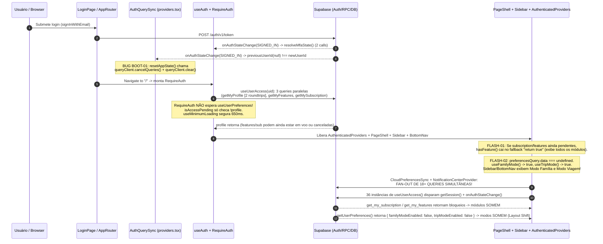
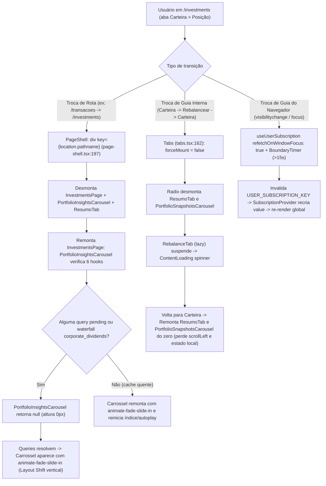

# Auditoria Técnica: Orquestração de Loading, Permissões, Preferências e Ciclo de Vida de UI

> **Data:** 26/11/2026  
> **Escopo:** Diagnóstico arquitetural somente leitura (nenhum arquivo de código da aplicação foi alterado).  
> **Escopo analisado:** `src/main.tsx`, `src/app/*`, `src/hooks/*`, `src/state/*`, `src/components/layout/*`, `src/components/ui/tabs.tsx`, `src/components/modules/dashboard-alerts-carousel.tsx`, `src/features/investments/*`, `src/features/overview/*`, `src/features/transactions/wizard/*`, `src/data/repositories/*`.

---

## 0. Fase 0 — Verificação da Causa Real, Discordâncias e Caminhos Mais Elegantes

### Veredito Direto sobre a Problemática

**Discordamos da hipótese inicial de que "falta um orquestrador global de loading/permissões" no cliente.**

A inspeção do código-fonte demonstra que o aplicativo **já possui** infraestrutura madura de cache, gating e skeletons:
- **TanStack Query v5** (`@tanstack/react-query` 5.101.4) com política centralizada de `STALE_TIMES` e `STATIC_GC_TIME` (`src/state/cache-policy.ts:19-31`);
- **Fronteira de autenticação e carregamento** em `RequireAuth` (`src/app/require-auth.tsx:146-238`) + `RequireActiveAccount` (`src/components/routing/require-active-account.tsx:12-35`) + `RequireFeature` (`src/components/routing/require-feature.tsx:17-50`);
- **Helper explícito de prontidão** `isQueryPending` (`src/state/query-readiness.ts:12-18`) e skeletons estruturais por rota em `RouteSkeletonFallback` (`src/components/layout/route-skeletons/route-skeleton-fallback.tsx:27-88`).

Criar um "orquestrador global de loading" em paralelo a essa stack seria **over-engineering**, duplicaria estado de servidor no cliente e criaria risco de travar navegações simples. **O problema real não é ausência de orquestrador, mas sim 5 defeitos cirúrgicos e independentes**:

1. **Defaults permissivos (`?? true`) em modos opcionais + `useUserPreferences` fora da barreira de boot:** `RequireAuth` exibe `"Sincronizando preferências e categorias…"`, mas **nunca aguarda `useUserPreferences()`**. Quando `PageShell` monta, `preferencesQuery.data` ainda é `undefined`; `useFamilyMode` e `useTripMode` retornam `true` por padrão e depois somem quando a query responde `false`.
2. **Corrida destrutiva no `AuthQuerySync` + `hasFeature` com fallback permissivo (`return true`) + `isLoading` em vez de `isPending`:** No cold start / pós-login, `AuthQuerySync` (`src/app/providers.tsx:76-83`) chama `resetAppState(queryClient, newUserId)` -> `queryClient.cancelQueries()` + `queryClient.clear()`, abortando queries em voo. Somado a `isLoading` (que em TanStack Query v5 é `false` quando `isPending && !isFetching`) e ao fallback final `return true` em `hasFeature` (`src/state/queries/use-user-access.ts:369-371`), opções de acesso restritas renderizam e desaparecem assim que `get_my_subscription` / `get_my_features` terminam.
3. **Multiplicação de listeners e fan-out de rede no boot:** `useUserAccess()` é chamado **36 vezes sem `targetUserId`**, registrando um `getSession()` + `onAuthStateChange()` próprio em cada instância montada (`src/state/queries/use-user-access.ts:229-284`). Em paralelo, `NotificationCenterProvider` (`src/hooks/use-notification-center.ts:10-29`) dispara **18+ queries globais simultâneas** logo ao entrar em qualquer página autenticada.
4. **Remontagem forçada em rotas e abas + `return null` sem reserva de altura em carrosséis:** `PageShell` força remontagem do `<Outlet />` com `<div key={location.pathname}>` (`src/components/layout/page-shell.tsx:197`), e `Tabs` usa `forceMount = false` (`src/components/ui/tabs.tsx:51,162`), desmontando `ResumoTab` e `PortfolioSnapshotsCarousel` a cada troca de guia. Já `PortfolioInsightsCarousel` retorna `null` enquanto 6 queries (incluindo o waterfall `assets + transactions -> corporate_dividends`) estão pendentes, gerando sumiço e *layout shift*.
5. **Modais lazy com `<Suspense fallback={<ContentLoading />}>` inline e modais sempre montados:** Modais carregados sob demanda renderizam um spinner no meio do DOM da página antes de abrir o portal, enquanto outros (como `AssetDetailSheet` e `QuickTransactionSheet`) permanecem montados fechados executando hooks de métricas a cada render.

---

### Discordâncias e Recalibração do Prompt

| Premissa / Hipótese | Veredito | Evidência no Código | Ajuste no Escopo |
|---|---|---|---|
| "Falta um orquestrador global de loading/permissões completo no app." | **Refutada** | `RequireAuth` (`src/app/require-auth.tsx:146-218`), `RequireActiveAccount`, `RequireFeature`, `STALE_TIMES` (`src/state/cache-policy.ts:19-31`) e `isQueryPending` (`src/state/query-readiness.ts:12-18`) já existem. O problema é falha de uso consistente, defaults permissivos e corrida no `AuthQuerySync`. | Substituir a busca por um orquestrador global pela **consolidação do bootstrap em 1 RPC + correção cirúrgica de cache, defaults e desmontagens**. |
| "Modo Trabalho (Modo Negócio) aparece inicialmente mesmo desabilitado e depois some." | **Parcial / Refutada para o hook** | `useBusinessMode` (`src/state/queries/use-business-mode.ts:37`) já usa opt-in estrito (`?? false`). Quem tem default permissivo (`?? true`) são **Modo Família** (`use-family-mode.ts:31`) e **Modo Viagem** (`use-trip-mode.ts:31`, contradizendo o próprio comentário na linha 11!). | Documentar a diferença exata: Família e Viagem têm bug de default permissivo; Negócio sofre efeito visual colateral do rearranjo da Sidebar/BottomNav quando os outros dois somem (ou quando está ativo e `preferences` atrasa). |
| "O carrossel de Investimentos recarrega ao trocar de guia apenas por falta de cache." | **Parcial** | Os dados têm `staleTime: 60_000` (`use-portfolio.ts:39,53,90,104,118`). A causa primária da reconstrução visual é **desmontagem de DOM**: `Tabs` com `forceMount={false}` (`src/components/ui/tabs.tsx:162`) desmonta `PortfolioSnapshotsCarousel`/`ResumoTab` na troca de sub-abas; `PageShell` com `key={location.pathname}` (`page-shell.tsx:197`) desmonta `PortfolioInsightsCarousel` na troca de rotas; e `PortfolioInsightsCarousel` faz `return null` + `animate-fade-slide-in` (`portfolio-insights-carousel.tsx:246`). | Expandir o Eixo 3 para cobrir **os dois carrosséis** (`PortfolioInsightsCarousel` e `PortfolioSnapshotsCarousel`), a desmontagem de `Tabs`/`PageShell` e o waterfall de `useCorporateDividends`. |
| "Modais piscam apenas por fazerem fetch sem estado estável." | **Parcial** | Muitos modais usam dados já em cache do TanStack Query, mas piscam por `<Suspense fallback={<ContentLoading />}>` inline (`investments-page.tsx:135,147`, `page-shell.tsx:208`), `key` dinâmica instável (`page-shell.tsx:148`) e fallback permissivo (`launch-wizard.tsx:90`). | Auditar no Eixo 4 o padrão de `<Suspense>`, `key`s, montagem condicional vs permanente e defaults de permissão dentro de modais. |

**Ajuste nos Eixos de Auditoria:**
- **Mantidos com foco cirúrgico:** Eixos 1, 2, 3, 4, 5, 6 e 7.
- **Adicionados (Pontos Cegos da Fase 0):** Fan-out de 18+ queries do `NotificationCenterProvider` no boot (`BLIND-01`), ausência de `userId` na `queryKey` de `useUserPreferences` (`BLIND-02`), revalidações em `visibilitychange` + fallback otimista de `useUserSubscription` (`BLIND-03`), piso artificial de 650ms em `useMinimumLoading` (`BLIND-04`) e reload silencioso do PWA na troca de rota (`BLIND-05`).

---

### Stack Real Identificada e Infraestrutura Já Existente

| Camada | Tecnologia / Implementação Real | Evidência |
|---|---|---|
| **Runtime & Build** | React 19.2.8 + Vite 8.2.1 + TypeScript 6.0.3 + Tailwind CSS 4.3.3 | `package.json:72-75, 88, 108, 110` |
| **Distribuição** | Web SPA + PWA (`vite-plugin-pwa` 1.3.0) + Android Nativo (Capacitor 8.5.3) | `package.json:48-57, 111`, `src/app/pwa.ts` |
| **Roteamento** | `react-router` 8.3.0 (`BrowserRouter`, `Routes`, `Outlet`, `React.lazy`) | `src/app/router.tsx:1-2, 318-426`, `src/app/routes.tsx:12-49` |
| **Estado de Servidor & Cache** | `@tanstack/react-query` 5.101.4 (`refetchOnWindowFocus: false`, `staleTime: 60_000`, `gcTime: 600_000`) | `src/app/providers.tsx:110-124`, `src/state/cache-policy.ts:19-31` |
| **Auth & Backend** | `@supabase/supabase-js` 2.112.3 (Auth + Postgres + RLS + RPCs + Realtime desativado por padrão via `VITE_ENABLE_REALTIME`) | `src/hooks/use-auth.ts`, `src/state/queries/use-user-access.ts:29-34` |
| **Stores Locais / Persistência** | `useSyncExternalStore` + `localStorage` namespaced por `userId` (`src/services/user-storage.ts`) + `sessionStorage` (`use-view-scope.ts`) | `src/hooks/use-visual-customization.ts`, `src/services/user-storage.ts:105-152` |
| **UI & Primitivos** | Radix UI (`@radix-ui/react-dialog`, `react-tabs`, `react-popover`, `react-select`, etc.) | `package.json:58-64`, `src/components/ui/tabs.tsx` |

---

### Mapeamento Nominal Real

| Termo do Relato | Implementação Real no Repositório | Flags / Tabelas / RPCs |
|---|---|---|
| **Opções de acesso / Permissões** | `useUserAccess` (`src/state/queries/use-user-access.ts`), `usePermission` (`src/state/queries/use-permission.ts`), `useUserSubscription` (`src/state/queries/use-user-subscription.ts`), `filterNavItems` (`src/components/layout/nav-items.tsx:95-119`), `RequireFeature` (`src/components/routing/require-feature.tsx`) | Tabelas `profiles`, `user_feature_overrides`, `user_subscriptions`, `user_module_permissions`; RPCs `get_my_features()`, `get_my_subscription()` |
| **Modo Família** | `useFamilyMode` (`src/state/queries/use-family-mode.ts:15-58`), rota `/familia`, flag `familyOnly` em `nav-items.tsx:49,76` | `user_preferences.custom_settings.familyModeEnabled` (default atual no código: `?? true`) |
| **Modo Viagem** | `useTripMode` (`src/state/queries/use-trip-mode.ts:15-58`), rotas `/viagens`, `/viagens/:id`, flag `tripOnly` em `nav-items.tsx:45,67` | `user_preferences.custom_settings.tripModeEnabled` (default atual no código: `?? true`, contradizendo JSDoc `false`) |
| **Modo Trabalho** | Chamado no produto de **Modo Negócio / Meu Negócio (MEI & PJ)**: `useBusinessMode` (`src/state/queries/use-business-mode.ts:20-97`), `useViewScope` (`src/state/hooks/use-view-scope.ts:72-86`), rota `/negocio`, flag `businessOnly` em `nav-items.tsx:44,66` | `user_preferences.custom_settings.businessModeEnabled` (default atual: `?? false`) |
| **Carrossel da área de Investimentos** | Existem **dois** carrosséis: (1) `PortfolioInsightsCarousel` (`src/features/investments/components/portfolio-insights-carousel.tsx`, baseado em `DashboardAlertsCarousel`, no topo de `InvestmentsPage`); (2) `PortfolioSnapshotsCarousel` (`src/features/investments/components/portfolio-snapshots-carousel.tsx`, Evolução Histórica, dentro de `ResumoTab`) | Queries: `useCorporateDividends`, `useAssetGovernanceInsights`, `usePortfolioPosition`, `usePortfolioAssets`, `useGroupTargets("class")`, `usePortfolioAlertDismissals`, `usePortfolioSnapshots` |
| **Modais afetados** | `LaunchWizard` (`page-shell.tsx:145-156`, `launch-wizard.tsx`), `UpgradeDialog` (`page-shell.tsx:207-218`, `sidebar.tsx:140-147`), `InvestmentWizard` & `CashFormDialog` (`investments-page.tsx:135-153`), `PendingDividendsDialogHost` (`pending-dividends-dialog-host.tsx:19-46`), `ResumoModalsHost` (`AssetDetailSheet`, `QuickTransactionSheet`) | Lazy chunks com `<Suspense fallback={<ContentLoading />}>` e props de acesso/preferências |
| **Outros módulos equivalentes não citados** | **Carrossel de Alertas da Home** (`DashboardAlertsCarousel` em `OverviewPage`), **Modo Somente-Leitura** (`DesktopTopbar` `Modo Leitura` + `ReadOnlyBanner`), **Extração IA** (`ai_extraction` em `LaunchWizard`), **Listener Bancário Android** (`bank_notification_listener` em `NativeIntegrationsHandler`), **Botões do Header** (`resolveVisibleHeaderSlots` em `PageShell` via `useVisualCustomization`) | `subscription.isReadOnly`, `hasFeature("ai_extraction")`, `hasFeature("bank_notification_listener")`, `custom_settings.headerButtons` |

---

### Pontos Cegos Descobertos e Incorporados

1. **`BLIND-01` — Tempestade de 18+ queries no boot via `NotificationCenterProvider`:** Montado no topo de `AuthenticatedProviders` (`src/app/authenticated-providers.tsx:188`), `useNotificationCenterCompute` (`src/hooks/use-notification-center.ts:10-29, 97-130`) dispara incondicionalmente queries de cartões, faturas, despesas, orçamentos, categorias, dividendos corporativos, família, viagens, tickets, broadcasts, onboarding e SmartAdvisor em *qualquer* rota, congestionando a rede no pós-login.
2. **`BLIND-02` — `useUserPreferences` sem `userId` na `queryKey`:** `src/state/queries/use-user-preferences.ts:8,16` usa `["user-preferences"]` global em vez de `["user-preferences", activeUserId]`, quebrando a convenção de isolamento de cache adotada em `useUserAccess`.
3. **`BLIND-03` — `refetchOnWindowFocus: true` + `visibilitychange` em assinatura causando cascata no `SubscriptionProvider`:** `use-user-access.ts:312` e `use-user-subscription.ts:26` sobrescrevem a política global (`refetchOnWindowFocus: false`) com `true`, e `useSubscriptionBoundaryTimer` (`src/state/hooks/use-subscription-boundary-timer.ts:73-82`) invalida `USER_SUBSCRIPTION_KEY` após 15s em background. Além disso, `useUserSubscription` faz fallback otimista lendo `getCachedIconTier()` do `localStorage` (`use-user-subscription.ts:38-44`).
4. **`BLIND-04` — Piso artificial de 650ms em `useMinimumLoading` no `RequireAuth`:** `src/app/require-auth.tsx:160` retém o `LoadingScreen` por no mínimo 650ms sempre que `isDataLoading` transita para `true`, adicionando latência percebida sem garantir que `userPreferences` tenha chegado.
5. **`BLIND-05` — Recarregamento silencioso de PWA na troca de rota:** `PWAUpdateRouteSync` (`src/app/router.tsx:277-316`) chama `applyPendingPWAUpdateIfSafe()` a cada mudança de `location.pathname`. Se uma atualização de Service Worker estiver pendente, a navegação entre telas pode desencadear um reload completo da SPA.

---

### Comparativo de Caminhos Arquiteturais

| Caminho / Abordagem | Elegância e Superfície de Código | Ganho em Performance Percebida | Trade-offs / Riscos | Veredito |
|---|---|---|---|---|
| **A. Orquestrador Global de Loading/Permissões no Cliente** (Context/Machine central bloqueando rotas e componentes) | Baixa — cria uma segunda máquina de estado paralela ao TanStack Query e ao React Router; alta superfície de acoplamento. | Médio — resolve flashes, mas tende a introduzir telas de loading globais desnecessárias e atrasar TTI em navegações simples. | Alto risco de regressão, deadlocks de loading se uma query secundária falhar, e manutenção custosa. | **Descartado** |
| **B. Apenas Correções Locais no Cliente** (ajustar `?? false`, `isPending`, `forceMount`, `key`) | Alta — mudanças mínimas, zero alteração de backend. | Alto — elimina flashes de modos e desmontagens de abas, mas mantém os 5 roundtrips de boot e o fan-out do `NotificationCenterProvider`. | Não elimina o waterfall de rede no pós-login (`getUser` + `profiles` + `features` + `subscription` + `preferences`). | **Insuficiente isoladamente** |
| **C. Bootstrap Único no Backend (1 RPC) + Calibração Nativa do TanStack Query + Default-Deny & Preservação de Subárvores** | **Muito Alta** — reduz código ao eliminar 36 listeners duplicados em `useUserAccess`, unifica 5 queries em 1 RPC e usa recursos nativos do TanStack Query v5 e Radix Tabs. | **Máximo** — 1 único roundtrip no login, zero flash de permissões/modos, zero remontagem em abas/carrosséis e fim do congestionamento de rede no boot. | Requer 1 migration SQL simples (`get_my_session_bootstrap()`) com fallback retrocompatível durante o rollout. | **CAMINHO VENCEDOR** |

**Declaração do Caminho Vencedor:** O **Caminho C** oferece o melhor equilíbrio entre elegância arquitetural, simplicidade, performance percebida e baixo risco de regressão. Ele resolve as causas-raiz na origem (rede, cache, defaults e ciclo de vida React/Radix) sem introduzir nenhuma camada paralela de orquestração artificial.

---

## 0.B Adendo de Verificação Pré-Execução (v2 — Edge Cases, Riscos e Decisões Fechadas)

Antes de transformar o diagnóstico em plano executável, foram auditados 8 vetores críticos de edge case e risco de regressão diretamente no código-fonte e na suíte de testes existente:

1. **Default de Produto vs. Default de Loading (`useFamilyMode`, `useTripMode`, `useBusinessMode`):**
   - **Descoberta que corrige a premissa da v1:** Na v1 sugeriu-se alterar `tripModeEnabled ?? true` para `?? false` com base no JSDoc de `src/state/queries/use-trip-mode.ts:11`. Contudo, os testes automatizados existentes (`src/state/queries/use-trip-mode.test.tsx:59-74` e `src/state/queries/use-family-mode.test.tsx:59-74`) e a migration `supabase/migrations/20260101000144_default_family_mode_enabled_for_new_users.sql:14,183` comprovam que o **contrato de produto** atual exige que **ambos** (`familyModeEnabled` e `tripModeEnabled`) resolvam para **`true`** quando `preferencesQuery.isSuccess === true` e o campo não estiver definido em `custom_settings` (contas novas ou antigas que nunca salvaram a preferência). Já `businessModeEnabled` (`src/state/queries/use-business-mode.ts:37`) é opt-in estrito (`false`).
   - **Decisão técnica fechada:** Separar estritamente **Default de Loading** (`isQueryPending(preferencesQuery) === true` -> **`false`**, *default-deny* absoluto) de **Default de Produto** (`isSuccess && valor == null` -> **`true`** para Família e Viagem; **`false`** para Negócio). Assim, contas existentes não perdem módulos e contas que desabilitaram os modos nunca sofrem flash.

2. **Matriz de Transições do `AuthQuerySync` + Isolamento entre Contas (`BLIND-02`):**
   - **Evidência crítica:** `src/app/providers.test.tsx:78-134` exige explicitamente que a transição de visitante anônimo (`null`) para usuário autenticado (`SIGNED_IN` com `userA`) purgue queries anônimas em cache (ex.: `["credit_cards"]`), pois rotas públicas (`/r/:token`, `/ferramentas/*`, `/entrar`) já rodam sob `AppProviders` (`src/app/router.tsx:205`).
   - **Causa exata do bug no cold start:** `activeUserIdRef` em `src/app/providers.tsx:42` inicia como `null` em vez de `getActiveUserId()`. Em cold start de usuário já logado, `INITIAL_SESSION` chega com `userA`, dispara `previousUserId (null) !== newUserId (userA)` e executa `resetAppState(queryClient, userA)` (`cancelQueries()` + `clear()`), abortando o boot do próprio `userA`.
   - **Vazamento adicional descoberto:** `LAST_APPLIED_ICON_TIER_KEY` (`src/services/native/app-icon.ts:7,43-67`) é chave global no `localStorage` (`"last_applied_icon_tier"`), limpa apenas quando `nextUserId === null` (`src/services/auth-cleanup.ts:27-30`). Em troca direta `userA (PRO) -> userB (FREE)`, `getCachedIconTier()` vaza `"PRO"` para `userB` durante o fallback de `useUserSubscription`. Deve ser resetada em qualquer mudança `previousUserId !== newUserId` (ou escopada por `userId`).

3. **Raio de Explosão de Remover `key={location.pathname}` no `PageShell` + Animações com Cache Quente:**
   - **Auditoria de rotas dinâmicas:** A única rota autenticada com parâmetro sob `PageShell` em `src/app/routes.tsx:12-35` é `/viagens/:id` (`TripDetailsPage`, `src/features/trips/pages/trip-details-page.tsx:28-35`). Ela usa `useTripDetailsState(tripId ?? "")`, que guarda estado local (`filterMyExpenses`, modais de edição/exclusão). Sem `key={location.pathname}` no `PageShell`, navegar de `/viagens/1` para `/viagens/2` manteria o estado local da viagem 1.
   - **Decisão técnica fechada:** Remover `key={location.pathname}` do `PageShell` (`src/components/layout/page-shell.tsx:197`) e adicionar `key={tripId}` internamente em `TripDetailsPage` (wrapper fino `TripDetailsPage -> <TripDetailsContent key={tripId} tripId={tripId} />`).
   - **Animações com cache quente:** `DashboardAlertsCarousel` (`src/components/modules/dashboard-alerts-carousel.tsx:56,72`) aplica `animate-fade-slide-in` incondicionalmente no mount. Deve receber prop opcional `animateOnMount?: boolean` (ou detectar via `useRef` em `PortfolioInsightsCarousel` se os dados já estavam prontos no 1º render — suprimindo a animação quando o cache já estiver quente).

4. **Auditoria de Efeitos Colaterais em `Tabs` com `keepMounted` (Opt-in):**
   - Varredura em `src/features/investments/` confirmou **zero** `ResizeObserver` e **zero** `setInterval` dentro das sub-abas (`ResumoTab`, `MovimentacoesTab`, `RebalanceTab`, `ProventosTab`). O carrossel com autoplay (`PortfolioInsightsCarousel`) fica **fora** das `<Tabs>` (`investments-page.tsx:67`).
   - **Único efeito colateral encontrado:** `PortfolioSnapshotsCarousel` (`src/features/investments/components/portfolio-snapshots-carousel.tsx:44-61`) registra `window.addEventListener("resize", updateScrollBounds)` e calcula `el.scrollWidth - el.clientWidth`. Quando a aba está oculta (`display: none`), `clientWidth === 0`. Solução: passar `isActive` (ou observar visibilidade via `ResizeObserver`/re-disparo quando `isActive` volta a `true`) para recalcular `updateScrollBounds()` apenas quando visível.
   - **Decisão técnica fechada:** Implementar prop opt-in `keepMountedAfterFirstVisit?: boolean` (default `false`) em `src/components/ui/tabs.tsx`, ativada inicialmente apenas nas abas de `InvestmentsPage`.

5. **`Suspense fallback={null}` em Modais Lazy vs. Sensação de "Clique Morto":**
   - Trocar `<Suspense fallback={<ContentLoading />}>` para `fallback={null}` elimina o spinner inline que quebra o layout da página, mas em conexões 3G o 1º clique em "Nova operação", "Adicionar caixa" ou "Nova transação" poderia parecer sem resposta por 300–800ms.
   - **Decisão técnica fechada:** Combinar `fallback={null}` com **prefetch silencioso do chunk** nos gatilhos (`onMouseEnter`/`onFocus` nos botões de `InvestmentsPage` e `PageShell` + `requestIdleCallback` pós-boot para `LaunchWizard` e `InvestmentWizard`), sem adicionar máquinas de estado complexas nos botões.

6. **Mapa Completo de Invalidação e Contrato de Segurança da RPC `public.get_my_session_bootstrap()`:**
   - **Varredura completa:** Foram localizados **8 arquivos / 17 pontos** de escrita, atualização otimista ou invalidação sobre `userPreferencesKey`, `USER_ACCESS_KEY`, `USER_FEATURES_KEY` e `USER_SUBSCRIPTION_KEY` (listados integralmente na Seção 5).
   - **Decisão arquitetural anti-regressão (Cache Seeding):** Em vez de substituir todas as 4 query keys por uma chave monolítica (o que obrigaria a reescrever todos os optimistic updates de `useUpdateCustomSettings` e `useUpdateAppMode`), `useSessionBootstrap(userId)` executa **1 única RPC** (`get_my_session_bootstrap()`) e **semeia diretamente as 4 chaves individuais no `QueryClient`** via `queryClient.setQueryData(...)`. Com isso, 100% das mutations, optimistic updates e handlers Realtime continuam íntegros sem drift!
   - **Detalhe SQL crítico:** `public.get_my_session_bootstrap()` **DEVE ser `VOLATILE`** (não `STABLE`), pois invoca `public.get_my_subscription()` que executa `INSERT INTO public.user_subscriptions` sob demanda quando o registro ainda não existe (`supabase/migrations/20260101000157_past_due_grace_and_reminders.sql:244,279`).

7. **Incorporação de `BLIND-05` (`PWAUpdateRouteSync`):**
   - `src/app/router.tsx:304-307` chama `applyPendingPWAUpdateIfSafe()` em toda mudança de `location.pathname`, disparando `window.location.reload()` (`src/app/pwa.ts:435`) no meio da navegação autenticada caso exista um Service Worker em espera.
   - **Decisão técnica fechada:** Alocado na **Fase 2** — manter auto-reload silencioso exclusivamente em `isCredentialRoute()`, na janela inicial de boot (`isBootWindow`, 12s) e com aba em background (`isBackgroundTab`), removendo o auto-reload da troca de rota autenticada (onde o `AppUpdateToast` já oferece atualização controlada pelo usuário).

8. **Desacoplamento do `NotificationCenterProvider` (`BLIND-01`) e Divisão da Fase 3:**
   - **Bugs concretos encontrados em `src/hooks/use-notification-center.ts:145-159`:** `useBudgets()` (L152), `useCategories("expense")` (L156) e `useUserTrips()` (L157) rodam **incondicionalmente** (mesmo sem feature ou com Modo Viagem desabilitado); `useMyFamily()` (L158) ignora `isFamilyModeEnabled`; e `useCorporateDividends()` (L159) dispara o waterfall inteiro de investimentos no boot de qualquer rota!
   - **Decisão técnica fechada:** Dividir a Fase 3 em **Fase 3A (Frontend puro: cortar fan-out do `NotificationCenterProvider`, eliminar os 36 listeners duplicados de `useUserAccess`, remover `refetchOnWindowFocus: true` de assinatura e recalibrar `useMinimumLoading`)** e **Fase 3B (Backend + Frontend: migration da RPC `get_my_session_bootstrap()` + `useSessionBootstrap` com cache seeding e fallback seguro)**.

---

## 1. Resumo Executivo

### Top 5 Causas-Raiz Reais Encontradas no Código

1. **`useUserPreferences` fora da barreira de `RequireAuth` + defaults permissivos (`?? true`) em `useFamilyMode` e `useTripMode`:** Causa direta e 100% reproduzível do aparecimento e sumiço de Modo Família e Modo Viagem após o login (`src/app/require-auth.tsx:148-160`, `src/state/queries/use-family-mode.ts:31`, `src/state/queries/use-trip-mode.ts:31`).
2. **Corrida de `AuthQuerySync` (`queryClient.cancelQueries()` + `queryClient.clear()` em cold start) combinada com `isLoading` (v5) e fallback permissivo `return true` em `hasFeature`:** Permite que a UI renderize opções de acesso não autorizadas antes da conclusão real de `get_my_features` e `get_my_subscription`, que depois somem (`src/app/providers.tsx:76-83`, `src/state/queries/use-user-access.ts:331-373`, `src/app/require-auth.tsx:157-158`).
3. **36 instâncias duplicadas de `useUserAccess()` sem `targetUserId` + fan-out de 18+ queries do `NotificationCenterProvider` no boot:** Multiplica listeners `onAuthStateChange`/`getSession()` e satura a fila HTTP logo após o login (`src/state/queries/use-user-access.ts:222-284`, `src/hooks/use-notification-center.ts:10-29`).
4. **Desmontagem forçada de subárvores na navegação (`PageShell` `key={location.pathname}` e `Tabs` `forceMount={false}`) + `PortfolioInsightsCarousel` retornando `null` sobre waterfall de 6 queries:** Faz os carrosséis de Investimentos descarregarem/recarregarem e provocarem *layout shift* ao transitar entre rotas ou sub-abas (`src/components/layout/page-shell.tsx:197`, `src/components/ui/tabs.tsx:162`, `src/features/investments/components/portfolio-insights-carousel.tsx:238-248`, `src/state/queries/use-corporate-dividends.ts:195-200`).
5. **Padrão inconsistente de modais (`<Suspense fallback={<ContentLoading />}>` inline no DOM da página, `key` mutável no `LaunchWizard` e modais sempre montados no `ResumoModalsHost`):** Gera piscadas inline, perda de estado e re-renders desnecessários em modais (`src/components/layout/page-shell.tsx:148,208`, `src/features/investments/pages/investments-page.tsx:135,147`, `src/features/investments/components/resumo/resumo-modals-host.tsx:77-111`).

### Diagnóstico Atual da Estabilidade Visual e de Carregamento
O aplicativo possui boa fundação visual (skeletons por rota, `cache-policy.ts`, `query-readiness.ts`), porém sofre de **instabilidade estrutural na transição de estado** (login -> shell e navegação entre guias/modais). A experiência percebida de "tudo aparece e some" não decorre de lentidão pura de renderização, mas de **renderização prematura com defaults otimistas/permissivos** seguida de **reconciliação assíncrona tardia**, agravada por **desmontagens evitáveis de DOM** e **concorrência de rede no boot**.

---

## 2. Mapa Arquitetural do Fluxo Atual

### Linha do Tempo 1: Login / Cold Start até Estabilização



### Linha do Tempo 2: Troca de Rotas e Guias em Investimentos



---

## 3. Matriz de Evidências

### Eixo 1 — Boot, Autenticação e Hidratação

| ID | Severidade | Arquivo e Linhas | Sintoma no Usuário | Causa Técnica Exata | Direção de Correção |
|---|---|---|---|---|---|
| `BOOT-01` | **Crítico** | `src/app/providers.tsx:42, 66-83` + `src/services/auth-cleanup.ts:18-24` | Pós-login lento, requisições abortadas e flash momentâneo de estado vazio/permissivo. | `activeUserIdRef` inicia em `null`. No primeiro evento `INITIAL_SESSION`/`SIGNED_IN`, `previousUserId !== newUserId` é `true` e chama `resetAppState(queryClient, newUserId)`, executando `queryClient.cancelQueries()` e `queryClient.clear()` + `invalidateQueries()` em cima das queries recém-iniciadas pelo `RequireAuth`. | Inicializar `activeUserIdRef` com `getActiveUserId()`; só executar `queryClient.clear()` em `SIGNED_OUT` ou troca real entre contas distintas (`previousUserId !== null && previousUserId !== newUserId`). |
| `BOOT-02` | **Crítico** | `src/app/require-auth.tsx:148-160, 209-212` | Preferências de modos (Família/Viagem) carregam *depois* da tela abrir, apesar do texto `"Sincronizando preferências e categorias…"`. | `RequireAuth` só aguarda `authLoading` e `userAccess` (`isAccessPending` checa apenas `!userAccess.profile && !userAccess.error`). Nunca consulta nem aguarda `useUserPreferences()`, que só começa a ser buscada após `AuthenticatedProviders` montar (`authenticated-providers.tsx:49`). | Incluir `preferences` no payload da RPC única de bootstrap (ou aguardar `useUserPreferences().isPending` na fronteira de `RequireAuth`). |
| `BOOT-03` | **Alto** | `src/state/queries/use-user-access.ts:222-284` | Overhead de boot, múltiplas chamadas `getSession()` e dezenas de listeners de auth ativos simultaneamente. | 36 componentes chamam `useUserAccess()` sem `targetUserId`. Cada instância executa `useEffect` chamando `supabase.auth.getSession()` e registrando um novo `supabase.auth.onAuthStateChange(...)`. | Consumir `userId` do singleton `useAuth()` (ou de um `SessionBootstrapContext` único) em vez de registrar `getSession`/`onAuthStateChange` por instância de hook. |
| `BOOT-04` | **Alto** | `src/data/repositories/access.ts:10-27` + `src/state/queries/use-user-access.ts:289-315` | Waterfall de 5 chamadas de rede separadas no boot (profile + features + subscription + preferences). | `getMyProfile()` faz 2 roundtrips sequenciais (`supabase.auth.getUser()` + `from("profiles").select(...)`), somados a `get_my_features()`, `get_my_subscription()` e `getUserPreferences()`. | Consolidar em 1 única RPC Postgres `get_my_session_bootstrap()` usando `auth.uid()` diretamente no banco. |
| `BOOT-05` | **Médio** | `src/app/require-auth.tsx:160` + `src/hooks/use-minimum-loading.ts:18-69` | Atraso artificial fixo de 650ms em todo boot autenticado mesmo quando os dados já resolveram em <150ms. | `useMinimumLoading(isDataLoading, 650)` retém o `LoadingScreen` por no mínimo 650ms após `isDataLoading` iniciar. | Reduzir ou remover o delay mínimo artificial quando o bootstrap vier em 1 única RPC rápida (ex.: 0ms se já em cache / <= 250ms de fade suave). |

### Eixo 2 — Flash of Unfiltered / Unauthorized UI

| ID | Severidade | Arquivo e Linhas | Sintoma no Usuário | Causa Técnica Exata | Direção de Correção |
|---|---|---|---|---|---|
| `FLASH-01` | **Crítico** | `src/state/queries/use-user-access.ts:331-373` + `src/app/require-auth.tsx:157-158` | Pós-login exibe todas as opções de acesso disponíveis e depois remove os itens não permitidos na frente do usuário. | 3 fatores combinados: (1) `useUserAccess.isLoading` usa `.isLoading` (`isPending && isFetching` no TQ v5) em vez de `.isPending`; (2) `RequireAuth` só verifica `!userAccess.profile` em `isAccessPending`, ignorando se `featuresQuery`/`subscriptionQuery` têm dados; (3) `hasFeature` linha 369-371 faz `if (features[featureKey] === undefined) return true;` (fallback permissivo) quando `subscription?.moduleAccess` ainda é `undefined`. | Trocar para `isPending` na verificação de prontidão (`!profileQuery.isSuccess || !featuresQuery.isSuccess || !subscriptionQuery.isSuccess`) e adotar **default-deny estrito** em `hasFeature`: se `featuresQuery.data === undefined || subscriptionQuery.data === undefined`, retornar `false`. |
| `FLASH-02` | **Crítico** | `src/state/queries/use-family-mode.ts:27-31` | **Modo Família** aparece na Sidebar, BottomNav, MoreMenuSheet e páginas mesmo quando desabilitado pelo usuário, sumindo após o carregamento. | `preferencesQuery.data?.custom_settings?.familyModeEnabled ?? true` avalia para `true` enquanto `preferencesQuery.data` é `undefined`. | Enquanto `isQueryPending(preferencesQuery)` for `true` (ou `data === undefined`), retornar `false` (default-deny). Aplicar o default `true` para novos usuários apenas quando `preferencesQuery.isSuccess` for verdadeiro e o campo vier ausente/null. |
| `FLASH-03` | **Crítico** | `src/state/queries/use-trip-mode.ts:11, 27-31` | **Modo Viagem** aparece na navegação e páginas mesmo quando desabilitado pelo usuário, sumindo após o carregamento. | `preferencesQuery.data?.custom_settings?.tripModeEnabled ?? true` avalia para `true` enquanto `preferencesQuery.data` é `undefined` — **contradizendo inclusive o JSDoc na linha 11** (`"Por padrão, o Modo Viagem inicia desabilitado (false)"`). | Corrigir fallback para `?? false` e garantir gating enquanto `isQueryPending(preferencesQuery)`. |
| `FLASH-04` | **Médio** | `src/state/queries/use-user-subscription.ts:30-45` + `src/components/layout/desktop-topbar.tsx:48-62` | Badges de plano/trial/Modo Leitura podem oscilar durante o boot. | Quando `subData` é `undefined`, `useUserSubscription` constrói um status sintético via `buildFallbackStatus` lendo `getCachedIconTier()` do `localStorage` (`pro_monthly` ou `trial`), com `isFullAccess: false, canWrite: false`, antes do backend confirmar. | Com o bootstrap consolidado no `RequireAuth`, `subData` já estará resolvido antes de `PageShell` montar, eliminando a necessidade de fallback sintético em runtime autenticado. |
| `FLASH-05` | **Médio** | `src/features/transactions/wizard/launch-wizard.tsx:88-90` | Opção de extração por IA (`ai_extraction`) aparece inicialmente no wizard mesmo para contas sem acesso e depois some. | `isAccessLoading ? true : hasFeature("ai_extraction")` usa fallback otimista `true` enquanto `isAccessLoading` é verdadeiro. | Inverter para `isAccessLoading ? false : hasFeature("ai_extraction")` (default-deny). |

### Eixo 3 — Ciclo de Vida em Trocas de Guia, Rotas e Remontagem

| ID | Severidade | Arquivo e Linhas | Sintoma no Usuário | Causa Técnica Exata | Direção de Correção |
|---|---|---|---|---|---|
| `NAV-01` | **Alto** | `src/components/layout/page-shell.tsx:197` | Ao sair de Investimentos para outra página e voltar, toda a página e o `PortfolioInsightsCarousel` são desmontados e reconstruídos do zero com animação de entrada. | `<div key={location.pathname} className="animate-route-in min-w-0 w-full">` força o React a destruir toda a árvore abaixo do `<Outlet />` a cada troca de rota. | Remover `key={location.pathname}` do wrapper do `<Outlet />` (o React Router já troca o elemento da rota quando o `path` muda, sem precisar forçar unmount de wrappers compartilhados; aplicar transição CSS apenas onde desejado sem destruir estado). |
| `NAV-02` | **Crítico** | `src/features/investments/components/portfolio-insights-carousel.tsx:238-248` + `src/components/modules/dashboard-alerts-carousel.tsx:48,56,72` | Carrossel de Insights de Investimentos some/descarrega e reaparece empurrando o conteúdo da página para baixo (CLS). | `isCarouselLoading` agrega 6 hooks (`useCorporateDividends`, `useAssetGovernanceInsights`, `usePortfolioPosition`, `usePortfolioAssets`, `useGroupTargets("class")`, `usePortfolioAlertDismissals`). Enquanto qualquer um está pendente, retorna `null` (altura 0px). Quando termina, monta `<DashboardAlertsCarousel>` com `animate-fade-slide-in`. | Reservar altura estável com skeleton compacto (`min-h-[104px] sm:min-h-[84px]`) durante `isCarouselLoading` inicial, e evitar re-disparar loading visual em revisitas com cache quente (`staleTime` adequado + sem reset de estado). |
| `NAV-03` | **Alto** | `src/components/ui/tabs.tsx:51, 159-169` + `src/features/investments/pages/investments-page.tsx:69-133` + `src/features/investments/pages/resumo-tab.tsx:158-167` | Ao alternar entre as guias internas de Investimentos (`Carteira` ↔ `Rebalancear` ↔ `Proventos`, ou `Posição` ↔ `Extrato`), o `PortfolioSnapshotsCarousel` (Evolução Histórica) e toda a `ResumoTab` são desmontados e recarregados ao voltar. | `Tabs` usa `forceMount = false` por padrão no Radix `TabsPrimitive.Content`. Mudar de aba desmonta `ResumoTab` (destruindo `scrollLeft` do carrossel, `allocationMode` e subcomponentes) e desmonta as abas lazy (`MovimentacoesTab`, `RebalanceTab`, `ProventosTab`). | Habilitar preservação de aba visitada ("lazy-once + keep-mounted" com `forceMount` + `data-[state=inactive]:hidden` após a primeira visita) nas abas principais de `InvestmentsPage`, preservando DOM, scroll e estado local sem custo inicial. |
| `NAV-04` | **Alto** | `src/state/queries/use-corporate-dividends.ts:195-200, 216-225` | Atraso em cascata na exibição do `PortfolioInsightsCarousel` na primeira visita ou após invalidação. | `corporateQuery` tem `enabled: enabled && !assetsQuery.isLoading && !transactionsQuery.isLoading && portfolioTickers.length > 0` — só dispara *depois* de `assets` e `transactions` terminarem (waterfall de 2 etapas). Enquanto isso, `isDividendsLoading = true` mantém o carrossel em `null`. | Manter `staleTime` longo (já é 15 min) e, idealmente, permitir que o carrossel renderize os slides de Governança/Alocação/Risco independentemente da carga de `corporateQuery`, ou pré-aquecer `corporate_dividends` em uma RPC/query sem depender de waterfall no cliente. |

### Eixo 4 — Modais, Drawers e Subcomponentes Assíncronos

| ID | Severidade | Arquivo e Linhas | Sintoma no Usuário | Causa Técnica Exata | Direção de Correção |
|---|---|---|---|---|---|
| `MODAL-01` | **Alto** | `src/features/investments/pages/investments-page.tsx:135,147` · `src/components/layout/page-shell.tsx:208` · `src/features/investments/components/pending-dividends-dialog-host.tsx:37` · `src/features/investments/components/resumo/resumo-modals-host.tsx:65,128` · `src/features/reports/components/reports-modals-host.tsx:177,188,228` | Piscada/salto de layout no corpo da página com texto `"Carregando..."` antes de o modal abrir. | Todos esses modais lazy usam `<Suspense fallback={<ContentLoading />}>`. Como `ContentLoading` (`src/components/ui/content-loading.tsx:4-11`) é uma `<div>` inline (não um portal/overlay), ela é injetada no fluxo da página enquanto o chunk baixa, empurrando elementos e piscando antes do `<Modal>` abrir. | Substituir `fallback={<ContentLoading />}` em hosts de modais por `fallback={null}` (ou um `<Modal open>` shell leve com skeleton interno), evitando injeção de spinner no fluxo da página. |
| `MODAL-02` | **Médio** | `src/components/layout/page-shell.tsx:148` | `LaunchWizard` pisca ou perde preenchimento se query params ou props de modo variarem durante abertura. | `key={`${initialType}-${initialMode}-${wizardOpen ? "open" : "closed"}-${sugIdParam ?? ""}`}` força remontagem completa do modal quando qualquer segmento da chave altera. | Remover `wizardOpen` da `key` (o componente já é montado condicionalmente via `{wizardOpen && ...}`) e usar `key` estável apenas quando realmente iniciar uma nova sessão de sugestão (`sugIdParam ?? "default"`). |
| `MODAL-03` | **Médio** | `src/features/investments/components/resumo/resumo-modals-host.tsx:77-111` + `src/features/investments/components/asset-detail-sheet.tsx:31-53` | Re-renders desnecessários e reavaliação de hooks pesados durante navegação na `ResumoTab`. | `<AssetDetailSheet>` e `<QuickTransactionSheet>` permanecem sempre montados mesmo com `open={false}` e `asset={null}`, executando `useMutationGuard()`, `useAssetDetailMetrics(asset)` e mutations a cada render da aba. | Montar condicionalmente (`{ctrl.activeDetailAsset && <AssetDetailSheet ... />}` e `{ctrl.quickTxAsset && <QuickTransactionSheet ... />}`), alinhando ao padrão já usado em `AssetEditDialog` na linha 113 do mesmo arquivo. |

### Eixo 5 — Waterfalls, Requisições Duplicadas e Gatilhos de Recarregamento

| ID | Severidade | Arquivo e Linhas | Sintoma no Usuário | Causa Técnica Exata | Direção de Correção |
|---|---|---|---|---|---|
| `BLIND-01` | **Crítico** | `src/app/authenticated-providers.tsx:188` + `src/hooks/use-notification-center.ts:10-29, 97-130` | Lentidão no pós-login e competição severa por conexões HTTP com as queries da página inicial. | `NotificationCenterProvider` monta globalmente em `AuthenticatedProviders` e chama **18+ hooks de query** (`useAllCardExpenses`, `useAllCardPayments`, `useBudgets`, `useCategories`, `useCorporateDividends`, `useCreditCards`, `useExpenses`, `useMyBroadcastNotifications`, `useMyFamily`, `useMyPublicShares`, `useMySupportTickets`, `useOnboardingCounts`, `useReminderStates`, `useReminders`, `useUserTrips`, `useSmartAdvisorInsights`, etc.) em *qualquer* rota, inclusive `/investments` ou `/configuracoes`. | Separar a contagem do sino em uma consulta leve (ou adiar a computação completa do hub via `requestIdleCallback` / apenas quando o popover de notificações ou `/lembretes` for aberto). |
| `BLIND-03` | **Alto** | `src/state/queries/use-user-access.ts:312` · `src/state/queries/use-user-subscription.ts:26` · `src/state/hooks/use-subscription-boundary-timer.ts:73-82` · `src/state/subscription-context.tsx:28-37` | Ao alternar para outra aba do navegador (>15s) e voltar, há refetch de assinatura e re-render em cascata dos consumidores de `SubscriptionContext`. | `useUserAccess` e `useUserSubscription` forçam `refetchOnWindowFocus: true` (quebrando o padrão global `false` de `providers.tsx:115`), e `useSubscriptionBoundaryTimer` invalida `USER_SUBSCRIPTION_KEY` em `visibilitychange` (>15s). Quando `subData` atualiza, `SubscriptionProvider` recria `value` e re-renderiza todos os consumidores. | Manter `refetchOnWindowFocus: false` (deixando o boundary timer ou retorno de checkout tratar viradas reais) e usar `structuralSharing` / comparação estável no `SubscriptionContext`. |
| `BLIND-05` | **Médio** | `src/app/router.tsx:277-316` | Recarregamento súbito da aplicação durante troca de páginas após um novo deploy. | `PWAUpdateRouteSync` chama `applyPendingPWAUpdateIfSafe()` a cada mudança de `location.pathname`, disparando reload da SPA quando há SW esperando. | Manter aplicação automática apenas em rotas de credenciais/cold start ou com sinalização explícita via `AppUpdateToast` para evitar reloads inesperados durante navegação ativa. |

### Eixo 6 — Persistência Local, Cache e Isolamento entre Contas

| ID | Severidade | Arquivo e Linhas | Sintoma no Usuário | Causa Técnica Exata | Direção de Correção |
|---|---|---|---|---|---|
| `BLIND-02` | **Alto** | `src/state/queries/use-user-preferences.ts:8, 16` | Risco de cache stale ou vazamento transitório de preferências entre contas se `resetAppState` não rodar antes do render. | `userPreferencesKey` é `["user-preferences"]` (sem `activeUserId`), enquanto `useUserAccess` usa `["user_access", activeUserId]`. | Parametrizar `queryKey: ["user-preferences", activeUserId]` (ou mover para o payload único de bootstrap parametrizado por `userId`). |
| `CACHE-01` | **Médio** | `src/state/queries/use-portfolio.ts:36,50,87,101,115` · `src/state/queries/use-allocation.ts:14` · `src/state/queries/use-asset-prices.ts:12` | Queries analíticas dependem de `queryClient.clear()` para isolamento entre contas; `useCategoryUsage` usa `staleTime: 0` (`use-categories.ts:46`). | As `queryKey`s de portfólio não incluem `userId` (embora `resetAppState` limpe o cache no logout/troca de conta). | Manter limpeza no `SIGNED_OUT`/troca de conta real (corrigindo `BOOT-01`) e, progressivamente, escopar chaves de usuário crítico por `userId`. |

### Eixo 7 — Padrões Atuais de Loading UI (Inconsistências)

| ID | Severidade | Arquivo e Linhas | Sintoma no Usuário | Causa Técnica Exata | Direção de Correção |
|---|---|---|---|---|---|
| `LOAD-01` | **Médio** | `src/app/router.tsx:324` · `src/components/layout/page-shell.tsx:198` · `src/components/ui/content-loading.tsx` · `src/features/investments/components/portfolio-insights-carousel.tsx:246` | *Popcorn loading*: convivem 4 padrões distintos (tela cheia `LoadingScreen`, `RouteSkeletonFallback`, spinner inline `ContentLoading` e `return null` sem reserva de espaço). | Falta um contrato único definindo quando segurar renderização, quando mostrar skeleton com altura reservada e quando usar `fallback={null}` em portais. | Adotar a matriz de contratos definida na Seção 5 desta auditoria. |

---

## 4. Rastreamento Ponta a Ponta dos 4 Sintomas Relatados

### (a) Flash pós-login de opções de acesso e permissões
1. Usuário autentica em `LoginPage` (`src/features/auth/hooks/use-login-form.ts:127`) -> navega para `/`.
2. `AuthQuerySync` (`src/app/providers.tsx:66-83`) recebe `SIGNED_IN` com `activeUserIdRef.current === null`, chama `resetAppState(queryClient, newUserId)` -> **`queryClient.cancelQueries()` + `queryClient.clear()`**, interferindo nas queries que `RequireAuth` dispara via `useUserAccess(session?.user?.id)`.
3. Em `RequireAuth` (`src/app/require-auth.tsx:157-158`), `isAccessPending` verifica **apenas** `!userAccess.profile && !userAccess.error`, e `useUserAccess.isLoading` (`src/state/queries/use-user-access.ts:331-334`) verifica `.isLoading` (que no TanStack Query v5 é `false` quando uma query está `isPending: true` e `isFetching: false`).
4. Assim que `profile` resolve (ou numa janela em que `featuresQuery`/`subscriptionQuery` ainda não concluíram), `RequireAuth` libera `PageShell`, `Sidebar` e `BottomNav`.
5. `Sidebar` (`sidebar.tsx:68-88`) e `BottomNav` (`bottom-nav.tsx:20-32`) chamam `filterNavItems(..., hasFeature, ...)`. Em `hasFeature` (`use-user-access.ts:350-372`), como `subscription` ainda é `null` (`moduleAccess` é `undefined`) e `features[featureKey]` é `undefined`, o fluxo cai na **linha 369-371 (`return true`)** — exibindo **todas** as opções do menu.
6. Centenas de milissegundos depois, `get_my_subscription` e `get_my_features` retornam os bloqueios (`"none"` / `false`) e os itens **desaparecem na frente do usuário**.

### (b) Aparição e sumiço de modos desabilitados (Família, Trabalho/Negócio, Viagem e correlatos)
1. `RequireAuth` (`src/app/require-auth.tsx:148-160`) **não** aguarda `useUserPreferences()`, embora exiba `"Sincronizando preferências e categorias…"` (linha 211).
2. `PageShell`, `Sidebar`, `BottomNav` e `MoreMenuSheet` montam enquanto `useUserPreferences()` (`src/state/queries/use-user-preferences.ts:15-21`) ainda está em voo (`data === undefined`).
3. Nesse estado transitório:
   - `useFamilyMode()` (`src/state/queries/use-family-mode.ts:31`) executa `preferencesQuery.data?.custom_settings?.familyModeEnabled ?? true` -> retorna **`true`**.
   - `useTripMode()` (`src/state/queries/use-trip-mode.ts:31`) executa `preferencesQuery.data?.custom_settings?.tripModeEnabled ?? true` -> retorna **`true`** (em desacordo com o próprio JSDoc na linha 11).
   - `useBusinessMode()` (`src/state/queries/use-business-mode.ts:37`) executa `?? false` -> retorna **`false`** (não sofre flash de default permissivo, mas o usuário percebe a barra/menu se reorganizando ao lado dele quando Família e Viagem somem, ou vê o item aparecer tardiamente se o Modo Negócio estiver *ativado*).
4. Quando `getUserPreferences()` responde com `{ familyModeEnabled: false, tripModeEnabled: false }`, **Modo Família** e **Modo Viagem** são removidos de `Sidebar`, `BottomNav`, `MoreMenuSheet` e dos filtros/abas das páginas (Transações, Relatórios, Insights, LaunchWizard).

### (c) Descarregamento e recarregamento do carrossel de Investimentos na troca de guias
O sintoma ocorre por **três mecanismos cumulativos** dependendo da navegação feita:
1. **Troca de página (ex.: Investimentos -> Transações -> Investimentos):** `PageShell` (`src/components/layout/page-shell.tsx:197`) usa `<div key={location.pathname}>`, desmontando integralmente `InvestmentsPage` e `PortfolioInsightsCarousel`. Ao retornar, o carrossel remonta, executa 6 hooks (incluindo o waterfall `assets + transactions -> corporate_dividends` em `use-corporate-dividends.ts:195-200`) e, se qualquer query estiver pendente, retorna **`null`** (`portfolio-insights-carousel.tsx:246`), reaparecendo depois com `animate-fade-slide-in` (`dashboard-alerts-carousel.tsx:56,72`) e causando *layout shift*. Mesmo com cache quente, a remontagem reinicia o estado interno de `useAlertsCarousel` (`physicalIndex`, timers de autoplay) e reexecuta a animação de entrada.
2. **Troca de guia interna em Investimentos (`Carteira` ↔ `Rebalancear` ↔ `Proventos` ou `Posição` ↔ `Extrato`):** O primitivo `Tabs` (`src/components/ui/tabs.tsx:51,162`) tem `forceMount = false`. O Radix **desmonta** `ResumoTab` e `PortfolioSnapshotsCarousel` (Evolução Histórica) ao sair de `Carteira/Posição` e os **remonta do zero** ao voltar (perdendo `scrollLeft`, `allocationMode` e disparando `animate-route-in`).
3. **Troca de guia do navegador:** `useUserSubscription` (`refetchOnWindowFocus: true`) e `useSubscriptionBoundaryTimer` (`visibilitychange` > 15s) invalidam `USER_SUBSCRIPTION_KEY`, provocando re-renders em cascata via `SubscriptionProvider`.

### (d) Recarregamentos e piscadas em modais e demais elementos de página
1. **Spinner inline no fluxo da página antes do modal abrir:** `InvestmentWizard`, `CashFormDialog`, `UpgradeDialog`, `PendingDividendsDialogHost`, `ReportsModalsHost` e `ResumoModalsHost` envolvem modais lazy com `<Suspense fallback={<ContentLoading />}>`, renderizando `<div role="status">Carregando...</div>` dentro do layout da página antes de o portal do modal aparecer.
2. **Remontagem por `key` dinâmica no `LaunchWizard`:** `PageShell` (`page-shell.tsx:148`) inclui `wizardOpen`, `initialType` e `initialMode` na `key` do `LaunchWizard`.
3. **Modais sempre montados fechados:** `AssetDetailSheet` e `QuickTransactionSheet` em `ResumoModalsHost` (`resumo-modals-host.tsx:77-111`) permanecem montados com `asset={null}`, executando hooks de métricas e guarda de mutação a cada render da `ResumoTab`.
4. **Permissões otimistas dentro de modais:** `LaunchWizard` (`launch-wizard.tsx:90`) libera `ai_extraction` enquanto `isAccessLoading` é `true`, podendo esconder a ação após a resposta.

---

## 5. Proposta de Arquitetura-Alvo e Contratos Executáveis (v2)

### 5.1 Desenho Técnico da Solução Recomendada

```
┌─────────────────────────────────────────────────────────────────────────┐
│ 1. BACKEND (Fase 3B): 1 RPC Consolidada                                 │
│    public.get_my_session_bootstrap() [VOLATILE, SECURITY DEFINER]       │
│    Retorna em 1 único roundtrip (usando auth.uid()):                    │
│    { profile, features, subscription, preferences }                     │
└───────────────────────────────┬─────────────────────────────────────────┘
                                │ 1 query TanStack no RequireAuth:
                                │ ["session_bootstrap", userId]
                                │ + Cache Seeding via setQueryData nas 4 keys:
                                │   ["user_access", uid], ["user_features", uid],
                                │   ["user_subscription", uid], ["user-preferences", uid]
                                ▼
┌─────────────────────────────────────────────────────────────────────────┐
│ 2. FRONTEND: AuthQuerySync Determinístico + RequireAuth (Única Barreira)│
│    • AuthQuerySync inicializa ref com getActiveUserId()                 │
│    • Cold start (userA -> userA): zero cancel/clear                     │
│    • RequireAuth aguarda authLoading || isBootstrapPending              │
│    • useUserAccess lê userId de useAuth() (1 listener global, não 36)   │
└───────────────────────────────┬─────────────────────────────────────────┘
                                │ Só libera PageShell quando 100% resolvido
                                ▼
┌─────────────────────────────────────────────────────────────────────────┐
│ 3. SHELL, ROTAS, ABAS, CARROSSÉIS, MODAIS & NOTIFICAÇÕES                │
│    • Default-deny em isPending; defaults de produto só em isSuccess     │
│    • PageShell sem key={location.pathname}; TripDetailsPage com key=id  │
│    • Tabs com keepMountedAfterFirstVisit opt-in (InvestmentsPage)       │
│    • Carrosséis com skeleton de altura fixa + sem animação em cache     │
│    • Modais lazy com Suspense fallback={null} + prefetch no hover/focus │
│    • NotificationCenterProvider com gating por modo + defer pós-boot    │
│    • PWAUpdateRouteSync sem auto-reload em navegação autenticada        │
└─────────────────────────────────────────────────────────────────────────┘
```

### 5.2 Tabela de Transições de Sessão do `AuthQuerySync`

| Transição (`prevUserId -> nextUserId`) | Evento Supabase típico | Ação no `QueryClient` | Ação em Storage / Serviços | Justificativa |
|---|---|---|---|---|
| **`userA -> userA` (Cold Start)** | `INITIAL_SESSION` (ref inicializada com `getActiveUserId()`) | **Nenhuma** (não cancela nem limpa queries de boot em voo). | Atualiza `lastAal`; não chama `resetAppState`. | Elimina `BOOT-01`: impede abortar o boot do próprio usuário autenticado. |
| **`null -> userA` (Visitante -> Login)** | `SIGNED_IN` após navegar em rota pública/login | `removeQueries({ predicate: (q) => !q.queryKey.includes(userA) })` (purga apenas cache anônimo, sem abortar queries já iniciadas para `userA`). | `setActiveUserId(userA)`, `setCachedIconTier("FREE")` se conta nova, herança visual controlada em `user-storage.ts`. | Mantém 100% do contrato de isolamento testado em `providers.test.tsx:78-134` sem corrida com `RequireAuth`. |
| **`userA -> userA` (Token Refresh / Retorno de Aba)** | `TOKEN_REFRESHED` ou `SIGNED_IN` duplicado | **Nenhuma**, exceto se `MFA_CHALLENGE_VERIFIED` ou elevação `aal1 -> aal2` (neste caso `invalidateQueries()`). | Atualiza `lastAal`. | Evita refetch storms e flashes ao voltar para a aba. |
| **`userA -> null` (Logout / Sessão Expirada)** | `SIGNED_OUT` | `cancelQueries()` + `clear()` completo via `resetAppState(queryClient, null)`. | `clearSessionNotifications(userA)`, `setCachedIconTier("FREE")`, `sessionStorage.clear()`, `removeAllChannels()`, `setActiveUserId(null)`. | Isolamento absoluto pós-logout. |
| **`userA -> userB` (Troca Direta de Conta)** | `SIGNED_IN` com outro `uid` | `cancelQueries()` + `clear()` completo via `resetAppState(queryClient, userB)` + `invalidateQueries()`. | `clearSessionNotifications(userA)`, **`setCachedIconTier("FREE")`** (corrigindo vazamento PRO->FREE), `sessionStorage.clear()`, `setActiveUserId(userB)`. | Zero vazamento de dados, preferências ou tier de ícone entre contas. |

### 5.3 Tabela de Defaults de Modos & Permissões (Loading vs. Produto)

| Flag / Hook | Arquivo | Durante `isPending` (antes da resposta) | Quando `isSuccess` + `null`/`undefined` | Quando `isSuccess` + valor explícito | Justificativa |
|---|---|---|---|---|---|
| `hasFeature(key)` | `src/state/queries/use-user-access.ts` | **`false`** (*default-deny*) | `true` apenas se `featuresQuery.isSuccess && subscriptionQuery.isSuccess` e não houver bloqueio em `features`/`moduleAccess` (exceto beta `bank_notification_listener` = `false`) | Respeita `isAdmin`, kill-switch `false` e `moduleAccess !== "none"` | Elimina `FLASH-01` sem quebrar features core não listadas em overrides. |
| `isFamilyModeEnabled` | `src/state/queries/use-family-mode.ts` | **`false`** (*default-deny*) | **`true`** (se `hasFinanceFeatures`) | Valor booleano salvo em `custom_settings.familyModeEnabled` | Elimina `FLASH-02` e preserva contrato de `use-family-mode.test.tsx:59-74` e `migration 144`. |
| `isTripModeEnabled` | `src/state/queries/use-trip-mode.ts` | **`false`** (*default-deny*) | **`true`** (se `hasFinanceFeatures`) | Valor booleano salvo em `custom_settings.tripModeEnabled` | Elimina `FLASH-03` e preserva contrato de `use-trip-mode.test.tsx:59-74` (atualizar JSDoc L11). |
| `isBusinessModeEnabled` | `src/state/queries/use-business-mode.ts` | **`false`** (*default-deny*) | **`false`** (opt-in estrito) | Valor booleano salvo em `custom_settings.businessModeEnabled` | Mantém isolamento estrito PF/PJ já existente. |
| `aiExtractionEnabled` | `src/features/transactions/wizard/launch-wizard.tsx:90` | **`false`** (*default-deny*) | `hasFeature("ai_extraction")` | `hasFeature("ai_extraction")` | Elimina `FLASH-05`. |
| `isReadOnly` / `canWrite` | `src/state/queries/use-user-subscription.ts` | `canWrite: false`, `isFullAccess: false` (sem exibir badge `Modo Leitura` enquanto `subscription.isLoading === true`) | Valores reais da RPC `get_my_subscription()` | Valores reais da RPC | Elimina `FLASH-04` no `DesktopTopbar` e `ReadOnlyBanner`. |

### 5.4 Contrato de Query Keys & Matriz Completa de Invalidação

**Padronização de Query Keys escopadas por `userId`:**
- `sessionBootstrapQueryKey(userId)` -> `["session_bootstrap", userId]` *(nova, Fase 3B)*
- `userAccessQueryKey(userId)` -> `["user_access", userId]` *(já existe)*
- `userFeaturesQueryKey(userId)` -> `["user_features", userId]` *(já existe)*
- `userSubscriptionQueryKey(userId)` -> `["user_subscription", userId]` *(já existe)*
- `userPreferencesQueryKey(userId)` -> `["user-preferences", userId]` *(padronizar na Fase 1, mantendo prefixo `USER_PREFERENCES_KEY = ["user-preferences"]` para que `invalidateQueries({ queryKey: USER_PREFERENCES_KEY })` invalide qualquer `userId` ativo)*

**Matriz Completa de Mutations / Callbacks Auditados (Zero Drift de Cache):**

| Origem (Arquivo e Linhas) | Operação | Chave(s) Invalidada(s) / Atualizada(s) Hoje | Ajuste Necessário (Fase 1 / Fase 3B) |
|---|---|---|---|
| `src/state/mutations/use-preference-mutations.ts:14-34` | `useUpdateReminderPreferences` | `invalidateQueries({ queryKey: userPreferencesKey })` | Usar prefixo `USER_PREFERENCES_KEY` (`["user-preferences"]`). Como a Fase 3B semeia `userPreferencesQueryKey(uid)`, continua válido sem reescrita. |
| `src/state/mutations/use-preference-mutations.ts:36-150` | `useUpdateCustomSettings` (toggles Família, Viagem, Negócio, Header, Dismissals) | `cancelQueries` + optimistic `setQueryData(userPreferencesKey)` + `invalidateQueries(userPreferencesKey)` | **Crítico (Fase 1):** trocar `setQueryData`/`getQueryData` de `userPreferencesKey` para `userPreferencesQueryKey(getActiveUserId())` para manter o optimistic update instantâneo com a nova chave parametrizada por `userId`! |
| `src/state/mutations/use-preference-mutations.ts:152-199` | `useUpdateAppMode` | `cancelQueries` + optimistic `setQueryData(userPreferencesKey)` + `invalidateQueries(userPreferencesKey)` | Mesmo ajuste: usar `userPreferencesQueryKey(getActiveUserId())` em `getQueryData`/`setQueryData`. |
| `src/state/mutations/portfolio/use-portfolio-asset-mutations.ts:149,201` | `useSetDividendTracking` | `setQueryData(userPreferencesKey)` + `invalidateQueries(userPreferencesKey)` | Atualizar `setQueryData` para `userPreferencesQueryKey(getActiveUserId())`. |
| `src/state/mutations/use-profile-mutations.ts:17` | Atualização de perfil | `invalidateQueries({ queryKey: USER_ACCESS_KEY })` | Sem alteração necessária (prefix match cobre `["user_access", uid]`). |
| `src/state/mutations/use-billing-mutations.ts:80,108,136,161,189,215` | Checkout / upgrade / cancelamento / cartão | `invalidateQueries({ queryKey: USER_SUBSCRIPTION_KEY })` | Sem alteração necessária (prefix match cobre `["user_subscription", uid]`). |
| `src/features/settings/components/subscription/use-cumulative-renewal.ts:112` | Renovação cumulativa | `invalidateQueries({ queryKey: USER_SUBSCRIPTION_KEY })` | Sem alteração necessária. |
| `src/features/subscription/hooks/use-checkout-pix-flow.ts:79,123,124` | Confirmação Pix Pro | `invalidateQueries` + `refetchQueries(USER_SUBSCRIPTION_KEY)` | Sem alteração necessária. |
| `src/state/hooks/use-subscription-boundary-timer.ts:57,58,79` | Virada de trial / período | `invalidateQueries(USER_SUBSCRIPTION_KEY)` + `USER_ACCESS_KEY` | Manter apenas timer de fronteira temporal; remover invalidação agressiva de 15s em `visibilitychange` (ou elevar para >= 5 min e apenas se `isTrial || isReadOnly`). |
| `src/state/queries/use-user-access.ts:91,103,115,127,128` | Handlers Realtime (`profiles`, `user_feature_overrides`, `user_subscriptions`, `user_module_permissions`) | Invalida `USER_ACCESS_KEY`, `USER_FEATURES_KEY`, `USER_SUBSCRIPTION_KEY` | Sem alteração necessária com estratégia de Cache Seeding. |

### 5.5 Especificação da RPC `public.get_my_session_bootstrap()` (Fase 3B)

- **Assinatura SQL:**
  ```sql
  CREATE OR REPLACE FUNCTION public.get_my_session_bootstrap()
  RETURNS jsonb
  LANGUAGE plpgsql
  SECURITY DEFINER
  VOLATILE
  SET search_path = public, pg_temp
  ```
- **Regras de Segurança:**
  - **Zero parâmetros de entrada** — utiliza exclusivamente `v_uid uuid := auth.uid();`. Se `v_uid IS NULL`, retorna `NULL`.
  - `REVOKE ALL ON FUNCTION public.get_my_session_bootstrap() FROM PUBLIC;` e `GRANT EXECUTE ON FUNCTION public.get_my_session_bootstrap() TO authenticated;`.
  - `VOLATILE` obrigatório (pois chama `public.get_my_subscription()`, que realiza `INSERT` on-demand em `user_subscriptions` se a linha ainda não existir).
  - Reaproveita internamente `public.get_my_features()` e `public.get_my_subscription()` para garantir **fonte única de verdade** sem duplicar lógica SQL.
  - Para `preferences`: `SELECT to_jsonb(up.*) INTO v_preferences FROM public.user_preferences up WHERE up.user_id = v_uid;` — retorna `null` se o usuário ainda não tiver linha (tratado de forma segura no cliente por `mapPreferences`).
- **Payload TypeScript Esperado (`SessionBootstrapPayload`):**
  ```ts
  export interface SessionBootstrapPayload {
    profile: Profile | null;
    features: Record<string, boolean>;
    subscription: RawMySubscriptionRpc | null;
    preferences: UserPreferences | null;
  }
  ```
- **Compatibilidade e Fallback Seguro no Cliente:**
  - `useSessionBootstrap(userId)` executa `getMySessionBootstrap()` e, ao resolver, semeia no `QueryClient` via `setQueryData`:
    - `userAccessQueryKey(userId)` <- `payload.profile`
    - `userFeaturesQueryKey(userId)` <- `payload.features`
    - `userSubscriptionQueryKey(userId)` <- `mapRawSubscriptionToStatus(payload.subscription)`
    - `userPreferencesQueryKey(userId)` <- `payload.preferences ? mapPreferences(payload.preferences) : null`
  - **Fallback de rollout:** se o RPC retornar erro `PGRST202` / função inexistente (ex.: frontend deployado segundos antes da migration), cai automaticamente em `Promise.all([getMyProfile(), getMyFeatures(), getMySubscription(), getUserPreferences()])`, garantindo deploy zero-downtime.

### 5.6 Contrato de UI de Loading, Abas, Carrosséis, Modais e PWA Update

1. **Blocking Gate:** Somente `RequireAuth` pode bloquear a tela inteira (`LoadingScreen`), exclusivamente enquanto `authLoading` ou `session_bootstrap` estiverem `isPending`. Proibido criar novos bloqueios globais por rota.
2. **Default-Deny Estrito:** Toda flag de acesso ou modo opcional deve retornar `false` enquanto `isQueryPending(query)` for `true`.
3. **Carrosséis e Blocos Estruturais:** Nunca retornar `null` durante `isPending` inicial para depois aparecer empurrando o layout. Reservar `min-h-[104px] sm:min-h-[84px]` com skeleton calmo durante `isPending`; se o cache já estiver quente no mount, renderizar imediatamente **sem** animação de entrada (`animate-fade-slide-in`).
4. **Revalidação Silenciosa (SWR):** Usar sempre `isQueryPending(query)` (nunca `isFetching`) para estados de carregamento visual.
5. **Preservação de Abas:** Abas com carrosséis ou filtros complexos (como `InvestmentsPage`) usam `keepMountedAfterFirstVisit={true}` em `<Tabs />`, recalculando bounds de scroll ao reativar a aba.
6. **Modais Lazy:** Sempre `<Suspense fallback={null}>` (nunca `ContentLoading` inline), montagem condicional quando `open === true`, e prefetch silencioso do chunk em `onMouseEnter`/`onFocus` do botão acionador.
7. **PWA Update:** Auto-reload silencioso permitido apenas em `isCredentialRoute()`, `isBootWindow` (< 12s) ou `isBackgroundTab`. Em navegação autenticada ativa, nunca disparar `window.location.reload()` silencioso — notificar via `AppUpdateToast`.

---

## 6. Plano de Execução Cirúrgico por Fases (1 Fase = 1 PR / Commit)

### Fase 1 — Fim dos Flashes Pós-Login (AuthQuerySync, Default-Deny e Preferências no Boot)

- **Objetivo e Escopo Fechado:** Eliminar 100% dos sintomas **(a)** (flash de opções de acesso/permissões) e **(b)** (aparição e sumiço de Modo Família e Modo Viagem), corrigir a corrida de cold start do `AuthQuerySync` e isolar `userPreferencesKey` e `app-icon` por conta.
- **Fora de Escopo nesta Fase:** Alterações em `Tabs`, `PageShell`, carrosséis, modais lazy, `NotificationCenterProvider` e criação de migration/RPC no backend.
- **Pré-requisitos:** Nenhum (fase independente, pode ser entregue imediatamente).

#### Ordem Interna de Implementação (Passo a Passo por Arquivo)
1. `src/services/auth-cleanup.ts` (L26-38): mover `setCachedIconTier("FREE")` para fora do `if (nextUserId === null)` de modo que também execute em troca direta `userA -> userB` (evitando vazamento de tier `PRO` no fallback de assinatura).
2. `src/app/providers.tsx` (L42, L66-92):
   - Inicializar `activeUserIdRef = useRef<string | null>(getActiveUserId())`.
   - Na transição `previousUserId === null && newUserId !== null` (visitante -> login): purgar apenas queries que não pertençam a `newUserId` (`queryClient.removeQueries({ predicate: (q) => !q.queryKey.includes(newUserId) })`) + atualizar `setActiveUserId(newUserId)` sem cancelar queries já iniciadas para `newUserId`.
   - Na transição `previousUserId !== null && previousUserId !== newUserId` (troca real `userA -> userB`) e em `SIGNED_OUT`: manter `clearSessionNotifications` + `resetAppState(queryClient, newUserId)` completo.
   - Armadilha a evitar: garantir que `src/app/providers.test.tsx:78-134` continue passando (o cache anônimo `["credit_cards"]` sem `userId` continua sendo removido no login!).
3. `src/state/queries/use-user-preferences.ts` (L8-22):
   - Exportar `USER_PREFERENCES_KEY = ["user-preferences"] as const` e `userPreferencesQueryKey = (userId: string | null) => [...USER_PREFERENCES_KEY, userId] as const` (mantendo `userPreferencesKey = USER_PREFERENCES_KEY` como alias retrocompatível para `invalidateQueries`).
   - Usar `queryKey: userPreferencesQueryKey(activeUserId)` no `useQuery`.
4. `src/state/mutations/use-preference-mutations.ts` (L41-44, L138, L157-160, L187) e `src/state/mutations/portfolio/use-portfolio-asset-mutations.ts` (L149):
   - Atualizar chamadas exatas de `getQueryData`/`setQueryData` para `userPreferencesQueryKey(getActiveUserId())`, mantendo `invalidateQueries({ queryKey: USER_PREFERENCES_KEY })` por prefixo.
5. `src/state/queries/use-family-mode.ts` (L27-31) e `src/state/queries/use-trip-mode.ts` (L11, L27-31):
   - Importar `isQueryPending` de `@/state/query-readiness`.
   - Retornar `false` enquanto `isQueryPending(preferencesQuery)` for `true` (default-deny).
   - Quando `preferencesQuery.isSuccess` (não pendente), preservar o default de produto (`?? true`) se `hasFinanceFeatures`. Atualizar o JSDoc desatualizado de `use-trip-mode.ts:11`.
6. `src/state/queries/use-user-access.ts` (L331-373):
   - Substituir `isLoading` baseado apenas em `.isLoading` por `isPending`: `isAuthResolved ? (profileQuery.isPending || featuresQuery.isPending || subscriptionQuery.isPending) : false` (usando `isQueryPending`).
   - Em `hasFeature` (L345-372): além de `!isAuthResolved || isLoading`, retornar `false` se `featuresQuery.data === undefined || subscriptionQuery.data === undefined` (bloqueando o fallback `return true` da L369 enquanto qualquer uma das duas RPCs não tiver resolvido).
7. `src/app/require-auth.tsx` (L148-160):
   - Chamar `const preferencesQuery = useUserPreferences({ enabled: hasUser });`.
   - Incluir `isQueryPending(preferencesQuery, hasUser)` em `isDataLoading`, garantindo que o `PageShell` só monte com `profile`, `features`, `subscription` e `preferences` resolvidos.
8. `src/features/transactions/wizard/launch-wizard.tsx` (L89-90):
   - Inverter `isAccessLoading ? true : hasFeature("ai_extraction")` para `isAccessLoading ? false : hasFeature("ai_extraction")`.
9. `src/components/layout/desktop-topbar.tsx` (L48):
   - Guardar badge `Modo Leitura` com `!subscription?.isLoading && subscription?.isReadOnly`.

#### Plano de Testes Automatizados (Fase 1)
- `src/app/providers.test.tsx`: adicionar cenários (1) cold start com `getActiveUserId() === "user-1"` recebendo `INITIAL_SESSION` **não** chama `queryClient.clear()`; (2) `userA -> userB` limpa cache e reseta `getCachedIconTier()` para `"FREE"`; (3) manter teste `null -> user-new-123` purgando cache anônimo.
- `src/state/queries/use-family-mode.test.tsx` e `use-trip-mode.test.tsx`: adicionar teste verificando que, enquanto `getUserPreferences` está pendente (Promise não resolvida), `isFamilyModeEnabled` e `isTripModeEnabled` retornam `false`, e após resolver com `custom_settings: {}` retornam `true`, e com `false` permanecem `false` (zero transição `true -> false`).
- `src/state/queries/use-user-access.test.tsx`: adicionar teste garantindo que `hasFeature("transactions")` retorna `false` enquanto `subscriptionQuery` ainda está `isPending` (mesmo com `profileQuery` já resolvido).
- `src/state/queries/use-user-preferences.test.tsx`: validar `queryKey` parametrizada por `userId` e optimistic update de `useUpdateCustomSettings`.

#### Checklist de Validação Manual / E2E (Fase 1)
- [ ] DevTools Network em **Slow 3G**: fazer login com conta que desabilitou Modo Família e Modo Viagem -> verificar que nenhum dos dois itens aparece na Sidebar/BottomNav em nenhum frame.
- [ ] Login com conta restrita ("Apenas Investimentos") -> verificar que nenhum módulo financeiro pisca antes do redirecionamento para `/investments`.
- [ ] Dar F5 (cold start) já logado -> confirmar no Network tab que `get_my_features` e `get_my_subscription` não são cancelados (`(canceled)`) nem disparados em duplicidade.
- [ ] Alternar toggle de Modo Família/Viagem/Negócio em Configurações -> atualização instantânea na Sidebar sem precisar de F5.

#### Critério de Pronto (DoD) e Rollback
- **DoD:** `npm run verify` (typecheck + lint + Vitest) verde e testes acima passando.
- **Rollback:** Revert simples de 1 PR frontend (zero impacto em banco de dados).

---

### Fase 2 — Estabilização de Rotas, Abas, Carrosséis, Modais e PWA Update

- **Objetivo e Escopo Fechado:** Eliminar os sintomas **(c)** (carrosséis de Investimentos descarregando/recarregando na troca de guias/rotas), **(d)** (piscadas inline em modais) e **`BLIND-05`** (reload silencioso do PWA na troca de rota).
- **Fora de Escopo nesta Fase:** Otimizações de boot/RPC (`NotificationCenterProvider`, `useUserAccess` listeners e `get_my_session_bootstrap`).
- **Pré-requisitos:** Fase 1 concluída (recomendado, mas tecnicamente independente).

#### Ordem Interna de Implementação (Passo a Passo por Arquivo)
1. `src/features/trips/pages/trip-details-page.tsx` (L28-35): extrair o corpo interno para `TripDetailsPageContent` renderizado com `key={tripId}` para preservar isolamento de estado ao navegar `/viagens/1 -> /viagens/2`.
2. `src/components/layout/page-shell.tsx`:
   - L197: remover `key={location.pathname}` do wrapper do `<Outlet />` (mantendo `<div className="min-w-0 w-full">`).
   - L148: estabilizar `key` do `LaunchWizard` para `key={sugIdParam ?? "default"}` (removendo `wizardOpen`, `initialType`, `initialMode`).
   - L208: trocar `<Suspense fallback={<ContentLoading />}>` do `UpgradeDialog` por `<Suspense fallback={null}>`.
3. `src/components/ui/tabs.tsx` (L38, L51, L158-170):
   - Adicionar prop opt-in `keepMountedAfterFirstVisit?: boolean` (default `false`).
   - Manter `visitedValues` em `useState<Set<string>>(() => new Set([value]))` atualizado quando `value` muda.
   - Para itens já visitados com `keepMountedAfterFirstVisit`, passar `forceMount={true}` e classe `data-[state=inactive]:hidden` (sem `animate-route-in` repetitivo ao reativar uma aba já visitada).
4. `src/features/investments/pages/investments-page.tsx`:
   - L69 e L80: ativar `keepMountedAfterFirstVisit` nos dois `<Tabs>` (`Carteira/Rebalancear/Proventos` e `Posição/Extrato`).
   - L35-53: adicionar prefetch silencioso de `InvestmentWizard` e `CashFormDialog` em `onMouseEnter`/`onFocus` dos botões "Nova operação" e "Adicionar caixa".
   - L135 e L147: trocar `<Suspense fallback={<ContentLoading />}>` por `<Suspense fallback={null}>`.
5. `src/features/investments/components/portfolio-snapshots-carousel.tsx` (L44-61):
   - Usar `ResizeObserver` no `scrollContainerRef` (ou prop `isActive`) para recalcular `updateScrollBounds()` automaticamente quando o contêiner sair de `display: none` (`clientWidth` passa de `0` para `> 0`), garantindo setas de navegação sempre corretas após trocar de aba.
6. `src/components/modules/dashboard-alerts-carousel.tsx` (L12-18, L56, L72) e `src/features/investments/components/portfolio-insights-carousel.tsx` (L238-252):
   - Adicionar prop `animateOnMount?: boolean` (default `true`) em `DashboardAlertsCarousel`.
   - Em `PortfolioInsightsCarousel`:
     - Registrar `wasReadyOnMountRef = useRef(!isCarouselLoading)` -> passar `animateOnMount={!wasReadyOnMountRef.current}` para eliminar animação de "recarregamento" quando retornar para `/investments` com cache quente.
     - Durante `isCarouselLoading` inicial, renderizar um skeleton compacto com altura reservada (`min-h-[104px] sm:min-h-[84px] rounded-2xl border border-border/80 bg-surface p-3.5 sm:p-4`) em vez de `return null` (CLS = 0).
     - Desacoplar `isDividendsLoading` de travar todo o carrossel quando os demais insights (alocação, governança, risco estrutural) já estão prontos.
7. `src/features/investments/components/resumo/resumo-modals-host.tsx` (L65, L77-111, L128), `src/features/investments/components/pending-dividends-dialog-host.tsx` (L37) e `src/features/reports/components/reports-modals-host.tsx` (L177, L188, L228):
   - Trocar `fallback={<ContentLoading />}` por `fallback={null}` em todos os hosts de modal.
   - Montar `<AssetDetailSheet />` e `<QuickTransactionSheet />` condicionalmente (`{ctrl.activeDetailAsset && ...}` e `{ctrl.quickTxAsset && ...}`).
8. `src/app/router.tsx` (L304-307):
   - Em `PWAUpdateRouteSync`, remover a chamada de auto-reload `applyPendingPWAUpdateIfSafe()` na troca de rota autenticada (mantendo-a apenas em `isCredentialRoute`, L287/L298). Na navegação normal, apenas executar `checkPWAUpdateNow({ throttleMs: ROUTE_CHECK_THROTTLE_MS, applyIfSafe: false })` para alimentar o `AppUpdateToast`.

#### Plano de Testes Automatizados (Fase 2)
- `src/components/ui/tabs.test.tsx`: testar `keepMountedAfterFirstVisit={true}` garantindo que aba 1 não monta aba 2 inicialmente (lazy), mas após visitar aba 2 e voltar à aba 1, ambas permanecem no DOM (aba inativa com `hidden`) preservando estado local.
- `src/features/investments/pages/investments-page.test.tsx`: validar que trocar `Carteira -> Rebalancear -> Carteira` não desmonta `ResumoTab` nem reseta `allocationMode`; validar que `PortfolioInsightsCarousel` renderiza skeleton com altura reservada em loading e não anima novamente em remount com cache quente.
- `src/app/router.test.tsx`: verificar que `PWAUpdateRouteSync` **não** chama `applyPendingPWAUpdateIfSafe()` ao navegar entre `/transacoes` e `/investments`, mas continua chamando em `/entrar`.

#### Checklist de Validação Manual / E2E (Fase 2)
- [ ] Em `/investments`, rolar horizontalmente o `PortfolioSnapshotsCarousel`, alternar para `Rebalancear` e voltar para `Carteira` -> posição do scroll e modo de alocação preservados, zero spinner.
- [ ] Navegar `/investments -> /transacoes -> /investments` com cache quente -> `PortfolioInsightsCarousel` aparece instantaneamente sem animação de reentrada nem salto vertical (verificar `Layout Shift` = 0 no Performance tab do DevTools).
- [ ] Navegar `/viagens/id-1 -> /viagens/id-2` -> confirmar que filtros e modais de `TripDetailsPage` resetam corretamente.
- [ ] Clicar em "Nova operação", "Adicionar caixa" e "Upgrade" em rede throttled -> nenhum texto `"Carregando..."` aparece no meio do layout da página antes do modal abrir.

#### Critério de Pronto (DoD) e Rollback
- **DoD:** `npm run verify` verde + inspeção visual de CLS = 0 em `/investments` e abertura de modais.
- **Rollback:** Revert isolado do PR da Fase 2 (100% frontend).

---

### Fase 3A — Corte do Fan-Out de Rede no Boot e Listeners Duplicados (Frontend Puro)

- **Objetivo e Escopo Fechado:** Eliminar os 36 listeners duplicados em `useUserAccess` (`BOOT-03`), cortar o fan-out de 18+ queries do `NotificationCenterProvider` (`BLIND-01`), remover `refetchOnWindowFocus: true` redundante de assinatura (`BLIND-03`) e reduzir o piso artificial de 650ms do `useMinimumLoading` (`BOOT-05`).
- **Fora de Escopo nesta Fase:** Criação da RPC SQL `get_my_session_bootstrap()` (fica isolada na Fase 3B).
- **Pré-requisitos:** Fase 1 concluída.

#### Ordem Interna de Implementação (Passo a Passo por Arquivo)
1. `src/state/queries/use-user-access.ts` (L222-287, L312):
   - Substituir o `useState` + `useEffect` que chama `supabase.auth.getSession()` e `supabase.auth.onAuthStateChange()` por instância pela leitura direta do singleton `useAuth()` (`const { user } = useAuth(); const activeUserId = targetUserId ?? user?.id ?? getActiveUserId() ?? null;`).
   - Alterar `refetchOnWindowFocus: true` (L312) para `false`.
2. `src/state/queries/use-user-subscription.ts` (L26):
   - Alterar `refetchOnWindowFocus: true` para `false`.
3. `src/state/hooks/use-subscription-boundary-timer.ts` (L73-82):
   - Restringir a invalidação de `USER_SUBSCRIPTION_KEY` em `visibilitychange` para ocorrer apenas quando `elapsed > 5 * 60_000` (5 min) ou quando `trialEndsAt`/`currentPeriodEnd` estiver dentro da janela de expiração (evitando refetch a cada troca rápida de aba de 15s).
4. `src/hooks/use-notification-center.ts` (L97-160):
   - Importar `useFamilyMode` e `useTripMode` (já em cache após Fase 1).
   - Adicionar gating estrito nas queries que hoje rodam incondicionalmente:
     - `useBudgets({ enabled: canDetectBudgets && isIdleReady })` (L152)
     - `useCategories("expense", { enabled: canDetectBudgets && isIdleReady })` (L156)
     - `useUserTrips({ enabled: canDetectFamilyOrTrips && isTripModeEnabled && isIdleReady })` (L157)
     - `useMyFamily({ enabled: canDetectFamilyOrTrips && isFamilyModeEnabled && isIdleReady })` (L158)
     - `useCorporateDividends({ enabled: canDetectDividends && isIdleReady })` (L159)
   - Introduzir `isIdleReady` (ativado via `requestIdleCallback` com timeout de 1500ms, ou imediatamente quando o usuário estiver em `/lembretes` ou abrir o popover de notificações), impedindo que os detectores secundários do sino disputem banda com a renderização inicial da rota ativa.
5. `src/app/require-auth.tsx` (L160):
   - Reduzir o piso de `useMinimumLoading(isDataLoading, 650)` para `200` ms (ou `0` quando `isDataLoading` já inicia `false` em cache quente), eliminando o bloqueio artificial pós-boot.

#### Plano de Testes Automatizados (Fase 3A)
- `src/state/queries/use-user-access.test.tsx`: verificar que montar 5 componentes simultâneos com `useUserAccess()` **não** registra múltiplos `onAuthStateChange` nem dispara múltiplos `getSession()`.
- Novo teste unitário para `NotificationCenterProvider`: verificar que com `isFamilyModeEnabled = false` e `isTripModeEnabled = false`, `useMyFamily` e `useUserTrips` não são disparados; e que detectores secundários respeitam `isIdleReady`.
- `src/app/require-auth.test.tsx` (ou teste de `useMinimumLoading`): validar transição rápida sem retenção artificial de 650ms quando dados já estão resolvidos.

#### Checklist de Validação Manual / E2E (Fase 3A)
- [ ] Abrir DevTools Network no login em `/`: confirmar queda drástica de requisições concorrentes no primeiro 1 segundo (nenhuma chamada de `trips`, `family` ou `corporate_dividends` se o modo estiver desabilitado ou antes do idle).
- [ ] Alternar para outra aba do navegador por 20 segundos e retornar -> confirmar zero refetch de `get_my_subscription` e zero flicker no header/sidebar.
- [ ] Abrir o sino de notificações / ir para `/lembretes` -> confirmar que contadores e alertas continuam precisos.

#### Critério de Pronto (DoD) e Rollback
- **DoD:** `npm run verify` verde; redução comprovada de requests iniciais no Network tab.
- **Rollback:** Revert isolado do PR da Fase 3A (100% frontend).

---

### Fase 3B — Consolidação de Bootstrap em 1 RPC SQL (`public.get_my_session_bootstrap()`)

- **Objetivo e Escopo Fechado:** Reduzir os 5 roundtrips sequenciais/paralelos de boot (`auth.getUser` + `profiles` + `get_my_features` + `get_my_subscription` + `user_preferences`) para **1 única RPC SQL** (`public.get_my_session_bootstrap()`) com *cache seeding* nas 4 query keys individuais do TanStack Query.
- **Fora de Escopo nesta Fase:** Reescrita das mutations existentes (mantidas intactas graças ao *cache seeding*).
- **Pré-requisitos:** Fases 1 e 3A concluídas.

#### Ordem Interna de Implementação (Passo a Passo por Arquivo)
1. Nova migration `supabase/migrations/<timestamp>_session_bootstrap_rpc.sql`:
   - Criar `public.get_my_session_bootstrap()` seguindo rigorosamente o contrato da Seção 5.5 (`VOLATILE`, `SECURITY DEFINER`, `SET search_path = public, pg_temp`, uso exclusivo de `auth.uid()`, `GRANT EXECUTE ... TO authenticated`).
2. `src/data/rpc/admin.ts` (ou novo `src/data/rpc/session.ts` reexportado em `src/data/rpc/index.ts`):
   - Adicionar `getMySessionBootstrap(): Promise<SessionBootstrapPayload | null>` chamando `callRpc("get_my_session_bootstrap", {})`.
3. `src/data/repositories/subscriptions.ts`:
   - Extrair helper puro `mapRawSubscriptionToStatus(raw)` a partir de `getMySubscription()` (L48-92) para reuso sem duplicação no *cache seeding*.
4. `src/data/repositories/user-preferences.ts`:
   - Exportar `mapPreferences(row)` (L12-18) para reuso no *cache seeding*.
5. Novo hook `src/state/queries/use-session-bootstrap.ts`:
   - `sessionBootstrapQueryKey(userId)` = `["session_bootstrap", userId]`.
   - `queryFn`: chama `getMySessionBootstrap()` (com fallback automático para `Promise.all([getMyProfile(), getMyFeatures(), getMySubscription(), getUserPreferences()])` em caso de função ainda não aplicada no ambiente) e executa `queryClient.setQueryData` nas 4 chaves individuais (`userAccessQueryKey`, `userFeaturesQueryKey`, `userSubscriptionQueryKey`, `userPreferencesQueryKey`) **antes de retornar**.
   - `staleTime: STALE_TIMES.static`, `gcTime: STATIC_GC_TIME`, `refetchOnWindowFocus: false`.
6. `src/app/require-auth.tsx` (L148-160):
   - Substituir a espera individual por `const bootstrap = useSessionBootstrap(session?.user?.id)` -> `isDataLoading = authLoading || (hasUser && isQueryPending(bootstrap, hasUser))`.
   - Uma vez que `bootstrap` resolve e semeia o cache, `RequireActiveAccount`, `RequireFeature`, `PageShell`, `Sidebar`, `BottomNav`, `useUserAccess`, `useUserPreferences` e `useUserSubscription` leem diretamente do cache quente (0 roundtrips extras!).

#### Plano de Testes Automatizados (Fase 3B)
- `src/state/queries/use-session-bootstrap.test.tsx`:
  - Validar que 1 chamada à RPC popula simultaneamente `userAccessQueryKey(uid)`, `userFeaturesQueryKey(uid)`, `userSubscriptionQueryKey(uid)` e `userPreferencesQueryKey(uid)`.
  - Validar que `preferences: null` (usuário sem linha em `user_preferences`) é tratado sem erro e sem loop de loading.
  - Validar fallback automático para os 4 repositórios individuais quando a RPC retornar erro de função ausente.
  - Validar que mutations de `useUpdateCustomSettings` e `useBillingMutations` continuam atualizando a UI instantaneamente após o seeding.

#### Checklist de Validação Manual / E2E (Fase 3B)
- [ ] Aplicar migration localmente (`npm run db:push` / ambiente de homologação) e testar login limpo no DevTools Network: confirmar **1 única chamada** `rpc/get_my_session_bootstrap` no lugar de `auth/v1/user` + `profiles` + `get_my_features` + `get_my_subscription` + `user_preferences`.
- [ ] Testar conta recém-criada (sem linha prévia em `user_subscriptions` nem `user_preferences`) -> RPC cria assinatura trial via `get_my_subscription()` e retorna `preferences: null` sem erro.
- [ ] Testar toggle de Modo Família, Modo Viagem, Modo Negócio e alteração de tema -> atualização otimista imediata e persistência após F5.
- [ ] Testar logout e login com outra conta -> zero resíduos da conta anterior.

#### Critério de Pronto (DoD) e Rollback
- **DoD:** Migration aplicada, `npm run verify` verde, 1 único roundtrip de bootstrap confirmado no Network tab.
- **Rollback:** Como o cliente mantém fallback para os 4 endpoints legados e os endpoints originais não são removidos nesta fase, basta reverter o PR do frontend (a RPC SQL adicional é inofensiva e retrocompatível).

