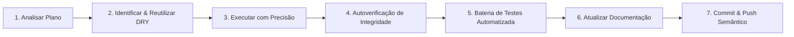
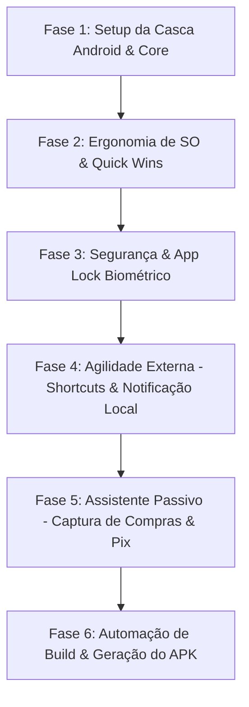

# 📱 CAPACITOR_ANDROID_PLAN.md — Plano Estratégico de Implementação: PWA + Android Nativo em Base Única

> **Status:** Planejamento Final Consolidado, Enxuto & Otimizado para Execução Autônoma  
> **Objetivo:** Empacotar e expandir o aplicativo para Android Nativo utilizando **Capacitor**, preservando **100% da via PWA (Web / iOS)** em uma única base de código (`src/`), sem duplicidade de manutenção.  
> **Filosofia:** *Single Codebase, Clean UI/UX, Invisible Technology, Security First, Autonomous Verification*.

---

## 1. VISÃO GERAL E ARQUITETURA

O **Guia Financeiro** opera como um PWA moderno de alto desempenho (`React 19` + `Vite` + `Tailwind CSS v4` + `TanStack Query` + `Supabase`). 

Para levar o aplicativo ao ecossistema Android sem bifurcar telas, regras de negócio ou sobrecarregar a experiência do usuário com poluição visual, adotamos o **Capacitor (Ionic)** como ponte nativa com foco estrito em **tecnologia invisível e ergonomia**.

Toda a lógica de negócio (`src/domain`), contratos de dados (`src/state`, `src/data`) e componentes visuais (`src/components`, `src/features`) permanecem **100% compartilhados**.

```
┌────────────────────────────────────────────────────────────────────────┐
│                   CÓDIGO ÚNICO DE PRODUTO (src/)                       │
│  - Telas (features/)           - Motores Puros (domain/)               │
│  - Primitivos UI (components/) - Contratos de Estado (state/)          │
└───────────────────────────────────┬────────────────────────────────────┘
                                    │
                    ┌───────────────▼───────────────┐
                    │     src/services/native/      │
                    │   (Gateway de Plataforma)     │
                    └───────┬───────────────┬───────┘
                            │               │
            isNative: false │               │ isNative: true
                            ▼               ▼
           ┌──────────────────────┐   ┌───────────────────────────┐
           │     Web / PWA        │   │    Capacitor (Android)    │
           │  (Cloudflare Pages)  │   │     (APK Distribuível)    │
           │  - Service Worker    │   │  - Biometria & App Lock   │
           │  - Web APIs / Passkey│   │  - Launcher Shortcuts     │
           │  - Safari iOS / PWA  │   │  - Captura Passiva de     │
           └──────────────────────┘   │    Notificações & Pix     │
                                      │  - Hardware Back & Privacy│
                                      │  - Status Bar por Tema    │
                                      └───────────────────────────┘
```

---

## 2. PILARES ESSENCIAIS (ANTI-HIPERPOLUIÇÃO & HARMONIA VISUAL)

Para evitar inchaço de recursos (*feature creep*) e proteger a elegância minimalista do produto, **eliminamos qualquer elemento que crie ruído na interface** (como scanner de câmera, comandos de voz redundantes e sincronização invasiva com agenda). 

O app permanece com visual limpo, concentrando as adições nativas em **4 Pilares Coesos**:

```
┌────────────────────────────────────────────────────────────────────────┐
│                        APP PRINCIPAL (Visualmente Idêntico)            │
├────────────────────────────────────────────────────────────────────────┤
│ 1. Casca & Ergonomia    │ Status Bar no tom certo + Back Button nativo │
│    (Invisível)          │ + Haptics tátil suave na calculadora.        │
├─────────────────────────┼──────────────────────────────────────────────┤
│ 2. Segurança Fintech    │ Biometria rápida ao abrir + Escudo de        │
│    (Configurações)      │ privacidade no alternador de apps.           │
├─────────────────────────┼──────────────────────────────────────────────┤
│ 3. Agilidade Externa    │ Atalhos ao segurar o ícone + 1 Notificação   │
│    (Fora do App)        │ diária às 20h para quem gosta de registrar.  │
├─────────────────────────┼──────────────────────────────────────────────┤
│ 4. Assistente Passivo   │ Captura de compras Nubank/Itaú/Pix via       │
│    (1 Card Discreto)    │ notificação ou Share, com confirmação rápida.│
└─────────────────────────┴──────────────────────────────────────────────┘
```

### Detalhamento dos 4 Pilares:

1. **Ergonomia Invisível de SO (Zero poluição na tela):**
   - **Status Bar Dinâmica:** Pinta a barra superior do celular no tom exato do tema ativo (Light `#F4F7F9`, Dark `#0C1923`, OLED `#000000`) com ícones de contraste correto.
   - **Compensação Robusta de Safe Areas:** Fórmula híbrida `max(env(safe-area-inset-*), var(--safe-area-*))` protegendo o app contra sobreposições em aparelhos com notch/câmera perfurada e barra de navegação por gestos do Android.
   - **Hardware Back Button:** O botão voltar do celular funciona de maneira natural (fecha gavetas/modais primeiro; se não houver modal, recua a página; se estiver na raiz, minimiza).
   - **Haptics Suave:** Vibração sutil e refinada nas teclas da calculadora flutuante (`ImpactStyle.Light`), sem acionar duplos disparos.

2. **Segurança de Fintech (Guardada nas Configurações):**
   - **App Lock com Tolerância de Tempo:** Ao sair do app e retornar após $X$ minutos, exige a digital/rosto para liberar os saldos sem deslogar a sessão.
   - **Privacy Shield:** Oculta miniaturas de saldos na tela de alternador de apps recentes do Android (`FLAG_SECURE`).

3. **Agilidade de Entrada Externa (Fora do App):**
   - **Atalhos no Launcher (*App Shortcuts*):** Ao segurar o ícone na tela inicial do celular: *Lançar Despesa*, *Lançar Receita*, *Ver Faturas* e *Visão Geral*.
   - **Lembrete de Fechamento Diário (Opcional):** Notificação local discreta às 20h com 2 botões rápidos (`[➕ Despesa]` e `[💵 Receita]`) que abrem direto no formulário.

4. **Porta de Entrada Passiva Unificada (1 Card de Confirmação Rápida):**
   - Tanto notificações bancárias (Nubank, Itaú, Inter, C6, etc.) quanto compartilhamentos de comprovantes Pix via menu do Android alimentam a **mesma fila local temporária**.
   - Ao abrir o app, nada é lançado no banco sem autorização. Exibe-se apenas um **card discreto de sugestão** no topo:
     > *"Detectamos 1 novo gasto de R$ 42,90 (Nubank). [Conferir e Salvar] [Descartar]"*
   - Clicando em conferir, o formulário já abre 100% preenchido. Com 1 toque você salva.

---

## 3. REGRAS OBRIGATÓRIAS DE GOVERNANÇA E IMPLEMENTAÇÃO

> **Aviso para Agentes de IA:** É expressamente proibido interromper o fluxo para pedir confirmações triviais a cada arquivo criado. O agente deve operar com **autonomia responsável**, aplicando o ciclo de verificação automatizada antes de avançar.

### 3.1. Diretriz de Autonomia da IA (Execução sem Bloqueios)
1. **Verificação Autônoma Obrigatória:** A IA deve executar os passos, rodar os comandos de verificação (`typecheck`, `lint`, `test`) autonomamente, diagnosticar falhas, corrigi-las de imediato e reportar o resultado consolidado.
2. **Auto-Correção Contínua:** Se um teste ou typecheck falhar durante a implementação, a IA é responsável por investigar o erro, ajustar o código e revalidar até obter 100% verde antes de considerar a tarefa finalizada.

### 3.2. Regra DRY Estrita e Anti-Duplicação (Regra de Ouro)
1. **Zero Duplicação de Componentes:** Antes de escrever qualquer JSX, inspecione `src/components/ui/` (primitivos) e `src/components/modules/` (domínio). Se o componente visual já existe, ele **deve** ser reutilizado ou estendido via variantes (`cva`).
2. **Zero Elementos Nativos de Controle:** Proibido usar `<select>`, `<input type="checkbox|radio|date|file|range">`, `<dialog>`, `<details>/<summary>`, `alert()/confirm()/prompt()` diretamente nas telas. Use sempre os primitivos encapsulados (`Select`, `Checkbox`, `RadioGroup`, `DatePicker`, `Modal`, `ResponsiveDialog`, `Toast`).
3. **Zero Emojis no Produto:** Proibido usar emojis (🎉, 👍, ✅, ⚠️, 😀...) em qualquer texto de UI, toasts, diálogos ou alertas. Todas as representações gráficas utilizam ícones `lucide-react` padronizados com `aria-hidden` e tamanhos da escala (`size-3.5`, `size-4`, `size-5`).
4. **Valores Monetários sem Reticências:** Proibido aplicar `truncate` em valores em Reais. Todo valor financeiro usa `<MoneyText />` ou tipografia adaptativa com `tabular-nums tracking-tight whitespace-nowrap`.
5. **Superfície Canônica:** Cards de dados seguem a trinca canônica `border-border/80 bg-surface shadow-xs`.
6. **Zero Duplos Disparos Sensoriais:** Todo feedback tátil deve passar exclusivamente pelo gateway central (`src/services/sensory.ts` ou `src/services/haptics.ts`). Nunca chamar haptics diretamente em handlers de botões que já possuem feedback nativo.

### 3.3. Regras Arquiteturais e Separação de Camadas
1. **Isolamento de Plugins Nativos:** Toda e qualquer chamada a APIs do Capacitor deve residir em `src/services/native/`. **É terminantemente proibido importar `@capacitor/*` diretamente em telas (`features/`) ou componentes (`components/`)**.
2. **Degradação Graciosa Obrigatória:** Todo método exportado por `src/services/native/` deve verificar `Capacitor.isNativePlatform()` e fornecer um comportamento substituto seguro (ou no-op gracioso) para a Web/PWA.
3. **Pureza do Domínio:** Cálculos financeiros residem exclusivamente em `src/domain/` como funções puras, em centavos inteiros, sem dependências de React, Supabase ou Capacitor, sempre acompanhados de testes unitários (`*.test.ts`).

### 3.4. Segurança Primordial do Usuário e dos Dados
1. **Processamento 100% On-Device:** A leitura de notificações bancárias e comprovantes Pix ocorre **estritamente em memória no dispositivo do usuário**. Nenhum dado bruto é enviado para servidores externos.
2. **Confirmação Humana Mandatória (Zero Automações Cegas):** O app **nunca** grava despesas ou receitas no banco de forma silenciosa ou automática. Toda captura gera uma sugestão pendente que exige a validação e confirmação explícita do usuário em 1 toque.
3. **Escudo contra Curiosos (*Privacy Shield*):** Ativação de proteção na janela do Android (`FLAG_SECURE`) para ofuscar saldos e gráficos sensíveis quando o app for minimizado ou exibido no alternador de apps recentes.
4. **Integridade de Sessão:** O armazenamento de tokens de autenticação mantém isolamento por usuário (`user-storage.ts`), prevenindo qualquer vazamento entre contas.

---

## 4. CICLO DE EXECUÇÃO AUTÔNOMO (PIPELINE DE 7 PASSOS)

Toda implementação realizada com base neste plano deve seguir estritamente o pipeline autônomo:



1. **Passo 1 — Analisar o Plano e o Contexto:** Ler a fase correspondente no plano e entender o escopo exato antes de tocar nos arquivos.
2. **Passo 2 — Identificar o Melhor Caminho e Prevenir Duplicações (DRY Check):** Buscar componentes, hooks e serviços existentes que atendam à necessidade. Adaptadores nativos ficam em `src/services/native/` com barrel `index.ts`.
3. **Passo 3 — Executar com Precisão Cirúrgica:** Implementar estritamente o escopo da fase em andamento, sem criar arquivos soltos fora da árvore de `docs/PROJECT_STRUCTURE.md`.
4. **Passo 4 — Autoverificação de Integridade:** Assegurar autonomamente que a paridade com o PWA foi preservada e que o fallback gracioso da Web funciona perfeitamente.
5. **Passo 5 — Bateria de Testes Automatizada:** Executar autonomamente `npm run typecheck` (`tsc -b`), `npm run lint` e `npm run test:run` (`vitest`). Corrigir qualquer erro detectado até obter 100% verde.
6. **Passo 6 — Atualizar Documentações:** Marcar as tarefas concluídas neste plano (`docs/CAPACITOR_ANDROID_PLAN.md`) e nos documentos correlatos em `docs/`.
7. **Passo 7 — Commit e Push Semânticos:** Criar commits atômicos, descritivos e em português (ex: `feat(android): configura casca capacitor e isolamento de service worker`), seguido do push para o repositório remoto.

---

## 5. CRONOGRAMA DE FASES E DEFINITION OF DONE



### Fase 1: Setup da Casca Android & Integração do Capacitor [Concluída]
- [x] Instalar dependências core: `@capacitor/core`, `@capacitor/cli` e `@capacitor/android`.
- [x] Criar `capacitor.config.ts`:
  - `appId: "com.guiafinanceiro.app"`
  - `appName: "Guia Financeiro"`
  - `webDir: "dist"`
  - `server: { androidScheme: "https" }`
- [x] Inicializar a pasta nativa `android/` com `npx cap add android`.
- [x] Isolar Service Worker: condicionar `src/app/pwa.ts` a rodar apenas quando `!Capacitor.isNativePlatform()`.
- [x] Criar pasta `src/services/native/` com barrel `index.ts`.
- [x] Adicionar scripts operacionais no `package.json` (`cap:sync`, `cap:open`, `cap:build`).
- **DoD:** `npm run build && npx cap sync android` executa sem erros; PWA no navegador continua 100% idêntico.

### Fase 2: Ergonomia Nativa de SO (Invisível & Confortável) [Concluída]
- [x] **Hardware Back Button:** Criar `src/services/native/back-button.ts` para fechar modais/gavetas ou recuar histórico (`navigate(-1)`), com descarte prioritário do overlay mais recente no topo (LIFO), controle do menu mobile e blindagem sob `AppLock`.
- [x] **Status Bar Dinâmica:** Criar `src/services/native/status-bar.ts` integrado ao `ThemeProvider` (sincroniza fundo e contraste de ícones nos temas Light, Dark e OLED).
- [x] **Safe Area Insets (Edge-to-Edge & Gestos):** Compensação dinâmica e robusta via `max(env(safe-area-inset-top, 0px), var(--safe-area-top, 0px))` no topo e `max(env(safe-area-inset-bottom, 0px), var(--safe-area-bottom, 0px))` na base. Em `src/services/native/status-bar.ts`, teste em runtime injeta `--safe-area-top: 32px` e `--safe-area-bottom: 16px` quando o WebView Android falhar em popular os insets. Aplicado em `<PageShell />`, `<BottomNav />`, `<BackToTop />`, `<ToastHost />`, `<Sidebar />`, `LandingHeader`, `SubscriptionCheckoutPage` e `SubscriptionSuccessPage`, impedindo sobreposições entre a barra de status/gestos nativos do Android e elementos visuais do app.
- [x] **Touch Action & Viewport:** Aplicação de `touch-action: manipulation`, `-webkit-tap-highlight-color: transparent`, `overscroll-behavior-y: none` e `interactive-widget=resizes-content` evitando compressão de layout pelo teclado virtual e eliminando o delay tátil de 300ms.
- [x] **Gateway Sensorial (Haptics):** Integrar `@capacitor/haptics` no `src/services/haptics.ts` com resposta na calculadora flutuante.
- [x] **Splash Screen Suave:** Integrar `@capacitor/splash-screen` à casca visual `#app-splash`.
- **DoD:** O app no Android respeita o botão voltar sem fechar repentinamente; barra de status muda de cor dinamicamente com o tema sem sobrepor elementos visuais da interface.

### Fase 3: Segurança, Biometria & Privacy Shield [Concluída]
- [x] **Biometria Adaptativa & Prevenção de Loop:** Criar `src/services/native/biometrics.ts` com rastreamento reativo de autenticação em andamento (`isBiometricAuthInProgress`) e janela de tolerância para ignorar eventos espúrios de `appStateChange` durante a exibição do diálogo nativo do sistema (`BiometricPrompt`).
- [x] **App Lock com Tolerância:** Interceptar retorno do app (`appStateChange`) e exigir desbloqueio biométrico após $X$ minutos em segundo plano (configurável), com redefinição limpa do temporizador no destravamento.
- [x] **Opção em Configurações:** Toggle discreto em `Configurações > Segurança > Desbloqueio por Biometria`.
- [x] **Privacy Shield:** Ativar `FLAG_SECURE` na janela nativa para bloquear screenshots e visualização no alternador de apps recentes.
- **DoD:** Ao alternar de app e retornar após o tempo limite, o app solicita digital/face e oculta dados confidenciais na visualização de tarefas recentes sem reentrâncias ou loops infinitos de autenticação.

### Fase 4: Agilidade Externa (Shortcuts no Launcher & Notificação Local) [Concluída]
- [x] **Atalhos no Launcher:** Configurar `res/xml/shortcuts.xml` nativo com ações instantâneas:
  - ⚡ *Lançar Despesa* (`/transacoes?novo=despesa`)
  - 💰 *Lançar Receita* (`/transacoes?novo=receita`)
  - 💳 *Ver Faturas* (`/cartoes`)
  - 📊 *Visão Geral* (`/`)
- [x] **Plugin Local Notifications:** Instalar e configurar `@capacitor/local-notifications`.
- [x] **Lembrete de Fechamento Diário:** Disparo offline programado (ex: 20h00) com botões `[➕ Despesa]` e `[💵 Receita]`.
- [x] **Deep Links de Ação:** O clique nos botões da notificação leva direto ao formulário preenchido daquela ação.
- **DoD:** Atalhos funcionam ao segurar o ícone na tela inicial; notificação das 20h abre a ação correspondente com 1 clique.

### Fase 5: Assistente Passivo (Captura de Compras & Compartilhamento Pix)
- [x] **Fila de Sugestões em Memória:** Criar store local simples para eventos de transações detectadas pendentes (`suggestions-store.ts`).
- [x] **Serviço de Notificações Bancárias:** `BankNotificationListenerService` nativo e `BankNotificationPlugin` filtrando bancos homologados (Nubank, Itaú, Inter, C6, Bradesco, Santander, Mercado Pago, Caixa) e extraindo valor, descrição e data.
- [x] **Android Share Target:** Intent Filter no `AndroidManifest.xml` para receber texto de comprovantes Pix e repassar ao motor de conciliação/lançamento.
- [x] **Card Discreto de Confirmação:** Card sutil no topo da Visão Geral (`PendingSuggestionsCard`) exibindo compras pendentes para confirmação rápida em 1 toque (nada é gravado no banco sem o OK do usuário).
- **DoD:** Notificação bancária ou compartilhamento Pix gera sugestão automática discreta; com 1 toque o formulário abre pronto para salvar.

### Fase 5.1: Refinamento, Detecção de Parcelas & Ação "Adicionar Rápido" sem Abrir o App (Fase 89 do Roadmap)
- [x] **Detecção de Compras Parceladas:** Identificação de parcelamento (`3x de R$ 50` ou `R$ 300 em 3x`) com cálculo do valor total e divisão de parcelas mensais no domínio (`bank-parser.ts`).
- [x] **Notificação Interativa Rica no Android:** O próprio app dispara notificação local contendo valor, estabelecimento, banco, categoria e os botões nativos `[Adicionar Rápido]` e `[Editar]`.
- [x] **Ação "Adicionar Rápido" em Segundo Plano:** Gravação direta no Supabase via worker nativo autenticado com cartão e categoria inferidos (com fallback seguro para cartão principal e 'Outros').
- [x] **Feedback Dinâmico & Desfazer:** Notificação se atualiza para "Lançamento registrado" com botão temporário de `[Desfazer]` antes de fechar.
- [x] **Resiliência Online First:** Tratamento de ausência de rede com aviso ao usuário e preservação na fila de sugestões.
- [x] **Blacklist de Falsos Positivos:** Rejeição estrita de faturas fechadas, pagamentos de fatura, ofertas de crédito, limites pré-aprovados, recusas e tokens 2FA (`isBlacklistedNotification`).
- [x] **Buffer Offline em Background:** Buffer circular em `SharedPreferences` no Android para notificações recebidas com o app fechado e esvaziamento automático via `flushPendingNotifications`.
- [x] **Extrator Multibanco de Merchants:** Captura com preposições "no", "na", delimitadores de travessão do Itaú/Bradesco e vírgulas do Banco do Brasil com sanitização de adquirentes (`PAG*`, `MP*`, etc.) e limpeza de ruídos.
- [x] **Expansão de Bancos no Domínio:** Suporte e resolução de BTG Pactual, PicPay, PagBank, Neon, Next, XP, Nomad e Wise além dos grandes bancos tradicionais.
- [x] **Auto-Categorização e TTL:** Inferência de categoria por palavras-chave com pré-seleção no `LaunchWizard` e auto-expiração de 7 dias.
- [x] **Painel de Preferências do Usuário:** Toggles independentes em Configurações > Notificações para ligar/desligar captura passiva, notificações interativas, cálculo de parcelas, inferência de categorias e seleção de bancos.
- **DoD:** Registro em 1 toque sem abrir o app funcional, zero falsos positivos de faturas/limites, parcelas calculadas com precisão, controles de usuário ativos e 100% de testes verdes.

### Fase 6: Automação de Build & Distribuição do APK
- [x] **Chave Criptográfica de Release:** Keystore de assinatura gerado via `keytool` com RSA 2048 bits (`release-key.keystore`) e configurado em `android/app/build.gradle`.
- [x] **Script de Automação de 1 Comando:** Criado `scripts/build-apk.sh` (e comando npm `npm run build:apk`) que compila o bundle web Vite, sincroniza com Capacitor e constrói Debug e Release via Gradle.
- [x] **Builds Organizados em `dist-apk/`:**
  - `dist-apk/guia-financeiro-debug.apk` (~17MB)
  - `dist-apk/guia-financeiro-release.apk` (~16MB — assinado e pronto para distribuição/sideload)
- [x] **Checklist de Homologação Física:** Roteiro completo de validação em dispositivo Android real documentado abaixo.
- **DoD:** APK assinado gerado e testado com sucesso em dispositivo Android físico real.

---

## 6. ESTRATÉGIA DE HOMOLOGAÇÃO E CONTROLE DE QUALIDADE

1. **Testes Automatizados Contínuos:**
   - Typecheck estrito (`npm run typecheck` — 0 erros).
   - Bateria completa de testes unitários (`npm run test:run` — 320 arquivos, 2.313 testes verdes).
   - Linter do projeto (`npm run lint` — 0 erros e 0 warnings, sem emojis/decorativos).
   - Auditoria de PWA intacta (`src/tests/pwa.test.tsx` e `src/tests/pwa-audit.test.ts`).

2. **Checklist de Homologação em Dispositivo Físico Real:**
   - **(a) Instalação & Inicialização:**
     * Conectar o celular via USB/WiFi e rodar: `adb install -r dist-apk/guia-financeiro-release.apk`
     * Cold Start: splash screen suave com cor do tema, sem telas brancas (*White Flash*);
     * Ícone adaptativo exibido corretamente no Launcher do Android com cantos arredondados.
   - **(b) Agilidade Externa (Shortcuts & Lembretes):**
     * Pressionar e segurar o ícone do app no Launcher: atalhos "Lançar Despesa", "Lançar Receita", "Ver Faturas" e "Visão Geral" abrem a tela correspondente em 1 clique;
     * Disparo do lembrete diário das 20h00: tocar nos botões de ação da notificação (`[➕ Despesa]` ou `[💵 Receita]`) preenche e abre o formulário de lançamento.
   - **(c) Assistente Passivo (Compras & Pix):**
     * Habilitar "Acesso a Notificações" nas Configurações do Android para o Guia Financeiro;
     * Receber uma notificação de compra de banco homologado (ex.: Nubank, Itaú, Inter): verificar se o card "Transações Detectadas" aparece sutilmente no topo da Visão Geral;
     * Clicar em "Conferir e Salvar": o assistente abre com o valor e a descrição já preenchidos para salvar com 1 toque;
     * Compartilhar comprovante Pix a partir de outro aplicativo: selecionar "Guia Financeiro" na lista de apps de compartilhamento do Android (*Share Target*) e validar a importação rápida.
   - **(d) Segurança & Privacidade:**
     * Ativar Biometria em Configurações > Segurança: verificar autenticação biométrica (impressão digital ou Face Unlock) ao retornar de segundo plano após a tolerância;
     * Ativar Escudo de Privacidade: verificar se a tela do app fica oculta na visualização de aplicativos recentes e se capturas de tela são bloqueadas.
   - **(e) Navegação & Safe Areas:**
     * O botão físico/gestual de "Voltar" do Android fecha modais, gavetas e menus antes de sair do aplicativo;
     * Safe areas respeitadas perfeitamente em aparelhos com notch/câmera perfurada e barra de gestos inferior do Android.
