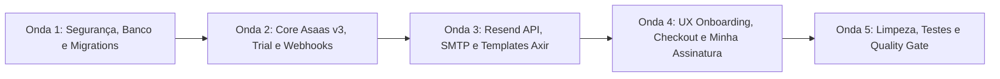

# PLANO MESTRE — ASSINATURAS, ONBOARDING, GATEWAY ASAAS E E-MAILS RESEND (AXIR)

> **Classificação de Governança (`AGENTS.md` §10.5):** Fluxo Completo (Feature / Plano Estrutural — SemVer `MINOR`).  
> **Status do Documento:** Planejamento Definitivo Aprovado para Execução (Código-fonte ainda intacto).  
> **Escopo:** Ciclo de vida integral do usuário no Axir — Cadastro, Confirmação de E-mail, Trial de 30 dias, Assinatura Mensal e Anual, Antecipação Acumulativa (2 a 11 meses), Upgrade/Cancelamento/Estorno CDC, Webhooks Idempotentes Asaas v3, E-mails Transacionais Resend (`axir.com.br`) e Blindagem de Segurança SaaS.

> [!CAUTION]
> **Governança Estrita de Credenciais:** Nenhuma chave de API, PAT do Supabase, token Cloudflare ou segredo do Resend/Asaas deve jamais ser gravado em arquivos rastreados pelo Git (`docs/`, `src/`, `supabase/config.toml` ou `.env` versionado). Todas as credenciais operam exclusivamente via `supabase secrets set`, painel de SMTP do Supabase e variáveis de ambiente de build/runtime fora do repositório. Recomenda-se rotacionar nos respectivos painéis quaisquer tokens compartilhados em canais de chat após a conclusão do setup.

---

## 1. ETAPA 1: MAPEAMENTO FORENSE DO ESTADO ATUAL (AS-IS)

Diagnóstico factual obtido por inspeção direta do código-fonte (`src/`, `supabase/migrations/`, `supabase/functions/`, `docs/`) cruzado com verificação em modo somente-leitura da infraestrutura ativa (Supabase projeto `lnsfcajcfofgvpvabwbi`, Cloudflare zona `axir.com.br`, Resend domínio `axir.com.br` e Asaas Sandbox).

### 1.1 Cadastro de Novo Usuário e Trial de 30 Dias Hoje

1. **Portas de entrada existentes:**
   - **Cadastro gratuito (`/cadastro`, `/criar-conta` -> `src/features/auth/pages/register-page.tsx` -> `src/data/auth.ts#signUpWithEmail`):** chama `supabase.auth.signUp` com `emailRedirectTo: getPublicAppUrl("/entrar")` (`https://axir.com.br/entrar`). Como `mailer_autoconfirm = false` no projeto Supabase Cloud, a conta exige clique no link enviado por e-mail antes de abrir sessão.
   - **Cadastro integrado no Checkout (`/assinatura` -> `src/features/subscription/pages/subscription-checkout-page.tsx` -> `supabase/functions/asaas-checkout/index.ts`):** quando acessado sem sessão, envia `registration: { name, email, password }` diretamente para a Edge Function `asaas-checkout`, que cria o usuário no Auth e já instancia cliente + assinatura/cobrança no Asaas na mesma requisição antes da confirmação do e-mail.
2. **Onde a data do Trial é gravada:**
   - O trigger `AFTER INSERT ON auth.users` executa `public.handle_new_user()` (`supabase/migrations/20260101000105_default_family_mode_for_new_users.sql`).
   - Cria atomicamente:
     - `public.profiles` (`role = 'user'`, `status = 'active'`, `approved_at = now()`; o 1º usuário histórico do banco recebe `superadmin` + `lifetime`);
     - `public.user_subscriptions` com `plan_id = 'trial'`, `tier = 'trial'`, `status = 'trialing'` e `trial_ends_at = now() + interval '30 days'` (ou `custom_trial_days` caso haja código válido em `public.access_invites`);
     - `public.user_preferences` (`app_mode = 'investor'`, `familyModeEnabled = true`) e seed das 11 categorias padrão.
   - **Lacuna forense na gravação inicial:** `handle_new_user()` na migration `105` não preenche a coluna `trial_started_at` criada posteriormente na migration `114` (deixando `trial_started_at = NULL` em cadastros novos). Além disso, o relógio de 30 dias dispara no `INSERT` de `auth.users` (antes de o usuário confirmar o e-mail).
3. **Quem controla a expiração e o que acontece ao expirar:**
   - **Controle em tempo real (Autoritativo no Banco — Funcional):** as funções SQL `public.can_current_user_write()` (`migration 116`), `public.get_user_module_access()` (`migration 118`) e `public.get_my_subscription()` (`migration 117`) verificam dinamicamente `trial_ends_at > now()`.
   - Ao atingir `trial_ends_at <= now()` sem assinatura ativa:
     - O RLS de escrita (`can_current_user_write_module`) bloqueia `INSERT/UPDATE/DELETE` nas tabelas operacionais;
     - `get_my_subscription()` projeta `billing_phase = 'trial_expired'`, `tier = 'read_only'`, `is_read_only = true`, `can_write = false` e `has_used_trial = true`;
     - Nenhum dado do usuário é excluído; a UI exibe `ReadOnlyBanner` e o hook `useMutationGuard` intercepta tentativas de escrita abrindo o `UpgradeDialog`.
   - **Controle em background / persistência física de status (Quebrado Hoje):** a função `public.reconcile_expired_subscriptions()` (`migration 118`) nunca é executada porque a extensão `pg_cron` não está instalada no banco remoto (`extensions: plpgsql, pg_stat_statements, uuid-ossp, pgcrypto, supabase_vault`), e possui erro fatal de tipagem no enum `subscription_status` (detalhado na §1.4).

### 1.2 Integração com o Asaas Hoje

1. **Catálogo de planos alinhado:**
   - `public.plans` no banco remoto, `src/domain/subscription/plans.ts` e `supabase/functions/_shared/asaas-plans.ts` estão sincronizados em 4 registros canônicos:
     - `trial` (`R$ 0,00`, 30 dias, interno);
     - `pro_monthly` (`R$ 19,99/mês` = `1999` centavos, ciclo `MONTHLY`);
     - `pro_annual` (`R$ 143,88/ano` = `14388` centavos, equivalente a `R$ 11,99/mês`, 40% OFF, ciclo `YEARLY`);
     - `lifetime` (`R$ 0,00`, VIP/interno).
2. **Criação de cliente (`_shared/asaas.ts#findOrCreateAsaasCustomer`):**
   - Consulta `GET /customers?cpfCnpj=...`, depois `GET /customers?email=...`, e caso não encontre faz `POST /customers` com `notificationDisabled: false`.
3. **Assinatura Mensal e Anual (`asaas-checkout/index.ts`):**
   - **Cartão de Crédito (`monthly` ou `annual`):** valida Luhn, validade e CVV; cria assinatura via `POST /subscriptions` (`billingType: "CREDIT_CARD"`). Se o servidor detectar trial ativo inédito (`isDelayedByTrial`), envia `nextDueDate = trial_ends_at` (mantendo `tier = 'trial'`, `scheduled_plan_id` e `scheduled_first_charge_at`). Caso contrário, cobra hoje e já grava `tier = planMeta.planId`, `status = 'active'` (ou `'incomplete'`) e `current_period_end = now + 1m/12m`.
   - **Pix (`annual` apenas):** bloqueado no mensal; cria cobrança avulsa via `POST /payments` (`billingType: "PIX"`, valor `143.88`), busca QR Code (`GET /payments/{id}/pixQrCode`), reaproveita cobrança pendente `< 1h` e insere `billing_intents` (`kind = 'subscription_start'`). A ativação depende do webhook e a UI faz polling de `USER_SUBSCRIPTION_KEY` a cada 3,5s.
4. **Pagamento antecipado de meses à frente (`kind === "cumulative_months"`):**
   - Restrito a assinantes `pro_monthly` com `status = 'active'` e sem `pending_plan_id`, permitindo de **2 a 11 meses** exclusivamente via **Pix** com descontos progressivos (`2–3m: 5%`, `4–6m: 10%`, `7–9m: 15%`, `10–11m: 20%`; `>= 12m` sugere o Plano Anual com 40% OFF).
   - Cria registro em `public.billing_intents` (`kind = 'cumulative_renewal'`), gera Pix avulso no Asaas e aguarda o webhook.
   - No webhook (`asaas-webhook/index.ts`), marca a `billing_intent` como `paid`, soma `months_count` sobre `current_period_end` via `addCivilMonthsServer` e envia `PUT /subscriptions/{id}` com `{ nextDueDate: targetDueDate, updatePendingPayments: false }`.
5. **Gestão da Assinatura (`asaas-manage/index.ts`):**
   - Implementa 6 ações: `schedule-plan-change`, `cancel-scheduled-plan-change`, `cancel` (com regra CDC de 7 dias estornando via `POST /payments/{id}/refund`, ou `cancel_at_period_end = true` após 7 dias via `DELETE /subscriptions/{id}`), `update-card` (`POST /subscriptions/{id}/creditCard`), `list-invoices` (`GET /payments?customer=...`) e `upgrade-to-annual`.
6. **Webhooks (`asaas-webhook/index.ts` + `_shared/asaas-webhook-logic.ts`):**
   - Valida header `asaas-access-token` com comparação em tempo constante via SHA-256 (`timingSafeEqualString`).
   - No Asaas Sandbox, o webhook `https://lnsfcajcfofgvpvabwbi.supabase.co/functions/v1/asaas-webhook` está ativo com `sendType: SEQUENTIALLY` e os eventos `PAYMENT_RECEIVED`, `PAYMENT_CONFIRMED`, `PAYMENT_OVERDUE`, `PAYMENT_DELETED` e `SUBSCRIPTION_DELETED` (**ausente `PAYMENT_REFUNDED`**).

### 1.3 Integração com o Resend e Cloudflare DNS Hoje

1. **DNS Cloudflare (`axir.com.br`) e Domínio Resend:**
   - Zona `axir.com.br` ativa na Cloudflare (`e8439467d8d8b9228cc3b54d5a529365`).
   - Domínio `axir.com.br` (`id: 5738313f-a8cd-4a1b-abea-f98986f00988`, região `us-east-1`) **já consta como `verified` no Resend**, com todos os registros DNS autenticados:
     - `TXT resend._domainkey.axir.com.br` (DKIM RSA verificado);
     - `MX send.axir.com.br` + `TXT send.axir.com.br` (`v=spf1 include:amazonses.com ~all` — Return-Path customizado verificado);
     - `CNAME rsend.axir.com.br` (`send.forge.rmta.net` — verificado);
     - `TXT _dmarc.axir.com.br` (`v=DMARC1; p=reject;` — política estrita anti-spoofing ativa).
   - O token Cloudflare inspecionado possui escopo `Zone:Read` (sem `DNS:Edit`) e expiração curta (`2026-11-19T02:25:01Z`), mas **nenhuma alteração de DNS é necessária**, pois `axir.com.br` já está integralmente autenticado para envio no Resend.
2. **Supabase Auth SMTP:**
   - Já configurado em produção apontando para `smtp.resend.com` (porta `465`, usuário `resend`, remetente `Axir <suporte@axir.com.br>`), com assuntos atualizados para `Axir`.
3. **Onde ficam os templates HTML e quais gatilhos existem:**
   - Documentados apenas para cópia manual em `docs/platforms/EMAIL_TEMPLATES.md` (4 templates do Supabase Auth: `Confirm signup`, `Reset password`, `Invite user`, `Change email address`), auditados por `src/tests/email-templates-integrity.test.ts`.
   - **Inconsistência de marca:** `docs/platforms/EMAIL_TEMPLATES.md` e `src/tests/email-templates-integrity.test.ts` ainda usam integralmente a marca antiga **`Áxis Finance`** e o domínio fictício `axis.finance`. No painel do Supabase Auth, os 4 templates ativos contêm mistura residual de `Áxis` com `Axir`, e os templates de alerta de segurança (`password_changed`, `email_changed`, `mfa_factor_enrolled`, `mfa_factor_unenrolled`) estão em inglês cru sem layout (`<h2>Your password was changed</h2>`).
   - **Ausência total de Resend nas Edge Functions:** o secret `RESEND_API_KEY` não está cadastrado nas Edge Functions do Supabase e não existe cliente HTTP do Resend em `supabase/functions/_shared/`. Zero e-mails transacionais são enviados para eventos de faturamento (boas-vindas pós-confirmação, cartão agendado no trial, pagamento/renovação confirmada, antecipação acumulativa, falha no cartão `past_due`, aviso de fim de trial, cancelamento ou estorno CDC).

### 1.4 Brechas de Segurança, Riscos de Cobrança Duplicada, Bugs e Inconsistências de UX

| ID | Severidade | Localização Exata | Diagnóstico Forense do Problema |
|---|---|---|---|
| **F-01** | **CRÍTICA (Quebra de Renovação)** | `supabase/functions/_shared/asaas-webhook-logic.ts` (L137–L148) | **Renovações do 2º mês em diante são ignoradas:** a trava `currentSub.asaas_subscription_id === payment.subscription` faz com que todo pagamento recorrente subsequente da mesma assinatura retorne `ignore_duplicate` (`already_active`). `current_period_end` nunca avança no 2º ciclo e o assinante pagante cai em `read_only`. |
| **F-02** | **CRÍTICA (Cobrança Dupla + Perda de Meses)** | `supabase/functions/asaas-webhook/index.ts` (L169–L179) e `asaas-webhook-logic.ts` (L153) | **Armadilha Asaas na antecipação acumulativa:** `PUT /subscriptions/{id}` com `updatePendingPayments: false` altera `nextDueDate`, mas **não remove nem reagenda a cobrança `PENDING` já emitida para o mês vigente**. No vencimento original, o cartão é cobrado mesmo após o Pix antecipado e, se processado pelo webhook, `computeNextPeriodEnd` calcula `hoje + 1 mês`, sobrescrevendo os meses comprados. |
| **F-03** | **CRÍTICA (Cobrança Dupla)** | `supabase/functions/asaas-checkout/index.ts` (L437–L511) e `asaas-webhook/index.ts` (L251) | **Assinaturas órfãs duplicadas no Asaas:** ao refazer checkout (ex: `trial_scheduled` trocando plano, `past_due` trocando método ou `pro_monthly` pagando Anual via Pix), o código cria nova assinatura/pagamento **sem cancelar (`DELETE /subscriptions/{oldId}`) a assinatura anterior no Asaas**, deixando duas recorrências ativas cobrando o mesmo cliente. |
| **F-04** | **CRÍTICA (Crash SQL)** | `supabase/migrations/20260101000118_harden_modular_access_period_expiration.sql` (L143) e `asaas-checkout/index.ts` (L314) | **Valor inválido de Enum:** `reconcile_expired_subscriptions()` executa `SET status = 'expired'::public.subscription_status`, mas o enum real no Postgres contém apenas `('trialing', 'active', 'past_due', 'canceled', 'read_only_expired', 'incomplete')`. Qualquer chamada à função aborta com erro `22P02`. |
| **F-05** | **ALTA (Carding / Conta Trancada)** | `supabase/functions/asaas-checkout/index.ts` (L57–L95) | **Checkout anônimo público sem CAPTCHA/confirmação:** `asaas-checkout` (`verify_jwt = false`) cria contas e submete cartões ao Asaas sem sessão autenticada e sem Turnstile. Permite *card testing* automatizado e permite pagar Pix/cartão com e-mail digitado errado, trancando o pagante fora da conta (`mailer_autoconfirm = false`). |
| **F-06** | **ALTA (Cancelamento Indevido)** | `supabase/functions/_shared/asaas-webhook-logic.ts` (L181–L191) | **`PAYMENT_DELETED` cancela assinatura inteira:** tratar `PAYMENT_DELETED` igual a `SUBSCRIPTION_DELETED` faz com que a exclusão de um QR Code Pix vencido ou de uma parcela pendente reajustada marque `cancel_at_period_end = true` na assinatura ativa do cliente. |
| **F-07** | **ALTA (Webhook Cego a Estorno)** | Painel Asaas Webhook + `GUIA_CONFIGURACAO_MANUAL_GO_LIVE.md` (L109–L113) | **`PAYMENT_REFUNDED` não cadastrado no Asaas:** o código trata `PAYMENT_REFUNDED`, mas o webhook configurado no Asaas não assina esse evento — estornos feitos diretamente no painel Asaas nunca rebaixam o acesso no banco. |
| **F-08** | **ALTA (Conflito de Upgrade)** | `supabase/functions/asaas-manage/index.ts` (L374–L409) e `cumulative-renewal-card.tsx` (L224) | **Upgrade anual sem confirmação e sem cobrança:** o botão "Mudar para o Anual" aciona `upgrade-to-annual` em 1 clique sem modal, promovendo `tier = 'pro_annual'` imediatamente sem cobrar R$ 143,88 no ato, enquanto `schedule-plan-change` está órfão na UI. |
| **F-09** | **ALTA (Perda de Trial Grátis)** | `supabase/functions/asaas-manage/index.ts` (L166–L260) | **Cancelar agendamento no Trial mata os dias gratuitos:** se um usuário em `trial_scheduled` (que nunca foi cobrado) cancelar a renovação, `asaas-manage` preenche `trial_consumed_at = now()`, fazendo `get_my_subscription()` encerrar imediatamente os dias restantes de teste gratuito para `read_only`. Além disso, na 1ª cobrança pós-trial, `asaas-webhook` não preenche `billing_start_at`, anulando os 7 dias do CDC. |
| **F-10** | **ALTA (Antifraude Produção)** | `supabase/functions/_shared/asaas.ts` (L285–L287, L401–L403) e `asaas-checkout` (L135) | **Dados fictícios hardcoded no Cartão:** envia `postalCode: "01310100"`, `addressNumber: "1"`, `phone: "11999999999"` e fallback `cpfCnpj: "00000000000"`. Em produção no Asaas, o motor antifraude recusa cartões legítimos por divergência cadastral; buscar `cpfCnpj=00000000000` colide clientes. |
| **F-11** | **MÉDIA (Grace Period Inoperante)** | `supabase/migrations/20260101000118_harden_modular_access_period_expiration.sql` (L88–L109) | **Divergência no Grace Period de 3 dias:** `can_current_user_write()` concede 3 dias de tolerância em `past_due`, mas `get_user_module_access()` retorna `'read'` imediatamente em `past_due`, bloqueando a escrita nos módulos na primeira falha de cartão. |
| **F-12** | **MÉDIA (Gateway JWT / CORS)** | `supabase/config.toml` (L410) e `package.json` (L32) | **`asaas-manage` com `verify_jwt = true`:** enquanto `asaas-checkout` usa `--no-verify-jwt` + `auth.getUser()` no handler para suportar `SUPABASE_JWKS` / preflight CORS sem falso `401`, `asaas-manage` mantém `verify_jwt = true` no gateway. |
| **F-13** | **MÉDIA (Validação Server-Side)** | `supabase/functions/asaas-checkout/index.ts` (L161–L198, L237) | **Teto acumulado ausente no servidor:** o backend não valida se `current_period_end` já ultrapassa 11 meses no futuro em `cumulative_months` e não envia `externalReference: intent.id` ao `POST /payments` do Asaas. |
| **F-14** | **BAIXA (Bugs Silenciosos / Dev)** | `asaas-webhook/index.ts` (L220, L294), `_shared/telegram.ts` (L102, L172), `subscription-checkout-page.tsx` (L375) | Webhook faz `select("full_name, email")` em `profiles` (a coluna real é `name`, retornando erro e `profile = null`); `_shared/telegram.ts` contém emoji e domínio antigo `axisfinancas.com.br`; checkout em `DEV` engole erro de cartão e redireciona para sucesso falso; `Turnstile` usa siteKey fixa de teste sem script Cloudflare. |
| **F-15** | **BAIXA (Código Morto / Legado)** | `src/domain/subscription/plans.ts` (L128–L192), `terms-page.tsx`, `privacy-page.tsx`, `.env.example` | Cálculo órfão de reembolso pró-rata anual (`calculateCancellationRefund`), menções residuais ao gateway `Stripe` em páginas legais/tipos/env e ausência de exibição do `cardLast4` na aba Minha Assinatura. |
| **F-16** | **CRÍTICA (Bypass de Read-Only em RLS e RPCs)** | Policies RLS (`categories`, `asset_prices`, `families*`, `trips*`, `public_shares`) e RPCs `SECURITY DEFINER` (`refinance_credit_card_bill`, `materialize_recurrences`, `allocate_goal_deposit`, `create_family`, `create_trip`) | Módulos adicionados após a migration `050` não validam `can_current_user_write()` nem `can_current_user_write_module()`. Um usuário expirado (`read_only`) ou com módulo bloqueado (`none`/`read`) consegue gravar diretamente no banco chamando essas tabelas ou RPCs `SECURITY DEFINER`. |
| **F-17** | **ALTA (Módulos Beta Bloqueados Mesmo Liberados)** | `src/state/queries/use-user-access.ts` (L301–L316) e `public.get_my_features()` | `get_my_features()` retorna `false` para qualquer feature com `default_enabled_for_new_users = false` (como `bank_notification_listener`). Em `useUserAccess`, `if (features[key] === false) return false` intercepta na linha 301 antes de consultar `subscription.moduleAccess`, tornando inoperante a concessão individual feita pelo Superadmin em `user_module_permissions`. |
| **F-18** | **ALTA (Superadmin Apaga Datas e Dessincroniza Asaas)** | `public.admin_set_user_subscription` e `src/features/admin/components/user-edit-dialog.tsx` (L112) | Ao salvar plano no painel Admin, `p_trial_ends_at` e `p_current_period_end` são enviados como `NULL`: (a) conceder `trial` cria um trial já expirado (`trial_ends_at = NULL` cai em `trial_expired`); (b) promover para `lifetime` ou rebaixar para `read_only` um cliente pagante **não cancela a assinatura no Asaas** (gerando cobrança indevida contínua) ou suprime dias já pagos pelo consumidor. |
| **F-19** | **ALTA (Bug Visual em Plano Vitalício VIP)** | `src/features/settings/components/tabs/subscription-tab.tsx` (L447–L605) e `subscription-context.tsx` (L17) | Para contas `tier = 'lifetime'`, o backend retorna `is_lifetime = true` e `is_pro = false`. Como `StatusBlock` só testa `hasAutoRenew`, `isTrial` e `isPro`, todo usuário **Vitalício VIP** vê na aba Plano o aviso incorreto *"Modo Somente-Leitura — Trial encerrado"* com botão de compra, e `SubscriptionProvider` grava ícone `FREE`. |
| **F-20** | **ALTA (Atraso nas Transições Automáticas de Estado)** | `src/state/queries/use-user-access.ts` (L29–L34, L254–L274) e `cumulative-renewal-card.tsx` (L100–L110) | `VITE_ENABLE_REALTIME` é `false` por padrão e `staleTime` é de **5 minutos** sem timer de expiração local nem refetch imediato no retorno do app bancário (`visibilitychange`). Se o trial/período vencer com a aba aberta ou se o Superadmin alterar permissões/plano, a UI demora até 5 minutos para refletir. No `CumulativeRenewalCard`, o modal Pix não fecha nem avisa quando o pagamento é confirmado. |
| **F-21** | **MÉDIA (Vazamento de Rotas em Overrides Modulares)** | `src/features/admin/components/user-edit/admin-module-catalog.ts` (L31–L44) e `src/app/authenticated-root.tsx` (L20–L35) | O preset rápido *"Apenas Investimentos"* esquece de bloquear `insights: 'none'` (mantendo `/insights` visível), e `AuthenticatedRoot` renderiza `<OverviewPage />` na rota `/` mesmo se o Superadmin bloquear `overview = 'none'` individualmente. |
| **F-22** | **MÉDIA (Escopo RBAC Admin vs Superadmin)** | `admin_set_user_subscription`, `admin_set_user_module_permission`, `admin_toggle_global_feature` | Exigem apenas `is_admin()` sem impedir que um `admin` comum altere plano/módulos de um `superadmin` e sem restringir Kill-Switches globais da plataforma exclusivamente a `is_superadmin()`. |
| **F-23** | **BAIXA (Fricções de Conforto em UX)** | `register-page.tsx` (L244–L276), `subscription-checkout-page.tsx` (L620, L956) | Tela pós-cadastro não possui botão de *"Reenviar e-mail de confirmação"* com cooldown; pagar Anual via Pix durante o Trial hoje desperdiça os dias gratuitos restantes em vez de somá-los aos 12 meses; tela do QR Code Pix não exibe botão manual *"Já paguei, verificar agora"* nem contador regressivo dinâmico. |

### 1.5 Diagnóstico Específico: Transições Automáticas, Permissões Modulares e Superadmin

1. **Transição entre Planos, Estados de Trial e Permissões:**
   - **No Backend (SQL):** a máquina de estados em `get_my_subscription()` calcula corretamente `trial_active`, `trial_scheduled`, `trial_expired`, `active`, `past_due`, `canceled_until_period_end`, `lifetime` e `read_only` a cada chamada, mas a persistência física depende de `reconcile_expired_subscriptions()` (hoje inoperante por `F-04` e ausência de `pg_cron`).
   - **No Frontend (React/TanStack Query):** como o WebSocket Realtime fica desabilitado por padrão (`VITE_ENABLE_REALTIME !== 'true'`) para evitar erros de proxy/WebSocket e o `staleTime` está fixado em 5 minutos, a transição **não é instantânea** quando: (a) o relógio cruza `trial_ends_at` ou `current_period_end` durante o uso; (b) o usuário retorna do aplicativo do banco no celular após pagar um Pix; ou (c) o Superadmin altera plano, status ou módulos do usuário.
2. **Funcionamento das Restrições de Módulo e Edição pelo Superadmin:**
   - A matriz granular em `UserEditDialog` (`write` / `read` / `none` por módulo + presets rápidos) já possui excelente fundação visual e grava em `user_module_permissions`, refletindo em `Sidebar`, `BottomNav`, `MoreMenuSheet`, `RequireFeature` e `useMutationGuard`.
   - Porém, para que funcione com **100% de segurança e respeito aos direitos do usuário**, é indispensável corrigir: (a) o bloqueio indevido de módulos Beta em `hasFeature` (`F-17`); (b) as tabelas e RPCs `SECURITY DEFINER` sem checagem de módulo/escrita (`F-16`); (c) a proteção de datas pagas e sincronização com o Asaas quando o Superadmin edita manualmente uma assinatura (`F-18`); e (d) a trava hierárquica `is_superadmin()` (`F-22`).

---

## 2. ETAPA 2: AUTO-REVISÃO CRÍTICA DO ESCOPO E DAS PREMISSAS

Com base nas evidências da Etapa 1 e no comportamento real da API v3 do Asaas, do Supabase Auth e do Resend, ajustamos as premissas técnicas para eliminar conflitos arquiteturais antes de escrever código:

### 2.1 Resolução Definitiva da Antecipação Acumulativa no Asaas (2 a 11 Meses)
- **Conflito técnico identificado:** no Asaas, assinaturas recorrentes (`POST /subscriptions`) geram automaticamente uma cobrança filha (`payment` com `status = 'PENDING'`) para o próximo ciclo. Apenas atualizar `PUT /subscriptions/{id}` com `nextDueDate` e `updatePendingPayments: false` mantém viva a cobrança `PENDING` do mês corrente, causando cobrança dupla no cartão. Por outro lado, usar `updatePendingPayments: true` pode alterar indevidamente valores caso haja mudança agendada.
- **Diretriz técnica blindada:**
  1. Ao confirmar no webhook uma `billing_intent` do tipo `cumulative_renewal` (2 a 11 meses pagos via Pix), calculamos `newPeriodEnd = addCivilMonthsServer(max(current_period_end, now), monthsCount)`.
  2. Executamos a rotina atômica `postponeAsaasSubscriptionAfterPrepayment(subscriptionId, targetDueDate)`:
     - Passo 1: `PUT /subscriptions/{subscriptionId}` com `{ nextDueDate: targetDueDate, updatePendingPayments: false }`;
     - Passo 2: `GET /subscriptions/{subscriptionId}/payments?status=PENDING` e, para toda cobrança `PENDING` cujo `dueDate < targetDueDate`, executamos `DELETE /payments/{pendingPaymentId}` (removendo qualquer débito agendado dentro do período já quitado via Pix).
  3. Como `PAYMENT_DELETED` passará a atualizar apenas `billing_intents` pendentes (nunca cancelando a assinatura), a remoção da fatura pendente não afeta o status `active` do assinante.
  4. Caso qualquer chamada de sincronização ao Asaas falhe por instabilidade externa de rede, `asaas_sync_status` permanece `'pending_resync'` para reprocessamento automático na rotina de reconciliação.

### 2.2 Idempotência Estrita e Avanço Correto de Renovação nos Webhooks
- **Conflito técnico identificado:** o Asaas envia `PAYMENT_CONFIRMED` e posteriormente `PAYMENT_RECEIVED` para o mesmo `payment.id` (com `event.id` distintos). A heurística antiga por `asaas_subscription_id` bloqueava renovações futuras; já o cálculo `computeNextPeriodEnd(tier, referenceDate)` encurtava ou apagava meses acumulados.
- **Diretriz técnica blindada:**
  1. **Desduplicação em duas camadas:**
     - Camada 1 (`provider_event_id`): se o `event.id` já existir em `billing_webhook_logs` com `processed_at IS NOT NULL`, retorna `200 OK` imediato (`duplicate_event`);
     - Camada 2 (`payment.id`): adiciona tabela/controle de pagamentos liquidados (ou validação `currentSub.asaas_payment_id === payment.id` combinada com busca em `billing_intents` / `billing_processed_payments` com `UNIQUE(provider, provider_payment_id)`). Assim, `PAYMENT_CONFIRMED` liquida `pay_X` uma única vez, `PAYMENT_RECEIVED` de `pay_X` é ignorado com segurança, e `pay_Y` no mês seguinte avança o ciclo normalmente.
  2. **Matemática monotônica de vigência (`current_period_end`):**
     - Em toda ativação/renovação de ciclo (`1 mês` ou `12 meses`), a base de soma será `baseDate = (currentSub.current_period_end && currentSub.current_period_end > now) ? currentSub.current_period_end : referenceDate`, garantindo que renovações nunca reduzam dias já pagos (mesmo em migração imediata de Mensal para Anual via Pix ou pós-antecipação).
  3. **Consulta real da 1ª cobrança no Checkout de Cartão imediato:**
     - Após `POST /subscriptions` sem trial diferido, `asaas-checkout` consulta `GET /subscriptions/{id}/payments?limit=1` para gravar o `asaas_payment_id` inicial e verificar se o pagamento já está `CONFIRMED`/`RECEIVED` (`status = 'active'`) ou ainda `PENDING` em análise antifraude (`status = 'incomplete'`, liberado segundos depois pelo webhook `PAYMENT_CONFIRMED`), evitando acesso gratuito com cartão recusado assincronamente.

### 2.3 Blindagem Anti-Duplicidade de Assinaturas e Fluxo Único de Autenticação
- **Regra de unicidade no Asaas:** antes de criar qualquer nova assinatura de cartão ou ativar um Pix Anual em conta que já possua `asaas_subscription_id` anterior, o backend executa `cancelPreviousAsaasSubscriptionSafely(oldSubscriptionId)` e limpa agendamentos obsoletos.
- **Porta única autenticada no Checkout:** `asaas-checkout` exigirá obrigatoriamente JWT válido (`userClient.auth.getUser()`), removendo a criação anônima de usuários dentro da Edge Function de pagamento. Visitantes não logados que clicarem em "Assinar Plano Pro" serão conduzidos por `/cadastro?plano=pro-anual` (ou `/entrar?plano=pro-anual`), confirmando o e-mail com preservação de `?plano=...` no `emailRedirectTo` até desembocar autenticado em `/assinatura?plano=...`.
- **Padronização de Edge Functions (`verify_jwt = false` no gateway + validação explícita no handler):** tanto `asaas-checkout` quanto `asaas-manage` usarão `verify_jwt = false` no `supabase/config.toml` e no script `deploy:functions`, validando o JWT de forma fail-closed via `userClient.auth.getUser()` dentro do código — eliminando rejeições `401` por rotação de chaves assimétricas (`SUPABASE_JWKS` / `ES256`) ou preflight `OPTIONS`.
- **Trava anti-mismatch Sandbox vs. Produção:** `_shared/asaas.ts` validará na inicialização a coerência entre o prefixo da `ASAAS_API_KEY` (`hmlg` vs `prod`) e o host resolvido (`api-sandbox.asaas.com` vs `api.asaas.com`), impedindo falhas silenciosas de credencial cruzada.

### 2.4 Transição Reativa Sem F5, Blindagem Modular Completa e Salvaguardas de Direitos no Superadmin
- **Transição automática instantânea no cliente (sem depender exclusivamente de WebSocket):**
  1. Reduzir `staleTime` de `user_subscription`, `user_access` e `user_features` para `30s` e ativar revalidação imediata em `visibilitychange === 'visible'` e `window.focus` (com *throttle* de 10s), garantindo atualização instantânea assim que o cliente volta do app bancário no celular ou alterna de aba após uma edição do Superadmin;
  2. Criar hook `useSubscriptionBoundaryTimer` que agenda um `setTimeout` exato para o próximo marco temporal (`trialEndsAt`, `currentPeriodEnd` ou `pendingPlanEffectiveAt`), invalidando `USER_SUBSCRIPTION_KEY` no exato segundo da virada para transicionar badges, banners e permissões sem recarregar a página;
  3. Unificar a resolução de módulos (`get_my_features()` retornará `false` apenas quando `is_globally_enabled = false` ou `ufo.is_enabled = false`, delegando o controle de módulos Beta e permissões `'none' | 'read' | 'write'` integralmente a `subscription.moduleAccess` em `useUserAccess` e `usePermission`).
- **Fechamento integral de brechas modulares no Postgres (RLS + RPCs):**
  - Aplicar `can_current_user_write()` / `can_current_user_write_module(...)` em todas as políticas RLS de escrita remanescentes (`categories`, `asset_prices`, `families*`, `trips*`, `public_shares`) e nas RPCs `SECURITY DEFINER` de mutação (`refinance_credit_card_bill`, `materialize_recurrences`, `allocate_goal_deposit`, `create_family`, `invite_family_member`, `remove_family_member`, `record_family_settlement`, `set_entity_family_id`, `create_trip`, `delete_trip_expense_sync`, `record_trip_settlements`, `unlink_trip_member`), preservando intactas apenas operações de direito fundamental do titular (leitura/exportação de dados, suporte, gestão de sessões/dispositivos e exclusão de conta LGPD).
- **Governança do Superadmin com Proteção aos Direitos do Assinante:**
  1. Restringir `admin_toggle_global_feature` a `is_superadmin()`, e bloquear qualquer `admin` comum de editar assinatura, status ou módulos de contas `superadmin`;
  2. Refatorar `admin_set_user_subscription` e estender `admin-super-action` (`action: "admin_update_subscription"`) para:
     - Nunca zerar acidentalmente `trial_ends_at` ou `current_period_end` (aplicando defaults inteligentes se omitidos: `+30d` para `trial`, preservação ou data explícita escolhida pelo Superadmin para `pro_monthly`/`pro_annual`);
     - Se o usuário possuir `asaas_subscription_id` recorrente ativa e o Superadmin conceder **Plano Vitalício VIP (`lifetime`)** ou cancelar a assinatura, cancelar automaticamente a cobrança futura no Asaas para **impedir cobrança indevida no cartão do cliente**;
     - Se o usuário possuir período já pago vigente (`current_period_end > now()`), exibir alerta explícito no `UserEditDialog` protegendo por padrão o direito adquirido até `current_period_end` (exigindo confirmação deliberada apenas em caso de estorno/fraude).
- **Valorização de Pix Anual durante o Trial:** caso um usuário em `trial_active` opte voluntariamente por pagar o **Plano Pro Anual via Pix** antes do fim dos 30 dias grátis, os dias restantes de trial serão **somados integralmente aos 12 meses** (`newPeriodEnd = addCivilMonthsServer(max(now, trial_ends_at), 12)`), garantindo zero perda de dias gratuitos e máxima transparência no checkout.

---

## 3. ETAPA 3: DECISÕES DE NEGÓCIO ALINHADAS (ZERO PENDÊNCIAS)

Todas as ambiguidades de negócio foram resolvidas diretamente com o fundador antes do fechamento deste plano. Não restam perguntas em aberto:

| # | Tema de Negócio | Decisão Canônica Aprovada |
|---|---|---|
| **D-01** | **Meios de Pagamento no Asaas** | **Sem Boleto.** Plano Pro Mensal (`R$ 19,99`): exclusivamente **Cartão de Crédito recorrente**. Plano Pro Anual (`R$ 143,88`): **Cartão de Crédito recorrente** ou **Pix à vista**. Antecipação Acumulativa de 2 a 11 meses: exclusivamente **Pix à vista**. |
| **D-02** | **Política de Upgrade (Mensal -> Anual)** | **Zero perda de dias pagos e zero cobrança dupla:** (a) via **Cartão**, agenda a troca de ciclo (`schedule-plan-change` com modal de confirmação) para `current_period_end`, passando a cobrar `R$ 143,88/ano` na próxima renovação (removendo a ação defeituosa `upgrade-to-annual`); (b) caso o assinante Mensal opte por pagar o **Pix Anual imediato** no checkout, o webhook cancela a assinatura mensal de cartão no Asaas e soma **+12 meses** sobre `max(now, current_period_end)`. |
| **D-03** | **Política de Cancelamento e Reembolso** | **Três regras claras:** (1) Em **Trial Agendado (`trial_scheduled`)**: cancelar no app deleta a assinatura agendada no Asaas, limpa o cartão agendado e **preserva integralmente os dias gratuitos restantes** até `trial_ends_at`; (2) **Até 7 dias corridos da 1ª cobrança efetivamente paga (CDC Art. 49)**: estorno integral automático de 100% no Asaas e retorno imediato ao modo `read_only`; (3) **Após 7 dias (Mensal, Antecipado ou Anual)**: sem reembolso pró-rata; cancela a renovação futura no Asaas (`cancel_at_period_end = true`) e mantém acesso Pro completo até `current_period_end`. |
| **D-04** | **Autenticação antes do Checkout & Antifraude** | **Sessão autenticada obrigatória** para invocar `asaas-checkout` (visitantes criam/confirmam conta antes do pagamento preservando `?plano=...`) + coleta obrigatória de **CPF, Celular e CEP + Número** no checkout/troca de Cartão de Crédito (eliminando dados fictícios no antifraude do Asaas) + ativação real do Cloudflare Turnstile nas telas públicas de Auth. |
| **D-05** | **Domínio Resend e Comunicação Transacional** | Utilizar o domínio já verificado **`axir.com.br`** (`Axir <nao-responda@axir.com.br>` com `Reply-To: suporte@axir.com.br`), configurar `notificationDisabled: true` nos clientes do Asaas e centralizar **100% dos e-mails de Auth e Ciclo de Assinatura** no Resend com templates HTML exclusivos da marca **Axir** (zero menções a `Áxis Finance` e zero emojis). |

---

## 4. ETAPA 4: PLANO DE EXECUÇÃO EM 5 ONDAS

A implementação seguirá estritamente a ordem de dependências abaixo, em branch dedicada (`feat/assinaturas-onboarding-axir`), mantendo a `main` íntegra até a aprovação final do Quality Gate (`npm run verify:full`).

---

### ONDA 1: Segurança de Segredos, Hardening de Banco (Migrations/RPCs) e Governança de Sessão

**Objetivo:** Corrigir os bugs estruturais de SQL/RLS, criar a tabela de controle idempotente de pagamentos/e-mails, habilitar agendamento de reconciliação e blindar variáveis de ambiente e Turnstile.

1. **Nova Migration `supabase/migrations/20260101000128_harden_billing_idempotency_and_trial_lifecycle.sql`:**
   - **Tabela `public.billing_processed_payments`:** `id uuid PK`, `provider text NOT NULL DEFAULT 'asaas'`, `provider_payment_id text NOT NULL`, `user_id uuid NOT NULL REFERENCES public.profiles(id) ON DELETE CASCADE`, `kind text NOT NULL`, `amount_cents integer NOT NULL`, `period_end_applied timestamptz`, `created_at timestamptz NOT NULL DEFAULT now()`, com constraint `UNIQUE (provider, provider_payment_id)` e RLS restrita a `service_role` e admins.
   - **Tabela `public.transactional_email_logs`:** `id uuid PK`, `user_id uuid REFERENCES public.profiles(id) ON DELETE CASCADE`, `template_key text NOT NULL`, `dedup_key text NOT NULL UNIQUE`, `recipient_email text NOT NULL`, `provider_message_id text`, `status text NOT NULL`, `created_at timestamptz NOT NULL DEFAULT now()` — garante que nenhum e-mail transacional (ex: recibo de `pay_X`, aviso de 5 dias do fim do trial, alerta `past_due`) seja disparado em duplicidade.
   - **Expansão de `public.profiles` (colunas opcionais antifraude de faturamento):** adicionar `phone text`, `postal_code text` e `address_number text` (com privilégios protegidos no mesmo padrão de `cpf` da migration `058`).
   - **Correção de `public.handle_new_user()`:** gravar explicitamente `starts_at = now()` e `trial_started_at = now()` ao criar a linha inicial de `public.user_subscriptions`.
   - **Alinhamento do Grace Period de 3 dias em `public.get_user_module_access()`:** incluir o bloco `status = 'past_due' AND current_period_end IS NOT NULL AND current_period_end + interval '3 days' > now()` retornando `'write'::public.access_level`, espelhando 100% `public.can_current_user_write()`.
   - **Correção de `public.get_my_features()` (`F-17`):** retornar `false` apenas quando `sf.is_globally_enabled = false` (Kill-Switch global) ou `ufo.is_enabled = false`, evitando bloquear features Beta (`default_enabled_for_new_users = false`) que foram liberadas individualmente pelo Superadmin via `user_module_permissions`.
   - **Fechamento integral de RLS e RPCs de Escrita (`F-16`):**
     - Adicionar `can_current_user_write_module('transactions')` nas políticas de escrita de `categories`, `families*`, `trips*` e `public_shares`, e `can_current_user_write_module('investments')` em `asset_prices` (mantendo leitura/exportação, suporte, perfil básico e exclusão LGPD sempre acessíveis);
     - Adicionar guarda explícita `can_current_user_write_module(...)` no topo das RPCs `SECURITY DEFINER`: `refinance_credit_card_bill` (`cards`), `materialize_recurrences` (`transactions`), `allocate_goal_deposit` (`budgets`), `create_family`, `invite_family_member`, `remove_family_member`, `record_family_settlement`, `set_entity_family_id`, `create_trip`, `delete_trip_expense_sync`, `record_trip_settlements` e `unlink_trip_member` (`transactions`).
   - **Hardening RBAC e Proteção de Datas em RPCs Admin (`F-18`, `F-22`):**
     - Restringir `admin_toggle_global_feature` exclusivamente a `public.is_superadmin()`;
     - Bloquear em `admin_set_user_subscription`, `admin_set_user_module_permission` e `admin_remove_user_module_permission` qualquer tentativa de um `admin` comum modificar um alvo `superadmin`;
     - Em `admin_set_user_subscription`, aplicar defaults defensivos quando datas não forem informadas (`p_trial_ends_at := coalesce(p_trial_ends_at, now() + interval '30 days')` para `trial`; preservação de `current_period_end` vigente ou `+1m/+12m` para `pro_monthly`/`pro_annual`), além de expor os campos completos (`asaas_subscription_id`, `asaas_customer_id`, `payment_method`, `card_last4`, `billing_start_at`, `trial_consumed_at`) para consulta administrativa.
   - **Correção de `public.reconcile_expired_subscriptions()` (`F-04`):** substituir o literal inválido `'expired'::public.subscription_status` por `'read_only_expired'::public.subscription_status`, além de expirar `past_due` cujo grace period de 3 dias já se encerrou (`current_period_end + interval '3 days' <= now()`) e expirar `billing_intents` pendentes há mais de 24h.
2. **Extensão `pg_cron` e Job Diário Seguro:**
   - Habilitar `pg_cron` no banco remoto e agendar job horário para `SELECT public.reconcile_expired_subscriptions();` + job diário para a Edge Function de régua de ciclo de vida (avisos de expiração de trial e resync pendente do Asaas).
3. **Configuração de Secrets e Gateway de Funções:**
   - Atualizar `supabase/config.toml`, `supabase/.env.example`, `.env.example` e script `deploy:functions` em `package.json`:
     - Definir `verify_jwt = false` também para `[functions.asaas-manage]` (mantendo autenticação obrigatória via `userClient.auth.getUser()` no handler);
     - Documentar `RESEND_API_KEY`, `RESEND_FROM_EMAIL` (`Axir <nao-responda@axir.com.br>`), `RESEND_REPLY_TO` (`suporte@axir.com.br`) e `VITE_TURNSTILE_SITE_KEY` (adicionando `VITE_TURNSTILE_SITE_KEY` em `ALLOWED_CLIENT_ENV_VARS` de `src/tests/security-audit.test.ts`);
     - Injetar os secrets no projeto Supabase (`lnsfcajcfofgvpvabwbi`) inicialmente apontando o Asaas para Sandbox (`https://api-sandbox.asaas.com/v3` com `ASAAS_ENVIRONMENT=sandbox`) para validação ponta a ponta antes da chave de Produção.

---

### ONDA 2: Core Asaas v3, Máquina de Estados de Trial/Assinatura e Webhooks Idempotentes

**Objetivo:** Blindar 100% da comunicação financeira com o Asaas contra cobranças duplicadas, perda de meses antecipados, falhas de renovação e brechas de cancelamento.

1. **Refatoração de `supabase/functions/_shared/asaas.ts` e `asaas-plans.ts`:**
   - **Guarda de coerência de ambiente (`assertAsaasEnvironmentMatch`):** detectar incompatibilidade entre chave `$aact_hmlg_...` e URL de produção (ou `$aact_prod_...` e URL sandbox), falhando de forma explícita e segura.
   - **Gestão segura de Cliente (`findOrCreateAsaasCustomer`):**
     - Priorizar `existingCustomerId` salvo em `user_subscriptions.asaas_customer_id` (validando via `GET /customers/{id}` e sincronizando `cpfCnpj`, `mobilePhone` e `notificationDisabled: true`);
     - Exigir CPF válido (`isValidCPF`) antes de qualquer chamada ao Asaas — eliminar definitivamente o fallback `"00000000000"`;
     - Criar/atualizar clientes sempre com `notificationDisabled: true` (decisão **D-05**).
   - **Novos métodos atômicos da API Asaas v3:**
     - `getAsaasSubscriptionPayments(subscriptionId, status?)`: consulta cobranças filhas de uma assinatura (`GET /subscriptions/{id}/payments`);
     - `deleteAsaasPayment(paymentId)`: remove cobrança `PENDING` avulsa/filha (`DELETE /payments/{id}`);
     - `postponeAsaasSubscriptionAfterPrepayment(subscriptionId, nextDueDate)`: atualiza `nextDueDate` (`updatePendingPayments: false`) e remove todas as cobranças `PENDING` da assinatura com `dueDate < nextDueDate`;
     - `ensurePreviousSubscriptionCanceled(subscriptionId)`: cancela com tolerância a `404/already deleted` qualquer assinatura anterior antes de criar uma nova ou ao migrar via Pix Anual;
     - Envio explícito de `externalReference` em `createAsaasPixCharge` e `createAsaasCreditCardSubscription`;
     - Remoção dos fallbacks fictícios de CEP (`01310100`) e telefone (`11999999999`), exigindo os dados reais validados do titular.
2. **Blindagem de `supabase/functions/asaas-checkout/index.ts`:**
   - **Autenticação estrita:** remover o bloco `registration` (`signUp` anônimo). Exigir `Authorization: Bearer <jwt>` validado por `userClient.auth.getUser()` e `user.email_confirmed_at` presente.
   - **Fluxo A (`cumulative_months` — 2 a 11 meses via Pix):**
     - Validar no servidor `isCumulativeRenewalEligible` (incluindo trava de teto máximo de 11 meses acumulados a partir de `now()`);
     - Reaproveitar `billing_intent` Pix pendente recente (`< 1h`) de mesma metragem/valor para evitar geração de múltiplos QR Codes órfãos;
     - Passar `externalReference: intent.id` ao Asaas.
   - **Fluxo B (Contratação Mensal/Anual):**
     - Validar `status !== 'read_only_expired'` (corrigindo o check `'expired'`) na autoridade de trial único;
     - Se o usuário já possuir `asaas_subscription_id` anterior (ex: trocando plano durante `trial_scheduled` ou regularizando `past_due`), cancelar a assinatura antiga no Asaas antes de criar a nova;
     - Em **Pix Anual** para assinante `pro_monthly` ativo (upgrade imediato — decisão **D-02**), registrar `billing_intent` (`kind = 'plan_change'`, `plan_id = 'pro_annual'`) mantendo a assinatura atual intacta até a confirmação efetiva do Pix no webhook;
     - Em **Cartão imediato** (sem trial), consultar a 1ª cobrança gerada da assinatura: gravar `asaas_payment_id = firstPayment.id`; se `CONFIRMED`/`RECEIVED`, ativar já registrando em `billing_processed_payments`; se `PENDING`, gravar `status = 'incomplete'` aguardando o webhook `PAYMENT_CONFIRMED`.
3. **Blindagem de `supabase/functions/_shared/asaas-webhook-logic.ts` e `asaas-webhook/index.ts`:**
   - **Correção definitiva de F-01:** remover `(payment.subscription && currentSub.asaas_subscription_id === payment.subscription)` da condição de duplicidade. Duplicidade de pagamento passa a ser verificada exclusivamente por `billing_processed_payments` (`provider_payment_id = payment.id`) ou `intent.status === 'paid'`.
   - **Vigência cumulativa monotônica (F-02, F-23 e D-02):** `computeNextPeriodEnd` recebe `currentPeriodEnd` e `trialEndsAt` atuais, somando `+1` ou `+12` meses sobre `max(referenceDate, currentPeriodEnd, trialEndsAt_se_trial_ativo)`. Assim, quem paga Pix Anual durante o Trial soma os dias restantes aos 12 meses sem perder nenhum dia gratuito.
   - **Pós-Trial e Troca Agendada (F-09):** quando a 1ª cobrança de `trial_scheduled` confirmar, preencher `billing_start_at = now()`, `trial_consumed_at = coalesce(trial_consumed_at, now())`, limpar `scheduled_plan_id` / `scheduled_first_charge_at`, ativar o `targetTier` e iniciar a janela legal de 7 dias do CDC a partir desse pagamento real. Quando uma renovação confirmar `pending_plan_id`, limpar `pending_plan_id` / `pending_plan_effective_at`.
   - **Upgrade Pix Anual sobre Mensal ativo (D-02):** ao confirmar pagamento Pix Anual de usuário que tinha `asaas_subscription_id` mensal, cancelar imediatamente a assinatura mensal no Asaas e somar `+12 meses` sobre `max(now, current_period_end)`.
   - **Separação estrita de eventos destrutivos (F-06 e F-07):**
     - `PAYMENT_DELETED`: cancela apenas `billing_intents` `pending` associadas a `payment.id`; nunca altera `cancel_at_period_end` de assinaturas ativas;
     - `SUBSCRIPTION_DELETED`: marca `cancel_at_period_end = true` apenas se a `subscriptionId` deletada for exatamente a `currentSub.asaas_subscription_id` vigente;
     - `PAYMENT_REFUNDED` / `PAYMENT_CHARGEBACK_REQUESTED`: rebaixa para `tier = 'read_only'`, `status = 'canceled'`, `current_period_end = now()`;
     - Configurar via API do Asaas a inclusão de `PAYMENT_REFUNDED` e `PAYMENT_CHARGEBACK_REQUESTED` no cadastro do webhook.
   - **Correção da query de perfil no Telegram (F-14):** trocar `select("full_name, email")` por `select("name, email")` e remover emojis/domínio legado em `_shared/telegram.ts`.
4. **Blindagem de `supabase/functions/asaas-manage/index.ts` e `admin-super-action/index.ts`:**
   - **Remover `upgrade-to-annual` (F-08 / D-02):** consolidar a mudança via cartão exclusivamente em `schedule-plan-change` (que ajusta a próxima cobrança para `YEARLY` / `R$ 143,88` preservando `nextDueDate = current_period_end` com `updatePendingPayments: false` e registra `pending_plan_id = 'pro_annual'`).
   - **Cancelamento em `trial_scheduled` (F-09 / D-03):** se `tier === 'trial'` e `billing_start_at IS NULL` (nunca houve cobrança paga), cancelar `asaas_subscription_id` no Asaas, limpar `scheduled_plan_id`, `scheduled_first_charge_at`, `asaas_subscription_id` e `card_last4`, **mantendo `tier = 'trial'`, `status = 'trialing'` e `trial_consumed_at = NULL`** até `trial_ends_at`.
   - **Cancelamento CDC 7 dias vs Pós-7 dias (D-03):** calcular os 7 dias estritamente sobre `billing_start_at` (data real da 1ª cobrança paga), nunca sobre `created_at` do trial.
   - **Troca de Cartão (`update-card`):** receber e repassar CEP, número e telefone reais + `card_brand` detectada.
   - **Sincronização Segura de Superadmin com Asaas (`admin-super-action` — F-18):** adicionar ação `admin_update_subscription` exclusiva para `superadmin` que, ao conceder `lifetime` ou encerrar manualmente uma conta que possua `asaas_subscription_id` ativa, cancela automaticamente a assinatura futura no Asaas (evitando cobrança fantasma no cartão) e protege `current_period_end` já pago pelo cliente (salvo flag explícita de estorno/fraude auditada em `audit_events`).
   - **Testes unitários obrigatórios:** suíte Vitest cobrindo todas as transições de `asaas-webhook-logic.ts` (1º pagamento, 2º mês recorrente, `PAYMENT_CONFIRMED` + `PAYMENT_RECEIVED` do mesmo ID, antecipação 2–11m, upgrade Pix Anual somando vigência, Pix Anual em trial somando dias restantes, cancelamento em `trial_scheduled`, CDC 7 dias, `PAYMENT_DELETED` inócuo e `PAYMENT_REFUNDED`).

---

### ONDA 3: Infraestrutura Resend (SMTP + API Edge) e Templates HTML Marca Axir

**Objetivo:** Unificar 100% da comunicação transacional de Auth e Faturamento sob a identidade visual **Axir** no domínio autenticado `axir.com.br` (zero emojis, zero marca legada `Áxis Finance`).

1. **Padronização do Remetente no Supabase Auth (via Management API / Painel):**
   - Atualizar `smtp_admin_email` para `nao-responda@axir.com.br` e `smtp_sender_name` para `Axir` (mantendo `smtp.resend.com:465`).
   - Atualizar e aplicar os **templates HTML de Autenticação** com design dark/light-safe editorial **Axir** (`https://axir.com.br`, suporte `suporte@axir.com.br`, zero emojis):
     1. `Confirm signup` — Confirmação de cadastro e início dos 30 dias Pro;
     2. `Reset password` — Redefinição segura de senha;
     3. `Invite user` — Convite exclusivo para o Axir;
     4. `Change email address` — Confirmação de alteração de e-mail;
     5. Notificações de segurança (`Password changed`, `Email changed`, `MFA factor enrolled/unenrolled`) traduzidas para pt-BR com layout Axir (substituindo o HTML cru em inglês atual).
   - Atualizar `docs/platforms/EMAIL_TEMPLATES.md`, `docs/platforms/DEPLOYMENT.md` e `src/tests/email-templates-integrity.test.ts` para refletir a marca oficial **Axir** e o domínio `axir.com.br`.
2. **Módulo Server-Side `supabase/functions/_shared/resend.ts` + `_shared/email-templates.ts`:**
   - Cliente leve via `fetch("https://api.resend.com/emails")` usando `RESEND_API_KEY`, remetente `Axir <nao-responda@axir.com.br>`, `reply_to: "suporte@axir.com.br"` e cabeçalho `Idempotency-Key: <dedupKey>` nativo do Resend + persistência em `public.transactional_email_logs`.
   - **Catálogo de 7 Templates Transacionais de Ciclo de Vida (disparados pelas Edge Functions):**
     1. `trial_card_scheduled`: confirmação de cartão cadastrado no Trial com data exata da 1ª cobrança e lembrete de cancelamento livre em 1 clique;
     2. `subscription_activated`: recibo de ativação/renovação do Plano Pro (Mensal ou Anual), valor pago, método (Cartão final `••••` ou Pix) e próxima renovação;
     3. `cumulative_renewal_confirmed`: recibo da antecipação acumulativa (+N meses, desconto obtido e nova data em que a cobrança mensal do cartão voltará a ocorrer);
     4. `plan_change_scheduled`: confirmação de agendamento de mudança de ciclo para `current_period_end`;
     5. `payment_past_due`: alerta imediato de falha na renovação do cartão informando os **3 dias de tolerância (grace period)** e botão direto para `/configuracoes?tab=assinatura` para atualizar o cartão sem perder acesso;
     6. `subscription_canceled_or_refunded`: comprovante de cancelamento (informando manutenção do acesso até `current_period_end` ou confirmação do estorno integral de 100% pelo Art. 49 do CDC);
     7. `trial_ending_reminder` (5 dias antes e último dia) / `trial_expired_readonly`: lembrete respeitoso (informando que 100% dos dados permanecem seguros para consulta) disparado por Edge Function agendada `billing-lifecycle-cron` (que também reexecuta `reconcile_expired_subscriptions()` e tenta resincronizar registros com `asaas_sync_status = 'pending_resync'`).

---

### ONDA 4: UX/UI Confortável, Transições Reativas Automáticas, Checkout e Painel Superadmin

**Objetivo:** Alinhar todas as telas às decisões **D-01 a D-05** e às Regras de Ouro de UI do `AGENTS.md` (zero inputs nativos crus, zero `autoFocus`, fontes `>= 16px` no mobile, zero emojis, modais padronizados), garantindo transições automáticas instantâneas sem F5 e controle ergonômico pelo Superadmin.

1. **Motor Reativo de Transição Automática de Planos, Trial e Módulos (`F-17`, `F-20`, `F-21`):**
   - Em `src/state/queries/use-user-access.ts` e `use-user-subscription.ts`: reduzir `staleTime` para `30_000 ms`, revalidar automaticamente em `visibilitychange === 'visible'` e `window.focus` (com *throttle* de 10s — capturando imediatamente o retorno do app bancário no mobile ou edições do Superadmin) e corrigir `hasFeature` para delegar módulos Beta (`default_enabled_for_new_users = false`) a `subscription.moduleAccess`.
   - Criar `useSubscriptionBoundaryTimer` montado em `SubscriptionProvider`: dispara invalidação automática de `USER_SUBSCRIPTION_KEY` no exato milissegundo em que `trialEndsAt`, `currentPeriodEnd` ou `pendingPlanEffectiveAt` é atingido, transicionando banners, badges e bloqueios de escrita em tempo real.
   - Em `SubscriptionProvider` (`src/state/subscription-context.tsx`): sincronizar o ícone/estado Pro considerando `subscription.isPro || subscription.isLifetime` (corrigindo `F-19`).
   - Em `src/app/authenticated-root.tsx` e `admin-module-catalog.ts` (`F-21`): incluir `insights: "none"` no preset *"Apenas Investimentos"* e redirecionar `/` via `resolveLandingPath` sempre que `hasFeature("overview")` for `false`.
2. **Jornada de Entrada Confortável (`/cadastro`, `/entrar` -> `/assinatura`):**
   - Em `src/features/landing/hooks/use-landing-cta.ts`: quando o visitante **não possui sessão**, `proUrl("pro-anual")` aponta para `/cadastro?plano=pro-anual` (e em `/entrar` preserva `?plano=...`); quando **já possui sessão**, vai direto para `/assinatura?plano=pro-anual`.
   - Em `src/data/auth.ts#signUpWithEmail` e `resendConfirmationEmail`: aceitar parâmetro opcional `redirectPath` para que cadastros vindos com `?plano=pro-anual` gerem `emailRedirectTo: getPublicAppUrl("/assinatura?plano=pro-anual")` (caindo direto no checkout já logado assim que confirmar o e-mail, sem redigitar senha).
   - Em `src/features/auth/pages/register-page.tsx` (`F-23`): adicionar na tela de confirmação de e-mail o botão *"Reenviar e-mail de confirmação"* com contador de cooldown de 60s e feedback via Toast.
   - Em `src/components/ui/turnstile.tsx` e `index.html`: carregar o script oficial do Cloudflare Turnstile sob demanda quando `VITE_TURNSTILE_SITE_KEY` estiver definida em produção, mantendo fallback determinístico apenas em ambiente local/testes.
3. **Refatoração de `SubscriptionCheckoutPage` (`src/features/subscription/pages/subscription-checkout-page.tsx`):**
   - Se `!session`, redirecionar de forma limpa para `/cadastro?plano=${planSlug}` (com link rápido para `/entrar?plano=${planSlug}`), removendo o formulário duplicado de criação de conta de dentro da tela de pagamento.
   - Pré-preencher automaticamente CPF, Celular, CEP e Número caso já existam em `profiles` (persistindo-os na primeira compra para zero retrabalho futuro).
   - Nos pagamentos com **Cartão de Crédito**, adicionar em grid responsivo (`grid-cols-1 sm:grid-cols-2 gap-3.5`, conforme `AGENTS.md` §4.18) os campos enxutos com máscara em `src/services/masks`: **Celular com DDD**, **CEP (`00000-000`)** e **Número do endereço**, além de enviar `cardBrand` detectada.
   - **Clareza em `trial_active` (Cartão vs Pix Anual — `F-23`):** no Cartão, exibir `R$ 0,00 hoje` com 1ª cobrança em `trial_ends_at`; ao alternar para **Pix Anual**, atualizar o resumo para `R$ 143,88 hoje via Pix` deixando explícito que **os dias restantes do teste gratuito são somados aos 12 meses** (`12 meses + X dias restantes`).
   - Na tela do QR Code Pix: incluir contador regressivo de validade e botão secundário *"Já paguei — verificar confirmação"* para checagem instantânea sob demanda, além de remover o `catch` que engolia erros em `import.meta.env.DEV` (`F-14`).
4. **Refatoração da Aba Plano (`subscription-tab.tsx` e `cumulative-renewal-card.tsx`):**
   - **Suporte nativo a `Plano Vitalício VIP` (`isLifetime` — `F-19`) e `Inadimplente em Tolerância` (`past_due`):** exibir card dedicado de Acesso Vitalício Permanente (ocultando CTAs de compra/cancelamento) para `lifetime`, e card de alerta claro com botão *"Regularizar Cartão Agora"* mostrando o prazo restante da tolerância de 3 dias em `past_due`.
   - **Exibição real do meio de pagamento:** mostrar bandeira e final do cartão (`Cartão •••• 1234`) quando `cardLast4` estiver presente, ou `Pix Anual (sem renovação automática em cartão)` quando o plano anual tiver sido pago via Pix (ocultando o botão inaplicável "Alterar Cartão" para quem pagou via Pix sem `asaas_subscription_id`).
   - **Fechamento automático e celebração no `CumulativeRenewalCard` (`F-20`):** monitorar o avanço de `currentPeriodEnd` enquanto o modal Pix estiver aberto; assim que o webhook confirmar o Pix, fechar o modal automaticamente, acionar `triggerSensory("success")` e exibir Toast com a nova data de vigência.
   - **Modal de confirmação na migração Mensal -> Anual:** ao clicar em "Mudar para o Anual" no `CumulativeRenewalCard` (ou na aba), abrir `<Modal size="md" />` oferecendo claramente as 2 opções da decisão **D-02**:
     1. *Agendar no Cartão para a próxima renovação* (`schedulePlanChange("annual")` — sem cobrança hoje);
     2. *Migrar agora via Pix Anual com 40% OFF* (redireciona para `/assinatura?plano=pro-anual&metodo=pix`, informando que os meses/dias atuais serão somados aos +12 meses e a recorrência mensal será encerrada).
   - **Modal de Alteração de Cartão (`UpdateCardModal`):** incluir CEP, Número e Celular pré-preenchidos para manter aprovação antifraude no Asaas.
   - **UX de Cancelamento em `trial_scheduled`:** quando o usuário estiver no período de teste com cartão agendado, exibir cópia específica ("Cancelar Cobrança Agendada — Você continuará aproveitando seus X dias gratuitos restantes sem nenhuma cobrança").
   - Substituir o `<input>` HTML cru do Copia e Cola Pix em `cumulative-renewal-card.tsx` (L266) pelo primitivo `<Input readOnly />` do Design System (`AGENTS.md` §4.7).
5. **Evolução do Painel Superadmin (`UserEditDialog` / `UserSaasPlanSection` — `F-18`):**
   - Exibir **Raio-X da Assinatura** (fase atual, vencimento do trial/período, vínculo ativo com Asaas `asaas_subscription_id` e método de pagamento);
   - Incluir seletor de data de vigência (`<DatePicker />` canônico) e atalhos rápidos (`+7 dias`, `+15 dias`, `+30 dias`, `+1 ano`) para concessão confortável de extensões de trial ou cortesias Pro;
   - Exibir aviso de proteção de direitos quando o usuário possuir período pago vigente (`current_period_end > now()`) ou recorrência ativa no Asaas, acionando `admin-super-action` para cancelar automaticamente cobranças futuras no Asaas ao promover para `lifetime` ou encerrar assinatura.

---

### ONDA 5: Limpeza de Código Morto, Alinhamento Documental/Jurídico e Quality Gate

**Objetivo:** Eliminar resíduos legados, atualizar documentação canônica e validar 100% da suíte automatizada + homologação Asaas Sandbox.

1. **Remoção de Código Morto e Resíduos Legados:**
   - Remover o ramo órfão de reembolso pró-rata anual pós-7 dias em `src/domain/subscription/plans.ts#calculateCancellationRefund` (alinhando com **D-03**) e atualizar `src/domain/subscription/plans.test.ts`;
   - Remover `upgradeToAnnual` / `useUpgradeToAnnualMutation` em favor de `schedulePlanChange` + fluxo Pix Anual;
   - Limpar menções ao `Stripe` em `src/features/legal/pages/terms-page.tsx`, `src/features/legal/pages/privacy-page.tsx`, `src/vite-env.d.ts`, `.env.example` e `subscription-checkout-page.tsx`, deixando exclusivamente o **Asaas** como instituição de pagamento homologada pelo Banco Central;
   - Alinhar a cláusula de cancelamento e reembolso em `terms-page.tsx` exatamente à decisão **D-03** (7 dias CDC integral + manutenção de acesso até o fim do período vigente após 7 dias).
2. **Atualização da Documentação Canônica (`AGENTS.md` §8):**
   - Atualizar `docs/platforms/EMAIL_TEMPLATES.md`, `docs/platforms/DEPLOYMENT.md`, `docs/operations/GUIA_CONFIGURACAO_MANUAL_GO_LIVE.md` (incluindo `PAYMENT_REFUNDED` e `PAYMENT_CHARGEBACK_REQUESTED` no checklist do webhook Asaas) e `docs/roadmap/ROADMAP.md`.
3. **Verificação, Build e Homologação Ponta a Ponta (Definition of Done):**
   - Executar `npm run verify` (`tsc -b` + `eslint .` com `local/no-decorative-unicode` + `vitest run src/domain/`) -> **100% verde**;
   - Executar `npx vitest run` (toda a suíte de componentes, repositórios, templates de e-mail e auditoria de segurança) -> **100% verde**;
   - Executar `npm run verify:full` (incluindo smoke tests Playwright E2E desktop/mobile) -> **100% verde**;
   - Deploy das Edge Functions (`asaas-checkout`, `asaas-manage`, `asaas-webhook`, `admin-super-action`, `billing-lifecycle-cron`) e homologação real no **Asaas Sandbox** validando os **8 cenários críticos**:
     1. Novo cadastro -> botão de reenvio + e-mail de confirmação Resend (`Axir`) -> redirecionamento autenticado -> Trial 30d ativo;
     2. Agendamento de Cartão no Trial (`R$ 0,00` hoje) -> cancelamento do agendamento preservando dias restantes de Trial;
     3. Contratação Pro Mensal no Cartão -> simulação de 2º ciclo no Sandbox avançando `current_period_end` + recibo Resend;
     4. Antecipação Acumulativa via Pix (ex: +3 meses) -> fechamento automático do modal Pix, avanço de `current_period_end`, atualização de `nextDueDate` e exclusão da fatura `PENDING` do mês atual no Asaas;
     5. Upgrade Mensal -> Anual (agendado no cartão e imediato via Pix somando +12 meses e cancelando assinatura mensal, além de Pix Anual durante o Trial somando dias restantes);
     6. Cancelamento dentro de 7 dias (estorno 100% + `read_only`) e após 7 dias (`cancel_at_period_end = true` mantendo acesso até o vencimento);
     7. Restrições de Módulo e Modo Somente-Leitura -> bloqueio efetivo na UI e no banco (RLS + RPCs `SECURITY DEFINER`, incluindo Família, Viagens, Categorias e Investimentos) e funcionamento real de módulos Beta (`bank_notification_listener`) e preset *"Apenas Investimentos"*;
     8. Governança Superadmin -> edição de plano (`lifetime` / extensão de trial com `<DatePicker />`) e de permissões modulares refletindo automaticamente na sessão do usuário, cancelando recorrência no Asaas ao promover para `lifetime` e preservando direitos pagos.
   - Após aprovação em Sandbox, troca única dos secrets `ASAAS_API_KEY` (`$aact_prod_...`), `ASAAS_ENVIRONMENT=production` e `ASAAS_API_URL=https://api.asaas.com/v3` + cadastro do webhook de Produção com todos os eventos obrigatórios.
