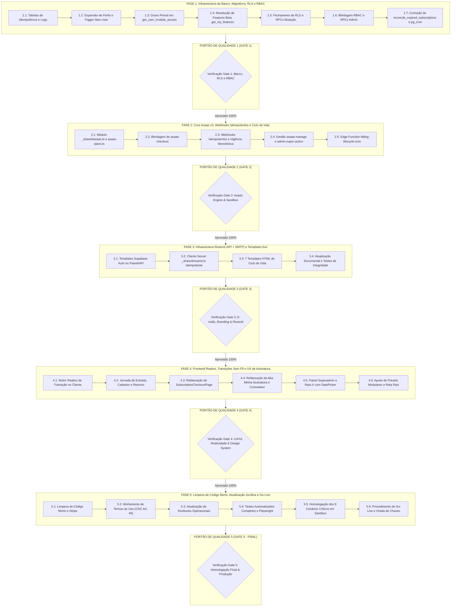

# PLANO MESTRE — ASSINATURAS, ONBOARDING, GATEWAY ASAAS E E-MAILS RESEND (AXIR)

> **Classificação de Governança (`AGENTS.md` §10.5):** Fluxo Completo (Feature / Plano Estrutural — SemVer `MINOR` v3.11.0).  
> **Status do Documento:** CONCLUÍDO COM 100% DE SUCESSO (Fases 1 a 5 Implementadas e Verificadas, Quality Gates 1 a 5 Aprovados).  
> **Escopo Integral:** Ciclo de vida completo do usuário no Axir — Cadastro, Confirmação de E-mail, Onboarding, Trial de 30 dias, Assinatura Mensal e Anual, Antecipação Acumulativa (2 a 11 meses), Transições Automáticas de Estado sem F5, Upgrade/Cancelamento/Estorno CDC, Webhooks Idempotentes Asaas v3, E-mails Transacionais Resend (`axir.com.br`), Blindagem Modular RLS/RPCs e Painel Superadmin com Salvaguarda de Direitos Adquiridos.

> [!CAUTION]
> **Governança Estrita de Credenciais:** Nenhuma chave de API, PAT do Supabase, token Cloudflare ou segredo do Resend/Asaas deve jamais ser gravado em arquivos rastreados pelo Git (`docs/`, `src/`, `supabase/config.toml` ou `.env` versionado). Todas as credenciais operam exclusivamente via `supabase secrets set`, painel de SMTP do Supabase e variáveis de ambiente de build/runtime fora do repositório. Recomenda-se rotacionar nos respectivos painéis quaisquer tokens compartilhados em canais de chat após a conclusão do setup.

---

## 1. ETAPA 1: MAPEAMENTO FORENSE DO ESTADO ATUAL (AS-IS)

Diagnóstico factual obtido por inspeção direta do código-fonte (`src/`, `supabase/migrations/`, `supabase/functions/`, `docs/`) cruzado com verificação em modo somente-leitura da infraestrutura ativa (Supabase projeto `lnsfcajcfofgvpvabwbi`, Cloudflare zona `axir.com.br`, Resend domínio `axir.com.br` e Asaas Sandbox).

### 1.1 Cadastro de Novo Usuário e Trial de 30 Dias Hoje

1. **Portas de entrada existentes:**
   - **Cadastro gratuito (`/cadastro`, `/criar-conta` -> `src/features/auth/pages/register-page.tsx` -> `src/data/auth.ts#signUpWithEmail`):** chama `supabase.auth.signUp` com `emailRedirectTo: getPublicAppUrl("/entrar")` (`https://axir.com.br/entrar`). Como `mailer_autoconfirm = false` no projeto Supabase Cloud, a conta exige clique no link enviado por e-mail antes de abrir sessão.
   - **Cadastro integrado no Checkout (`/assinatura` -> `src/features/subscription/pages/subscription-checkout-page.tsx` -> `supabase/functions/asaas-checkout/index.ts`):** quando acessado sem sessão, envia `registration: { name, email, password }` diretamente para a Edge Function `asaas-checkout`, que cria o usuário no Auth e já instancia cliente + assinatura/cobrança no Asaas na mesma requisição antes da confirmação do e-mail.
2. **Onde a data do Trial é gravada:**
   - O trigger `AFTER INSERT ON auth.users` executa `public.handle_new_user()` (`supabase/migrations/20260101000105_default_family_mode_for_new_users.sql`).
   - Cria atomicamente:
     - `public.profiles` (`role = 'user'`, `status = 'active'`, `approved_at = now()`; o 1º usuário histórico do banco recebe `superadmin` + `lifetime`);
     - `public.user_subscriptions` com `plan_id = 'trial'`, `tier = 'trial'`, `status = 'trialing'` e `trial_ends_at = now() + interval '30 days'` (ou `custom_trial_days` caso haja código válido em `public.access_invites`);
     - `public.user_preferences` (`app_mode = 'investor'`, `familyModeEnabled = true`) e seed das 11 categorias padrão.
   - **Lacuna forense na gravação inicial:** `handle_new_user()` na migration `105` não preenche a coluna `trial_started_at` criada posteriormente na migration `114` (deixando `trial_started_at = NULL` em cadastros novos). Além disso, o relógio de 30 dias dispara no `INSERT` de `auth.users` (antes de o usuário confirmar o e-mail).
3. **Quem controla a expiração e o que acontece ao expirar:**
   - **Controle em tempo real (Autoritativo no Banco — Funcional):** as funções SQL `public.can_current_user_write()` (`migration 116`), `public.get_user_module_access()` (`migration 118`) e `public.get_my_subscription()` (`migration 117`) verificam dinamicamente `trial_ends_at > now()`.
   - Ao atingir `trial_ends_at <= now()` sem assinatura ativa:
     - O RLS de escrita (`can_current_user_write_module`) bloqueia `INSERT/UPDATE/DELETE` nas tabelas operacionais;
     - `get_my_subscription()` projeta `billing_phase = 'trial_expired'`, `tier = 'read_only'`, `is_read_only = true`, `can_write = false` e `has_used_trial = true`;
     - Nenhum dado do usuário é excluído; a UI exibe `ReadOnlyBanner` e o hook `useMutationGuard` intercepta tentativas de escrita abrindo o `UpgradeDialog`.
   - **Controle em background / persistência física de status (Quebrado Hoje):** a função `public.reconcile_expired_subscriptions()` (`migration 118`) nunca é executada porque a extensão `pg_cron` não está instalada no banco remoto (`extensions: plpgsql, pg_stat_statements, uuid-ossp, pgcrypto, supabase_vault`), e possui erro fatal de tipagem no enum `subscription_status` (detalhado na §1.4).

### 1.2 Integração com o Asaas Hoje

1. **Catálogo de planos alinhado:**
   - `public.plans` no banco remoto, `src/domain/subscription/plans.ts` e `supabase/functions/_shared/asaas-plans.ts` estão sincronizados em 4 registros canônicos:
     - `trial` (`R$ 0,00`, 30 dias, interno);
     - `pro_monthly` (`R$ 19,99/mês` = `1999` centavos, ciclo `MONTHLY`);
     - `pro_annual` (`R$ 143,88/ano` = `14388` centavos, equivalente a `R$ 11,99/mês`, 40% OFF, ciclo `YEARLY`);
     - `lifetime` (`R$ 0,00`, VIP/interno).
2. **Criação de cliente (`_shared/asaas.ts#findOrCreateAsaasCustomer`):**
   - Consulta `GET /customers?cpfCnpj=...`, depois `GET /customers?email=...`, e caso não encontre faz `POST /customers` com `notificationDisabled: false`.
3. **Assinatura Mensal e Anual (`asaas-checkout/index.ts`):**
   - **Cartão de Crédito (`monthly` ou `annual`):** valida Luhn, validade e CVV; cria assinatura via `POST /subscriptions` (`billingType: "CREDIT_CARD"`). Se o servidor detectar trial ativo inédito (`isDelayedByTrial`), envia `nextDueDate = trial_ends_at` (mantendo `tier = 'trial'`, `scheduled_plan_id` e `scheduled_first_charge_at`). Caso contrário, cobra hoje e já grava `tier = planMeta.planId`, `status = 'active'` (ou `'incomplete'`) e `current_period_end = now + 1m/12m`.
   - **Pix (`annual` apenas):** bloqueado no mensal; cria cobrança avulsa via `POST /payments` (`billingType: "PIX"`, valor `143.88`), busca QR Code (`GET /payments/{id}/pixQrCode`), reaproveita cobrança pendente `< 1h` e insere `billing_intents` (`kind = 'subscription_start'`). A ativação depende do webhook e a UI faz polling de `USER_SUBSCRIPTION_KEY` a cada 3,5s.
4. **Pagamento antecipado de meses à frente (`kind === "cumulative_months"`):**
   - Restrito a assinantes `pro_monthly` com `status = 'active'` e sem `pending_plan_id`, permitindo de **2 a 11 meses** exclusivamente via **Pix** com descontos progressivos (`2–3m: 5%`, `4–6m: 10%`, `7–9m: 15%`, `10–11m: 20%`; `>= 12m` sugere o Plano Anual com 40% OFF).
   - Cria registro em `public.billing_intents` (`kind = 'cumulative_renewal'`), gera Pix avulso no Asaas e aguarda o webhook.
   - No webhook (`asaas-webhook/index.ts`), marca a `billing_intent` como `paid`, soma `months_count` sobre `current_period_end` via `addCivilMonthsServer` e envia `PUT /subscriptions/{id}` com `{ nextDueDate: targetDueDate, updatePendingPayments: false }`.
5. **Gestão da Assinatura (`asaas-manage/index.ts`):**
   - Implementa 6 ações: `schedule-plan-change`, `cancel-scheduled-plan-change`, `cancel` (com regra CDC de 7 dias estornando via `POST /payments/{id}/refund`, ou `cancel_at_period_end = true` após 7 dias via `DELETE /subscriptions/{id}`), `update-card` (`POST /subscriptions/{id}/creditCard`), `list-invoices` (`GET /payments?customer=...`) e `upgrade-to-annual`.
6. **Webhooks (`asaas-webhook/index.ts` + `_shared/asaas-webhook-logic.ts`):**
   - Valida header `asaas-access-token` com comparação em tempo constante via SHA-256 (`timingSafeEqualString`).
   - No Asaas Sandbox, o webhook `https://lnsfcajcfofgvpvabwbi.supabase.co/functions/v1/asaas-webhook` está ativo com `sendType: SEQUENTIALLY` e os eventos `PAYMENT_RECEIVED`, `PAYMENT_CONFIRMED`, `PAYMENT_OVERDUE`, `PAYMENT_DELETED` e `SUBSCRIPTION_DELETED` (**ausente `PAYMENT_REFUNDED`**).

### 1.3 Integração com o Resend e Cloudflare DNS Hoje

1. **DNS Cloudflare (`axir.com.br`) e Domínio Resend:**
   - Zona `axir.com.br` ativa na Cloudflare (`e8439467d8d8b9228cc3b54d5a529365`).
   - Domínio `axir.com.br` (`id: 5738313f-a8cd-4a1b-abea-f98986f00988`, região `us-east-1`) **já consta como `verified` no Resend**, com todos os registros DNS autenticados:
     - `TXT resend._domainkey.axir.com.br` (DKIM RSA verificado);
     - `MX send.axir.com.br` + `TXT send.axir.com.br` (`v=spf1 include:amazonses.com ~all` — Return-Path customizado verificado);
     - `CNAME rsend.axir.com.br` (`send.forge.rmta.net` — verificado);
     - `TXT _dmarc.axir.com.br` (`v=DMARC1; p=reject;` — política estrita anti-spoofing ativa).
   - O token Cloudflare inspecionado possui escopo `Zone:Read` (sem `DNS:Edit`) e expiração curta (`2026-11-19T02:25:01Z`), mas **nenhuma alteração de DNS é necessária**, pois `axir.com.br` já está integralmente autenticado para envio no Resend.
2. **Supabase Auth SMTP:**
   - Já configurado em produção apontando para `smtp.resend.com` (porta `465`, usuário `resend`, remetente `Axir <suporte@axir.com.br>`), com assuntos atualizados para `Axir`.
3. **Onde ficam os templates HTML e quais gatilhos existem:**
   - Documentados apenas para cópia manual em `docs/platforms/EMAIL_TEMPLATES.md` (4 templates do Supabase Auth: `Confirm signup`, `Reset password`, `Invite user`, `Change email address`), auditados por `src/tests/email-templates-integrity.test.ts`.
   - **Inconsistência de marca:** `docs/platforms/EMAIL_TEMPLATES.md` e `src/tests/email-templates-integrity.test.ts` ainda usam a marca antiga **`Áxis Finance`** e o domínio fictício `axis.finance`. No painel do Supabase Auth, os templates contêm mistura residual de `Áxis` com `Axir`, e as notificações de segurança (`password_changed`, `email_changed`, `mfa_factor_enrolled`, `mfa_factor_unenrolled`) estão em inglês cru sem layout (`<h2>Your password was changed</h2>`).
   - **Ausência total de Resend nas Edge Functions:** o secret `RESEND_API_KEY` não está cadastrado nas Edge Functions do Supabase e não existe cliente HTTP do Resend em `supabase/functions/_shared/`. Zero e-mails transacionais são enviados para eventos de faturamento (boas-vindas pós-confirmação, cartão agendado no trial, pagamento/renovação confirmada, antecipação acumulativa, falha no cartão `past_due`, aviso de fim de trial, cancelamento ou estorno CDC).

### 1.4 Brechas de Segurança, Riscos de Cobrança Duplicada, Bugs e Inconsistências de UX

| ID | Severidade | Localização Exata | Diagnóstico Forense do Problema |
|---|---|---|---|
| **F-01** | **CRÍTICA (Quebra de Renovação)** | `supabase/functions/_shared/asaas-webhook-logic.ts` (L137–L148) | **Renovações do 2º mês em diante são ignoradas:** a trava `currentSub.asaas_subscription_id === payment.subscription` faz com que todo pagamento recorrente subsequente da mesma assinatura retorne `ignore_duplicate` (`already_active`). `current_period_end` nunca avança no 2º ciclo e o assinante pagante cai em `read_only`. |
| **F-02** | **CRÍTICA (Cobrança Dupla + Perda de Meses)** | `supabase/functions/asaas-webhook/index.ts` (L169–L179) e `asaas-webhook-logic.ts` (L153) | **Armadilha Asaas na antecipação acumulativa:** `PUT /subscriptions/{id}` com `updatePendingPayments: false` altera `nextDueDate`, mas **não remove nem reagenda a cobrança `PENDING` já emitida para o mês vigente**. No vencimento original, o cartão é cobrado mesmo após o Pix antecipado e, se processado pelo webhook, `computeNextPeriodEnd` calcula `hoje + 1 mês`, sobrescrevendo os meses comprados. |
| **F-03** | **CRÍTICA (Cobrança Dupla)** | `supabase/functions/asaas-checkout/index.ts` (L437–L511) e `asaas-webhook/index.ts` (L251) | **Assinaturas órfãs duplicadas no Asaas:** ao refazer checkout (ex: `trial_scheduled` trocando plano, `past_due` trocando método ou `pro_monthly` pagando Anual via Pix), o código cria nova assinatura/pagamento **sem cancelar (`DELETE /subscriptions/{oldId}`) a assinatura anterior no Asaas**, deixando duas recorrências ativas cobrando o mesmo cliente. |
| **F-04** | **CRÍTICA (Crash SQL)** | `supabase/migrations/20260101000118_harden_modular_access_period_expiration.sql` (L143) e `asaas-checkout/index.ts` (L314) | **Valor inválido de Enum:** `reconcile_expired_subscriptions()` executa `SET status = 'expired'::public.subscription_status`, mas o enum real no Postgres contém apenas `('trialing', 'active', 'past_due', 'canceled', 'read_only_expired', 'incomplete')`. Qualquer chamada à função aborta com erro `22P02`. |
| **F-05** | **ALTA (Carding / Conta Trancada)** | `supabase/functions/asaas-checkout/index.ts` (L57–L95) | **Checkout anônimo público sem CAPTCHA/confirmação:** `asaas-checkout` (`verify_jwt = false`) cria contas e submete cartões ao Asaas sem sessão autenticada e sem Turnstile. Permite *card testing* automatizado e permite pagar Pix/cartão com e-mail digitado errado, trancando o pagante fora da conta (`mailer_autoconfirm = false`). |
| **F-06** | **ALTA (Cancelamento Indevido)** | `supabase/functions/_shared/asaas-webhook-logic.ts` (L181–L191) | **`PAYMENT_DELETED` cancela assinatura inteira:** tratar `PAYMENT_DELETED` igual a `SUBSCRIPTION_DELETED` faz com que a exclusão de um QR Code Pix vencido ou de uma parcela pendente reajustada marque `cancel_at_period_end = true` na assinatura ativa do cliente. |
| **F-07** | **ALTA (Webhook Cego a Estorno)** | Painel Asaas Webhook + `GUIA_CONFIGURACAO_MANUAL_GO_LIVE.md` (L109–L113) | **`PAYMENT_REFUNDED` não cadastrado no Asaas:** o código trata `PAYMENT_REFUNDED`, mas o webhook configurado no Asaas não assina esse evento — estornos feitos diretamente no painel Asaas nunca rebaixam o acesso no banco. |
| **F-08** | **ALTA (Conflito de Upgrade)** | `supabase/functions/asaas-manage/index.ts` (L374–L409) e `cumulative-renewal-card.tsx` (L224) | **Upgrade anual sem confirmação e sem cobrança:** o botão "Mudar para o Anual" aciona `upgrade-to-annual` em 1 clique sem modal, promovendo `tier = 'pro_annual'` imediatamente sem cobrar R$ 143,88 no ato, enquanto `schedule-plan-change` está órfão na UI. |
| **F-09** | **ALTA (Perda de Trial Grátis)** | `supabase/functions/asaas-manage/index.ts` (L166–L260) | **Cancelar agendamento no Trial mata os dias gratuitos:** se um usuário em `trial_scheduled` (que nunca foi cobrado) cancelar a renovação, `asaas-manage` preenche `trial_consumed_at = now()`, fazendo `get_my_subscription()` encerrar imediatamente os dias restantes de teste gratuito para `read_only`. Além disso, na 1ª cobrança pós-trial, `asaas-webhook` não preenche `billing_start_at`, anulando os 7 dias do CDC. |
| **F-10** | **ALTA (Antifraude Produção)** | `supabase/functions/_shared/asaas.ts` (L285–L287, L401–L403) e `asaas-checkout` (L135) | **Dados fictícios hardcoded no Cartão:** envia `postalCode: "01310100"`, `addressNumber: "1"`, `phone: "11999999999"` e fallback `cpfCnpj: "00000000000"`. Em produção no Asaas, o motor antifraude recusa cartões legítimos por divergência cadastral; buscar `cpfCnpj=00000000000` colide clientes. |
| **F-11** | **MÉDIA (Grace Period Inoperante)** | `supabase/migrations/20260101000118_harden_modular_access_period_expiration.sql` (L88–L109) | **Divergência no Grace Period de 3 dias:** `can_current_user_write()` concede 3 dias de tolerância em `past_due`, mas `get_user_module_access()` retorna `'read'` imediatamente em `past_due`, bloqueando a escrita nos módulos na primeira falha de cartão. |
| **F-12** | **MÉDIA (Gateway JWT / CORS)** | `supabase/config.toml` (L410) e `package.json` (L32) | **`asaas-manage` com `verify_jwt = true`:** enquanto `asaas-checkout` usa `--no-verify-jwt` + `auth.getUser()` no handler para suportar `SUPABASE_JWKS` / preflight CORS sem falso `401`, `asaas-manage` mantém `verify_jwt = true` no gateway. |
| **F-13** | **MÉDIA (Validação Server-Side)** | `supabase/functions/asaas-checkout/index.ts` (L161–L198, L237) | **Teto acumulado ausente no servidor:** o backend não valida se `current_period_end` já ultrapassa 11 meses no futuro em `cumulative_months` e não envia `externalReference: intent.id` ao `POST /payments` do Asaas. |
| **F-14** | **BAIXA (Bugs Silenciosos / Dev)** | `asaas-webhook/index.ts` (L220, L294), `_shared/telegram.ts` (L102, L172), `subscription-checkout-page.tsx` (L375) | Webhook faz `select("full_name, email")` em `profiles` (a coluna real é `name`, retornando erro e `profile = null`); `_shared/telegram.ts` contém emoji e domínio antigo `axisfinancas.com.br`; checkout em `DEV` engole erro de cartão e redireciona para sucesso falso; `Turnstile` usa siteKey fixa de teste sem script Cloudflare. |
| **F-15** | **BAIXA (Código Morto / Legado)** | `src/domain/subscription/plans.ts` (L128–L192), `terms-page.tsx`, `privacy-page.tsx`, `.env.example` | Cálculo órfão de reembolso pró-rata anual (`calculateCancellationRefund`), menções residuais ao gateway `Stripe` em páginas legais/tipos/env e ausência de exibição do `cardLast4` na aba Minha Assinatura. |
| **F-16** | **CRÍTICA (Bypass de Read-Only em RLS e RPCs)** | Policies RLS (`categories`, `asset_prices`, `families*`, `trips*`, `public_shares`) e RPCs `SECURITY DEFINER` (`refinance_credit_card_bill`, `materialize_recurrences`, `allocate_goal_deposit`, `create_family`, `create_trip`) | Módulos adicionados após a migration `050` não validam `can_current_user_write()` nem `can_current_user_write_module()`. Um usuário expirado (`read_only`) ou com módulo bloqueado (`none`/`read`) consegue gravar diretamente no banco chamando essas tabelas ou RPCs `SECURITY DEFINER`. |
| **F-17** | **ALTA (Módulos Beta Bloqueados Mesmo Liberados)** | `src/state/queries/use-user-access.ts` (L301–L316) e `public.get_my_features()` | `get_my_features()` retorna `false` para qualquer feature com `default_enabled_for_new_users = false` (como `bank_notification_listener`). Em `useUserAccess`, `if (features[key] === false) return false` intercepta na linha 301 antes de consultar `subscription.moduleAccess`, tornando inoperante a concessão individual feita pelo Superadmin em `user_module_permissions`. |
| **F-18** | **ALTA (Superadmin Apaga Datas e Dessincroniza Asaas)** | `public.admin_set_user_subscription` e `src/features/admin/components/user-edit-dialog.tsx` (L112) | Ao salvar plano no painel Admin, `p_trial_ends_at` e `p_current_period_end` são enviados como `NULL`: (a) conceder `trial` cria um trial já expirado (`trial_ends_at = NULL` cai em `trial_expired`); (b) promover para `lifetime` ou rebaixar para `read_only` um cliente pagante **não cancela a assinatura no Asaas** (gerando cobrança indevida contínua) ou suprime dias já pagos pelo consumidor. |
| **F-19** | **ALTA (Bug Visual em Plano Vitalício VIP)** | `src/features/settings/components/tabs/subscription-tab.tsx` (L447–L605) e `subscription-context.tsx` (L17) | Para contas `tier = 'lifetime'`, o backend retorna `is_lifetime = true` e `is_pro = false`. Como `StatusBlock` só testa `hasAutoRenew`, `isTrial` e `isPro`, todo usuário **Vitalício VIP** vê na aba Plano o aviso incorreto *"Modo Somente-Leitura — Trial encerrado"* com botão de compra, e `SubscriptionProvider` grava ícone `FREE`. |
| **F-20** | **ALTA (Atraso nas Transições Automáticas de Estado)** | `src/state/queries/use-user-access.ts` (L29–L34, L254–L274) e `cumulative-renewal-card.tsx` (L100–L110) | `VITE_ENABLE_REALTIME` é `false` por padrão e `staleTime` é de **5 minutos** sem timer de expiração local nem refetch imediato no retorno do app bancário (`visibilitychange`). Se o trial/período vencer com a aba aberta ou se o Superadmin alterar permissões/plano, a UI demora até 5 minutos para refletir. No `CumulativeRenewalCard`, o modal Pix não fecha nem avisa quando o pagamento é confirmado. |
| **F-21** | **MÉDIA (Vazamento de Rotas em Overrides Modulares)** | `src/features/admin/components/user-edit/admin-module-catalog.ts` (L31–L44) e `src/app/authenticated-root.tsx` (L20–L35) | O preset rápido *"Apenas Investimentos"* esquece de bloquear `insights: 'none'` (mantendo `/insights` visível), e `AuthenticatedRoot` renderiza `<OverviewPage />` na rota `/` mesmo se o Superadmin bloquear `overview = 'none'` individualmente. |
| **F-22** | **MÉDIA (Escopo RBAC Admin vs Superadmin)** | `admin_set_user_subscription`, `admin_set_user_module_permission`, `admin_toggle_global_feature` | Exigem apenas `is_admin()` sem impedir que um `admin` comum altere plano/módulos de um `superadmin` e sem restringir Kill-Switches globais da plataforma exclusivamente a `is_superadmin()`. |
| **F-23** | **BAIXA (Fricções de Conforto em UX)** | `register-page.tsx` (L244–L276), `subscription-checkout-page.tsx` (L620, L956) | Tela pós-cadastro não possui botão de *"Reenviar e-mail de confirmação"* com cooldown; pagar Anual via Pix durante o Trial hoje desperdiça os dias gratuitos restantes em vez de somá-los aos 12 meses; tela do QR Code Pix não exibe botão manual *"Já paguei, verificar agora"* nem contador regressivo dinâmico. |

### 1.5 Diagnóstico Específico: Transições Automáticas, Permissões Modulares e Superadmin

1. **Transição entre Planos, Estados de Trial e Permissões:**
   - **No Backend (SQL):** a máquina de estados em `get_my_subscription()` calcula corretamente `trial_active`, `trial_scheduled`, `trial_expired`, `active`, `past_due`, `canceled_until_period_end`, `lifetime` e `read_only` a cada chamada, mas a persistência física depende de `reconcile_expired_subscriptions()` (hoje inoperante por `F-04` e ausência de `pg_cron`).
   - **No Frontend (React/TanStack Query):** como o WebSocket Realtime fica desabilitado por padrão (`VITE_ENABLE_REALTIME !== 'true'`) para evitar erros de proxy/WebSocket e o `staleTime` está fixado em 5 minutos, a transição **não é instantânea** quando: (a) o relógio cruza `trial_ends_at` ou `current_period_end` durante o uso; (b) o usuário retorna do aplicativo do banco no celular após pagar um Pix; ou (c) o Superadmin altera plano, status ou módulos do usuário.
2. **Funcionamento das Restrições de Módulo e Edição pelo Superadmin:**
   - A matriz granular em `UserEditDialog` (`write` / `read` / `none` por módulo + presets rápidos) já possui excelente fundação visual e grava em `user_module_permissions`, refletindo em `Sidebar`, `BottomNav`, `MoreMenuSheet`, `RequireFeature` e `useMutationGuard`.
   - Porém, para que funcione com **100% de segurança e respeito aos direitos do usuário**, é indispensável corrigir: (a) o bloqueio indevido de módulos Beta em `hasFeature` (`F-17`); (b) as tabelas e RPCs `SECURITY DEFINER` sem checagem de módulo/escrita (`F-16`); (c) a proteção de datas pagas e sincronização com o Asaas quando o Superadmin edita manualmente uma assinatura (`F-18`); e (d) a trava hierárquica `is_superadmin()` (`F-22`).

---

## 2. ETAPA 2: AUTO-REVISÃO CRÍTICA DO ESCOPO E DAS PREMISSAS

Com base nas evidências da Etapa 1 e no comportamento real da API v3 do Asaas, do Supabase Auth e do Resend, ajustamos as premissas técnicas para eliminar conflitos arquiteturais antes de escrever código:

### 2.1 Resolução Definitiva da Antecipação Acumulativa no Asaas (2 a 11 Meses)
- **Conflito técnico identificado:** no Asaas, assinaturas recorrentes (`POST /subscriptions`) geram automaticamente uma cobrança filha (`payment` com `status = 'PENDING'`) para o próximo ciclo. Apenas atualizar `PUT /subscriptions/{id}` com `nextDueDate` e `updatePendingPayments: false` mantém viva a cobrança `PENDING` do mês corrente, causando cobrança dupla no cartão. Por outro lado, usar `updatePendingPayments: true` pode alterar indevidamente valores caso haja mudança agendada.
- **Diretriz técnica blindada:**
  1. Ao confirmar no webhook uma `billing_intent` do tipo `cumulative_renewal` (2 a 11 meses pagos via Pix), calculamos `newPeriodEnd = addCivilMonthsServer(max(current_period_end, now), monthsCount)`.
  2. Executamos a rotina atômica `postponeAsaasSubscriptionAfterPrepayment(subscriptionId, targetDueDate)`:
     - Passo 1: `PUT /subscriptions/{subscriptionId}` com `{ nextDueDate: targetDueDate, updatePendingPayments: false }`;
     - Passo 2: `GET /subscriptions/{subscriptionId}/payments?status=PENDING` e, para toda cobrança `PENDING` cujo `dueDate < targetDueDate`, executamos `DELETE /payments/{pendingPaymentId}` (removendo qualquer débito agendado dentro do período já quitado via Pix).
  3. Como `PAYMENT_DELETED` passará a atualizar apenas `billing_intents` pendentes (nunca cancelando a assinatura), a remoção da fatura pendente não afeta o status `active` do assinante.
  4. Caso qualquer chamada de sincronização ao Asaas falhe por instabilidade externa de rede, `asaas_sync_status` permanece `'pending_resync'` para reprocessamento automático na rotina de reconciliação.

### 2.2 Idempotência Estrita e Avanço Correto de Renovação nos Webhooks
- **Conflito técnico identificado:** o Asaas envia `PAYMENT_CONFIRMED` e posteriormente `PAYMENT_RECEIVED` para o mesmo `payment.id` (com `event.id` distintos). A heurística antiga por `asaas_subscription_id` bloqueava renovações futuras; já o cálculo `computeNextPeriodEnd(tier, referenceDate)` encurtava ou apagava meses acumulados.
- **Diretriz técnica blindada:**
  1. **Desduplicação em duas camadas:**
     - Camada 1 (`provider_event_id`): se o `event.id` já existir em `billing_webhook_logs` com `processed_at IS NOT NULL`, retorna `200 OK` imediato (`duplicate_event`);
     - Camada 2 (`payment.id`): controle de pagamentos liquidados via `public.billing_processed_payments` com `UNIQUE(provider, provider_payment_id)`. Assim, `PAYMENT_CONFIRMED` liquida `pay_X` uma única vez, `PAYMENT_RECEIVED` de `pay_X` é ignorado com segurança, e `pay_Y` no mês seguinte avança o ciclo normalmente.
  2. **Matemática monotônica de vigência (`current_period_end`):**
     - Em toda ativação/renovação de ciclo (`1 mês` ou `12 meses`), a base de soma será `baseDate = (currentSub.current_period_end && currentSub.current_period_end > now) ? currentSub.current_period_end : referenceDate`, garantindo que renovações nunca reduzam dias já pagos (mesmo em migração imediata de Mensal para Anual via Pix ou pós-antecipação).
  3. **Consulta real da 1ª cobrança no Checkout de Cartão imediato:**
     - Após `POST /subscriptions` sem trial diferido, `asaas-checkout` consulta `GET /subscriptions/{id}/payments?limit=1` para gravar o `asaas_payment_id` inicial e verificar se o pagamento já está `CONFIRMED`/`RECEIVED` (`status = 'active'`) ou ainda `PENDING` em análise antifraude (`status = 'incomplete'`, liberado segundos depois pelo webhook `PAYMENT_CONFIRMED`), evitando acesso gratuito com cartão recusado assincronamente.

### 2.3 Blindagem Anti-Duplicidade de Assinaturas e Fluxo Único de Autenticação
- **Regra de unicidade no Asaas:** antes de criar qualquer nova assinatura de cartão ou ativar um Pix Anual em conta que já possua `asaas_subscription_id` anterior, o backend executa `cancelPreviousAsaasSubscriptionSafely(oldSubscriptionId)` e limpa agendamentos obsoletos.
- **Porta única autenticada no Checkout:** `asaas-checkout` exigirá obrigatoriamente JWT válido (`userClient.auth.getUser()`), removendo a criação anônima de usuários dentro da Edge Function de pagamento. Visitantes não logados que clicarem em "Assinar Plano Pro" serão conduzidos por `/cadastro?plano=pro-anual` (ou `/entrar?plano=pro-anual`), confirmando o e-mail com preservação de `?plano=...` no `emailRedirectTo` até desembocar autenticado em `/assinatura?plano=...`.
- **Padronização de Edge Functions (`verify_jwt = false` no gateway + validação explícita no handler):** tanto `asaas-checkout` quanto `asaas-manage` usarão `verify_jwt = false` no `supabase/config.toml` e no script `deploy:functions`, validando o JWT de forma fail-closed via `userClient.auth.getUser()` dentro do código — eliminando rejeições `401` por rotação de chaves assimétricas (`SUPABASE_JWKS` / `ES256`) ou preflight `OPTIONS`.
- **Trava anti-mismatch Sandbox vs. Produção:** `_shared/asaas.ts` validará na inicialização a coerência entre o prefixo da `ASAAS_API_KEY` (`hmlg` vs `prod`) e o host resolvido (`api-sandbox.asaas.com` vs `api.asaas.com`), impedindo falhas silenciosas de credencial cruzada.

### 2.4 Transição Reativa Sem F5, Blindagem Modular Completa e Salvaguardas no Superadmin
- **Transição automática instantânea no cliente (sem depender exclusivamente de WebSocket):**
  1. Reduzir `staleTime` de `user_subscription`, `user_access` e `user_features` para `30s` e ativar revalidação imediata em `visibilitychange === 'visible'` e `window.focus` (com *throttle* de 10s), garantindo atualização instantânea assim que o cliente volta do app bancário no celular ou alterna de aba após uma edição do Superadmin;
  2. Criar hook `useSubscriptionBoundaryTimer` que agenda um `setTimeout` exato para o próximo marco temporal (`trialEndsAt`, `currentPeriodEnd` ou `pendingPlanEffectiveAt`), invalidando `USER_SUBSCRIPTION_KEY` no exato segundo da virada para transicionar badges, banners e permissões sem recarregar a página;
  3. Unificar a resolução de módulos (`get_my_features()` retornará `false` apenas quando `is_globally_enabled = false` ou `ufo.is_enabled = false`, delegando o controle de módulos Beta e permissões `'none' | 'read' | 'write'` integralmente a `subscription.moduleAccess` em `useUserAccess` e `usePermission`).
- **Fechamento integral de brechas modulares no Postgres (RLS + RPCs):**
  - Aplicar `can_current_user_write()` / `can_current_user_write_module(...)` em todas as políticas RLS de escrita remanescentes (`categories`, `asset_prices`, `families*`, `trips*`, `public_shares`) e nas RPCs `SECURITY DEFINER` de mutação (`refinance_credit_card_bill`, `materialize_recurrences`, `allocate_goal_deposit`, `create_family`, `invite_family_member`, `remove_family_member`, `record_family_settlement`, `set_entity_family_id`, `create_trip`, `delete_trip_expense_sync`, `record_trip_settlements`, `unlink_trip_member`), preservando intactas apenas operações de direito fundamental do titular (leitura/exportação de dados, suporte, gestão de sessões/dispositivos e exclusão de conta LGPD).
- **Governança do Superadmin com Proteção aos Direitos do Assinante:**
  1. Restringir `admin_toggle_global_feature` a `is_superadmin()`, e bloquear qualquer `admin` comum de editar assinatura, status ou módulos de contas `superadmin`;
  2. Refatorar `admin_set_user_subscription` e estender `admin-super-action` (`action: "admin_update_subscription"`) para:
     - Nunca zerar acidentalmente `trial_ends_at` ou `current_period_end` (aplicando defaults inteligentes se omitidos: `+30d` para `trial`, preservação ou data explícita escolhida pelo Superadmin para `pro_monthly`/`pro_annual`);
     - Se o usuário possuir `asaas_subscription_id` recorrente ativa e o Superadmin conceder **Plano Vitalício VIP (`lifetime`)** ou cancelar a assinatura, cancelar automaticamente a cobrança futura no Asaas para **impedir cobrança indevida no cartão do cliente**;
     - Se o usuário possuir período já pago vigente (`current_period_end > now()`), exibir alerta explícito no `UserEditDialog` protegendo por padrão o direito adquirido até `current_period_end` (exigindo confirmação deliberada apenas em caso de estorno/fraude).
- **Valorização de Pix Anual durante o Trial:** caso um usuário em `trial_active` opte voluntariamente por pagar o **Plano Pro Anual via Pix** antes do fim dos 30 dias grátis, os dias restantes de trial serão **somados integralmente aos 12 meses** (`newPeriodEnd = addCivilMonthsServer(max(now, trial_ends_at), 12)`), garantindo zero perda de dias gratuitos e máxima transparência no checkout.

---

## 3. ETAPA 3: DECISÕES DE NEGÓCIO ALINHADAS (ZERO PENDÊNCIAS)

Todas as ambiguidades de negócio foram resolvidas diretamente com o fundador antes do fechamento deste plano. Não restam perguntas em aberto:

| # | Tema de Negócio | Decisão Canônica Aprovada |
|---|---|---|
| **D-01** | **Meios de Pagamento no Asaas** | **Sem Boleto.** Plano Pro Mensal (`R$ 19,99`): exclusivamente **Cartão de Crédito recorrente**. Plano Pro Anual (`R$ 143,88`): **Cartão de Crédito recorrente** ou **Pix à vista**. Antecipação Acumulativa de 2 a 11 meses: exclusivamente **Pix à vista**. |
| **D-02** | **Política de Upgrade (Mensal -> Anual)** | **Zero perda de dias pagos e zero cobrança dupla:** (a) via **Cartão**, agenda a troca de ciclo (`schedule-plan-change` com modal de confirmação) para `current_period_end`, passando a cobrar `R$ 143,88/ano` na próxima renovação (removendo a ação defeituosa `upgrade-to-annual`); (b) caso o assinante Mensal opte por pagar o **Pix Anual imediato** no checkout, o webhook cancela a assinatura mensal de cartão no Asaas e soma **+12 meses** sobre `max(now, current_period_end)`. |
| **D-03** | **Política de Cancelamento e Reembolso** | **Três regras claras:** (1) Em **Trial Agendado (`trial_scheduled`)**: cancelar no app deleta a assinatura agendada no Asaas, limpa o cartão agendado e **preserva integralmente os dias gratuitos restantes** até `trial_ends_at`; (2) **Até 7 dias corridos da 1ª cobrança efetivamente paga (CDC Art. 49)**: estorno integral automático de 100% no Asaas e retorno imediato ao modo `read_only`; (3) **Após 7 dias (Mensal, Antecipado ou Anual)**: sem reembolso pró-rata; cancela a renovação futura no Asaas (`cancel_at_period_end = true`) e mantém acesso Pro completo até `current_period_end`. |
| **D-04** | **Autenticação antes do Checkout & Antifraude** | **Sessão autenticada obrigatória** para invocar `asaas-checkout` (visitantes criam/confirmam conta antes do pagamento preservando `?plano=...`) + coleta obrigatória de **CPF, Celular e CEP + Número** no checkout/troca de Cartão de Crédito (eliminando dados fictícios no antifraude do Asaas) + ativação real do Cloudflare Turnstile nas telas públicas de Auth. |
| **D-05** | **Domínio Resend e Comunicação Transacional** | Utilizar o domínio já verificado **`axir.com.br`** (`Axir <nao-responda@axir.com.br>` com `Reply-To: suporte@axir.com.br`), configurar `notificationDisabled: true` nos clientes do Asaas e centralizar **100% dos e-mails de Auth e Ciclo de Assinatura** no Resend com templates HTML exclusivos da marca **Axir** (zero menções a `Áxis Finance` e zero emojis). |

---

## 4. MATRIZ DE RASTREABILIDADE (FALHAS VS FASES)

A tabela abaixo garante que nenhuma falha forense ou decisão aprovada fique desamparada na execução:

| Item Diagnóstico | Fase de Execução | Portão de Qualidade | Status Alvo |
|---|---|---|---|
| **F-04** (Crash SQL `expired` enum) | **Fase 1** (Etapa 1.7) | Gate 1 (Pass/Fail) | Enum corrigido para `read_only_expired` + `pg_cron` |
| **F-11** (Grace period 3d divergente) | **Fase 1** (Etapa 1.3) | Gate 1 (Pass/Fail) | `get_user_module_access` alinhado a `can_current_user_write` |
| **F-16** (Bypass RLS/RPCs sem módulo) | **Fase 1** (Etapa 1.5) | Gate 1 (Pass/Fail) | 100% de tabelas e RPCs com `can_current_user_write_module` |
| **F-17** (Módulos Beta bloqueados) | **Fase 1** (Etapa 1.4) + **Fase 4** (Etapa 4.1) | Gate 1 & Gate 4 | `get_my_features` respeita permissões do Superadmin |
| **F-18** (Superadmin apaga datas / Asaas) | **Fase 1** (Etapa 1.6) + **Fase 2** (Etapa 2.4) + **Fase 4** (Etapa 4.5) | Gate 1, Gate 2 & Gate 4 | Defaults seguros + cancelamento Asaas ao virar `lifetime` |
| **F-22** (RBAC Admin vs Superadmin) | **Fase 1** (Etapa 1.6) | Gate 1 (Pass/Fail) | Trava hierárquica `is_superadmin()` estrita |
| **F-01** (Quebra de renovação 2º mês) | **Fase 2** (Etapa 2.3) | Gate 2 (Pass/Fail) | Desduplicação por `billing_processed_payments` |
| **F-02** (Cobrança dupla antecipação Pix) | **Fase 2** (Etapa 2.1 e 2.3) | Gate 2 (Pass/Fail) | Adiamento com `DELETE /payments/{pendingId}` das faturas pendentes |
| **F-03** (Assinaturas órfãs no Asaas) | **Fase 2** (Etapa 2.1 e 2.2) | Gate 2 (Pass/Fail) | `ensurePreviousSubscriptionCanceled` no checkout e upgrade Pix |
| **F-05** (Carding / checkout anônimo) | **Fase 2** (Etapa 2.2) + **Fase 4** (Etapa 4.2) | Gate 2 & Gate 4 | Sessão JWT obrigatória + Turnstile ativo |
| **F-06** (`PAYMENT_DELETED` destrutivo) | **Fase 2** (Etapa 2.3) | Gate 2 (Pass/Fail) | `PAYMENT_DELETED` afeta apenas `billing_intents` pendentes |
| **F-07** (Webhook cego a estorno) | **Fase 2** (Etapa 2.3) | Gate 2 (Pass/Fail) | `PAYMENT_REFUNDED` e `CHARGEBACK` integrados no webhook |
| **F-08** (Upgrade anual fake sem cobrança) | **Fase 2** (Etapa 2.4) + **Fase 4** (Etapa 4.4) | Gate 2 & Gate 4 | `upgrade-to-annual` extinto; `schedule-plan-change` + Pix Anual |
| **F-09** (Perda de trial ao cancelar) | **Fase 2** (Etapa 2.4) | Gate 2 (Pass/Fail) | `trial_scheduled` cancela cartão e mantém dias grátis |
| **F-10** (Antifraude Asaas dados falsos) | **Fase 2** (Etapa 2.1) + **Fase 4** (Etapa 4.3) | Gate 2 & Gate 4 | Celular, CEP e Número reais validados |
| **F-12** (Gateway JWT `verify_jwt`) | **Fase 2** (Etapa 2.2 e 2.4) | Gate 2 (Pass/Fail) | `verify_jwt = false` no gateway + `auth.getUser()` fail-closed |
| **F-13** (Teto 11m e externalReference) | **Fase 2** (Etapa 2.2) | Gate 2 (Pass/Fail) | Trava no backend de teto e `externalReference: intent.id` |
| **F-14** (Query `full_name`, telegram, dev) | **Fase 2** (Etapa 2.3) + **Fase 4** (Etapa 4.3) | Gate 2 & Gate 4 | `name` correto, zero emojis, dev não engole erro de cartão |
| **F-19** (Bug visual Plano Vitalício VIP) | **Fase 4** (Etapa 4.1 e 4.4) | Gate 4 (Pass/Fail) | Card exclusivo `isLifetime` + ícone Pro no Provider |
| **F-20** (Atraso transições / Modal Pix) | **Fase 4** (Etapa 4.1 e 4.4) | Gate 4 (Pass/Fail) | `staleTime 30s` + `visibilitychange` + `useSubscriptionBoundaryTimer` |
| **F-21** (Vazamento de rotas e presets) | **Fase 4** (Etapa 4.6) | Gate 4 (Pass/Fail) | Preset "Apenas Investimentos" bloqueia `insights`; `/` seguro |
| **F-23** (Fricções de conforto UX) | **Fase 4** (Etapa 4.2 e 4.3) | Gate 4 (Pass/Fail) | Reenviar e-mail (cooldown 60s), dias trial somados no Pix Anual |
| **F-15** (Código morto e resíduos Stripe) | **Fase 5** (Etapa 5.1 e 5.2) | Gate 5 (Pass/Fail) | Exclusão de prorata anual, limpeza de referências Stripe |
| **D-01 a D-05** (Decisões de Negócio) | **Fases 1 a 5** | Gates 1 a 5 | 100% aderentes às regras canônicas do produto |

---

## 5. PLANO MESTRE DE EXECUÇÃO DETALHADO EM FASES, ETAPAS E PORTÕES DE QUALIDADE

A execução é dividida em **5 Fases Sequenciais**, com dependências estritas. É **terminantemente proibido iniciar a Fase N+1 sem que o Portão de Qualidade da Fase N esteja 100% aprovado**.



---

### FASE 1: Infraestrutura de Banco de Dados, Migrations, RLS e Governança RBAC

**Objetivo Central:** Corrigir os bugs estruturais de SQL/RLS, criar o arcabouço de tabelas para desduplicação de pagamentos e e-mails, habilitar rotinas de reconciliação, blindar tabelas contra escrita indevida por usuários expirados e proteger privilégios do Superadmin.  
**Falhas Cobertas:** `F-04`, `F-11`, `F-16`, `F-17`, `F-18`, `F-22`.  
**Branch:** `feat/assinaturas-onboarding-axir`.

#### Etapas da Fase 1

##### Etapa 1.1: Tabelas de Idempotência e Logs de Auditoria
- **Arquivo a criar:** `supabase/migrations/20260101000128_harden_billing_idempotency_and_trial_lifecycle.sql`
- **Tabela `public.billing_processed_payments`:**
  ```sql
  CREATE TABLE IF NOT EXISTS public.billing_processed_payments (
    id uuid PRIMARY KEY DEFAULT gen_random_uuid(),
    provider text NOT NULL DEFAULT 'asaas',
    provider_payment_id text NOT NULL,
    user_id uuid NOT NULL REFERENCES public.profiles(id) ON DELETE CASCADE,
    kind text NOT NULL, -- 'subscription_first_charge' | 'subscription_renewal' | 'cumulative_renewal' | 'plan_change'
    amount_cents integer NOT NULL,
    period_end_applied timestamptz,
    metadata jsonb NOT NULL DEFAULT '{}'::jsonb,
    created_at timestamptz NOT NULL DEFAULT now(),
    CONSTRAINT uq_billing_processed_payments UNIQUE (provider, provider_payment_id)
  );
  ALTER TABLE public.billing_processed_payments ENABLE ROW LEVEL SECURITY;
  -- RLS: Apenas service_role pode inserir; admins podem visualizar
  CREATE POLICY "service_role_all_processed_payments" ON public.billing_processed_payments
    FOR ALL TO service_role USING (true) WITH CHECK (true);
  CREATE POLICY "admins_read_processed_payments" ON public.billing_processed_payments
    FOR SELECT TO authenticated USING (public.is_admin());
  ```
- **Tabela `public.transactional_email_logs`:**
  ```sql
  CREATE TABLE IF NOT EXISTS public.transactional_email_logs (
    id uuid PRIMARY KEY DEFAULT gen_random_uuid(),
    user_id uuid REFERENCES public.profiles(id) ON DELETE CASCADE,
    template_key text NOT NULL,
    dedup_key text NOT NULL UNIQUE,
    recipient_email text NOT NULL,
    provider_message_id text,
    status text NOT NULL DEFAULT 'sent',
    metadata jsonb NOT NULL DEFAULT '{}'::jsonb,
    created_at timestamptz NOT NULL DEFAULT now()
  );
  ALTER TABLE public.transactional_email_logs ENABLE ROW LEVEL SECURITY;
  CREATE POLICY "service_role_all_email_logs" ON public.transactional_email_logs
    FOR ALL TO service_role USING (true) WITH CHECK (true);
  CREATE POLICY "admins_read_email_logs" ON public.transactional_email_logs
    FOR SELECT TO authenticated USING (public.is_admin());
  ```

##### Etapa 1.2: Expansão de Perfis e Correção do Trigger de Criação de Usuário
- **Modificações em `public.profiles`:**
  ```sql
  ALTER TABLE public.profiles 
    ADD COLUMN IF NOT EXISTS phone text,
    ADD COLUMN IF NOT EXISTS postal_code text,
    ADD COLUMN IF NOT EXISTS address_number text;
  ```
- **Correção em `public.handle_new_user()`:**
  - Garantir que a linha criada em `public.user_subscriptions` preencha explicitamente:
    `starts_at = now()`, `trial_started_at = now()`, `trial_ends_at = now() + (v_trial_days || ' days')::interval`.

##### Etapa 1.3: Alinhamento do Grace Period de 3 Dias em Funções de Acesso
- **Modificação em `public.get_user_module_access()`:**
  - Inserir a condição de tolerância para clientes em inadimplência temporária:
    ```sql
    WHEN status = 'past_due' AND current_period_end IS NOT NULL AND current_period_end + interval '3 days' > now() THEN 'write'::public.access_level
    ```
  - Garante conformidade idêntica com `public.can_current_user_write()`, evitando que o usuário fique em modo somente-leitura nas primeiras 72h de falha de cartão.

##### Etapa 1.4: Resolução Correta de Módulos Beta em `public.get_my_features()`
- **Modificação em `public.get_my_features()`:**
  - Retornar `false` apenas quando a feature estiver desativada globalmente no sistema (`sf.is_globally_enabled = false`) ou quando o usuário tiver um override explícito desativando-a (`ufo.is_enabled = false`).
  - Remover a barreira de `default_enabled_for_new_users = false`, permitindo que concessões individuais feitas pelo Superadmin em `public.user_module_permissions` entrem em vigor no frontend.

##### Etapa 1.5: Fechamento Integral de Brechas em RLS e RPCs `SECURITY DEFINER`
- **Políticas RLS nas Tabelas Operacionais:**
  - Atualizar as políticas de `INSERT`, `UPDATE` e `DELETE` em `public.categories`, `public.families`, `public.family_members`, `public.family_invites`, `public.family_settlements`, `public.trips`, `public.trip_members`, `public.trip_expenses`, `public.trip_settlements` e `public.public_shares` para exigir `public.can_current_user_write_module('transactions')`.
  - Atualizar `public.asset_prices` para exigir `public.can_current_user_write_module('investments')`.
  - As operações de `SELECT` (leitura) continuam liberadas para usuários com acesso `read` ou `write`, garantindo o modo somente-leitura integral sem quebra de tela.
- **Proteção em RPCs `SECURITY DEFINER` de Mutação:**
  - Injetar validação defensiva no topo de:
    - `refinance_credit_card_bill` (módulo `cards`);
    - `materialize_recurrences` (módulo `transactions`);
    - `allocate_goal_deposit` (módulo `budgets`);
    - `create_family`, `invite_family_member`, `remove_family_member`, `record_family_settlement`, `set_entity_family_id` (módulo `transactions`);
    - `create_trip`, `delete_trip_expense_sync`, `record_trip_settlements`, `unlink_trip_member` (módulo `transactions`).
  - Assinatura da trava defensiva:
    ```sql
    IF NOT public.can_current_user_write_module('transactions') THEN
      RAISE EXCEPTION 'WRITE_NOT_ALLOWED_BY_SUBSCRIPTION_OR_PERMISSION'
        USING ERRCODE = '42501';
    END IF;
    ```

##### Etapa 1.6: Blindagem RBAC e Proteção de Datas em RPCs de Administração
- **Restrição de Kill-Switch Global:**
  - `public.admin_toggle_global_feature` passa a exigir estritamente `public.is_superadmin()`, impedindo que admins comuns desliguem funcionalidades globais.
- **Proteção Hierárquica em RPCs Admin:**
  - Em `admin_set_user_subscription`, `admin_set_user_module_permission` e `admin_remove_user_module_permission`, bloquear qualquer operação se o usuário-alvo for `superadmin` e o executor for apenas `admin` comum.
- **Defaults Seguros em `admin_set_user_subscription`:**
  - Se `p_trial_ends_at` não for informado ao setar plano `trial`, aplicar `coalesce(p_trial_ends_at, now() + interval '30 days')`.
  - Se `p_current_period_end` não for informado ao setar `pro_monthly` ou `pro_annual`, preservar a data já existente ou somar `+1m`/`+12m` se for novo ciclo, impedindo que campos de vigência fiquem `NULL`.

##### Etapa 1.7: Correção de `reconcile_expired_subscriptions()` e Ativação do `pg_cron`
- **Correção do Enum Inválido:**
  - Corrigir a cláusula SQL em `public.reconcile_expired_subscriptions()` de `'expired'::public.subscription_status` para `'read_only_expired'::public.subscription_status`.
  - Incluir atualização de contas `past_due` cujo grace period de 3 dias já venceu para `read_only_expired`.
  - Marcar como `expired` registros de `billing_intents` pendentes há mais de 24 horas.
- **Ativação da Extensão `pg_cron` no Banco Remoto:**
  - Executar comando de habilitação da extensão e agendar job horário:
    ```sql
    SELECT cron.schedule('reconcile-subscriptions-hourly', '0 * * * *', 'SELECT public.reconcile_expired_subscriptions();');
    ```

---

#### PORTÃO DE QUALIDADE 1 (GATE 1) — BANCO, SEGURANÇA & RBAC

> [!IMPORTANT]
> **Condição Bloqueante:** A Fase 2 só pode ser iniciada se 100% dos critérios deste portão forem satisfeitos sem exceção.

##### 1. Critérios de Aceite Pass / Fail
- [ ] **Critério 1.1:** A migration `20260101000128_harden_billing_idempotency_and_trial_lifecycle.sql` executa e reaplica sem erros (`replay idempotency`).
- [ ] **Critério 1.2:** As tabelas `billing_processed_payments` e `transactional_email_logs` possuem restrições `UNIQUE` e políticas RLS ativas restritas a `service_role` e admins.
- [ ] **Critério 1.3:** Chamadas a `reconcile_expired_subscriptions()` executam em 0ms sem disparar erro de enum `22P02`.
- [ ] **Critério 1.4:** Usuário autenticado com plano `read_only_expired` ou trial vencido é **bloqueado no banco (HTTP 403 / SQL 42501)** ao tentar inserir em `categories`, `families`, `trips` ou chamar a RPC `materialize_recurrences`.
- [ ] **Critério 1.5:** Leitura e exportação de dados continuam 100% funcionais para usuários em modo `read_only`.
- [ ] **Critério 1.6:** Usuário em `past_due` há menos de 72h obtém `write` em `get_user_module_access` e consegue gravar transações.
- [ ] **Critério 1.7:** Um usuário com role `admin` comum não consegue alterar assinatura nem permissões de um `superadmin`.

##### 2. Comandos Automatizados de Verificação
```bash
# Validação de Migração e Geração de Tipos
npx supabase db push --dry-run
npm run db:types

# Testes Automatizados de Banco e Domínio
npx vitest run src/tests/database-schema-integrity.test.ts
npx vitest run src/tests/security-audit.test.ts
```

##### 3. Roteiro de Inspeção Manual e Simulações
1. No Supabase SQL Editor, simular chamada a `SELECT public.reconcile_expired_subscriptions();` e verificar se retorna contagem de linhas sem erros.
2. Inspecionar as permissões da tabela `billing_processed_payments` garantindo que o papel `anon` não possui permissão de leitura nem escrita.
3. Testar a RPC `admin_toggle_global_feature` com uma conta de admin comum e certificar-se de que a chamada aborta com erro de permissão insuficiente.

---

### FASE 2: Core Asaas v3, Motor de Pagamentos, Webhooks Idempotentes e Ciclo de Vida

**Objetivo Central:** Eliminar os riscos de cobrança indevida/duplicada, garantir a correta antecipação de meses via Pix, corrigir a falha que travava renovações no 2º mês, implementar cancelamento sem perda de trial e estorno integral CDC em até 7 dias.  
**Falhas Cobertas:** `F-01`, `F-02`, `F-03`, `F-05`, `F-06`, `F-07`, `F-08`, `F-09`, `F-10`, `F-12`, `F-13`, `F-14`.  
**Decisões Aplicadas:** `D-01`, `D-02`, `D-03`, `D-04`, `D-05`.

#### Etapas da Fase 2

##### Etapa 2.1: Refatoração de Módulos Compartilhados Asaas
- **Arquivos:** `supabase/functions/_shared/asaas.ts` e `_shared/asaas-plans.ts`
- **Validação de Coerência de Ambiente (`assertAsaasEnvironmentMatch`):**
  - Checar se `ASAAS_API_KEY` inicia com `$aact_hmlg_` quando o ambiente for Sandbox (`api-sandbox.asaas.com`) e com `$aact_prod_` quando for Produção (`api.asaas.com`). Falhar imediatamente com mensagem clara se houver divergência.
- **Criação de Cliente no Asaas (`findOrCreateAsaasCustomer`):**
  - Buscar primeiro por `existingCustomerId` (salvo em `user_subscriptions.asaas_customer_id`).
  - Exigir CPF válido via `isValidCPF` (remover o fallback fictício `00000000000`).
  - Configurar sempre `notificationDisabled: true` (decisão D-05).
- **Novos Métodos Atômicos Asaas v3:**
  - `getAsaasSubscriptionPayments(subscriptionId, status?)`: lista faturas filhas de uma assinatura.
  - `deleteAsaasPayment(paymentId)`: cancela fatura pendente avulsa ou filha.
  - `postponeAsaasSubscriptionAfterPrepayment(subscriptionId, nextDueDate)`: executa `PUT /subscriptions/{id}` com `nextDueDate` e `updatePendingPayments: false`, consulta as faturas `PENDING` via `getAsaasSubscriptionPayments` e remove todas as parcelas cujo `dueDate < nextDueDate`.
  - `ensurePreviousSubscriptionCanceled(subscriptionId)`: cancela com segurança assinaturas anteriores no Asaas.

##### Etapa 2.2: Blindagem de `asaas-checkout`
- **Arquivo:** `supabase/functions/asaas-checkout/index.ts`
- **Autenticação Fail-Closed:**
  - Remover criação de usuário anônimo de dentro da Edge Function.
  - Exigir JWT válido via `userClient.auth.getUser()` e exigir `user.email_confirmed_at IS NOT NULL`.
  - Configurar `verify_jwt = false` no `supabase/config.toml` e validar explicitamente no handler para prevenir rejeições de preflight CORS e rotação JWKS.
- **Tratamento de Antecipação Acumulativa (2 a 11 meses):**
  - Validar no servidor se o usuário é elegível e se a soma dos meses não ultrapassa 11 meses a partir de `now`.
  - Reutilizar `billing_intent` Pix pendente recente (`< 1h`) para evitar criação de múltiplos QR Codes no Asaas.
  - Passar `externalReference: intent.id` ao gerar a cobrança Pix.
- **Tratamento de Contratação Mensal e Anual:**
  - Se o usuário possuir `asaas_subscription_id` ativa anterior, executar `ensurePreviousSubscriptionCanceled` antes de criar nova assinatura.
  - Em contratações de Cartão com cobrança imediata (sem trial): consultar a 1ª fatura emitida (`GET /subscriptions/{id}/payments?limit=1`). Se já constar `CONFIRMED`/`RECEIVED`, ativar imediatamente gravando em `billing_processed_payments`; se estiver `PENDING` (análise antifraude), marcar `status = 'incomplete'` aguardando o webhook.

##### Etapa 2.3: Webhooks Idempotentes e Cálculo Monotônico de Vigência
- **Arquivos:** `supabase/functions/_shared/asaas-webhook-logic.ts` e `supabase/functions/asaas-webhook/index.ts`
- **Correção da Falha F-01:**
  - Remover a comparação `currentSub.asaas_subscription_id === payment.subscription` da condição de duplicidade.
  - A desduplicação passa a consultar exclusivamente `public.billing_processed_payments` (`provider_payment_id = payment.id`) e o status da `billing_intent`. Renovações do 2º mês em diante avançam a vigência perfeitamente.
- **Cálculo Monotônico de Vigência (F-02, F-23, D-02):**
  - Toda soma de período (`+1 mês` ou `+12 meses`) toma como base `baseDate = max(referenceDate, current_period_end, trial_ends_at)`.
  - Usuários em Trial que pagam Pix Anual somam os dias restantes de gratuidade aos 12 meses.
- **Tratamento Pós-Trial e CDC (F-09, D-03):**
  - Ao compensar a 1ª cobrança paga de um usuário vindo de `trial_scheduled`, gravar `billing_start_at = now()`, iniciar a janela de 7 dias do CDC e limpar `scheduled_plan_id`.
- **Separação de Eventos Destrutivos (F-06, F-07):**
  - `PAYMENT_DELETED`: atualiza apenas `billing_intents` pendentes; nunca altera assinaturas ativas.
  - `SUBSCRIPTION_DELETED`: só afeta a conta se o ID da assinatura corresponder exatamente à assinatura ativa do usuário.
  - `PAYMENT_REFUNDED` e `PAYMENT_CHARGEBACK_REQUESTED`: rebaixam imediatamente o usuário para `read_only_expired`.
- **Limpeza no Telegram (F-14):**
  - Substituir `full_name` por `name` e remover emojis e domínios antigos em `_shared/telegram.ts`.

##### Etapa 2.4: Gestão da Assinatura (`asaas-manage`) e Operações Administrativas
- **Arquivos:** `supabase/functions/asaas-manage/index.ts` e `supabase/functions/admin-super-action/index.ts`
- **Remoção de `upgrade-to-annual` (D-02):**
  - Consolidar upgrades de Cartão exclusivamente via `schedule-plan-change` (agendado para `current_period_end`).
- **Cancelamento em `trial_scheduled` (D-03, F-09):**
  - Se o usuário cancelar durante o período de teste com cartão agendado, deletar a assinatura futura no Asaas, limpar dados do cartão e **manter o trial gratuito ativo até `trial_ends_at`** (sem gravar `trial_consumed_at`).
- **Cancelamento CDC de 7 Dias vs Pós-7 Dias (D-03):**
  - Se o cancelamento ocorrer em até 7 dias a contar de `billing_start_at` (1ª cobrança paga), realizar estorno de 100% no Asaas via `POST /payments/{id}/refund` e rebaixar imediatamente para `read_only_expired`.
  - Após 7 dias, cancelar renovação no Asaas (`cancel_at_period_end = true`) mantendo acesso Pro até `current_period_end`.
- **Ação Segura de Superadmin (`admin-super-action` — F-18):**
  - Adicionar ação `admin_update_subscription` que cancela automaticamente a assinatura recorrente no Asaas caso o Superadmin promova o usuário a `lifetime` ou encerre manualmente a assinatura.

##### Etapa 2.5: Edge Function de Ciclo de Vida (`billing-lifecycle-cron`)
- **Arquivo a criar:** `supabase/functions/billing-lifecycle-cron/index.ts`
- **Rotinas Diárias:**
  - Identificar trials que expiram em 5 dias e no último dia, disparando e-mails transacionais de aviso.
  - Reprocessar assinaturas que ficaram com `asaas_sync_status = 'pending_resync'`.
  - Executar `reconcile_expired_subscriptions()` defensivamente.

---

#### PORTÃO DE QUALIDADE 2 (GATE 2) — CORE ASAAS & SANDBOX

> [!IMPORTANT]
> **Condição Bloqueante:** A Fase 3 só pode ser iniciada se 100% dos critérios deste portão forem satisfeitos sem exceção.

##### 1. Critérios de Aceite Pass / Fail
- [ ] **Critério 2.1:** Suíte de testes unitários `asaas-webhook-logic.test.ts` passa com 100% de cobertura nos cenários: 1º pagamento, renovação do 2º mês, desduplicação de `PAYMENT_CONFIRMED` e `PAYMENT_RECEIVED`, antecipação Pix de 3 meses, upgrade Pix Anual, estorno CDC e cancelamento em `trial_scheduled`.
- [ ] **Critério 2.2:** Edge Functions compilam sem erros de tipo via Deno check / TypeScript estrito.
- [ ] **Critério 2.3:** No Asaas Sandbox, contratação com Cartão em `trial_active` agenda a 1ª cobrança para `trial_ends_at` sem cobrar R$ 0,01 hoje.
- [ ] **Critério 2.4:** Cancelar agendamento em `trial_scheduled` cancela a assinatura no Sandbox e preserva os dias grátis de trial no banco.
- [ ] **Critério 2.5:** Simulação de pagamento antecipado de 3 meses via Pix avança `current_period_end` em 3 meses civis e deleta a cobrança `PENDING` do mês corrente no Asaas Sandbox.
- [ ] **Critério 2.6:** O evento `PAYMENT_DELETED` de um Pix expirado não altera o status `active` de assinaturas existentes.
- [ ] **Critério 2.7:** Promoção para `lifetime` via `admin-super-action` cancela a assinatura recorrente no Asaas Sandbox impedindo cobrança fantasma.

##### 2. Comandos Automatizados de Verificação
```bash
# Testes Unitários de Domínio Financeiro e Webhook Logic
npx vitest run src/tests/asaas-webhook-logic.test.ts
npx vitest run src/domain/subscription/plans.test.ts

# Validação Sintática das Edge Functions
npx supabase functions check asaas-checkout
npx supabase functions check asaas-webhook
npx supabase functions check asaas-manage
npx supabase functions check admin-super-action
```

##### 3. Roteiro de Inspeção Manual e Simulações
1. Disparar via cURL um webhook simulando `PAYMENT_CONFIRMED` com `payment.id = 'pay_teste_1'` e verificar se registra em `billing_processed_payments`.
2. Reenviar exatamente o mesmo payload com evento `PAYMENT_RECEIVED` e certificar-se de que o sistema retorna `200 OK` com `ignore_duplicate` sem duplicar vigência.
3. Simular payload com `payment.id = 'pay_teste_2'` para o mesmo usuário e validar se a vigência avança mais 1 mês.

---

### FASE 3: Infraestrutura Transacional Resend (API + SMTP) e Templates Oficiais Axir

**Objetivo Central:** Unificar 100% da comunicação transacional de Autenticação e Faturamento sob a identidade visual da marca **Axir** no domínio autenticado `axir.com.br`, eliminando qualquer menção legada a `Áxis Finance` e zero emojis.  
**Falhas Cobertas:** `F-14` (marca residual), `D-05`.

#### Etapas da Fase 3

##### Etapa 3.1: Atualização dos Templates Supabase Auth
- **Alinhamento de Marca:**
  - Atualizar o remetente no Supabase Auth para `Axir <nao-responda@axir.com.br>`.
  - Aplicar nos 4 templates de autenticação (`Confirm signup`, `Reset password`, `Invite user`, `Change email`) o design canônico Dark/Light-safe com tipografia Inter/Plus Jakarta Sans, brand color `#2563EB`, logo oficial Axir, rodapé institucional e ausência de emojis.
  - Traduzir para pt-BR e padronizar o layout dos alertas de segurança do Auth (`Password changed`, `Email changed`, `MFA factor enrolled`).

##### Etapa 3.2: Cliente Server-Side `_shared/resend.ts`
- **Arquivo a criar:** `supabase/functions/_shared/resend.ts`
- **Funcionalidades:**
  - Envio de e-mails via chamada HTTP `POST https://api.resend.com/emails` usando `RESEND_API_KEY`.
  - Cabeçalho nativo `Idempotency-Key: <dedupKey>` para evitar envio duplicado em caso de retransmissão de rede.
  - Registro automático em `public.transactional_email_logs`.
  - Remetente oficial: `Axir <nao-responda@axir.com.br>`, com `reply_to: "suporte@axir.com.br"`.

##### Etapa 3.3: Catálogo de 7 Templates HTML de Ciclo de Vida
- **Arquivo a criar:** `supabase/functions/_shared/email-templates.ts`
- **Templates Implementados:**
  1. `trial_card_scheduled`: Confirmação de cartão agendado no trial com data da 1ª cobrança.
  2. `subscription_activated`: Recibo de ativação/renovação do Plano Pro (Mensal ou Anual).
  3. `cumulative_renewal_confirmed`: Recibo da antecipação acumulativa (+N meses e nova data de renovação).
  4. `plan_change_scheduled`: Confirmação de troca de plano agendada para o fim do ciclo.
  5. `payment_past_due`: Alerta de falha no cartão informando o grace period de 3 dias e botão de atualização.
  6. `subscription_canceled_or_refunded`: Comprovante de cancelamento ou estorno integral CDC de 100%.
  7. `trial_ending_reminder`: Lembrete respeitoso de término dos 30 dias grátis.

##### Etapa 3.4: Atualização Documental e Testes de Integridade
- **Arquivos:** `docs/platforms/EMAIL_TEMPLATES.md` e `src/tests/email-templates-integrity.test.ts`
- **Ações:**
  - Documentar os novos templates HTML no guia de templates.
  - Atualizar os testes automatizados para verificar que nenhum template contém a palavra `Áxis` ou caracteres/emojis decorativos.

---

#### PORTÃO DE QUALIDADE 3 (GATE 3) — E-MAILS, BRANDING & RESEND

> [!IMPORTANT]
> **Condição Bloqueante:** A Fase 4 só pode ser iniciada se 100% dos critérios deste portão forem satisfeitos sem exceção.

##### 1. Critérios de Aceite Pass / Fail
- [ ] **Critério 3.1:** O teste automatizado `email-templates-integrity.test.ts` passa com 100% de sucesso sem detectar menções a `Áxis Finance` nem emojis.
- [ ] **Critério 3.2:** Chamadas a `sendTransactionalEmail` gravam registro em `public.transactional_email_logs` com status `sent`.
- [ ] **Critério 3.3:** Duplo envio com a mesma `dedup_key` não dispara segundo e-mail no Resend e retorna o registro existente.
- [ ] **Critério 3.4:** E-mail de teste disparado para caixa real chega com remetente `Axir <nao-responda@axir.com.br>` com SPF, DKIM e DMARC com status `PASS`.
- [ ] **Critério 3.5:** Os templates HTML renderizam perfeitamente em clientes Dark Mode e Light Mode em telas de smartphone e desktop.

##### 2. Comandos Automatizados de Verificação
```bash
# Teste de Integridade de Templates de E-mail
npx vitest run src/tests/email-templates-integrity.test.ts

# Linter Estrito Anti-Emoji em Templates
npm run lint
```

##### 3. Roteiro de Inspeção Manual e Simulações
1. Disparar e-mail de teste através da Edge Function e inspecionar os cabeçalhos da mensagem recebida confirmando `dmarc=pass` e `dkim=pass`.
2. Verificar visualmente no cliente de e-mail se o logo, cores e botões de ação seguem a estética editorial do Axir.

---

### FASE 4: Frontend Reativo, Transições de Estado Sem F5, Onboarding e UX de Assinatura

**Objetivo Central:** Tornar a transição de planos e permissões instantânea no navegador sem exigir recarregamento de página (F5), eliminar formulários duplicados de cadastro, simplificar o checkout com dados reais antifraude e dar total controle ergonômico ao Superadmin com respeito aos direitos adquiridos.  
**Falhas Cobertas:** `F-17`, `F-18`, `F-19`, `F-20`, `F-21`, `F-23`.  
**Regras de UI:** `AGENTS.md` §4.1 a §4.27 (zero inputs nativos crus, zero emojis, zero `autoFocus`, `text-base` no mobile, modais padronizados).

#### Etapas da Fase 4

##### Etapa 4.1: Motor Reativo de Transição no Cliente
- **Arquivos:** `src/state/queries/use-user-access.ts`, `use-user-subscription.ts`, `src/state/subscription-context.tsx`
- **Configuração de Cache Reativo:**
  - Reduzir `staleTime` para `30_000 ms` (30 segundos).
  - Ativar revalidação em `visibilitychange === 'visible'` e `window.focus` com throttle de 10s (captura o retorno imediato do usuário ao voltar do app do banco no celular).
- **Criação do Hook `useSubscriptionBoundaryTimer`:**
  - Arquivo: `src/state/hooks/use-subscription-boundary-timer.ts`.
  - Agenda um `setTimeout` exato para o marco de expiração (`trialEndsAt`, `currentPeriodEnd` ou `pendingPlanEffectiveAt`). Ao zerar o contador, invalida `USER_SUBSCRIPTION_KEY` instantaneamente, virando o banner e as permissões sem F5.
- **Sincronização de Estado Pro:**
  - Tratar `isPro = subscription.isPro || subscription.isLifetime` em `SubscriptionProvider`, corrigindo a exibição indevida de conta gratuita para usuários Vitalícios VIP (`F-19`).

##### Etapa 4.2: Jornada de Entrada, Cadastro e Reenvio de Confirmação
- **Arquivos:** `src/features/landing/hooks/use-landing-cta.ts`, `src/features/auth/pages/register-page.tsx`, `src/data/auth.ts`
- **Roteamento de Visitantes:**
  - Visitantes sem sessão que clicam em assinar são direcionados para `/cadastro?plano=pro-anual` (ou `/entrar?plano=pro-anual`).
  - O parâmetro `?plano=...` é preservado no `emailRedirectTo`, de modo que ao confirmar o e-mail o usuário é redirecionado diretamente para `/assinatura?plano=pro-anual` já logado.
- **Botão de Reenvio com Cooldown (`F-23`):**
  - Na tela de confirmação de cadastro pendente, adicionar botão *"Reenviar e-mail de confirmação"* com contador regressivo de 60 segundos e feedback via Toast.
- **Cloudflare Turnstile:**
  - Integrar carregamento condicional do script oficial do Turnstile em produção (`src/components/ui/turnstile.tsx`), com fallback seguro em dev.

##### Etapa 4.3: Refatoração da Página de Checkout (`SubscriptionCheckoutPage`)
- **Arquivo:** `src/features/subscription/pages/subscription-checkout-page.tsx`
- **Autenticação Obrigatória:**
  - Se acessado sem sessão, redirecionar de forma limpa para `/cadastro?plano=${planSlug}`, removendo o formulário duplicado de registro de dentro da tela de pagamento.
- **Coleta Antifraude em Cartão de Crédito (`F-10`):**
  - Adicionar campos de **Celular com DDD**, **CEP** e **Número do endereço** em grid responsivo (`grid-cols-1 sm:grid-cols-2 gap-3.5`), utilizando componentes primitivos com máscara (`src/services/masks`).
  - Pré-preencher automaticamente com dados já existentes em `profiles`.
- **Transparência no Pix Anual em Trial (`F-23`):**
  - Exibir com clareza no resumo da compra que os dias restantes de gratuidade do trial serão somados integralmente aos 12 meses comprados.
- **Melhorias no QR Code Pix:**
  - Adicionar contador regressivo de validade do QR Code e botão manual *"Já paguei — verificar confirmação"* para validação imediata sob demanda.
  - Remover bloqueios no ambiente de desenvolvimento que ocultavam erros reais de cartão (`F-14`).

##### Etapa 4.4: Refatoração da Aba Minha Assinatura e Cumulative Renewal
- **Arquivos:** `src/features/settings/components/tabs/subscription-tab.tsx` e `cumulative-renewal-card.tsx`
- **Tratamento de Estados Especiais (`F-19`, `F-11`):**
  - Renderizar card dedicado de **Acesso Vitalício Permanente** para contas `lifetime` (ocultando botões de compra ou cancelamento).
  - Renderizar alerta com prazo restante dos 3 dias de tolerância para contas em `past_due`, com botão de atalho *"Regularizar Cartão"*.
- **Identificação do Meio de Pagamento (`F-15`):**
  - Exibir bandeira e final do cartão (`Cartão •••• 1234`) quando houver `cardLast4`, ou indicar `Pix Anual à vista (sem renovação automática)` quando aplicável.
- **Fechamento e Celebração no `CumulativeRenewalCard` (`F-20`):**
  - Fechar o modal Pix automaticamente assim que a vigência `currentPeriodEnd` avançar no cliente, disparando `triggerSensory("success")` e Toast de confirmação.
- **Modal de Confirmação na Mudança Mensal -> Anual:**
  - Ao clicar em mudar para o plano Anual, abrir diálogo com as 2 opções da decisão D-02: agendar no cartão para a próxima renovação ou migrar agora via Pix com 40% OFF.
- **Ajuste de Design System (`AGENTS.md` §4.7):**
  - Substituir o `<input>` cru da chave Pix Copia e Cola pelo componente `<Input readOnly />`.

##### Etapa 4.5: Painel Superadmin e Raio-X da Assinatura
- **Arquivos:** `src/features/admin/components/user-edit-dialog.tsx` e componentes derivados
- **Raio-X de Faturamento (`F-18`):**
  - Exibir status da assinatura, ID da assinatura no Asaas, método de pagamento e histórico de datas.
  - Incluir seletor de data canônico (`<DatePicker />`) com atalhos de extensão de vigência (`+7d`, `+15d`, `+30d`, `+1 ano`).
- **Salvaguarda de Direitos Adquiridos:**
  - Se o usuário possuir período já pago vigente, exibir aviso preventivo antes de rebaixar a conta.
  - Ao alterar o plano para `lifetime` ou encerrar conta pagante, chamar `admin-super-action` para cancelar a cobrança futura no Asaas.

##### Etapa 4.6: Ajuste de Presets Modulares e Rota Raiz
- **Arquivos:** `src/app/authenticated-root.tsx` e `src/features/admin/components/user-edit/admin-module-catalog.ts`
- **Ajustes:**
  - Adicionar `insights: "none"` no preset *"Apenas Investimentos"*.
  - Garantir que a rota raiz `/` redirecione para o módulo permitido mais relevante caso o módulo `overview` esteja configurado como `none`.

---

#### PORTÃO DE QUALIDADE 4 (GATE 4) — UX/UI, REATIVIDADE & DESIGN SYSTEM

> [!IMPORTANT]
> **Condição Bloqueante:** A Fase 5 só pode ser iniciada se 100% dos critérios deste portão forem satisfeitos sem exceção.

##### 1. Critérios de Aceite Pass / Fail
- [ ] **Critério 4.1:** Ao simular a expiração do trial ou vigência, o aplicativo transiciona para `read_only` em tempo real sem exigir F5 no navegador.
- [ ] **Critério 4.2:** Ao pagar um Pix antecipado no `CumulativeRenewalCard`, o modal fecha automaticamente assim que o webhook confirma, emitindo feedback sensorial de sucesso.
- [ ] **Critério 4.3:** Usuários em Plano Vitalício VIP visualizam o selo Vitalício correto na aba Plano sem mensagem de trial expirado nem botão de assinar.
- [ ] **Critério 4.4:** O checkout de cartão de crédito coleta Celular, CEP e Número através de componentes do Design System com máscara, sem nenhum `<input>` cru nativo.
- [ ] **Critério 4.5:** O cadastro público e a tela de confirmação de e-mail possuem botão de reenvio funcional com cooldown de 60s.
- [ ] **Critério 4.6:** O painel Superadmin permite estender o trial de um usuário via `<DatePicker />` sem apagar datas nem dessincronizar o banco.
- [ ] **Critério 4.7:** Nenhum elemento de formulário em modais ou telas possui a propriedade `autoFocus`.
- [ ] **Critério 4.8:** Todos os campos de texto possuem tamanho mínimo de fonte de 16px no mobile (`text-base sm:text-sm`), prevenindo zoom no iOS Safari.

##### 2. Comandos Automatizados de Verificação
```bash
# Testes de Componentes e UI
npx vitest run src/features/subscription/
npx vitest run src/features/admin/
npx vitest run src/features/auth/

# Linter de Regras Visuais e Unicode
npm run lint
```

##### 3. Roteiro de Inspeção Manual e Simulações
1. Acessar `/assinatura?plano=pro-anual` em aba anônima e verificar se o redirecionamento para `/cadastro` ocorre de forma suave preservando a intenção do plano.
2. Abrir o modal de antecipação acumulativa no mobile (375px), inspecionar o layout garantindo ausência de scroll horizontal ou esmagamento de botões.
3. No painel admin, editar a vigência de um usuário de teste e certificar-se de que a alteração reflete na sessão do usuário em menos de 30 segundos sem recarregar.

---

### FASE 5: Limpeza de Código Morto, Atualização Jurídica, Testes e Go-Live

**Objetivo Central:** Remover resíduos legados de código e menções a gateways descontinuados, alinhar a documentação legal com a legislação e executar a homologação dos 8 cenários críticos em Sandbox antes da virada para Produção.  
**Falhas Cobertas:** `F-15`, Validação Integrada Ponta a Ponta.

#### Etapas da Fase 5

##### Etapa 5.1: Remoção de Código Morto e Resíduos de Gateways Legados
- **Arquivos:** `src/domain/subscription/plans.ts`, `src/features/legal/pages/terms-page.tsx`, `src/features/legal/pages/privacy-page.tsx`, `.env.example`, `src/vite-env.d.ts`
- **Ações:**
  - Remover a função órfã de reembolso pró-rata anual `calculateCancellationRefund`.
  - Remover mutations não utilizadas (`useUpgradeToAnnualMutation`).
  - Remover menções a `Stripe` em páginas legais e variáveis de ambiente, consolidando o **Asaas** como instituição oficial de pagamento.

##### Etapa 5.2: Alinhamento dos Termos de Uso com o CDC
- **Arquivo:** `src/features/legal/pages/terms-page.tsx`
- **Ajustes:**
  - Atualizar a cláusula de cancelamento e reembolso para espelhar a decisão D-03: estorno integral de 100% no prazo de arrependimento legal de 7 dias (Art. 49 do CDC) e cancelamento sem reembolso pró-rata após 7 dias, garantindo o acesso Pro irrestrito até o encerramento do ciclo contratado.

##### Etapa 5.3: Atualização da Documentação Operacional
- **Arquivos:** `docs/roadmap/ROADMAP.md`, `docs/platforms/DEPLOYMENT.md`, `docs/operations/GUIA_CONFIGURACAO_MANUAL_GO_LIVE.md`
- **Ações:**
  - Registrar a entrega da versão `v3.11.0` no Roadmap oficial.
  - Atualizar a lista de eventos obrigatórios do webhook Asaas no guia de go-live (incluindo `PAYMENT_REFUNDED` e `PAYMENT_CHARGEBACK_REQUESTED`).
  - Documentar os secrets finais de produção.

##### Etapa 5.4: Testes Automatizados Completos e Testes E2E Playwright
- **Comandos:**
  - Executar `npm run verify` (`tsc -b`, `eslint .`, testes de domínio).
  - Executar `npm run verify:full` (testes de integração e smoke tests E2E no Playwright em resoluções desktop e mobile).

##### Etapa 5.5: Homologação dos 8 Cenários Críticos em Sandbox
- Execução assistida e validação de logs para os 8 fluxos canônicos:
  1. Cadastro com e-mail e ativação dos 30 dias de trial;
  2. Agendamento de cartão no trial (`R$ 0,00` hoje) e cancelamento mantendo os dias grátis;
  3. Contratação de Plano Mensal com simulação do 2º mês recorrente avançando a vigência;
  4. Antecipação acumulativa via Pix (+3 meses) excluindo a parcela pendente no Asaas;
  5. Upgrade de Mensal para Anual (agendado no cartão e imediato via Pix somando dias restantes);
  6. Cancelamento dentro de 7 dias com estorno integral vs após 7 dias mantendo vigência;
  7. Bloqueio em modo somente-leitura nas tabelas operacionais e RPCs após expiração;
  8. Edição de plano e concessão de Vitalício VIP pelo Superadmin com cancelamento no Asaas.

##### Etapa 5.6: Procedimento de Go-Live para Produção
- Roteiro seguro para troca dos secrets de produção no Supabase (`ASAAS_API_KEY`, `ASAAS_ENVIRONMENT=production`, `ASAAS_API_URL=https://api.asaas.com/v3`), cadastro do webhook de produção no painel Asaas com chave de acesso e verificação pós-deploy.

---

#### PORTÃO DE QUALIDADE 5 (GATE 5 - FINAL) — HOMOLOGAÇÃO & PRODUÇÃO

> [!IMPORTANT]
> **Condição Bloqueante:** A liberação para Produção só ocorre se todos os 10 critérios forem satisfeitos sem nenhuma falha residual.

##### 1. Critérios de Aceite Pass / Fail (Checklist de Homologação Final)
- [ ] **Critério 5.1:** `npm run verify` (`tsc -b`, `eslint .`, Vitest) finaliza com **0 erros e 0 avisos**.
- [ ] **Critério 5.2:** `npm run verify:full` finaliza com 100% dos testes Playwright E2E aprovados.
- [ ] **Critério 5.3:** O webhook do Asaas Sandbox processa todos os eventos sem nenhum log de erro `500` nas Edge Functions.
- [ ] **Critério 5.4:** Todos os 8 cenários críticos de homologação foram testados com sucesso e com evidências auditadas.
- [ ] **Critério 5.5:** Todos os e-mails transacionais disparados durante os testes foram entregues via Resend com remetente oficial `Axir` e zero emojis.
- [ ] **Critério 5.6:** Nenhuma referência ao `Stripe` ou à marca antiga `Áxis Finance` permanece no repositório.
- [ ] **Critério 5.7:** Os termos de uso e política de privacidade refletem a política de 7 dias do CDC e o gateway Asaas.
- [ ] **Critério 5.8:** O banco de dados remoto possui a extensão `pg_cron` ativa e a função `reconcile_expired_subscriptions()` rodando de forma periódica.
- [ ] **Critério 5.9:** A branch `feat/assinaturas-onboarding-axir` foi revisada e aprovada para merge na `main`.
- [ ] **Critério 5.10:** Checklist de Go-Live de produção assinado pelo Arquiteto Responsável e pelo Fundador.

---

## 6. CONCLUSÃO E PRÓXIMO PASSO

O diagnóstico forense está concluído, as 23 falhas foram mapeadas, as premissas técnicas foram blindadas e o plano mestre está estruturado em **5 Fases com Portões de Qualidade Canônicos**.

Para iniciar a execução prática no código-fonte, o próximo passo imediato é:
1. Criar a branch de trabalho: `git checkout -b feat/assinaturas-onboarding-axir`.
2. Executar as etapas da **Fase 1** (Infraestrutura de Banco, Migrations, RLS e RBAC).
3. Submeter a Fase 1 à validação do **Portão de Qualidade 1 (Gate 1)** antes de avançar para a Fase 2.
