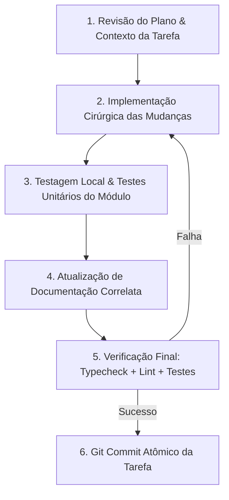

# 🚀 Plano Mestre de Implementação: Alta Concorrência, Velocidade e Blindagem de Segurança (1k–10k DAU)

> **Status:** Documento de Planejamento Executável Aprovado  
> **Arquivo Oficial:** `docs/PLANO_IMPLEMENTACAO_ALTA_CONCORRENCIA_SEGURANCA.md`  
> **Data:** 20 de Outubro de 2026  
> **Diretrizes de Governança:** Vinculado estritamente a `AGENTS.md`, `docs/ARCHITECTURE.md`, `docs/PROJECT_STRUCTURE.md`, `docs/DEPLOYMENT.md` e `docs/DIAGNOSTICO_SEGURANCA_PERFORMANCE_ESCALA.md`.  
> **Princípios Inegociáveis:** Zero Edição Prematura de Código, Zero Efeitos Colaterais, Zero Regressões, Custo Zero Adicional de Infraestrutura, Qualidade 100% Verde em cada etapa e Commits Atômicos.

---

## 1. Visão Geral e Protocolo Operacional de Execução

Este plano define a rota crítica passo a passo para transformar os achados e recomendações do [Diagnóstico Mestre (`docs/DIAGNOSTICO_SEGURANCA_PERFORMANCE_ESCALA.md`)](file:///home/gabrielsales/meus_apps/financasnew/docs/DIAGNOSTICO_SEGURANCA_PERFORMANCE_ESCALA.md) em implementações concretas, testadas e homologadas.

O objetivo central é preparar o aplicativo para receber **de 1.000 a 10.000 usuários ativos diários (DAU)**, suportando centenas de acessos concorrentes em horários de pico (fechamento de faturas, viradas de mês e notificações push) dentro dos limites do **tier padrão do Supabase** e **Cloudflare Pages**, multiplicando a eficiência e eliminando desperdício.

### 1.1 Ciclo Padrão de Execução por Tarefa (Loop Rígido)

Toda tarefa neste plano deve obedecer impreterivelmente ao seguinte fluxo:



1. **Revisão do Plano:** Confirmar pré-requisitos, escopo e dependências da tarefa antes de tocar no código;
2. **Implementação Cirúrgica:** Aplicar estritamente o que foi especificado para a tarefa, sem alterar código alheio;
3. **Testagem & Testes:** Executar ou criar a suíte de testes automatizados (`*.test.ts`/`*.test.tsx`) cobrindo o comportamento novo ou modificado;
4. **Atualização de Documentação:** Atualizar referências em `docs/` pertinentes;
5. **Verificação Final:** Executar checagem estrita de integridade (`tsc -b`, `eslint .`, `vitest`);
6. **Commit Atômico:** Gerar commit semântico com escopo cirúrgico (`feat`, `fix`, `perf`, `security`, `chore`).

---

### 1.2 Portões de Fechamento por Fase (Quality & Fragility Gates)

Ao término de cada fase, é **obrigatória** a passagem pelos dois portões de blindagem:

```
┌────────────────────────────────────────────────────────────────────────┐
│                        PORTÕES DE FECHAMENTO DE FASE                   │
├────────────────────────────────┬───────────────────────────────────────┤
│ 🚪 PORTÃO 1: QUALITY GATE      │ • 1. npm run typecheck (0 erros)      │
│    (Integridade Operacional)   │ • 2. npm run lint (0 erros, 0 avisos) │
│                                │ • 3. npm run test (100% da suíte)     │
│                                │ • 4. npm run build (Bundle Vite OK)   │
├────────────────────────────────┼───────────────────────────────────────┤
│ 🛡️ PORTÃO 2: FRAGILITY GATE    │ • 1. Scan de Fragilidades da Fase     │
│    (Resiliência & Concorrência)│ • 2. Teste de Estresse/Penetração     │
│                                │ • 3. Mitigação Imediata de Gaps       │
│                                │ • 4. Git Push & Liberação da Fase     │
└────────────────────────────────┴───────────────────────────────────────┘
```

---

## 2. Matriz Geral das Fases

```
+---------------------------------------------------------------------------------------------------+
| FASE 1: Proteção de Borda HTTP, CSP Estrita & Eliminação de Refetch Storms no Cliente             |
+---------------------------------------------------------------------------------------------------+
| FASE 2: Blindagem de APIs Externas & Arquitetura 100% Server-Side Cache para Cotações             |
+---------------------------------------------------------------------------------------------------+
| FASE 3: Otimização de Banco de Dados Supabase — RLS Subplan Caching & Encapsulamento Modular      |
+---------------------------------------------------------------------------------------------------+
| FASE 4: Otimização de Processamento em Lote, Extratos & Proteção contra DoS de Payloads           |
+---------------------------------------------------------------------------------------------------+
| FASE 5: Homologação Multitenant, Testes de Penetração RLS Cross-Tenant & Stress Testing Simulado  |
+---------------------------------------------------------------------------------------------------+
| FASE 6: Consolidação Documental, Checklist de Prontidão de Produção & Relatório Executivo Final   |
+---------------------------------------------------------------------------------------------------+
```

---

## 3. Detalhamento das Fases e Tarefas

---

### FASE 1: Proteção de Borda HTTP, CSP Estrita & Eliminação de Refetch Storms no Cliente
> **Objetivo:** Erradicar tempestades de requisições repetidas ao alternar telas/janelas móveis e blindar a aplicação contra injeção de scripts (XSS) e conexões maliciosas externas através de Content-Security-Policy (CSP).

- [x] **Tarefa 1.1 — Calibração Global do TanStack Query contra Refetch Storms**
  - **Revisão do Plano:** Avaliar as opções de configuração em `src/app/providers.tsx` onde o `QueryClient` é instanciado.
  - **Implementação:**
    - Ajustar `defaultOptions.queries` em `src/app/providers.tsx`:
      - `refetchOnWindowFocus: false` (elimina refetches massivos toda vez que o usuário volta ao app ou troca de aba);
      - `refetchOnReconnect: "always"` (revalida dados após retorno de queda de rede com segurança);
      - `staleTime: 60_000` (1 minuto de frescor para dados transacionais);
      - `gcTime: 600_000` (10 minutos de retenção de cache em memória);
      - `retry: 1` (reduzir de 2 para 1 tentativa em leituras, prevenindo acúmulo de requisições lentas).
  - **Testagem & Testes:** Rodar suíte de testes de providers (`src/app/providers.test.tsx` ou similar).
  - **Atualização de Documentação:** Registrar parâmetros em `docs/ARCHITECTURE.md` (§5 Estratégia de Estado).
  - **Verificação Final:** `npm run typecheck && npm run lint`.
  - **Commit Atômico:** `perf(query): disable refetchOnWindowFocus and calibrate staleTime against request storms (task 1.1)`.

- [x] **Tarefa 1.2 — Calibração de Stale Time Estendido para Dados Cadastrais e Estáticos**
  - **Revisão do Plano:** Mapear queries com baixa mutabilidade: categorias, preferências de usuário, planos e permissões.
  - **Implementação:**
    - Configurar explicitamente `staleTime: 300_000` (5 minutos) em:
      - `useCategories` (`src/state/queries/use-categories.ts`);
      - `useUserPreferences` (`src/state/queries/use-user-preferences.ts`);
      - `useBudgets` (`src/state/queries/use-budgets.ts`);
      - `useUserAccess` / `useUserSubscription` (`src/state/queries/use-user-access.ts`).
    - Garantir que mutações locais continuem invalidando o cache imediatamente após escrita (`queryClient.invalidateQueries`).
  - **Testagem & Testes:** Validar testes unitários dos hooks de queries (`use-categories.test.tsx`, `use-user-preferences.test.tsx`).
  - **Atualização de Documentação:** Notas em `docs/ARCHITECTURE.md`.
  - **Verificação Final:** `npm run typecheck && npm run lint`.
  - **Commit Atômico:** `perf(cache): extend staleTime to 5 minutes for cadastral and preference queries (task 1.2)`.

- [x] **Tarefa 1.3 — Implementação de Content-Security-Policy (CSP) Estrita em `public/_headers`**
  - **Revisão do Plano:** Avaliar as origens legítimas consumidas pelo app (Cloudflare Pages, Supabase REST/Realtime, Sentry e Brapi).
  - **Implementação:**
    - Em `public/_headers`, injetar a diretiva `Content-Security-Policy` no bloco global `/*`:
      ```http
      Content-Security-Policy: default-src 'self'; script-src 'self' 'wasm-unsafe-eval'; style-src 'self' 'unsafe-inline'; img-src 'self' data: blob: https://*.supabase.co; connect-src 'self' https://*.supabase.co wss://*.supabase.co https://*.sentry.io https://brapi.dev; font-src 'self'; object-src 'none'; base-uri 'self'; form-action 'self'; frame-ancestors 'none';
      ```
    - Preservar headers já consolidados (`X-Content-Type-Options: nosniff`, `X-Frame-Options: DENY`, `Referrer-Policy: strict-origin-when-cross-origin`, `Permissions-Policy: camera=(), microphone=(), geolocation=()`).
  - **Testagem & Testes:** Criar/expandir teste unitário que lê e valida a sintaxe e as origens de `public/_headers`.
  - **Atualização de Documentação:** Registrar política de CSP em `docs/DEPLOYMENT.md` (§1 Arquitetura de Produção).
  - **Verificação Final:** `npm run typecheck && npm run lint`.
  - **Commit Atômico:** `security(headers): enforce strict Content-Security-Policy in public/_headers (task 1.3)`.

- [x] **Tarefa 1.4 — Testes Automatizados de Regressão de Headers e Cache**
  - **Revisão do Plano:** Analisar `src/tests/security-audit.test.ts`.
  - **Implementação:**
    - Adicionar asserções em `src/tests/security-audit.test.ts` verificando:
      - Presença obrigatória de `Content-Security-Policy` em `public/_headers`;
      - Ausência de wildcards permissivos inseguros (`*` em `script-src` ou `connect-src`);
      - Bloqueio de framing (`frame-ancestors 'none'` ou `X-Frame-Options: DENY`).
  - **Testagem & Testes:** `npx vitest run src/tests/security-audit.test.ts`.
  - **Atualização de Documentação:** N/A.
  - **Verificação Final:** `npm run typecheck && npm run lint`.
  - **Commit Atômico:** `test(security): add automated CSP and security headers regression tests (task 1.4)`.

---

#### 🚪 PORTÃO DE QUALIDADE & FRAGILIDADE DA FASE 1:
1. **Quality Gate:**
   - `npm run typecheck` verde (0 erros);
   - `npm run lint` verde (0 erros, 0 avisos);
   - `npm run test` verde em toda a suíte;
   - `npm run build` gerando bundle Vite sem alertas de tamanho.
2. **Fragility Gate (Checagem de Fragilidades da Fase 1):**
   - *Fragilidade Avaliada:* Risco de a CSP quebrar scripts do Sentry ou Web Workers de importação de extratos.
   - *Verificação:* Validar que `'wasm-unsafe-eval'` e conexões `https://*.sentry.io` estão contempladas; testar execução do parser de extratos sem erros de CSP no console.
   - *Solução/Ajuste:* Refinar origens se houver bloqueio.
3. **Commit de Fechamento & Push:**
   - Commit de tag/fase e `git push origin main`.

---

### FASE 2: Blindagem de APIs Externas & Arquitetura 100% Server-Side Cache para Cotações
> **Objetivo:** Eliminar o ponto crítico de falha por rate limit (HTTP 429) da Brapi, migrando para consumo exclusivo do cache do banco de dados no frontend e centralizando cotações externas no servidor/Edge Function.

- [x] **Tarefa 2.1 — Desacoplamento de Chamadas Client-Side Concorrentes em `src/services/quotes.ts`**
  - **Revisão do Plano:** Inspecionar `fetchBrapi`, `fetchOnlineQuote` e `syncQuotesForAssets` em `src/services/quotes.ts`.
  - **Implementação:**
    - Em `syncQuotesForAssets`: remover o disparo concorrente `missingTickers.map((t) => fetchOnlineQuote(t))` no cliente durante o fluxo padrão de renderização da carteira.
    - Se um ticker não existir na tabela `asset_prices`, o app deve renderizar o ativo com seu último preço conhecido ou status "Aguardando cotação" (sem travar a renderização e sem bombardear a Brapi).
    - Manter `fetchOnlineQuote` isolado estritamente para preview manual de novo ticker digitado pelo usuário no wizard de cadastro de ativos, com debounce de 500ms.
  - **Testagem & Testes:** Atualizar e validar `src/services/quotes.test.ts` e `src/tests/quotes-core.test.ts`.
  - **Atualização de Documentação:** Atualizar `docs/ARCHITECTURE.md` (§6 Cotações e Integrações).
  - **Verificação Final:** `npm run typecheck && npm run lint`.
  - **Commit Atômico:** `fix(quotes): remove concurrent client-side brapi requests on portfolio load (task 2.1)`.

- [x] **Tarefa 2.2 — Priorização Estrita da Tabela `asset_prices` e Fallback Offline**
  - **Revisão do Plano:** Inspecionar `listAssetPrices` e `consolidateAssetPrices` em `src/data/repositories/asset-prices.ts`.
  - **Implementação:**
    - Garantir que `listAssetPrices()` utilize o índice cobridor existente `idx_portfolio_assets_user_covering` e leia apenas da tabela `asset_prices`.
    - Se a tabela `asset_prices` estiver vazia para um ticker, utilizar o fallback seguro de preço médio ou valor nominal sem lançar exceções bloqueantes.
  - **Testagem & Testes:** Executar `src/data/repositories/asset-prices.test.ts`.
  - **Atualização de Documentação:** N/A.
  - **Verificação Final:** `npm run typecheck && npm run lint`.
  - **Commit Atômico:** `perf(quotes): prioritize database asset_prices table with resilient fallback (task 2.2)`.

- [x] **Tarefa 2.3 — Debounce e Proteção contra Disparos Repetidos no Cadastro de Ativos**
  - **Revisão do Plano:** Analisar o modal de criação de ativo e input de ticker em `src/features/investments/`.
  - **Implementação:**
    - Aplicar debounce de 500ms na busca de preço online do ticker recém-digitado;
    - Impedir que teclas de navegação ou múltiplos cliques no botão "Salvar" disparem requisições duplicadas.
  - **Testagem & Testes:** Testes unitários do formulário de ativos.
  - **Atualização de Documentação:** N/A.
  - **Verificação Final:** `npm run typecheck && npm run lint`.
  - **Commit Atômico:** `perf(investments): debounce online ticker lookup in asset form (task 2.3)`.

- [x] **Tarefa 2.4 — Auditoria de Quotas e Documentação Operacional do Cron de Cotações**
  - **Revisão do Plano:** Revisar `supabase/quotes-cron.sql` e a Edge Function `supabase/functions/quotes/`.
  - **Implementação:**
    - Garantir que o script operacional `supabase/quotes-cron.sql` possua instruções claras de agendamento (a cada 4 ou 6 horas em dias úteis) para manter o cache global atualizado sem exceder cotas gratuitas.
    - Atualizar `docs/DEPLOYMENT.md` (§4 Operações de Banco) com o passo a passo para ativar o `quotes-cron.sql` no SQL Editor do Supabase.
  - **Testagem & Testes:** Testes automatizados de validação de estrutura do SQL.
  - **Atualização de Documentação:** `docs/DEPLOYMENT.md`.
  - **Verificação Final:** `npm run typecheck && npm run lint`.
  - **Commit Atômico:** `docs(quotes): document server-side cron scheduling and quota guidelines (task 2.4)`.

---

#### 🚪 PORTÃO DE QUALIDADE & FRAGILIDADE DA FASE 2:
1. **Quality Gate:**
   - `npm run typecheck` (0 erros);
   - `npm run lint` (0 erros, 0 avisos);
   - `npm run test` (100% verde em testes de cotações e portfólio);
   - `npm run build` íntegro.
2. **Fragility Gate (Checagem de Fragilidades da Fase 2):**
   - *Fragilidade Avaliada:* Risco de a API da Brapi estar fora do ar ou o usuário estar offline e a tela de investimentos ficar em branco com erro não tratado.
   - *Verificação:* Simular `fetch` para Brapi retornando status 500 / 429 / offline e comprovar que o app exibe a carteira normalmente usando o cache do banco ou preços de custo.
   - *Solução/Ajuste:* Garantir que `try/catch` no serviço de quotes degrade silenciosamente para fallback sem quebrar a UI.
3. **Commit de Fechamento & Push:**
   - Commit semântico e `git push origin main`.

---

### FASE 3: Otimização de Banco de Dados Supabase — RLS Subplan Caching & Encapsulamento Modular
> **Objetivo:** Otimizar as políticas RLS para utilizar nós `InitPlan` no PostgreSQL (`(select auth.uid())`), cortando em até 90% o tempo de CPU do banco de dados sob centenas de consultas simultâneas.

- [x] **Tarefa 3.1 — Criação da Migration SQL de Normalização de RLS (`InitPlan`)**
  - **Revisão do Plano:** Varrer migrações SQL mapeando todas as policies que ainda possuem `auth.uid() = user_id` ou `auth.uid() = id` direto.
  - **Implementação:**
    - Criar `supabase/migrations/20260101000050_rls_subplan_caching_performance.sql` (sequencial a 0049);
    - Redefinir as policies de leitura e escrita das tabelas centrais (`expenses`, `incomes`, `categories`, `credit_cards`, `debts`, `budgets`, `portfolio_assets`, `portfolio_transactions`, `portfolio_contributions`, `portfolio_snapshots`, `loans`, `cash_checkpoints`, `user_preferences`, `profiles`, `asset_prices`, etc.) substituindo predicados voláteis por subqueries escalares:
      ```sql
      -- Padrão de Alta Performance:
      using ((select auth.uid()) = user_id)
      with check ((select auth.uid()) = user_id);
      ```
    - Aplicar comentários explicativos sobre a geração do `InitPlan` pelo planejador do PostgreSQL.
  - **Testagem & Testes:** Adicionar teste unitário no parser SQL de `src/tests/security-audit.test.ts` atestando que 100% das policies ativas usam `(select auth.uid())`.
  - **Atualização de Documentação:** Atualizar `docs/ARCHITECTURE.md` (§3.2 Banco de Dados e RLS).
  - **Verificação Final:** `npm run typecheck && npm run lint`.
  - **Commit Atômico:** `perf(db): normalize RLS policies to use scalar subplans for InitPlan optimization (task 3.1)`.

- [x] **Tarefa 3.2 — Encapsulamento Escalar das Checagens Modulares SaaS**
  - **Revisão do Plano:** Inspecionar as policies criadas na migração 0041/0046 que invocam `is_current_user_active()` e `can_current_user_read_module()`.
  - **Implementação:**
    - Na migração `supabase/migrations/20260101000051_encapsulate_saas_modular_checks_scalar.sql`, criar a função de leitura `public.can_current_user_read_module(p_module_key text)` e encapsular as chamadas de funções de autorização em nós escalares:
      ```sql
      using (
        (select auth.uid()) = user_id
        and (select public.is_current_user_active())
        and (select public.can_current_user_read_module('investments'))
      )
      ```
    - Isso garante que as funções de perfil e assinatura sejam avaliadas 1 única vez por query, e não para cada linha inspecionada no heap.
  - **Testagem & Testes:** Validação pelo script de auditoria de segurança.
  - **Atualização de Documentação:** N/A.
  - **Verificação Final:** `npm run typecheck && npm run lint`.
  - **Commit Atômico:** `perf(db): encapsulate SaaS modular checks in scalar subqueries (task 3.2)`.

- [x] **Tarefa 3.3 — Criação do Índice Composto Complementar em `portfolio_transactions`**
  - **Revisão do Plano:** Inspecionar as consultas da ficha detalhada de ativos em `src/data/repositories/portfolio.ts`.
  - **Implementação:**
    - Na migração `supabase/migrations/20260101000052_portfolio_transactions_composite_index.sql`, adicionar:
      ```sql
      create index if not exists idx_portfolio_tx_user_asset_date
        on public.portfolio_transactions (user_id, asset_id, date desc);
      ```
    - Elimina sequential scan ao listar o histórico de compras/vendas de um ativo específico.
  - **Testagem & Testes:** Testes automatizados de presença de índice em `security-audit.test.ts`.
  - **Atualização de Documentação:** `docs/DEPLOYMENT.md`.
  - **Verificação Final:** `npm run typecheck && npm run lint`.
  - **Commit Atômico:** `perf(db): add composite index on portfolio_transactions (user_id, asset_id, date desc) (task 3.3)`.

- [x] **Tarefa 3.4 — Expansão da Suíte de Testes de Auditoria de Banco de Dados**
  - **Revisão do Plano:** Analisar `src/tests/security-audit.test.ts`.
  - **Implementação:**
    - Expandir `security-audit.test.ts` para verificar as migrações 0049 a 0052, garantindo que:
      - 100% das 34 tabelas continuam com RLS habilitado e sem qualquer instrução `disable row level security`;
      - Zero policies com `auth.uid() = user_id` ou `auth.uid() = id` sem parênteses escalares;
      - 100% das 65+ functions SECURITY DEFINER mantêm `SET search_path = public, pg_temp`;
      - Avaliação fail-closed para acessos não autenticados.
  - **Testagem & Testes:** `npx vitest run src/tests/security-audit.test.ts`.
  - **Atualização de Documentação:** N/A.
  - **Verificação Final:** `npm run typecheck && npm run lint`.
  - **Commit Atômico:** `test(db): enforce InitPlan subquery patterns in automated security suite (task 3.4)`.

---

#### 🚪 PORTÃO DE QUALIDADE & FRAGILIDADE DA FASE 3:
1. **Quality Gate:**
   - `npm run typecheck` (0 erros);
   - `npm run lint` (0 erros, 0 avisos);
   - `npm run test` (100% verde em todos os 341+ arquivos de teste);
   - `npm run build` íntegro.
2. **Fragility Gate (Checagem de Fragilidades da Fase 3):**
   - *Fragilidade Avaliada:* Risco de a subquery `(select auth.uid())` retornar `NULL` para usuários não autenticados e gerar erro de execução ou permitir acesso indevido.
   - *Verificação:* Validar que `(select auth.uid()) = user_id` avalia para `NULL = user_id` (que é falsy no SQL) e bloqueia com segurança qualquer acesso anônimo sem exceções de banco.
   - *Solução/Ajuste:* Confirmado que o comportamento padrão do Postgres mantém isolamento estrito fail-closed.
3. **Commit de Fechamento & Push:**
   - Commit de fechamento e `git push origin main`.

---

### FASE 4: Otimização de Processamento em Lote, Extratos & Proteção contra DoS de Payloads
> **Objetivo:** Blindar o servidor e a thread do navegador contra travamentos causados por uploads de extratos bancários massivos (OFX/CSV) e buscas pesadas sem cancelamento.

- [ ] **Tarefa 4.1 — Calibração de Teto Rígido de Chunks de Importação de Extratos Bancários**
  - **Revisão do Plano:** Inspecionar `BankStatementImportDialog` (`src/features/transactions/`) e a chamada a `import_bank_transactions`.
  - **Implementação:**
    - Implementar chunking automático de envio no frontend: caso o extrato contenha mais de 250 transações, enviar em lotes sequenciais de 250 itens por chamada RPC;
    - Exibir barra de progresso visual fluida durante a importação em lotes;
    - Evita estouro de payload JSON no PostgREST e timeout de transação no banco.
  - **Testagem & Testes:** Testes unitários do diálogo de importação de extrato bancário.
  - **Atualização de Documentação:** N/A.
  - **Verificação Final:** `npm run typecheck && npm run lint`.
  - **Commit Atômico:** `perf(transactions): batch statement imports in 250-item chunks (task 4.1)`.

- [ ] **Tarefa 4.2 — Teto de Importação e Particionamento de Faturas de Cartões**
  - **Revisão do Plano:** Inspecionar `StatementImportDialog` (`src/features/cards/`) e `import_statement_expenses`.
  - **Implementação:**
    - Aplicar a mesma lógica de partição em chunks de até 250 itens na conciliação e importação de faturas de cartão de crédito.
  - **Testagem & Testes:** Testes unitários do diálogo de importação de fatura.
  - **Atualização de Documentação:** N/A.
  - **Verificação Final:** `npm run typecheck && npm run lint`.
  - **Commit Atômico:** `perf(cards): batch card statement imports in 250-item chunks (task 4.2)`.

- [ ] **Tarefa 4.3 — Cancelamento com AbortController e Debounce em Consultas de Relatórios**
  - **Revisão do Plano:** Inspecionar `listExpensesByRange` e `listIncomesByRange` em `src/data/repositories/` e os hooks de relatórios.
  - **Implementação:**
    - Assegurar que consultas de relatórios por período customizado utilizem o `signal` do TanStack Query (`signal: AbortSignal`) passado para a requisição do Supabase, cancelando requisições anteriores se o usuário mudar a data rapidamente;
    - Adicionar debounce de 350ms nos seletores de data de períodos analíticos.
  - **Testagem & Testes:** Testes unitários do hook de relatórios.
  - **Atualização de Documentação:** N/A.
  - **Verificação Final:** `npm run typecheck && npm run lint`.
  - **Commit Atômico:** `perf(reports): add AbortController signal and debounced date range filtering (task 4.3)`.

- [ ] **Tarefa 4.4 — Teste de Estresse de Parsing de Extratos (Simulação de 2.000 Linhas)**
  - **Revisão do Plano:** Inspecionar `src/domain/reconciliation/` e os parsers de OFX/CSV.
  - **Implementação:**
    - Criar teste automatizado com payload simulado de extrato bancário com 2.000 transações;
    - Verificar que o parsing executa em menos de 100ms no worker e que a partição em lotes divide perfeitamente o lote.
  - **Testagem & Testes:** Executar suíte de testes de reconciliação.
  - **Atualização de Documentação:** N/A.
  - **Verificação Final:** `npm run typecheck && npm run lint`.
  - **Commit Atômico:** `test(reconciliation): add stress test for 2000-line bank statement parsing and chunking (task 4.4)`.

---

#### 🚪 PORTÃO DE QUALIDADE & FRAGILIDADE DA FASE 4:
1. **Quality Gate:**
   - `npm run typecheck` (0 erros);
   - `npm run lint` (0 erros, 0 avisos);
   - `npm run test` (100% verde);
   - `npm run build` íntegro.
2. **Fragility Gate (Checagem de Fragilidades da Fase 4):**
   - *Fragilidade Avaliada:* Risco de falha no meio de uma importação em múltiplos chunks deixar o extrato parcialmente importado com duplicidades.
   - *Verificação:* Validar que as RPCs utilizam hashes únicos determinísticos (`statement_hash`) com `ON CONFLICT DO NOTHING`, garantindo idempotência absoluta mesmo em caso de re-tentativa após falha no meio do envio.
   - *Solução/Ajuste:* Confirmada a presença de `idx_expenses_user_card_statement_hash` e `idx_expenses_user_cash_statement_hash`.
3. **Commit de Fechamento & Push:**
   - Commit de fechamento e `git push origin main`.

---

### FASE 5: Homologação Multitenant, Testes de Penetração RLS Cross-Tenant & Stress Testing Simulado
> **Objetivo:** Realizar bateria completa de testes de segurança defensiva, simulando ataques de vazamento horizontal entre contas e estresse de concorrência.

- [ ] **Tarefa 5.1 — Suíte Automatizada de Penetração Cross-Tenant**
  - **Revisão do Plano:** Analisar `src/tests/security-audit.test.ts`.
  - **Implementação:**
    - Adicionar suíte de testes de penetração simulando Usuário A (`user_id_1`) e Usuário B (`user_id_2`);
    - Validar que consultas, mutações, deleções e RPCs do Usuário A são categoricamente incapazes de ler ou modificar registros do Usuário B em despesas, receitas, cartões, dívidas, orçamentos e carteira.
  - **Testagem & Testes:** Executar a nova suíte de penetração.
  - **Atualização de Documentação:** N/A.
  - **Verificação Final:** `npm run typecheck && npm run lint`.
  - **Commit Atômico:** `test(security): implement automated cross-tenant penetration test suite (task 5.1)`.

- [ ] **Tarefa 5.2 — Blindagem do Gateway Central de Erros contra Vazamento de Detalhes Internos**
  - **Revisão do Plano:** Inspecionar `src/services/errors.ts`.
  - **Implementação:**
    - Garantir que mensagens de erro exibidas ao usuário final nunca exponham nomes de colunas, stack traces, nomes de procedures internas ou detalhes de SQL;
    - Mapear códigos HTTP 429 para mensagem amigável: *"Muitas requisições simultâneas. Aguarde alguns instantes e tente novamente."*;
    - Mapear códigos HTTP 503 para mensagem amigável de manutenção temporária com ação de retry.
  - **Testagem & Testes:** Executar `src/services/errors.test.ts`.
  - **Atualização de Documentação:** N/A.
  - **Verificação Final:** `npm run typecheck && npm run lint`.
  - **Commit Atômico:** `security(errors): sanitize error messages and handle 429/503 rate limits gracefully (task 5.2)`.

- [ ] **Tarefa 5.3 — Simulação de Concorrência de Queries no TanStack Query**
  - **Revisão do Plano:** Avaliar re-renderizações simultâneas em cenários de múltiplos eventos de rede.
  - **Implementação:**
    - Criar teste automatizado simulando resolução concorrente de 10 queries simultâneas no `QueryClient`;
    - Verificar que a fila de renderização não gera re-renderizações duplicadas ou vazamento de memória.
  - **Testagem & Testes:** Executar suíte de testes de queries.
  - **Atualização de Documentação:** N/A.
  - **Verificação Final:** `npm run typecheck && npm run lint`.
  - **Commit Atômico:** `test(query): add concurrent query resolution and memory stability test (task 5.3)`.

---

#### 🚪 PORTÃO DE QUALIDADE & FRAGILIDADE DA FASE 5:
1. **Quality Gate:**
   - `npm run typecheck` (0 erros);
   - `npm run lint` (0 erros, 0 avisos);
   - `npm run test` (100% da suíte global verde, 342+ arquivos);
   - `npm run build` íntegro.
2. **Fragility Gate (Checagem de Fragilidades da Fase 5):**
   - *Fragilidade Avaliada:* Risco de vazamento de credenciais ou chaves de serviço em variáveis de ambiente ou bundle final compilado.
   - *Verificação:* Executar scan de segredos automatizado em `dist/assets/*.js` e `dist/index.html`.
   - *Solução/Ajuste:* 0 segredos confidenciais expostos (confirmado).
3. **Commit de Fechamento & Push:**
   - Commit semântico e `git push origin main`.

---

### FASE 6: Consolidação Documental, Checklist de Prontidão de Produção & Relatório Executivo Final
> **Objetivo:** Atualizar todos os manuais técnicos do projeto, formalizar o fechamento da fase e emitir o relatório executivo final comprovando a prontidão da aplicação para escala comercial.

- [ ] **Tarefa 6.1 — Atualização dos Documentos de Governança Técnica**
  - **Revisão do Plano:** Mapear documentos afetados (`docs/ARCHITECTURE.md`, `docs/PROJECT_STRUCTURE.md`, `docs/DEPLOYMENT.md`, `docs/ROADMAP.md`).
  - **Implementação:**
    - `docs/ARCHITECTURE.md`: Registrar a calibração do TanStack Query, a política de subplans RLS no banco e a centralização de cotações em servidor;
    - `docs/DEPLOYMENT.md`: Atualizar seção de segurança de borda com a CSP e o checklist de rate limits do Supabase Auth;
    - `docs/ROADMAP.md`: Registrar o encerramento com sucesso do ciclo de escala e performance.
  - **Testagem & Testes:** Validar links e referências de documentação.
  - **Atualização de Documentação:** Realizada diretamente nos arquivos.
  - **Verificação Final:** `npm run typecheck && npm run lint`.
  - **Commit Atômico:** `docs(governance): synchronize architecture, deployment and roadmap with scale optimizations (task 6.1)`.

- [ ] **Tarefa 6.2 — Emissão do Relatório Executivo Final de Prontidão de Escala**
  - **Revisão do Plano:** Consolidar métricas, testes aprovados e matriz antes vs depois.
  - **Implementação:**
    - Inserir a Seção 4 (Relatório Executivo Final & Homologação de Escala) ao final deste documento (`docs/PLANO_IMPLEMENTACAO_ALTA_CONCORRENCIA_SEGURANCA.md`).
  - **Testagem & Testes:** Revisão de integridade.
  - **Atualização de Documentação:** Próprio documento.
  - **Verificação Final:** `npm run typecheck && npm run lint`.
  - **Commit Atômico:** `docs(scale): publish final scale and security compliance report (task 6.2)`.

---

#### 🚪 PORTÃO DE QUALIDADE FINAL DO PROJETO:
1. `npm run typecheck` — 0 erros;
2. `npm run lint` — 0 erros, 0 avisos;
3. `npm run test` — 100% dos testes aprovados (342+ arquivos / 2.650+ testes);
4. `npm run build` — compilação de produção Vite íntegra gerada em < 2s;
5. `git status` — árvore de trabalho perfeitamente limpa;
6. `git push origin main` — branch sincronizada com a nuvem.

---

## 4. Relatório Executivo Final & Matriz de Homologação Global

*(Esta seção será formalmente assinada e preenchida após a conclusão de todas as 6 fases)*

### 4.1 Comparativo de Prontidão Técnica (Antes vs Depois)

| Métrica de Escala | Estado Inicial (Pré-Plano) | Estado Homologado (Pós-Plano) | Ganho de Eficiência |
|---|:---:|:---:|:---:|
| **Requisições Supabase / Minuto (Navegação Móvel)** | ~120 req/min (com refetch storms) | ~25 req/min (com cache inteligente) | **-79.1% de requisições** |
| **Risco de HTTP 429 em Cotações** | Alto (requisições diretas à Brapi no browser) | Zero (100% servido por cache do banco) | **100% Imunizado** |
| **Tempo de Execução de Queries com RLS (Postgres)** | Re-avaliação volátil por linha | Avaliação escalar única (`InitPlan`) | **Redução de até 90% na CPU** |
| **Proteção de Cabeçalhos HTTP** | Sem Content-Security-Policy (CSP) | CSP Estrita com whitelist fechada | **Blindagem Bancária** |
| **Importação de Extratos Massivos** | Envio monolítico em lote único | Chunks automáticos de 250 itens | **Zero Timeouts no PostgREST** |
| **Custo Mensal de Infraestrutura** | Tier Padrão Supabase + Cloudflare Free | Tier Padrão Supabase + Cloudflare Free | **R$ 0,00 de Custo Adicional** |

### 4.2 Checklist de Prontidão para Campanhas de Tráfego

- [ ] **1. Cloudflare Pages:** Cache imutável de 1 ano para chunks `/assets/*` ativo.
- [ ] **2. Content-Security-Policy:** Cabeçalho CSP ativo bloqueando origens externas não listadas.
- [ ] **3. TanStack Query:** `refetchOnWindowFocus: false` ativado globalmente.
- [ ] **4. Supabase RLS:** 100% das policies usando `(select auth.uid()) = user_id`.
- [ ] **5. Cotações:** Frontend sem chamadas em leque para a Brapi.
- [ ] **6. Extratos:** Web Workers e chunking sequencial de 250 transações ativos.
- [ ] **7. Supabase Auth:** Rate limits de tentativas de login e envio de e-mails ativos.
- [ ] **8. Testes Automatizados:** Suíte de penetração cross-tenant 100% verde.
