# Plano Mestre de Implementação: Limitador de Módulos, Governança SaaS, Segurança, Precisão de Cálculos e Fluidez

**Arquivo Canônico:** `docs/PLANO_IMPLEMENTACAO_MODULOS_E_SAAS.md`  
**Data de Atualização:** 17 de Outubro de 2026  
**Status:** Pronto para Execução Sequencial  
**Repositório:** `meus_apps/financasnew`  
**Autores:** Engenharia de Software, Segurança da Informação & Arquitetura Áxis Financeiro  

---

## 1. Visão Geral e Contexto Estratégico

Este documento constitui o **Plano Mestre de Engenharia** para elevar o aplicativo Áxis Financeiro ao estado da arte em **segurança, precisão matemática, fluidez de experiência do usuário (60 FPS) e preparação para monetização SaaS agnóstica (Stripe ou Asaas)**, além de solucionar em definitivo a vulnerabilidade de vazamento do limitador de módulos em cold-start.

### 1.1 Diagnóstico do Limitador de Módulos (Causa Raiz)
* **Descompasso Temporal:** Queries de assinatura e perfil disparadas no instante zero de montagem sem garantir a restauração prévia do token de autenticação pelo Supabase Auth.
* **Cache Indevido de NULL:** O endpoint RPC `get_my_subscription()` avalia `auth.uid() = NULL`, retornando `NULL` que é gravado no cache TanStack Query por 5 minutos (`staleTime`).
* **Vazamento no Fallback Permissivo:** Com `subscription = null` e `isLoading = false`, a função `hasFeature()` falha no teste de whitelist e salta para o fallback global, exibindo todos os módulos do sistema e abrindo a Visão Geral (`/`).
* **Resolução com Refresh:** Ao atualizar a página (F5), o token já existente no storage local é enviado imediatamente na requisição, ativando a Whitelist de `get_user_module_access()` e forçando o redirecionamento para o módulo restrito (`/investments`).

### 1.2 Objetivos Estratégicos do Plano Mestre
1. **Blindagem e Fail-Closed:** Garantir que jamais ocorra vazamento de telas ou dados sensíveis em qualquer estado de carregamento, rede ou autenticação.
2. **Precisão Matemática Absoluta:** Assegurar que 100% dos cálculos (investimentos, DRE, fluxo de caixa, cartões, IOF, juros e rebalanceamento) operem com precisão monetária imune a erros de ponto flutuante.
3. **Segurança Multitenant Integral:** Auditar e blindar 100% das políticas RLS, RPCs `SECURITY DEFINER`, sanitização de inputs e proteção contra captura de tela de dados financeiros no mobile (`FLAG_SECURE`).
4. **Fluidez e Performance 60 FPS:** Virtualização de extratos longos, microinterações sensoriais táteis, cache offline resiliente e zero layout shift.
5. **Preparação SaaS Agnóstica (Stripe ou Asaas Ready):** Arquitetura desacoplada via Adapter Pattern para suportar integração futura plug-and-play de qualquer gateway de pagamento sem refatorar o domínio ou o banco de dados.

---

## 2. Mapa Geral de Fases e Portões de Verificação (Quality Gates)

O plano é estruturado em **8 Fases Sequenciais**, onde cada fase deve cumprir rigorosamente o ciclo de **Planejamento $\rightarrow$ Implementação $\rightarrow$ Verificação de Erros $\rightarrow$ Correção $\rightarrow$ Testes $\rightarrow$ Documentação $\rightarrow$ Portão de Verificação (Commit Semântico & Push)** antes que a próxima fase seja iniciada.

```mermaid
flowchart TD
    subgraph D1["Fase 1: Limitador de Módulos & Cold Start"]
        F1_P[1.1 Planejar] --> F1_I[1.2 Implementar]
        F1_I --> F1_V[1.3 Checar Erros]
        F1_V --> F1_C[1.4 Corrigir]
        F1_C --> F1_T[1.5 Testes]
        F1_T --> F1_D[1.6 Documentar]
        F1_D --> QG1["Portão 1: Commit & Push"]
    end

    subgraph D2["Fase 2: Painel Admin & Whitelist Visual"]
        QG1 --> F2_P[2.1 Planejar]
        F2_P --> F2_I[2.2 Implementar]
        F2_I --> F2_V[2.3 Checar Erros]
        F2_V --> F2_C[2.4 Corrigir]
        F2_C --> F2_T[2.5 Testes]
        F2_T --> F2_D[2.6 Documentar]
        F2_D --> QG2["Portão 2: Commit & Push"]
    end

    subgraph D3["Fase 3: Feedback Modular, Convites & Safe Area Mobile"]
        QG2 --> F3_P[3.1 Planejar]
        F3_P --> F3_I[3.2 Implementar]
        F3_I --> F3_V[3.3 Checar Erros]
        F3_V --> F3_C[3.4 Corrigir]
        F3_C --> F3_T[3.5 Testes]
        F3_T --> F3_D[3.6 Documentar]
        F3_D --> QG3["Portão 3: Commit & Push"]
    end

    subgraph D4["Fase 4: Engenharia de Precisão e Cálculos Financeiros"]
        QG3 --> F4_P[4.1 Planejar]
        F4_P --> F4_I[4.2 Implementar]
        F4_I --> F4_V[4.3 Checar Erros]
        F4_V --> F4_C[4.4 Corrigir]
        F4_C --> F4_T[4.5 Testes]
        F4_T --> F4_D[4.6 Documentar]
        F4_D --> QG4["Portão 4: Commit & Push"]
    end

    subgraph D5["Fase 5: Segurança Integral, RLS e Privacidade de Dados"]
        QG4 --> F5_P[5.1 Planejar]
        F5_P --> F5_I[5.2 Implementar]
        F5_I --> F5_V[5.3 Checar Erros]
        F5_V --> F5_C[5.4 Corrigir]
        F5_C --> F5_T[5.5 Testes]
        F5_T --> F5_D[5.6 Documentar]
        F5_D --> QG5["Portão 5: Commit & Push"]
    end

    subgraph D6["Fase 6: Performance, Fluidez 60 FPS e UX Profissional"]
        QG5 --> F6_P[6.1 Planejar]
        F6_P --> F6_I[6.2 Implementar]
        F6_I --> F6_V[6.3 Checar Erros]
        F6_V --> F6_C[6.4 Corrigir]
        F6_C --> F6_T[6.5 Testes]
        F6_T --> F6_D[6.6 Documentar]
        F6_D --> QG6["Portão 6: Commit & Push"]
    end

    subgraph D7["Fase 7: Arquitetura Agnóstica SaaS (Stripe ou Asaas Ready)"]
        QG6 --> F7_P[7.1 Planejar]
        F7_P --> F7_I[7.2 Implementar]
        F7_I --> F7_V[7.3 Checar Erros]
        F7_V --> F7_C[7.4 Corrigir]
        F7_C --> F7_T[7.5 Testes]
        F7_T --> F7_D[7.6 Documentar]
        F7_D --> QG7["Portão 7: Commit & Push"]
    end

    subgraph D8["Fase 8: Portão Final de Homologação Global"]
        QG7 --> F8_TS["Typecheck (tsc -b)"]
        F8_TS --> F8_LINT["ESLint (eslint .)"]
        F8_LINT --> F8_TEST["Vitest (100% verde)"]
        F8_TEST --> F8_BUILD["Build Web/PWA"]
        F8_BUILD --> F8_APK["Build APKs Android"]
        F8_APK --> F8_DOCS["Consolidação Docs"]
        F8_DOCS --> QG8["Release Final & Push"]
    end
```



---

## 3. Detalhamento Operacional das Fases

### FASE 1 — Demanda 1: Correção do Limitador de Módulos (Cold Start & Fail-Closed)

- [x] **1.1 Planejamento Técnico:**
  - Especificar a parametrização das queries de acesso por `userId`: `[...USER_SUBSCRIPTION_KEY, userId]`, `[...USER_ACCESS_KEY, userId]`.
  - Definir regra de guarda `enabled: Boolean(userId)` para impedir disparo de queries anônimas no cold start.
  - Desenhar a política estrita de Fail-Closed em `hasFeature`: caso o usuário não seja admin e as permissões modulares ainda não estejam confirmadas, retornar `false`.
- [x] **1.2 Implementação:**
  - Em `src/state/queries/use-user-access.ts`:
    - Incorporar monitoramento direto de sessão com Supabase.
    - Parametrizar as chaves de query com o `userId` ativo.
    - Condicionar queries com `enabled: Boolean(userId)`.
    - Blindar `hasFeature`: se `!isAdmin` e `subscription` for `null` ou `moduleAccess` estiver indefinido, aplicar Fail-Closed imediato.
  - Em `src/app/providers.tsx` (`AuthQuerySync`):
    - Tratar evento `SIGNED_IN` e alteração de `userId` para disparar reset e invalidação imediata de queries.
  - Em `src/components/routing/require-feature.tsx`:
    - Garantir que a guarda de rota mantenha `LoadingScreen` ativa até a resolução completa dos dados e redirecione imediatamente para o destino resolvido por `resolveLandingPath`.
- [x] **1.3 Verificação de Erros (TypeScript & ESLint):**
  - Executar `npm run typecheck` e `npm run lint`.
- [x] **1.4 Correção de Erros:**
  - Corrigir tipagens e eventuais problemas de concorrência.
- [x] **1.5 Testes Automatizados:**
  - Criar e atualizar testes em `src/state/queries/use-user-access.test.tsx` cobrindo cold start, sessão inicial de usuário restrito e Fail-Closed.
- [x] **1.6 Atualização da Documentação:**
  - Atualizar `docs/ARCHITECTURE.md` detalhando o ciclo de vida autenticado de queries.
- [x] **Portão de Verificação 1 (Quality Gate 1):**
  - Commit semântico: `fix(auth): enforce fail-closed modular access and resolve cold-start module limiter leak` e `git push`.

---

### FASE 2 — Demanda 2: Transparência e Whitelist Visual no Painel Administrativo

- [x] **2.1 Planejamento Técnico:**
  - Analisar renderização de status modulares em `src/features/admin/components/user-edit-dialog.tsx`.
  - Definir detecção do modo Whitelist (`hasAnyModuleOverride`): se o usuário possui qualquer permissão granular, os demais módulos operam bloqueados pelo backend.
  - Planejar botões de ação rápida: *"Apenas Investimentos"* e *"Restaurar Padrão do Plano"*.
- [x] **2.2 Implementação:**
  - Em `src/features/admin/components/user-edit-dialog.tsx`:
    - Detectar se o usuário possui overrides ativos.
    - Para módulos sem override explícito em modo Whitelist, renderizar o badge `"Bloqueado (Whitelist)"` com variante `critical` em vez de `"Padrão do Plano"`.
    - Adicionar card de aviso contextual sobre a vigência da política Whitelist.
    - Adicionar atalhos de configuração rápida em 1 clique.
    - Garantir invalidação imediata das queries administrativas de permissão modular do usuário editado.
- [x] **2.3 Verificação de Erros:**
  - Executar `npm run typecheck` e `npm run lint`.
- [x] **2.4 Correção de Erros:**
  - Sanar qualquer advertência ou inconsistência.
- [x] **2.5 Testes Automatizados:**
  - Atualizar `src/features/admin/components/user-edit-dialog.test.tsx` com os cenários de Whitelist visual e botões de ação rápida.
- [x] **2.6 Atualização da Documentação:**
  - Atualizar `docs/PROJETO_SAAS.md` com as diretrizes do painel administrativo.
- [x] **Portão de Verificação 2 (Quality Gate 2):**
  - Commit semântico: `feat(admin): highlight modular whitelist mode and add quick assignment actions in user dialog` e `git push`.

---

### FASE 3 — Demanda 3: Feedback Modular, Convites & Safe Area Mobile

- [ ] **3.1 Planejamento Técnico:**
  - Mapear feedbacks de licença especial em `subscription-tab.tsx`.
  - Desenhar alerta de Whitelist em `create-invite-dialog.tsx`.
  - Revisar ajustes pendentes de Safe Area mobile no Android (`var(--safe-area-top)` e `var(--safe-area-bottom)`).
- [ ] **3.2 Implementação:**
  - Em `src/features/settings/components/tabs/subscription-tab.tsx`:
    - Adicionar card explicativo de *"Licença Modular Personalizada"* listando os módulos ativos do usuário.
  - Em `src/features/admin/components/create-invite-dialog.tsx`:
    - Exibir alerta ao administrador informando que personalizar módulos ativará a restrição estrita de Whitelist.
  - Em `src/components/layout/bottom-nav.tsx`, `page-shell.tsx`, `sidebar.tsx`:
    - Consolidar a compensação robusta de Safe Area mobile (`max(env(...), var(...))`) para afastar o cabeçalho e rodapé da barra de status e de gestos.
- [ ] **3.3 Verificação de Erros:**
  - Executar `npm run typecheck` e `npm run lint`.
- [ ] **3.4 Correção de Erros:**
  - Ajustar alinhamentos visuais e estilos responsivos.
- [ ] **3.5 Testes Automatizados:**
  - Rodar suíte de testes de layout e formulários: `bottom-nav.test.tsx`, `sidebar.test.tsx`, `subscription-tab.test.tsx`, `create-invite-dialog.test.tsx`.
- [ ] **3.6 Atualização da Documentação:**
  - Atualizar `docs/PWA_GUIDELINES.md` e `docs/CAPACITOR_ANDROID_PLAN.md`.
- [ ] **Portão de Verificação 3 (Quality Gate 3):**
  - Commit semântico: `feat(subscription): add modular license feedback, invite whitelist guidance and mobile safe-area insets` e `git push`.

---

### FASE 4 — Precisão Matemática e Engenharia de Cálculos Financeiros

- [ ] **4.1 Planejamento Técnico da Auditoria de Cálculos:**
  - Mapear todas as funções matemáticas críticas em `src/domain/`:
    - `src/domain/money/` (arredondamento, parcelamentos, totais).
    - `src/domain/portfolio/` (preço médio, rentabilidade TWRR/MWRR, proventos/dividendos, rebalanceamento, marcação a mercado).
    - `src/domain/cards/` e `src/domain/debts/` (competência de faturas, juros, amortização).
    - `src/domain/reports/` (DRE, balanço patrimonial, taxa de poupança).
  - Definir padrões estritos contra imprecisão de ponto flutuante IEEE 754 (operações com inteiros em centavos ou arredondamento simétrico meio-para-cima padronizado).
- [ ] **4.2 Implementação e Refinamento Matemático:**
  - **Aritmética Monetária:** Garantir que somatórios e divisões de parcelas utilizem distribuição de centavos exata (sem perda de R$ 0,01 no totalizador).
  - **Carteira & Investimentos:**
    - Auditar cálculo do Preço Médio Ponderado incluindo taxas/corretagens em compras sucessivas e vendas parciais.
    - Validar fórmula do TWRR (Time-Weighted Rate of Return) e MWRR/TIR contra fluxos de aportes e resgates externos.
    - Validar o motor de Rebalanceamento Inteligente de Aportes para garantir que nenhuma sugestão gere valores negativos ou compras incompatíveis com o aporte total informado.
    - Assegurar distinção precisa entre Proventos Provisionados e Liquidados/Recebidos.
  - **Cartões de Crédito:**
    - Auditar corte de fatura (`billCompetence`), limites utilizados vs disponíveis e impacto de estornos parciais.
  - **DRE & Fluxo de Caixa:**
    - Blindar a neutralidade de transferências entre contas e pagamentos de cartão de crédito para impedir duplicação artificial de receitas ou despesas.
- [ ] **4.3 Verificação de Erros:**
  - Executar `npm run typecheck` e `npm run lint`.
- [ ] **4.4 Correção de Erros:**
  - Sanar distorções em testes matemáticos de borda.
- [ ] **4.5 Testes Automatizados Extensivos:**
  - Executar e enriquecer a suíte de testes de domínio:
    - `src/domain/money/totals.test.ts`, `parcelar.test.ts`.
    - `src/domain/portfolio/valuation.test.ts`, `twr.test.ts`, `irr.test.ts`, `aporte.test.ts`, `dividends.test.ts`.
    - `src/domain/reports/detailed-close.test.ts`, `consolidated-balance.test.ts`.
- [ ] **4.6 Atualização da Documentação:**
  - Criar ou atualizar guia com as especificações matemáticas em `docs/DESIGN_SYSTEM.md` ou documento técnico dedicado.
- [ ] **Portão de Verificação 4 (Quality Gate 4):**
  - Commit semântico: `test(domain): audit financial calculation engine, ensure float precision and validate portfolio metrics` e `git push`.

---

### FASE 5 — Segurança Integral, RLS e Privacidade de Dados

- [ ] **5.1 Planejamento Técnico de Segurança:**
  - Mapear a matriz de RLS de todas as 34 tabelas do Supabase.
  - Revisar todas as funções RPC com `SECURITY DEFINER` e cláusulas `SET search_path = public, pg_temp`.
  - Mapear pontos de entrada de dados suscetíveis a XSS/Injection.
  - Definir diretrizes de privacidade de dados financeiros em clientes móveis (Android FLAG_SECURE e mascaramento).
- [ ] **5.2 Implementação das Blindagens de Segurança:**
  - **Supabase & RLS:**
    - Auditar se 100% das tabelas possuem `ALTER TABLE ... ENABLE ROW LEVEL SECURITY;`.
    - Garantir que as políticas de `SELECT`, `INSERT`, `UPDATE` e `DELETE` validem estritamente `auth.uid() = user_id`.
  - **Blindagem de RPCs:**
    - Assegurar que todas as RPCs transacionais verifiquem se a conta está ativa e se o usuário tem permissão de escrita via `can_current_user_write()`.
  - **Sanitização de Borda:**
    - Validar todos os inputs de texto livre (descrições de transação, nomes de categoria, observações de dívidas) através de sanitização Zod defensiva.
  - **Privacidade Mobile & Observabilidade:**
    - Garantir acionamento do `FLAG_SECURE` nativo no Android para impedir captura de tela e gravação em segundo plano de saldos e transações bancárias.
    - Auditar o cliente Sentry/Observabilidade para garantir que dados sensíveis (CPF, cartões, senhas, e-mails de clientes restritos) jamais sejam transmitidos nos logs de telemetria.
- [ ] **5.3 Verificação de Erros:**
  - Executar `npm run typecheck` e `npm run lint`.
- [ ] **5.4 Correção de Erros:**
  - Corrigir eventuais falhas de permissão ou sanitização.
- [ ] **5.5 Testes Automatizados de Segurança:**
  - Executar testes de validação defensiva em `src/domain/validation/` e testes de sanitização em `src/services/errors.test.ts`.
- [ ] **5.6 Atualização da Documentação:**
  - Atualizar relatórios de auditoria e governança em `docs/ARCHITECTURE.md`.
- [ ] **Portão de Verificação 5 (Quality Gate 5):**
  - Commit semântico: `security: enforce strict rls isolation, rpc search-path hardening and mobile privacy protection` e `git push`.

---

### FASE 6 — Performance, Fluidez 60 FPS e UX Profissional

- [ ] **6.1 Planejamento Técnico de Performance:**
  - Mapear gargalos de renderização em telas densas (Extrato com muitas transações, Hub de Investimentos com dezenas de ativos e cotações, Relatórios com gráficos dinâmicos).
  - Estabelecer metas: 60 FPS em scroll, zero CLS (Cumulative Layout Shift) e tempo de resposta tátil < 100ms.
- [ ] **6.2 Implementação de Otimizações:**
  - **Virtualização e Paginação:**
    - Otimizar renderização do extrato e de tabelas longas para impedir acúmulo excessivo de nós no DOM.
  - **Estabilidade Visual (Zero CLS):**
    - Ajustar dimensões fixas e skeletons precisos para cards de dashboard, gráficos e tabelas enquanto queries assíncronas estão em trânsito.
  - **Microinterações Sensoriais (Haptics):**
    - Padronizar vibração tátil nativa (`triggerSensory('selection')`, `'success'`, `'destructive'`) em ações chave (confirmar transação, alternar abas, acionar FAB).
  - **Optimistic UI com Rollback Seguro:**
    - Garantir que mutações de criação/edição rápida apliquem atualização otimista instantânea na UI, desfazendo suavemente caso a rede falhe com notificação de toast explicativa.
- [ ] **6.3 Verificação de Erros:**
  - Executar `npm run typecheck` e `npm run lint`.
- [ ] **6.4 Correção de Erros:**
  - Ajustar eventuais imperfeições de layout ou animação.
- [ ] **6.5 Testes Automatizados:**
  - Rodar suíte de testes de componentes de UI e hooks de interação (`use-sensory`, `use-mutation-guard`).
- [ ] **6.6 Atualização da Documentação:**
  - Atualizar `docs/DESIGN_SYSTEM.md` com os padrões de microinterações e diretrizes de fluidez.
- [ ] **Portão de Verificação 6 (Quality Gate 6):**
  - Commit semântico: `perf(ui): optimize render performance, streamline 60fps scrolling and refine haptic feedback` e `git push`.

---

### FASE 7 — Arquitetura Agnóstica SaaS (Stripe ou Asaas Ready)

- [ ] **7.1 Planejamento da Abstração de Pagamentos:**
  - Projetar a interface canônica `BillingProviderAdapter` totalmente desacoplada de provedores específicos:
    ```typescript
    interface BillingProviderAdapter {
      providerName: 'stripe' | 'asaas';
      createCheckoutSession(params: CreateCheckoutParams): Promise<CheckoutSessionResult>;
      cancelSubscription(subscriptionId: string): Promise<void>;
      updatePaymentMethod(params: UpdatePaymentParams): Promise<void>;
      getBillingPortalUrl?(customerId: string): Promise<string>;
    }
    ```
  - Mapear a transição suave de esquema para que o banco armazene: `payment_provider`, `provider_customer_id`, `provider_subscription_id`.
  - Normalizar eventos de Webhooks em contratos agnósticos universais (`subscription.created`, `invoice.paid`, `invoice.payment_failed`, `subscription.canceled`).
- [ ] **7.2 Implementação da Camada de Abstração:**
  - Em `src/data/repositories/billing.ts`:
    - Refatorar endpoints para interagir com o contrato genérico de billing da API.
  - Em `src/features/subscription/pages/subscription-checkout-page.tsx`:
    - Tornar o formulário de checkout agnóstico: preparado tanto para embedded elements (como Stripe Elements) quanto para checkout direto via tokenização/cartão ou PIX (Asaas).
  - Em `src/domain/subscription/`:
    - Centralizar as regras de plano (preços, ciclos de cobrança mensal/anual, regras de pró-rata de trial).
- [ ] **7.3 Verificação de Erros:**
  - Executar `npm run typecheck` e `npm run lint`.
- [ ] **7.4 Correção de Erros:**
  - Sanar qualquer incompatibilidade de contrato.
- [ ] **7.5 Testes Automatizados:**
  - Executar testes de billing e checkout: `subscription-checkout-page.test.tsx`, `billing.test.ts`.
- [ ] **7.6 Atualização da Documentação:**
  - Atualizar `docs/PROJETO_SAAS.md` documentando o Adapter Pattern e os requisitos de integração para Stripe e Asaas.
- [ ] **Portão de Verificação 7 (Quality Gate 7):**
  - Commit semântico: `feat(billing): decouple saas payment architecture via provider-agnostic billing adapter` e `git push`.

---

### FASE 8 — Portão Final de Verificação e Homologação Global

- [ ] **8.1 Auditoria de Tipos (TypeScript):**
  - Executar `npm run typecheck` (`tsc -b`). Meta: **0 erros**.
- [ ] **8.2 Auditoria de Código e Estilo (ESLint):**
  - Executar `npm run lint` (`eslint .`). Meta: **0 erros e 0 avisos**.
- [ ] **8.3 Suíte Completa de Testes Automatizados (Vitest):**
  - Executar `npm test` (`vitest run`). Meta: **100% dos testes aprovados em todos os 341+ arquivos de teste**.
- [ ] **8.4 Compilação de Produção Web & PWA:**
  - Executar `npm run build`. Meta: **Bundle otimizado gerado com sucesso, Workbox precache íntegro**.
- [ ] **8.5 Compilação de Pacotes Nativos Android:**
  - Executar `./scripts/build-apk.sh`. Meta: **APKs Debug e Release assinados compilados com sucesso pelo Gradle**.
- [ ] **8.6 Consolidação Documental:**
  - Atualizar os índices em `docs/PROJECT_STRUCTURE.md` e o histórico de governança em `docs/ROADMAP.md`.
- [ ] **Portão Final (Release Gate):**
  - Commit semântico final: `chore(release): complete master financial engineering, security hardening, ui optimization and payment readiness` e `git push`.

---

## 4. Matriz Comparativa de Metas e Indicadores de Sucesso

| Indicador de Qualidade | Situação Atual | Meta do Plano Mestre |
|---|---|---|
| **Limitador de Módulos (Cold Start)** | Vazamento permissivo (exibe todos os módulos até dar F5) | **100% Fail-Closed. Usuário restrito vê apenas seus módulos desde o frame zero** |
| **Painel Administrativo** | Exibe "Padrão do Plano" para módulos bloqueados por Whitelist | **Exibição explícita de "Bloqueado (Whitelist)" e ações rápidas de 1 clique** |
| **Precisão de Cálculos Financeiros** | Cálculos mistos com eventuais riscos de ponto flutuante | **Aritmética inteira em centavos e fórmulas de carteira (TWRR/MWRR/DRE) auditadas** |
| **Segurança e Isolamento RLS** | Políticas existentes necessitando auditoria de cobertura | **100% das tabelas auditadas com isolamento estrito `auth.uid() = user_id`** |
| **Privacidade Mobile** | Parcial | **FLAG_SECURE ativo em telas sensíveis e higienização de telemetria sem dados pessoais** |
| **Fluidez de Renderização** | Renderização padrão de lista | **Zero CLS, scroll suave 60 FPS e feedback háptico tátil em ações críticas** |
| **Gateway de Pagamento SaaS** | Acoplado a chamadas diretas de função Asaas | **Adapter Pattern agnóstico, pronto para Stripe ou Asaas sem retrabalho** |
| **Suíte de Testes (`npm test`)** | 2.645 testes verdes | **100% verde com novos testes de Fail-Closed, precisão matemática e billing** |
| **Compilação Web e Android** | Funcional | **Homologação total de PWA Cloudflare e APKs Debug/Release assinados** |

---

## 5. Diretrizes Rígidas de Execução

1. **Execução Sequencial Estrita:** Jamais avançar de fase antes que o Portão de Verificação (Quality Gate) da fase anterior esteja verde, testado e com commit/push realizado.
2. **Preservação de Regras de Negócio:** Nenhuma regra de persistência ou contrato financeiro estabelecido em `docs/ARCHITECTURE.md` pode ser descontinuada.
3. **Atualização Contínua do Checklist:** Cada etapa executada deve ser imediatamente marcada como concluída `[x]` no arquivo canônico.
