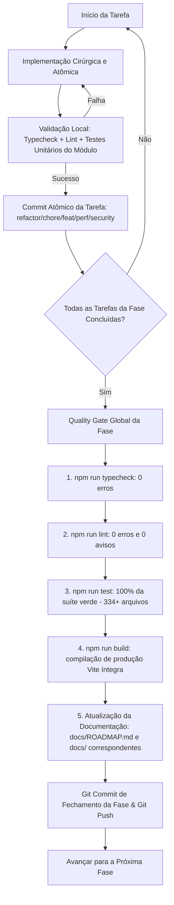

# 🛡️ Plano Mestre de Governança, Organização de Pastas, Configurações, Otimização, Limpeza e Segurança Multicamada

> **Status:** Documento de Planejamento Aprovado — Pronto para Execução Faseada  
> **Arquivo Oficial:** `docs/PLANO_LIMPEZA_OTIMIZACAO_SEGURANCA.md`  
> **Data:** 16 de Outubro de 2026  
> **Diretrizes de Governança:** Vinculado estritamente a `AGENTS.md`, `docs/ARCHITECTURE.md`, `docs/PROJECT_STRUCTURE.md` e `ESPECIFICACAO_TECNICA.md`.  
> **Princípios Centrais:** Zero Efeitos Colaterais, Zero Regressões, Princípio "Nada Solto", Governança de Alto Nível, Configurações Profissionais e Qualidade 100% Verde em cada etapa.  
> **Aviso Operacional:** Nenhuma alteração de código ou remoção estrutural deve ser executada durante a fase de planejamento. A execução ocorre estritamente tarefa a tarefa após validação.

---

## 1. Visão Geral e Critérios de Governança de Alto Nível

Este plano mestre define a estratégia unificada e executável para a reorganização estrutural, governança de arquivos e pastas, desinchaço e reformulação da página de configurações, eliminação de código morto, desduplicação (DRY), otimização de performance e blindagem de segurança multicamada (Front-end React 19, Capacitor Android nativo e Supabase / PostgreSQL).

### Critérios de Governança Arquitetural (Alto Padrão):
1. **Princípio "Nada Solto" (Raiz Limpa):** A raiz do projeto (`/`) é reservada exclusivamente para arquivos canônicos de governança e arquivos de configuração de ferramentas (`package.json`, `tsconfig*.json`, `vite.config.ts`, `eslint.config.js`, `.env*`, `capacitor.config.ts`, `AGENTS.md`, `ESPECIFICACAO_TECNICA.md`, `RECONSTRUCAO.md` e `README.md`). Qualquer arquivo solto ou pasta de mídia não canônica (`identidadeVisual/`, `roadmap_tarefas.md`) deve ser devidamente realocado ou expurgado.
2. **Consolidação Documental sem Duplicações:** A pasta `docs/` deve conter apenas documentos vivos, canônicos e de referência (`UPPER_SNAKE_CASE.md`). Documentações fragmentadas ou com históricos duplicados (`ROADMAP.md` 646KB, `FASES_IMPLEMENTADAS.md` 198KB, `NEXT_PHASES.md` 70KB, `STATEMENT_RECONCILIATION_PLAN.md`) devem ser consolidadas e unificadas sem perda de histórico.
3. **Página de Configurações Profissional & Otimizada:**
   - Ocultação estrita no Web/PWA de recursos e telas que só possuem efeito no Android nativo (`isNativePlatform()`), como o Assistente Passivo de Compras e o Escudo de Privacidade (`FLAG_SECURE`);
   - Reorganização em 4 abas especializadas: *Aparência*, *Notificações & Automações*, *Segurança & Dados* e *Plano*;
   - Eliminação de opções cosméticas poluentes e de baixo valor (remoção de Glassmorphism vs Flat e presets excessivamente complexos);
   - Inclusão da configuração de alto valor: **Ocultação Dinâmica de Centavos no Dashboard** (modo compacto de valores monetários);
   - Desinchaço do monolito `appearance-tab.tsx` (1.200 linhas) em componentes menores, coesos e desacoplados.
4. **Coesão e Baixo Acoplamento de Módulos (`src/`):**
   - Nenhuma pasta genérica (`utils/`, `helpers/`, `shared/`);
   - Telas vivem exclusivamente em `src/features/<área>/pages/`;
   - Eliminação de pastas de páginas que não são rotas ativas (ex.: desativar página órfã `src/features/categories/pages/categories-page.tsx`, movendo diálogos compartilhados para `budgets/` ou `components/modules/`);
   - Cálculos e regras de negócio financeiros residem estritamente em `src/domain/` como funções puras colocalizadas com testes;
   - Camada de dados (`src/data/`) nunca é importada diretamente pela UI (`src/features/` ou `src/components/`), passando obrigatoriamente por `src/state/`.
5. **Higiene e Desduplicação Estrita (DRY):** Erradicação de marcações repetidas, layouts de rodapé divergentes, classes de micro-padding manuais e duplicidade de lógicas de cálculo ou formatação.
6. **Auditoria e Blindagem de Segurança Multicamada:** 100% das tabelas protegidas com RLS estrito (`auth.uid() = user_id`), RPCs com `SET search_path = public`, proteção contra XSS via Zod, blindagem de tela nativa no Android (`FLAG_SECURE`) e ausência de chaves de serviço no bundle do cliente.
7. **Zero Efeitos Colaterais & Portões de Qualidade Inegociáveis:** Cada tarefa gera seu commit atômico validado. Cada fase exige o Quality Gate Global (typecheck estrito, lint sem avisos, 100% dos testes verdes e build de produção bem-sucedido) antes de qualquer push.

---

## 2. Protocolo de Execução, Commits e Portões de Qualidade (Quality Gates)

O fluxo de execução obedece rigorosamente ao diagrama abaixo:



---

## 3. Matriz Estrutural das Fases

```
+---------------------------------------------------------------------------------------------------+
| FASE 0: Linha de Base Estável, Governança de Pastas, Limpeza da Raiz & Consolidação Documental    |
+---------------------------------------------------------------------------------------------------+
| FASE 1: Reformulação, Desinchaço & Otimização da Página de Configurações (Ajustes Profissionais)   |
+---------------------------------------------------------------------------------------------------+
| FASE 2: Purga de Código Morto, Arquivos Órfãos & Desinchaço de Dependências                       |
+---------------------------------------------------------------------------------------------------+
| FASE 3: Desduplicação (DRY), Reuso de Componentes & Padronização de Domínio                      |
+---------------------------------------------------------------------------------------------------+
| FASE 4: Otimização de Performance, Bundle, Assets & Renderização                                  |
+---------------------------------------------------------------------------------------------------+
| FASE 5: Auditoria e Fortalecimento de Segurança, RLS & Privacidade                                |
+---------------------------------------------------------------------------------------------------+
| FASE 6: Homologação Integral, Regressão, Documentação Final & Release                             |
+---------------------------------------------------------------------------------------------------+
```

---

## 4. Detalhamento das Fases e Tarefas

### FASE 0: Linha de Base Estável, Governança de Pastas, Limpeza da Raiz & Consolidação Documental
> **Objetivo:** Estabelecer uma linha de base 100% verde, limpar arquivos soltos na raiz ("Nada Solto"), organizar a árvore de diretórios e consolidar o acervo de documentação sem sobreposições.

- [x] **Tarefa 0.1 — Validação e Consolidação do Working Directory (Baseline Verde)**
  - **Ação:** Avaliar o status dos arquivos atualmente modificados no branch (`src/data/repositories/billing.ts`, `src/features/subscription/`, `src/domain/subscription/`, `src/features/landing/`).
  - **Validação:** Rodar `npm run typecheck` e `npm run lint` atestando zero erros e zero avisos.
  - **Critério de Saída:** Working tree validada e estável.

- [x] **Tarefa 0.2 — Estabilização e Homologação dos Testes Unitários de Importação**
  - **Ação:** Executar e validar a suíte de testes de extratos e cartões:
    - `src/features/cards/components/statement-import-dialog.test.tsx`
    - `src/features/transactions/components/bank-statement-import-dialog.test.tsx`
  - **Validação:** Rodar `npx vitest run` nos componentes garantindo zero falhas ou timeouts.
  - **Critério de Saída:** 100% dos testes de importação verdes e rápidos.

- [x] **Tarefa 0.3 — Limpeza e Organização da Raiz do Projeto (Princípio "Nada Solto")**
  - **Ação:** Auditar e reorganizar arquivos e diretórios fora do padrão na raiz do projeto:
    - **Arquivo `roadmap_tarefas.md` (89 KB):** Comparar com `docs/ROADMAP.md` e `docs/FASES_IMPLEMENTADAS.md`. Transferir itens de tarefas ainda pertinentes para a documentação canônica em `docs/` e remover o arquivo solto da raiz;
    - **Diretório `identidadeVisual/` (6.7 MB):** Auditar as imagens soltas (`Gemini_Generated_Image_...png` 5.4MB, `foto-original.png`, `foto-sem-fundo.png`, `axis-logo.png`). Mover assets de marca oficiais e definitivos para `public/brand/` ou documentação apropriada, e expurgar rascunhos pesados não utilizados em runtime.
  - **Critério de Saída:** Raiz do projeto contendo estritamente os arquivos de configuração e governança permitidos por `PROJECT_STRUCTURE.md`.

- [x] **Tarefa 0.4 — Consolidação e Saneamento do Acervo Documental (`docs/`)**
  - **Ação:** Realizar auditoria rigorosa contra duplicação de informações em `docs/`:
    - **Duplicações de Histórico e Roadmaps:** Analisar o overlap entre `docs/ROADMAP.md` (646 KB), `docs/FASES_IMPLEMENTADAS.md` (198 KB), `docs/NEXT_PHASES.md` (70 KB) e `docs/STATEMENT_RECONCILIATION_PLAN.md` (13 KB). Consolidar fases concluídas no `ROADMAP.md` histórico canônico e unificar planos vigentes, expurgando arquivos de planejamento intermediários já absorvidos;
    - **Padronização de Nomenclatura:** Garantir que 100% dos arquivos em `docs/` adotem `UPPER_SNAKE_CASE.md` (ex.: pasta `docs/security-audit/` padronizada ou formalizada conforme convenção);
    - **Governança SaaS:** Sincronizar `docs/PROJETO_SAAS.md` com as regras recentes de trial de 30 dias e planos de assinatura.
  - **Critério de Saída:** Acervo documental coeso, sem páginas redundantes, com referências cruzadas válidas e em conformidade estrita com `AGENTS.md`.

- [x] **Tarefa 0.5 — Auditoria e Reorganização Arquitetural das Pastas em `src/`**
  - **Ação:** Verificar o alinhamento das pastas de código com `docs/PROJECT_STRUCTURE.md`:
    - **Páginas e Módulos Órfãos:** Inspecionar `src/features/categories/`. Visto que a rota `/categorias` redireciona para `/orcamentos`, reestruturar componentes compartilhados (como `CategoryFormDialog`) para `src/features/budgets/components/` ou `src/components/modules/`, eliminando pastas de páginas que não são mais rotas ativas;
    - **Barrels de Export (`index.ts`):** Garantir que todas as pastas de features, componentes e domínio possuam barrels `index.ts` com exports nomeados consistentes, sem default exports.
  - **Critério de Saída:** Estrutura de diretórios em `src/` 100% aderente ao diagrama canônico de `PROJECT_STRUCTURE.md`.

- [x] **PORTÃO DE QUALIDADE DA FASE 0:**
  - `npm run typecheck` verde (0 erros).
  - `npm run lint` verde (0 erros e 0 avisos).
  - `npm run test` verde em toda a suíte (336 arquivos / 2.557 testes).
  - Commit semântico: `chore(governance): clean project root, consolidate docs and align directory structure`
  - `git push`

---

### FASE 1: Reformulação, Desinchaço & Otimização da Página de Configurações (Ajustes Profissionais)
> **Objetivo:** Transformar a página de configurações em uma central limpa, profissional e intuitiva, ocultando recursos inválidos no PWA, reorganizando abas e adicionando a opção de ocultação de centavos no Dashboard.

- [x] **Tarefa 1.1 — Ocultação Condicional Estrita de Recursos Exclusivos Android no PWA**
  - **Ação:** Utilizar `isNativePlatform()` de `@/services/native`:
    - **Assistente Passivo de Compras & Notificações Bancárias:** Ocultar completamente o card e seus 8 toggles de bancos no ambiente Web/PWA, exibindo-o estritamente no runtime nativo do Android;
    - **Escudo de Privacidade (Privacy Shield / `FLAG_SECURE`):** Ocultar a opção no Web/PWA onde a flag de janela não tem suporte nem efeito;
    - **Biometria / App Lock:** Exibir no ambiente Web somente quando houver suporte a autenticação de dispositivo ou ocultar graciosamente se não for nativo.
  - **Critério de Saída:** Zero opções inúteis ou inoperantes renderizadas para usuários no navegador/PWA.

- [x] **Tarefa 1.2 — Reestruturação da Navegação em 4 Abas Especializadas**
  - **Ação:** Reorganizar a `SettingsPage` para distribuir as opções em 4 abas coesas:
    1. **Aparência & Identidade Visual (`appearance`):** Tema (Claro, Escuro, OLED, Automático), Cor de Destaque Oficial/Variantes, Modo de Centavos no Dashboard e Visibilidade Padrão de Saldos;
    2. **Notificações & Automações (`notifications`):** Lembretes de Vencimento de Contas, Lembrete Diário no Dispositivo e, se Android, Assistente Bancário de Compras;
    3. **Segurança & Gestão de Dados (`security`):** Dados da Conta, Alteração de Senha, Bloqueio com Biometria (Android) e Exportação/Backup de Dados;
    4. **Plano & Assinatura (`subscription`):** Plano ativo, recursos inclusos e upgrade Pro.
  - **Critério de Saída:** Layout balanceado, fim da superlotação visual e navegação sem abas gigantes.

- [x] **Tarefa 1.3 — Desinchaço de Opções Cosméticas Irrelevantes & Decomposição de Componentes**
  - **Ação:** Limpar opções de micro-customização de baixo impacto visual:
    - Remover a seleção de estilo de superfície Flat vs Glassmorphism (manter o padrão de superfície limpo do Design System);
    - Simplificar os presets de experiência para opções diretas e claras sem duplicidade de toggles;
    - Decompor o arquivo monolítico `appearance-tab.tsx` (1.200 linhas) em componentes menores e desacoplados dentro de `src/features/settings/components/tabs/`.
  - **Critério de Saída:** Código limpo, componentizado, com peso reduzido e facilidade de manutenção.

- [x] **Tarefa 1.4 — Implementação da Configuração de Ocultação Dinâmica de Centavos no Dashboard**
  - **Ação:** Criar a preferência do usuário `hide_dashboard_cents` em `useVisualCustomization` e persistência:
    - Permitir que o usuário opte por exibir valores monetários no Dashboard de forma compacta (ex.: `R$ 1.250` em vez de `R$ 1.250,00`);
    - Integrar de forma limpa ao `<MoneyText />` ou formatadores de cards de resumo financeiro;
    - Colocalizar teste unitário para garantir zero efeitos colaterais nos cálculos internos em centavos.
  - **Critério de Saída:** Nova preferência funcional, elegante e integrada ao design system.

- [x] **PORTÃO DE QUALIDADE DA FASE 1:**
  - `npm run typecheck` verde.
  - `npm run lint` verde.
  - `npm run test` verde (incluindo testes de configurações e preferências).
  - `npm run build` verde.
  - Commit semântico: `feat(settings): add hide dashboard cents toggle and complete phase 1 quality gate (task 1.4)`
  - `git push`

---

### FASE 2: Purga de Código Morto, Arquivos Órfãos & Desinchaço de Dependências
> **Objetivo:** Eliminar arquivos sem referência, exports não consumidos e dependências fantasmas sem afetar nenhuma funcionalidade.

- [x] **Tarefa 2.1 — Remoção de Arquivos Mortos e Componentes Abandonados**
  - **Ação:** Cruzar o relatório de diagnóstico da Fase 0 com a árvore de imports:
    - Removidos 10 arquivos órfãos / código morto: `emergency-fund-gauge.tsx` (+teste), `feature-gate.tsx` (+teste), `tooltip.tsx` (+teste), `virtual-list.tsx` (+teste) e `domain/virtualization/index.ts` (+teste);
    - Conectado barrel canônico `subscription/index.ts` em `components/modules/index.ts`;
    - Atualizado `docs/PROJECT_STRUCTURE.md` removendo as referências a arquivos excluídos.
  - **Trava de Segurança:** Verificado que nenhum arquivo excluído possuía referências em lazy imports, rotas, manifestos PWA, atalhos nativos ou scripts operacionais.
  - **Critério de Saída:** Exclusão cirúrgica de todos os arquivos órfãos confirmados.

- [ ] **Tarefa 2.2 — Purga de Exports Públicos Não Utilizados**
  - **Ação:** Limpar funções, constantes e tipos exportados que nunca são consumidos fora de seu arquivo em `src/domain/`, `src/services/`, `src/types/` e `src/components/`:
    - Tornar locais (remover `export`) ou deletar funções e constantes sem utilidade;
    - Preservar tipos de banco gerados em `src/types/database.ts` e contratos de RPC.
  - **Critério de Saída:** Árvore de exports limpa, com superfície de API interna reduzida e coesa.

- [ ] **Tarefa 2.3 — Auditoria e Desinchaço de Pacotes (`package.json`)**
  - **Ação:** Auditar `dependencies` e `devDependencies`:
    - Identificar pacotes não importados em código nem chamados em scripts de build/teste;
    - Remover pacotes desnecessários via `npm uninstall`;
    - Atualizar `package-lock.json` de forma limpa e reproduzível.
  - **Trava de Segurança:** Garantir a permanência de plugins nativos do Capacitor essenciais para a compilação do Android.
  - **Critério de Saída:** `package.json` sem bibliotecas não utilizadas e com dependências essenciais íntegras.

- [ ] **PORTÃO DE QUALIDADE DA FASE 2:**
  - `npm run typecheck` verde.
  - `npm run lint` verde.
  - `npm run test` verde.
  - `npm run build` verde.
  - Commit semântico: `chore(cleanup): prune dead files, unused exports and unreferenced dependencies`
  - `git push`

---

### FASE 3: Desduplicação (DRY), Reuso de Componentes & Padronização de Domínio
> **Objetivo:** Aplicar com rigor a Regra DRY Estrita de UI (§4 de `AGENTS.md`) e centralizar lógicas financeiras repetidas em funções puras de domínio.

- [ ] **Tarefa 3.1 — Unificação da Anatomia de Diálogos e Modais**
  - **Ação:** Varrer telas de `src/features/` e padronizar todos os modais:
    - Utilizar os primitivos `<Modal />` e `<ResponsiveDialog />` respeitando estritamente a escala de larguras (`sm`, `md`, `lg`, `xl`, `2xl`, `3xl`);
    - Erradicar marcações manuais de rodapé de diálogo, aplicando a anatomia canônica: Cancelar à esquerda, Confirmar à direita no desktop e empilhamento seguro no mobile (`flex-col-reverse`);
    - Eliminar classes manuais de micro-padding em badges (`text-[9px]`, `py-0`), adotando as variantes padronizadas de `<Badge size="xs" | "sm" | "md" />`.
  - **Critério de Saída:** 100% dos diálogos do sistema com anatomia, largura e responsividade padronizadas.

- [ ] **Tarefa 3.2 — Padronização de Valores Monetários e Erradicação de `truncate`**
  - **Ação:** Auditar exibições de moeda em cards, listas e extratos (§11 de `AGENTS.md`):
    - Proibição absoluta de `truncate` em valores financeiros;
    - Assegurar o uso de `<MoneyText />` ou tipografia tabular adaptativa (`tabular-nums tracking-tight whitespace-nowrap`);
    - Centralizar formatações em `src/domain/money.ts` e `src/services/formatters.ts`.
  - **Critério de Saída:** Valores monetários legíveis em qualquer largura de tela sem truncamentos indevidos.

- [ ] **Tarefa 3.3 — Conformidade com a Regra de Zero Controles Nativos**
  - **Ação:** Verificar conformidade com §7 de `AGENTS.md`:
    - Garantir que nenhum `<select>`, `<input type="date">` ou `<input type="checkbox">` nativo seja renderizado solto nas páginas;
    - Todos os controles devem utilizar os primitivos encapsulados (`Select`, `DatePicker`, `Checkbox`, `RadioGroup`, `MoneyInput`, `Input`, `Textarea`);
    - Padronizar anatomia de labels (`text-xs font-semibold text-foreground`) e helper texts (`text-[11px] text-muted-foreground`).
  - **Critério de Saída:** Zero elementos nativos de controle soltos em toda a interface.

- [ ] **Tarefa 3.4 — Centralização de Cálculos Financeiros em Funções Puras (`src/domain/`)**
  - **Ação:** Mapear regras de negócio, somatórios e filtros temporais dispersos em componentes ou hooks:
    - Extrair para funções puras dentro de `src/domain/` com valores monetários em centavos inteiros;
    - Colocalizar testes unitários (`*.test.ts`) para cada função de domínio extraída.
  - **Critério de Saída:** Componentes de apresentação puramente visuais, sem regras de cálculo embutidas.

- [ ] **PORTÃO DE QUALIDADE DA FASE 3:**
  - `npm run typecheck` verde.
  - `npm run lint` verde.
  - `npm run test` verde.
  - `npm run build` verde.
  - Commit semântico: `refactor(dry): harmonize dialogs, enforce MoneyText, eliminate native controls and centralize domain calculations`
  - `git push`

---

### FASE 4: Otimização de Performance, Bundle, Assets & Renderização
> **Objetivo:** Acelerar o carregamento inicial da aplicação, otimizar a distribuição de chunks do Vite, compactar assets e garantir 60fps constantes nas interações.

- [ ] **Tarefa 4.1 — Otimização e Compressão de Assets Estáticos**
  - **Ação:** Auditar a pasta `public/` e imagens de branding:
    - Comprimir `public/brand/logo-full.png` (~5.0 MB) para formato moderno WebP/PNG de alta fidelidade (< 300 KB);
    - Auditar ícones PWA e favicons em `public/pwa/` para garantir compressão máxima sem perda de nitidez visual.
  - **Critério de Saída:** Redução de múltiplos megabytes nos assets estáticos servidos pelo app.

- [ ] **Tarefa 4.2 — Code-Splitting Fino e Lazy Loading de Rotas Secundárias**
  - **Ação:** Auditar `src/app/router.tsx` e o grafo de dependências do Vite:
    - Garantir lazy loading via `React.lazy` para rotas secundárias ou pesadas (Relatórios analíticos, Painel Admin, Assistentes de importação de extrato, Telas de Checkout SaaS);
    - Configurar prefetch inteligente em idle para rotas de alta frequência.
  - **Critério de Saída:** Redução drástica do tamanho do chunk inicial `index.js`.

- [ ] **Tarefa 4.3 — Calibração do Rollup e Vendor Chunks no Vite**
  - **Ação:** Configurar `manualChunks` em `vite.config.ts`:
    - Isolar vendors estáveis em chunks cacheados:
      - `vendor-react`: `react`, `react-dom`, `react-router`;
      - `vendor-ui`: `@radix-ui/*`, `lucide-react`, `cmdk`;
      - `vendor-backend`: `@supabase/supabase-js`, `@tanstack/react-query`;
      - `vendor-native`: pacotes `@capacitor/*`.
  - **Critério de Saída:** Eliminação do aviso de chunk > 500 kB do Rollup e melhor aproveitamento de cache HTTP/PWA.

- [ ] **Tarefa 4.4 — Otimização de Renderização e Reatividade (React 19)**
  - **Ação:** Auditar listas volumosas e componentes com cálculos frequentes:
    - Aplicar memoização (`useMemo`, `useCallback`) em ordenações, filtros de extrato e gráficos analíticos;
    - Garantir chaves estáveis (`key={id}`) em todas as iterações (evitando `index` como chave);
    - Ajustar `staleTime` no TanStack Query para evitar re-fetches desnecessários em navegação rápida entre abas.
  - **Critério de Saída:** Interações e rolagens a 60fps em dispositivos de baixo e médio desempenho.

- [ ] **Tarefa 4.5 — Auditoria de Feedback Sensorial e Eliminação de Double-Haptics**
  - **Ação:** Auditar chamadas de feedback tátil e sonoro (§17 de `AGENTS.md`):
    - Garantir que todos os disparos ocorram exclusivamente pelo Gateway Central (`src/services/sensory.ts`);
    - Confirmar ausência de chamadas manuais a `triggerHaptic` dentro de handlers `onClick` de botões;
    - Garantir silêncio tátil/auditivo durante digitação em `MoneyInput` e rolagens.
  - **Critério de Saída:** Experiência tátil fluida, sem disparos duplicados e energeticamente eficiente.

- [ ] **PORTÃO DE QUALIDADE DA FASE 4:**
  - `npm run typecheck` verde.
  - `npm run lint` verde.
  - `npm run test` verde.
  - `npm run build` verde (verificação dos tamanhos dos chunks compilados).
  - Commit semântico: `perf: compress branding assets, optimize vendor chunking and refine react rendering`
  - `git push`

---

### FASE 5: Auditoria e Fortalecimento de Segurança, RLS & Privacidade
> **Objetivo:** Auditar e blindar todo o perímetro de segurança (Banco de Dados Supabase, Client-Side, Camada Nativa Android e Dependências de Terceiros).

- [ ] **Tarefa 5.1 — Auditoria Integral de Políticas RLS do Supabase**
  - **Ação:** Varrer todas as migrações SQL em `supabase/migrations/`:
    - Confirmar `ALTER TABLE ... ENABLE ROW LEVEL SECURITY` em 100% das tabelas de dados do usuário;
    - Verificar que todas as políticas (`SELECT`, `INSERT`, `UPDATE`, `DELETE`) impõem `auth.uid() = user_id`;
    - Confirmar a inexistência de políticas permissivas acidentais (`USING (true)`).
  - **Critério de Saída:** Isolamento horizontal absoluto entre contas garantido no nível do banco de dados.

- [ ] **Tarefa 5.2 — Blindagem de Funções RPC e Sanitização de Search Path**
  - **Ação:** Inspecionar todas as funções SQL `SECURITY DEFINER`:
    - Assegurar a presença obrigatória de `SET search_path = public, pg_temp` em todas as RPCs transacionais para blindar contra vulnerabilidades de *search path hijacking*;
    - Verificar a validação de sessão e `auth.uid()` no corpo de cada função.
  - **Critério de Saída:** 100% das RPCs protegidas contra injeção de schema e bypass de permissão.

- [ ] **Tarefa 5.3 — Auditoria do Bundle Client contra Vazamento de Segredos**
  - **Ação:** Varrer a base de código e o bundle gerado:
    - Garantir que nenhuma credencial privilegiada (`SUPABASE_SERVICE_ROLE_KEY`, secrets de webhook, senhas de banco) exista no código de `src/`;
    - Confirmar que apenas `VITE_SUPABASE_URL` e `VITE_SUPABASE_ANON_KEY` são expostas ao cliente.
  - **Critério de Saída:** Zero segredos confidenciais expostos no código client-side.

- [ ] **Tarefa 5.4 — Sanitização de Inputs e Validação Defensiva com Zod**
  - **Ação:** Auditar schemas Zod em mutations e formulários:
    - Validar sanitização estrita de strings (prevenção de injeção de HTML/XSS e caracteres de controle);
    - Validar limites em centavos para evitar overflows em cálculos monetários.
  - **Critério de Saída:** Validação defensiva completa em todas as bordas de entrada de dados.

- [ ] **Tarefa 5.5 — Fortalecimento Nativo Android & Privacidade de Sessão**
  - **Ação:** Auditar proteções nativas no Capacitor:
    - Validar o `PrivacyShield` (`FLAG_SECURE`) impedindo capturas de tela e ocultando dados sensíveis no gerenciador de tarefas recentes do Android;
    - Verificar o bloqueio automático de tela (`AppLock`) por inatividade com biometria adaptativa;
    - Confirmar em `AndroidManifest.xml` o bloqueio a tráfego HTTP inseguro (`cleartextTraffic`).
  - **Critério de Saída:** Camada nativa em conformidade com os mais altos padrões de segurança para apps financeiros.

- [ ] **Tarefa 5.6 — Auditoria e Mitigação de Vulnerabilidades de Dependências**
  - **Ação:** Executar `npm audit` e analisar relatórios de vulnerabilidades conhecidas (CVEs).
  - **Correção:** Atualizar pacotes de forma segura e pontual, sem quebras de compatibilidade.
  - **Critério de Saída:** Relatório de dependências limpo, sem vulnerabilidades de severidade crítica ou alta.

- [ ] **PORTÃO DE QUALIDADE DA FASE 5:**
  - `npm run typecheck` verde.
  - `npm run lint` verde.
  - `npm run test` verde.
  - `npm run build` verde.
  - Commit semântico: `security: harden supabase rls and rpc search paths, sanitize inputs and verify android privacy`
  - `git push`

---

### FASE 6: Homologação Integral, Regressão, Documentação Final & Release
> **Objetivo:** Executar o ciclo completo de testes e homologação cruzada, sincronizar a documentação viva e emitir a versão estável e otimizada.

- [ ] **Tarefa 6.1 — Bateria Completa de Testes Automatizados & Acessibilidade**
  - **Ação:** Executar a suíte integral de testes unitários, testes de integração e auditoria de acessibilidade (`src/tests/accessibility-audit.test.tsx`).
  - **Critério de Saída:** 100% dos 334+ arquivos de teste aprovados sem falhas nem avisos.

- [ ] **Tarefa 6.2 — Homologação de Compilação Web e PWA**
  - **Ação:** Executar `npm run build` e validar a integridade dos artefatos em `dist/`:
    - Validar manifesto PWA e Service Worker gerados pelo `vite-plugin-pwa`;
    - Confirmar funcionamento do fallback offline (`offline.html`).
  - **Critério de Saída:** Build de produção PWA homologado e pronto para deploy no Cloudflare Pages.

- [ ] **Tarefa 6.3 — Sincronização e Compilação dos APKs Nativos Android**
  - **Ação:** Executar `npx cap sync android` e `./scripts/build-apk.sh`:
    - Compilar `guia-financeiro-debug.apk` e `guia-financeiro-release.apk` (assinado);
    - Checar hashes de integridade SHA-256.
  - **Critério de Saída:** Artefatos Android gerados com sucesso pelo Gradle.

- [ ] **Tarefa 6.4 — Sincronização da Documentação e Governança Canônica**
  - **Ação:** Atualizar os registros de documentação com os resultados finais:
    - Registrar a nova versão e o relatório consolidado em `docs/ROADMAP.md`;
    - Atualizar a árvore em `docs/PROJECT_STRUCTURE.md` refletindo as pastas e arquivos reorganizados;
    - Atualizar a tabela de métricas deste plano (`docs/PLANO_LIMPEZA_OTIMIZACAO_SEGURANCA.md`).
  - **Critério de Saída:** Documentação viva, precisa e 100% sincronizada com o repositório.

- [ ] **PORTÃO DE QUALIDADE FINAL & RELEASE:**
  - Todos os portões anteriores 100% verdes.
  - Commit semântico final: `chore(release): complete application-wide governance, settings overhaul, cleanup, optimization and security hardening`
  - `git push`

---

## 5. Tabela Comparativa de Metas e Indicadores de Sucesso

| Indicador | Situação Inicial (Pré-Plano) | Meta do Plano |
|---|---|---|
| **Erros de Linter (`npm run lint`)** | 0 erros / 0 avisos | **0 erros / 0 avisos (manter)** |
| **Suíte de Testes (`npm run test`)** | 334+ arquivos (com eventuais timeouts em extrato) | **100% verde (2.300+ testes rápidos e estáveis)** |
| **Página de Configurações** | Superlotada (monolito de 1.200 linhas, opções inoperantes no PWA) | **4 abas limpas, sem poluição cosmética, condicional Android estrito** |
| **Configuração de Centavos** | Inexistente (exibição fixa) | **Nova preferência funcional: Ocultação de Centavos no Dashboard** |
| **Raiz do Projeto (`/`)** | Arquivos e pastas soltos (`roadmap_tarefas.md`, `identidadeVisual/`) | **100% limpa (apenas configs e governança)** |
| **Acervo de Documentação (`docs/`)** | Documentos com sobreposição histórica (646KB + 198KB + 70KB) | **Consolidado, canônico e sem redundâncias** |
| **Arquivos Órfãos / Dead Code em `src/`** | Páginas órfãs e componentes descontinuados | **0 arquivos órfãos / 0 exports mortos** |
| **Controles de UI Nativos** | Potenciais controles soltos | **Zero controles nativos (100% primitivos)** |
| **Assets de Branding (`logo-full.png`)** | ~5.0 MB | **< 300 kB (otimizado WebP/PNG de alta fidelidade)** |
| **Chunks Rollup do Bundle** | Bundle sem segmentação explícita | **Chunks vendor segmentados (< 500 kB cada)** |
| **Conformidade RLS no Supabase** | Parcial / A auditar | **100% das tabelas com `auth.uid() = user_id`** |
| **Blindagem de RPCs Supabase** | Parcial / A auditar | **100% com `SET search_path = public, pg_temp`** |
| **Privacidade Nativa Android** | Funcional | **Homologada (FLAG_SECURE + AppLock)** |
| **Compilação PWA e APKs** | Funcional | **100% validada e automatizada** |

---

## 6. Diretrizes Estritas para a Execução

Quando a autorização para execução for concedida:
1. **Disciplina Sequencial:** Executar estritamente fase a fase, tarefa a tarefa, na ordem numérica de 0 a 6. Jamais avançar de fase antes do Quality Gate da fase anterior estar verde.
2. **Atualização do Checklist:** Marcar com `[x]` cada tarefa concluída em `docs/PLANO_LIMPEZA_OTIMIZACAO_SEGURANCA.md`.
3. **Commit e Push:** Respeitar o protocolo de commits atômicos por tarefa e git push ao final de cada fase.
4. **Respeito às Regras de Negócio:** Nenhuma regra financeira definida em `ESPECIFICACAO_TECNICA.md` pode ser modificada ou quebrada.
