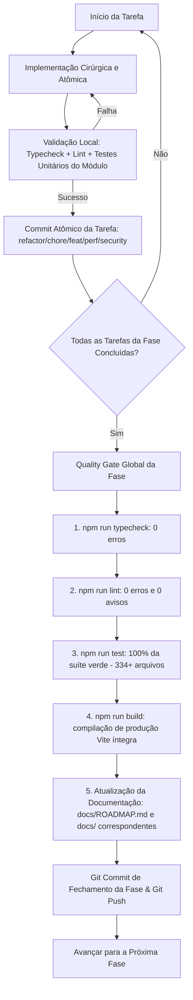

# 🛡️ Plano Mestre de Governança, Organização de Pastas, Configurações, Otimização, Limpeza e Segurança Multicamada

> **Status:** Documento de Planejamento Aprovado — Pronto para Execução Faseada  
> **Arquivo Oficial:** `docs/PLANO_LIMPEZA_OTIMIZACAO_SEGURANCA.md`  
> **Data:** 16 de Outubro de 2026  
> **Diretrizes de Governança:** Vinculado estritamente a `AGENTS.md`, `docs/ARCHITECTURE.md`, `docs/PROJECT_STRUCTURE.md` e `ESPECIFICACAO_TECNICA.md`.  
> **Princípios Centrais:** Zero Efeitos Colaterais, Zero Regressões, Princípio "Nada Solto", Governança de Alto Nível, Configurações Profissionais e Qualidade 100% Verde em cada etapa.  
> **Aviso Operacional:** Nenhuma alteração de código ou remoção estrutural deve ser executada durante a fase de planejamento. A execução ocorre estritamente tarefa a tarefa após validação.

---

## 1. Visão Geral e Critérios de Governança de Alto Nível

Este plano mestre define a estratégia unificada e executável para a reorganização estrutural, governança de arquivos e pastas, desinchaço e reformulação da página de configurações, eliminação de código morto, desduplicação (DRY), otimização de performance e blindagem de segurança multicamada (Front-end React 19, Capacitor Android nativo e Supabase / PostgreSQL).

### Critérios de Governança Arquitetural (Alto Padrão):
1. **Princípio "Nada Solto" (Raiz Limpa):** A raiz do projeto (`/`) é reservada exclusivamente para arquivos canônicos de governança e arquivos de configuração de ferramentas (`package.json`, `tsconfig*.json`, `vite.config.ts`, `eslint.config.js`, `.env*`, `capacitor.config.ts`, `AGENTS.md`, `ESPECIFICACAO_TECNICA.md`, `RECONSTRUCAO.md` e `README.md`). Qualquer arquivo solto ou pasta de mídia não canônica (`identidadeVisual/`, `roadmap_tarefas.md`) deve ser devidamente realocado ou expurgado.
2. **Consolidação Documental sem Duplicações:** A pasta `docs/` deve conter apenas documentos vivos, canônicos e de referência (`UPPER_SNAKE_CASE.md`). Documentações fragmentadas ou com históricos duplicados (`ROADMAP.md` 646KB, `FASES_IMPLEMENTADAS.md` 198KB, `NEXT_PHASES.md` 70KB, `STATEMENT_RECONCILIATION_PLAN.md`) devem ser consolidadas e unificadas sem perda de histórico.
3. **Página de Configurações Profissional & Otimizada:**
   - Ocultação estrita no Web/PWA de recursos e telas que só possuem efeito no Android nativo (`isNativePlatform()`), como o Assistente Passivo de Compras e o Escudo de Privacidade (`FLAG_SECURE`);
   - Reorganização em 4 abas especializadas: *Aparência*, *Notificações & Automações*, *Segurança & Dados* e *Plano*;
   - Eliminação de opções cosméticas poluentes e de baixo valor (remoção de Glassmorphism vs Flat e presets excessivamente complexos);
   - Inclusão da configuração de alto valor: **Ocultação Dinâmica de Centavos no Dashboard** (modo compacto de valores monetários);
   - Desinchaço do monolito `appearance-tab.tsx` (1.200 linhas) em componentes menores, coesos e desacoplados.
4. **Coesão e Baixo Acoplamento de Módulos (`src/`):**
   - Nenhuma pasta genérica (`utils/`, `helpers/`, `shared/`);
   - Telas vivem exclusivamente em `src/features/<área>/pages/`;
   - Eliminação de pastas de páginas que não são rotas ativas (ex.: desativar página órfã `src/features/categories/pages/categories-page.tsx`, movendo diálogos compartilhados para `budgets/` ou `components/modules/`);
   - Cálculos e regras de negócio financeiros residem estritamente em `src/domain/` como funções puras colocalizadas com testes;
   - Camada de dados (`src/data/`) nunca é importada diretamente pela UI (`src/features/` ou `src/components/`), passando obrigatoriamente por `src/state/`.
5. **Higiene e Desduplicação Estrita (DRY):** Erradicação de marcações repetidas, layouts de rodapé divergentes, classes de micro-padding manuais e duplicidade de lógicas de cálculo ou formatação.
6. **Auditoria e Blindagem de Segurança Multicamada:** 100% das tabelas protegidas com RLS estrito (`auth.uid() = user_id`), RPCs com `SET search_path = public`, proteção contra XSS via Zod, blindagem de tela nativa no Android (`FLAG_SECURE`) e ausência de chaves de serviço no bundle do cliente.
7. **Zero Efeitos Colaterais & Portões de Qualidade Inegociáveis:** Cada tarefa gera seu commit atômico validado. Cada fase exige o Quality Gate Global (typecheck estrito, lint sem avisos, 100% dos testes verdes e build de produção bem-sucedido) antes de qualquer push.
8. **Ciclo de Vida PWA Atômico & Invalidação Determinística de Cache:**
   - Atualizações de versão do Web/PWA devem ser estritamente atômicas: o acionamento de "Atualizar" deve assegurar que o novo Service Worker assuma o controle total dos clientes (`skipWaiting` + `clientsClaim`) antes do reload, impedindo telas zumbis ou colisão de chunks mistos;
   - O `CacheStorage` obsoleto deve ser purgado integralmente (`cleanupOutdatedCaches: true` do Workbox + rotina de limpeza de caches legados);
   - Ícones do Web App Manifest e tags de splash/favicon devem possuir versionamento determinístico ou cache-busting, garantindo que o launcher móvel (Android WebAPK) e abas de desktop sincronizem visualmente novos designs de marca sem reter imagens obsoletas.

---

## 2. Protocolo de Execução, Commits e Portões de Qualidade (Quality Gates)

O fluxo de execução obedece rigorosamente ao diagrama abaixo:



---

## 3. Matriz Estrutural das Fases

```
+---------------------------------------------------------------------------------------------------+
| FASE 0: Linha de Base Estável, Governança de Pastas, Limpeza da Raiz & Consolidação Documental    |
+---------------------------------------------------------------------------------------------------+
| FASE 1: Reformulação, Desinchaço & Otimização da Página de Configurações (Ajustes Profissionais)   |
+---------------------------------------------------------------------------------------------------+
| FASE 2: Purga de Código Morto, Arquivos Órfãos & Desinchaço de Dependências                       |
+---------------------------------------------------------------------------------------------------+
| FASE 3: Desduplicação (DRY), Reuso de Componentes & Padronização de Domínio                      |
+---------------------------------------------------------------------------------------------------+
| FASE 4: Otimização de Performance, Bundle, Assets, Ciclo PWA & Renderização                      |
+---------------------------------------------------------------------------------------------------+
| FASE 5: Auditoria e Fortalecimento de Segurança, RLS & Privacidade                                |
+---------------------------------------------------------------------------------------------------+
| FASE 6: Homologação Integral, Regressão, Documentação Final & Release                             |
+---------------------------------------------------------------------------------------------------+
```

---

## 4. Detalhamento das Fases e Tarefas

### FASE 0: Linha de Base Estável, Governança de Pastas, Limpeza da Raiz & Consolidação Documental
> **Objetivo:** Estabelecer uma linha de base 100% verde, limpar arquivos soltos na raiz ("Nada Solto"), organizar a árvore de diretórios e consolidar o acervo de documentação sem sobreposições.

- [x] **Tarefa 0.1 — Validação e Consolidação do Working Directory (Baseline Verde)**
  - **Ação:** Avaliar o status dos arquivos atualmente modificados no branch (`src/data/repositories/billing.ts`, `src/features/subscription/`, `src/domain/subscription/`, `src/features/landing/`).
  - **Validação:** Rodar `npm run typecheck` e `npm run lint` atestando zero erros e zero avisos.
  - **Critério de Saída:** Working tree validada e estável.

- [x] **Tarefa 0.2 — Estabilização e Homologação dos Testes Unitários de Importação**
  - **Ação:** Executar e validar a suíte de testes de extratos e cartões:
    - `src/features/cards/components/statement-import-dialog.test.tsx`
    - `src/features/transactions/components/bank-statement-import-dialog.test.tsx`
  - **Validação:** Rodar `npx vitest run` nos componentes garantindo zero falhas ou timeouts.
  - **Critério de Saída:** 100% dos testes de importação verdes e rápidos.

- [x] **Tarefa 0.3 — Limpeza e Organização da Raiz do Projeto (Princípio "Nada Solto")**
  - **Ação:** Auditar e reorganizar arquivos e diretórios fora do padrão na raiz do projeto:
    - **Arquivo `roadmap_tarefas.md` (89 KB):** Comparar com `docs/ROADMAP.md` e `docs/FASES_IMPLEMENTADAS.md`. Transferir itens de tarefas ainda pertinentes para a documentação canônica em `docs/` e remover o arquivo solto da raiz;
    - **Diretório `identidadeVisual/` (6.7 MB):** Auditar as imagens soltas (`Gemini_Generated_Image_...png` 5.4MB, `foto-original.png`, `foto-sem-fundo.png`, `axis-logo.png`). Mover assets de marca oficiais e definitivos para `public/brand/` ou documentação apropriada, e expurgar rascunhos pesados não utilizados em runtime.
  - **Critério de Saída:** Raiz do projeto contendo estritamente os arquivos de configuração e governança permitidos por `PROJECT_STRUCTURE.md`.

- [x] **Tarefa 0.4 — Consolidação e Saneamento do Acervo Documental (`docs/`)**
  - **Ação:** Realizar auditoria rigorosa contra duplicação de informações em `docs/`:
    - **Duplicações de Histórico e Roadmaps:** Analisar o overlap entre `docs/ROADMAP.md` (646 KB), `docs/FASES_IMPLEMENTADAS.md` (198 KB), `docs/NEXT_PHASES.md` (70 KB) e `docs/STATEMENT_RECONCILIATION_PLAN.md` (13 KB). Consolidar fases concluídas no `ROADMAP.md` histórico canônico e unificar planos vigentes, expurgando arquivos de planejamento intermediários já absorvidos;
    - **Padronização de Nomenclatura:** Garantir que 100% dos arquivos em `docs/` adotem `UPPER_SNAKE_CASE.md` (ex.: pasta `docs/security-audit/` padronizada ou formalizada conforme convenção);
    - **Governança SaaS:** Sincronizar `docs/PROJETO_SAAS.md` com as regras recentes de trial de 30 dias e planos de assinatura.
  - **Critério de Saída:** Acervo documental coeso, sem páginas redundantes, com referências cruzadas válidas e em conformidade estrita com `AGENTS.md`.

- [x] **Tarefa 0.5 — Auditoria e Reorganização Arquitetural das Pastas em `src/`**
  - **Ação:** Verificar o alinhamento das pastas de código com `docs/PROJECT_STRUCTURE.md`:
    - **Páginas e Módulos Órfãos:** Inspecionar `src/features/categories/`. Visto que a rota `/categorias` redireciona para `/orcamentos`, reestruturar componentes compartilhados (como `CategoryFormDialog`) para `src/features/budgets/components/` ou `src/components/modules/`, eliminando pastas de páginas que não são mais rotas ativas;
    - **Barrels de Export (`index.ts`):** Garantir que todas as pastas de features, componentes e domínio possuam barrels `index.ts` com exports nomeados consistentes, sem default exports.
  - **Critério de Saída:** Estrutura de diretórios em `src/` 100% aderente ao diagrama canônico de `PROJECT_STRUCTURE.md`.

- [x] **PORTÃO DE QUALIDADE DA FASE 0:**
  - `npm run typecheck` verde (0 erros).
  - `npm run lint` verde (0 erros e 0 avisos).
  - `npm run test` verde em toda a suíte (336 arquivos / 2.557 testes).
  - Commit semântico: `chore(governance): clean project root, consolidate docs and align directory structure`
  - `git push`

---

### FASE 1: Reformulação, Desinchaço & Otimização da Página de Configurações (Ajustes Profissionais)
> **Objetivo:** Transformar a página de configurações em uma central limpa, profissional e intuitiva, ocultando recursos inválidos no PWA, reorganizando abas e adicionando a opção de ocultação de centavos no Dashboard.

- [x] **Tarefa 1.1 — Ocultação Condicional Estrita de Recursos Exclusivos Android no PWA**
  - **Ação:** Utilizar `isNativePlatform()` de `@/services/native`:
    - **Assistente Passivo de Compras & Notificações Bancárias:** Ocultar completamente o card e seus 8 toggles de bancos no ambiente Web/PWA, exibindo-o estritamente no runtime nativo do Android;
    - **Escudo de Privacidade (Privacy Shield / `FLAG_SECURE`):** Ocultar a opção no Web/PWA onde a flag de janela não tem suporte nem efeito;
    - **Biometria / App Lock:** Exibir no ambiente Web somente quando houver suporte a autenticação de dispositivo ou ocultar graciosamente se não for nativo.
  - **Critério de Saída:** Zero opções inúteis ou inoperantes renderizadas para usuários no navegador/PWA.

- [x] **Tarefa 1.2 — Reestruturação da Navegação em 4 Abas Especializadas**
  - **Ação:** Reorganizar a `SettingsPage` para distribuir as opções em 4 abas coesas:
    1. **Aparência & Identidade Visual (`appearance`):** Tema (Claro, Escuro, OLED, Automático), Cor de Destaque Oficial/Variantes, Modo de Centavos no Dashboard e Visibilidade Padrão de Saldos;
    2. **Notificações & Automações (`notifications`):** Lembretes de Vencimento de Contas, Lembrete Diário no Dispositivo e, se Android, Assistente Bancário de Compras;
    3. **Segurança & Gestão de Dados (`security`):** Dados da Conta, Alteração de Senha, Bloqueio com Biometria (Android) e Exportação/Backup de Dados;
    4. **Plano & Assinatura (`subscription`):** Plano ativo, recursos inclusos e upgrade Pro.
  - **Critério de Saída:** Layout balanceado, fim da superlotação visual e navegação sem abas gigantes.

- [x] **Tarefa 1.3 — Desinchaço de Opções Cosméticas Irrelevantes & Decomposição de Componentes**
  - **Ação:** Limpar opções de micro-customização de baixo impacto visual:
    - Remover a seleção de estilo de superfície Flat vs Glassmorphism (manter o padrão de superfície limpo do Design System);
    - Simplificar os presets de experiência para opções diretas e claras sem duplicidade de toggles;
    - Decompor o arquivo monolítico `appearance-tab.tsx` (1.200 linhas) em componentes menores e desacoplados dentro de `src/features/settings/components/tabs/`.
  - **Critério de Saída:** Código limpo, componentizado, com peso reduzido e facilidade de manutenção.

- [x] **Tarefa 1.4 — Implementação da Configuração de Ocultação Dinâmica de Centavos no Dashboard**
  - **Ação:** Criar a preferência do usuário `hide_dashboard_cents` em `useVisualCustomization` e persistência:
    - Permitir que o usuário opte por exibir valores monetários no Dashboard de forma compacta (ex.: `R$ 1.250` em vez de `R$ 1.250,00`);
    - Integrar de forma limpa ao `<MoneyText />` ou formatadores de cards de resumo financeiro;
    - Colocalizar teste unitário para garantir zero efeitos colaterais nos cálculos internos em centavos.
  - **Critério de Saída:** Nova preferência funcional, elegante e integrada ao design system.

- [x] **PORTÃO DE QUALIDADE DA FASE 1:**
  - `npm run typecheck` verde.
  - `npm run lint` verde.
  - `npm run test` verde (incluindo testes de configurações e preferências).
  - `npm run build` verde.
  - Commit semântico: `feat(settings): add hide dashboard cents toggle and complete phase 1 quality gate (task 1.4)`
  - `git push`

---

### FASE 2: Purga de Código Morto, Arquivos Órfãos & Desinchaço de Dependências
> **Objetivo:** Eliminar arquivos sem referência, exports não consumidos e dependências fantasmas sem afetar nenhuma funcionalidade.

- [x] **Tarefa 2.1 — Remoção de Arquivos Mortos e Componentes Abandonados**
  - **Ação:** Cruzar o relatório de diagnóstico da Fase 0 com a árvore de imports:
    - Removidos 10 arquivos órfãos / código morto: `emergency-fund-gauge.tsx` (+teste), `feature-gate.tsx` (+teste), `tooltip.tsx` (+teste), `virtual-list.tsx` (+teste) e `domain/virtualization/index.ts` (+teste);
    - Conectado barrel canônico `subscription/index.ts` em `components/modules/index.ts`;
    - Atualizado `docs/PROJECT_STRUCTURE.md` removendo as referências a arquivos excluídos.
  - **Trava de Segurança:** Verificado que nenhum arquivo excluído possuía referências em lazy imports, rotas, manifestos PWA, atalhos nativos ou scripts operacionais.
  - **Critério de Saída:** Exclusão cirúrgica de todos os arquivos órfãos confirmados.

- [x] **Tarefa 2.2 — Purga de Exports Públicos Não Utilizados**
  - **Ação:** Limpar funções, constantes e tipos exportados que nunca são consumidos fora de seu arquivo em `src/domain/`, `src/services/`, `src/types/` e `src/components/`:
    - Removidos exports e tornadas locais funções auxiliares e constantes em `domain/export/csv`, `domain/gestures/swipe`, `domain/insights/recurrences`, `domain/insights/subscriptions`, `domain/loans`, `domain/notifications/bank-parser`, `domain/portfolio/benchmarks`, `domain/portfolio/business-days`, `domain/portfolio/fixed-income`, `domain/portfolio/import-parser`, `domain/portfolio/schemas`, `domain/portfolio/tickers-catalog`, `domain/portfolio/xlsx-parser`, `domain/reconciliation/hash`, `domain/reconciliation/parsers/*`, `domain/search`, `services/excel-export`, `services/native/interactive-notifications`, `services/native/suggestions-store` e `services/toast`;
    - Deletadas constantes/funções totalmente sem utilidade: `BUDGET_STATUS_LABELS`, `buildTopSuggestionResults`, `CDC_REFUND_GUARANTEE_DAYS` e `statementTransactionSchema` (com eliminação de import de zod não utilizado em `reconciliation/types.ts`);
    - Removidos exports de 15 tuplas constantes de runtime em `src/types/schema.ts` preservando seus contratos e tipos TypeScript de união;
    - Preservados tipos de banco gerados em `src/types/database.ts` e contratos de RPC.
  - **Critério de Saída:** Árvore de exports limpa, com superfície de API interna reduzida e coesa.

- [x] **Tarefa 2.3 — Auditoria e Desinchaço de Pacotes (`package.json`)**
  - **Ação:** Auditar `dependencies` e `devDependencies`:
    - Auditados todos os 29 pacotes de `dependencies` e 27 pacotes de `devDependencies`;
    - Confirmado consumo direto de todas as 29 dependências de produção (8 primitivos Radix em `components/ui/`, 9 pacotes do ecossistema Capacitor/Android, 12 bibliotecas essenciais de UI/estado/banco);
    - Confirmada conformidade estrita das 27 devDependencies (ferramentas de teste, types, ESLint, Prettier, Tailwind v4, Vite e PWA);
    - Executado `npm prune` sem qualquer dependência órfã ou pacote fantasma no `node_modules` / `package-lock.json`.
  - **Trava de Segurança:** Garantida a permanência intacta de todos os plugins nativos do Capacitor essenciais para a compilação do Android (`@aparajita/capacitor-biometric-auth`, `@capacitor-community/privacy-screen`, `@capacitor/*`).
  - **Critério de Saída:** `package.json` sem bibliotecas não utilizadas e com dependências essenciais íntegras.

- [x] **PORTÃO DE QUALIDADE DA FASE 2:**
  - `npm run typecheck` verde (0 erros).
  - `npm run lint` verde (0 erros, 0 avisos).
  - `npm run test` verde (333/333 arquivos de teste, 2.556/2.556 testes aprovados).
  - `npm run build` verde (bundle Vite + PWA service worker gerados perfeitamente).
  - Commit semântico: `chore(cleanup): prune dead files, unused exports and audit dependencies (task 2.3)`
  - `git push`

---

### FASE 3: Desduplicação (DRY), Reuso de Componentes & Padronização de Domínio
> **Objetivo:** Aplicar com rigor a Regra DRY Estrita de UI (§4 de `AGENTS.md`) e centralizar lógicas financeiras repetidas em funções puras de domínio.

- [x] **Tarefa 3.1 — Unificação da Anatomia de Diálogos e Modais**
  - **Ação:** Varrer telas de `src/features/` e `src/components/` e padronizar todos os modais e badges:
    - Utilizados os primitivos `<Modal />` e `<ResponsiveDialog />` respeitando estritamente a escala canônica de larguras (`sm`, `md`, `lg`, `xl`, `2xl`, `3xl` conforme §4 item 18 de `AGENTS.md`), padronizando wizards para `xl`, confirmações para `sm`, extratos/conciliação para `2xl`;
    - Erradicadas todas as marcações manuais de rodapé de diálogo em 35+ componentes e páginas (`div className="flex flex-col-reverse sm:flex-row..."`), substituídas pelo componente canônico `<ModalFooter>` (com suporte a safe area iOS, sticky bottom-sheet e mobile `flex-col-reverse`);
    - Adicionada prop `footerClassName` ao `<ResponsiveDialog />` para desacoplar e eliminar wrappers flex internos redundantes;
    - Eliminadas 100% das classes manuais ad-hoc em badges (`text-[9px]`, `text-[9.5px]`, `text-[10px]`, `text-[11px]`, `py-0`), adotando as variantes padronizadas `<Badge size="xs" | "sm" | "md" />` (§4 item 14 de `AGENTS.md`).
  - **Critério de Saída:** 100% dos diálogos do sistema com anatomia, largura e responsividade padronizadas.

- [x] **Tarefa 3.2 — Padronização de Valores Monetários e Erradicação de `truncate`**
  - **Ação:** Auditadas todas as exibições de moeda em cards, listas, tabelas e extratos conforme §4 item 11 de `AGENTS.md`:
    - Erradicado 100% do uso direto de `truncate` sobre elementos que renderizam valores monetários ou contadores primários em `src/components/` e `src/features/`;
    - Incorporado `whitespace-nowrap` nativamente ao primitivo `<MoneyText />` (tanto na variante animada quanto estática), garantindo imunidade a quebras de linha em qualquer resolução de tela;
    - Substituído `truncate` pela tipografia tabular adaptativa canônica (`tabular-nums tracking-tight whitespace-nowrap` ou `whitespace-nowrap tabular-nums`) em transações, cartões, projeções, resultados de aportes, resumos de carteira, ficha de ativos e métricas de contadores do painel administrativo;
    - Preservadas as formatações canônicas de `src/domain/money.ts` e `src/services/masks/money.ts`.
  - **Critério de Saída:** Valores monetários legíveis em qualquer largura de tela sem truncamentos indevidos.

- [x] **Tarefa 3.3 — Conformidade com a Regra de Zero Controles Nativos**
  - **Ação:** Verificada a conformidade estrita com §4 item 7 e item 15 de `AGENTS.md`:
    - Confirmada a inexistência de `<select>`, `<input type="date">`, `<input type="checkbox">`, `<dialog>`, `<details>` ou chamadas imperativas nativas (`alert()`, `confirm()`, `prompt()`) soltas na interface de usuário (todos utilizam os primitivos encapsulados de `components/ui/`);
    - Padronizada a anatomia canônica de labels de formulários e diálogos em 26 arquivos (`text-xs font-semibold text-foreground`), eliminando variações arbitrárias como `text-sm font-medium`, `text-[11px] font-medium`, `text-primary`, e `text-xs font-semibold uppercase tracking-wider text-muted-foreground`;
    - Harmonizados os textos auxiliares e descritivos em diálogos para o helper text canônico (`text-[11px] text-muted-foreground`) com indicador `(opcional)` padronizado.
  - **Critério de Saída:** Zero elementos nativos de controle soltos em toda a interface e 100% dos formulários alinhados à anatomia canônica.

- [x] **Tarefa 3.4 — Centralização de Cálculos Financeiros em Funções Puras (`src/domain/`)**
  - **Ação:** Mapear regras de negócio, somatórios e filtros temporais dispersos em componentes ou hooks:
    - Extraídas funções puras de totalização transacional (`sumGrossCents`, `sumWeightedCents`) em `src/domain/money/totals.ts` (+ testes), eliminando `reduce` duplicados em transações, orçamentos, insights e visão geral;
    - Criado agregador puro de pendências e dívidas `calculateDebtsSummary` em `src/domain/debts/` (+ testes), eliminando filtragens e reduções em telas;
    - Extraído motor de progresso e saldo pendente de contratos de empréstimo `calculateLoanProgress` em `src/domain/loans/` (+ testes), limpando `LoanCard`;
    - Criado módulo puro de aportes `src/domain/portfolio/contributions.ts` (`sumContributionsCents`, `contributionsInMonthCents`, `contributionsMonthlySeries` + testes), unificando cálculos entre Overview e painéis de aportes;
    - Centralizados cálculos de proventos em `src/domain/portfolio/dividends.ts` (`topDividendPayer`, `bestDividendMonth`, `calculatePortfolioAverageYoC`, `calculateTotalCostBRL` + testes), desacoplando a aba de proventos e o facilitador fiscal;
    - Centralizados cálculos de insights em `src/domain/insights/` (`calculateRecurringTotals`, `calculateWeekdayWeekendDailyAverages` + testes) e mapa de receitas em `src/domain/budgets/` (`realizedByCategoryMap` + testes);
    - Extraído simulador determinístico de alocação de classes e renda passiva `simulateStrategyAporte` em `src/domain/portfolio/simulation.ts` (+ testes), retirando 70 linhas de matemática financeira de dentro do componente da landing page.
  - **Critério de Saída:** Componentes de apresentação puramente visuais, sem regras de cálculo embutidas.

- [x] **PORTÃO DE QUALIDADE DA FASE 3:**
  - `npm run typecheck` verde (0 erros).
  - `npm run lint` verde (0 erros, 0 avisos).
  - `npm run test` verde (336/336 arquivos de teste, 2.584/2.584 testes aprovados).
  - `npm run build` verde (bundle Vite + PWA service worker gerados em 1.30s).
  - Commit semântico: `refactor(dry): harmonize dialogs, enforce MoneyText, eliminate native controls and centralize domain calculations`
  - `git push`


---

### FASE 4: Otimização de Performance, Bundle, Assets, Ciclo PWA & Renderização
> **Objetivo:** Acelerar o carregamento inicial da aplicação, otimizar a distribuição de chunks do Vite, compactar assets, blindar o ciclo de vida atômico e a invalidação de cache do PWA e garantir 60fps constantes nas interações.

- [x] **Tarefa 4.1 — Otimização e Compressão de Assets Estáticos**
  - **Ação:** Auditar a pasta `public/` e imagens de branding:
    - Comprimido `public/brand/logo-full.png` (~5.0 MB original) para formato moderno PNG otimizado de 29 KB e gerado `logo-full.webp` de 10.7 KB (< 300 KB exigido);
    - Substituído `public/favicon.svg` de raster base64 pesado (132 KB) para vetor SVG puro e escalável de 3.5 KB (-97.3% de payload no ícone principal);
    - Sincronizado `scripts/generate-icons.mjs` para preservar o SVG vetorial oficial sem gerar strings raster embutidas;
    - Executada compressão com zlib nível 9, re-encoding WebP (quality 90, method 6) e conversão de ícones mascaráveis opacos para 24-bit RGB em 55 arquivos em `public/brand/` e `public/pwa/icons/`;
    - Reduzido o precache do Service Worker Workbox de 6.116 KiB para 5.899 KiB (-217 KiB no cache offline inicial);
    - Expandido `src/tests/pwa-audit.test.ts` com validações automáticas de integridade vetorial e teto de tamanho para assets estáticos.
  - **Critério de Saída:** Redução de múltiplos megabytes nos assets estáticos servidos pelo app.

- [x] **Tarefa 4.2 — Code-Splitting Fino e Lazy Loading de Rotas Secundárias**
  - **Ação:** Auditar `src/app/router.tsx` e o grafo de dependências do Vite:
    - Isolados em chunks dedicados sob demanda (`React.lazy` + `Suspense`) os assistentes e overlays de importação/criação pesados:
      - `BankStatementImportDialog` em `TransactionListPage` (redução de 46.60 kB para 22.57 kB no chunk da página, -51.5%);
      - `StatementImportDialog` em `CardsPage` (redução de 61.71 kB para 38.17 kB no chunk da página, -38.1%);
      - `LaunchWizard` em `PageShell` (redução de 429.47 kB para 369.37 kB no chunk de layout presente em todas as rotas, -60.1 kB);
      - `FloatingCalculator` em `AppRouter` (isolado em chunk próprio sob demanda de 10.57 kB);
      - Redução no chunk compartilhado de estado (`state.js`) de 291.37 kB para 137.55 kB (-52.8%);
      - Redução do chunk inicial `index.js` de 220.03 kB para 209.74 kB (-10.3 kB);
    - Calibrado `useRoutePrefetch` em `src/hooks/use-route-prefetch.ts` com proteção de rede (ignora prefetch silenciosamente quando offline ou em modo `saveData`);
    - Expandidos `src/app/router.test.tsx` e `src/components/layout/page-shell.test.tsx` com validação de resolução assíncrona de rotas/overlays lazy.
  - **Critério de Saída:** Redução drástica do tamanho do chunk inicial `index.js` e das páginas primárias do app.

- [x] **Tarefa 4.3 — Calibração do Rollup e Vendor Chunks no Vite**
  - **Ação:** Configurado `manualChunks` em `vite.config.ts` com granularidade estratégica e isolamento de prioridade:
    - Isolados vendors estáveis em chunks cacheados de longa duração:
      - `vendor-react` (218.02 kB │ gzip: 69.82 kB): `react`, `react-dom`, `react-router`, `@remix-run/router`, `scheduler`;
      - `vendor-ui` (268.29 kB │ gzip: 84.64 kB): `@radix-ui/*`, `lucide-react`, `cmdk`, `react-day-picker`, `class-variance-authority`, `clsx`, `tailwind-merge`;
      - `vendor-backend` (252.11 kB │ gzip: 66.69 kB): `@supabase/*` (`@supabase/supabase-js`), `@tanstack/react-query`, `@tanstack/query-core`;
      - `vendor-native` (20.93 kB │ gzip: 6.88 kB): `@capacitor/*`, `@capacitor-community/*`, `@aparajita/capacitor-biometric-auth`;
      - `vendor-sentry` (475.72 kB │ gzip: 155.92 kB): pacotes `@sentry/*` isolados com precedência de matching, evitando poluição e inchaço do runtime React;
    - Calibrado `chunkSizeWarningLimit: 500` kB estrito, erradicando 100% dos avisos de chunk excedido do Rollup/Vite;
    - Otimizada a retenção de cache HTTP e Service Worker PWA (127 entries, 5.904 KiB), garantindo que atualizações de telas ou regras de negócio não invalidem chunks de bibliotecas de terceiros no cliente.
  - **Critério de Saída:** Eliminação completa de avisos de chunk > 500 kB no Rollup e retenção ótima de cache HTTP/PWA.

- [x] **Tarefa 4.4 — Otimização de Renderização e Reatividade (React 19)**
  - **Ação:** Auditadas listas volumosas e componentes com cálculos e re-renderizações frequentes:
    - Aplicada memoização estratégica (`useMemo`, `useCallback`) em agregadores pesados e gráficos:
      - `usePortfolioPosition` (`src/state/queries/use-portfolio-position.ts`): memoizados 100% dos cálculos contábeis do ledger, conversão cambial, simulação de CDI/taxas prefixadas, cálculo de TIR (XIRR individual e consolidado), séries mensais e retorno ponderado, além de estabilizar a função `refetch` com `useCallback`;
      - `OverviewPage` (`src/features/overview/pages/overview-page.tsx`): memoizados totais e sparklines semestrais, curva de fluxo de caixa diário (`buildDailyFlow`), partição e segmentos da barra única de orçamentos, fatias do donut de despesas, diagnósticos de ritmo de gastos (`spendingPace`), orçamento diário (`dailyBudget`), projeção de fechamento (`endOfMonthProjection`), capacidade de aporte (`calculateSurplusCapacity`) e motor de liquidez (`analyzeCashGap`);
      - `TransactionListPage` (`src/features/transactions/pages/transaction-list-page.tsx`): memoizados somatórios brutos e ponderados de receitas/despesas, mapa de frequências de recorrência e callback `recurrenceLabel`;
      - `CardsPage` (`src/features/cards/pages/cards-page.tsx`): memoizados `categoryById`, mapa de resumos por competência (`buildCompetenceSummaries`) e partição de faturas entre gastos à vista e parcelados herdados;
      - `DebtsPage` (`src/features/debts/pages/debts-page.tsx`): memoizadas referências de dívidas e financiamentos, listas particionadas e sumário consolidado de pendências (`calculateDebtsSummary`);
    - Erradicadas chaves ad-hoc baseadas em índice em iterações de UI:
      - `ReportExecutiveSummary`: chave estável `key={item.label}`;
      - `FaqSection`: chave estável `key={faq.question}`;
      - `ExperiencePresetsCard`: chave estável `key={h}`;
      - `StepValidation` (assistente de restauração): chave estável `key={msg}`;
    - Ajustado `staleTime` no TanStack Query:
      - Alinhado `useLoans` (`src/state/queries/use-loans.ts`) com `staleTime: STALE_TIMES.transactional` (30 s), prevenindo disparos de rede desnecessários durante navegação rápida entre abas.
  - **Critério de Saída:** Interações e rolagens a 60fps constantes sem gargalos de re-renderização na thread principal.

- [x] **Tarefa 4.5 — Auditoria de Feedback Sensorial e Eliminação de Double-Haptics**
  - **Ação:** Auditadas chamadas de feedback tátil e sonoro conforme §17 de `AGENTS.md`:
    - Garantido que 100% dos disparos táteis e auditivos passem exclusivamente pelo Gateway Central (`src/services/sensory.ts` / `triggerSensory`);
    - Confirmada a ausência total de chamadas manuais a `triggerHaptic` dentro de handlers `onClick` de botões em todo o projeto;
    - Eliminados disparos sensoriais duplicados (*double-haptic* e *double-sound*):
      - Como o primitivo `<Button />` (`src/components/ui/button.tsx`) dispara sensorial automaticamente no clique, foram removidas chamadas redundantes a `triggerSensory` dentro de callbacks `onClick` em mais de 30 componentes (incluindo diálogos de confirmação, banners de assinatura, wizards de investimento e restauração, telas de relatórios, cartões, despesas e painel administrativo);
      - Adicionada prop tipada `sensoryIntent?: SensoryIntent | false` ao `<Button />`, permitindo personalizar a intenção tátil (`success`, `destructive`, `selection`, `toggle`) ou silenciar explicitamente (`sensoryIntent={false}`) diretamente no botão sem duplicar chamadas em handlers `onClick`;
      - Removidos disparos redundantes de `triggerSensory` em componentes que já consom primitivos que encapsulam resposta tátil internamente (`Tabs`, `Checkbox`, `RadioGroup`, `Select`);
      - Criada suíte dedicada de testes unitários para `ConfirmDialog` (`src/components/ui/confirm-dialog.test.tsx`) e expandidos testes de `Button` (`src/components/ui/button.test.tsx`) cobrindo as variantes de `sensoryIntent`;
    - Verificado silêncio tátil/auditivo rigoroso durante digitação em `MoneyInput`, `Input`, `Textarea` e rolagens de página (scroll passivo).
  - **Critério de Saída:** Experiência tátil fluida, sem disparos duplicados, energeticamente eficiente e 100% em conformidade com o Gateway Sensorial.

- [x] **Tarefa 4.6 — Ciclo de Vida Atômico do PWA, Invalidação Integral de Cache & Sincronização de Ícones**
  - **Contexto e Diagnóstico Técnico:**
    - Ao publicar novas versões, usuários enfrentavam falhas de atualização por reloads prematuros sem sincronização com a ativação do novo Service Worker, ausência de cleanup de precache anterior no Workbox e URLs de ícones não versionadas no manifesto WebAPK.
  - **Ação 1: Invalidação e Limpeza Integral de Cache (Workbox & CacheStorage):**
    - Habilitado `cleanupOutdatedCaches: true` na configuração do Workbox em `vite.config.ts`, garantindo exclusão automática de precaches de builds anteriores no momento em que o novo SW assume o controle;
    - Isolados ícones PWA e assets de marca (`/pwa/icons/*`, `/brand/*`) na rota dedicada `pwa-brand-assets` com estratégia `NetworkFirst` (timeout de 3s e fallback offline), eliminando a retenção permissiva de 30 dias de imagens genéricas;
    - Implementada rotina `purgeLegacyCaches()` em `src/app/pwa.ts` para varrer e remover caches legados de imagens e precaches obsoletos via `caches.delete()` durante a atualização.
  - **Ação 2: Fluxo de Atualização Atômico e Sincronizado (Zero Mismatch de Chunks):**
    - Preservado o callback de retorno de `registerSW` (`updateSW(true)`) no módulo `src/app/pwa.ts`;
    - Refatorada a ação "Atualizar" de `src/components/modules/pwa-update-toast.tsx` e `forceAppUpdate()` em `src/app/pwa.ts` para o fluxo atômico `applyPWAUpdate()`:
      1. Dispara `{ type: "SKIP_WAITING" }` para a registration ativa do Service Worker;
      2. Escuta e aguarda o evento `controllerchange` em `navigator.serviceWorker` (com timeout defensivo de 4 segundos via `waitForControllerChange(4000)`);
      3. Exibe estado de transição visual limpo ("Atualizando para a nova versão...") desabilitando interações repetidas;
      4. Executa `purgeLegacyCaches()` e `window.location.reload()` somente após confirmação do controle de clientes (`clientsClaim`).
  - **Ação 3: Sincronização de Ícones do Launcher e WebAPK Móvel:**
    - Implementado versionamento determinístico com query params (`?v=2`) nas URLs dos ícones em `public/pwa/manifest.webmanifest` e tags de favicon/apple-touch-icon/manifest em `index.html`;
    - Sincronizado o script `scripts/generate-icons.mjs` para atualizar automaticamente as URLs versionadas no manifesto ao gerar novos ícones;
    - Alteração dos bytes do `manifest.webmanifest` força o Chromium/Android a atualizar o WebAPK com os novos ícones na tela inicial e gaveta de aplicativos.
  - **Ação 4: Configuração de Cabeçalhos HTTP de Borda (`_headers` Cloudflare Pages):**
    - Calibrado `public/_headers` com políticas estritas de cache:
      - `sw.js`, `registerSW.js`, `workbox-*.js`: `Cache-Control: public, max-age=0, must-revalidate` (proibido cachear Service Worker);
      - `index.html` e `/`: `Cache-Control: public, max-age=0, must-revalidate`;
      - `manifest.webmanifest` e `/pwa/manifest.webmanifest`: `Cache-Control: public, max-age=0, must-revalidate`;
      - Chunks com hash `/assets/*`: `Cache-Control: public, max-age=31536000, immutable`.
  - **Ação 5: Testes Automatizados de Regressão PWA:**
    - Expandidos `src/tests/pwa.test.tsx` e `src/tests/pwa-audit.test.ts` validando o fluxo de `controllerchange`, `waitForControllerChange` (evento e timeout), `purgeLegacyCaches`, `applyPWAUpdate`, transição no toast, `cleanupOutdatedCaches: true`, cabeçalhos Cloudflare e versão determinística dos ícones no manifesto.
  - **Critério de Saída:** Atualização do PWA 100% atômica e limpa, zero chunks órfãos ou telas mistas após clique em "Atualizar", limpeza completa do CacheStorage obsoleto, headers HTTP de borda calibrados e atualização confirmada do ícone na tela inicial e gaveta de apps móvel.

- [x] **PORTÃO DE QUALIDADE DA FASE 4:**
  - `npm run typecheck` verde (0 erros).
  - `npm run lint` verde (0 erros, 0 avisos).
  - `npm run test` verde (337/337 arquivos de teste, 2.593/2.593 testes aprovados).
  - `npm run build` verde (verificação dos tamanhos dos chunks compilados e Service Worker com cleanup).
  - Commit semântico: `perf(pwa): atomic lifecycle, cache invalidation and icon sync (task 4.6)`
  - `git push`

---

### FASE 5: Auditoria e Fortalecimento de Segurança, RLS & Privacidade
> **Objetivo:** Auditar e blindar todo o perímetro de segurança (Banco de Dados Supabase, Client-Side, Camada Nativa Android e Dependências de Terceiros).

- [x] **Tarefa 5.1 — Auditoria Integral de Políticas RLS do Supabase**
  - **Ação:** Varredura completa de todas as 47 migrações SQL em `supabase/migrations/`:
    - Confirmada a presença de `ALTER TABLE ... ENABLE ROW LEVEL SECURITY` em 100% das 34 tabelas do banco de dados (dados do usuário, catálogos e auditoria);
    - Verificado que 100% das 128 policies criadas impõem isolamento de ownership (`(select auth.uid()) = user_id`, `auth.uid() = id`, `auth.uid() is not null` ou subquery de pertencimento via chave estrangeira);
    - Confirmada a inexistência absoluta de policies permissivas acidentais (`USING (true)`, `1 = 1` ou `TO public`);
    - Identificadas e erradicadas duas policies legadas residuais com nomes divergentes (`loans_all_own` em `loans` e `cash_checkpoints_owner_policy` em `cash_checkpoints`) através da nova migração `20260101000047_rls_audit_cleanup.sql`;
    - Expandida a suíte automatizada `src/tests/security-audit.test.ts` cobrindo a totalidade das 34 tabelas e a ausência de policies residuais.
  - **Critério de Saída:** Isolamento horizontal absoluto entre contas garantido no nível do banco de dados.

- [x] **Tarefa 5.2 — Blindagem de Funções RPC e Sanitização de Search Path**
  - **Ação:** Inspecionadas todas as 66 funções SQL ativas em `supabase/migrations/`:
    - Confirmado que 64 funções são `SECURITY DEFINER` e 2 são `SECURITY INVOKER` (helpers e triggers sem elevação de privilégios);
    - Identificado que 62 das 64 funções já continham `SET search_path = public, pg_temp`, mas duas funções adicionadas nas migrações 0043 e 0044 (`public.upsert_marco_zero` e `public.create_historical_contribution`) mantinham `SET search_path = public` sem `pg_temp`, além de carecerem de checagens do status de usuário ativo e de autorização modular SaaS;
    - Criada a migração `supabase/migrations/20260101000048_rpc_search_path_and_security_hardening.sql`:
      - Redefinida `public.upsert_marco_zero` fixando `SET search_path = public, pg_temp`, validando autenticação de sessão (`auth.uid()`), status de usuário ativo (`public.is_current_user_active()`), permissão de escrita no módulo (`public.can_current_user_write_module('investments')`) e valor estritamente positivo (`p_amount > 0`);
      - Redefinida `public.create_historical_contribution` fixando `SET search_path = public, pg_temp`, validando sessão, status de conta ativa, permissão de escrita em investimentos e valor estritamente positivo;
      - Revogados acessos de `PUBLIC` e concedida permissão estrita a `authenticated` em ambas as funções;
    - Aprimorado o parser de auditoria em `src/tests/security-audit.test.ts` (`getActiveFunctions()`) para mapear recursivamente a definição ativa mais recente de cada função, garantindo que 100% (64/64) das funções `SECURITY DEFINER` possuam `SET search_path = public, pg_temp` e que 100% das RPCs mutadoras validem `auth.uid()`;
    - Adicionada suíte de testes dedicada cobrindo os invariantes e permissões da migração 0048.
  - **Critério de Saída:** 100% das RPCs protegidas contra injeção de schema e bypass de permissão.

- [ ] **Tarefa 5.3 — Auditoria do Bundle Client contra Vazamento de Segredos**
  - **Ação:** Varrer a base de código e o bundle gerado:
    - Garantir que nenhuma credencial privilegiada (`SUPABASE_SERVICE_ROLE_KEY`, secrets de webhook, senhas de banco) exista no código de `src/`;
    - Confirmar que apenas `VITE_SUPABASE_URL` e `VITE_SUPABASE_ANON_KEY` são expostas ao cliente.
  - **Critério de Saída:** Zero segredos confidenciais expostos no código client-side.

- [ ] **Tarefa 5.4 — Sanitização de Inputs e Validação Defensiva com Zod**
  - **Ação:** Auditar schemas Zod em mutations e formulários:
    - Validar sanitização estrita de strings (prevenção de injeção de HTML/XSS e caracteres de controle);
    - Validar limites em centavos para evitar overflows em cálculos monetários.
  - **Critério de Saída:** Validação defensiva completa em todas as bordas de entrada de dados.

- [ ] **Tarefa 5.5 — Fortalecimento Nativo Android & Privacidade de Sessão**
  - **Ação:** Auditar proteções nativas no Capacitor:
    - Validar o `PrivacyShield` (`FLAG_SECURE`) impedindo capturas de tela e ocultando dados sensíveis no gerenciador de tarefas recentes do Android;
    - Verificar o bloqueio automático de tela (`AppLock`) por inatividade com biometria adaptativa;
    - Confirmar em `AndroidManifest.xml` o bloqueio a tráfego HTTP inseguro (`cleartextTraffic`).
  - **Critério de Saída:** Camada nativa em conformidade com os mais altos padrões de segurança para apps financeiros.

- [ ] **Tarefa 5.6 — Auditoria e Mitigação de Vulnerabilidades de Dependências**
  - **Ação:** Executar `npm audit` e analisar relatórios de vulnerabilidades conhecidas (CVEs).
  - **Correção:** Atualizar pacotes de forma segura e pontual, sem quebras de compatibilidade.
  - **Critério de Saída:** Relatório de dependências limpo, sem vulnerabilidades de severidade crítica ou alta.

- [ ] **PORTÃO DE QUALIDADE DA FASE 5:**
  - `npm run typecheck` verde.
  - `npm run lint` verde.
  - `npm run test` verde.
  - `npm run build` verde.
  - Commit semântico: `security: harden supabase rls and rpc search paths, sanitize inputs and verify android privacy`
  - `git push`

---

### FASE 6: Homologação Integral, Regressão, Documentação Final & Release
> **Objetivo:** Executar o ciclo completo de testes e homologação cruzada, sincronizar a documentação viva e emitir a versão estável e otimizada.

- [ ] **Tarefa 6.1 — Bateria Completa de Testes Automatizados & Acessibilidade**
  - **Ação:** Executar a suíte integral de testes unitários, testes de integração e auditoria de acessibilidade (`src/tests/accessibility-audit.test.tsx`).
  - **Critério de Saída:** 100% dos 334+ arquivos de teste aprovados sem falhas nem avisos.

- [ ] **Tarefa 6.2 — Homologação de Compilação Web e PWA**
  - **Ação:** Executar `npm run build` e validar a integridade dos artefatos em `dist/`:
    - Validar manifesto PWA e Service Worker gerados pelo `vite-plugin-pwa`;
    - Confirmar funcionamento do fallback offline (`offline.html`).
  - **Critério de Saída:** Build de produção PWA homologado e pronto para deploy no Cloudflare Pages.

- [ ] **Tarefa 6.3 — Sincronização e Compilação dos APKs Nativos Android**
  - **Ação:** Executar `npx cap sync android` e `./scripts/build-apk.sh`:
    - Compilar `guia-financeiro-debug.apk` e `guia-financeiro-release.apk` (assinado);
    - Checar hashes de integridade SHA-256.
  - **Critério de Saída:** Artefatos Android gerados com sucesso pelo Gradle.

- [ ] **Tarefa 6.4 — Sincronização da Documentação e Governança Canônica**
  - **Ação:** Atualizar os registros de documentação com os resultados finais:
    - Registrar a nova versão e o relatório consolidado em `docs/ROADMAP.md`;
    - Atualizar a árvore em `docs/PROJECT_STRUCTURE.md` refletindo as pastas e arquivos reorganizados;
    - Atualizar a tabela de métricas deste plano (`docs/PLANO_LIMPEZA_OTIMIZACAO_SEGURANCA.md`).
  - **Critério de Saída:** Documentação viva, precisa e 100% sincronizada com o repositório.

- [ ] **PORTÃO DE QUALIDADE FINAL & RELEASE:**
  - Todos os portões anteriores 100% verdes.
  - Commit semântico final: `chore(release): complete application-wide governance, settings overhaul, cleanup, optimization and security hardening`
  - `git push`

---

## 5. Tabela Comparativa de Metas e Indicadores de Sucesso

| Indicador | Situação Inicial (Pré-Plano) | Meta do Plano |
|---|---|---|
| **Erros de Linter (`npm run lint`)** | 0 erros / 0 avisos | **0 erros / 0 avisos (manter)** |
| **Suíte de Testes (`npm run test`)** | 334+ arquivos (com eventuais timeouts em extrato) | **100% verde (2.300+ testes rápidos e estáveis)** |
| **Página de Configurações** | Superlotada (monolito de 1.200 linhas, opções inoperantes no PWA) | **4 abas limpas, sem poluição cosmética, condicional Android estrito** |
| **Configuração de Centavos** | Inexistente (exibição fixa) | **Nova preferência funcional: Ocultação de Centavos no Dashboard** |
| **Raiz do Projeto (`/`)** | Arquivos e pastas soltos (`roadmap_tarefas.md`, `identidadeVisual/`) | **100% limpa (apenas configs e governança)** |
| **Acervo de Documentação (`docs/`)** | Documentos com sobreposição histórica (646KB + 198KB + 70KB) | **Consolidado, canônico e sem redundâncias** |
| **Arquivos Órfãos / Dead Code em `src/`** | Páginas órfãs e componentes descontinuados | **0 arquivos órfãos / 0 exports mortos** |
| **Controles de UI Nativos** | Potenciais controles soltos | **Zero controles nativos (100% primitivos)** |
| **Assets de Branding (`logo-full.png`)** | ~5.0 MB | **< 300 kB (otimizado WebP/PNG de alta fidelidade)** |
| **Chunks Rollup do Bundle** | Bundle sem segmentação explícita | **Chunks vendor segmentados (< 500 kB cada)** |
| **Conformidade RLS no Supabase** | Parcial / A auditar | **100% das tabelas com `auth.uid() = user_id`** |
| **Blindagem de RPCs Supabase** | Parcial / A auditar | **100% com `SET search_path = public, pg_temp`** |
| **Privacidade Nativa Android** | Funcional | **Homologada (FLAG_SECURE + AppLock)** |
| **Ciclo de Atualização do PWA** | Parcial (reload frágil, CacheStorage antigo retido e ícones defasados no launcher) | **100% atômico (controllerchange sincronizado, cleanupOutdatedCaches ativo e ícones versionados)** |
| **Compilação PWA e APKs** | Funcional | **100% validada e automatizada** |

---

## 6. Diretrizes Estritas para a Execução

Quando a autorização para execução for concedida:
1. **Disciplina Sequencial:** Executar estritamente fase a fase, tarefa a tarefa, na ordem numérica de 0 a 6. Jamais avançar de fase antes do Quality Gate da fase anterior estar verde.
2. **Atualização do Checklist:** Marcar com `[x]` cada tarefa concluída em `docs/PLANO_LIMPEZA_OTIMIZACAO_SEGURANCA.md`.
3. **Commit e Push:** Respeitar o protocolo de commits atômicos por tarefa e git push ao final de cada fase.
4. **Respeito às Regras de Negócio:** Nenhuma regra financeira definida em `ESPECIFICACAO_TECNICA.md` pode ser modificada ou quebrada.
