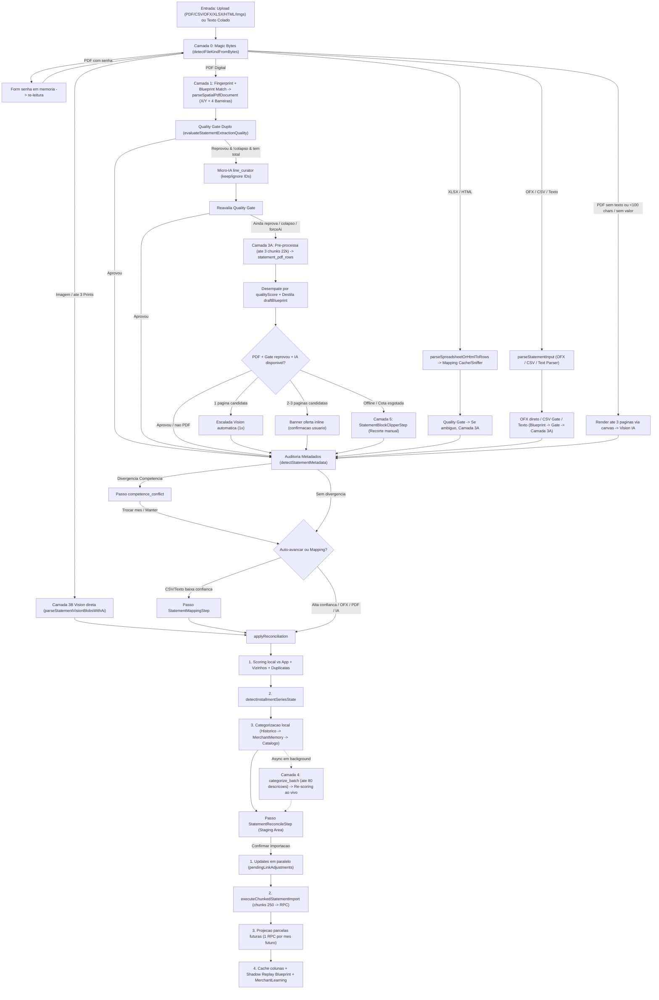
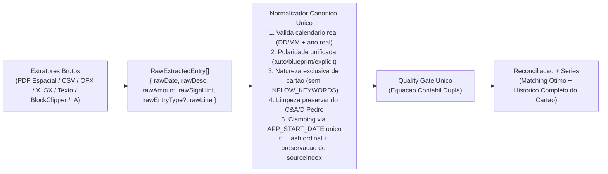

# Auditoria Técnica e de UI/UX — Fluxo Completo de Importação de Faturas

- **Escopo:** Pipeline ponta a ponta de importação e reconciliação de faturas de cartão de crédito (UI/UX, orquestração de estado, parsers determinísticos sem IA, pré-processamento, Quality Gate, Blueprints autoevolutivos, Block Clipper, Micro-IA no cliente e Edge Function, aprendizado semântico, cache, RPCs e banco de dados).
- **Base analisada:** Código-fonte real do repositório (`/src`, `/supabase/functions`, `/supabase/migrations`) em 24/11/2026.
- **Governança de referência:** `AGENTS.md`, `docs/design/DESIGN_SYSTEM.md`, `docs/architecture/ARCHITECTURE.md`, `docs/architecture/FINANCIAL_MATH_SPEC.md`.

---

## 1. Sumário Executivo e Diagnóstico Geral

O ecossistema de importação de faturas atingiu um alto grau de sofisticação conceitual — combinando parser espacial de PDF (coordenadas X/Y e 4 barreiras anti-ruído), Equação Contábil Dupla, Blueprints autoevolutivos com Shadow Replay, fallback de Micro-IA (texto, curador por ID, Vision e categorização em lote), detecção de séries parceladas e reconciliação bidirecional com competências vizinhas.

Entretanto, a evolução acelerada em múltiplos ciclos sucessivos sem consolidação arquitetural produziu **dois problemas estruturais centrais** que explicam diretamente a percepção de instabilidade e desconforto:

1. **Inconsistência operacional e bugs críticos de integridade de dados:**
   - Existem **6 caminhos distintos de extração/normalização** com regras divergentes entre si (`spatial-pdf-parser`, `text-parser`, `csv-parser`, `ofx-parser`, `spreadsheet-parser`, `block-clipper` e `buildTransactionsFromAiRows`).
   - O orquestrador cresceu para um **God Hook de 2.596 linhas** (`use-statement-import.ts`) acoplado a um **God Helper de 2.212 linhas** (`statement-import-helpers.ts`), acumulando divergências de estado entre fluxos (imagem única vs múltiplas imagens vs PDF digital vs PDF escaneado vs troca de competência).
   - Foram identificados **8 bugs críticos (P0)**, **10 falhas de alta severidade (P1)**, **7 problemas médios (P2)** e **2 dívidas de código legado/escope creep (P3)** — incluindo **duplicação silenciosa de parcelas futuras**, **corrupção de `entryType` em lotes da IA**, **falsa conciliação `exact_match` com 0% de similaridade textual**, **compras legítimas ("Depósito...") convertidas em estornos**, **cache do `line_curator` permanentemente quebrado no SQL e na Edge Function**, e **envenenamento automático do cache de mapeamento de colunas**.

2. **UI/UX poluída, inconsistente e em desacordo com as regras do app:**
   - A etapa de conferência (`StatementReconcileStep`) pode empilhar **até 8 banners/alertas simultâneos** acima da lista de lançamentos, expulsando a fatura para fora da primeira dobra no mobile.
   - Uma única linha de transação pode renderizar **6 badges + 4 botões de ação + seletor de categoria + checkbox + valor**, truncando o nome do estabelecimento.
   - Foram mapeadas **12 categorias de violações diretas ao `AGENTS.md §4` e `DESIGN_SYSTEM.md`**: `text-xs` (12px) em inputs disparando auto-zoom no iOS WebKit (Regra 20), duplos disparos sensoriais em botões (Regra 17), `EmptyState` ignorado (§5 / Regra 14), formulários inline duplicados com `<label>` cru (Regra DRY #4 e Regra 15), `border-border/60` (Regra 16), containers decorativos de ícone Nível 2 dentro de modal (Regra 13), formatação monetária manual fora de `<MoneyText />` (Regra 11), e botão "Marcar todos" que seleciona itens ocultos em outras abas.

| Severidade | Quantidade | Principais Impactos |
|---|---:|---|
| **P0 — Crítico** | 8 | Duplicação de parcelas futuras, escrita parcial sem atomicidade, corrupção de tipo de lançamento da IA, falsos `exact_match`, cache SQL quebrado, compras virando estorno, datas ISO inválidas, "Marcar todos" marcando abas ocultas |
| **P1 — Alto** | 10 | Envenenamento de cache de colunas, preâmbulo CSV destruído, perda de ano/metadados ao trocar competência, falso alarme de diferença no sumário, mutilação de nomes de lojas no PDF espacial, poluição de `merchantLearning` na nuvem, race condition de re-scoring em background, timeouts dessincronizados |
| **P2 — Médio** | 7 | `isDirty` incompleto, edição/adição manual sem re-análise/rehash ordinal, blueprints globais sem `userId` nem UI de limpeza, filtro preso após reanálise, performance (DOM sem virtualização, `memo` quebrado, PDF lido 2–3x) |
| **P3 — Baixo / Legado** | 2 | Código morto de extrato bancário de conta corrente (violação `AGENTS.md §6`), hash customizado documentado como SHA-256 e matching guloso |

---

## 2. Mapa Fiel da Arquitetura e Inventário de Arquivos

### 2.1. Inventário por Camada

| Camada | Arquivo | Linhas | Responsabilidade Real Atual |
|---|---|---:|---|
| **UI — Entrada** | `src/features/cards/components/cards-page-modals.tsx` | 326 | Monta `StatementImportDialog` sob demanda via `React.lazy` + `Suspense` |
| **UI — Modal Orquestrador** | `src/features/cards/components/statement-import-dialog.tsx` | 499 | Modal (`size="2xl"`), alterna os 5 passos do wizard, renderiza alertas globais, oferta Vision, conflito de competência e `ModalFooter` |
| **UI — Passo Upload** | `src/features/cards/components/statement-upload-step.tsx` | 242 | Abas "Enviar arquivo ou print" (`Dropzone` múltiplo até 15 MB) e "Colar texto ou tabela" (`Textarea`), além do formulário de senha de PDF |
| **UI — Passo Mapeamento** | `src/features/cards/components/statement-mapping-step.tsx` | 140 | Prévia das 5 primeiras linhas tabulares e selects de colunas Data/Descrição/Valor + checkbox de cabeçalho |
| **UI — Passo Block Clipper** | `src/features/cards/components/statement-block-clipper-step.tsx` | 389 | Camada 5 sem tokens: barra sticky Selecionado vs Oficial, filtro Candidatas/Todas, seleção Início–Fim + exclusão pontual |
| **UI — Passo Conferência** | `src/features/cards/components/statement-reconcile-step.tsx` | 597 | Orquestra sumário, banners contextuais, prompt de propagação de categoria, toolbar de abas, lista de lançamentos, progresso de chunks e rodapé de contagem |
| **UI — Sumário** | `src/features/cards/components/statement-reconcile-summary-card.tsx` | 156 | Card de KPIs (Total Lido, Já no App, Novos, Fatura Oficial), badges de origem/soma e botão "Reanalisar com IA" |
| **UI — Toolbar** | `src/features/cards/components/statement-reconcile-toolbar.tsx` | 234 | Alertas de duplicidade e "No App apenas", abas de filtro (até 7 abas), botões "Adicionar linha", "Tudo PJ/PF" e "Marcar todos" |
| **UI — Linhas e Editores** | `src/features/cards/components/statement-reconcile-rows.tsx` | 1.010 | `CategoryPill`, `StatementAppOnlyRow`, `StatementAppDuplicateRow`, `StatementInlineEditRow`, `StatementInlineAddRow`, `StatementReconcileItemRow` |
| **Orquestração (Hook)** | `src/features/cards/components/use-statement-import.ts` | 2.596 | **God Hook:** controla todos os estados do wizard, ingestão, fallback Vision, troca de competência, reconciliação, Camada 4 em background, edições, ações 1-clique e commit em lote |
| **Orquestração (Helpers)** | `src/features/cards/components/statement-import-helpers.ts` | 2.212 | **God Helper:** leitura de arquivos (PDF/unpdf, imagens, planilhas), pipeline Camadas 1–3A, Vision multi-página com deduplicação de scroll, chunked import, helpers de edição/adição |
| **Domínio — Contratos** | `src/domain/reconciliation/types.ts` | 293 | Tipos de transação, natureza (6 tipos), `ReconciliationItem`, `ColumnMapping`, `CrossCompetenceMatch`, `AppDuplicateCandidate` e tipos legados de conta corrente |
| **Domínio — Parsers** | `src/domain/reconciliation/parsers/magic-bytes.ts` | 111 | Camada 0: detecção de formato via magic bytes (`%PDF-`, `PK`, OLE2, PNG/JPEG/WEBP) e cabeçalho 4 KB |
| **Domínio — Parsers** | `src/domain/reconciliation/parsers/spatial-pdf-parser.ts` | 807 | Motor espacial PDF (X/Y): pré-condição bimodal, agrupamento `|ΔY| <= 2.5px`, `SectionStateMachine` + 4 barreiras + `ChecksumGate` |
| **Domínio — Parsers** | `src/domain/reconciliation/parsers/csv-parser.ts` | 236 | Parser RFC-4180 com `sep=`, detecção de delimitador fora de aspas e decodificação UTF-8/Latin-1 |
| **Domínio — Parsers** | `src/domain/reconciliation/parsers/ofx-parser.ts` | 279 | Parser SGML/XML OFX/QFX com inferência de polaridade e extração de `<ORG>`, `<ACCTID>`, `<LEDGERBAL>` |
| **Domínio — Parsers** | `src/domain/reconciliation/parsers/spreadsheet-parser.ts` | 556 | Parser nativo sem dependências para `.xlsx` (ZIP + `DecompressionStream` + XML), tabelas HTML e SpreadsheetML; rejeita `.xls` BIFF8 |
| **Domínio — Parsers** | `src/domain/reconciliation/parsers/text-parser.ts` | 603 | Parser de texto livre/colagem (delimitadores, blocos multilinhas, linguagem natural e modo `strict_statement`) |
| **Domínio — Parsers** | `src/domain/reconciliation/parsers/type-sniffer.ts` | 688 | `normalizeDateToISO`, `parseAmountToCents`, `sniffColumnMapping`, `evaluateMappingConfidence` |
| **Domínio — Parsers** | `src/domain/reconciliation/parsers/index.ts` | 339 | `buildTransactionsFromRows` e `parseStatementInput` (hub tabular/OFX/texto) |
| **Domínio — Parsers** | `src/domain/reconciliation/parsers/line-curator.ts` | 95 | Monta candidatos para `line_curator` e valida resposta `{ keep, ignore }` no cliente |
| **Domínio — Qualidade & Meta** | `src/domain/reconciliation/statement-preprocessor.ts` | 410 | Extração de totais do resumo (`extractPrintedStatementTotalCents`, `extractStatementSummaryAmounts`), poda local para IA, chunking 22k chars e `evaluateDeterministicStatementQuality` |
| **Domínio — Qualidade & Meta** | `src/domain/reconciliation/quality-gate.ts` | 222 | `evaluateStatementExtractionQuality`: Score 0–100, Equação Contábil Dupla (`cycle_net` vs `statement_balance`), checksum bidirecional `+-5c` |
| **Domínio — Qualidade & Meta** | `src/domain/reconciliation/statement-metadata.ts` | 398 | Auditoria de competência (cabeçalho, distribuição com `closing_day`, vencimento), cartão (`last_four_digits`, banco emissor) e divergências |
| **Domínio — Blueprints** | `src/domain/reconciliation/blueprints/*` | 1.256 | `types.ts`, `builtin-blueprints.ts` (13 bancos), `fingerprint.ts`, `matcher.ts` (precedência + self-healing), `learner.ts` (destilação + Shadow Replay) |
| **Domínio — Consolidação** | `src/domain/reconciliation/clean.ts` | 438 | Limpeza de adquirentes/cidades/parcelas, classificação das 6 naturezas, detecção de pagamentos, ruídos e cabeçalhos de subcartão |
| **Domínio — Consolidação** | `src/domain/reconciliation/hash.ts` | 61 | Hash determinístico síncrono DJB2/Murmur 64-bit estendido (32 hex) com `occurrenceIndex` |
| **Domínio — Consolidação** | `src/domain/reconciliation/installments.ts` | 95 | Extração de parcelas (`(02/10)`, `PARC 2/10`, `2 DE 10`, `02/10`, `3x`) com proteções contra datas |
| **Domínio — Consolidação** | `src/domain/reconciliation/series-detector.ts` | 227 | Classificador dos 4 estados de séries parceladas + `projectFutureInstallments` (valor exato da parcela) |
| **Domínio — Consolidação** | `src/domain/reconciliation/scorer.ts` | 442 | `calculateMatchScore` (0–100), `predictCategoryForDescription` (Jaccard), `reconcileStatementTransactions` (bidirecional + cross-competence) |
| **Domínio — Consolidação** | `src/domain/reconciliation/app-duplicates.ts` | 179 | Detecta duplicatas já existentes no aplicativo (`AppDuplicateCandidate`) |
| **Domínio — Consolidação** | `src/domain/reconciliation/block-clipper.ts` | 221 | Prévia de linhas e cálculo ao vivo do recorte manual da Camada 5 |
| **Domínio — Consolidação** | `src/domain/reconciliation/chunking.ts` | 34 | Particionamento em lotes (`STATEMENT_IMPORT_CHUNK_SIZE = 250`) |
| **Domínio — Encargos** | `src/domain/cards/charges.ts` | 140 | `inferChargeKindFromDescription` (`tax`, `interest`, `fine`, `bank_fee`, `regular`) |
| **Serviços — IA & PDF** | `src/services/ai-assistant.ts` | 960 | Cliente HTTP da Edge Function, dedup `inFlightBySha256`, compressão Vision (960px, `<=500 KB`), mascaramento PII, validação Zod |
| **Serviços — IA & PDF** | `src/services/native/receipt-extractor.ts` | 418 | `PdfPasswordProtectedError`, `renderScannedPdfPageToBlob` via `unpdf` + `<canvas>` |
| **Serviços — Memória/Cache** | `src/services/statement-blueprint-store.ts` | 197 | CRUD em `localStorage` global (`axir_statement_layout_blueprints_v1`, LRU 50, self-healing `>=2` falhas) |
| **Serviços — Memória/Cache** | `src/services/statement-mapping-cache.ts` | 233 | Cache em `localStorage` global (`axir_statement_column_mapping_cache`) com validação amostral |
| **Serviços — Memória/Cache** | `src/services/merchant-learning.ts` | 1.134 | Memória de estabelecimentos isolada por usuário + sync debounced para `user_preferences.custom_settings.merchantLearning` |
| **State & RPC** | `src/state/mutations/use-statement-mutations.ts` | 38 | Mutation `useImportStatementExpenses` (invalida `cardExpensesKey`, `expensesKey`, `budgetsKey` + chama `autoLearnExpenseCategory`) |
| **State & RPC** | `src/data/rpc/transactions.ts` | 468 | Wrapper `importStatementExpenses` chamando RPC `import_statement_expenses` |
| **Backend — Edge Function** | `supabase/functions/ai-financial-assistant/index.ts` | 903 | Auth JWT, feature flags, assinatura ativa, cache LGPD, cotas 2 baldes, Gemini com 3 modelos fallback, validação Zod, upsert cache + débito atômico |
| **Backend — Schemas** | `supabase/functions/_shared/ai-schemas.ts` | 1.055 | Contratos Zod compartilhados, hard caps, mascaramento PII, avaliação de cotas em BRT, normalizadores de saída LLM |
| **Backend — SQL** | `supabase/migrations/*0015, 0056, 0145, 0148*.sql` | ~1.121 | Colunas `statement_hash` e `imported_from_statement`, índice único parcial, RPC `import_statement_expenses`, tabelas `user_ai_quotas` e `receipt_extractions_cache` |

### 2.2. Diagrama do Fluxo Atual Ponta a Ponta



---

## 3. Análise Fiel do Funcionamento Atual — Camada por Camada

### 3.1. Entrada e Classificação (Camada 0)
- **Upload e Colagem (`statement-upload-step.tsx`):** Aceita múltiplos arquivos (limite 15 MB por arquivo no `Dropzone`) ou colagem de texto/tabela. A lista `STATEMENT_FILE_ACCEPT` termina com `*/*` para não bloquear arquivos sem extensão no Android/WhatsApp.
- **Sniffing (`magic-bytes.ts`):** Inspeciona primeiros bytes (`%PDF-`, `PK\x03\x04`, `D0 CF 11 E0`, PNG, JPEG, WEBP) e os primeiros 4 KB como Latin-1 para detectar `<OFX>`, `<STMTTRN>`, `<table>`, `<Workbook>`.
- **Classificação de PDF (`readStatementFileContent` em `statement-import-helpers.ts:215-333`):**
  1. Calcula SHA-256 do arquivo.
  2. Extrai texto página a página via `unpdf.extractText(data, { mergePages: false })`.
  3. Se o texto tiver `< 100` caracteres **ou** nenhum token monetário, classifica como `pdf_scanned` (aciona renderização em `<canvas>` até 3 páginas + Vision IA).
  4. Caso contrário (`pdf_text`), extrai total impresso via `extractPrintedStatementTotalCents`, calcula fingerprint, busca o melhor blueprint (`user_learned` → `ai_learned` → `builtin`) e executa `parseSpatialPdfDocument`.

### 3.2. Motores Determinísticos Sem IA (Camadas 1 e 2)
- **Motor Espacial de PDF (`spatial-pdf-parser.ts`):**
  - Lê `page.getTextContent()` via `unpdf` e extrai tokens `{ str, x, y, width, height, fontSize }`.
  - **Pré-condição bimodal:** divide a página exatamente ao meio (`midX = pageWidth * 0.5`) e ativa modo 2 colunas somente se esquerda e direita tiverem individualmente `>= 2` linhas com `Data + Valor` (ou se o blueprint forçar `columnMode: "bimodal"`).
  - **Agrupamento em linhas:** agrupa tokens com `|ΔY| <= 2.5px` e ordena por `X` crescente.
  - **4 Barreiras anti-ruído:**
    1. *Barreira 1 (`SectionStateMachine`):* estados `outside`, `start_zone`, `pause_zone`, `paused_boleto`. Ao virar de página, `pause_zone` e `paused_boleto` voltam para `outside`. Em `outside`, qualquer linha com `Data + Valor` ativa `start_zone` (exceto se `blueprintHints.strictStartZone === true`).
    2. *Barreira 2 (Geometria):* descarta linhas com `fontSize > 0 && fontSize < 6.8`.
    3. *Barreira 3 (Simulações/Taxas):* descarta linhas contendo `% a.m.`, `CET`, `Nx de R$`, `pagamento mínimo`, `juros do rotativo`.
    4. *Barreira 4 (`ChecksumGate`):* soma compras + encargos − estornos (excluindo `invoice_payment`) e valida contra `officialTotalCents` com tolerância `+- 5` centavos.
  - **Moeda estrangeira:** `extractBrlAmountFromLine` escolhe o valor mais à direita que não seja precedido por `USD/EUR/GBP/US$/€`. Linhas de continuação (`isFxDetail`) são concatenadas na `rawDescription` da transação anterior.
- **Planilhas (`spreadsheet-parser.ts`):** Implementa descompactação ZIP + `DecompressionStream("deflate-raw")` pura no navegador, lê `xl/sharedStrings.xml`, `xl/styles.xml` (para datas seriais Excel base 1899-12-30) e pontua todas as abas (`scoreWorksheetRows`) escolhendo a que tem mais pares `Data + Valor`. Suporta HTML (`<table>`) e XML SpreadsheetML (`<Workbook>`), rejeitando `.xls` binário BIFF8 com mensagem explicativa.
- **CSV/TSV (`csv-parser.ts`):** Suporta RFC-4180 com quebras de linha dentro de aspas, diretiva `sep=`, decodificação UTF-8 com fallback ISO-8859-1 e detecção de delimitador descontando vírgulas decimais brasileiras.
- **OFX (`ofx-parser.ts`):** Suporta SGML (sem tag de fechamento) e XML, extrai metadados (`<ORG>`, `<ACCTID>`, `<LEDGERBAL>`) e infere polaridade quando `TRNTYPE` é genérico (`OTHER`/`PAYMENT`).
- **Texto Livre (`text-parser.ts`):** Agrupa blocos multilinhas (ex.: Data / Loja / Parcela / Valor copiados do Nubank/Itaú), tenta delimitadores (`\t`, `|`, `;`, ` - `, `  +`) e faz fallback para parser de linha de extrato/linguagem natural (`strict_statement` ativado automaticamente para PDF ou `> 15` linhas).
- **Quality Gate (`quality-gate.ts`):** Pontua de 0 a 100 com Equação Contábil Dupla:
  - Prioridade 1 (`cycle_net`): compara `compras + encargos − estornos` contra `"Despesas e créditos do mês"`.
  - Prioridade 2 (`statement_balance`): compara `carryOver (saldoAnterior − pagamentos) + cycleNet` contra `"Valor/Total da fatura"`.
  - Penaliza `zero_transactions`, `checksum_underflow`, `checksum_overflow`, `degraded_descriptions` (`>=15%`), `synthetic_dates` (`>40%` iguais a hoje), `outlier_amount` (`>3x` total), `spatial_collapse` e `low_mapping_confidence` (`<75` ou colisão `desc === date`). Aprova se `score >= 85` e nenhuma falha crítica.

### 3.3. Mecanismos Com IA (Camadas 3A, 3B, Curador e Camada 4)
Toda chamada de IA passa pelo cliente fino `src/services/ai-assistant.ts` para a Edge Function `supabase/functions/ai-financial-assistant/index.ts` (Gemini `gemini-3.5-flash-lite` com fallback para `gemini-3.5-flash` e `gemini-flash-lite-latest`, `temperature: 0`, `responseSchema` JSON estrito):

| Modo IA | Balde de Cota | Quando é acionado | Limites e Proteções |
|---|---|---|---|
| `line_curator` | `batch_calls` | PDF espacial extraiu linhas mas `checksumGate` e `qualityGate` reprovaram (sem colapso) | Até 500 linhas (`<=300` chars). IA só classifica IDs em `{ keep, ignore }`. Zero alucinação numérica. |
| `statement_pdf_rows` (texto — Camada 3A) | `batch_calls` | `qualityGate` ainda reprovou em PDF, texto colado ou CSV/planilha ambígua, ou botão "Reanalisar com IA" | Texto podado localmente por `preprocessStatementTextForAi` em até **3 chunks** de 22.000 chars (teto Edge: 25.000). PII mascarada (CPF, agência/conta, PAN). Desempate por `qualityScore`. |
| `statement_pdf_rows` (Vision — Camada 3B) | `batch_calls` | Upload de imagens (até 3 prints), PDF escaneado (até 3 páginas) ou escalada Vision de PDF digital reprovado (automática para 1 página; confirmação inline para 2–3 páginas) | Compressão canvas `960px @ 0.70`, teto `500 KB`. Deduplicação de overlap de scroll entre prints consecutivos (`deduplicateConsecutiveVisionRows`, janela 6 linhas). |
| `categorize_batch` (Camada 4) | `batch_calls` (`passive`) | Silenciosamente em background ao abrir `reconcile` para estabelecimentos genuinamente desconhecidos após Camadas 1–3 locais | Até 2 lotes × 40 descrições (80 máx.), priorizados por maior impacto financeiro. Sem valores nem datas (`<=80` chars). Whitelist estrita de `categoryId`. Reserva diária de cota (`PASSIVE_AI_DAILY_RESERVE = 2`). |

**Cotas FinOps (`AI_QUOTA_LIMITS`, reset 00:00 BRT):**
- **Trial:** `batch_calls` = 2/dia, 5/mês (para `passive`, limite diário efetivo cai para 1/dia).
- **Pro / Lifetime / Admin:** `batch_calls` = 5/dia, 20/mês (para `passive`, limite diário efetivo cai para 3/dia).
- **Cache LGPD (`receipt_extractions_cache`):** indexado por `(user_id, sha256, mode)`, guarda apenas o JSON extraído (TTL: 30d `statement_pdf_rows`, 14d `categorize_batch`, 7d `line_curator`). Cache hit não debita cota. Reanálise manual usa salt determinístico `${baseSha}:reanalyze:${nonce}` convertido em novo SHA-256 64-hex.

### 3.4. Funcionalidades Satélites
1. **Blueprints Autoevolutivos (`blueprints/` + `statement-blueprint-store.ts`):**
   - Catálogo embutido de 13 bancos (Nomad, XP, Rico, Clear, Nubank, Itaú, Bradesco, Santander, Inter, C6, BTG, BB, Caixa).
   - Fingerprint em 2 níveis sem PII (`<kind>:<issuerKey>:<headerTokensHash>` e `<kind>:<issuerKey>`).
   - Quando a IA (texto) ou o usuário (`BlockClipper`) extrai uma fatura com sucesso, `distillStatementBlueprintDraft` gera um rascunho em memória (`draftBlueprintRef`). No commit final, `validateBlueprintWithShadowReplay` executa um dry-run determinístico antes de salvar no `localStorage` (LRU de 50 entradas).
   - Self-healing: após 2 falhas consecutivas (`consecutiveFailures >= 2`), o blueprint aprendido é excluído.
2. **Block Clipper (`statement-block-clipper-step.tsx` / `block-clipper.ts`):** Fallback sem tokens quando o Quality Gate reprova sem IA disponível (offline, cota esgotada, modo leitura) ou via oferta Vision. Permite clicar na 1ª e na última linha de compras, desmarcar intrusas e ver `Selecionado vs Fatura Oficial` em tempo real.
3. **Cache de Mapeamento de Colunas (`statement-mapping-cache.ts`):** Memoriza `ColumnMapping` pela assinatura normalizada do cabeçalho da tabela, validando 50% de amostra antes de aplicar.
4. **Reconciliação Bidirecional e Scoring (`scorer.ts` + `app-duplicates.ts`):**
   - Cruza transações do extrato com despesas já cadastradas na competência ativa (`existingExpenses`) e competências vizinhas M−1 / M+1 (`adjacentExpenses`).
   - Classifica em `exact_match` (`score >= 75` e `diffCents === 0`), `probable_match` (`score >= 40`) ou `unmatched_new`.
   - Expõe `unmatchedAppExpenses` ("No App apenas", com alerta se próxima ao fechamento e ações Mover M−1/M+1 ou Excluir) e `appDuplicates` (duplicatas já cadastradas no aplicativo).
5. **Séries Parceladas (`installments.ts` + `series-detector.ts`):** Classifica compras parceladas em 4 estados (`state_1_new_series`, `state_2_orphan_series`, `state_3_continuation_without_projection`, `state_4_already_projected`) e oferece checkbox para projetar parcelas futuras `K+1..N` mantendo o valor exato da parcela.
6. **Ações Assistidas na Conferência:** Vincular e ajustar centavos (`pendingLinkAdjustments`), Registrar estorno em 1 clique (`useCreateRefund`), Realinhar competência individual ou em lote (`crossCompetenceMatch`), Alternar esfera PF/PJ em cartões mistos (`showScopeControls`), Edição/Adição manual inline, Propagação de categoria em lote por estabelecimento e Auto-aprendizado (`merchant-learning.ts`).

### 3.5. Persistência e Banco de Dados
Ao clicar em **Importar**, `handleConfirmImport` (`use-statement-import.ts:2245-2510`) executa sequencialmente no cliente:
1. `Promise.allSettled` com `updateExpenseMutation` para cada ajuste em `pendingLinkAdjustments`.
2. `executeChunkedStatementImport` dividindo `validToImport` em chunks de 250 itens para `rpc('import_statement_expenses')`.
3. Loop por competência futura (`projectionsByCompetence`) chamando novamente `rpc('import_statement_expenses')` em chunks de 250 (sem `statement_hash`).
4. Persistência de cache de colunas, Shadow Replay + salvamento de blueprint e loop de `autoLearnExpenseCategory`.

No PostgreSQL (`migration 0148`), `import_statement_expenses` valida sessão, usuário ativo, permissão `'cards'`, posse do cartão, `date >= '2026-01-01'`, `value > 0`, resolve categoria com fallback, herda `scope` do cartão (`business` / `personal`) e `is_tax_deductible`, e garante idempotência via `ON CONFLICT (user_id, card_id, statement_hash) WHERE statement_hash IS NOT NULL DO NOTHING`.

---

## 4. Auditoria de Bugs, Brechas e Fragilidades

### 4.1. Bugs Críticos (P0 — Quebra de Integridade Financeira ou Funcionalidade Central)

#### P0-1. `detectInstallmentSeriesState` recebe apenas despesas da competência atual (duplicação de parcelas futuras)
- **Onde:** `src/features/cards/components/use-statement-import.ts:283-321` e `src/domain/reconciliation/series-detector.ts:78-130`.
- **O que acontece:** `existingExpenses` é montado por `mapExpensesForReconciliation(expensesQuery.data ?? [], compForRecon)`, que filtra estritamente `e.bill_competence === competenceMonth`. Esse array filtrado é passado para `detectInstallmentSeriesState`.
- **Consequência:** A parcela anterior (`K-1`, em `M-1`) e as parcelas futuras (`K+1..N`, em `M+1..M+N`) **nunca existem** dentro de `existingExpenses`. Portanto:
  - `previousExists` é sempre `false` (`state_3_continuation_without_projection` é inalcançável).
  - `futureProjectedCount` é sempre `0`. Se o usuário já tem as parcelas `3/10 .. 10/10` cadastradas nos meses futuros, mas a parcela `2/10` não foi encontrada exatamente na competência atual (ou foi importada com pequena variação), o motor classifica como `state_2_orphan_series`, marca `projectSeries: true` **por padrão** e **duplica todas as parcelas futuras `3/10..10/10` no banco**.
- **Nota:** `useCardExpenses(card.id)` já carrega todas as competências do cartão na memória — o erro está exclusivamente no filtro passado à função.

#### P0-2. Projeção de parcelas futuras viola atomicidade, perde `installment_group_id` e não tem idempotência
- **Onde:** `src/features/cards/components/use-statement-import.ts:2316-2419` e `supabase/migrations/20260101000148_business_scope_statement_import_and_deductions.sql:95-150`.
- **O que acontece:**
  1. `handleConfirmImport` orquestra no cliente 3 grupos independentes de escritas (`updateExpenseMutation` em paralelo + N chunks da competência atual + M chamadas separadas de `import_statement_expenses`, uma por mês futuro) — violando diretamente `AGENTS.md §5` (*"Escritas compostas devem usar RPC transacional; proibido orquestrar multi-escrita sequencial no cliente"*). Falha de rede no mês `M+3` deixa ajustes + competência atual + `M+1..M+2` gravados permanentemente e `M+3..M+10` ausentes.
  2. As parcelas futuras são enviadas com `statement_hash: undefined` (sem proteção contra duplicação em retry) e sem `installment_group_id` (o RPC nem aceita `installment_group_id`). Assim, a parcela `1/10` e as projetadas `2/10..10/10` ficam **totalmente desvinculadas no banco**: editar/excluir a série depois no app não reconhece o grupo.
  3. O cliente envia `charge_kind: "installment"` (`use-statement-import.ts:2401`), valor inválido para a whitelist SQL (`'regular', 'interest', 'fine', 'tax', 'bank_fee'`), sendo silenciosamente descartado para `'regular'`.

#### P0-3. Desalinhamento de índice em `buildTransactionsFromAiRows` corrompe `isPayment`, `isRefund` e `charge_kind`
- **Onde:** `src/features/cards/components/statement-import-helpers.ts:655-700` (especificamente linhas `662-664`).
- **O que acontece:**
  ```ts
  const baseTransactions = buildTransactionsFromRows(rawRows, CANONICAL_AI_MAPPING, params);
  const enrichedTransactions = baseTransactions.map((tx, idx) => {
    const sourceRow = aiRowsData[idx];
  ```
  Se `buildTransactionsFromRows` descartar **uma única linha** de `rawRows` (ex.: linha identificada por `isStatementNoiseOrSummary`, `isSubcardHeader`, data inválida ou valor zero), `baseTransactions` fica menor que `aiRowsData`. A partir desse ponto, `aiRowsData[idx]` aponta para a linha errada!
- **Consequência:** Um `entryType: "payment"` ou `"refund"` ou `"charge"` da linha `k+1` é aplicado na compra legítima da linha `k`, transformando compras normais em pagamentos ignorados ou estornos, ou deixando pagamentos de fatura entrarem como compra. (Além disso, `buildTransactionsFromRows` renumera `tx.index = 0, 1, 2...`, perdendo `row.rowIndex` original.)

#### P0-4. Falso `exact_match` com 0% de similaridade textual no `scorer.ts`
- **Onde:** `src/domain/reconciliation/scorer.ts:91-151` e `324-344`.
- **O que acontece:** Os pesos atuais são: Valor exato (`diffCents === 0`) = **50 pontos** + Mesmo dia (`diffDays === 0`) = **35 pontos** + Texto Jaccard = **0 a 15 pontos**.
  - Limiar de `exact_match`: `score >= 75 && diffCents === 0`.
  - Resultado: **50 + 35 + 0 = 85 pontos (`exact_match`)** com **zero similaridade na descrição**! Mesmo com `diffDays === 1` (25 pts) + categoria prevista coincidente (+10 pts) = **85 pontos** com texto totalmente diferente.
- **Consequência:** Se o usuário fez duas compras distintas de mesmo valor no mesmo dia (ex.: R$ 50,00 no Posto já cadastrado no app e R$ 50,00 na Farmácia vindo na fatura), o sistema concilia a Farmácia com o Posto como `Conciliado (85%)`, desmarca a Farmácia automaticamente (`selected: false`) e **omite uma compra real da fatura do usuário**.

#### P0-5. Cache remoto da Edge Function quebrado para `line_curator` e com expiração eterna pós-TTL
- **Onde:**
  - `supabase/migrations/20260101000145_ai_extraction_quotas_and_cache.sql:55`
  - `supabase/functions/ai-financial-assistant/index.ts:624-684` e `864-873`.
- **O que acontece:**
  1. A tabela `receipt_extractions_cache` possui `CHECK (mode IN ('single_receipt', 'statement_pdf_rows', 'categorize_batch'))` — **`'line_curator'` não foi incluído**. Toda tentativa de gravar cache do `line_curator` falha no Postgres (`falha ao gravar cache LGPD`).
  2. O bloco de leitura de cache na Edge Function (`index.ts:629-684`) não possui ramo `else if (requestData.mode === "line_curator")`. Mesmo que a constraint fosse corrigida, `line_curator` **nunca leria do cache** e cobraria cota de IA em toda chamada repetida.
  3. No `upsert` da linha `865-873`, o payload enviado é `{ user_id, sha256, mode, extracted_json }` sem atualizar `created_at: new Date().toISOString()`. Após um registro expirar pelo TTL (7/14/30 dias), o novo `upsert` mantém o `created_at` antigo, causando **cache miss permanente** para aquele `(user_id, sha256, mode)`.

#### P0-6. Heurística legada de conta corrente transforma compras legítimas de cartão em estornos negativos
- **Onde:** `src/domain/reconciliation/parsers/index.ts:211-213`, `src/domain/reconciliation/parsers/text-parser.ts:367-371` e `src/domain/reconciliation/clean.ts:172-226`.
- **O que acontece:** Em arquivos tabulares/texto de fatura de cartão com compras positivas, `buildTransactionsFromRows` executa:
  ```ts
  } else if (!parsedAmt.isNegative) {
    isCredit = isLikelyIncomeDescription(row.rawText);
  }
  ```
  E `INFLOW_KEYWORDS` contém termos genéricos como `"deposito"`, `"depósito"`, `"entrou"`, `"rendimento"`, `"recebimento"`. Em `text-parser.ts:368`, a regex também captura `\bdep[oó]sito\b` e prefixa `+` no valor.
- **Consequência:** Qualquer compra real no cartão em estabelecimentos como `"DEPOSITO DE BEBIDAS"`, `"DEPOSITO CONSTRUCAO SILVA"` ou `"DEPOSITO SAO JOSE"` é invertida para `isCredit = true` → `isRefund = true` (Estorno). Isso causa erro duplo na soma (`+X` vira `-X`, gerando desvio de `2X`), reprova o Quality Gate, dispara chamadas desnecessárias de IA e remove a compra dos selecionados para importação.

#### P0-7. `normalizeDateToISO` e `extractDateEntity` não validam calendário real (datas ISO inválidas e corrupção de valores)
- **Onde:** `src/domain/reconciliation/parsers/type-sniffer.ts:68-124` e `src/domain/reconciliation/parsers/text-parser.ts:66-123`.
- **O que acontece:**
  1. `normalizeDateToISO` aceita qualquer 1–2 dígitos como dia e mês sem checar `1 <= month <= 12` nem `1 <= day <= daysInMonth(year, month)`. Assim, `"45/20"` retorna `"2026-20-45"` e `"31/02/2026"` retorna `"2026-02-31"`.
  2. Em `text-parser.ts:116`, `extractDateEntity` roda **antes** de `extractAmountEntity` e casa `/\b(\d{1,2})[/.-](\d{1,2})\b/`. Números com ponto decimal de até 2 dígitos antes do ponto (ex.: `12.50`, `45.90` em linhas sem data ou com data após o valor) são capturados como **data `12/50` ou `45/90`**, removendo o valor da linha e produzindo uma data ISO inválida que faz o PostgreSQL abortar o lote inteiro com `date/time field value out of range`.

#### P0-8. "Marcar todos / Desmarcar" opera sobre todos os itens da fatura, ignorando a aba de filtro ativa
- **Onde:** `src/features/cards/components/statement-reconcile-step.tsx:248`, `statement-reconcile-toolbar.tsx:219-228` e `use-statement-import.ts:1860-1866`.
- **O que acontece:** `allFilteredSelected` é calculado sobre `filteredItems` (ex.: aba `"Novos (4)"`), mas clicar no botão chama `handleToggleAll(!allFilteredSelected)`, que executa `prev.map((it) => ({ ...it, selected }))` sobre **TODO o array `reconciledItems`**.
- **Consequência:** Ao clicar "Marcar todos" na aba "Novos", o usuário **seleciona inadvertidamente todos os lançamentos já Conciliados, Pagamentos de Fatura, Estornos e Duplicatas** ocultos nas outras abas, elevando o contador de importação e arriscando duplicações/erros.

---

### 4.2. Fragilidades e Bugs de Alta Severidade (P1 — Causas Diretas de Inconsistência entre Faturas)

#### P1-1. Envenenamento automático do cache de mapeamento de colunas (`statement-mapping-cache.ts`)
- **Onde:** `src/features/cards/components/statement-import-helpers.ts:1372-1374, 1550-1552` e `src/domain/reconciliation/parsers/type-sniffer.ts:642`.
- **O que acontece:** Logo após `sniffColumnMapping`, antes de avaliar o Quality Gate ou de o usuário confirmar as colunas, o sistema grava automaticamente o mapeamento no `localStorage` (`setCachedColumnMapping`). Se o sniffer errou (ex.: trocou coluna de valor por coluna de parcela ou moeda estrangeira), na próxima tentativa `getCachedColumnMapping` retorna o mapeamento errado, `isCacheHit` vira `true`, `evaluateMappingConfidence` retorna **100** imediatamente (`if (isCacheHit) return 100`), e `shouldAutoAdvance` pula o passo de Mapeamento permanentemente.

#### P1-2. `StatementMappingStep` destrói `startRowIndex` real de extratos com preâmbulo
- **Onde:** `src/features/cards/components/statement-mapping-step.tsx:37-58`.
- **O que acontece:** O componente ignora `initialMapping.startRowIndex`, fixa `headerCells = rows[0]?.cells` e envia `startRowIndex: hasHeader ? 1 : 0`. Em CSVs/planilhas bancárias brasileiras com 4–8 linhas de cabeçalho institucional (Bradesco, BB, Itaú, Santander), abrir "Ajustar colunas" e confirmar **corrompe o índice inicial para 1**, fazendo o parser tentar ler o preâmbulo como compras e salvando a linha 0 errada como assinatura no `statement-mapping-cache`.

#### P1-3. Troca de competência (`handleSwitchCompetence`) perde metadados de qualidade e corrompe datas em virada de ano
- **Onde:** `src/features/cards/components/use-statement-import.ts:1263-1418`.
- **O que acontece:**
  1. Quando `sameYear === true`, reaproveita `loaded.extractedTransactions` mas chama `applyReconciliation` **sem passar** `extractionOrigin`, `qualityGate` nem `aiStatusNotice` (linhas 1322-1327), perdendo o status de origem e a validação. Além disso, se a competência original estava errada (ex.: modal aberto em `2026-10` para fatura de `2026-12`), datas `DD/MM` de novembro/dezembro foram parseadas como **2025** (`month > referenceMonth` em `normalizeDateToISO`) e clampadas para `2026-01-01` — ao trocar para `2026-12`, como `sameYear` é `true`, as datas erradas **não são re-parseadas**!
  2. Quando `sameYear === false` (ex.: Dezembro/2026 vs Janeiro/2027), cai no branch `parseStatementWithPdfAiFallback` passando `spatialTransactions: loaded.spatialTransactions` já construídos com o ano antigo, sem re-executar `parseSpatialPdfDocument`.

#### P1-4. Sumário de Conferência dispara falsos alarmes de diferença (desalinhado com a Equação Contábil Dupla)
- **Onde:** `src/features/cards/components/statement-reconcile-step.tsx:158-169` e `statement-reconcile-summary-card.tsx:45-60`.
- **O que acontece:**
  1. `totalReadCents` ignora `it.isInternalDuplicate` (`if (it.transaction.isPayment || it.isInternalDuplicate) return acc`). Compras legítimas idênticas no mesmo dia (ex.: 2 corridas de Uber de R$ 19,90) têm a 2ª excluída da soma lida, gerando falsa divergência de `-R$ 19,90` contra o total impresso.
  2. O card compara `totalReadCents` diretamente contra `officialInvoiceTotalCents` ("Valor da fatura"), ignorando `carryOverCents` (saldo anterior − pagamentos) e `cycleNetTargetCents` ("Despesas e créditos do mês") que o `quality-gate.ts` usa. Faturas com rotativo, juros de parcelamento anterior ou pagamento a maior exibem badge laranja de erro e CTA "Reanalisar com IA" mesmo quando 100% corretas.

#### P1-5. Fragilidades e divergências estruturais no `spatial-pdf-parser.ts` (principal motor de PDF)
- **Onde:** `src/domain/reconciliation/parsers/spatial-pdf-parser.ts:185, 241, 276, 386, 521-549`.
- **Fragilidades concretas:**
  1. **Mutilação de nomes de lojas (linha 533):** `.replace(/\b[cd]\b/i, "")` remove letras `C` ou `D` isoladas da descrição (ex.: `C&A` vira `&A`, `D PEDRO` vira `PEDRO`, `C V C` vira `V C`).
  2. **Substituição imprecisa do valor (linha 532):** `.replace(rawAmtFullMatch, "")` substitui a *primeira* ocorrência na linha em vez da última à direita.
  3. **Divergência na detecção de pagamento (linha 549):** chama `isInvoicePayment` em vez de `isPaymentOrSettlement` (usado em CSV/OFX), deixando pagamentos reconhecidos por `PAYMENT_KEYWORDS` passarem como compras.
  4. **Sem inferência de polaridade negativa:** diferente de CSV e OFX, se um PDF digital listar compras com sinal negativo (`-120,00`) e não houver blueprint aprendido com `polarity: "negative_purchase"`, todas as compras viram `isRefund = true`.
  5. **Geometria rígida:** `|ΔY| <= 2.5px` (linha 276) quebra linhas com sobrescrito/fontes mistas (ex.: `R$` desalinhado 3–4px); `midX = pageWidth * 0.5` (linhas 185/241) corta layouts de 2 colunas assimétricas (ex.: 55%/45%).
  6. **Reativação fácil da zona de extração (linha 386):** em `outside`, qualquer linha com `Data + Valor` reabre `start_zone` (e `strictStartZone` é `false` em todos os 13 blueprints builtin).
  7. **Campos de blueprint ignorados:** `totalLabels`, `ignoredTotalLabels`, `dateFormatHint`, `currencyStrategy`, `relativeXRanges` e `requireExplicitDatePerLine` existem no schema Zod (`blueprints/types.ts`), mas são completamente ignorados pelo `spatial-pdf-parser.ts` e por `readStatementFileContent`.

#### P1-6. Poluição de `merchantLearning` na nuvem com linhas brutas de extrato + chamadas duplicadas
- **Onde:** `src/features/cards/components/use-statement-import.ts:1878-1883, 2458-2467`, `src/state/mutations/use-statement-mutations.ts:30-34`, `src/domain/reconciliation/parsers/spatial-pdf-parser.ts:593`.
- **O que acontece:**
  1. `tx.rawDescription` contém a linha bruta inteira (com data e valor, ex.: `"15/11 PAG*PADARIA ESTRELA 45,90"`). Ao passá-la como `rawName` para `autoLearnExpenseCategory`, essas strings com datas e valores específicos são gravadas em `rawAliases` no `localStorage` e sincronizadas para `user_preferences.custom_settings.merchantLearning` no Supabase — nunca dão match no mês seguinte e inflam o JSON do usuário.
  2. `autoLearnExpenseCategory` é executado **em dobro** no commit: uma vez por item de cada chunk (incluindo parcelas futuras!) dentro de `useImportStatementExpenses.onSuccess`, e outra vez no loop do passo 5 de `handleConfirmImport` — disparando dezenas de gravações redundantes em `localStorage`, resets do timer de sync cloud e eventos `axis:session-insights-reevaluate`.

#### P1-7. Fluxos de imagem ignoram `competence_conflict` e divergem entre 1 vs N arquivos
- **Onde:** `src/features/cards/components/use-statement-import.ts:882-933` vs `1105-1186` vs `935-1058`.
- **O que acontece:** O tratamento de imagem está duplicado em dois lugares (`processLoadedStatementSource` para `loaded.kind === "image"` e `handleFilesSelect` para `imageFiles.length > 0`). Nenhum dos dois verifica `visionResult.detectedMeta?.hasCompetenceMismatch` (diferente de `pdf_scanned`, que pausa em `competence_conflict`), e o ramo `loaded.kind === "image"` também não preenche `loadedInputRef.current.extractedTransactions`.

#### P1-8. Race condition de UX na Camada 4 (`categorize_batch` em background)
- **Onde:** `src/features/cards/components/use-statement-import.ts:416-583`.
- **O que acontece:** Enquanto o usuário já está revisando a lista na tela `reconcile`, a resposta assíncrona de `categorize_batch` (2–6s depois) executa novo scoring e **promove linhas `unmatched_new` para `exact_match` ou `probable_match` ao vivo**, desmarcando checkboxes (`selected: false`), removendo despesas de `unmatchedAppExpenses` e alterando `cleanDescription` sem recalcular `statementHash`.
- **Consequência:** A lista "pula" sob o cursor do usuário (mudança repentina de totais e contadores), gera discrepância de hash caso o usuário edite o item posteriormente, e se o usuário clicar Importar antes do retorno, a chamada abortada no cliente ainda consome crédito na Edge Function.

#### P1-9. Dessincronização de timeouts Cliente vs Edge Function (aborts prematuros com gasto de cota)
- **Onde:** `src/services/ai-assistant.ts:44-45, 690, 769` vs `supabase/functions/ai-financial-assistant/index.ts:61-62, 349`.
- **O que acontece:** A Edge Function tenta até 3 modelos Gemini em cascata com timeouts de `7s + 10s + 10s = 27s`. Porém o cliente aborta:
  - `statement_pdf_rows` em **22s** (`CLIENT_AI_TIMEOUT_MS`), cortando o 3º fallback no meio.
  - `line_curator` e `categorize_batch` em **8s** (`CLIENT_AI_BATCH_TIMEOUT_MS`), cortando já no início do 2º modelo fallback (`7s + 1s`), o que faz o cliente cair em `timeout` enquanto a Edge Function continua rodando, valida o Gemini e debita 1 crédito da cota do usuário sem entregar o resultado.

#### P1-10. Validações de borda faltantes no RPC `import_statement_expenses` e contrato TS incompleto
- **Onde:** `supabase/migrations/20260101000148_business_scope_statement_import_and_deductions.sql:18-178` e `src/data/rpc/transactions.ts:393-403`.
- **O que acontece:**
  - O RPC não valida o formato de `p_competence_month ~ '^\d{4}-\d{2}$'`, não valida `installments_total BETWEEN 1 AND 60`, não valida `installment_number BETWEEN 1 AND installments_total`, não valida `report_weight BETWEEN 0 AND 1`, e não aceita `installment_group_id`.
  - No cliente, `StatementExpenseItemInput` em `src/data/rpc/transactions.ts` omite `scope` e `is_tax_deductible`, desalinhando o tipo da camada `data/` com o `ChunkedImportExpenseInput` enviado por `features/cards/`.

---

### 4.3. Problemas de Média Severidade (P2 — Usabilidade, Manutenibilidade e Performance)

1. **`isDirty` / `hasUnsavedChanges` incompleto (`use-statement-import.ts:1943-2032`):**
   `handleRemoveItem`, `handleAddManualItem`, `handleToggleScope`, `handleSetScopeAll`, `handleToggleProjectSeries`, `handleLinkAndAdjust` e `handleUncheckDuplicates` não marcam `setHasUnsavedChanges(true)`. O modal pode ser fechado perdendo edições sem disparar o diálogo de confirmação de descarte.
2. **Edição e adição manual não recalculam invariantes (`statement-import-helpers.ts:422-495`):**
   - `createManualReconciliationItem` fixa `occurrenceIndex: 0` (pode colidir `statementHash` com item já existente na fatura e ser ignorado silenciosamente pelo `ON CONFLICT DO NOTHING`) e não roda `detectInstallmentSeriesState` (parcelas adicionadas manualmente não podem ser projetadas).
   - `applyEditedReconciliationItem` sobrescreve `rawDescription = updated.cleanDescription`, não recalcula `occurrenceIndex`, `isRefund`/`isPayment`/`nature` nem `seriesAnalysis`.
3. **Blueprints e Cache de Mapeamento globais no navegador, sem UI de gestão e com falhas de aprendizagem:**
   - `statement-blueprint-store.ts` e `statement-mapping-cache.ts` usam chaves globais de `localStorage` sem isolamento por `userId` (misturam layouts entre contas no mesmo navegador) e sem sincronização em nuvem.
   - `deleteStatementBlueprint` e `clearAllStatementBlueprints` não têm nenhuma UI no app — se um blueprint errado passar do Shadow Replay, o usuário não consegue removê-lo manualmente.
   - `validateBlueprintWithShadowReplay` (`learner.ts:447`) cria linhas sintéticas todas na `pageNumber: 1` e `fontSize: 10`, divergindo da paginação/geometria real de `parseSpatialPdfDocument`.
   - `parseStatementVisionBlobsWithAi` possui código de destilação de blueprint (`rawTextForLearning` / `rawLinesForLearning`), mas nenhum chamador em `use-statement-import.ts` passa esses parâmetros (código morto).
4. **Estado residual em `StatementReconcileStep` após reanálise (`statement-reconcile-step.tsx:121-136`):**
   `filter`, `editingRowId`, `isAddingManual` e `categoryPropagationPrompt` não são resetados quando os itens são substituídos por "Reanalisar com IA", "Escalation Vision" ou "Ajustar colunas", podendo deixar o usuário preso em uma aba agora vazia (ex.: `"duplicates"`) ou editando um ID que agora pertence a outra transação.
5. **Botão do footer em `block_clipper` sem desabilitação (`statement-import-dialog.tsx:97-99`):**
   Quando `hideFooter` oculta o footer interno de `StatementBlockClipperStep`, o botão externo "Avançar para Conferência" não recebe `disabled` quando `selection.transactions.length === 0`. Clicar nele não faz nada e não exibe feedback.
6. **Gargalos de Performance e Escalabilidade:**
   - **Dupla/tripla decodificação de PDF:** `readStatementFileContent` abre o PDF via `unpdf.extractText` e abre novamente em `parseSpatialPdfDocument`. Para `pdf_scanned`, o loop em `use-statement-import.ts:940` abre e destrói o PDF 3 vezes (uma por página).
   - **`React.memo` anulado:** `StatementReconcileItemRow` é envolvido por `memo(...)`, mas recebe 5 callbacks inline recriados a cada render (`statement-reconcile-step.tsx:303-325`). Marcar 1 checkbox re-renderiza 100% das linhas da fatura.
   - **DOM sem virtualização:** faturas de 150–300 compras montam 3.000+ nós DOM simultâneos (com 1 Radix `Popover` por linha).
   - **Truncamento silencioso de texto IA:** faturas textuais que gerem `> 3` chunks (`MAX_STATEMENT_AI_CHUNKS = 3`) têm o restante descartado sem aviso ao usuário (diferente do aviso de truncamento de imagens Vision).
7. **Detecção de formato incompleta e constantes duplicadas:**
   - `magic-bytes.ts` não detecta HEIC/AVIF (`ftyp`) por bytes e rotula qualquer arquivo ZIP (`.docx`, `.zip`) como `xlsx`.
   - `APP_START_DATE = "2026-01-01"` está hardcoded em 4 arquivos diferentes (`parsers/index.ts`, `spatial-pdf-parser.ts`, `ofx-parser.ts`, `block-clipper.ts`).
   - Dois avaliadores de qualidade coexistem (`evaluateDeterministicStatementQuality` em `statement-preprocessor.ts` e `evaluateStatementExtractionQuality` em `quality-gate.ts`) com regras conflitantes.

---

### 4.4. Dívidas de Escopo e Melhorias Algorítmicas (P3)

1. **Código legado de extrato de conta corrente (`AGENTS.md §6`):**
   `src/domain/reconciliation/types.ts:210-291` (`BankTransactionItem`, `BankReconciliationResult`), `src/data/rpc/transactions.ts:428-468` (`importBankTransactions`) e funções de conta corrente em `clean.ts` permanecem no módulo de reconciliação mesmo com o escopo restrito a faturas de cartão — e inclusive causaram o bug **P0-6**.
2. **Matching guloso e hash não-criptográfico:**
   - `reconcileStatementTransactions` faz atribuição 1:1 gulosa na ordem das linhas do arquivo (ordem dependente); um matching por ordenação global de pares `(tx, existing)` por score decrescente evita que um match medíocre roube a despesa ideal de outra transação.
   - `generateStatementHash` (`hash.ts`) é documentado como "SHA-256", mas implementa um hash DJB2/Murmur síncrono de 64 bits estendido.

---

## 5. Auditoria Completa de UI/UX e Conformidade com o App

### 5.1. Diagnóstico Experiencial (Por que a UI parece poluída e desconfortável)

1. **Cascata vertical de alertas ("muro de banners"):**
   Na etapa `reconcile`, o usuário pode ver simultaneamente acima da lista de compras:
   1. `Alert variant="error"` (`statement-import-dialog.tsx:225`)
   2. `Alert variant="warning"` de status IA (`:234`)
   3. Card de Oferta de Leitura Visual Vision (`:253`)
   4. `Alert variant="warning"` de Compatibilidade de Cartão (`:372`)
   5. `StatementReconcileSummaryCard` (`statement-reconcile-step.tsx:334`)
   6. Barra contextual de cartão/reimportação/"Ajustar colunas" (`:349`)
   7. Banner azul de Propagação de Categoria (`:384`)
   8. `Alert variant="warning"` de Competência Vizinha (`:418`)
   9. `Alert variant="warning"` de Duplicidades (`statement-reconcile-toolbar.tsx:100`)
   10. `Alert variant="warning"` de "No App apenas" (`:138`)
   - **Resultado:** No mobile e em notebooks 13", o usuário precisa rolar 600–900px antes de ver a primeira compra da fatura.

2. **Sobrecarga visual em cada linha de transação (`StatementReconcileItemRow`):**
   Cada linha mistura, sem hierarquia de leitura clara:
   - Checkbox + Nome truncado (`truncate`) + até **6 badges** (`1/12`, `Data ajustada`, `Duplicata no Arquivo`, `Conciliado (100%)` / `Sugestão` / `Na fatura MM/YYYY` / `Novo`, `Nova compra parcelada (1/12)`).
   - Sublinha com data + texto `· Casa com: ...`.
   - Botões de ação inline empilhados (`Mover para esta fatura`, `Vincular e ajustar valor`, `Registrar Estorno`, checkbox `Projetar parcelas futuras`, texto itálico de motivo de duplicata).
   - Barra lateral/inferior com botão `PJ/PF`, `CategoryPill`, valor monetário, botão Editar e botão Remover.
   - **Resultado:** Cada item vira um mini-formulário caótico com altura irregular (de 64px a 210px), dificultando a conferência rápida em lote.

3. **Falta de orientação de progresso no wizard:**
   O fluxo possui 5 passos internos (`upload`, `competence_conflict`, `mapping`, `block_clipper`, `reconcile`), mas não há nenhum indicador de etapa, fazendo transições (como cair em `block_clipper` ou `mapping` ou voltar de `reconcile`) parecerem saltos abruptos.

4. **Densidade de controles e linguagem técnica vazando para o usuário:**
   Textos como `"Estruturado com IA"`, `"Leitura local (Layout aprendido)"`, `"Sugestão (72%)"`, `"Conciliado (95%)"` e `"Ajustar colunas"` + 7 abas horizontais (`Todos`, `Novos`, `Sugestões`, `Conciliados`, `Ignorados / Estornos`, `Duplicatas`, `No App apenas`) expõem a engenharia interna da reconciliação em vez de guiar o usuário pelas decisões que realmente importam (*O que será importado* vs *O que precisa da sua atenção*).

### 5.2. Matriz de Violações às Regras do `AGENTS.md` e `DESIGN_SYSTEM.md`

| Regra (`AGENTS.md`) | Status | Evidências Exatas no Código |
|---|---|---|
| **§4 Regra 4 (DRY — Zero JSX Duplicado)** | **Violada** | `StatementInlineEditRow` (`statement-reconcile-rows.tsx:407-539`) e `StatementInlineAddRow` (`:549-680`) duplicam ~130 linhas de formulário quase idêntico. |
| **§4 Regra 11 (Zero reticências em valores / usar `<MoneyText />`)** | **Violada** | Formatação manual `(cents / 100).toLocaleString("pt-BR", ...)` em `statement-reconcile-summary-card.tsx:95`, `statement-reconcile-rows.tsx:790`, `statement-block-clipper-step.tsx:209` e `use-statement-import.ts:2056`. `statement-mapping-step.tsx:95` aplica `truncate max-w-[140px]` em todas as células (incluindo valores monetários). |
| **§4 Regra 13 (Hierarquia de Ícones Nível 1 vs Nível 2)** | **Violada** | Containers decorativos Nível 2 (`size-9` / `size-10` com `rounded-xl border bg-warning/15`) usados em subcards internos do modal em `statement-import-dialog.tsx:255` e `:300` (reservados exclusivamente a Banners da Home e Heróis Editoriais). |
| **§4 Regra 14 & §5 (`EmptyState` canônico)** | **Violada** | 3 estados vazios crus `<div className="p-8 text-center text-xs text-muted-foreground">` em `statement-reconcile-step.tsx:476, 501, 523` em vez de `<EmptyState />`. |
| **§4 Regra 15 (Anatomia de Formulários e Rodapés)** | **Violada** | `<label className="text-xs font-semibold...">` crus em vez de `<FormField />` em `StatementInlineEditRow` (`:465-513`) e `StatementInlineAddRow` (`:606-654`). |
| **§4 Regra 16 (Superfície `border-border/80 bg-surface shadow-xs`)** | **Violada** | Uso espalhado de `border-border/60` / `divide-border/60` em `statement-import-dialog.tsx:329`, `statement-mapping-step.tsx:85`, `statement-block-clipper-step.tsx:188,234,244,278`, `statement-reconcile-summary-card.tsx:63`, `statement-reconcile-step.tsx:473`, `statement-reconcile-rows.tsx:449,522,587,663`. |
| **§4 Regra 17 (Zero Duplos Disparos Sensoriais)** | **Violada** | `<Button>` já dispara `triggerSensory("action")`, mas handlers chamados por `<Button>` sem `sensoryIntent={false}` disparam novamente `triggerSensory`: `handleApplyCategoryBatch` (`:1909`), `handleLinkAndAdjust` (`:2031`), `handleCreateRefund` (`:2053`), `handleDeleteAppExpense` (`:2107`), `handleMoveExpenseToCompetence` (`:2164`), `handleMoveAllCrossCompetenceMatches` (`:2226`). |
| **§4 Regra 18 (Governança de Modais e Rodapés)** | **Violada** | Confirmação de descarte ao voltar em `statement-import-dialog.tsx:103-126` injeta layout `flex-wrap` ad-hoc dentro do `ModalFooter`, quebrando o grid mobile 2-colunas e duplicando o mecanismo nativo `DiscardConfirmDialog` do `<Modal>`. Botões com overrides manuais `h-6`, `h-7`, `px-2`, `text-[11px]` em toda a reconciliação. |
| **§4 Regra 20 (Prevenção de Auto-Zoom iOS WebKit — min 16px no mobile)** | **Violada** | `<Input className="h-9 text-xs" />` e `<Input className="h-8 text-xs" />` sobrescrevem `text-base sm:text-sm` do primitivo `<Input />` para **12px no mobile** em `statement-reconcile-rows.tsx:95, 485, 495, 509, 626, 636, 650`. |
| **§4 Regra 23 (Prevenção de Truncamento Cego)** | **Violada** | `truncate` cego em títulos que dividem linha com múltiplos badges em `statement-reconcile-rows.tsx:176, 313, 757` (deveria usar `line-clamp-2 break-words` e badges em linha dedicada). |
| **§4 Regra 24 (Escala Tipográfica de KPIs Mobile)** | **Parcial** | `StatementReconcileSummaryCard` usa `text-sm` fixo no mobile em grid de 2 colunas e não utiliza o padding/escala adaptativa de KPIs. |
| **§5 (RPC Transacional para Escritas Compostas)** | **Violada** | `handleConfirmImport` orquestra multi-escritas sequenciais no cliente (ajustes + chunks atuais + chunks futuros por competência). |

---

## 6. Proposta de Reestruturação Otimizada

### 6.1. Reestruturação do Motor de Importação (Precisão e Consistência)

#### A. Unificação do Pipeline em 4 Estágios Canônicos (Fim dos 6 Pipelines Divergentes)
Em vez de cada parser reimplementar data, polaridade, pagamento, limpeza, clamping e hash de forma diferente, adotar um **estágio único de normalização pós-extração** (`src/domain/reconciliation/normalize-transactions.ts`):



Principais ganhos imediatos dessa unificação:
1. **Validação estrita de calendário em `normalizeDateToISO`:** rejeita qualquer `month < 1 || month > 12` ou `day > daysInMonth`, impedindo datas impossíveis (`2026-20-45`) e impedindo que `12.50` seja capturado como data em `text-parser.ts`.
2. **Separação total de regras de Cartão vs Conta Corrente:** remover `isLikelyIncomeDescription` do pipeline de faturas (fim do bug `"Depósito de Bebidas"` virando estorno) e usar exclusivamente `isPaymentOrSettlement` em todos os extratores (inclusive `spatial-pdf-parser`).
3. **Preservação de índice de origem em `buildTransactionsFromAiRows`:** cruzar cada transação com `aiRowsData[row.rowIndex]` em vez de `idx` filtrado.
4. **Refinamento do `spatial-pdf-parser.ts`:**
   - Substituir `.replace(/\b[cd]\b/i, "")` por remoção exclusiva do sufixo capturado ao lado do valor (`amountExtracted.suffix`).
   - Remover o valor da linha pela **posição final (`lastIndexOf`)** e não pela primeira ocorrência.
   - Suportar `inferNegativeMeansPurchase` automático também em PDFs digitais sem blueprint.
   - Tolerância vertical proporcional ao tamanho da fonte (`Math.max(2.5, fontSize * 0.35)`) e detecção de divisor bimodal por vale horizontal real de densidade de `X` (em vez de `pageWidth * 0.5` fixo).
   - Honrar todos os campos dos blueprints (`totalLabels`, `ignoredTotalLabels`, `strictStartZone`, `dateFormatHint`) tanto no PDF espacial quanto no fallback textual.
5. **Quality Gate único:** remover `evaluateDeterministicStatementQuality` (duplicado em `statement-preprocessor.ts`) e centralizar toda decisão em `evaluateStatementExtractionQuality`, expondo os mesmos números (`cycleNetCents`, `effectiveTargetCents`, `diffCents`, `checksumEquation`) para a UI do Sumário — acabando com o falso alarme entre Quality Gate e Summary Card.

#### B. Reconciliação, Parcelamento e Persistência Transacional
1. **Corrigir `scorer.ts`:** exigir sinal mínimo de compatibilidade textual ou categoria/parcela para `exact_match`:
   - `diffCents === 0` + `diffDays === 0` com `jaccard === 0` deve ser no máximo **`probable_match`** (teto 70 pts quando `scoreText === 0 && bonusCharge === 0 && bonusInstallment <= 0`), nunca `exact_match` automático.
   - Trocar o matching guloso por ordenação global de todos os pares candidatos `(txIdx, expIdx)` por `score DESC` (resolvendo conflitos 1:1 de forma determinística e ótima).
2. **Corrigir `detectInstallmentSeriesState`:** passar **todas as despesas do cartão** (`expensesQuery.data` mapeadas sem filtrar por competência) para que `K-1` (em `M-1`) e `K+1..N` (em `M+1..M+N`) sejam realmente detectados.
3. **Criar RPC transacional único `commit_statement_reconciliation` (ou evoluir `import_statement_expenses`):**
   - Recebe em uma única transação PostgreSQL (por lote atômico): `p_card_id`, `p_competence_month`, `p_link_adjustments` (updates de valor/hash), `p_expenses` (com `bill_competence` opcional por item e `installment_group_id` compartilhado entre parcela atual `K/N` e projetadas `K+1..N`).
   - Valida todas as invariantes no SQL: `p_competence_month ~ '^\d{4}-\d{2}$'`, `installments_total BETWEEN 1 AND 60`, `installment_number BETWEEN 1 AND installments_total`, `report_weight BETWEEN 0 AND 1`, `charge_kind` válido.
   - Gera `statement_hash` determinístico também para parcelas projetadas (ou chave de dedup por `(card_id, bill_competence, installment_group_id, installment_number)`) para impedir duplicação em retries.
4. **Corrigir a Edge Function & SQL de IA:**
   - Nova migration alterando a CHECK constraint de `receipt_extractions_cache` para incluir `'line_curator'`.
   - Adicionar leitura de cache para `line_curator` na Edge Function e incluir `created_at: new Date().toISOString()` no `upsert`.
   - Alinhar timeouts: aumentar `CLIENT_AI_BATCH_TIMEOUT_MS` para `18_000` (e `CLIENT_AI_TIMEOUT_MS` para `28_000`) ou reduzir cascata do servidor para 2 modelos (`7s + 9s = 16s`), eliminando aborts prematuros com cobrança de cota.
   - Impedir `categorize_batch` em background de alterar `status` ou `selected` ao vivo após o usuário começar a revisar: restringi-lo a enriquecer `suggestedCategoryId`/`selectedCategoryId` (somente onde ainda está na categoria default e não foi tocado) e `friendlyName`, sem desmarcar itens de surpresa.
5. **Higiene de Caches e Memória:**
   - Nunca gravar `statement-mapping-cache` durante o `sniff`; salvar somente no `handleConfirmMapping` ou no `handleConfirmImport` bem-sucedido.
   - Isolar `statement-blueprint-store` e `statement-mapping-cache` por `userId` via `getUserStorageItem`/`setUserStorageItem` (e adicionar ação discreta nas Configurações ou no modal para limpar layouts aprendidos).
   - Em `autoLearnExpenseCategory`, passar apenas o nome do estabelecimento sem data/valor (nunca a linha bruta completa do PDF) e remover a chamada duplicada em `useImportStatementExpenses.onSuccess`.
6. **Quebra do God Hook e God Helper:**
   - Extrair `use-statement-import.ts` (2.596 LOC) em 4 unidades focadas:
     - `use-statement-ingestion.ts` (upload, senha PDF, troca de competência, reanálise IA, Vision escalation)
     - `use-statement-reconciliation.ts` (estado dos itens, filtros, seleção por aba, edição/adição, ações 1-clique, `isDirty` completo)
     - `use-statement-commit.ts` (commit transacional, progresso, aprendizado pós-commit)
     - `statement-import-pipeline.ts` (função pura/assíncrona de ingestão multi-camada)

---

### 6.2. Proposta de Redesign UI/UX (Limpa, Confortável e 100% Aderente ao `AGENTS.md`)

1. **Stepper Discreto de 3 Etapas no Topo do Conteúdo:**
   `1. Enviar` → `2. Conferir` *(com subpasso opcional `Ajustar` apenas quando cair em Mapeamento ou Recorte Manual)* → `3. Concluir`.
   - Quando houver conflito de competência (`competence_conflict`), exibir como estado claro e focado com ícone Nível 1 (`size-4 text-warning-strong`, sem caixa decorativa Nível 2) e ações no padrão `ModalFooter` simétrico.

2. **Substituir o "Muro de 8 Banners" por 1 Único Painel de Conferência Compacto:**
   - **Card Principal (`StatementReconcileSummaryCard`):** superfície canônica `rounded-2xl border border-border/80 bg-surface p-3 sm:p-4 shadow-xs`.
     - Topo compacto: 3 KPIs limpos com `<MoneyText />` responsivo (`Fatura lida` | `A importar (N)` | `Total oficial`, exibindo `Já no app` como subtexto discreto).
     - Status de conferência único: 1 badge (`Soma conferida` ou `Diferença de R$ X`) usando o **mesmo alvo efetivo do Quality Gate** (`cycle_net` ou `statement_balance`).
     - Ações secundárias condensadas em 1 linha discreta no rodapé do card (somente se aplicáveis): `"Reanalisar com IA"`, `"Ajustar colunas"`, `"Recortar manualmente"`.
   - **Faixa Única de Atenção (Disclosure):** se houver qualquer aviso secundário (cartão divergente, competência vizinha, duplicidades no app, itens ausentes no extrato, oferta Vision), renderizar **no máximo 1 alerta consolidado por vez** (prioridade: Erro > Oferta Vision > Divergência de Cartão > Competência Vizinha > Propagação de Categoria) em vez de empilhar todos simultaneamente. Os contadores de `Duplicatas` e `Só no app` já aparecem como badges nas abas — não precisam de 2 banners amarelos extras repetindo a mesma informação.

3. **Reduzir de 7 Abas para 4 Abas Orientadas à Decisão:**
   - `A importar (N)` — novos lançamentos prontos para importar (aba padrão quando já existem conciliados).
   - `Revisar (N)` — agrupa `probable_match`, `crossCompetenceMatch`, `duplicates` e `estornos` (tudo que pede uma decisão rápida do usuário).
   - `Conciliados (N)` — já presentes no app + pagamentos ignorados (consulta sob demanda).
   - `Só no app (N)` — despesas no app ausentes no extrato (só aparece se `> 0`).
   - O botão `"Marcar todos"` / `"Desmarcar"` passa a atuar **estritamente sobre os itens visíveis na aba ativa** (`filteredItems`).

4. **Redesenho Limpo da Linha de Lançamento (`StatementReconcileItemRow`):**
   - **Estrutura em 2 linhas previsíveis (Desktop e Mobile):**
     - **Linha 1:** `<Checkbox />` + Nome do estabelecimento (`text-xs sm:text-sm font-medium line-clamp-2 break-words`, **zero `truncate` cego**) + `<MoneyText />` alinhado à direita (`tabular-nums whitespace-nowrap`).
     - **Linha 2:** Data (`font-mono text-[11px]`) + **no máximo 1 `<Badge size="xs" />` de status** (ex.: `2/10`, `Conciliado`, `Revisar`, `Estorno`) + `<CategoryPill />` compacto + 2 botões de ícone canônicos (`size-8`, Editar e Remover).
     - **Faixa Contextual (opcional, só quando aplicável):** no máximo 1 linha discreta abaixo para a ação principal daquele item (ex.: toggle `Projetar 2..10`, botão `Vincular e ajustar`, botão `Mover para esta fatura` ou `Registrar estorno`).
   - **Estabilizar `React.memo`:** passar callbacks estáveis via `useCallback` (usando `tx.id` no filho) e adicionar virtualização simples (ou paginação/renderização incremental) para faturas `> 80` itens.

5. **Eliminação Integral das Violações do Design System:**
   - Unificar `StatementInlineEditRow` e `StatementInlineAddRow` em um único componente `<StatementItemForm />` usando `<FormField />` e `<Input />` sem `text-xs` (garantindo `16px` / `text-base sm:text-sm` no mobile — zero auto-zoom iOS).
   - Substituir todos os `div` vazios por `<EmptyState tone="default" />`.
   - Substituir toda formatação `.toLocaleString` manual por `<MoneyText />` ou `formatCurrency`.
   - Trocar todo `border-border/60` / `divide-border/60` por `border-border/80` / `divide-border/80`.
   - Passar `sensoryIntent={false}` em todo `<Button>` cujo handler já dispara feedback de resultado (`success`/`error`) ou remover `triggerSensory("selection")` redundante nos handlers.
   - Usar o `DiscardConfirmDialog` nativo do `<Modal>` também para o botão "Voltar" de `reconcile`, removendo o footer ad-hoc de confirmação em `statement-import-dialog.tsx:103-126`.
   - Desabilitar corretamente o CTA de `block_clipper` no `ModalFooter` enquanto nenhuma linha estiver selecionada.

---

## 7. Plano de Execução Recomendado (4 Ondas)

| Onda | Foco | Itens Cobertos | Critério de Pronto (DoD) |
|---|---|---|---|
| **Onda 1 — Estabilização P0 & Banco** | Corrigir corrupção de dados e cache SQL | P0-1 (`series-detector` com todas despesas do cartão), P0-2 (RPC transacional com `installment_group_id` + validações SQL), P0-3 (`buildTransactionsFromAiRows` por `rowIndex`), P0-4 (teto `scorer.ts` quando `jaccard === 0`), P0-5 (CHECK constraint + cache `line_curator` + `created_at` upsert), P0-6 (remover `isLikelyIncomeDescription` do fluxo de cartão), P0-7 (validação de calendário em datas), P0-8 (`handleToggleAll` só em `filteredItems`) | Testes unitários de regressão para cada P0 + migration aplicada + `npm run verify` verde |
| **Onda 2 — Consistência dos Parsers & IA** | Eliminar divergência entre bancos e formatos | Normalizador canônico único (`normalize-transactions.ts`), fixes do `spatial-pdf-parser` (`C&A`, polaridade negativa, `isPaymentOrSettlement`, ΔY adaptativo, bimodal por vale, hints de blueprint), fim do cache poisoning (`statement-mapping-cache`), correção do `StatementMappingStep` (`startRowIndex`), correção de `handleSwitchCompetence` em virada de ano, alinhamento de timeouts IA, controle da Camada 4 em background, limpeza de `merchantLearning` | Suíte `multibank-regression.test.ts` ampliada (faturas com rotativo, compras repetidas, compras negativas, virada de ano, preâmbulo CSV, `"Depósito..."`, `"C&A"`) 100% verde |
| **Onda 3 — Refatoração Estrutural & Performance** | Modularidade, isolamento e velocidade | Quebra de `use-statement-import.ts` e `statement-import-helpers.ts` em hooks/módulos coesos; isolar blueprints e cache por `userId` + UI para limpar layouts aprendidos; abrir PDF 1 única vez (reaproveitar `DocumentProxy`); estabilizar `memo` + virtualização para faturas grandes; remover código morto de extrato bancário (P3-1); corrigir `isDirty` e edição/adição manual | Arquivos `<= 400` LOC por módulo, zero re-render em cascata ao marcar checkbox, PDF aberto 1x |
| **Onda 4 — Redesign UI/UX Padronizado** | Limpeza visual e conformidade total `AGENTS.md` | Stepper de 3 etapas; consolidação do "muro de banners" em 1 card + 1 faixa prioritária; redução para 4 abas orientadas à decisão; redesenho da linha em 2 níveis; `<StatementItemForm />` unificado com `<FormField />` e `text-base sm:text-sm`; `<EmptyState />`, `<MoneyText />`, `border-border/80`, `sensoryIntent={false}`, footer unificado | Revisão visual desktop (1280px+) e mobile (375px) nos temas claro/escuro + `npm run verify:full` verde |
