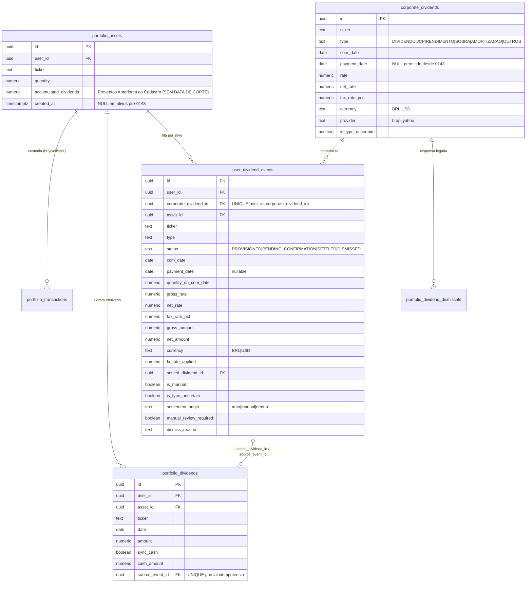
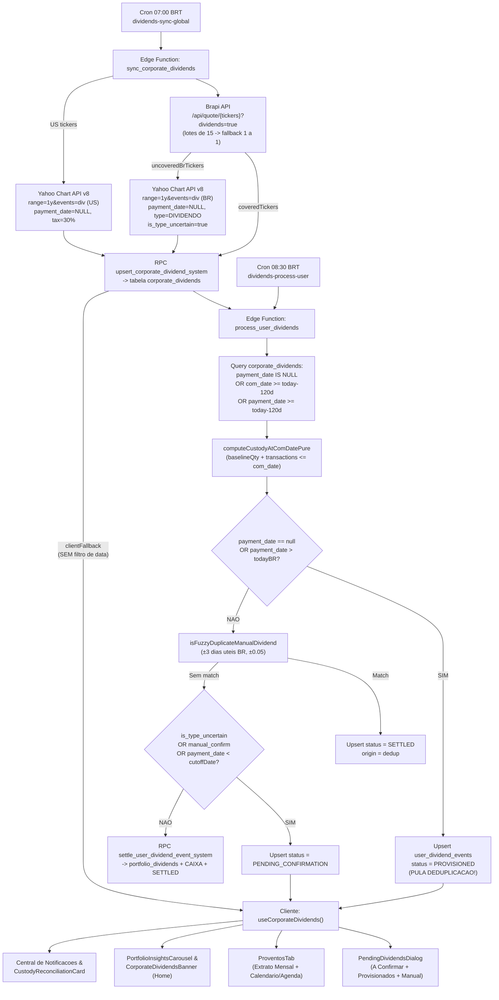
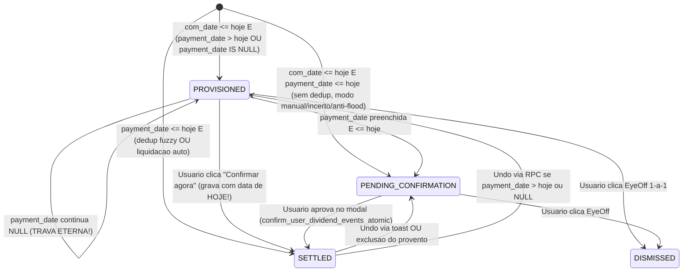
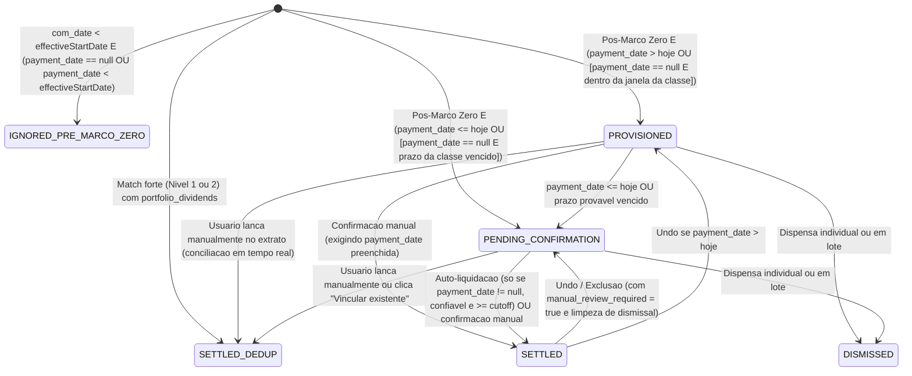

# Auditoria Técnica e Arquitetural — Funcionalidade de Proventos Provisionados e a Receber

- **Escopo:** Análise completa ponta a ponta da funcionalidade de detecção, provisionamento, conciliação, conferência e liquidação de proventos da carteira (Banco de Dados, Migrations, Crons `pg_cron`, Edge Function `quotes`, Motor Puro de Domínio, Repositórios/RPCs, Camada de Estado/React Query, UI/UX, Notificações e Relatórios).
- **Base analisada:** Código-fonte real do repositório (`/src`, `/supabase/functions`, `/supabase/migrations`, `/supabase/quotes-cron.sql`) em 26/11/2026.
- **Modo de atuação:** Somente leitura no código de produção; este documento consolida o mapeamento fiel da arquitetura atual, o diagnóstico forense de fragilidades/bugs e o desenho completo de correções e melhorias.
- **Governança de referência:** `AGENTS.md`, `docs/architecture/ESPECIFICACAO_TECNICA.md`, `docs/architecture/ARCHITECTURE.md`, `docs/architecture/FINANCIAL_MATH_SPEC.md`, `docs/plans/PLANO_MOTOR_COTACOES_PROVENTOS.md`.

---

## 1. Sumário Executivo e Diagnóstico Geral

A funcionalidade de **Proventos Detectados e Provisionados** (Bloco C do motor de cotações e proventos) foi projetada com bons princípios estruturais — separação de estados (`PROVISIONED`, `PENDING_CONFIRMATION`, `SETTLED`, `DISMISSED`), isolamento contábil estrito fora do Patrimônio no Fechamento e do Caixa até a liquidação, idempotência via `source_event_id` e proteção Anti-Flood para liquidação automática.

Contudo, a auditoria forense revelou **4 falhas críticas (P0)**, **10 falhas de alta severidade (P1)** e **9 fragilidades médias (P2)** que, atuando em conjunto, explicam integralmente o colapso observado em produção (mais de **165 proventos** acumulados desde novembro/2025 presos em `"Provisionados — A Receber"`, **0** em `"A Confirmar"`, 100% exibindo `"Data de pagamento a definir"`, duplicação de proventos já lançados manualmente e provisionamento retroativo de proventos anteriores ao Marco Zero já lançados como `"Proventos Anteriores ao Cadastro"`).

### 1.1. Resumo de Severidades

| Severidade | Qtd. | Síntese dos Impactos |
|---|---:|---|
| **P0 — Crítico** | 4 | `payment_date` sempre `null` no Yahoo travando 100% dos eventos em `PROVISIONED` e **desligando a deduplicação**; ausência de **Marco Zero** e desconexão total com `accumulated_dividends`; falhas estruturais de conciliação (JCP -15%, modo `[MENSAL]`, tolerância fixa de R$ 0,05, 1:1 rígido); eventos vencidos há meses presos em "Provisionados" em vez de "Conferir" |
| **P1 — Alto** | 10 | "Confirmar agora" gravando provento antigo com data de **hoje**; impossibilidade de editar `payment_date`; ausência de ações em lote em Provisionados; dependência frágil da Brapi + FIIs rotulados como `Alíquota a conferir (Yahoo)`; duplicidade na RPC `upsert_corporate_dividend_system` por ±1 dia na `com_date`; arquitetura dual-engine cliente/servidor dessincronizada; falhas de `computeCustodyAtComDatePure` com `created_at = NULL` e `baselineQty`; KPIs/banners somando histórico inteiro como "Previsto no Mês"; bug de exclusão manual não limpando `portfolio_dividend_dismissals`; `revertSettledUserDividendEvents` sem `manual_review_required` |
| **P2 — Médio** | 9 | Modal sem filtros/busca/agrupamento/virtualização; alarme falso de alíquota e tipo `DIVIDENDO` em FIIs; `activatedAt` restrito ao modo `auto`; ausência de botão de sincronização manual e transparência de custódia/fonte na fila Provisionados; desvios menores de `AGENTS.md §3/§4` (`created_at` fora de `PortfolioAsset`, `<label>` cru, `text-[10px]`); dual-write legado com `portfolio_dividend_dismissals`; `ON DELETE SET NULL` órfão em `SETTLED/dedup`; lacunas de testes em integração e UI |

### 1.2. Matriz Causa-Efeito (Relato Real de Produção → Causa Raiz no Código)

| Sintoma Observado em Produção | Causa Raiz Comprovada no Código | Referências |
|---|---|---|
| **165+ proventos desde 26/11/2025 até 19/11/2026** (1 ano inteiro) aparecendo mesmo com ativos cadastrados depois e com `"Proventos Anteriores"` preenchidos | 1) Yahoo busca `range=1y` sem filtro de marco zero; 2) `portfolio_assets.created_at` é `NULL` para ativos pré-migration 0143 (assumido como custódia desde `-∞`); 3) `accumulated_dividends` é **completamente ignorado** pelo motor; 4) Query do servidor usa `.or("payment_date.is.null, com_date.gte.{today-120d}")`, furando o lookback de 120d sempre que `payment_date IS NULL`; 5) Cliente `listCorporateDividends` não tem **nenhum** filtro temporal | `quotes/index.ts:487, 1415` `quotes-core.ts:1126-1160` `dividend-suggester.ts:158-205` `portfolio.ts:806-816` `0143:29-37` |
| **Todos os itens B3** com `DIVIDENDO · Alíquota a conferir (Yahoo)` e `Data de pagamento a definir` (inclusive todos os FIIs: `LVBI11`, `HGLG11`, `KNCR11`, `VISC11`, `XPML11`, `ALZR11`, `BTLG11`, `GARE11`, `GGRC11`, `RZTR11`, `TGAR11`, `NEWL11`, `BTCI11`, `HGRU11`) | Brapi não retorna `cashDividends` para esses tickers (limite de plano/token), fazendo 100% deles caírem no fallback `fetchYahooDividendsForTicker(ticker, "BR")`. O endpoint `/v8/finance/chart?events=div` do Yahoo **nunca envia `paymentDate`** nem tipo fiscal, e o parser fixa `type: "DIVIDENDO"` e `is_type_uncertain: true` até para FIIs isentos | `quotes/index.ts:392-499, 1252-1272` `quotes-core.ts:970-1035` |
| **Todos os itens EUA** (`O`, `VICI`, `VOO`, `VEA`, `SPHQ`, `MCHI`, `EWW`, `ARGT`) com `Data de pagamento a definir` | Mesmo endpoint `/v8/finance/chart?events=div` usado para mercado `US`: só retorna `ex-date` e `amount`, nunca `paymentDate` | `quotes/index.ts:487, 1274-1283` `quotes-core.ts:1016-1017` |
| **Proventos já cadastrados manualmente** aparecem duplicados na lista | 1) No servidor, quando `payment_date IS NULL`, o fluxo entra em `if (isProvisioned) { ... continue; }` **antes** de rodar a deduplicação fuzzy; 2) `isFuzzyDuplicateManualDividend` e `findFuzzyMatchingManualDividend` retornam `false`/`null` imediatamente quando `paymentDate` é nulo; 3) No cliente, para eventos já persistidos, compara `com_date` com tolerância de **±3 dias úteis** (incompatível com pagamento real 10–60d depois e com modo `[MENSAL]` gravado no dia 01); 4) Tolerância de valor fixa em **±R$ 0,05** falha em **100% dos JCPs** via Yahoo (15% IRRF = divergência de 15%) e em diferenças mínimas de cotas/arredondamento | `quotes/index.ts:1673-1745` `quotes-core.ts:1184-1210` `dividend-deduplication.ts:58-103` `use-corporate-dividends.ts:275-284` `dividends.ts:121-126` |
| **Proventos de 2025 e meses anteriores de 2026** estão em `"Provisionados"` (com `Aprovar no Caixa (0)`) em vez de `"Conferir"` | A transição para `"A Confirmar"` (`PENDING_CONFIRMATION` / `available`) exige estritamente `payment_date !== null && payment_date <= today`. Sem `payment_date`, o evento **nunca** transita de `PROVISIONED` para `PENDING_CONFIRMATION`, mesmo 12 meses após a Data COM | `quotes/index.ts:1673` `dividend-suggester.ts:303` `use-corporate-dividends.ts:75-79` |

---

## 2. Estrutura Atual da Funcionalidade de Ponta a Ponta

### 2.1. Inventário Completo de Arquivos por Camada

| Camada | Arquivo | Linhas | Responsabilidade Atual |
|---|---|---:|---|
| **BD — Migration** | `supabase/migrations/20260101000027_portfolio_accumulated_dividends.sql` | 24 | Adiciona `accumulated_dividends` e `estimated_monthly_dividend_per_share` em `portfolio_assets` |
| **BD — Migration** | `supabase/migrations/20260101000087_portfolio_monthly_closing_and_corporate_dividends.sql` | 368 | Cria `corporate_dividends`, `portfolio_dividend_dismissals` e RPC legada `approve_dividends_batch_atomic` |
| **BD — Migration** | `supabase/migrations/20260101000143_automated_dividends_engine.sql` | 2.241 | Evolui `corporate_dividends` (`payment_date` anulável, `provider`, `tax_rate_pct`, `is_type_uncertain`), cria `user_dividend_events` + RLS, adiciona `created_at` sem backfill em `portfolio_assets`/`portfolio_transactions`, adiciona `source_event_id` em `portfolio_dividends`, cria RPCs `upsert_corporate_dividend_system`, `settle_user_dividend_event_system`, `confirm_user_dividend_events_atomic`, `revert_confirmed_dividend_events_atomic`, `dismiss_user_dividend_event_atomic`, atualiza `approve_dividends_batch_atomic` e `restore_backup` |
| **Infra — Cron** | `supabase/quotes-cron.sql` | 119 | Agenda 2 jobs diários de proventos via `pg_cron` + `pg_net`: `dividends-sync-global` (10:00 UTC / 07:00 BRT) e `dividends-process-user` (11:30 UTC / 08:30 BRT) |
| **Backend — Edge Function** | `supabase/functions/quotes/index.ts` | 2.469 | Ação `sync_corporate_dividends` (linhas 1160–1314: coleta Brapi + fallback Yahoo B3 + Yahoo US + RPC upsert) e ação `process_user_dividends` (linhas 1319–1950: apuração Data COM, deduplicação, Anti-Flood, upsert `user_dividend_events`, liquidação automática e push) |
| **Backend — Motor Compartilhado** | `supabase/functions/_shared/quotes-core.ts` | 1.542 | Funções puras Deno/Vitest: `parseBrapiDividends`, `parseYahooDividends`, `computeCustodyAtComDatePure`, `resolveAntiFloodCutoffDate`, `isFuzzyDuplicateManualDividend`, calendários BR/US e `getPreviousMarketBusinessDay` |
| **Data — Repositório** | `src/data/repositories/portfolio.ts` | 1.125 | `listCorporateDividends`, `listUserDividendEvents`, `createManualUserDividendEvent`, `updateUserDividendEvent`, `deleteUserDividendEvent`, `revertSettledUserDividendEvents`, `listPortfolioDividendDismissals`, `dismissCorporateDividend` |
| **Data — RPCs** | `src/data/rpc/portfolio.ts` | 291 | Wrappers tipados: `approveDividendsBatchRpc`, `confirmUserDividendEventsRpc`, `revertConfirmedDividendEventsRpc`, `dismissUserDividendEventRpc` |
| **Domínio — Apuração** | `src/domain/portfolio/dividend-suggester.ts` | 363 | `getCustodyAtComDate`, `calculateSuggestedDividends` (fallback client-side), `resolveDividendAntiFloodCutoff`, `todaySaoPauloISO` |
| **Domínio — Deduplicação** | `src/domain/portfolio/dividend-deduplication.ts` | 127 | `normalizeDividendTickerKey`, `getBusinessDaysDifference`, `findFuzzyMatchingManualDividend`, `isCorporateDividendDeduplicated` |
| **Domínio — Isolamento Contábil** | `src/domain/portfolio/provisioned-dividends.ts` | 153 | `summarizeProvisionedDividends`, `computeProjectedPatrimonyWithProvisioned`, adaptadores de item |
| **Domínio — Governança de Caixa** | `src/domain/portfolio/dividend-cash-governance.ts` | 66 | `isDividendLiquidationDue`, `validateDividendReversalSafeguard` (alerta de estorno com recurso já reinvestido) |
| **Domínio — Analítica & Extrato** | `src/domain/portfolio/dividends-analytics.ts` & `dividends.ts` | 608 | `buildMonthlyDividendsSummary`, `buildYearlyDividendsSummary`, `buildAssetsDividendsBreakdown`, `resolveDividendDate` (`daily` vs `monthly`), `resolveDividendNote` (`[MENSAL]`) |
| **Domínio — Notificações** | `src/domain/notifications/hub/event-detectors.ts` | 458 | `detectDividendNotificationAlerts` (agrupa até 3 alertas determinísticos na Central de Notificações: `pending_confirmation`, `provisioned`, `settled`) |
| **State — Queries** | `src/state/queries/use-corporate-dividends.ts` | 378 | `useUserDividendEvents` e `useCorporateDividends`: mescla `user_dividend_events` persistidos com `clientFallback` sobre `corporate_dividends`, calcula totais BRL/USD e `provisionedSummary` |
| **State — Mutations** | `src/state/mutations/portfolio/use-portfolio-dividend-mutations.ts` | 599 | `useConfirmUserDividendEvents` (com Undo ACID), `useApproveDividendsBatch`, `useCreateManualUserDividendEvent`, `useUpdateUserDividendEvent`, `useDismissUserDividendEvent`, `useDeleteUserDividendEvent`, `useDeletePortfolioDividend` |
| **Serviço — Modal Bus** | `src/services/dividend-review-modal.ts` | 28 | Pub/sub global `openDividendReviewModal` / `subscribeDividendReviewModal` |
| **UI — Modal Único** | `src/features/investments/components/pending-dividends-dialog.tsx` | 1.095 | `PendingDividendsDialog` + `PendingDividendsDialogHost`: abas `"Conferência"` (seções `"A Confirmar"` e `"Provisionados — A Receber"`) e `"Provisionar Manual"` |
| **UI — Aba Proventos** | `src/features/investments/pages/proventos-tab.tsx`, `use-proventos-tab-controller.ts`, `dividends-calendar-panel.tsx`, `dividends-history-panel.tsx` | 862 | Sub-abas Extrato Mensal (banner de previstos no mês), Calendário (grid anual + seção Agenda de Proventos Provisionados e a Confirmar), Por Ativo (`accumulated_dividends` + periódicos) e Bola de Neve |
| **UI — Carrossel Investimentos** | `src/features/investments/components/portfolio-insights-carousel.tsx` & `build-dividend-insight-items.tsx` | 432 | Slides `"Proventos Creditados na Corretora"` (com aprovação rápida 1-clique quando sem incerteza) e `"Proventos Previstos no Mês"` |
| **UI — Home (Overview)** | `src/features/overview/components/corporate-dividends-banner.tsx` & `build-overview-alerts.tsx` | 567 | Banner no carrossel da Home respeitando `notifyOnPayment` / `notifyOnProvisioned` |
| **UI — Configurações** | `src/features/settings/components/tabs/notifications/dividend-automation-card.tsx` | 213 | Preferências: `settlementMode` (`manual_confirm` vs `auto`), `autoCreditCash`, `notifyOnProvisioned`, `notifyOnPayment`, `activatedAt` |
| **UI — Relatórios & Custódia** | `src/components/modules/reports/custody-reconciliation-card.tsx` & `src/domain/calculation-memory/builders/portfolio-breakdown.ts` | — | Linha auxiliar `"Proventos Provisionados — A Receber"` e `"Total Projetado c/ Provisionados"` isolados do Patrimônio no Fechamento |
| **Contratos & Tipos** | `src/types/schema.ts` | — | `CorporateDividend`, `UserDividendEvent`, `PortfolioDividendDismissal`, `ConfirmDividendEventItem`, `DividendAutomationPreferences`, `PortfolioAsset` |

---

### 2.2. Modelo de Dados Atual

**Observação crítica sobre `portfolio_assets`:**
- `accumulated_dividends` existe desde a migration `000027`, mas **não possui nenhuma data de corte/marco zero associada** (ex.: `dividends_start_date` ou `accumulated_dividends_as_of`).
- `created_at` foi adicionado apenas na migration `000143` **sem backfill** (`NULL` para todos os ativos criados antes de 23/11/2026). Além disso, `PortfolioAsset` em `src/types/schema.ts:886-931` nem declara `created_at`.

---

### 2.3. Fluxo Atual Ponta a Ponta

---

### 2.4. Máquina de Estados Atual (e o Gargalo de Travamento)

---

### 2.5. Como Cada Subsistema Opera Hoje

1. **Coleta Global (`sync_corporate_dividends`, `quotes/index.ts:1160-1314`):**
   - Carrega todos os `portfolio_assets` com `quantity > 0` ou transação nos últimos 120 dias (`isMarketQuotedAsset`), separa em `brTickers` e `usTickers`.
   - Para `brTickers`, chama Brapi em lotes de 15 (`?dividends=true`); se o lote falhar (400/403/404), reexecuta 1 a 1 com concorrência 4.
   - Todo ticker BR que não veio com `dividendsData.cashDividends` em array cai em `fetchYahooDividendsForTicker(ticker, "BR")`.
   - Todos os `usTickers` vão direto para `fetchYahooDividendsForTicker(ticker, "US")`.
   - Ambos os fetches do Yahoo usam `?range=1y&interval=1d&events=div`.
   - Persiste via RPC `upsert_corporate_dividend_system` (lotes de 200), tentando promover linhas `payment_date IS NULL` ou `is_type_uncertain = true` quando chega dado confiável com **exata mesma `com_date`** e taxa dentro de `max(0.002, rate * 3%)`.

2. **Materialização por Usuário (`process_user_dividends`, `quotes/index.ts:1319-1950`):**
   - Executa apenas 1x/dia às 08:30 BRT via `pg_cron` (não há endpoint/botão para o usuário disparar).
   - Agrupa ativos do usuário por ticker canônico (somando `PETR4` + `PETR4F`).
   - Reconstrói custódia na Data COM com `computeCustodyAtComDatePure`.
   - Se `payment_date` é nula ou futura → grava/atualiza `PROVISIONED` e dá `continue` (**sem deduplicação**).
   - Se `payment_date <= todayBR` → roda `isFuzzyDuplicateManualDividend` (`±3 dias úteis BR`, `±0,05`); se não casar, grava `PENDING_CONFIRMATION` e (se `settlementMode === "auto"`, `!is_type_uncertain` e `payment_date >= cutoffDate`) liquida automaticamente via `settle_user_dividend_event_system`.
   - Dispara notificações push via `push-dispatcher` para novos `settled`, `pending` e `provisioned`.

3. **Camada Cliente (`useCorporateDividends`, `src/state/queries/use-corporate-dividends.ts`):**
   - Consulta 6 fontes em paralelo: `portfolio_assets`, `portfolio_transactions`, `portfolio_dividends`, `asset_prices`, `corporate_dividends` (sem filtro de data), `portfolio_dividend_dismissals` e `user_dividend_events`.
   - Percorre `user_dividend_events` (ocultando `SETTLED`, `DISMISSED`, dispensados na tabela legada e eventos que casem com `isCorporateDividendDeduplicated` usando `payment_date ?? comDate`).
   - Para todo `corporate_dividends` cujo `id` não está em `user_dividend_events`, roda o fallback client-side `calculateSuggestedDividends`.
   - Mescla as duas listas em `available` (`pendingConfirmation`) e `projected` (`provisioned`), e alimenta `summarizeProvisionedDividends`.

4. **Confirmação, Provisionamento Manual e Estorno:**
   - `PendingDividendsDialog` exibe `"A Confirmar"` (com checkboxes, edição inline de Tipo/IR/Valor Líquido e aprovação em lote) e `"Provisionados — A Receber"` (sem checkboxes, sem edição inline, apenas botão `"Confirmar agora"` e `"EyeOff"` individual).
   - Aprovação chama `confirm_user_dividend_events_atomic` (insere `portfolio_dividends` com `source_event_id`, credita `CAIXA` se `p_sync_cash = true` convertendo USD→BRL, marca evento `SETTLED` e insere em `portfolio_dividend_dismissals`).
   - Toast de sucesso oferece `"Desfazer"` por 5s chamando `revert_confirmed_dividend_events_atomic`.

---

## 3. Análise Forense de Fragilidades, Bugs e Falhas Estruturais

### 3.1. Bugs Críticos (P0)

#### [P0-01] `payment_date` permanentemente nula no Yahoo Finance paralisa a máquina de estados e desliga a deduplicação
- **Onde:** `supabase/functions/_shared/quotes-core.ts:1016-1017`, `supabase/functions/quotes/index.ts:487, 1252-1284, 1673-1745`, `src/domain/portfolio/dividend-deduplication.ts:67`, `src/domain/portfolio/dividend-suggester.ts:291-303`.
- **Análise técnica:**
  - A API `/v8/finance/chart/{ticker}?range=1y&interval=1d&events=div` retorna apenas `{ amount, date }` (ex-date). O campo `rec.paymentDate` lido na linha 1016 de `quotes-core.ts` **não existe** no contrato desse endpoint → `payment_date` é sempre `null`.
  - Na prática de produção, a Brapi falha ou omite `dividendsData.cashDividends` para a vasta maioria dos FIIs e ações B3 (especialmente fora dos 4 tickers gratuitos de demo ou dependendo do plano do `BRAPI_TOKEN`), empurrando **toda a carteira B3 + toda a carteira EUA** para o Yahoo.
  - Consequências em cadeia:
    1. **Trava eterna em `PROVISIONED`:** `const isProvisioned = !corp.payment_date || corp.payment_date > todayBR` (`quotes/index.ts:1673`) e `const isAvailable = paymentDateClean !== null && paymentDateClean <= referenceDate` (`dividend-suggester.ts:303`) mantêm eventos de 2025 eternamente provisionados.
    2. **Deduplicação 100% desligada no servidor:** O bloco `if (isProvisioned) { ... continue; }` (`quotes/index.ts:1675-1736`) executa **antes** de `isFuzzyDuplicateManualDividend` (linha 1740), e mesmo que chegasse lá, `quotes-core.ts:1191` retorna `{ matched: false }` na primeira linha quando `!paymentDate`.
    3. **Deduplicação 100% desligada no `clientFallback`:** `findFuzzyMatchingManualDividend` (`dividend-deduplication.ts:67`) executa `if (!corporateEvent.payment_date ...) return null;`.
    4. **Deduplicação quebrada em `useCorporateDividends` (`use-corporate-dividends.ts:275-284`):** Para eventos já persistidos em `user_dividend_events`, substitui `payment_date` por `mapped.comDate`, mas aplica tolerância de **±3 dias úteis** contra a data de pagamento manual — que na vida real ocorre 5–15 dias úteis depois em FIIs, 10–25 dias úteis nos EUA e 10–60+ dias úteis em ações B3!

#### [P0-02] Inexistência de "Marco Zero" de Proventos e desconexão total com `accumulated_dividends` ("Proventos Anteriores ao Cadastro")
- **Onde:** `supabase/migrations/20260101000143_automated_dividends_engine.sql:29-37`, `supabase/functions/_shared/quotes-core.ts:1099-1163`, `supabase/functions/quotes/index.ts:1326, 1415, 1650-1668`, `src/domain/portfolio/dividend-suggester.ts:139-219`, `src/data/repositories/portfolio.ts:806-822`, `src/features/investments/components/shared-forms/asset-metadata-accordion.tsx:154-175`.
- **Análise técnica:**
  - O produto explicitamente orienta o investidor no cadastro/edição do ativo a preencher **"Proventos Anteriores ao Cadastro"** (`portfolio_assets.accumulated_dividends`) justamente para que ele **não precise cadastrar manualmente** cada dividendo antigo antes do marco zero em que começou a usar o aplicativo.
  - Entretanto, o motor de proventos provisionados **ignora 100%** esse conceito:
    1. **Ativos pré-migration 0143 têm `created_at = NULL`:** `computeCustodyAtComDatePure` (`quotes-core.ts:1127`) e `getCustodyAtComDate` (`dividend-suggester.ts:159`) interpretam `!assetCreatedAt` como *"o usuário possuía essas cotas desde o início dos tempos"*.
    2. **Furo no filtro de lookback do servidor:** Em `quotes/index.ts:1415`, a cláusula `.or(\`payment_date.is.null,com_date.gte.${lookbackStart},payment_date.gte.${lookbackStart}\`)` coloca `payment_date.is.null` **sem qualquer restrição de `com_date`**. Como todos os eventos do Yahoo têm `payment_date IS NULL`, o lookback de 120 dias é completamente anulado, trazendo todos os 365 dias do `range=1y`!
    3. **Ausência total de filtro temporal no cliente:** `listCorporateDividends` (`portfolio.ts:806-816`) baixa todo o histórico existente em `corporate_dividends` sem recorte de data.
    4. **Colisão entre data de aquisição (para PM/IR) e marco zero de proventos:** Quando um usuário cadastra um ativo existente via Wizard ou importação B3 informando uma data de compra inicial (ex.: `2026-01-01` via `clampAppDate` em `operations.ts:313-318`) e preenche `accumulated_dividends` cobrindo tudo até a data em que começou a usar o app (ex.: outubro/2026), o motor vê `txsUpToCom.length > 0` para todas as Datas COM de janeiro a outubro de 2026 e provisiona tudo em duplicidade ao `accumulated_dividends`!
    5. **`baselineQty` sem data de origem:** Se `asset.quantity` excede a soma das transações (por edição manual de posição ou legado), `baselineQty` é injetado no instante `t = -∞` sempre que `assetCreatedAt` for nulo ou houver ao menos uma transação anterior à Data COM.

#### [P0-03] Algoritmo de conciliação/deduplicação incapaz de casar cenários reais de proventos já cadastrados manualmente
- **Onde:** `supabase/functions/_shared/quotes-core.ts:1184-1210`, `src/domain/portfolio/dividend-deduplication.ts:58-103`, `src/state/queries/use-corporate-dividends.ts:275-284`, `src/domain/portfolio/dividends.ts:121-126`, `src/state/mutations/portfolio/use-portfolio-order-mutations.ts:484-516`.
- **Análise técnica — 7 brechas independentes que causam duplicação:**
  1. **Modo `[MENSAL]` (`YYYY-MM-01`):** O próprio app incentiva lançar proventos pelo modo "Extrato do Mês" (`resolveDividendDate("monthly", "2026-10") => "2026-10-01"`). Um pagamento ocorrido em `2026-10-15` (10 dias úteis após `2026-10-01`) **nunca** passa na janela de `±3 dias úteis`.
  2. **JCP via Yahoo (divergência exata de 15%):** O Yahoo marca `tax_rate_pct = 0` (`net_rate = gross_rate`). Quando o usuário lança o valor líquido recebido na corretora (85% do bruto) para `ITSA4`, `BBAS3`, `WEGE3`, `PSSA3`, `ABCB4`, `SAPR4`, `TAEE4`, `MDIA3`, `RDOR3`, a diferença de 15% falha invariavelmente contra `maxAmountDiff = 0.05`.
  3. **Tolerância monetária fixa de R$ 0,05 (sem margem percentual):** Em dividendos maiores (ex.: `CPFE3` R$ 197,42, `ABCB4` R$ 177,91, `RDOR3` R$ 147,24), qualquer diferença de R$ 0,06 causada por arredondamento de casa decimal do Yahoo, taxa de custódia/ADR ou pequena variação de fração de cota impede o match.
  4. **Impossibilidade de conciliar lançamentos consolidados (N eventos → 1 lançamento manual):** Se `PSSA3` ou `ITSA4` ou `BBAS3` anuncia 2 proventos no mesmo mês (ex.: `PSSA3` com Data COM 30/03/2026 R$ 43,93 e 31/03/2026 R$ 71,77 na lista real do usuário!) e o usuário lança R$ 115,70 consolidado no mês, o algoritmo 1:1 falha para ambos.
  5. **Sem conciliação no momento da escrita manual:** Cadastrar um provento em `portfolio_dividends` via `useRecordOrder` / `useCreatePortfolioDividend` não consulta nem atualiza `user_dividend_events`.
  6. **Calendário divergente servidor vs cliente:** `isFuzzyDuplicateManualDividend` no servidor (`quotes-core.ts:1200-1201`) usa sempre calendário `"BR"` mesmo para ativos `"US"`, enquanto `dividend-deduplication.ts:77-78` usa `"US"` para `USD`.
  7. **Falta de `consumedManualDividends` em `use-corporate-dividends.ts:275-284`:** Ao contrário de `dividend-suggester.ts:261`, o loop sobre `userEvents` no hook não marca um lançamento manual como já consumido, permitindo que um único registro manual suprima incorretamente dois eventos persistidos de valor igual.

#### [P0-04] Ciclo de vida rígido mantém eventos vencidos/antigos sem data como "Provisionados" em vez de "A Conferir"
- **Onde:** `supabase/functions/quotes/index.ts:1673`, `src/domain/portfolio/dividend-suggester.ts:303`, `src/state/queries/use-corporate-dividends.ts:75-79`, `src/features/investments/components/pending-dividends-dialog.tsx:735-818`.
- **Análise técnica:**
  - Não existe heurística de janela de pagamento por classe de ativo. Um FII com Data COM `28/11/2025` (12 meses atrás!) ou `30/10/2026` (quase 1 mês atrás, quando FIIs pagam até o 10º–15º dia útil do mês seguinte) continua classificado como `PROVISIONED` ("A Receber — futuro") em vez de ser promovido para conferência (`PENDING_CONFIRMATION`) com aviso de *"Data de pagamento não informada pela fonte — informe a data real do crédito"*.
  - Além disso, o usuário não consegue diferenciar um provento legitimamente futuro (Data COM recente) de um provento passado cujo pagamento já ocorreu mas a fonte não soube a data.

---

### 3.2. Bugs e Fragilidades de Alta Severidade (P1)

#### [P1-01] "Confirmar agora" em item sem `payment_date` corrompe a competência gravando a data de HOJE
- **Onde:** `src/features/investments/components/pending-dividends-dialog.tsx:292-299, 341-355` e `supabase/migrations/20260101000143_automated_dividends_engine.sql:1033`.
- **Detalhes:** `const rawPayDate = d.paymentDate ?? today;` → ao clicar **"Confirmar agora"** em um item de `LVBI11` com Data COM `30/04/2026` e `paymentDate = null`, a RPC liquida o provento imediatamente sem abrir editor e grava `portfolio_dividends.date = '2026-11-26'` (hoje), distorcendo o extrato do mês atual, o calendário anual, o "Melhor Mês" e a média mensal.

#### [P1-02] Editor inline do modal não permite editar `payment_date` e sequer existe na seção Provisionados
- **Onde:** `src/features/investments/components/pending-dividends-dialog.tsx:609-698, 748-815`.
- **Detalhes:** Na seção `"A Confirmar"`, o editor permite mudar apenas `Tipo`, `IR Retido (%)` e `Valor Líquido`. Na seção `"Provisionados — A Receber"`, não há sequer botão de edição — impedindo o usuário de ajustar tipo (JCP vs Dividendo), IR, valor ou informar a data real do pagamento antes de confirmar.

#### [P1-03] Impossibilidade de seleção e ação em lote na seção Provisionados (e ausência de dispensa por corte temporal)
- **Onde:** `src/features/investments/components/pending-dividends-dialog.tsx:735-818`.
- **Detalhes:** Com 165 itens em Provisionados, não há checkbox, não há "Selecionar todos", não há "Dispensar selecionados" e não há ação "Dispensar anteriores a [data]". O usuário precisaria executar 165 cliques individuais no ícone `EyeOff` (165 chamadas RPC + 165 toasts).

#### [P1-04] Fragilidade dos provedores externos (Brapi/Yahoo) e classificação fiscal errônea de FIIs
- **Onde:** `supabase/functions/quotes/index.ts:392-499, 1252-1284`, `supabase/functions/_shared/quotes-core.ts:911-1035`.
- **Detalhes:**
  - Lotes de 15 tickers na Brapi falham inteiros quando 1 único ticker não tem suporte no plano, forçando fallback individual (muitas chamadas HTTP desperdiçadas).
  - Quando cai no Yahoo, **todos os FIIs** (`LVBI11`, `HGLG11`, `KNCR11`, `VISC11`, `XPML11`, `ALZR11`, `BTLG11`, `GARE11`, `GGRC11`, `RZTR11`, `TGAR11`, `NEWL11`, `BTCI11`, `HGRU11`) são gravados com `type = 'DIVIDENDO'` e `is_type_uncertain = true`, disparando o alerta amarelo `"Alíquota a conferir (Yahoo)"` e bloqueando aprovação rápida/automática — apesar de FIIs distribuírem `RENDIMENTO` isento de IR para PF (0%) e nunca JCP!
  - O Yahoo não tem fonte complementar para `paymentDate` nem no Brasil nem nos EUA.

#### [P1-05] `upsert_corporate_dividend_system` exige `com_date` exata e pode duplicar registros entre Brapi e Yahoo
- **Onde:** `supabase/migrations/20260101000143_automated_dividends_engine.sql:194-452`.
- **Detalhes:** `parseYahooDividends` calcula `com_date = getPreviousMarketBusinessDay(exDateIso, market)`. Se houver diferença de ±1 dia útil entre a `ex-date` do Yahoo (UTC/BRT) e a `lastDatePrior` da Brapi, os `WHERE com_date = v_com_date` falham e a tabela `corporate_dividends` acumula **duas linhas** para o mesmo evento (uma com `payment_date` preenchida e outra com `payment_date IS NULL`). Além disso, em `quotes/index.ts:1719`, se um evento `PROVISIONED` tiver `manual_review_required = true`, uma promoção futura de `payment_date` em `corporate_dividends` deixa de propagar para `user_dividend_events`.

#### [P1-06] Arquitetura Dual-Engine dessincronizada entre servidor (`process_user_dividends`) e cliente (`useCorporateDividends` + `dividend-suggester.ts`)
- **Onde:** `supabase/functions/quotes/index.ts:1623-1869`, `src/domain/portfolio/dividend-suggester.ts:225-363`, `src/state/queries/use-corporate-dividends.ts:252-306`.
- **Divergências concretas:**
  1. **Agrupamento de lotes (`PETR4` + `PETR4F`):** servidor soma lotes em 1 evento (`quotes/index.ts:1624-1666`); cliente gera 1 evento **por lote** (`dividend-suggester.ts:278`).
  2. **Janela temporal:** servidor usa `-120d` (furado por `payment_date IS NULL`), cliente usa `-180d` para ativos zerados e **nenhum limite** para `corporate_dividends`.
  3. **Eventos `PENDING_CONFIRMATION` congelados:** linha 1793 de `quotes/index.ts` pula totalmente qualquer evento já em `PENDING_CONFIRMATION` — se o usuário corrigiu transações de compra/venda retroativas que alteram a custódia na Data COM, o valor pendente nunca é recalculado.
  4. **Deduplicação apenas visual no cliente:** `use-corporate-dividends.ts:275-284` esconde eventos na UI sem reconciliar `user_dividend_events` no banco.
  5. **Latência de 24h:** `process_user_dividends` só roda às 08:30 BRT; não existe sincronização sob demanda.

#### [P1-07] Falhas na reconstrução histórica de custódia na Data COM (`computeCustodyAtComDatePure` / `getCustodyAtComDate`)
- **Onde:** `supabase/functions/_shared/quotes-core.ts:1099-1163`, `src/domain/portfolio/dividend-suggester.ts:139-219`.
- **Detalhes:**
  - `created_at` nulo em ativos legados libera custódia retroativa ilimitada.
  - `baselineQty` inferido por engenharia reversa não tem data de referência — contamina qualquer Data COM anterior se houver 1 transação antes da Data COM ou `created_at = NULL`.
  - Compra inicial gerada pelo Wizard/Importação (`buildInitialPositionOperations` com `clampAppDate` em `2026-01-01`) cria custódia aparente desde janeiro/2026 mesmo quando o usuário só começou a acompanhar proventos em meses posteriores e já somou o passado em `accumulated_dividends`.
  - Ordenação intradia do cliente (`dividend-suggester.ts:152-156`) omite o desempate por `created_at` presente no servidor (`quotes-core.ts:1123`).

#### [P1-08] Distorção semântica e inflação de KPIs nos banners, calendário e relatórios
- **Onde:**
  - `src/features/investments/components/insights-carousel/build-dividend-insight-items.tsx:125`: exibe título **"Proventos Previstos no Mês"**, mas injeta `projectedCount` e `totalProjectedAmount` de **todos os meses acumulados** (inclusive 2025 e os 12 meses de 2026 sem filtro de mês!).
  - `src/features/investments/components/proventos/use-proventos-tab-controller.ts:142-153` & `src/domain/portfolio/dividends-analytics.ts:151-153`: filtram `typeof p.paymentDate === "string" && p.paymentDate.startsWith(month)` — fazendo o Extrato Mensal e o grid do Calendário exibirem **0 previstos** enquanto a seção "Agenda" logo abaixo despeja 165 itens.
  - `src/features/overview/components/build-overview-alerts.tsx:338-355` & `src/components/modules/reports/custody-reconciliation-card.tsx:182-205`: somam todos os 165 eventos históricos/duplicados no banner da Home e na linha `"Total Projetado c/ Provisionados"` do relatório executivo.

#### [P1-09] Exclusão de provento no Extrato Mensal (`useDeletePortfolioDividend`) não limpa `portfolio_dividend_dismissals` e depende de cache React Query
- **Onde:** `src/state/mutations/portfolio/use-portfolio-dividend-mutations.ts:195-202`.
- **Detalhes:** Se o usuário exclui um provento confirmado pela aba Extrato Mensal:
  1. O código busca eventos vinculados apenas no cache em memória `queryClient.getQueryData(PORTFOLIO_QUERY_KEYS.userDividendEvents)` — se a query não estiver em cache, o `user_dividend_events` continua `SETTLED` (órfão).
  2. Mesmo quando está em cache, `revertSettledUserDividendEvents` não apaga o registro correspondente em `portfolio_dividend_dismissals`, fazendo `useCorporateDividends` (linha 268) continuar ocultando o evento permanentemente.

#### [P1-10] `revertSettledUserDividendEvents` não respeita `payment_date` futura/nula nem marca `manual_review_required = true`
- **Onde:** `src/data/repositories/portfolio.ts:1011-1030`.
- **Detalhes:** Força `status = "PENDING_CONFIRMATION"` mesmo se `payment_date` for futura ou nula, e deixa `manual_review_required = false` — permitindo que o cron no modo `auto` reliquide no dia seguinte um provento que o usuário acabou de excluir.

---

### 3.3. Fragilidades Médias (P2)

1. **[P2-01] UX degradada para listas longas no `PendingDividendsDialog`:** sem busca por ticker, sem filtros (A Confirmar / Provisionados / Sem data / Incerto), sem agrupamento por mês ou ativo, sem paginação/virtualização.
2. **[P2-02] Fadiga de alerta com `Alíquota a conferir (Yahoo)` em FIIs:** polui visualmente todos os fundos imobiliários com badge amarela desnecessária.
3. **[P2-03] Tipo `DIVIDENDO` atribuído a FIIs vindos do Yahoo:** deveria ser `RENDIMENTO`.
4. **[P2-04] Anti-Flood (`activatedAt`) inoperante no modo padrão (`manual_confirm`):** só é preenchido ao ligar `settlementMode = "auto"` (`dividend-automation-card.tsx:75-77`) e não protege contra enxurrada de eventos antigos na fila manual.
5. **[P2-05] Falta de transparência e controle na fila Provisionados:** a linha de Provisionados em `pending-dividends-dialog.tsx:756-767` não exibe a quantidade de cotas apurada na Data COM nem a taxa por cota (ao contrário da seção A Confirmar), dificultando auditoria pelo usuário; não há timestamp da última sincronização nem botão "Sincronizar agora".
6. **[P2-06] Aderência a `AGENTS.md §3/§4`:**
   - `PortfolioAsset` em `src/types/schema.ts:886-931` não tipa `created_at?: string | null` (lido por cast `as Record<string, unknown>` em `dividend-suggester.ts:147`).
   - `pending-dividends-dialog.tsx` usa `<label>` cru em vez de `<FormField>` no editor inline e na aba manual, e botões de ícone `size-8 p-0` sem `!w-8 !min-w-8`.
   - `dividends-calendar-panel.tsx:134, 144` usa `text-[10px]` fora da escala canônica.
7. **[P2-07] Dual-write redundante com tabela legada `portfolio_dividend_dismissals`:** mantém duas fontes de verdade para dispensa/liquidação em todas as RPCs e no cliente.
8. **[P2-08] Deleção direta em `portfolio_dividends` deixa `user_dividend_events` preso em `SETTLED`:** a FK `settled_dividend_id` usa `ON DELETE SET NULL`, mas não há trigger nem reconciliação para limpar `status = 'SETTLED'` quando o provento manual é excluído fora da RPC de reversão.
9. **[P2-09] Lacunas de cobertura de testes:** existem testes unitários de funções isoladas (`dividend-suggester.test.ts`, `dividend-deduplication.test.ts`, `provisioned-dividends.test.ts`), mas **não existem** testes unitários para `use-corporate-dividends.ts` nem testes de componente para `pending-dividends-dialog.tsx`, e os testes existentes não cobrem os cenários críticos reais (`payment_date = null` com 6 meses de atraso, JCP -15% via Yahoo, lançamento `[MENSAL]`, `accumulated_dividends` + Marco Zero, lotes `PETR4`+`PETR4F` no cliente).

---

## 4. Arquitetura Alvo: Melhorias e Correções Propostas

Para transformar a funcionalidade em um motor confiável, inteligente e organizado, propõe-se uma reestruturação em **7 Frentes Complementares**.

---

### Frente 1 — Marco Zero Formal de Proventos e Integração com `accumulated_dividends`

O usuário precisa de uma regra transparente, determinística e editável: **"a partir de qual data o aplicativo deve começar a provisionar e acompanhar proventos detalhados?"**

#### 1.1. Modelo de Marco Zero em Dois Níveis (Carteira + Ativo)
1. **Marco Zero da Carteira (`user_preferences.custom_settings.dividendAutomation.trackingStartDate: string | null` — `YYYY-MM-DD`):**
   - Representa a data oficial a partir da qual o usuário deseja provisionamento automático de proventos.
   - **Regra de inicialização segura (fallback determinístico quando `trackingStartDate` ainda não foi definido):**
     - Para novos usuários: preenchido automaticamente na data da criação do 1º ativo de renda variável ou no primeiro acesso à aba Investimentos.
     - Para usuários existentes sem `trackingStartDate` configurado: calcular sugestão inteligente baseada no menor entre `(a) data do primeiro lançamento periódico em portfolio_dividends` (se houver) ou `(b) min(portfolio_assets.created_at)` (se não nulo), com piso seguro de `today - 30 dias` quando todos os ativos legados tiverem `created_at = NULL` e não houver `portfolio_dividends` — exibindo um **banner de calibração 1-clique** no topo do modal para o usuário confirmar ou ajustar sua data de Marco Zero!
2. **Marco Zero por Ativo (`portfolio_assets.dividends_start_date: date | null` — nova coluna opcional):**
   - Quando o usuário cadastra um ativo novo no Wizard ou edita um ativo preenchendo **"Proventos Anteriores ao Cadastro" (`accumulated_dividends > 0`)**:
     - Exibir campo opcional (pré-preenchido com a data de cadastro/hoje, ou editável): **"Proventos anteriores cobrem recebimentos até"** (`dividends_start_date`).
     - Se o usuário preencheu `accumulated_dividends > 0` e não customizou a data, o sistema assume automaticamente `dividends_start_date = asset.created_at (BRT)` (ou `trackingStartDate` se ativo legado).
   - **Invariante de Corte (Marco Zero Efetivo do Ativo):**
     $$\text{effectiveStartDate}(\text{asset}) = \max\Big(\text{user.trackingStartDate},\ \text{asset.dividends\_start\_date} \text{ ou } \text{asset.created\_at\_brt}\Big)$$
   - **Regra de Elegibilidade na Data COM / Pagamento:**
     - Um evento corporativo só é elegível para provisionamento se:
       - `corp.com_date >= effectiveStartDate(asset)` **OU** (`corp.payment_date !== null && corp.payment_date >= effectiveStartDate(asset)` quando o usuário opta explicitamente por acompanhar por data de pagamento, com padrão canônico **por Data COM ou Data de Pagamento posterior ao Marco Zero**, recomendando-se **`payment_date >= effectiveStartDate` quando conhecida, e `com_date >= effectiveStartDate` quando `payment_date IS NULL`**).
       - Na prática, se o usuário iniciou o controle em `01/11/2026` e cadastrou tudo anterior em `accumulated_dividends`, um provento com Data COM `30/10/2026` e pagamento em `14/11/2026` **deve** entrar se não estiver nos proventos anteriores; já qualquer provento com `com_date < 01/11/2026` e `payment_date < 01/11/2026` (ou sem data e `com_date < effectiveStartDate - 15d`) é **automaticamente descartado antes de existir**!
3. **Backfill seguro de `portfolio_assets.created_at` e tipagem em `PortfolioAsset`:**
   - Adicionar `created_at?: string | null` e `dividends_start_date?: string | null` ao tipo `PortfolioAsset` (`src/types/schema.ts`).
   - Em vez de tratar `created_at = NULL` como `t = -∞`, usar `effectiveStartDate` (nunca infinito passado!).

---

### Frente 2 — Inteligência de Fontes de Dados (Provedores B3 & EUA + Classificação FII)

#### 2.1. Classificação Automática de FIIs / Fiagros / FI-Infras (Fim do falso alerta Yahoo)
- Na função `parseYahooDividends` (e na ingestão `sync_corporate_dividends`), cruzar o ticker com a classe do ativo (`portfolio_assets.asset_class`) e/ou lista canônica de FIIs/Fiagros:
  - Se o ativo é **FII / Fiagro / FI-Infra** (ex.: `LVBI11`, `HGLG11`, `KNCR11`, `VISC11`, `XPML11`, `ALZR11`, `BTLG11`, `GARE11`, `GGRC11`, `RZTR11`, `TGAR11`, `NEWL11`, `BTCI11`, `HGRU11`):
    - `type = "RENDIMENTO"` (em vez de `"DIVIDENDO"`)
    - `tax_rate_pct = 0`
    - **`is_type_uncertain = false`** (rendimento de FII é isento de IR para PF — não há ambiguidade Dividendo vs JCP!).
  - Manter `is_type_uncertain = true` **exclusivamente** para **Ações B3** (ex.: `ITSA4`, `BBAS3`, `WEGE3`, `PSSA3`) quando vierem do fallback Yahoo sem distinção Dividendo (0%) vs JCP (15%).

#### 2.2. Obtenção Real de `payment_date` (B3 e EUA)
1. **Mercado B3:**
   - Verificar/configurar `BRAPI_TOKEN` adequado ou adicionar **provedor estruturado secundário para B3** antes do fallback Yahoo (ex.: API pública de proventos B3/StatusInvest/DadosDeMercado ou parser resiliente com cache global em `corporate_dividends`), que entrega `com_date` (`dataCom`), `payment_date` (`dataPagamento`), `type` (`Dividendo`/`JCP`/`Rendimento`) e `rate` exatos.
   - Evitar desperdício na Brapi: detectar HTTP 403/401 de escopo no primeiro lote e não refazer 30 chamadas individuais inúteis quando o token não suporta dividendos.
2. **Mercado EUA (`O`, `VICI`, `VOO`, `VEA`, `SPHQ`, `MCHI`, `EWW`, `ARGT`):**
   - Complementar o Yahoo Chart API com fonte que forneça `paymentDate` real (ex.: Nasdaq Dividend History API `https://api.nasdaq.com/api/quote/{TICKER}/dividends?assetclass=stocks|etf` ou Yahoo `quoteSummary?modules=calendarEvents` para o próximo pagamento), populando `payment_date` real e `com_date` exata.
3. **Janela limpa de ingestão e query:**
   - Reduzir janela de ingestão do Yahoo de `range=1y` para `range=6mo` (ou filtrar no parser `com_date >= today - 120d`), evitando importar 1 ano de histórico morto em `corporate_dividends`.
   - **Corrigir a query em `process_user_dividends` (`quotes/index.ts:1415`):** trocar `.or("payment_date.is.null,...")` por `.or(\`and(payment_date.is.null,com_date.gte.${lookbackStart}),com_date.gte.${lookbackStart},payment_date.gte.${lookbackStart}\`)` — impedindo que registros sem data furem o lookback!
   - Em `listCorporateDividends` (`portfolio.ts:806-816`), aplicar filtro mínimo de data (ex.: `com_date >= effectiveUserMinDate` ou últimos 180 dias) em vez de baixar toda a história da tabela.
4. **Tolerância de ±1 dia útil na `com_date` em `upsert_corporate_dividend_system`:**
   - Ao receber um registro confiável (`is_type_uncertain = false`, com `payment_date`) e procurar um registro incerto do Yahoo para promover in-place, aceitar `com_date BETWEEN v_com_date - 2 AND v_com_date + 2` (com taxa dentro da tolerância), evitando duplicatas quando Yahoo e Brapi divergem em 1 dia na conversão `ex-date → com_date`.

---

### Frente 3 — Máquina de Estados Inteligente (Provisionado vs A Conferir vs Expirado)

Para resolver o problema de proventos já pagos ficarem presos em `"Provisionados"`, introduzir **promoção automática por prazo típico de liquidação** quando `payment_date IS NULL`:

| Classe / Mercado do Ativo | Prazo Típico `com_date → pagamento` | Regra quando `payment_date IS NULL` |
|---|---|---|
| **FII / Fiagro / FI-Infra (BR)** | 5 a 12 dias úteis | Se `diasUteisBR(com_date, hoje) <= 15` → `PROVISIONED` Se `diasUteisBR(com_date, hoje) > 15` → **`PENDING_CONFIRMATION`** (flag `payment_date_missing = true`, badge *"Pagamento provável · informar data"*) |
| **REIT / Stock / ETF (EUA)** | 10 a 25 dias úteis | Se `diasUteisUS(com_date, hoje) <= 22` → `PROVISIONED` Se `diasUteisUS(com_date, hoje) > 22` → **`PENDING_CONFIRMATION`** (`payment_date_missing = true`) |
| **Ação / BDR (BR)** | 15 a 45 dias corridos (variável) | Se `diasCorridos(com_date, hoje) <= 35` → `PROVISIONED` Se `diasCorridos(com_date, hoje) > 35` → **`PENDING_CONFIRMATION`** (`payment_date_missing = true`) |

**Regras de segurança adicionais na transição:**
- Um evento promovido por prazo provável (`payment_date IS NULL`) **NUNCA** é liquidado automaticamente no modo `auto` (exige sempre conferência manual do usuário para informar a data real do pagamento).
- **Guardrail de obsolescência (Anti-Zumbi):** eventos pendentes com `com_date` anterior a `effectiveStartDate` ou mais antigos que 120 dias sem ação deixam de inflar os KPIs de `"Proventos a Receber"` e `"Patrimônio Projetado"`, ficando segregados em filtro explícito `"Antigos / Revisão"` até serem dispensados ou confirmados.

---

### Frente 4 — Motor Unificado de Conciliação / Deduplicação Inteligente (Multi-Nível)

Substituir o algoritmo atual (`±3 dias úteis` + `±R$ 0,05` + aborto se `payment_date IS NULL`) por um motor puro de **Conciliação por Pontuação e Cenários (`reconcileCorporateWithManualDividends`)**:

#### 4.1. Tolerância Monetária Inteligente e Fiscalmente Consciente (`isAmountCompatible`)
Para cada evento corporativo `(grossAmount, netAmount, taxRatePct, isTypeUncertain, currency)`, gerar o conjunto de **valores esperados plausíveis** que o usuário pode ter lançado:
- `expectedCandidates`:
  1. `netAmount` (padrão líquido)
  2. Se `isTypeUncertain && currency === "BRL"` (ação BR via Yahoo): incluir **`round2(grossAmount * 0.85)`** (JCP líquido de 15% IRRF!)
  3. Se `currency === "USD"`: incluir **`grossAmount`** (caso o usuário tenha lançado bruto ou com alíquota diferente) e `round2(grossAmount * 0.70)` (líquido 30% WHT).
- **Tolerância híbrida:**
  $$\text{tol}(v) = \max\big(0.10,\ 0.015 \times v\big)$$
  *(Mínimo de R$ 0,10 / US$ 0,10 ou 1,5% do valor — resolve arredondamentos, centavos divergentes em posições grandes e pequenas variações de taxa Yahoo vs corretora sem gerar falsos positivos.)*

#### 4.2. Janela Temporal Inteligente (com e sem `payment_date` + suporte a `[MENSAL]`)
1. **Caso A — `payment_date` conhecida e lançamento manual diário:**
   - Janela de `±5 dias úteis` (no calendário do mercado do ativo: `"BR"` ou `"US"`).
2. **Caso B — `payment_date IS NULL` (Yahoo) e lançamento manual diário:**
   - Como o pagamento sempre ocorre **na Data COM ou após ela** (`manualDate >= comDate - 1 dia`), aceitar `manualDate` dentro da janela esperada pós-Data COM:
     - **FIIs:** `manualDate ∈ [com_date, com_date + 25 dias úteis]`
     - **EUA:** `manualDate ∈ [com_date, com_date + 35 dias úteis]`
     - **Ações BR:** `manualDate ∈ [com_date, com_date + 65 dias úteis]`
   - Exigir match monetário forte (`isAmountCompatible`) — e, em caso de múltiplos candidatos no intervalo, escolher o de **menor erro monetário** e **data mais próxima** da mediana esperada da classe (matching ótimo, não guloso).
3. **Caso C — Lançamento manual em modo `[MENSAL]` (`notes` contém `[MENSAL]` ou `date` termina em `-01`):**
   - Comparar por **competência mensal**:
     - Se `payment_date` existe: `manual.date.slice(0, 7) === payment_date.slice(0, 7)`.
     - Se `payment_date IS NULL`: aceitar o mês da `com_date` **OU** o mês seguinte (`shiftMonth(com_date, +1)`) — cobrindo 100% dos FIIs cuja Data COM cai no fim do mês (ex.: 30/09) e o pagamento ocorre no mês seguinte (ex.: 14/10, lançado como `[MENSAL] 2026-10-01`).
4. **Caso D — Match Agregado (N eventos → 1 lançamento manual consolidado):**
   - Se após os passes 1:1 sobrarem ≥ 2 eventos do mesmo ticker na mesma competência mensal e 1 lançamento manual não consumido maior que cada evento individual, testar se a soma dos eventos (ou de um subconjunto de 2–3 eventos) casa com `manual.amount` dentro de `tol(manual.amount)`. Resolve casos reais como `PSSA3` / `ITSA4` / `BBAS3` com 2 proventos no mesmo mês!

#### 4.3. Classificação de Confiança da Conciliação (3 Níveis)
- **Match Forte (Auto-conciliação):** ticker + janela temporal + valor dentro de `tol` (1,5% ou R$ 0,10) → marca automaticamente `status = 'SETTLED'`, `settlement_origin = 'dedup'`, `settled_dividend_id = manual.id` (e se casou por `0.85 * grossAmount` em evento Yahoo incerto, ainda infere `type = 'JCP'`, `tax_rate_pct = 15`).
- **Match Provável (Sugestão na UI):** ticker + janela temporal + valor divergente entre 1,5% e 12% → mantém em `"A Conferir"` com destaque explícito: *"Você já registrou R$ X em DD/MM para {TICKER}. É o mesmo provento?"* com dois botões: **"Sim, vincular ao existente"** (concilia sem duplicar!) e **"Não, é outro provento"**.
- **Sem Match:** fluxo normal (`PROVISIONED` ou `PENDING_CONFIRMATION`).

#### 4.4. Conciliação Bidirecional em Tempo Real (Sem esperar o Cron de 08:30)
- **Na criação/edição de `portfolio_dividends`:** rodar reconciliação automática (via RPC ou pós-mutação) marcando o `user_dividend_events` correspondente como `SETTLED (origin = 'dedup', settled_dividend_id = newDivId)`.
- **Na exclusão de `portfolio_dividends`:** migrar `useDeletePortfolioDividend` para uma RPC atômica no Postgres (ou reutilizar/estender `revert_confirmed_dividend_events_atomic`) que, dentro da mesma transação:
  1. Exclui o `portfolio_dividends`;
  2. Reverte o Caixa se solicitado;
  3. Localiza diretamente no banco (sem depender do cache React Query!) qualquer `user_dividend_events` com `settled_dividend_id = p_id`, restaurando seu status correto (`PROVISIONED` vs `PENDING_CONFIRMATION`) com `manual_review_required = true`;
  4. Remove a entrada correspondente em `portfolio_dividend_dismissals`.

---

### Frente 5 — Arquitetura Single-Engine e Sincronização Sob Demanda

1. **Unificação da lógica de domínio:**
   - Alinhar 100% as regras entre `supabase/functions/_shared/quotes-core.ts` e `src/domain/portfolio/`:
     - Agrupamento de lotes do mesmo ticker (`PETR4` + `PETR4F`) **também** no `calculateSuggestedDividends`.
     - Mesmo calendário (`"US"` para `USD`, `"BR"` para `BRL`) no servidor e no cliente.
     - Mesmo desempate intradia por `created_at` na reconstrução de custódia.
     - Mesma lógica de Marco Zero, promoção por prazo provável e deduplicação multi-nível.
   - Criar suíte de testes de paridade garantindo que `quotes-core` e `src/domain/portfolio` retornem resultados idênticos para a mesma matriz de cenários.
2. **Recálculo de custódia em eventos pendentes não editados:**
   - Em `process_user_dividends`, permitir recalcular `quantity_on_com_date`, `gross_amount` e `net_amount` de eventos `PENDING_CONFIRMATION` quando `manual_review_required = false` e `is_manual = false`, corrigindo automaticamente o valor se o usuário ajustar uma compra/venda retroativa.
3. **Ação `sync_user_dividends` sob demanda (com rate limit / cooldown de 5 min):**
   - Permitir ao usuário clicar em **"Sincronizar proventos"** na aba Proventos ou no modal `PendingDividendsDialog` para:
     1. Atualizar eventos corporativos dos seus tickers (`sync_corporate_dividends` escopado);
     2. Executar a materialização/reconciliação apenas para `callerUserId` (`process_user_dividends` escopado por usuário);
     3. Invalidar queries e exibir resumo (*"3 conciliados automaticamente, 2 novos para conferir"*).
4. **Aposentadoria progressiva de `portfolio_dividend_dismissals`:**
   - Consolidar todas as dispensas em `user_dividend_events (status = 'DISMISSED')` como fonte única da verdade (SSOT), mantendo a tabela legada apenas para leitura de migração/backup antigo até remoção segura.

---

### Frente 6 — Reestruturação de UI/UX, Ações em Lote e Correção de KPIs

#### 6.1. Novo `PendingDividendsDialog` (Mais limpo, estruturado e ágil)
- **Header de contexto (compacto):**
  - Exibe **Marco Zero ativo** (ex.: `Acompanhando desde 01/11/2026 · Alterar`) + botão compacto **"Sincronizar"** com data/hora da última sincronização.
- **Abas estruturadas (`Tabs`):**
  1. **`A Conferir (N)`** — inclui eventos com `payment_date <= hoje` **e** eventos sem data cujo prazo provável da classe já passou (identificados por badge *"Data a informar"*).
  2. **`Provisionados (M)`** — exclusivamente eventos **futuros** (`payment_date > hoje` ou `com_date` recente dentro da janela da classe).
  3. **`Provisionar Manual`** — cadastro manual de provento futuro/pendente.
- **Toolbar de produtividade (quando `total >= 5`):**
  - Busca rápida por ticker + chips de filtro (`Todos`, `Ação necessária / IR`, `Possível duplicata`, `Sem data`).
  - **Ações em lote em ambas as abas:**
    - Em `A Conferir`: checkboxes + `"Confirmar selecionados"` + `"Dispensar selecionados"`.
    - Em `Provisionados`: checkboxes + `"Dispensar selecionados"` + atalho `"Dispensar anteriores ao Marco Zero"`.
- **Anatomia unificada de cada linha (A Conferir e Provisionados):**
  - Exibir **sempre**: `Ticker`, badges limpos (`Tipo`, `IR` somente quando > 0 ou ação BR incerta, `Data a informar` quando sem data), `Qtd cotas na Data COM × valor/cota`, `Data COM`, `Data de pagamento` (ou prazo estimado), e `<MoneyText />` na moeda nativa.
  - **Editor inline disponível em qualquer linha** (usando `<FormField>` canônico conforme `AGENTS.md §4` Regra 15): permite editar **`Data de pagamento` (`DatePicker`)**, **`Tipo` (`Select`)**, **`IR Retido (%)` (`PercentInput`)** e **`Valor Líquido` (`MoneyInput`)**.
  - **Proteção contra data errada no "Confirmar agora":** se `paymentDate === null`, clicar em `"Confirmar"` **abre o editor inline destacando o campo `Data de pagamento`** (pré-sugerido com uma data razoável ou pedindo escolha do usuário), em vez de gravar silenciosamente a data de hoje!
  - Se houver **Match Provável** com lançamento manual, renderizar aviso compacto na linha com CTA `"Vincular ao lançamento existente"`.

#### 6.2. Correção dos KPIs, Banners e Calendário
- **`build-dividend-insight-items.tsx`:**
  - Corrigir `"Proventos Previstos no Mês"` para contabilizar **somente** eventos previstos para o mês corrente (ou renomear claramente para `"Proventos Provisionados"` quando exibir o total futuro da agenda, separando do mês corrente).
- **`DividendsHistoryPanel` e `DividendsCalendarPanel`:**
  - Exibir apenas eventos pós-Marco Zero e válidos. Para eventos recentes sem `payment_date` (dentro da janela da classe), associá-los visualmente ao mês provável ou exibir pill discreta `"X eventos aguardando data de pagamento"` sem zerar a visibilidade no Extrato Mensal.
- **`CustodyReconciliationCard` e `CorporateDividendsBanner`:**
  - Garantir que `provisionedSummary` agregue apenas eventos pós-Marco Zero e ativos (sem itens zumbis antigos), preservando o isolamento contábil estrito.

#### 6.3. Nova Configuração de Marco Zero em `DividendAutomationCard`
- Adicionar controle explícito **"Início do acompanhamento automático (Marco Zero)"** (`DatePicker`) no card `Proventos Automatizados (Carteira)` em Configurações, explicando em 1 linha simples: *"Proventos anteriores a esta data são ignorados automaticamente (use 'Proventos Anteriores' no cadastro do ativo)."*

---

### Frente 7 — Plano de Execução Faseado e Matriz de Testes

#### 7.1. Sequência Recomendada de Implementação

| Fase | Escopo | Entregáveis Principais |
|---|---|---|
| **Fase 1 — Marco Zero & Saneamento de Dados** | Banco + Domínio + Configurações | Coluna `portfolio_assets.dividends_start_date`, `trackingStartDate` em `dividendAutomation`, tipagem `created_at` em `PortfolioAsset`, correção do furo `payment_date.is.null` em `quotes/index.ts:1415` e lookback em `listCorporateDividends`, RPC `bulk_dismiss_user_dividend_events_atomic` e saneamento guiado para contas já afetadas |
| **Fase 2 — Motor de Conciliação & Máquina de Estados** | Domínio Puro + Edge Function | Novo motor unificado `reconcileCorporateWithManualDividends` (tolerância híbrida `max(0.10, 1.5%)`, JCP -15%, janela pós-COM sem `payment_date`, modo `[MENSAL]`, agregação N:1, matches prováveis), promoção automática por prazo da classe para `PENDING_CONFIRMATION`, reconciliação em tempo real ao criar/excluir `portfolio_dividends` |
| **Fase 3 — Provedores & Classificação Fiscal** | Edge Function `quotes` + `quotes-core` | Classificação automática de FIIs como `RENDIMENTO` (0% IR, `is_type_uncertain = false`), integração de fonte com `payment_date` real para B3 e EUA, janela `range=6mo`, tolerância ±1 dia útil em `upsert_corporate_dividend_system`, ação `sync_user_dividends` sob demanda |
| **Fase 4 — Reestruturação de UI/UX & KPIs** | `PendingDividendsDialog`, `ProventosTab`, Carrossel, Home | Abas `A Conferir` / `Provisionados` / `Manual`, busca/filtros, seleção e dispensa em lote, editor completo com `DatePicker` de `payment_date`, trava contra confirmação sem data, banner de Marco Zero + botão Sincronizar, correção dos títulos/cálculos de KPIs e conformidade `AGENTS.md §4` |
| **Fase 5 — Testes & Paridade** | Vitest + Playwright | Suíte completa de testes unitários, paridade servidor/cliente, testes de componente do `PendingDividendsDialog` e `useCorporateDividends`, e E2E de fluxo ponta a ponta |

#### 7.2. Matriz de Testes Obrigatória (Cenários de Regressão)
1. **Marco Zero + `accumulated_dividends`:** ativo cadastrado em `01/11/2026` com `accumulated_dividends = R$ 1.500,00` e `created_at = NULL` (legado) ou compra inicial em `2026-01-01` → nenhum provento de 2025 ou jan–out/2026 deve ser provisionado.
2. **FIIs via Yahoo (`LVBI11`, `HGLG11`, `KNCR11`):** classificados como `RENDIMENTO`, `tax_rate_pct = 0`, `is_type_uncertain = false`; com Data COM há > 15 dias úteis e `payment_date = null` → entram em `PENDING_CONFIRMATION` (não em `PROVISIONED`).
3. **Deduplicação JCP Yahoo (-15% IRRF):** `ITSA4` Yahoo bruto R$ 23,34 vs lançamento manual líquido R$ 19,84 (`23,34 * 0,85`) com `payment_date = null` e data manual 12 dias úteis após Data COM → concilia automaticamente (`SETTLED / dedup`).
4. **Deduplicação modo `[MENSAL]`:** FII com Data COM `30/09/2026` e `payment_date = null` vs lançamento `[MENSAL]` em `2026-10-01` → concilia automaticamente.
5. **Deduplicação agregada N:1:** `PSSA3` com 2 eventos no mesmo mês (`43,93` + `71,77`) vs 1 lançamento manual de `115,70` → ambos conciliam.
6. **Proteção de data na confirmação:** confirmar item com `payment_date = null` exige preenchimento da data de pagamento e jamais grava `today` silenciosamente.
7. **Exclusão de provento no Extrato Mensal:** excluir um `portfolio_dividends` reverte atomicamente `user_dividend_events` (com `manual_review_required = true`) e limpa `portfolio_dividend_dismissals` mesmo sem cache React Query pré-carregado.
8. **Paridade servidor vs cliente:** mesmos lotes (`PETR4` + `PETR4F`), mesmas transações e mesmos eventos corporativos produzem exatamente a mesma lista e os mesmos totais em `process_user_dividends` e `useCorporateDividends`.
