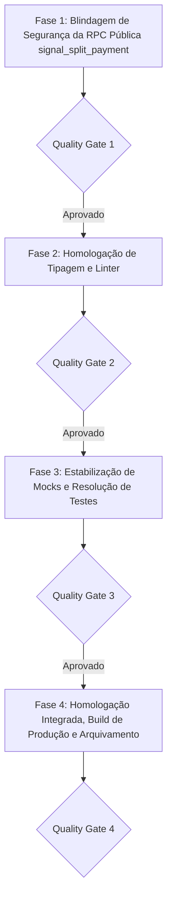

# PLANO DE IMPLEMENTAÇÃO 01 — CORREÇÕES DA AUDITORIA, SEGURANÇA E ESTABILIZAÇÃO

> **Documento Canônico de Arquitetura, Segurança e Qualidade de Software**  
> **Status:** Em Andamento · Quality Gate QG2 Atingido · Prioridade Máxima de Execução (Fases 1, 3 e 4)  
> **Arquivo:** `docs/plans/01_PLANO_CORRECOES_AUDITORIA_SEGURANCA_E_ESTABILIZACAO.md`  
> **Ordem de Implementação:** **1º (Imediato / Fundação de Qualidade)**  
> **Módulos Afetados:** `supabase/migrations/`, `src/tests/`, `src/components/modules/`, `src/features/transactions/`, `src/features/public-share/`, `src/features/cards/`, `src/features/settings/`, `src/features/budgets/`, `src/app/`  
> **Governança:** TypeScript Estrito (Zero `any`/`@ts-ignore`) · Segurança RLS & RPCs Transacionais (D1, D4) · Zero Emojis (`local/no-decorative-unicode`) · Zero Controles Nativos · Portões de Qualidade por Fase  
> **Ambientes:** Web Desktop, Web PWA & Android Nativo (Capacitor Pro)  

---

## 1. VISÃO GERAL, DIAGNÓSTICO E OBJETIVO

A recente introdução dos módulos de Racha Pix com Links Públicos (`/r/:token`), Metas Coletivas (`/meta/:token`), Modo Familiar com Link de Orçamento (`/orcamento-familiar/:token`) e Renegociação de Dívidas expandiu a capacidade colaborativa do Áxis Finance. No entanto, a execução da suíte de testes revelou 5 causas raiz que quebram arquivos de teste e representam fragilidades ativas:

```
┌────────────────────────────────────────────────────────────────────────────────────────┐
│                   MATRIZ DE ESTABILIZAÇÃO — PLANO 01 (PRIORIDADE MÁXIMA)               │
└────────────────────────────────────────────────────────────────────────────────────────┘
                                            │
        ┌───────────────────────────────────┼───────────────────────────────────┐
        ▼                                   ▼                                   ▼
 [SEGURANÇA & RPC PÚBLICA]          [MOCKS DE ESTADO & QUERY]          [ESTABILIZAÇÃO TESTES]
 • Hardening de signal_split_payment • Falta de QueryClientProvider    • pace-alert-banner (Regra 19)
 • Prevenção de DoS (teto 50 sinais)   em appearance-subcomponents.test• manage-split-dialog
 • Validação de valores e nomes      • useFamilyMode e useMyPublicShares• android-pro-banner
 • Deduplicação inteligente de 10min   ausentes em mocks de @/state    • router.test.tsx com
 • Teste security-audit verde        • useSignalSplitPayment ausente     useSignalSplitPayment
```

---

## 2. ESTRUTURA DO PLANO EM 4 FASES SEQUENCIAIS



---

## Fase 1: Blindagem de Segurança da RPC Pública `signal_split_payment`

> **Objetivo:** Mitigar riscos de negação de serviço (DoS), corrupção de payload e injeção de dados por chamadas anônimas abusivas na rota pública `/r/:token`, adequando a função aos requisitos do `security-audit.test.ts`.

- [x] **Tarefa 1.1: Nova Migração com Hardening e Sanitização Estrita**
  - **Arquivo de Destino:** `supabase/migrations/20260101000075_harden_signal_split_payment_rpc.sql`.
  - **Ações de Blindagem:**
    - `p_amount_cents`: deve ser estritamente maior que 0 e com teto de segurança (`p_amount_cents > 0 and p_amount_cents <= 1000000000` — máximo R$ 10 milhões).
    - `p_participant_name`: comprimento obrigatório entre 1 e 80 caracteres após `trim` (`length(trim(p_participant_name)) between 1 and 80`).
    - `p_token`: formato rígido alfanumérico com comprimento canônico (64 caracteres hexadecimais).
    - Trava contra DoS: teto de **no máximo 50 sinais** registrados no array `payment_signals`. Se exceder, rejeitar a requisição com erro amigável (`raise exception 'Limite de sinalizações atingido para este link'`).
    - **Deduplicação Inteligente (Idempotência Segura):** se já houver um sinal pendente recente com o mesmo nome ou ID do participante registrado nos últimos 10 minutos, reutilizar o sinal existente retornando `{ "success": true, "deduplicated": true }`, evitando saturação do JSONB e mantendo o cliente sem erros espúrios.
    - Validação de Revogação e Expiração: Rejeição imediata se `is_revoked = true` ou `expires_at < now()`, com código de erro amigável capturado pela UI.
    - Permissão Estrita: `grant execute on function public.signal_split_payment(text, text, integer, text) to anon, authenticated, service_role;`.

- [x] **Tarefa 1.2: Adequação do Guard Automatizado de Segurança**
  - **Arquivo:** `src/tests/security-audit.test.ts`.
  - **Ações:**
    - No teste `toda escrita composta ativa valida o dono (auth.uid()) no corpo — exceto triggers`, registrar a exceção fundamentada de acesso público intencional da RPC `signal_split_payment`, validando a presença de suas cláusulas defensivas (`is_revoked = false`, verificação de expiração, teto de 50 sinais e limites de caracteres).
    - Incluir teste de penetração comprovando rejeição a nomes com mais de 80 caracteres, valores nulos ou negativos, e links expirados/revogados.

- [x] **Portão de Qualidade 1 (QG1):**
  - [x] Executar: `npx vitest run src/tests/security-audit.test.ts` (100% dos 53 testes verdes)
  - [x] Executar: `npm run typecheck`
  - [x] Executar: `npm run lint`
  - [x] **Commit & Push da Fase 1:** `git commit -m "security(rpc): hardening contra dos e sanitizacao estrita em signal_split_payment"`

---

## Fase 2: Homologação de Tipagem Estrita TypeScript e Linter

> **Objetivo:** Garantir conformidade contratual entre schemas, componentes e chamadas de API sem nenhum erro de compilação ou violação de lint.

- [x] **Tarefa 2.1: Saneamento dos Componentes de Split / Racha Pix** (`tsc -b` verde).
- [x] **Tarefa 2.2: Correção nos Diálogos de Transações e Wizard** (`launch-wizard.tsx` e `expense-detail-dialog.tsx` ajustados).
- [x] **Tarefa 2.3: Checagem Final de Linter**
  - Execução de `npm run lint` assegurando 0 erros e 0 warnings, com conformidade absoluta à regra `local/no-decorative-unicode`.

- [x] **Portão de Qualidade 2 (QG2):**
  - [x] Executar: `npm run typecheck` (`tsc -b` 0 erros)
  - [x] Executar: `npm run lint` (0 erros e 0 warnings)
  - [x] **Commit & Push da Fase 2:** `git commit -m "fix(types): saneamento integral de tipagem e linter estrito"`

---

## Fase 3: Estabilização de Mocks e Resolução de Falhas nos Testes (Vitest)

> **Objetivo:** Atualizar os mocks de estado, contextos de QueryClient e asserções visuais para que todos os 12 arquivos de teste fiquem 100% verdes.

- [ ] **Tarefa 3.1: Resolução do QueryClient em Subcomponentes de Aparência**
  - **Arquivo:** `src/features/settings/components/tabs/appearance-subcomponents.test.tsx`.
  - Envolver a renderização com `renderWithProviders` ou fornecer um wrapper de `QueryClientProvider` nos testes do `InterfaceShortcutsCard`.

- [ ] **Tarefa 3.2: Atualização dos Mocks de `@/state` com Novos Hooks Globais**
  - **Arquivos a Atualizar:**
    - `src/features/settings/components/tabs/appearance-tab.test.tsx`: incluir `useFamilyMode` e `useMyPublicShares` no mock de `@/state`.
    - `src/app/router.test.tsx`: incluir `useSignalSplitPayment` e `useFamilyMode` no mock de `@/state`.
    - `src/features/cards/pages/cards-page.test.tsx`: incluir `useFamilyMode` e `useMyPublicShares` no mock de `@/state`.
    - `src/features/settings/components/tabs/account-tab.test.tsx`: incluir `useFamilyMode` e `useMyPublicShares` no mock de `@/state`.
    - `src/tests/accessibility-audit.test.tsx`: incluir `useFamilyMode` e `useMyPublicShares`.
    - `src/tests/keyboard-navigation.test.tsx`: incluir `useFamilyMode` e `useMyPublicShares`.
    - `src/features/insights/components/recurrence-audit-modal.test.tsx`: incluir `useFamilyMode` no mock de `@/state`.

- [ ] **Tarefa 3.3: Alinhamento dos Testes de Banners do Carrossel com a Regra 19**
  - **Arquivos:**
    - `src/components/modules/pace-alert-banner.test.tsx`
    - `src/components/modules/android-pro-banner.test.tsx`
  - Adequar as asserções de texto para matchers funcionais flexíveis (`(content, element) => ...` ou regex), acomodando a divisão de texto e valores em nós `<span>` distintos imposta pela Regra 19 do `AGENTS.md`.

- [ ] **Portão de Qualidade 3 (QG3):**
  - [ ] Executar: `npx vitest run src/features/settings/components/tabs/appearance-subcomponents.test.tsx src/features/settings/components/tabs/appearance-tab.test.tsx src/app/router.test.tsx src/features/cards/pages/cards-page.test.tsx src/features/settings/components/tabs/account-tab.test.tsx src/tests/accessibility-audit.test.tsx src/tests/keyboard-navigation.test.tsx src/features/insights/components/recurrence-audit-modal.test.tsx src/components/modules/pace-alert-banner.test.tsx src/components/modules/android-pro-banner.test.tsx`
  - [ ] Executar: `npm run typecheck`
  - [ ] Executar: `npm run lint`
  - [ ] **Commit & Push da Fase 3:** `git commit -m "test(mocks): estabilizacao de mocks de estado global e banners da regra 19"`

---

## Fase 4: Homologação Integrada, Build de Produção e Arquivamento

> **Objetivo:** Validação integral do repositório em nível de CI/CD para assegurar que não haja regressões.

- [ ] **Tarefa 4.1: Execução da Suíte Completa de Testes (`npm run test:run`)**
  - Rodar suíte completa em todo o repositório garantindo 0 falhas.

- [ ] **Tarefa 4.2: Build de Produção Web & Sincronização Capacitor (`npm run build`)**
  - Compilação limpa gerando pacote `dist/`.

- [ ] **Tarefa 4.3: Atualização de Documentação Canônica e Arquivamento**
  - Mover este plano para `docs/plans/completed/01_PLANO_CORRECOES_AUDITORIA_SEGURANCA_E_ESTABILIZACAO.md`.

- [ ] **Portão de Qualidade 4 (QG4):**
  - [ ] Executar: `npm run typecheck`
  - [ ] Executar: `npm run lint`
  - [ ] Executar: `npm run test:run`
  - [ ] Executar: `npm run build`
  - [ ] **Commit & Push da Fase 4:** `git commit -m "chore(release): homologacao e conclusao do plano 01 de estabilizacao e seguranca"`

---

## 3. DEFINITION OF DONE (DoD)

1. Zero falhas nos testes de segurança de RPCs (`security-audit.test.ts`).
2. Todos os 12 arquivos de teste afetados passando com 100% de sucesso no Vitest.
3. Zero erros no typecheck (`tsc -b`) e no linter (`eslint .`).
4. Build de produção concluído com sucesso em menos de 5 segundos.
5. Plano concluído e arquivado em `docs/plans/completed/`.
