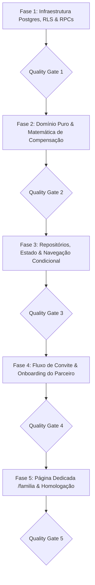

# PLANO DE IMPLEMENTAÇÃO 03 — MODO FAMÍLIA COLABORATIVO MULTI-CONTAS & CONSOLIDAÇÃO ORÇAMENTÁRIA SEGURA

> **Documento Canônico de Arquitetura, Engenharia de Dados e Governança de Software**  
> **Status:** Proposto / Consolidado e Pronto para Execução · Quality Gates QG1–QG5 Definidos  
> **Arquivo:** `docs/plans/03_PLANO_MODO_FAMILIA_COLABORATIVO_MULTI_CONTAS.md`  
> **Ordem de Implementação:** **3º (Módulo Colaborativo & Expansão de Produto)**  
> **Módulos Afetados:** `supabase/migrations/`, `src/types/`, `src/domain/family/`, `src/data/repositories/`, `src/data/rpc.ts`, `src/state/`, `src/hooks/`, `src/features/family/`, `src/features/transactions/`, `src/features/budgets/`, `src/features/settings/`, `src/features/public-share/`, `docs/`  
> **Governança:** TypeScript Estrito (Zero `any`/`@ts-ignore`) · RLS Hermético (D4 — Zero Data Bleed) · Moeda em Centavos · Zero Controles Nativos Crus · Zero Emojis (`local/no-decorative-unicode`) · Portões de Qualidade (QG) por Fase  
> **Ambientes:** Web Desktop, Web PWA (iOS/Android) & Android Nativo (Capacitor Pro)  

---

## 1. SUMÁRIO EXECUTIVO: COMO ESTÁ HOJE vs. COMO VAI FUNCIONAR

```
┌───────────────────────────────────────────────────────────────────────────────────────────────────┐
│                      ECOSSISTEMA FAMILIAR COMPARTILHADO (ÁXIS FINANCE)                            │
└───────────────────────────────────────────────────────────────────────────────────────────────────┘
                                                  │
            ┌─────────────────────────────────────┴─────────────────────────────────────┐
            ▼                                                                           ▼
┌───────────────────────┐                                                   ┌───────────────────────┐
│     CONTA A (VOCÊ)    │                                                   │   CONTA B (PARCEIRO)  │
│  - Gastos Pessoais    │ (Privado)                               (Privado) │  - Gastos Pessoais    │
│  - Contas Bancárias   │                                                   │  - Contas Bancárias   │
│  - Cartões de Crédito │                                                   │  - Cartões de Crédito │
│  - Investimentos      │                                                   │  - Investimentos      │
│  - Extrato Pessoal    │                                                   │  - Extrato Pessoal    │
└───────────┬───────────┘                                                   └───────────┬───────────┘
            │                                                                           │
            │  [is_family = true + family_id]                       [is_family = true + family_id]
            └─────────────────────────────────┬─────────────────────────────────────────┘
                                              ▼
                             ┌───────────────────────────────────┐
                             │    HUB DO ORÇAMENTO FAMILIAR      │
                             │  - Orçamento Global da Casa       │
                             │  - Tetos por Categoria Familiar   │
                             │  - Extrato Consolidado com Badges │
                             │    de Quem Pagou (Você / Parceiro)│
                             │  - Barra Bicolor de Contribuição  │
                             │  - Compensação Justa via Pix      │
                             │  - Link Público Seguro Opcional   │
                             └───────────────────────────────────┘
```

1. **Unidade Familiar no Banco (`families` e `family_members`):** O titular cria a família e gera um link de convite único (`/convite-familiar/:token`).
2. **Onboarding Sem Atrito:** O parceiro clica no link, faz login ou cria sua conta em 1 clique, e passa a integrar a família.
3. **Lançamento Fluido:** Ao lançar um gasto familiar, o usuário apenas ativa o toggle familiar (já automatizado por categorias familiares). A transação recebe o `family_id` automaticamente nos bastidores.
4. **Preservação Sagrada do Extrato Pessoal (Zero Data Bleed):**
   - No **Extrato Geral e Dashboard Pessoal (`/transacoes`)**, o usuário vê apenas o que saiu da **sua** conta/cartão (marcado com o badge informativo `[Familiar]`).
   - No **Hub de Orçamento Familiar (`/familia`)**, o app consolida os gastos de todos os membros, exibindo quem pagou cada item, o percentual de consumo da casa e o equilíbrio entre o casal.
5. **Acerto de Contas do Casal em 1 Toque com Histórico Auditável:** Cálculo automático de quanto cada um gastou comparado à sua cota (50/50 ou proporcional à renda), gerando o valor exato e botão de copiar Chave Pix para liquidação sem atrito, com registro na tabela `family_settlements`.

---

## 2. SALVAGUARDAS ARQUITETURAIS & BLINDAGEM DE RLS

| # | Fragilidade Diagnosticada | Impacto no Sistema | Salvaguarda Blindada de Engenharia |
|---|---|---|---|
| **F1** | **Armadilha do Data Bleed no Extrato Pessoal** | RLS liberar despesas do parceiro na query padrão. | **Isolamento Sagrado de RLS:** O RLS de `expenses` continua estritamente `auth.uid() = user_id`. A consolidação familiar é atendida **exclusivamente por RPC dedicada** `get_family_consolidation`. |
| **F2** | **Descompasso de Categorias Customizadas** | Parceiro categorizar com categoria própria. | **Compartilhamento de Categorias Familiares:** A policy de leitura de `categories` é estendida: `user_id = auth.uid() or (family_id is not null and family_id = user_family_id and is_family = true)`. |
| **F3** | **Vazamento de Privacidade Bancária** | Expor contas ou cartões privados entre parceiros. | **Sanitização Estrita de Colunas:** A RPC omite `account_id`, `card_id` e metadados bancários. |
| **F4** | **Mutação e Exclusão Cruzada Destrutiva** | Parceiro editar ou excluir despesa do outro. | **Imutabilidade Cruzada por RLS:** Apenas o autor original pode editar ou excluir suas despesas. |
| **F5** | **Alteração de Despesas Pós-Acerto do Mês** | Alterar despesas após compensação Pix realizada. | **Registro de Acerto (`family_settlements`):** Histórico de liquidações por mês com aviso de movimentações pós-fechamento. |

---

## 3. FASES DE EXECUÇÃO DETALHADAS & CHECKLIST



---

## Fase 1: Infraestrutura Postgres, RLS & RPCs

> **Objetivo:** Criar a estrutura relacional de famílias com RLS à prova de vazamento de dados pessoais e suporte a acertos auditáveis.

- [x] **Tarefa 1.1: Migration de Famílias (`supabase/migrations/20260101000076_create_families_and_multi_account_collaboration.sql`)**
  - Criação de `families`, `family_members`, `family_invites`, `family_settlements` e adição de `family_id` em `expenses`, `incomes` e `categories`.
  - Habilitação de RLS em todas as novas tabelas com isolamento por usuário e verificação de membresia na família.

- [x] **Tarefa 1.2: RPC Transacional `get_family_consolidation`**
  - Valida se `auth.uid()` pertence à família.
  - Retorna total gasto pela casa, fatias de cada participante, percentual de consumo do teto, lista de despesas enriquecidas com categoria e nome do pagador (omitindo contas e cartões) e status de acerto do mês.

- [x] **Tarefa 1.3: RPC de Gestão de Família (`create_family`, `invite_family_member`, `accept_family_invite`, `leave_family`, `record_family_settlement`)**
  - Operações atômicas com validação de participante único.

- [x] **Portão de Qualidade 1 (QG1):**
  - [x] Executar: `npx vitest run src/tests/cross-tenant-penetration.test.ts src/tests/security-audit.test.ts`
  - [x] Executar: `npm run typecheck`
  - [x] Executar: `npm run lint`
  - [x] **Commit & Push da Fase 1:** `git commit -m "feat(family): schema de familias, membros, convites e rpc de consolidacao"`

---

## Fase 2: Domínio Puro & Matemática de Compensação

- [x] **Tarefa 2.1: Agrupamento de Categorias (`src/domain/family/category-clustering.ts`)**
  - [x] Normalização e agrupamento de categorias da casa.

- [x] **Tarefa 2.2: Reconciliação em Centavos (`src/domain/family/reconciliation.ts`)**
  - [x] Cálculo de totais por pagador, saldo da casa e percentuais de consumo.

- [x] **Tarefa 2.3: Compensação Justa via Pix (`src/domain/family/settlement.ts`)**
  - [x] Calcula a diferença entre o valor pago e a cota devida (50/50 ou proporcional à renda).
  - [x] Gera chave Pix com valor exato de transferência e payload EMVCo para pagamento instantâneo.

- [x] **Portão de Qualidade 2 (QG2):**
  - [x] Executar: `npx vitest run src/domain/family/`
  - [x] Executar: `npm run typecheck`
  - [x] Executar: `npm run lint`
  - [x] **Commit & Push da Fase 2:** `git commit -m "feat(family): motor puro de reconciliacao familiar e compensacao pix"`

---

## Fase 3: Repositórios, Estado & Navegação Condicional

- [ ] **Tarefa 3.1: Repositório e Queries TanStack (`src/data/repositories/families.ts` e `src/state/queries/use-family.ts`)**
  - Hooks `useMyFamily()`, `useFamilyConsolidation(month)` e mutações de convite/acerto.

- [ ] **Tarefa 3.2: Compartilhamento de Categorias no Wizard**
  - O `useCategories()` lista categorias pessoais + categorias marcadas com `is_family = true` da família ativa.

- [ ] **Tarefa 3.3: Injeção Condicional da Rota `/familia`**
  - Exibição de item "Orçamento Familiar" no menu lateral (`AppSidebar`) e navegação mobile quando o usuário pertencer a uma família ativa.

- [ ] **Portão de Qualidade 3 (QG3):**
  - [ ] Executar: `npm run typecheck`
  - [ ] Executar: `npm run lint`
  - [ ] Executar: `npx vitest run src/state/queries/use-family.test.ts`
  - [ ] **Commit & Push da Fase 3:** `git commit -m "feat(family): repositorio, estado reativo e navegacao condicional"`

---

## Fase 4: Fluxo de Convite & Onboarding do Parceiro

- [ ] **Tarefa 4.1: Rota Pública de Convite (`/convite-familiar/:token`)**
  - Página segura que recepciona o parceiro, exibe o nome de quem convidou e permite vincular a conta em 1 clique (com redirecionamento inteligente pós-login).

- [ ] **Tarefa 4.2: Card de Gestão da Família em Configurações (`src/features/settings/components/tabs/family-tab.tsx`)**
  - Gerenciamento de membros, link de convite, link público passivo opcional e teto mensal compartilhado.

- [ ] **Portão de Qualidade 4 (QG4):**
  - [ ] Executar: `npx vitest run src/features/settings/components/tabs/family-tab.test.tsx`
  - [ ] Executar: `npm run typecheck`
  - [ ] Executar: `npm run lint`
  - [ ] **Commit & Push da Fase 4:** `git commit -m "feat(family): fluxo de convite e onboarding do parceiro"`

---

## Fase 5: Página Dedicada `/familia` & Homologação

- [ ] **Tarefa 5.1: Construção da Página `/familia`**
  - Cards de Teto da Casa, Equilíbrio do Mês, Gráfico Comparativo e Ranking de Consumo.
  - Extrato da casa com filtros fluidos (`Todas da Casa`, `Pagas por Você`, `Pagas pelo Parceiro`).
  - Botão de Acerto de Contas com cópia de Chave Pix e botão "Registrar Acerto Realizado".

- [ ] **Tarefa 5.2: Preservação do Extrato Pessoal (`/transacoes`)**
  - Confirmação de que `/transacoes` exibe estritamente os gastos do próprio usuário com badge `[Familiar]`.

- [ ] **Tarefa 5.3: Homologação e Build de Produção**
  - Testes E2E, typecheck, lint e build de produção. Mover plano para `docs/plans/completed/`.

- [ ] **Portão de Qualidade 5 (QG5):**
  - [ ] Executar: `npm run typecheck`
  - [ ] Executar: `npm run lint`
  - [ ] Executar: `npx vitest run src/features/family/`
  - [ ] Executar: `npm run build`
  - [ ] **Commit & Push da Fase 5:** `git commit -m "chore(release): homologacao e conclusao do plano 03 de modo familia colaborativo"`

---

## 4. DEFINITION OF DONE (DoD)

1. Zero vazamento de dados bancários ou despesas pessoais entre os cônjuges (Data Bleed = 0).
2. Lançamento com auto-atribuição de `family_id` transparente no `LaunchWizard`.
3. Histórico de acertos auditável registrado em `family_settlements`.
4. 100% de cobertura nos testes unitários e de integração com Vitest.
5. Plano concluído e arquivado em `docs/plans/completed/`.
