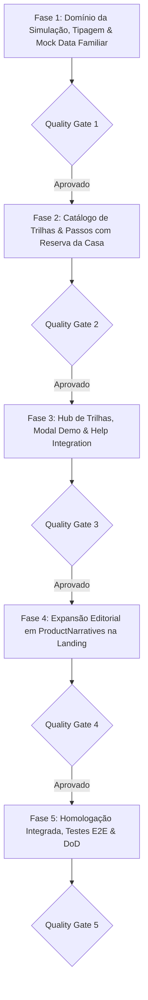

# PLANO DE IMPLEMENTAÇÃO 04 — EXPANSÃO E MODERNIZAÇÃO DA APRESENTAÇÃO E DO TOUR GUIADO

> **Documento Canônico de Arquitetura de Produto, UX/UI e Governança de Software**  
> **Status:** Otimizado, Harmonizado com o Modo Família v2.90 e Pronto para Execução · Quality Gates QG1–QG5 Definidos  
> **Arquivo:** `docs/plans/04_PLANO_EXPANSAO_APRESENTACAO_E_TOUR_GUIADO.md`  
> **Ordem de Implementação:** **4º (Aquisição, Demonstração e Onboarding)**  
> **Módulos Afetados:** `src/domain/demo-simulation/`, `src/components/modules/`, `src/features/landing/`, `src/features/transactions/`, `src/features/family/`, `src/features/budgets/`, `src/state/demo-mode/`, `docs/`  
> **Governança:** TypeScript Estrito (Zero `any`/`@ts-ignore`) · Funções Puras no Domínio · Moeda em Centavos (`<MoneyText />`) · Zero Controles Nativos · Zero Emojis (`local/no-decorative-unicode`) · Zero Duplo Haptic · Regra 18 (Modais Canônicos) · Mobile-First · Portões de Qualidade por Fase  
> **Ambientes:** Web Desktop, Web PWA (iOS/Android) & Android Nativo (Capacitor Pro)  

---

## 1. VISÃO GERAL E OBJETIVO ESTRATÉGICO

Com a conclusão dos módulos colaborativos essenciais (Racha de Despesas com Pix, Termômetro de Metas Coletivas e o Modo Família Multi-Contas de até 6 participantes com Reserva da Casa do Plano 03.1), o aplicativo possui um ecossistema social de altíssimo valor percebido e tração viral (*Product-Led Growth*).

Este plano unifica a **vitrine pública de conversão** (`/apresentacao` — Landing Page) e a **experiência guiada interativa** (`DemoTourSpotlight` e `DemoTrackSelectModal`), garantindo que tanto novos visitantes quanto usuários explorando a demonstração compreendam o valor único do Áxis Finance em menos de 2 minutos.

```
┌────────────────────────────────────────────────────────────────────────────────────────────────────────┐
│                        ARQUITETURA UNIFICADA DE APRESENTAÇÃO E EXPERIÊNCIA DO TOUR                     │
└────────────────────────────────────────────────────────────────────────────────────────────────────────┘
                                                    │
                ┌───────────────────────────────────┴───────────────────────────────────┐
                ▼                                                                       ▼
   [VITRINE PÚBLICA: LANDING PAGE]                                         [EXPERIÊNCIA INTERNA: TOUR & HUB]
   (/apresentacao — Conversão & Valor)                                     (DemoTourSpotlight & TrackSelectModal)
   
   • Eixo 1: Caixa Real & Safe-to-Spend                                    • Trilha 1: Finanças Diárias & Cartões (8 passos)
   • Eixo 2: Cartões & Competências Futuras                                • Trilha 2: Finanças Compartilhadas (NOVA - 5 passos)
   • Eixo 3: Rebalanceamento & Carteira                                    • Trilha 3: Investimentos & Aportes (5 passos)
   • Eixo 4: Vida Compartilhada & Família (NOVO em ProductNarratives)      • Trilha 4: App Nativo Android Pro (4 passos)
     - Card Visual: Racha com Pix e WhatsApp                               • Micro-tours no Hub:
     - Card Visual: Orçamento Familiar (Teto & Acerto Pix)                   - Racha Rápido & Cobrança Pix (2 passos)
     - Card Visual: Reserva da Casa & Patrimônio Compartilhado               - Reserva Coletiva & Termômetro (2 passos)
     - Card Visual: Termômetro de Metas Coletivas                            - Modo Família no Ajuste (2 passos)
   • Vitrine de Ferramentas Abertas (/ferramentas)                         • Salvaguarda: Mock Demo com familyModeEnabled: true
```

---

## 2. DIAGNÓSTICO DE FRAGILIDADES & MELHORIAS APLICADAS

| Ponto de Análise | Fragilidade Diagnosticada | Otimização Arquitetural Aplicada |
| :--- | :--- | :--- |
| **Guarda de Rota `/familia`** | O commit recente `45957a8b` redireciona `/familia` para `/` se `familyModeEnabled` for falso. No modo demo, se a flag não estiver ligada, o tour quebra. | O motor da sessão demo (`src/state/demo-mode/demo-session-store.ts`) passa a injetar `familyModeEnabled: true` e `myFamilyData` mockado com 2 membros ativos antes de acionar a trilha compartilhada. |
| **Escopo do Modo Família** | O plano anterior previa apenas teto e contas domésticas, ignorando a grande entrega do Plano 03.1 (Patrimônio e Reserva da Casa). | A Trilha 2 foi expandida para 5 passos, incluindo o **Passo 4: Reserva da Casa & Patrimônio Compartilhado** com foco no `HouseholdWealthCard`. |
| **Seletores em `/orcamentos`** | O tour apontava para `/orcamentos` sem especificar a aba, correndo risco de quebrar se a aba ativa fosse "Categorias" ou "Teto". | O seletor aponta para a aba de metas (`/orcamentos?tab=metas`) e os componentes recebem marcadores `data-tour="goals-tracker-card"`. |
| **Estrutura da Landing Page** | O plano original sugeria "novo bloco editorial" solto na Landing Page. | O Eixo 4 é integrado formalmente dentro do componente canônico `ProductNarratives.tsx`, mantendo a harmonia de design e o scroll-spy. |
| **Vitrine de Ferramentas** | A Landing Page não promovia os novos simuladores públicos já construídos no app. | Inclusão de pílulas no Hero e cards de acesso rápido para o Hub de Ferramentas Abertas (`/ferramentas`). |

---

## 3. FASES DE EXECUÇÃO DETALHADAS & QUALITY GATES



---

### Fase 1: Domínio da Simulação, Tipagem & Mock Data Familiar

> **Objetivo:** Preparar dados simulados em memória realistas para o Modo Família Multi-Contas, Racha de Despesas com Pix, Termômetro de Metas e Reserva da Casa.

- [ ] **Tarefa 1.1: Expansão dos Tipos de Trilha (`src/domain/demo-simulation/types.ts`)**
  - Adicionar a união `SharedTourTrackId = "shared_finances" | "finances_split" | "finances_family" | "finances_wealth" | "finances_goals"`.
  - Registrar a categoria `"shared"` com rótulo "Compartilhadas" e ícone `users`.

- [ ] **Tarefa 1.2: Enriquecimento do Dataset Mock (`src/domain/demo-simulation/mock-finances.ts`)**
  - Despesa com `is_family: true` e `family_id` simulado.
  - Racha ativo com 3 participantes e 2 pagamentos já sinalizados via Pix com comprovante.
  - Meta pública de vaquinha em 75% da arrecadação com chave Pix mockada.
  - Família mockada ("Família Silva") com 2 membros ativos, teto mensal de R$ 6.000,00 e acerto Pix equilibrado.
  - Ativo de Renda Fixa compartilhado (`is_family: true`) simulando a Reserva da Casa (R$ 18.000,00 = 3 meses do teto).

- [ ] **Tarefa 1.3: Metadados Textuais Contextuais (`src/domain/demo-simulation/metadata.ts`)**
  - Títulos e descrições educativas em pt-BR com zero emojis e estrita adesão ao vocabulário canônico.

- [ ] **Portão de Qualidade 1 (QG1):**
  - [ ] Executar: `npx vitest run src/domain/demo-simulation/`
  - [ ] Executar: `npm run typecheck`
  - [ ] Executar: `npm run lint`
  - [ ] **Commit da Fase 1:** `git commit -m "feat(demo): tipagem e mock data para financas compartilhadas e reserva familiar"`

---

### Fase 2: Catálogo de Trilhas & Passos do Tour Guiado

> **Objetivo:** Registrar formalmente as novas jornadas no catálogo com seletores DOM estáveis, coordenadas anti-colisão e suporte à Reserva da Casa.

- [ ] **Tarefa 2.1: Registro Canônico (`src/domain/demo-simulation/tour-catalog.ts`)**
  - `shared_finances`: Trilha completa unificada com 5 passos.
  - Micro-tours sob demanda:
    * `finances_split`: 2 passos (Wizard e Extrato de Rachas).
    * `finances_family`: 2 passos (Teto e Acerto Pix).
    * `finances_wealth`: 2 passos (Reserva da Casa e Metas Patrimoniais).
    * `finances_goals`: 2 passos (Vaquinhas e Metas Coletivas).

- [ ] **Tarefa 2.2: Passos Detalhados da Trilha (`src/domain/demo-simulation/tour-steps.ts`)**
  1. *Passo 1 (Wizard de Lançamento):* Toggle de Racha e Modo Família (`[data-tour="wizard-split-toggle"]` e `[data-tour="wizard-family-toggle"]`).
  2. *Passo 2 (Extrato de Rachas):* Card de divisões ativas e cobrança Pix (`[data-tour="split-pending-card"]`).
  3. *Passo 3 (Hub da Família - Orçamento):* Teto compartilhado da casa e acerto Pix de compensação justa (`/familia`).
  4. *Passo 4 (Hub da Família - Patrimônio):* Card da Reserva da Casa com meses de segurança e isolamento de investimentos particulares (`/familia?tab=patrimonio` / `[data-tour="family-wealth-card"]`).
  5. *Passo 5 (Metas & Vaquinha):* Termômetro de arrecadação pública com cópia de chave Pix (`/orcamentos?tab=metas` / `[data-tour="goals-tracker-card"]`).

- [ ] **Tarefa 2.3: Inserção de Atributos `data-tour` nos Componentes de UI**
  - Inserir marcadores semânticos nos formulários e cards alvo sem alterar o layout nem introduzir dependências de estado.

- [ ] **Portão de Qualidade 2 (QG2):**
  - [ ] Executar: `npx vitest run src/domain/demo-simulation/tour-steps.test.ts src/domain/demo-simulation/tour-catalog.test.ts`
  - [ ] Executar: `npm run typecheck`
  - [ ] Executar: `npm run lint`
  - [ ] **Commit da Fase 2:** `git commit -m "feat(demo): catalogo e passos guiados cobrindo financas compartilhadas e reserva"`

---

### Fase 3: Hub de Trilhas, Modal Demo & Integração com Ajuda

- [ ] **Tarefa 3.1: Modernização do Seletor de Trilhas (`DemoTrackSelectModal.tsx`)**
  - Renderizar o grupo "Finanças Compartilhadas" com badge de destaque e ícone `Users`.
  - Aplicar a Regra 18 do AGENTS.md (modal canônico, largura adaptativa sem `max-w` solto no JSX).

- [ ] **Tarefa 3.2: Integração com a Central de Ajuda (`HelpModal.tsx`)**
  - Atalho direto no menu de ajuda para reativar o tour de finanças compartilhadas a qualquer momento.

- [ ] **Tarefa 3.3: Blindagem da Sessão Demo (`demo-session-store.ts`)**
  - Ao iniciar qualquer trilha compartilhada, garantir que `familyModeEnabled` seja ativado temporariamente no mock e desativado com segurança ao sair da simulação.

- [ ] **Portão de Qualidade 3 (QG3):**
  - [ ] Executar: `npx vitest run src/components/modules/demo-track-select-modal.test.tsx`
  - [ ] Executar: `npm run typecheck`
  - [ ] Executar: `npm run lint`
  - [ ] **Commit da Fase 3:** `git commit -m "feat(demo): seletor de trilhas com grupo compartilhado e blindagem de sessao"`

---

### Fase 4: Expansão Editorial da Landing Page (`/apresentacao`)

- [ ] **Tarefa 4.1: Inclusão do Eixo 4 em `ProductNarratives.tsx`**
  - Novo pilar narrativo "Vida Compartilhada & Modo Família":
    1. Card de Racha de Despesas com cópia de Pix e botão de WhatsApp.
    2. Card de Orçamento Familiar Seguro (teto da casa e acerto Pix automático sem cobrança constrangedora).
    3. Card de Reserva da Casa & Metas Coletivas (termômetro conjunto mantendo ativos privados 100% invisíveis).

- [ ] **Tarefa 4.2: Pílulas de Destaque no Hero (`hero-editorial.tsx`)**
  - Adição de tags discretas no topo: `[ Racha com Pix ]` e `[ Modo Família & Reserva ]`.

- [ ] **Tarefa 4.3: Conexão com as Ferramentas Abertas (`tools-showcase.tsx`)**
  - Adicionar link direto para os simuladores gratuitos abertos (`/ferramentas`) como estratégia de atração orgânica (*Product-Led Growth*).

- [ ] **Portão de Qualidade 4 (QG4):**
  - [ ] Executar: `npx vitest run src/features/landing/`
  - [ ] Executar: `npm run typecheck`
  - [ ] Executar: `npm run lint`
  - [ ] **Commit da Fase 4:** `git commit -m "feat(landing): eixo 4 de financas compartilhadas e destaque para ferramentas"`

---

### Fase 5: Homologação Integrada, Testes & Governança

- [ ] **Tarefa 5.1: Testes E2E de Simulação (Vitest)**
  - Validação de fluxo de ponta a ponta sem erros de console ou chamadas de rede indesejadas no modo demo.
  - Verificação de foco de teclado (`document.activeElement`) e navegação por teclado (`Tab`, `Escape`, `Enter`).

- [ ] **Tarefa 5.2: Verificação de Build e Types**
  - `npm run typecheck`, `npm run lint` e `npm run build` 100% verdes.

- [ ] **Tarefa 5.3: Arquivamento em `docs/plans/completed/`**
  - Mover este plano para `docs/plans/completed/04_PLANO_EXPANSAO_APRESENTACAO_E_TOUR_GUIADO.md`.

- [ ] **Portão de Qualidade 5 (QG5):**
  - [ ] Executar: `npm run typecheck`
  - [ ] Executar: `npm run lint`
  - [ ] Executar: `npm run test:run`
  - [ ] Executar: `npm run build`
  - [ ] **Commit da Fase 5:** `git commit -m "chore(release): homologacao e conclusao do plano 04 de tour e apresentacao"`

---

## 4. DEFINITION OF DONE (DoD)

1. Trilha de Finanças Compartilhadas navegável sem nenhuma tela vazia ou redirecionamento involuntário.
2. Foco de acessibilidade restaurado com sucesso ao fechar o tour em `document.activeElement`.
3. Eixo 4 publicado na Landing Page em conformidade total com o Design System em `ProductNarratives.tsx`.
4. Zero emojis no produto e zero violações de linter (`local/no-decorative-unicode`).
5. Plano concluído e arquivado em `docs/plans/completed/`.
