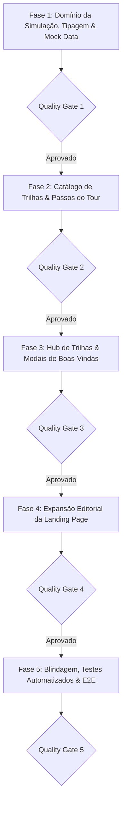

# PLANO DE IMPLEMENTAÇÃO 04 — EXPANSÃO E MODERNIZAÇÃO DA APRESENTAÇÃO E DO TOUR GUIADO

> **Documento Canônico de Arquitetura de Produto, UX/UI e Governança de Software**  
> **Status:** Proposto / Consolidado em 5 Fases Sequenciais com Portões de Qualidade (QG1–QG5)  
> **Arquivo:** `docs/plans/04_PLANO_EXPANSAO_APRESENTACAO_E_TOUR_GUIADO.md`  
> **Ordem de Implementação:** **4º (Aquisição, Demonstração e Onboarding)**  
> **Módulos Afetados:** `src/domain/demo-simulation/`, `src/components/modules/`, `src/features/landing/`, `src/features/transactions/`, `src/features/goals/`, `src/features/family/`, `src/features/settings/`, `src/state/demo-mode/`  
> **Governança:** TypeScript Estrito (Zero `any`/`@ts-ignore`) · Funções Puras no Domínio · Moeda em Centavos (`<MoneyText />`) · Zero Controles Nativos · Zero Emojis (`local/no-decorative-unicode`) · Zero Duplo Haptic · Mobile-First · Portões de Qualidade por Fase  
> **Ambientes:** Web Desktop, Web PWA (iOS/Android) & Android Nativo (Capacitor Pro)  

---

## 1. VISÃO GERAL E OBJETIVO ESTRATÉGICO

Com a conclusão dos módulos colaborativos essenciais (Racha de Despesas com Pix, Termômetro de Metas Coletivas e o Modo Família Multi-Contas do Plano 03), o aplicativo possui um ecossistema social de altíssimo valor percebido e tração viral (*Product-Led Growth*).

```
┌────────────────────────────────────────────────────────────────────────────────────────────────────────┐
│                        ARQUITETURA UNIFICADA DE APRESENTAÇÃO E EXPERIÊNCIA DO TOUR                     │
└────────────────────────────────────────────────────────────────────────────────────────────────────────┘
                                                    │
                ┌───────────────────────────────────┴───────────────────────────────────┐
                ▼                                                                       ▼
   [VITRINE PÚBLICA: LANDING PAGE]                                         [EXPERIÊNCIA INTERNA: TOUR & HUB]
   (/apresentacao — Conversão & Valor)                                     (DemoTourSpotlight & TrackSelectModal)
   
   • Eixo 1: Caixa Real & Safe-to-Spend                                    • Trilha 1: Finanças Diárias & Cartões (8 passos)
   • Eixo 2: Cartões & Competências Futuras                                • Trilha 2: Finanças Compartilhadas (NOVA - 4 passos)
   • Eixo 3: Rebalanceamento & Carteira                                    • Trilha 3: Investimentos & Aportes (5 passos)
   • Eixo 4: Vida Compartilhada & Pix (NOVO)                               • Trilha 4: App Nativo Android Pro (4 passos)
     - Card Visual: Racha com Pix e WhatsApp                               • Micro-tours no Hub:
     - Card Visual: Termômetro de Vaquinha                                   - Racha Rápido & Pix (2 passos)
     - Card Visual: Orçamento Familiar Seguro                                - Termômetro de Metas (2 passos)
   • Pílulas no Hero & Prova Social de PWA                                   - Modo Família no Ajuste (2 passos)
```

---

## 2. FASES DE EXECUÇÃO DETALHADAS & CHECKLIST



---

## Fase 1: Domínio da Simulação, Tipagem & Mock Data

> **Objetivo:** Preparar dados simulados em memória realistas para o Modo Família, Racha de Despesas com Pix e Termômetro de Metas.

- [x] **Tarefa 1.1: Expansão dos Tipos de Trilha (`src/domain/demo-simulation/types.ts`)**
  - Adicionar a união `SharedTourTrackId = "shared_finances" | "finances_split" | "finances_family" | "finances_goals"`.
  - Categoria `"shared"` com rótulo "Compartilhadas".

- [x] **Tarefa 1.2: Enriquecimento do Dataset Mock (`src/domain/demo-simulation/mock-finances.ts`)**
  - Despesa com `is_family: true` e `family_id` simulado.
  - Racha ativo com 4 participantes e 2 pagamentos já sinalizados via Pix.
  - Meta pública com arrecadação em 75% e chave Pix mockada.
  - Hub familiar simulado com 2 membros e acerto de contas equilibrado.

- [x] **Tarefa 1.3: Metadados Textuais (`src/domain/demo-simulation/metadata.ts`)**
  - Rótulos contextuais e descrições amigáveis em pt-BR.

- [x] **Portão de Qualidade 1 (QG1):**
  - [x] Executar: `npx vitest run src/domain/demo-simulation/`
  - [x] Executar: `npm run typecheck`
  - [x] Executar: `npm run lint`
  - [x] **Commit & Push da Fase 1:** `git commit -m "feat(demo): tipagem e mock data para financas compartilhadas"`

---

## Fase 2: Catálogo de Trilhas & Passos do Tour Guiado

> **Objetivo:** Registrar formalmente as novas jornadas no catálogo com seletores DOM estáveis e coordenadas anti-colisão.

- [x] **Tarefa 2.1: Registro Canônico (`src/domain/demo-simulation/tour-catalog.ts`)**
  - [x] `shared_finances`: Trilha completa com 4 passos.
  - [x] Micro-tours dedicados para Racha, Família e Metas.

- [x] **Tarefa 2.2: Passos Detalhados (`src/domain/demo-simulation/tour-steps.ts`)**
  1. *Passo 1 (Wizard de Lançamento):* Toggle de Racha e Modo Família (`[data-tour="wizard-split-toggle"]`).
  2. *Passo 2 (Extrato de Rachas):* Card de divisões ativas e cobrança Pix (`[data-tour="split-pending-card"]`).
  3. *Passo 3 (Hub da Família):* Teto compartilhado da casa e equilíbrio do mês (`/familia`).
  4. *Passo 4 (Metas Coletivas):* Termômetro de arrecadação e link de doação (`/orcamentos`).

- [x] **Portão de Qualidade 2 (QG2):**
  - [x] Executar: `npx vitest run src/domain/demo-simulation/tour-steps.test.ts src/domain/demo-simulation/tour-catalog.test.ts`
  - [x] Executar: `npm run typecheck`
  - [x] Executar: `npm run lint`
  - [x] **Commit & Push da Fase 2:** `git commit -m "feat(demo): catalogo e passos guiados de financas compartilhadas"`

---

## Fase 3: Hub de Trilhas & Modais de Acolhimento

- [ ] **Tarefa 3.1: Modernização do Seletor de Trilhas (`DemoTrackSelectModal.tsx`)**
  - Exibição do grupo "Finanças Compartilhadas" com badge de destaque.

- [ ] **Tarefa 3.2: Integração com a Central de Ajuda (`HelpModal.tsx`)**
  - Atalho direto para rever o tour compartilhado.

- [ ] **Portão de Qualidade 3 (QG3):**
  - [ ] Executar: `npx vitest run src/components/modules/demo-track-select-modal.test.tsx`
  - [ ] Executar: `npm run typecheck`
  - [ ] Executar: `npm run lint`
  - [ ] **Commit & Push da Fase 3:** `git commit -m "feat(demo): seletor de trilhas com grupo de financas compartilhadas"`

---

## Fase 4: Expansão Editorial da Landing Page (`/apresentacao`)

- [ ] **Tarefa 4.1: Inclusão do Eixo 4 — Finanças Compartilhadas & Pix**
  - Novo bloco editorial com cards visuais ricos:
    1. Card de Racha de Despesas com cópia de Pix e botão de WhatsApp.
    2. Card de Termômetro de Vaquinha Coletiva em tempo real.
    3. Card de Orçamento Familiar Seguro (divisão 50/50 e acerto sem atrito).

- [ ] **Tarefa 4.2: Pílulas de Destaque no Hero**
  - Adição de tags discretas no topo: `[ Racha com Pix ]` e `[ Modo Família ]`.

- [ ] **Portão de Qualidade 4 (QG4):**
  - [ ] Executar: `npx vitest run src/features/landing/`
  - [ ] Executar: `npm run typecheck`
  - [ ] Executar: `npm run lint`
  - [ ] **Commit & Push da Fase 4:** `git commit -m "feat(landing): eixo 4 de financas compartilhadas e racha pix"`

---

## Fase 5: Homologação Integrada, Testes & Governança

- [ ] **Tarefa 5.1: Testes E2E de Simulação (Vitest)**
  - Validação de fluxo de ponta a ponta sem erros de console ou chamadas de rede indesejadas no modo demo.

- [ ] **Tarefa 5.2: Verificação de Build e Types**
  - `npm run typecheck` e `npm run build` 100% verdes.

- [ ] **Tarefa 5.3: Arquivamento em `docs/plans/completed/`**
  - Mover este plano para `docs/plans/completed/04_PLANO_EXPANSAO_APRESENTACAO_E_TOUR_GUIADO.md`.

- [ ] **Portão de Qualidade 5 (QG5):**
  - [ ] Executar: `npm run typecheck`
  - [ ] Executar: `npm run lint`
  - [ ] Executar: `npm run test:run`
  - [ ] Executar: `npm run build`
  - [ ] **Commit & Push da Fase 5:** `git commit -m "chore(release): homologacao e conclusao do plano 04 de tour e apresentacao"`

---

## 3. DEFINITION OF DONE (DoD)

1. Trilha de Finanças Compartilhadas navegável sem nenhuma tela vazia.
2. Foco de acessibilidade restaurado com sucesso em `document.activeElement`.
3. Eixo 4 publicado na Landing Page em conformidade total com o Design System.
4. Zero emojis no produto e zero violações de linter.
5. Plano concluído e arquivado em `docs/plans/completed/`.
