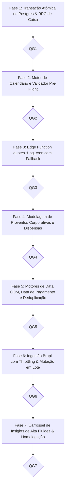

# PLANO DE IMPLEMENTAÇÃO 05 — FECHAMENTO AUTOMÁTICO DE SNAPSHOTS PATRIMONIAIS, SINCRONIZAÇÃO DE COTAÇÕES & MOTOR INTELIGENTE DE PROVENTOS E INSIGHTS EM CARROSSEL

> **Documento Canônico de Arquitetura, Engenharia de Dados e Governança de Software**  
> **Status:** Otimizado, Harmonizado com a Governança de Caixa e Pronto para Execução · Quality Gates QG1–QG7 Definidos  
> **Arquivo:** `docs/plans/05_PLANO_FECHAMENTO_AUTOMATICO_SNAPSHOTS_E_COTACAO.md`  
> **Ordem de Implementação:** **5º (Automação de Servidor, Proventos B3 & Centro de Insights)**  
> **Módulos Afetados:** `supabase/migrations/`, `supabase/functions/quotes/`, `src/types/`, `src/domain/portfolio/`, `src/data/repositories/`, `src/services/`, `src/state/`, `src/features/investments/`, `docs/`  
> **Governança:** TypeScript Estrito (Zero `any`/`@ts-ignore`) · Transações Atômicas Server-Authoritative · Moeda em Centavos · Padrões CVM, ANBIMA e B3 · Zero Emojis (`local/no-decorative-unicode`) · Regra 19 para Carrossel · Sincronização Estrita de Caixa (`sync_cash`, `cash_amount`, `rollbackCash`)  
> **Ambientes:** Web Desktop, Web PWA (iOS/Android) & Android Nativo (Capacitor Pro)  

---

## 1. SUMÁRIO EXECUTIVO & ARQUITETURA DE VALOR

Este plano conecta a infraestrutura de fechamento mensal autônomo com o **motor de inteligência e captura de proventos corporativos (B3 e internacionais)**, totalmente harmonizado com o novo **Gateway Contábil de Caixa** (`sync_cash`, `cash_amount` e rollback atômico).

```
┌────────────────────────────────────────────────────────────────────────────────────────────────────────────────────────┐
│                   INFRAESTRUTURA INTEGRADA: FECHAMENTO DE CARTEIRA & MOTOR AUTÔNOMO DE PROVENTOS                       │
└────────────────────────────────────────────────────────────────────────────────────────────────────────────────────────┘
                                                            │
                 ┌──────────────────────────────────────────┴──────────────────────────────────────────┐
                 ▼                                                                                     ▼
   [PILAR 1: FECHAMENTO & SNAPSHOTS]                                                     [PILAR 2: PROVENTOS & CAIXA CONCATENADO]
   - Encerramento no último dia útil do mês pós-19h BRT                                  - Detecção autônoma B3 / EUA (Brapi + Edge)
   - Transacionalidade atômica (commit_monthly_closing_atomic)                           - Apuração de custódia na Data COM (ponto-no-tempo)
   - Cotação $1,00$ estática para Caixa (sem poluição de rede)                           - Liquidação financeira na Data de Pagamento
   - Server-Authoritative (pg_cron) + Fallback Just-in-Time                              - Integração nativa com sync_cash e cash_amount
                 │                                                                       - Deduplicação fuzzy contra proventos manuais
                 │                                                                       - Rollback seguro em caso de Undo / Exclusão
                 │                                                                                     │
                 └──────────────────────────────────────────┬──────────────────────────────────────────┘
                                                            ▼
                                    [PILAR 3: CENTRO DE AÇÕES & INSIGHTS EM CARROSSEL]
                                    - Carrossel Unificado de Insights (PortfolioInsightsCarousel)
                                    - Formato canônico da Regra 19 do AGENTS.md (p-3.5 sm:p-4, teto de 2 linhas)
                                    - Slide Sintético em Lote: "8 proventos recebidos (R$ 245,60)" -> [Aprovar Todos no Caixa]
                                    - Slide Individual com alternância de destino (Caixa da Corretora vs Orçamento)
                                    - Trava inteligente de rotação (autoplay pausa em hover, toque ou controles em foco)
                                    - Badge integrado "Creditado no Caixa" na timeline e no extrato (sem duplicação de linhas)
```

---

## 2. DIAGNÓSTICO DE FRAGILIDADES DO PLANO ANTERIOR & MELHORIAS APLICADAS

| Ponto de Análise | Fragilidade do Plano Anterior | Otimização Arquitetural Aplicada |
| :--- | :--- | :--- |
| **Sincronização com o Ativo Caixa** | Previa destinação genérica sem tipagem forte, gerando risco de multi-escritas sequenciais pelo cliente. | Adotado o contrato nativo `sync_cash: boolean` e `cash_amount: number` em `portfolio_dividends`, com **RPC atômico `approve_dividends_batch_atomic`** no Postgres para creditar o Caixa de uma só vez. |
| **Temporalidade COM vs Pagamento** | Creditava proventos no momento da detecção, inflando o saldo disponível de Caixa antes da data de liquidação bancária. | **Segregação Estrita de Datas**: cotas apuradas na **Data COM** (via `calculatePointInTimePosition`), mas crédito em Caixa liberado apenas na **Data de Pagamento** (`payment_date <= today`). Proventos futuros entram como *Previstos*. |
| **Reversibilidade (Undo e Estorno)** | Apenas excluía o provento, correndo risco de deixar o dinheiro "órfão" no Caixa. | O cancelamento/desfazimento aciona o **estorno contábil de Caixa com piso de proteção** (`Math.max(0, cashAsset.quantity - cashAmount)`), prevenindo saldos negativos caso o usuário já tenha reinvestido. |
| **Deduplicação Inteligente** | Risco de duplicar proventos já cadastrados manualmente pelo investidor com `syncCash = true`. | Motor de matching por `(ticker, data ± 3 dias úteis, valor ± R$ 0,02)` vincula o evento ao lançamento existente sem reinjetar crédito duplicado no Caixa. |
| **Ativos Internacionais (USD)** | Não previa a retenção tributária (withholding tax de 30% IRS) nem a conversão cambial na data de pagamento. | Apuração em moeda original com aplicação de alíquota líquida e conversão via `usdRate` do dia de pagamento para o crédito em Caixa em BRL. |
| **Fricção do Usuário no Carrossel** | Exigia aprovar provento por provento em múltiplos slides (alta fadiga para quem tem muitos FIIs). | Introduzido o **Slide Sintético Agrupado**: *"Você tem X proventos creditados na corretora (R$ Y)"* com CTA principal **`Aprovar Todos no Caixa`** (1 clique para 95% dos casos). |
| **Cotações Automáticas e Caixa** | Validador pré-flight exigia cotação de mercado para todos os ativos, podendo falhar ao tentar cotar "CAIXA". | Ativo de ticker `CAIXA` e classe `Caixa` é expressamente ignorado nas requisições de rede, com preço fixo $1,00$. |

---

## 3. FASES DE EXECUÇÃO DETALHADAS & QUALITY GATES



---

### Fase 1: Arquitetura de Dados & Transações Atômicas no Postgres (Pilar 1 & 2)

- [ ] **Tarefa 1.1: Migration de Fechamento Atômico (`supabase/migrations/`)**
  - Adicionar colunas em `portfolio_snapshots`: `status ('provisional', 'closed')`, `closing_date date` e `closed_at timestamptz`.
  - Criar RPC `commit_monthly_closing_atomic`: grava cotações (`portfolio_monthly_prices`) e snapshot (`portfolio_snapshots`) na mesma transação. Rollback se qualquer ativo cotado tiver preço $\le 0$.

- [ ] **Tarefa 1.2: RPC Transacional de Aprovação de Proventos em Lote com Caixa**
  - Criar RPC `approve_dividends_batch_atomic(p_dividends jsonb, p_sync_cash boolean)`:
    * Insere múltiplos proventos em `portfolio_dividends` gravando `sync_cash = p_sync_cash` e `cash_amount`.
    * Se `p_sync_cash = true`: localiza o ativo `CAIXA` do usuário e incrementa `quantity = quantity + sum(cash_amount)` em uma única instrução SQL atômica.
    * Registra as dispensas correspondentes em `portfolio_dividend_dismissals` para que não sejam sugeridos novamente.

- [ ] **Tarefa 1.3: Tipagens Fortes TypeScript (`src/types/schema.ts` e `src/types/portfolio.ts`)**
  - Consolidar `PortfolioDividend` com `sync_cash: boolean` e `cash_amount: number | null`.
  - Definir DTOs para `ApproveDividendsBatchPayload` e `CorporateDividendEvent`.

- [ ] **Portão de Qualidade 1 (QG1):**
  - [ ] Executar: `npx vitest run src/data/rpc.test.ts`
  - [ ] Executar: `npm run typecheck`
  - [ ] Executar: `npm run lint`

---

### Fase 2: Motor de Domínio — Calendário de Mercado e Validador Pré-Flight (Pilar 1)

- [ ] **Tarefa 2.1: Calendário de Negociação B3 e Feriados Anbima (`src/domain/portfolio/market-calendar.ts`)**
  - Função pura `getLastBusinessDayOfMonth(year, month)` com tabela de feriados nacionais.
  - Função pura `isMarketClosedForMonth(year, month, currentDateTime)`: valida se já passou das 19h00 BRT do último dia útil do mês.

- [ ] **Tarefa 2.2: Validador Pré-Flight de Cotações com Isenção de Caixa (`src/domain/portfolio/closing-validator.ts`)**
  - Valida se todos os ativos elegíveis possuem cotação positiva.
  - **Regra de Ouro:** Ativos de classe `Caixa` ou ticker `CAIXA` têm cotação $1,00$ estática atribuída automaticamente pelo validador, sem requisição externa.

- [ ] **Tarefa 2.3: Testes de Unidade (`market-calendar.test.ts` e `closing-validator.test.ts`)**

- [ ] **Portão de Qualidade 2 (QG2):**
  - [ ] Executar: `npx vitest run src/domain/portfolio/market-calendar.test.ts src/domain/portfolio/closing-validator.test.ts`
  - [ ] Executar: `npm run typecheck`

---

### Fase 3: Backend de Fechamento — Edge Function `quotes` & pg_cron com Fallback JIT (Pilar 1)

- [ ] **Tarefa 3.1: Expansão da Edge Function `quotes` (`action: 'close_month'`)**
  - Coleta cotações de fechamento oficiais para todos os tickers dos usuários ativos.
  - Executa o RPC `commit_monthly_closing_atomic` por usuário em lote controlado.

- [ ] **Tarefa 3.2: Agendador `pg_cron` e Rota de Fallback Just-in-Time**
  - Agendamento diário às 23h30 BRT. Dispara apenas no último dia útil do mês.
  - Rota de Fallback JIT no hook `usePortfolioMonthlyPosition`: caso o usuário abra um mês anterior e o snapshot ainda esteja como `provisional` ou não consolidado, roda o fechamento sob demanda com feedback calmo.

- [ ] **Portão de Qualidade 3 (QG3):**
  - [ ] Executar: `npm run typecheck`
  - [ ] Executar: `npm run lint`

---

### Fase 4: Modelagem de Eventos Corporativos Globais & Dispensas Reversíveis (Pilar 2)

- [ ] **Tarefa 4.1: Tabela Global de Proventos Corporativos (`corporate_dividends`)**
  - Colunas: `ticker`, `type` (`dividend`, `jcp`, `fii_yield`), `com_date date`, `payment_date date`, `rate numeric(16,8)`, `currency text`, `net_rate numeric(16,8)`, `created_at`.
  - Índices únicos em `(ticker, com_date, type, payment_date)`.

- [ ] **Tarefa 4.2: Tabela de Dispensas do Usuário (`portfolio_dividend_dismissals`)**
  - Colunas: `id`, `user_id`, `corporate_dividend_id`, `reason text`, `dismissed_at timestamptz`.
  - Suporte a desfazer (reativar provento dispensado na aba de configurações/extrato).

- [ ] **Tarefa 4.3: Repositório e Mapeadores Data Layer (`src/data/repositories/portfolio.ts`)**

- [ ] **Portão de Qualidade 4 (QG4):**
  - [ ] Executar: `npm run typecheck`

---

### Fase 5: Motores de Domínio — Data COM, Liquidação e Deduplicação com Caixa (Pilar 2)

- [ ] **Tarefa 5.1: Motor de Deduplicação e Fuzzy Matching (`dividend-deduplication.ts`)**
  - Compara eventos corporativos da B3 com a lista de proventos já registrados pelo usuário (`portfolio_dividends`).
  - Critério de Cobertura: mesmo ticker, data com diferença $\le 3$ dias úteis e valor financeiro total com diferença $\le \text{R\$} 0,05$.
  - Se coberto, o evento é automaticamente ignorado, **prevenindo crédito duplicado no Caixa**.

- [ ] **Tarefa 5.2: Apuração Determinística na Data COM (`dividend-suggester.ts`)**
  - Consulta a custódia histórica exata que o investidor detinha no fechamento da `com_date` através do motor puro `calculatePointInTimePosition`.
  - Se `quantidade_na_data_com == 0`, o provento não é gerado para o usuário.
  - Valor total previsto: $\text{quantidade\_na\_data\_com} \times \text{net\_rate}$.

- [ ] **Tarefa 5.3: Segregação de Liquidação Financeira (`dividend-cash-governance.ts`)**
  - Se `payment_date > today`: o provento entra na categoria **Previsto** (alimenta o gráfico da Bola de Neve e calendário preditivo, sem creditar no Caixa de imediato).
  - Se `payment_date <= today`: o provento entra como **Disponível para Crédito** (habilita o botão de aprovação imediata com crédito no Caixa).

- [ ] **Tarefa 5.4: Testes de Domínio Colocalizados**
  - Testes cobrindo proventos em BRL, conversão cambial USD (com imposto retido na fonte de 30% IRS) e deduplicação estrita.

- [ ] **Portão de Qualidade 5 (QG5):**
  - [ ] Executar: `npx vitest run src/domain/portfolio/dividend-suggester.test.ts src/domain/portfolio/dividend-deduplication.test.ts`
  - [ ] Executar: `npm run typecheck`

---

### Fase 6: Ingestão de Proventos, Reconciliação JIT & Mutação de Caixa em Lote (Pilar 1 & 2)

- [ ] **Tarefa 6.1: Job de Ingestão de Proventos na Edge Function `quotes`**
  - Busca eventos corporativos B3 via Brapi para os tickers sob custódia dos usuários ativos.
  - Gravação idempotente na tabela `corporate_dividends` com deduplicação por chave única.

- [ ] **Tarefa 6.2: Hook de Mutação em Lote (`useApproveDividendsBatch`)**
  - Executa o RPC `approve_dividends_batch_atomic`.
  - Invalida simultaneamente os caches TanStack Query: `assets`, `position`, `dividends`, `allTransactions` e `snapshots`.
  - Emite feedback sensorial positivo (`triggerSensory("success")`) e exibe Toast de confirmação com opção de **Desfazer (Undo)** nos primeiros 5 segundos.

- [ ] **Tarefa 6.3: Mecanismo de Desfazer (Undo) com Rollback Seguro de Caixa**
  - Se o usuário clicar em "Desfazer" no Toast:
    * Remove os proventos aprovados em lote.
    * Estorna atômica e proporcionalmente o saldo do ativo `CAIXA` através de `Math.max(0, cashAsset.quantity - cashTotal)`.
    * Restaura a sugestão no carrossel de insights.

- [ ] **Portão de Qualidade 6 (QG6):**
  - [ ] Executar: `npx vitest run src/state/mutations/use-portfolio-mutations.test.tsx`
  - [ ] Executar: `npm run typecheck`
  - [ ] Executar: `npm run lint`

---

### Fase 7: Experiência Fluida — Carrossel de Insights & Aprovação em 1 Clique (Pilar 3)

- [ ] **Tarefa 7.1: Componente `PortfolioInsightsCarousel.tsx` (Regra 19 do AGENTS.md)**
  - Casca canônica unificada `w-full h-full min-h-[104px] sm:min-h-[72px] rounded-2xl border border-border/80 bg-surface p-3.5 sm:p-4 shadow-xs`.
  - Bloco de texto com teto de 2 linhas (`truncate` no título e na descrição) e badge de severidade `size="xs"`.
  - Trava de rotação automática: autoplay pausa instantaneamente em hover, toque mobile ou foco de teclado no botão de ação.

- [ ] **Tarefa 7.2: Card de Proventos Agrupados em Lote (Fricção Mínima)**
  - Título: *"Proventos Creditados na Corretora"*
  - Descrição: *"8 proventos da B3 recebidos somam R$ 245,60 disponíveis para reinvestimento."*
  - CTA Principal: Botão `size="sm"` com label **`Aprovar no Caixa`** (1 clique credita no Caixa e limpa o alerta).
  - CTA Secundário / Link: *"Ver detalhes"* (abre o diálogo modal detalhado caso o usuário queira desmarcar itens).

- [ ] **Tarefa 7.3: Diálogo Detalhado de Proventos Sugeridos (`PendingDividendsDialog.tsx`)**
  - Lista de proventos apurados com checkbox individual.
  - Checkbox mestre: *"Creditar valor selecionado no saldo em Caixa da corretora"*.
  - Exibição transparente de data COM, data de pagamento e cotação unitária.

- [ ] **Tarefa 7.4: Homologação Completa e Arquivamento**
  - Validação ponta a ponta na aba Resumo e na aba Proventos.
  - Verificação de estorno em caso de exclusão na timeline de movimentações.
  - Arquivamento formal do plano em `docs/plans/completed/`.

- [ ] **Portão de Qualidade 7 (QG7):**
  - [ ] Executar: `npx vitest run src/features/investments/components/portfolio-insights-carousel.test.tsx`
  - [ ] Executar: `npm run test:run`
  - [ ] Executar: `npm run typecheck`
  - [ ] Executar: `npm run lint`
  - [ ] Executar: `npm run build`

---

## 4. DEFINITION OF DONE (DoD) & INVARIANTES DE ENGENHARIA

1. **Invariante de Caixa Conservado:** Nenhum provento automático pode ser creditado no ativo Caixa sem antes atingir a data real de pagamento (`payment_date <= today`).
2. **Atômica Server-Authoritative:** O crédito de proventos em lote e o incremento do saldo de Caixa ocorrem na mesma transação SQL via RPC (`approve_dividends_batch_atomic`), impossibilitando estados parciais ou saldos inconsistentes.
3. **Rollback Seguro:** Toda exclusão ou reversão (Undo) de provento que esteve vinculado ao Caixa debita o saldo com a trava protetiva `Math.max(0, saldo - valor)`.
4. **Zero Duplicações no Extrato:** Proventos aprovados exibem o badge `Creditado no Caixa` na timeline e entram no somatório de proventos do mês sem duplicar linhas de aporte em dinheiro.
5. **Isolamento de Cotação de Caixa:** Ativos de classe Caixa jamais são enviados para APIs externas de cotação.
6. **Conformidade Estrita com AGENTS.md:** Zero emojis, TypeScript estrito, Regra 19 para o Carrossel (altura fixa, sem layout jumps) e design tokens canônicos.
7. **100% dos testes unitários e de integração verdes**, sem quebras em relatórios ou fechamentos retroativos.
