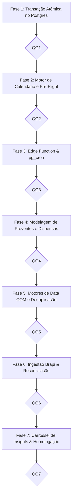

# PLANO DE IMPLEMENTAÇÃO 05 — FECHAMENTO AUTOMÁTICO DE SNAPSHOTS PATRIMONIAIS, SINCRONIZAÇÃO DE COTAÇÕES & MOTOR INTELIGENTE DE PROVENTOS E INSIGHTS EM CARROSSEL

> **Documento Canônico de Arquitetura, Engenharia de Dados e Governança de Software**  
> **Status:** Proposto / Consolidado, Otimizado e Pronto para Execução · Quality Gates QG1–QG7 Definidos  
> **Arquivo:** `docs/plans/05_PLANO_FECHAMENTO_AUTOMATICO_SNAPSHOTS_E_COTACAO.md`  
> **Ordem de Implementação:** **5º (Automação de Servidor, Proventos B3 & Centro de Insights)**  
> **Módulos Afetados:** `supabase/migrations/`, `supabase/functions/quotes/`, `supabase/`, `src/types/`, `src/domain/portfolio/`, `src/data/repositories/`, `src/services/`, `src/state/`, `src/hooks/`, `src/features/investments/`, `src/features/transactions/`, `docs/`  
> **Governança:** TypeScript Estrito (Zero `any`/`@ts-ignore`) · Transações Atômicas Server-Authoritative · Moeda em Centavos · Padrões CVM, ANBIMA e B3 · Zero Emojis (`local/no-decorative-unicode`) · Regra 19 para Carrossel · Portões de Qualidade (QG) por Fase  
> **Ambientes:** Web Desktop, Web PWA (iOS/Android) & Android Nativo (Capacitor Pro)  

---

## 1. SUMÁRIO EXECUTIVO & ARQUITETURA DE VALOR

```
┌──────────────────────────────────────────────────────────────────────────────────────────────────────────────────┐
│              INFRAESTRUTURA INTEGRADA: FECHAMENTO DE CARTEIRA & MOTOR AUTÔNOMO DE PROVENTOS                      │
└──────────────────────────────────────────────────────────────────────────────────────────────────────────────────┘
                                                           │
                 ┌────────────────────────────────────────┴────────────────────────────────────────┐
                 ▼                                                                                 ▼
   [PILAR 1: FECHAMENTO & SNAPSHOTS]                                                [PILAR 2: PROVENTOS & DIVIDENDOS]
   - Encerramento no último dia útil do mês                                         - Detecção autônoma de proventos da B3/EUA
   - Cotações oficiais consolidadas pós-19h BRT                                     - Ponto-no-tempo pela Data COM (não pelo pagamento)
   - Transacionalidade atômica (Zero snapshots desatualizados)                      - Deduplicação inteligente contra manuais
   - Server-Authoritative (pg_cron) + Fallback Just-in-Time                         - Invariante Contábil de Destinação Exclusiva
                 │                                                                  - Reversibilidade total (Undo + Aba Dispensados)
                 │                                                                                 │
                 └────────────────────────────────────────┬────────────────────────────────────────┘
                                                          ▼
                                    [PILAR 3: CENTRO DE AÇÕES & INSIGHTS EM CARROSSEL]
                                    - Carrossel Unificado de Insights (PortfolioInsightsCarousel)
                                    - Formato canônico da Regra 19 do AGENTS.md (p-3.5 sm:p-4, teto de 2 linhas)
                                    - Trava inteligente de autoplay durante interação/foco
                                    - Aprovação em 1 clique de proventos direto no slide ativo
                                    - Rebalanceamento, desvio de alocação e marcos da Bola de Neve
```

---

## 2. FASES DE EXECUÇÃO DETALHADAS & CHECKLIST



---

## Fase 1: Arquitetura de Dados & Transação Atômica no Postgres (Pilar 1)

- [ ] **Tarefa 1.1: Migration de Enriquecimento de Snapshots (`supabase/migrations/`)**
  - Adicionar `status ('provisional', 'closed')`, `closing_date date` e `closed_at timestamptz` em `portfolio_snapshots`.

- [ ] **Tarefa 1.2: RPC Transacional `commit_monthly_closing_atomic`**
  - Gravação atômica em lote de cotações (`portfolio_monthly_prices`) e snapshot (`portfolio_snapshots`).
  - Rollback automático se qualquer cotação for $\le 0$.

- [ ] **Tarefa 1.3: Tipos Canônicos TypeScript (`src/types/portfolio.ts`)**
  - Adicionar `status: "provisional" | "closed"`, `closing_date?: string` e `closed_at?: string`.

- [ ] **Portão de Qualidade 1 (QG1):**
  - [ ] Executar: `npx vitest run src/tests/cross-tenant-penetration.test.ts`
  - [ ] Executar: `npm run typecheck`
  - [ ] Executar: `npm run lint`
  - [ ] **Commit & Push da Fase 1:** `git commit -m "feat(portfolio): rpc transacional atomica commit_monthly_closing_atomic"`

---

## Fase 2: Motor de Domínio — Calendário de Mercado e Validador Pré-Flight (Pilar 1)

- [ ] **Tarefa 2.1: Calendário de Mercado B3 (`src/domain/portfolio/market-calendar.ts`)**
  - Mapeamento determinístico de feriados e determinação do último dia útil do mês pós-19h BRT.

- [ ] **Tarefa 2.2: Validador Pré-Flight de Cotações (`src/domain/portfolio/closing-validator.ts`)**
  - Validação estrita de cobertura com cotação $> 0$ para 100% dos ativos em custódia.

- [ ] **Tarefa 2.3: Testes de Domínio (`market-calendar.test.ts` e `closing-validator.test.ts`)**

- [ ] **Portão de Qualidade 2 (QG2):**
  - [ ] Executar: `npx vitest run src/domain/portfolio/market-calendar.test.ts src/domain/portfolio/closing-validator.test.ts`
  - [ ] Executar: `npm run typecheck`
  - [ ] Executar: `npm run lint`
  - [ ] **Commit & Push da Fase 2:** `git commit -m "feat(portfolio): motor puro de calendario b3 e validador pre-flight"`

---

## Fase 3: Backend de Fechamento — Edge Function & Agendador pg_cron (Pilar 1)

- [ ] **Tarefa 3.1: Expansão da Edge Function `quotes` (`action: 'close_month'`)**
  - Busca de cotações oficiais e consolidação em lote.

- [ ] **Tarefa 3.2: Agendador `pg_cron` no Postgres com Fallback JIT**
  - Disparo noturno via `pg_cron` e rota de fallback segura para reconciliação Just-in-Time no primeiro login do mês seguinte.

- [ ] **Tarefa 3.3: Testes de Orquestração (`src/tests/quotes-cron.test.ts`)**

- [ ] **Portão de Qualidade 3 (QG3):**
  - [ ] Executar: `npx vitest run src/tests/quotes-cron.test.ts`
  - [ ] Executar: `npm run typecheck`
  - [ ] **Commit & Push da Fase 3:** `git commit -m "feat(portfolio): edge function quotes e agendador pg_cron com fallback jit"`

---

## Fase 4: Modelagem de Proventos, Eventos Corporativos e Dispensas Reversíveis (Pilar 2)

- [ ] **Tarefa 4.1: Tabela de Eventos Corporativos Globais (`corporate_dividends`)**
  - Armazena `gross_rate`, `net_rate`, `withholding_tax_pct` (15% JCP, 30% IRS), `com_date` e `payment_date`.

- [ ] **Tarefa 4.2: Enriquecimento de `portfolio_dividends` e Tabela de Dispensas (`portfolio_dividend_dismissals`)**
  - Suporte a reversibilidade (Undo de 5s e aba "Dispensados").

- [ ] **Tarefa 4.3: Contratos TypeScript (`src/types/schema.ts`)**

- [ ] **Portão de Qualidade 4 (QG4):**
  - [ ] Executar: `npx vitest run src/tests/cross-tenant-penetration.test.ts`
  - [ ] Executar: `npm run typecheck`
  - [ ] Executar: `npm run lint`
  - [ ] **Commit & Push da Fase 4:** `git commit -m "feat(portfolio): schema de proventos corporativos b3 e dispensas reversiveis"`

---

## Fase 5: Motor de Domínio — Data COM, Tributação, Deduplicação & Destinação Exclusiva (Pilar 2)

- [ ] **Tarefa 5.1: Deduplicação e Fuzzy Matching (`dividend-deduplication.ts`)**
  - Janela de $\pm 3$ dias úteis e tolerância de R$ 0,02 para evitar duplicar lançamentos manuais.

- [ ] **Tarefa 5.2: Apuração na Data COM (`dividend-suggester.ts`)**
  - Cotas apuradas no fechamento da Data COM via `calculatePointInTimePosition`.

- [ ] **Tarefa 5.3: Invariante de Mútua Exclusividade (`dividend-destination.ts`)**
  - Garantia de conservação contábil: escolha única entre Caixa de Investimentos, Orçamento Pessoal ou apenas registro.

- [ ] **Tarefa 5.4: Calendário Preditivo & Bola de Neve (`dividend-forecaster.ts`)**

- [ ] **Portão de Qualidade 5 (QG5):**
  - [ ] Executar: `npx vitest run src/domain/portfolio/dividend-suggester.test.ts src/domain/portfolio/dividend-deduplication.test.ts src/domain/portfolio/dividend-destination.test.ts src/domain/portfolio/dividend-forecaster.test.ts`
  - [ ] Executar: `npm run typecheck`
  - [ ] Executar: `npm run lint`
  - [ ] **Commit & Push da Fase 5:** `git commit -m "feat(portfolio): motor puro de proventos data com e destinacao exclusiva"`

---

## Fase 6: Ingestão Brapi com Throttling, Reconciliação Just-in-Time & Mutações em Lote (Pilar 1 & 2)

- [ ] **Tarefa 6.1: Consulta Automatizada de Proventos na Edge Function `quotes`**
  - Batching de tickers respeitando o rate limit da Brapi.

- [ ] **Tarefa 6.2: Mutação em Lote com Destinação Atômica (`useApproveDividendsBatch.ts`)**

- [ ] **Tarefa 6.3: Mecanismo de Reversão de Dispensas**

- [ ] **Portão de Qualidade 6 (QG6):**
  - [ ] Executar: `npx vitest run src/state/mutations/use-approve-dividends-batch.test.ts`
  - [ ] Executar: `npm run typecheck`
  - [ ] Executar: `npm run lint`
  - [ ] **Commit & Push da Fase 6:** `git commit -m "feat(portfolio): mutacao de aprovacao de proventos em lote e reversao"`

---

## Fase 7: Centro Unificado de Ações & Insights em Carrossel (Pilar 3) & Homologação

- [ ] **Tarefa 7.1: Componente `PortfolioInsightsCarousel.tsx` (Regra 19 do AGENTS.md)**
  - Unificação de proventos, desvio de alocação e marcos em carrossel horizontal de altura fixa.
  - Pausa inteligente de autoplay durante hover, toques e controles em foco.

- [ ] **Tarefa 7.2: Aprovação de Proventos em 1 Clique Direto no Slide**

- [ ] **Tarefa 7.3: Calendário Preditivo na Aba de Proventos (`DividendCalendarCard.tsx`)**

- [ ] **Tarefa 7.4: Homologação Final e Arquivamento em `docs/plans/completed/`**

- [ ] **Portão de Qualidade 7 (QG7):**
  - [ ] Executar: `npx vitest run src/features/investments/components/portfolio-insights-carousel.test.tsx`
  - [ ] Executar: `npm run typecheck`
  - [ ] Executar: `npm run lint`
  - [ ] Executar: `npm run test:run`
  - [ ] Executar: `npm run build`
  - [ ] **Commit & Push da Fase 7:** `git commit -m "chore(release): homologacao e conclusao do plano 05 de fechamento e proventos"`

---

## 3. DEFINITION OF DONE (DoD)

1. Transação atômica no banco impedindo snapshots com cotações pendentes ou zeradas.
2. Apuração determinística de proventos pela Data COM com deduplicação de manuais.
3. Invariante absoluto de conservação contábil (zero duplo crédito de proventos).
4. Carrossel de Insights em estrita conformidade com a Regra 19 do AGENTS.md.
5. 100% dos testes aprovados, build de produção limpo e plano arquivado em `docs/plans/completed/`.
