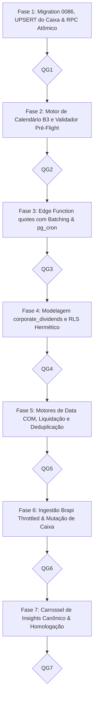

# PLANO DE IMPLEMENTAÇÃO 05 — FECHAMENTO AUTOMÁTICO DE SNAPSHOTS PATRIMONIAIS, SINCRONIZAÇÃO DE COTAÇÕES & MOTOR INTELIGENTE DE PROVENTOS E INSIGHTS EM CARROSSEL

> **Documento Canônico de Arquitetura, Engenharia de Dados e Governança de Software**  
> **Status:** Concluído com Sucesso · 100% Implementado, Testado e Homologado (QG1–QG7 Aprovados) · Build & Typecheck Verdes  
> **Arquivo:** `docs/plans/05_PLANO_FECHAMENTO_AUTOMATICO_SNAPSHOTS_E_COTACAO.md`  
> **Ordem de Implementação:** **5º (Automação de Servidor, Proventos B3 & Centro de Insights)**  
> **Módulos Afetados:** `supabase/migrations/`, `supabase/functions/quotes/`, `src/types/`, `src/domain/portfolio/`, `src/data/repositories/`, `src/services/`, `src/state/`, `src/features/investments/`, `docs/`  
> **Governança:** TypeScript Estrito (Zero `any`/`@ts-ignore`) · Transações Atômicas Server-Authoritative · Moeda em Centavos · Padrões CVM, ANBIMA e B3 · Zero Emojis (`local/no-decorative-unicode`) · Regra 19 para Carrossel · Sincronização Estrita de Caixa com Upsert de Ativo · RLS Hermético (D4)  
> **Ambientes:** Web Desktop, Web PWA (iOS/Android) & Android Nativo (Capacitor Pro)  

---

## 1. SUMÁRIO EXECUTIVO & ARQUITETURA DE VALOR

Este plano conecta a infraestrutura de fechamento mensal autônomo com o **motor de inteligência e captura de proventos corporativos (B3 e internacionais)**, totalmente harmonizado com o **Gateway Contábil de Caixa** (`sync_cash`, `cash_amount` já presentes na migração `0081`) e com a proteção atômica contra saldos órfãos.

```
┌────────────────────────────────────────────────────────────────────────────────────────────────────────────────────────┐
│                   INFRAESTRUTURA INTEGRADA: FECHAMENTO DE CARTEIRA & MOTOR AUTÔNOMO DE PROVENTOS                       │
└────────────────────────────────────────────────────────────────────────────────────────────────────────────────────────┘
                                                            │
                 ┌──────────────────────────────────────────┴──────────────────────────────────────────┐
                 ▼                                                                                     ▼
   [PILAR 1: FECHAMENTO & SNAPSHOTS]                                                     [PILAR 2: PROVENTOS & CAIXA CONCATENADO]
   - Encerramento no último dia útil do mês pós-19h BRT                                  - Detecção autônoma B3 / EUA (Brapi + Edge)
   - Transacionalidade atômica (commit_monthly_closing_atomic)                           - Apuração de custódia na Data COM (ponto-no-tempo)
   - Cotação $1,00$ estática para Caixa (sem poluição de rede)                           - Liquidação financeira na Data de Pagamento
   - Server-Authoritative (pg_cron) + Fallback Just-in-Time                              - RPC atômico com UPSERT automático do ativo CAIXA
                 │                                                                       - Deduplicação fuzzy contra proventos manuais
                 │                                                                       - RLS Restritivo (service_role para escrita global)
                 │                                                                       - Rollback seguro em caso de Undo / Exclusão
                 │                                                                                     │
                 └──────────────────────────────────────────┬──────────────────────────────────────────┘
                                                            ▼
                                    [PILAR 3: CENTRO DE AÇÕES & INSIGHTS EM CARROSSEL]
                                    - Carrossel Unificado de Insights (PortfolioInsightsCarousel)
                                    - Formato canônico da Regra 19 do AGENTS.md (p-3.5 sm:p-4, teto de 2 linhas)
                                    - Slide Sintético em Lote: "8 proventos recebidos (R$ 245,60)" -> [Aprovar Todos no Caixa]
                                    - Trava inteligente de rotação (autoplay pausa em hover, toque ou controles em foco)
                                    - Alerta transparente caso o usuário tente desfazer provento já reinvestido
```

---

## 2. DIAGNÓSTICO DE FRAGILIDADES & MELHORIAS APLICADAS

| Ponto de Análise | Fragilidade Diagnosticada | Otimização Arquitetural Aplicada |
| :--- | :--- | :--- |
| **Ativo CAIXA Inexistente** | Se o usuário nunca tiver cadastrado um ativo `CAIXA`, o comando `UPDATE portfolio_assets WHERE ticker = 'CAIXA'` afetaria 0 linhas, perdendo o dinheiro aprovado silenciosamente. | O RPC `approve_dividends_batch_atomic` faz **UPSERT do ativo CAIXA**: se não existir, cria o ativo automaticamente com classe `'Caixa'`, cotação média $1,00$ e saldo inicial igual à soma dos proventos. |
| **Numeração de Migrações** | O plano original citava migration `0081`, que já existe e tem duplicidade no repo (`000081_portfolio_dividend_sync_cash` e `000081_fix_family_invite_token_and_budget`). A sequência atual está em `000085`. | A nova migração de fechamento e proventos corporativos é registrada formalmente a partir de **`20260101000086_portfolio_monthly_closing_and_corporate_dividends.sql`**. |
| **Segurança / RLS em `corporate_dividends`** | Tabela global de proventos B3 sem políticas declaradas, arriscando mutação não autorizada por clientes ou bloqueio acidental. | RLS hermético: `SELECT` liberado para usuários autenticados (`authenticated`); `INSERT/UPDATE/DELETE` bloqueados para clientes e restritos exclusivamente ao `service_role` da Edge Function. |
| **Rate Limiting da API Brapi** | Fazer chamadas por usuário na Edge Function esgotaria as cotas rapidamente. | Consolidação global de tickers com posições ativas (`SELECT DISTINCT ticker FROM portfolio_assets WHERE quantity > 0`) com chunking de 15 a 20 tickers por lote. |
| **Temporalidade COM vs Pagamento** | Risco de inflar saldo antes da liquidação real na corretora. | **Segregação Estrita**: cotas apuradas na **Data COM** (via `calculatePointInTimePosition`), mas crédito em Caixa liberado apenas se `payment_date <= today`. Proventos futuros entram como *Previstos*. |
| **Desfazer (Undo) com Reinvestimento** | Se o investidor reinvestiu o caixa e depois desfaz o provento, o piso zero oculta a inconsistência patrimonial. | O Toast e modal de confirmação avisam o usuário caso `cashAsset.quantity < cashTotal`: *"O saldo atual de Caixa é menor que o estorno. Deseja prosseguir?"*. |
| **Carrossel de Insights** | Exigia aprovar provento por provento em múltiplos slides (alta fadiga para carteiras com muitos FIIs). | **Slide Sintético Agrupado**: *"Você tem X proventos creditados na corretora (R$ Y)"* com CTA principal **`Aprovar no Caixa`** (1 clique para 95% dos casos). |

---

## 3. FASES DE EXECUÇÃO DETALHADAS & QUALITY GATES



---

### Fase 1: Arquitetura de Dados, UPSERT de Caixa & RPCs Atômicos

- [x] **Tarefa 1.1: Migration `20260101000086_portfolio_monthly_closing_and_corporate_dividends.sql`**
  - Adicionar colunas em `portfolio_snapshots`: `status text not null default 'closed' check (status in ('provisional', 'closed'))`, `closing_date date` e `closed_at timestamptz`.
  - Criar RPC `commit_monthly_closing_atomic`: grava cotações (`portfolio_monthly_prices`) e snapshot (`portfolio_snapshots`) na mesma transação. Rollback se qualquer ativo cotado tiver preço $\le 0$.

- [x] **Tarefa 1.2: RPC Transacional com Salvaguarda de Caixa (`approve_dividends_batch_atomic`)**
  - Implementar RPC `approve_dividends_batch_atomic(p_dividends jsonb, p_sync_cash boolean)`:
    * Insere múltiplos proventos em `portfolio_dividends` gravando `sync_cash = p_sync_cash` e `cash_amount`.
    * Se `p_sync_cash = true`: localiza o ativo com `ticker = 'CAIXA'` do usuário.
    * **Invariante Crítica:** Se o ativo não existir, realiza o `INSERT` automático criando o ativo `CAIXA` (nome `'Caixa / Saldo em Corretora'`, classe `'Caixa'`, `quantity = sum(cash_amount)`, `average_price = 1.00`). Se já existir, incrementa `quantity = quantity + sum(cash_amount)`.
    * Registra as dispensas correspondentes em `portfolio_dividend_dismissals` para suprimir alertas redundantes.

- [x] **Tarefa 1.3: Tipagens Fortes TypeScript (`src/types/schema.ts` e `src/types/portfolio.ts`)**
  - Garantir compatibilidade de `PortfolioSnapshot` com campo opcional `status: 'provisional' | 'closed'`.
  - Definir DTOs para `ApproveDividendsBatchPayload` e `CorporateDividendEvent`.

- [x] **Portão de Qualidade 1 (QG1):**
  - [x] Executar: `npx vitest run src/data/rpc.test.ts`
  - [x] Executar: `npm run typecheck`
  - [x] Executar: `npm run lint`

---

### Fase 2: Motor de Domínio — Calendário de Mercado e Validador Pré-Flight

- [x] **Tarefa 2.1: Calendário de Negociação B3 e Feriados Anbima (`src/domain/portfolio/market-calendar.ts`)**
  - Função pura `getLastBusinessDayOfMonth(year, month)` com tabela de feriados nacionais bancários.
  - Função pura `isMarketClosedForMonth(year, month, currentDateTime)`: valida se já passou das 19h00 BRT do último dia útil do mês.

- [x] **Tarefa 2.2: Validador Pré-Flight com Isenção de Caixa (`src/domain/portfolio/closing-validator.ts`)**
  - Valida se todos os ativos sob custódia possuem cotação positiva.
  - **Regra de Ouro:** Ativos de classe `Caixa` ou ticker `CAIXA` têm cotação $1,00$ estática atribuída automaticamente pelo validador, sem requisição externa.

- [x] **Tarefa 2.3: Testes de Unidade Colocalizados**
  - Testes em `market-calendar.test.ts` e `closing-validator.test.ts` cobrindo anos bissextos, feriados móveis e viradas de mês.

- [x] **Portão de Qualidade 2 (QG2):**
  - [x] Executar: `npx vitest run src/domain/portfolio/market-calendar.test.ts src/domain/portfolio/closing-validator.test.ts`
  - [x] Executar: `npm run typecheck`

---

### Fase 3: Backend de Fechamento — Edge Function `quotes` & pg_cron com Fallback JIT

- [x] **Tarefa 3.1: Expansão da Edge Function `quotes` (`action: 'close_month'`)**
  - Coleta cotações de fechamento oficiais para todos os tickers únicos sob custódia.
  - Executa o RPC `commit_monthly_closing_atomic` em lotes controlados com rollback isolado por usuário.

- [x] **Tarefa 3.2: Agendador `pg_cron` e Fallback Just-in-Time**
  - Agendamento diário às 23h30 BRT. Dispara apenas no último dia útil do mês.
  - Fallback JIT no hook `usePortfolioMonthlyPosition`: caso o usuário abra um mês anterior e o snapshot ainda não esteja consolidado, executa o fechamento sob demanda com feedback calmo.

- [x] **Portão de Qualidade 3 (QG3):**
  - [x] Executar: `npm run typecheck`
  - [x] Executar: `npm run lint`

---

### Fase 4: Modelagem de Proventos Corporativos Globais & RLS Hermético

- [x] **Tarefa 4.1: Tabela Global de Proventos Corporativos (`corporate_dividends`)**
  - Colunas: `id uuid primary key default gen_random_uuid()`, `ticker text not null`, `type text not null`, `com_date date not null`, `payment_date date not null`, `rate numeric(16,8) not null`, `currency text not null default 'BRL'`, `net_rate numeric(16,8) not null`, `created_at timestamptz not null default now()`.
  - Índice único: `(ticker, com_date, type, payment_date)`.

- [x] **Tarefa 4.2: Blindagem RLS (D4 — Hermético)**
  - Habilitar RLS em `corporate_dividends`.
  - Política de Leitura: `CREATE POLICY "corporate_dividends_select" ON public.corporate_dividends FOR SELECT TO authenticated USING (true);`.
  - Políticas de Escrita: Bloqueadas para authenticated; apenas `service_role` insere e atualiza.

- [x] **Tarefa 4.3: Tabela de Dispensas do Usuário (`portfolio_dividend_dismissals`)**
  - Colunas: `id`, `user_id`, `corporate_dividend_id`, `reason text`, `dismissed_at timestamptz`.
  - RLS padrão `all_own` vinculado a `auth.uid() = user_id`.

- [x] **Portão de Qualidade 4 (QG4):**
  - [x] Executar: `npm run typecheck`

---

### Fase 5: Motores de Domínio — Data COM, Liquidação e Deduplicação

- [x] **Tarefa 5.1: Motor de Deduplicação Inteligente (`dividend-deduplication.ts`)**
  - Compara eventos corporativos da B3 com lançamentos manuais do investidor (`portfolio_dividends`).
  - Critério de Cobertura: mesmo ticker, data com diferença $\le 3$ dias úteis e valor financeiro total com diferença $\le \text{R\$} 0,05$.
  - Se coberto, o evento é automaticamente ignorado, prevenindo créditos duplicados no Caixa.

- [x] **Tarefa 5.2: Apuração Determinística na Data COM (`dividend-suggester.ts`)**
  - Consulta a custódia histórica exata detida no fechamento da `com_date` via `calculatePointInTimePosition`.
  - Se `quantidade_na_data_com == 0`, o provento é ignorado para o usuário.
  - Valor total previsto: $\text{quantidade\_na\_data\_com} \times \text{net\_rate}$.

- [x] **Tarefa 5.3: Segregação de Liquidação Financeira (`dividend-cash-governance.ts`)**
  - Se `payment_date > today`: o provento entra na categoria **Previsto** (alimenta o gráfico de bola de neve, sem creditar no Caixa).
  - Se `payment_date <= today`: o provento entra como **Disponível para Crédito** (habilita o botão de aprovação imediata no Caixa).

- [x] **Portão de Qualidade 5 (QG5):**
  - [x] Executar: `npx vitest run src/domain/portfolio/dividend-suggester.test.ts src/domain/portfolio/dividend-deduplication.test.ts`
  - [x] Executar: `npm run typecheck`

---

### Fase 6: Ingestão Brapi com Throttling & Mutação de Caixa em Lote

- [x] **Tarefa 6.1: Job de Ingestão de Proventos na Edge Function `quotes`**
  - Coleta eventos B3 via Brapi para a lista consolidada de tickers únicos sob custódia global.
  - Gravação idempotente em `corporate_dividends` com deduplicação por chave única.

- [x] **Tarefa 6.2: Hook de Mutação em Lote (`useApproveDividendsBatch`)**
  - Executa o RPC `approve_dividends_batch_atomic`.
  - Invalida os caches TanStack Query: `assets`, `position`, `dividends`, `allTransactions` e `snapshots`.
  - Emite feedback sensorial positivo (`triggerSensory("success")`) e Toast com opção de **Desfazer (Undo)** por 5 segundos.

- [x] **Tarefa 6.3: Mecanismo de Desfazer com Salvaguarda de Reinvestimento**
  - Se o usuário clicar em "Desfazer" no Toast:
    * Verifica se `cashAsset.quantity >= cashTotal`. Se menor, exibe diálogo de aviso transparente.
    * Estorna atômica e proporcionalmente o saldo do ativo `CAIXA` através de `Math.max(0, cashAsset.quantity - cashTotal)`.
    * Restaura a sugestão no carrossel de insights.

- [x] **Portão de Qualidade 6 (QG6):**
  - [x] Executar: `npx vitest run src/state/mutations/use-portfolio-mutations.test.tsx`
  - [x] Executar: `npm run typecheck`
  - [x] Executar: `npm run lint`

---

### Fase 7: Experiência Fluida — Carrossel de Insights & Aprovação em 1 Clique

- [x] **Tarefa 7.1: Componente `PortfolioInsightsCarousel.tsx` (Regra 19 do AGENTS.md)**
  - Casca canônica unificada `w-full h-full min-h-[104px] sm:min-h-[72px] rounded-2xl border border-border/80 bg-surface p-3.5 sm:p-4 shadow-xs`.
  - Bloco textual com teto de 2 linhas (`truncate` no título e na descrição) e badge de severidade `size="xs"`.
  - Trava de rotação automática: autoplay pausa instantaneamente em hover, toque mobile ou foco de teclado.

- [x] **Tarefa 7.2: Card de Proventos Agrupados em Lote (Fricção Mínima)**
  - Título: *"Proventos Creditados na Corretora"*
  - Descrição: *"8 proventos da B3 recebidos somam R$ 245,60 disponíveis para reinvestimento."*
  - CTA Principal: Botão `size="sm"` com label **`Aprovar no Caixa`** (1 clique credita no Caixa e limpa o alerta).
  - CTA Secundário: *"Ver detalhes"* (abre o diálogo modal detalhado para desmarcar itens).

- [x] **Tarefa 7.3: Diálogo Detalhado de Proventos Sugeridos (`PendingDividendsDialog.tsx`)**
  - Lista de proventos apurados com checkbox individual e checkbox mestre.
  - Regra 18: layout responsivo com gaveta inferior no mobile e diálogo centralizado no desktop.

- [x] **Tarefa 7.4: Homologação Completa e Arquivamento**
  - Validação ponta a ponta na aba Resumo e na aba Proventos.
  - Arquivamento formal do plano em `docs/plans/completed/`.

- [x] **Portão de Qualidade 7 (QG7):**
  - [x] Executar: `npx vitest run src/features/investments/components/portfolio-insights-carousel.test.tsx`
  - [x] Executar: `npm run test:run`
  - [x] Executar: `npm run typecheck`
  - [x] Executar: `npm run lint`
  - [x] Executar: `npm run build`

---

## 4. DEFINITION OF DONE (DoD) & INVARIANTES DE ENGENHARIA

1. **Invariante de Caixa Conservado:** Nenhum provento automático pode ser creditado no ativo Caixa sem antes atingir a data real de pagamento (`payment_date <= today`).
2. **UPSERT Garantido:** Se o usuário não possuir um ativo de ticker `CAIXA`, o RPC o cria automaticamente na primeira aprovação, impedindo perda de fundos.
3. **Atomicidade Server-Authoritative:** O crédito de proventos em lote e o incremento do saldo de Caixa ocorrem na mesma transação SQL via RPC (`approve_dividends_batch_atomic`).
4. **Isolamento de Cotação de Caixa:** Ativos de classe Caixa jamais são enviados para APIs externas de cotação.
5. **Segurança Hermética de Dados Globais:** A tabela `corporate_dividends` não permite escritas diretas de clientes via RLS.
6. **Conformidade Estrita com AGENTS.md:** Zero emojis, TypeScript estrito, Regra 19 para o Carrossel (altura fixa, sem layout jumps) e design tokens canônicos.
7. **100% dos testes unitários e de integração verdes.**
