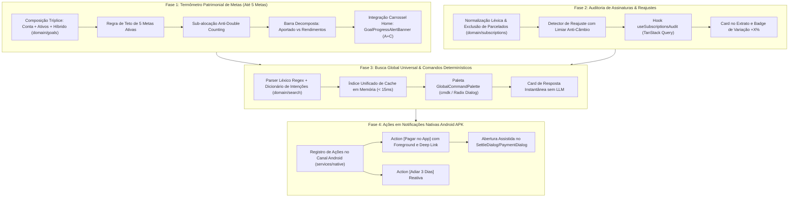

# 🗺️ PLANO DE IMPLEMENTAÇÃO 12 — EXPANSÃO E AUTOMAÇÃO: METAS COM TERMÔMETRO PATRIMONIAL INTEGRADO, AUDITORIA DE ASSINATURAS, BUSCA DETERMINÍSTICA E AÇÕES NATIVAS ANDROID

> **Documento Canônico de Arquitetura de Produto, Engenharia Financeira e Governança de UX**  
> **Status:** Pronto para Execução (Refinado, Auditado e com Resolução Integral de Fragilidades)  
> **Versão Alvo do Roadmap:** **v3.08**  
> **Arquivo:** `planos/12_PLANO_EXPANSAO_AUTOMACAO_RADAR_METAS_E_BUSCA_UNIVERSAL.md`  
> **Módulos Afetados:** `src/domain/goals/`, `src/features/goals/`, `src/features/overview/`, `src/features/extract/`, `src/features/reports/`, `src/components/modules/`, `src/services/native/`, `docs/`  
> **Governança:** TypeScript Estrito (Zero `any` / `@ts-ignore`) · Zero Emojis no Produto (`local/no-decorative-unicode`) · Regras DRY e Design System 13/18/19 · Precisão Contábil em Centavos Inteiros · Zero Chamadas a LLMs (100% Determinístico e Gratuito) · Teto de 5 Metas Ativas Simultâneas

---

## 1. SUMÁRIO EXECUTIVO & DIAGNÓSTICO PROFUNDO

Após a entrega bem-sucedida das **Fases 1 (Quitação e Baixa Direta na Central de Lembretes)** e **Fase 2 (Radar de Vencimentos dos Próximos 7 Dias no Dashboard)**, este plano executivo consolida a evolução das 4 novas capacidades de alto impacto no aplicativo:

1. **Termômetro Patrimonial Integrado de Metas (Até 5 Metas Ativas):**
   - Transposição da arquitetura comprovada do Termômetro da Reserva (`EmergencyFundConfigDialog`) para a funcionalidade de Metas;
   - Suporte nativo às 3 modalidades de composição de progresso: **Apenas Saldo em Conta**, **Apenas Investimentos** ou **Híbrido (Conta + Investimentos)**;
   - Decomposição visual na barra: *Total Desembolsado em Aportes* vs. *Rendimentos/Juros Compostos de Mercado*;
   - Integração proativa no Carrossel da Home (`GoalProgressAlertBanner`) com gatilhos de reta final ($\ge 80\%$) e botão resolutivo `[+ Aportar]` in-loco (Opções A + C combinadas);
   - Teto estrito de **até 5 metas ativas simultâneas** para foco e disciplina financeira.
2. **Auditoria de Assinaturas e Planos Fixos com Alerta de Reajuste:**
   - Detecção determinística em tempo linear $O(N \log N)$ de cobranças periódicas sem custo de IA;
   - Filtro anti-falsos-positivos (exclusão estrita de compras parceladas);
   - Limiar de reajuste ($\Delta \ge 3\%$ ou $\Delta \ge \text{R\$ } 3,00$) para neutralizar oscilações cambiais/IOF;
   - Alerta visual no extrato e relatórios com cálculo de impacto anualizado ($12 \times \Delta$).
3. **Busca Global Universal & Comandos Rápidos Determinísticos (< 15ms):**
   - Paleta de comandos global (`Ctrl+K` / `Cmd+K` / Botão de Lupa) sobre dados de cache em memória;
   - Parser léxico estruturado com Regex capaz de responder instantaneamente a perguntas analíticas (*"quanto gastei com alimentação este mês"*);
   - Zero dependência de LLM, sem risco de alucinação contábil e com privacidade total.
4. **Ações Diretas em Notificações Nativas do Android APK:**
   - Botões de ação rápida no sistema operacional Android: `[Pagar no App]` e `[Adiar 3 Dias]`;
   - Regra inegociável de segurança: o botão `[Pagar no App]` NUNCA efetua baixa silenciosa em background — ele abre o app diretamente no diálogo modal de confirmação assistida.

---

## 2. MATRIZ DE FRAGILIDADES IDENTIFICADAS & SOLUÇÕES ARQUITETURAIS

| # | Funcionalidade | Fragilidade / Risco Identificado | Causa Raiz Potencial | Solução Canônica de Engenharia |
|---|---|---|---|---|
| **1** | **Metas & Termômetro** | **Contagem Dupla (Double Counting):** Falso enriquecimento visual. | Duas metas diferentes vinculadas à mesma conta corrente ou ao mesmo ativo da carteira. | **Modo de Alocação com Teto (Sub-alocação):** Quando uma conta ou ativo é compartilhado, o usuário define um teto de saldo alocado. Chip visual discreto alerta: `Compartilhado com outra meta`. |
| **2** | **Metas & Termômetro** | **Caixa Ilusório Comprometido:** Contas a pagar engolindo a meta. | A conta bancária tem R$ 5.000, mas R$ 4.000 vencem em faturas nos próximos dias. | **Cálculo por Saldo Livre Efetivo:** $\text{SaldoLivre} = \text{SaldoConta} - \text{ObrigaçõesPendentesDaConta}$. Indicação na UI para priorizar contas de poupança/reserva. |
| **3** | **Metas & Termômetro** | **Volatilidade de Mercado Recuando a Meta:** Bolsa em queda. | Ativos de renda variável ou títulos longos sofrem marcação a mercado. | **Barra Bicolor Decomposta:** Mostra o *Total Aportado em Dinheiro* em tom sólido e os *Ganhos de Mercado* em tom gradiente. Trava de meta atingida para congelar marco histórico. |
| **4** | **Metas & Termômetro** | **Rebalanceamento / Troca de Ativos:** Venda zera o termômetro. | Ativo individual vendido para compra de outro ativo no rebalanceamento. | **Vínculo por Classe como Recomendação Padrão:** Vincular à classe (ex.: Renda Fixa) confere imunidade contra troca de ativos pontuais. Caixa não aplicado da corretora é computado. |
| **5** | **Home & Integração** | **Poluição Vertical vs. Inércia:** Não ver o progresso ou poluir a tela. | Cards estáticos adicionais na Home inflacionam o scroll do mobile. | **Carrossel Inteligente Interativo (Opções A + C):** Alerta proativo no carrossel existente com gatilhos de reta final ($\ge 80\%$), sobra de mês e botão `[+ Aportar]` direto na Home. |
| **6** | **Metas & Teto** | **Dispersão e Descontrole Financeiro:** Criar 20 metas sem foco. | Criação irrestrita de objetivos pulverizando a capacidade de poupança. | **Teto Estrito de 5 Metas Ativas Simultâneas:** Validação no domínio e no diálogo de cadastro, incentivando conclusão antes de abrir novas metas. |
| **7** | **Assinaturas** | **Falsos Positivos em Parcelamentos:** Compras em 10x de valor fixo. | Compras parceladas têm periodicidade mensal e o mesmo valor. | **Filtro Estrito por Invariante:** Despesas com `installments_total > 1` são categoricamente ignoradas pelo detector de assinaturas. |
| **8** | **Assinaturas** | **Alarme Falso por Câmbio / IOF:** Planos em dólar oscilando centavos. | Variações cambiais de R$ 110 para R$ 112 simulando reajuste contratual. | **Limiar Anti-Câmbio:** Apenas variações $\ge 3\%$ ou $\ge \text{R\$ } 3,00$ disparam alerta crítico. Pequenas oscilações recebem badge neutro e opção de silenciar. |
| **9** | **Busca Global** | **Latência e Alucinação por LLM:** Consultas de gastos demoradas ou erradas. | Chamadas a APIs de IA generativa para responder perguntas numéricas. | **Zero LLM / Parser Léxico Determinístico:** Reconhecimento em $< 10\text{ms}$ por Regex + Dicionário de Categorias sobre o cache local do TanStack Query. 100% exato e gratuito. |
| **10** | **Ações Android** | **Baixa Silenciosa Acidental:** Quitar dívida com 1 toque por engano. | Disparo de mutação de baixa em background sem abrir a tela. | **Regra Inegociável de Confirmação:** O botão `[Pagar no App]` NUNCA dá baixa silenciosa. Abre o modal de quitação assistida (`SettleDialog` / `PaymentDialog`) para confirmação explícita. |

---

## 3. MAPA DE DEPENDÊNCIAS ARQUITETURAIS

---

## 4. CHECKLIST OPERACIONAL DE IMPLEMENTAÇÃO

### FASE 1: TERMÔMETRO PATRIMONIAL INTEGRADO DE METAS (ATÉ 5 METAS ATIVAS)

#### 1.1 Domínio Financeiro & Tipagem (`src/domain/goals/` e `src/types/`)
- [ ] **Etapa 1.1.1:** Definir contratos de composição de metas em `src/types/goals.ts`:
  - `MAX_ACTIVE_GOALS = 5`;
  - `GoalSourceMode: 'manual' | 'patrimonial'`;
  - `GoalCompositionConfig`:
    - `includeCheckingAccounts: boolean`;
    - `accountIds?: string[] | null` (todas as contas ou selecionadas);
    - `includeInvestments: boolean`;
    - `investmentMode: 'selected_assets' | 'selected_classes' | 'entire_portfolio'`;
    - `assetIds?: string[] | null`;
    - `classes?: string[] | null`;
    - `allocationCapCents?: number | null` (teto exclusivo anti-double counting);
    - `isCompletedLocked?: boolean` (trava de meta batida contra oscilação negativa).
- [ ] **Etapa 1.1.2:** Implementar resolver puro de composição em `src/domain/goals/goal-composition.ts`:
  - Função pura `resolveGoalComposition(params: ResolveGoalCompositionParams): GoalCompositionResult`:
    - Calcula parcela em contas correntes (com dedução de contas a pagar pendentes da conta);
    - Calcula parcela em investimentos (valor de mercado atual);
    - Decomposição: `totalDesembolsadoCents` (soma dos aportes históricos) vs `totalRendimentoCents` (ganho de capital e proventos);
    - Aplica o teto de alocação configurado (`allocationCapCents`);
    - Retorna `currentCents = min(totalDisponivel, allocationCapCents ?? totalDisponivel)`, percentual acumulado e status.
- [ ] **Etapa 1.1.3:** Implementar validação de regra de negócio do teto de metas:
  - Função pura `canCreateActiveGoal(activeGoalsCount: number): boolean` retornando falso se $\text{activeGoals} \ge 5$.
- [ ] **Etapa 1.1.4:** Testes unitários em `src/domain/goals/goal-composition.test.ts`:
  - 100% de cobertura cobrindo as 3 modalidades (Conta, Investimentos, Híbrido), sub-alocação e trava contra double counting.

#### 1.2 Banco de Dados, RLS e RPCs Transacionais (`supabase/migrations/`)
- [ ] **Etapa 1.2.1:** Migration SQL `20260101000093_goals_patrimonial_composition.sql`:
  - Expandir a tabela `goals` com a coluna `composition_config jsonb null`;
  - Trigger de banco de dados garantindo a constraint de integridade de no máximo 5 metas ativas por usuário (`status != 'archived'`);
  - Atualização dos RPCs de auditoria e backup/restore.
- [ ] **Etapa 1.2.2:** RPC transacional `allocate_goal_deposit`:
  - Permite aportar diretamente na meta via débito de conta ou aporte de carteira (`portfolio_contributions`), atualizando atomicamente meta e patrimônio.
- [ ] **Etapa 1.2.3:** Hooks TanStack Query em `src/state/queries/use-goals.ts` e `use-goal-mutations.ts`.

#### 1.3 Componentes Visuais do Termômetro & Configuração
- [ ] **Etapa 1.3.1:** Criar diálogo de configuração de composição `src/features/goals/components/goal-composition-dialog.tsx`:
  - Herda a ergonomia limpa do `EmergencyFundConfigDialog` com tabs ou seletores claros: *Conta*, *Investimentos*, *Ambos*;
  - Toggles intuitivos de seleção de contas e ativos/classes com preview em tempo real.
- [ ] **Etapa 1.3.2:** Refatorar o card da meta `src/features/goals/components/goal-card.tsx` e `campaign-card.tsx`:
  - Barra de termômetro bicolor: tom sólido para *Aportes Realizados* e tom gradiente para *Rendimento de Mercado*;
  - Chips informativos: `Saldo em Conta`, `Renda Fixa`, `Ações/FIIs` e alerta se for conta compartilhada;
  - Trava visual quando a meta atinge 100% (`[Congelar Conquista]`);
  - Botão de ação direta `[+ Aportar]` que roteia para guardar na conta ou investir no ativo.
- [ ] **Etapa 1.3.3:** Sanitização em `GoalTrackerPublicPage`:
  - Garantir que termômetros compartilhados via link público `/meta/:token` recebam apenas o valor total e percentual, com zero exposição de nomes de bancos, corretoras ou tickers de ações.

#### 1.4 Integração Inteligente com o Carrossel da Home (`DashboardAlertsCarousel`)
- [ ] **Etapa 1.4.1:** Criar banner interativo `src/features/overview/components/goal-progress-alert-banner.tsx` (Opções A + C):
  - Conformidade estrita com a Regra 19 de governança do carrossel (`min-h-[104px] sm:min-h-[72px]`);
  - Casca canônica `size-9` com ícone `Target` e badge de percentual;
  - Exibe a meta mais prioritária com os gatilhos inteligentes:
    - *Gatilho 1 (Reta Final):* Meta com $\ge 80\%$ concluída (*"Faltam apenas R$ X para conquistar 'Viagem'"*);
    - *Gatilho 2 (Sobra do Mês):* Mês com sobra de caixa sugerindo destinar para a meta;
    - *Gatilho 3 (Meta Conquistada):* Celebração de 100% batido;
  - **Ação Direta In-Loco:** Botão `[+ Aportar]` (`size="sm"`) que abre o diálogo de aporte diretamente por cima da Home, sem forçar navegação para outra tela.
- [ ] **Etapa 1.4.2:** Integrar no carrossel de `overview-page.tsx` substituindo o antigo banner restrito a vaquinhas públicas.

---

### FASE 2: AUDITORIA DE ASSINATURAS E PLANOS FIXOS COM ALERTA DE REAJUSTE

#### 2.1 Domínio Analítico & Normalização Léxica (`src/domain/subscriptions/`)
- [ ] **Etapa 2.1.1:** Criar módulo puro `src/domain/subscriptions/audit.ts`:
  - Normalizador de títulos: limpeza de caracteres estranhos, datas, identificadores de cartão e números de autorização;
  - Filtro invariante: exclusão expressa de compras parceladas (`installments_total > 1`);
  - Agrupamento temporal: detecção de cobranças recorrentes com ciclo de $\sim 30\text{ dias}$ ou $\sim 365\text{ dias}$;
  - Detector de reajuste com limiar anti-câmbio: só classifica aumento contratual se $\Delta \ge 3\%$ ou $\Delta \ge \text{R\$ } 3,00$;
  - Cálculo de métricas: valor anterior, valor atual, variação percentual e impacto anualizado ($12 \times \Delta$).
- [ ] **Etapa 2.1.2:** Testes unitários puros em `src/domain/subscriptions/audit.test.ts` cobrindo falsos positivos de parcelamentos e variações de IOF/câmbio.

#### 2.2 Hooks e Estado (`src/state/queries/`)
- [ ] **Etapa 2.2.1:** Criar hook `useSubscriptionsAudit()` em `src/state/queries/use-subscriptions-audit.ts` com cache TanStack Query (`staleTime: STALE_TIMES.analytical`);
- [ ] **Etapa 2.2.2:** Suporte a silenciar ou confirmar reajustes persistido em `user_preferences.custom_settings`.

#### 2.3 Componentes Visuais no Extrato e Relatórios
- [ ] **Etapa 2.3.1:** Criar badge `src/features/extract/components/price-increase-badge.tsx` (`+X%`) na linha da transação reajustada;
- [ ] **Etapa 2.3.2:** Criar card expansível `src/features/extract/components/subscriptions-audit-card.tsx` com o resumo anual de serviços recorrentes;
- [ ] **Etapa 2.3.3:** Criar modal de detalhe `src/components/modules/subscription-adjustment-modal.tsx` com histórico comparativo e atalho para cancelar/renegociar plano.

---

### FASE 3: BUSCA GLOBAL UNIVERSAL COM INTENÇÕES DETERMINÍSTICAS RÁPIDAS (< 15ms)

#### 3.1 Motor Determinístico de Intenções (`src/domain/search/`)
- [ ] **Etapa 3.1.1:** Criar analisador léxico determinístico `src/domain/search/intents.ts`:
  - Dicionário estruturado de categorias de gastos, meses e sinônimos em pt-BR;
  - Regex determinísticos para reconhecer:
    1. *Gasto por Categoria:* `/(quanto|total|gastei|valor).*(com|em|de)?\s+([a-zçãéíóú]+).*(mês|hoje|ano)?/i`;
    2. *Vencimentos Próximos:* `/(faturas?|contas?|vencend|a pagar|boletos?)/i`;
    3. *Saldo e Reserva:* `/(saldo|quanto tenho|disponivel|reserva)/i`;
    4. *Ações do Sistema:* `/(novo|nova|criar|adicionar|lançar)\s+(gasto|despesa|receita|cartão|meta)/i`.
- [ ] **Etapa 3.1.2:** Resolução de respostas em memória sobre dados em cache em $< 2\text{ms}$;
- [ ] **Etapa 3.1.3:** Testes unitários puros em `src/domain/search/intents.test.ts` com 40+ frases em pt-BR.

#### 3.2 Índice em Memória & Interface da Paleta
- [ ] **Etapa 3.2.1:** Hook `useGlobalSearchIndex` agregando entidades em memória sem requisições de rede;
- [ ] **Etapa 3.2.2:** Componente `GlobalCommandPalette` (`src/components/modules/global-command-palette.tsx`):
  - Acionável por `Ctrl+K` / `Cmd+K`, tecla `/` e botão de lupa no cabeçalho;
  - Exibe resposta instantânea no topo quando detectada intenção analítica;
  - Ergonomia mobile: tela cheia adaptativa, input com fonte $\ge 16\text{px}$ (anti-zoom iOS) e navegação 100% acessível por teclado.

---

### FASE 4: AÇÕES DIRETAS EM NOTIFICAÇÕES NATIVAS DO ANDROID APK

#### 4.1 Camada Nativa de Notificações (`src/services/native/`)
- [ ] **Etapa 4.1.1:** Registrar Action Types no canal Android (`src/services/native/notifications.ts`):
  - Ação 1: `id: 'PAY'`, label: `'Pagar no App'`, com flag `foreground: true`;
  - Ação 2: `id: 'SNOOZE'`, label: `'Adiar 3 Dias'`, reagendando notificação local.
- [ ] **Etapa 4.1.2:** Listener de ações nativas redirecionando para deep link `financas://lembretes?action=pay&key={itemKey}`.

#### 4.2 Recepção Assistida e Confirmação no App Web
- [ ] **Etapa 4.2.1:** Hook `useNotificationActionHandler` em `src/hooks/use-notification-action-handler.ts`:
  - Captura a abertura do app via notificação e abre diretamente o `SettleDialog` (dívidas) ou `PaymentDialog` (faturas) com valor e conta pré-selecionados;
  - Exige toque deliberado no botão de confirmação (zero baixas silenciosas acidentais).
- [ ] **Etapa 4.2.2:** Degradação graciosa para Web Desktop e PWA iOS.

---

### FASE 5: DOCUMENTAÇÃO, VERIFICAÇÃO INTEGRAL & BUILD DO APK

- [ ] **Etapa 5.1:** Atualizar especificação técnica executável [`docs/architecture/ESPECIFICACAO_TECNICA.md`](file:///home/gabrielsales/meus_apps/financasnew/docs/architecture/ESPECIFICACAO_TECNICA.md);
- [ ] **Etapa 5.2:** Atualizar roadmap executável [`docs/roadmap/ROADMAP.md`](file:///home/gabrielsales/meus_apps/financasnew/docs/roadmap/ROADMAP.md);
- [ ] **Etapa 5.3:** Execução dos Quality Gates:
  - `npx vitest run` (100% dos testes verdes);
  - `npx tsc -b` (zero erros de tipagem estrita);
  - `npm run lint` (zero advertências e conformidade com `local/no-decorative-unicode`);
  - `npm run build` (build Web de produção finalizado com sucesso).
- [ ] **Etapa 5.4:** Compilação oficial do APK Android release assinado (`npm run build:apk`) e upload para o Cloudflare R2.

---

## 5. PORTÕES DE QUALIDADE (QUALITY GATES & DoD)

| Portão | Foco | Critério de Aceite Inegociável |
|---|---|---|
| **QG0 — Foco & Teto de Metas** | Disciplina Financeira | O sistema impede a criação de mais de 5 metas ativas simultâneas (`canCreateActiveGoal`). |
| **QG1 — Precisão Contábil do Termômetro** | Integridade de Centavos | A composição de saldo em conta + investimentos bate em 100% dos centavos, sem double counting em contas compartilhadas. |
| **QG2 — Interação Direta na Home** | Ergonomia de Uso | O card do carrossel na Home permite acionar o modal de aporte diretamente com 1 toque sem troca de tela. |
| **QG3 — Anti-Falso-Alarme em Assinaturas** | Qualidade Analítica | Zero compras parceladas classificadas como assinaturas; oscilações cambiais $< 3\%$ não emitem alerta crítico de reajuste. |
| **QG4 — Determinismo & Custo Zero** | Desempenho da Busca | Perguntas analíticas respondidas em menos de 15ms sobre o cache local, com zero chamadas a LLMs e sem custo de tokens. |
| **QG5 — Segurança em Ações Android** | Proteção de Caixa | O botão "Pagar" na notificação NUNCA realiza quitação em segundo plano; abre o diálogo modal assistido para confirmação do usuário. |
| **QG6 — Governança de Release** | Qualidade Contínua | Testes automatizados 100% verdes, typecheck zerado, lint sem emojis e compilação do APK Android concluída com sucesso. |
