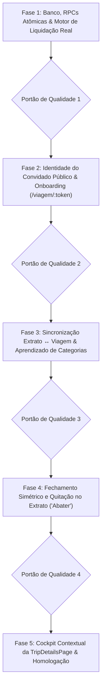

# PLANO DE IMPLEMENTAÇÃO 16 — MODO VIAGEM COLABORATIVO MULTI-USUÁRIO, SINCRONIZAÇÃO BIDIRECIONAL COM EXTRATO PESSOAL, APRENDIZADO DE CATEGORIAS & LIQUIDAÇÃO REAL

> **Documento Canônico de Arquitetura, Engenharia de Dados e Governança de Software**  
> **Status:** Consolidado e Pronto para Execução via Argos · Quality Gates QG1–QG5 Definidos  
> **Arquivo Canônico:** `planos/16_PLANO_MODO_VIAGEM_COLABORACAO_MULTI_USUARIO_E_SINCRONIZACAO_EXTRATO.md`  
> **Ordem de Implementação:** **16º (Evolução Colaborativa, Multi-Contas & Sincronização Contábil Total do Modo Viagem)**  
> **Módulos Afetados:** `supabase/migrations/`, `src/types/`, `src/domain/trips/`, `src/data/repositories/`, `src/data/rpc.ts`, `src/state/`, `src/hooks/`, `src/features/trips/`, `src/features/transactions/`, `src/features/public-share/`, `docs/`  
> **Governança:** TypeScript Estrito (Zero `any`/`@ts-ignore`) · RLS Hermético (D4 — Zero Data Bleed) · Moeda em Centavos Inteiros · Zero Controles Nativos Crus (Regra 7 AGENTS.md) · Zero Emojis (Regra 8 — `local/no-decorative-unicode`) · Portões de Qualidade (QG) por Fase  
> **Ambientes:** Web Desktop, Web PWA (iOS/Android) & Android Nativo (Capacitor Pro)  

---

## 1. SUMÁRIO EXECUTIVO & FILOSOFIA DE PRODUTO E ENGENHARIA

```
┌────────────────────────────────────────────────────────────────────────────────────────────────────────┐
│                        ECOSSISTEMA COLABORATIVO INTEGRADO (PLANO 16)                                  │
└────────────────────────────────────────────────────────────────────────────────────────────────────────┘
                                                    │
                   ┌────────────────────────────────┼────────────────────────────────┐
                   ▼                                ▼                                ▼
       ┌───────────────────────┐        ┌───────────────────────┐        ┌───────────────────────┐
       │   PERFIL A: TITULAR   │        │   PERFIL B: MEMBRO    │        │  PERFIL C: CONVIDADO  │
       │   (HOST ORGANIZADOR)  │        │   (CONEXÃO ÁXIS)      │        │     (SEM CONTA)       │
       │                       │        │                       │        │                       │
       │ - Cria & modera viagem│        │ - Aceita vínculo 1-clique     │ - Link público         │
       │ - Gerencia membros    │        │ - Viagem no seu /viagens│      │   /viagem/:token      │
       │ - Debita do cartão/Pix│        │ - Debita do seu cartão│        │ - Identidade 1º toque │
       │ - Painel de controle  │        │ - Cockpit contextual  │        │   (memorizada no nav) │
       │ - Baixa de reembolso  │        │ - Quita dívida com Pix│        │ - Lança em 5 segundos │
       │   no extrato pessoal  │        │   e lança no extrato  │        │ - Sem risco de imputar│
       │ - Visão administrativa│        │ - Categoria personalizada│     │   despesa no Host     │
       └───────────┬───────────┘        └───────────┬───────────┘        └───────────┬───────────┘
                   │                                │                                │
                   └────────────────────────────────┼────────────────────────────────┘
                                                    ▼
                               ┌────────────────────────────────────────┐
                               │       LIVRO-RAZÃO DA VIAGEM (HUB)      │
                               │ - Cotas exatas com resíduo garantido   │
                               │ - RLS com separação Host vs. Membro    │
                               │ - Permissão de edição pelo autor       │
                               │ - Auditoria de quem criou e quem pagou │
                               └────────────────────┬───────────────────┘
                                                    ▼
                   ┌────────────────────────────────┴────────────────────────────────┐
                   ▼                                                                 ▼
       ┌───────────────────────┐                                         ┌───────────────────────┐
       │ SINCRONIZAÇÃO EM VIDA │                                         │ LIQUIDAÇÃO MATEMÁTICA │
       │   (EXTRATO ↔ VIAGEM)  │                                         │      REAL & ATIVA     │
       │                       │                                         │                       │
       │ - Criação bilateral   │                                         │ - Settlements abatem  │
       │ - Edição refletida    │                                         │   saldos pendentes    │
       │ - Exclusão mútua      │                                         │ - Devedor transfere   │
       │   guiada por modal    │                                         │   Pix e cria despesa  │
       │ - Aprendizado da sua  │                                         │ - Credor confirma Pix │
       │   categoria favorita  │                                         │   e cria reembolso    │
       │   (Lazer, Viagem, etc)│                                         │ - Zero liquidação     │
       │ - Opção de criar nova │                                         │   fantasma            │
       └───────────────────────┘                                         └───────────────────────┘
```

### 1.1 Filosofia de Crescimento e Engenharia (Product-Led Growth Utilitário)
O Áxis Finance adota o princípio de **crescimento por utilidade real**, e não por truques de retenção ou gamificação artificial:
- **Zero Fricção de Entrada:** Convidar amigos para uma viagem não pode exigir download obrigatório nem cadastro forçado de 10 minutos. O amigo sem conta deve conseguir lançar seu consumo no bar em 5 segundos via navegador do celular.
- **Viralidade Orgânica:** O convidado que experimenta a elegância do extrato compartilhado descobre voluntariamente o Áxis. Ao clicar em *"Vincular à minha conta Áxis"*, ele se cadastra organicamente para guardar o histórico e sincronizar com seu extrato pessoal.
- **Privacidade Bancária Intransigente (D4 — Zero Data Bleed):** O link compartilhado da viagem expõe unicamente o livro do grupo (descrições, valores de cota e quem pagou). Dados confidenciais do usuário (contas bancárias, faturas completas de cartão, investimentos, rendimentos) jamais são expostos aos convidados.
- **Versatilidade Além das Férias:** O Modo Viagem não se limita a viagens turísticas. Ele atende perfeitamente churrascos de condomínio, almoços coletivos de trabalho, lanches de equipe, comemorações de aniversário e passeios de fim de semana. Portanto, o sistema nunca impõe rigidamente uma categoria chamada "Viagem".

### 1.2 Diagnóstico do Estado Atual (Limitações do Plano 14 e 15)
1. **Isolamento de Contas:** Embora a tabela `trip_members` possua a coluna `user_id`, não existia fluxo de vínculo ou convite inter-contas. Apenas o anfitrião enxergava a viagem no seu próprio app (`/viagens`). Amigos que possuíam conta no Áxis eram forçados a usar o link público anônimo pelo navegador.
2. **Retrabalho Contábil Duplo:** Um participante com conta no Áxis precisava lançar a despesa na viagem pública e depois ir ao seu próprio aplicativo recadastrar o lançamento no extrato bancário para não perder o controle do cartão de crédito.
3. **Liquidação Fantasma (Falha Matemática de Abatimento):** O motor matemático puro original (`calculateMemberBalances`) computava saldos exclusivamente a partir de `expenses`. Registrar uma transferência em `trip_settlements` **não reduzia o saldo devedor nem as transferências sugeridas**, fazendo com que o saldo continuasse estático mesmo após o pagamento Pix!
4. **Assimetria no Fechamento ("Abater"):** No acerto de contas (`settlements`), o app oferecia apenas o lançamento de **Receita** para quem *recebe* dinheiro (credor). Quem *paga* para quitar sua dívida devedora não possuía integração para lançar a saída como Despesa em seu extrato, tendo que fazê-lo manualmente.
5. **Ciclo de Vida Desconectado (Exclusão & Edição):** Se uma despesa fosse excluída na viagem, a transação correspondente no extrato bancário pessoal permanecia órfã. Se fosse excluída no extrato pessoal, a cota na viagem permanecia inalterada, gerando divergências financeiras graves.
6. **Falha Cognitiva do Pagador Padrão no Link Público:** No link web (`/viagem/:token`), se um convidado sem conta não selecionasse explicitamente quem pagou, o sistema imputava a despesa silenciosamente na conta do **Organizador/Host**, gerando confusão e distorções contábeis no grupo.
7. **Rigidez de Categorias:** Forçar categorias com o nome "Viagem" impedia o uso confortável em eventos casuais como churrascos ou saídas noturnas.

### 1.3 Estado Futuro com o Plano 16
1. **Hub Colaborativo Multi-Contas:** Usuários com conta conectam-se à viagem com 1 clique (ou ao se cadastrar via link da viagem). A viagem aparece automaticamente na aba `/viagens` de todos os participantes autenticados.
2. **Motor de Abatimento Real:** `calculateMemberBalances` passa a incorporar os acertos registrados/confirmados em `settlements`. À medida que os Pix são realizados, os saldos devedores reduzem deterministicamente até zero.
3. **Sincronização Bidirecional Fluida (Extrato ↔ Viagem):**
   - Ao lançar na viagem, opção de debitar do cartão/Pix pessoal.
   - Ao lançar no extrato pessoal via wizard, opção de vincular à viagem ativa.
   - Ao editar valor/data, atualização sincronizada em ambas as pontas.
   - Ao excluir, modal decisório: *"Excluir de ambos"* ou *"Excluir apenas da viagem/extrato"*.
4. **Aprendizado & Personalização Livre de Categorias:**
   - O usuário escolhe livremente qualquer categoria do seu extrato pessoal (ex.: "Lazer", "Alimentação", "Churrasco", "Viagens").
   - O sistema **aprende e memoriza** a categoria habitualmente escolhida para lançamentos daquele grupo compartilhado, sugerindo-a automaticamente nos próximos lançamentos.
   - Se o usuário não tiver uma categoria de sua preferência, o diálogo oferece atalho rápido para **criar uma nova categoria personalizada** sem sair do fluxo.
5. **Identidade Ativa no Link Público ("Quem é você nesta viagem?"):**
   - Identificação mandatória ou seleção inicial memorizada no navegador (`localStorage`).
   - Bloqueio estrito no formulário público contra envio com pagador vazio ou padrão silencioso no Host.
6. **Quitação Simétrica Total:**
   - Devedor clica em "Pagar Pix" e com 1 toque registra a despesa de acerto em sua conta corrente/Pix.
   - Credor confirma o recebimento e registra o reembolso em seu extrato pessoal.
7. **Cockpit Personalizado na `TripDetailsPage`:**
   - Cards contextuais dinâmicos informando exatamente o status pessoal daquele usuário logado (saldo líquido pessoal, atalhos de quitação, gastos no cartão próprio e ações permitidas para seu papel).

---

## 2. FUNDAMENTOS MATEMÁTICOS & CONTABILIDADE FINANCEIRA

### 2.1 Aritmética de Centavos Inteiros e Conservação de Resíduos
Em conformidade com a especificação canônica de precisão matemática (`FINANCIAL_MATH_SPEC.md` e Regra 3 do `AGENTS.md`), **todos os valores no motor de viagens são representados como números inteiros de centavos**:
- É expressamente proibido o uso de ponto flutuante (`float`) para acúmulo de saldos.
- A divisão igualitária com resíduo aloca a sobra deterministicamente ao pagador da despesa:
  $$\text{baseShare} = \lfloor \text{totalCents} / N \rfloor, \quad \text{remainder} = \text{totalCents} \pmod N$$
- Invariante inegociável:
  $$\sum_{i=1}^{N} \text{shareCents}_i = \text{totalCents}$$

### 2.2 Ponderação no Orçamento Pessoal (`report_weight`)
Quando um usuário passa seu cartão de crédito pessoal para pagar uma conta coletiva de R$ 600,00 onde sua cota é R$ 200,00 e o restante pertence a dois amigos:
1. **Na Fatura do Cartão de Crédito:** O lançamento bancário pessoal registra o valor integral de **R$ 600,00**, permitindo a conferência e conciliação exata com o extrato bancário.
2. **Nos Relatórios e Gráficos de Orçamento:** A despesa pessoal recebe um peso contábil proporcional calculado pela função pura `calculateLinkedExpenseWeight`:
   $$\text{report\_weight} = \frac{\text{userShareCents}}{\text{totalExpenseCents}} = \frac{20000}{60000} \approx 0.333333$$
   Desta forma, os cálculos de orçamento do Áxis computam apenas **R$ 200,00** como gasto real do indivíduo, prevenindo o falso estouro de teto de gastos.
3. **No Fechamento e Ressarcimento:** Quando os amigos transferem os R$ 400,00 restantes via Pix, o recebimento é classificado contabilmente como **Reembolso de Despesa** (`report_weight = 0` na receita), evitando inflar falsamente a renda anual tributável ou salário do titular.

### 2.3 Equação de Liquidação Real com Abatimento de Settlements
O saldo líquido pendente de um membro no grupo é rigorosamente formulado por:
$$\text{NetBalance} = \sum \text{Paid}_{\text{expenses}} - \sum \text{Owed}_{\text{expenses}} + \sum \text{Paid}_{\text{settlements}} - \sum \text{Received}_{\text{settlements}}$$
- Quando o devedor transfere o Pix de acerto, $\sum \text{Paid}_{\text{settlements}}$ aumenta, aproximando seu $\text{NetBalance}$ de $0$.
- O grafo de transferências mínimas (*Greedy Min-Cash-Flow*) é recalculado a cada acerto, extinguindo gradativamente as dívidas do painel até a quitação integral.

---

## 3. MATRIZ DE FRAGILIDADES, RISCOS & SALVAGUARDAS ARQUITETURAIS

| # | Fragilidade Diagnosticada | Impacto no Usuário / Negócio | Salvaguarda Blindada de Engenharia |
|---|---|---|---|
| **F1** | **Usurpação de Membro no Grupo (Takeover por Link)** | Qualquer pessoa com o link do WhatsApp poderia clicar em "Sou o Lucas" e assumir a conta de outro amigo na viagem. | **Salvaguarda em Três Níveis:** (1) Apenas membros sem `user_id` vinculado podem ser reivindicados; (2) Se a viagem tiver `passcode`, este é validado na RPC `claim_trip_member`; (3) O Anfitrião tem controle total com o botão *"Desvincular Conta"*, podendo revogar qualquer vínculo a qualquer momento. |
| **F2** | **Atribuição Errada no Link Público (Gasto no Host)** | Convidado abre o modal na web, digita o valor e envia sem ver que estava marcado como "Pago pelo Host". | **Identidade Ativa Persistida + Bloqueio Estrito:** O visitante seleciona sua identidade no topo da página uma única vez (memorizada na sessão local). No diálogo `AddPublicTripExpenseDialog`, é proibido fallback silencioso: se não houver membro ativo, o seletor inicia com placeholder obrigatório e o botão Confirmar fica desabilitado (`disabled={!effectivePayerId}`). |
| **F3** | **Distorção no Orçamento Pessoal (Dupla Contabilidade)** | Membro paga R$ 600 no cartão pelo grupo. Seu extrato acusa R$ 600 gastos. Quando recebe os R$ 400 de volta, se lançar como receita bruta, seu faturamento anual fica falso. | **Cálculo de `report_weight` + Baixa Neutra:** A despesa no extrato recebe `report_weight` proporcional à sua cota real (`userShareCents / totalAmountCents`). O valor de R$ 600 permanece na fatura para bater com o banco, mas os relatórios computam apenas os R$ 200 dele. O ressarcimento de R$ 400 entra como Reembolso (peso 0% na receita). |
| **F4** | **Exclusão Inadvertida de Despesa Pessoal do Cartão** | Membro exclui um almoço na viagem e, sem querer, o app apaga a despesa do seu cartão de crédito pessoal, gerando furos na conciliação da fatura. | **Modal Decisório com Opções Explícitas:** Nunca apagar em cascata sem consentimento. O `TripExpenseDeleteDialog` apresenta duas opções claras: (A) *"Excluir da viagem e do meu extrato pessoal"*; (B) *"Excluir apenas da viagem (mantendo o gasto no meu extrato como despesa pessoal avulsa)"*. |
| **F5** | **Exclusão Inadvertida no Extrato Afetando a Viagem** | Usuário organiza suas finanças no extrato pessoal, apaga uma compra e, sem saber, remove a despesa da viagem dos amigos. | **Diálogo Contextual em `ExpenseDetailDialog`:** Se `expense.trip_id` existir, o modal de exclusão avisa: *"Esta despesa faz parte da viagem X"* e permite escolher entre excluir de ambos ou apenas desvincular do extrato mantendo o livro do grupo intacto. |
| **F6** | **Modo Viagem Desativado no Convidado Autenticado** | Amigo aceita o convite no app, mas seu toggle modular de viagem estava desligado (`tripModeEnabled: false`), caindo num EmptyState confuso de "Modo Viagem desativado". | **Ativação Automática Transacional:** A RPC `claim_trip_member` ou a mutation de aceite atualiza automaticamente `custom_settings.tripModeEnabled = true` nas preferências do usuário, garantindo entrada direta na tela de detalhes da viagem sem atritos. |
| **F7** | **Vandalismo de Despesas por Convidados** | Convidado autenticado altera ou apaga despesas lançadas por outro participante. | **RLS Granular por Autor:** Membros comuns só possuem permissão de alteração/exclusão em despesas onde `created_by_member_id` ou `paid_by_member_id` coincida com seu `member_id`. O anfitrião possui permissão administrativa ampla. |
| **F8** | **Acerto Parcial de Dívidas ("Paguei R$ 50 de R$ 100")** | O sistema trava se o amigo transferir apenas parte da dívida em dinheiro ou Pix. | **Liquidação com Valor Flexível:** A RPC `record_trip_settlement` permite registrar pagamentos parciais (`amount_cents <= balance`), recalculando o saldo restante automaticamente. |
| **F9** | **Exclusão de Membro com Transações Ativas** | Anfitrião remove um membro que já pagou despesas ou faz parte de rateios, quebrando o cálculo de compensação líquida. | **Trava de Integridade Referencial:** Ação bloqueada pelo banco (`on delete restrict`) e interface exibe alerta: *"Não é possível remover participante com lançamentos ativos. Reatribua as despesas ou zere as contas antes de excluí-lo."* |
| **F10** | **Cadastramento da Chave Pix Redundante** | Usuário que já tem Pix salvo no perfil do Áxis é forçado a digitar a chave novamente na viagem. | **Auto-População Inteligente:** Ao vincular a conta via `claim_trip_member`, a RPC puxa automaticamente a chave Pix cadastrada em `user_preferences` / `profile`. |
| **F11** | **A "Liquidação Fantasma" (Saldos Estáticos pós-Pix)** | Usuário registra que pagou o amigo via Pix, mas a tela continua dizendo que ele deve o valor integral. | **Incorporação de Settlements no Motor Matemático:** A função `calculateMemberBalances` passa a receber os settlements confirmados/pendentes: para cada acerto, credita o valor ao devedor e debita do credor, convergindo o saldo para R$ 0,00 e limpando as transferências sugeridas. |
| **F12** | **Rigidez e Inadequação de Categorias Pessoais** | Usuário usa o grupo para um churrasco ou almoço e o app tenta forçar categoria "Viagem", distorcendo seu orçamento pessoal. | **Liberdade Total + Memória de Preferência + Criação Inline:** O usuário seleciona qualquer categoria existente. O app aprende sua preferência salvando em `user_preferences.custom_settings.preferredTripCategoryId`. Se desejar, o modal oferece botão para criar na hora uma categoria personalizada (ex: "Churrascos & Lazer") sem sair do fluxo. |

---

## 4. ARQUITETURA DE BANCO DE DADOS (SUPABASE POSTGRES & RPCs)

### 4.1 Migration `20260101000098_trips_multi_user_collaboration_and_sync.sql`

```sql
-- ---------------------------------------------------------------------------
-- 20260101000098_trips_multi_user_collaboration_and_sync.sql
-- Evolução Colaborativa: Vínculo Multi-Contas, RLS Refinado e RPCs Transacionais
-- ---------------------------------------------------------------------------

-- 1. RPC: REIVINDICAR / VINCULAR CONTA DE MEMBRO (claim_trip_member)
create or replace function public.claim_trip_member(
  p_trip_token text,
  p_member_id uuid,
  p_passcode text default null
)
returns jsonb
language plpgsql
security definer
set search_path = public, pg_temp
as $$
declare
  v_user_id uuid := auth.uid();
  v_trip record;
  v_member record;
  v_user_pix text;
  v_user_pix_type text;
begin
  if v_user_id is null then
    raise exception 'AUTH_REQUIRED: Usuário precisa estar autenticado para vincular conta.';
  end if;

  -- 1. Busca e valida viagem
  select id, passcode_hash, status into v_trip
  from public.trips
  where public_token = p_trip_token;

  if not found then
    raise exception 'NOT_FOUND: Viagem não encontrada para o token informado.';
  end if;

  -- Validação de passcode se configurado
  if v_trip.passcode_hash is not null and v_trip.passcode_hash <> '' then
    if p_passcode is null or crypt(p_passcode, v_trip.passcode_hash) <> v_trip.passcode_hash then
      raise exception 'INVALID_PASSCODE: Código de acesso incorreto.';
    end if;
  end if;

  -- 2. Busca e valida membro
  select id, user_id, trip_id into v_member
  from public.trip_members
  where id = p_member_id and trip_id = v_trip.id;

  if not found then
    raise exception 'NOT_FOUND: Participante não encontrado nesta viagem.';
  end if;

  if v_member.user_id is not null and v_member.user_id <> v_user_id then
    raise exception 'ALREADY_CLAIMED: Este participante já está vinculado a outra conta.';
  end if;

  -- 3. Resgata chave Pix do perfil se disponível
  select 
    custom_settings->>'defaultPixKey',
    custom_settings->>'defaultPixKeyType'
  into v_user_pix, v_user_pix_type
  from public.user_preferences
  where user_id = v_user_id;

  -- 4. Atualiza vínculo do membro
  update public.trip_members
  set 
    user_id = v_user_id,
    pix_key = coalesce(pix_key, v_user_pix),
    pix_key_type = coalesce(pix_key_type, v_user_pix_type)
  where id = p_member_id;

  -- 5. Ativa Modo Viagem nas preferências do usuário
  update public.user_preferences
  set custom_settings = jsonb_set(
    coalesce(custom_settings, '{}'::jsonb),
    '{tripModeEnabled}',
    'true'::jsonb,
    true
  )
  where user_id = v_user_id;

  return jsonb_build_object(
    'success', true,
    'trip_id', v_trip.id,
    'member_id', p_member_id,
    'user_id', v_user_id
  );
end;
$$;

-- 2. RPC: DESVINCULAR CONTA DE MEMBRO (unlink_trip_member)
create or replace function public.unlink_trip_member(
  p_trip_id uuid,
  p_member_id uuid
)
returns jsonb
language plpgsql
security definer
set search_path = public, pg_temp
as $$
declare
  v_user_id uuid := auth.uid();
  v_is_host boolean;
  v_target_user_id uuid;
begin
  if v_user_id is null then
    raise exception 'AUTH_REQUIRED: Usuário não autenticado.';
  end if;

  -- Verifica se é o host ou o próprio membro
  v_is_host := public.is_trip_host(p_trip_id, v_user_id);
  
  select user_id into v_target_user_id
  from public.trip_members
  where id = p_member_id and trip_id = p_trip_id;

  if not found then
    raise exception 'NOT_FOUND: Membro não encontrado na viagem.';
  end if;

  if not v_is_host and v_target_user_id <> v_user_id then
    raise exception 'PERMISSION_DENIED: Apenas o anfitrião ou o próprio usuário podem desvincular a conta.';
  end if;

  update public.trip_members
  set user_id = null
  where id = p_member_id;

  return jsonb_build_object('success', true, 'member_id', p_member_id);
end;
$$;

-- 3. RPC: EXCLUSÃO SINCRONIZADA DE DESPESA (delete_trip_expense_sync)
create or replace function public.delete_trip_expense_sync(
  p_expense_id uuid,
  p_delete_personal boolean default false
)
returns jsonb
language plpgsql
security definer
set search_path = public, pg_temp
as $$
declare
  v_user_id uuid := auth.uid();
  v_trip_id uuid;
  v_personal_id uuid;
  v_creator_user_id uuid;
  v_is_host boolean;
begin
  -- Busca despesa
  select 
    te.trip_id, 
    te.linked_personal_expense_id,
    tm.user_id
  into v_trip_id, v_personal_id, v_creator_user_id
  from public.trip_expenses te
  left join public.trip_members tm on tm.id = te.paid_by_member_id
  where te.id = p_expense_id;

  if not found then
    raise exception 'NOT_FOUND: Despesa de viagem não encontrada.';
  end if;

  v_is_host := public.is_trip_host(v_trip_id, v_user_id);

  if not v_is_host and (v_creator_user_id is null or v_creator_user_id <> v_user_id) then
    raise exception 'PERMISSION_DENIED: Sem permissão para excluir esta despesa.';
  end if;

  -- 1. Exclui a despesa pessoal se solicitado e se pertencer ao usuário
  if p_delete_personal and v_personal_id is not null then
    delete from public.expenses
    where id = v_personal_id and user_id = v_user_id;
  elsif v_personal_id is not null then
    -- Se não excluiu a despesa pessoal, desvincula o trip_id
    update public.expenses
    set trip_id = null
    where id = v_personal_id;
  end if;

  -- 2. Exclui da viagem (cascata remove splits)
  delete from public.trip_expenses
  where id = p_expense_id;

  return jsonb_build_object(
    'success', true,
    'deleted_trip_expense_id', p_expense_id,
    'deleted_personal_expense', p_delete_personal and v_personal_id is not null
  );
end;
$$;

-- 4. AJUSTE DE RLS PARA MEMBROS AUTENTICADOS (trip_members e trip_expenses)
drop policy if exists "trip_members_write_policy" on public.trip_members;
create policy "trip_members_write_policy" on public.trip_members
  for all to authenticated
  using (
    public.is_trip_host(trip_id, (select auth.uid()))
    or user_id = (select auth.uid())
  )
  with check (
    public.is_trip_host(trip_id, (select auth.uid()))
    or user_id = (select auth.uid())
  );
```

---

## 5. ESTRUTURA DO PLANO DE IMPLEMENTAÇÃO (ARGOS EXECUTION TREE)



---

## Fase 1: Fundação de Banco, RPCs Atômicas & Motor de Liquidação Real

Estruturar a camada pura de cálculo financeiro, as políticas RLS no Postgres e as RPCs transacionais de vinculação e exclusão atômica.

- [x] **Tarefa 1.1: Migration PostgreSQL para Vínculo Multi-Contas e Exclusão Sincronizada**
  - Criar migração `supabase/migrations/20260101000098_trips_multi_user_collaboration_and_sync.sql`:
    - RPC `claim_trip_member(p_trip_token text, p_member_id uuid, p_passcode text default null)`:
      - Valida token público e `passcode` criptografado (se ativo).
      - Garante que o membro existe e não está vinculado a outro usuário.
      - Atualiza `trip_members.user_id = auth.uid()`.
      - Puxa automaticamente a chave Pix padrão de `user_preferences` se disponível.
      - Ativa `tripModeEnabled = true` em `user_preferences.custom_settings`.
    - RPC `unlink_trip_member(p_trip_id uuid, p_member_id uuid)`:
      - Permite ao próprio usuário desvincular sua conta ou ao anfitrião revogar o vínculo (`user_id = null`).
    - RPC `delete_trip_expense_sync(p_expense_id uuid, p_delete_personal boolean default false)`:
      - Valida se o chamador é o host ou o criador da despesa.
      - Se `p_delete_personal = true` e `linked_personal_expense_id` existir: exclui a despesa correspondente em `public.expenses` de forma atômica.
      - Se `p_delete_personal = false`: desvincula `expenses.trip_id = null`.
      - Remove a despesa de `public.trip_expenses` (cascata limpa os splits).
    - Ajuste de RLS em `public.trip_members`:
      - Política de update liberando ao membro autenticado editar sua própria linha (ex.: alterar chave Pix).

- [x] **Tarefa 1.2: Motor Matemático Puro de Liquidação Real (`trip-math.ts`)**
  - Atualizar `src/domain/trips/trip-math.ts`:
    - Interface `SettlementItemForBalance` com `{ from_member_id, to_member_id, amount_cents, status }`.
    - Atualizar a função pura `calculateMemberBalances(members, expenses, settlements)`:
      - Incorporar acertos confirmados/registrados: somar `amount_cents` aos pagamentos efetuados pelo devedor (`from_member_id`) e deduzir do crédito do credor (`to_member_id`).
      - Invariante estrita de conservação: $\sum \text{netBalanceCents} = 0$.
    - Expandir `src/domain/trips/trip-math.test.ts` com testes cobrindo abatimento gradual de saldos e resíduos de centavos.

- [x] **Tarefa 1.3: Tipagens e Contratos TypeScript Estritos (`types/trips.ts`)**
  - Atualizar `src/types/trips.ts`:
    - Tipos para inputs e outputs de `claim_trip_member`, `unlink_trip_member` e `delete_trip_expense_sync`.
    - Tipagem do parâmetro opcional de settlements no cálculo de balanços.

- [x] **Tarefa 1.4: Repositório e Camada RPC (`data/rpc.ts` e `data/repositories/trips.ts`)**
  - Implementar em `src/data/rpc.ts`:
    - `claimTripMemberRpc(params)`
    - `unlinkTripMemberRpc(params)`
    - `deleteTripExpenseSyncRpc(params)`
  - Implementar em `src/data/repositories/trips.ts`:
    - `claimTripMember(token, memberId, passcode)`
    - `unlinkTripMember(tripId, memberId)`
    - `deleteTripExpenseSync(expenseId, deletePersonal)`
    - Atualizar `getUserTrips()` para garantir ordenação e carregamento transparente de viagens onde o usuário é participante vinculado.

- [x] **Tarefa 1.5: Testes de Repositório e Integração no Vitest**
  - Atualizar `src/data/repositories/trips.test.ts` com cobertura das novas operações e validação de tratamento de erros via `classifyError`.

- [x] **Portão de Qualidade 1:**
  - [x] Executar: `npm run typecheck`
  - [x] Executar: `npm run lint`
  - [x] Executar: `npx vitest run src/domain/trips/trip-math.test.ts src/data/repositories/trips.test.ts`
  - [x] **Commit da Fase 1:** `git commit -m "feat(trips): migration multi-contas rpc claim e motor de abatimento real"`

---

## Fase 2: Identidade do Convidado Público & Onboarding (`/viagem/:token`)

Eliminar a seleção silenciosa do anfitrião como pagador padrão no link público e criar a ponte fluida de onboarding para contas Áxis.

- [x] **Tarefa 2.1: Hook de Persistência de Identidade do Convidado (`usePublicTripGuestIdentity.ts`)**
  - Criar `src/features/public-share/hooks/use-public-trip-guest-identity.ts`:
    - Chave estável no `localStorage`: `axis_guest_member_${token}`.
    - Funções: `activeMemberId`, `setActiveMemberId(id)`, `clearActiveMember()`.
    - Testes colocalizados em `use-public-trip-guest-identity.test.ts`.

- [x] **Tarefa 2.2: Banner de Identificação no Topo da Viagem (`PublicTripIdentityBanner.tsx`)**
  - Criar `src/features/public-share/components/public-trip-identity-banner.tsx`:
    - Se não houver identidade ativa: card sóbrio com título *"Quem é você nesta viagem?"* e botões dos participantes disponíveis.
    - Se houver identidade ativa: badge *"Você é [Nome]"* com botão compacto *"Alterar"*.
    - Banner discreto para usuários que já possuem conta: *"Entrar com minha conta Áxis para sincronizar com meu extrato"*.

- [x] **Tarefa 2.3: Blindagem Anti-Erro no `AddPublicTripExpenseDialog.tsx`**
  - Atualizar `src/features/public-share/components/add-public-trip-expense-dialog.tsx`:
    - Remover expressamente o fallback para o anfitrião (`host?.id`).
    - Se `activeMemberId` estiver ativo: pré-selecionar o pagador como o próprio convidado.
    - Se não houver identidade: iniciar com placeholder *"Selecione o pagador (Obrigatório)..."*.
    - Desabilitar botão de submissão enquanto `!effectivePayerId`.
    - Atualizar testes em `add-public-trip-expense-dialog.test.tsx`.

- [x] **Tarefa 2.4: Fluxo de Reivindicação de Conta com 1 Clique (`TripPublicPage.tsx`)**
  - Em `src/features/public-share/pages/trip-public-page.tsx`:
    - Se o usuário visitante estiver autenticado no navegador e seu `user_id` não estiver vinculado a nenhum membro:
      - Exibir botão de destaque: *"Vincular esta viagem ao meu aplicativo Áxis"*.
      - Abre modal rápido de confirmação: *"Selecione qual participante é você"*.
      - Dispara `claimTripMemberRpc`, exibe toast de sucesso e redireciona para `/viagens/${tripId}` no app.

- [x] **Portão de Qualidade 2:**
  - [x] Executar: `npm run typecheck`
  - [x] Executar: `npm run lint`
  - [x] Executar: `npx vitest run src/features/public-share/`
  - [x] **Commit da Fase 2:** `git commit -m "feat(trips): identidade ativa de convidados e vinculo publico de conta"`

---

## Fase 3: Sincronização Extrato ↔ Viagem & Aprendizado de Categorias

Integrar o ciclo de vida de despesas entre a conta pessoal e o livro da viagem, com liberdade total e aprendizado de categorias.

- [ ] **Tarefa 3.1: Liberdade, Aprendizado e Criação Inline de Categorias Pessoais**
  - Atualizar `src/features/trips/components/add-trip-expense-dialog.tsx`:
    - Permitir seleção de qualquer categoria de despesa do extrato do usuário.
    - Ler categoria preferida salva em `user_preferences.custom_settings.preferredTripCategoryId`.
    - Ao salvar despesa pessoal vinculada, gravar o ID da categoria nas preferências para aprendizado automático.
    - Adicionar botão *"Nova Categoria"* inline abrindo o diálogo compacto de criação de categoria sem sair do formulário.

- [ ] **Tarefa 3.2: Diálogo de Exclusão Coordenada na Viagem (`TripExpenseDeleteDialog.tsx`)**
  - Criar `src/features/trips/components/trip-expense-delete-dialog.tsx`:
    - Disparado pelo botão de exclusão de despesa em `TripDetailsPage`.
    - Se a despesa possuir `linked_personal_expense_id`: modal de decisão clara:
      - Opção A: *"Excluir da viagem e do meu extrato pessoal"* (apaga de ambos).
      - Opção B: *"Excluir apenas da viagem"* (desvincula e mantém o lançamento no extrato).
    - Se não for vinculada: confirmação padrão de exclusão da viagem.
    - Executa a mutation que chama `deleteTripExpenseSyncRpc`.

- [ ] **Tarefa 3.3: Exclusão Coordenada a partir do Extrato (`ExpenseDetailDialog.tsx`)**
  - Atualizar `src/features/transactions/components/expense-detail-dialog.tsx`:
    - Se `expense.trip_id` existir:
      - No `ConfirmDialog` de exclusão, alertar sobre o vínculo com o Modo Viagem.
      - Opções: *"Excluir do extrato e da viagem"* vs. *"Excluir apenas do extrato pessoal"*.
    - Invalidação coordenada das queries de extrato e de viagem (`TRIP_QUERY_KEYS.detail`).

- [ ] **Tarefa 3.4: Sincronização de Edição Bidirecional**
  - Em `EditTripExpenseDialog`: ao alterar valor ou data de despesa vinculada, atualizar a transação em `expenses` e recalcular faturas de cartão se aplicável.
  - Em `ExpenseDetailDialog`: ao salvar edição de despesa vinculada à viagem, atualizar `trip_expenses` e recalcular os splits da viagem.

- [ ] **Tarefa 3.5: Lançamento Cruzado no Assistente de Transações (`LaunchWizard.tsx`)**
  - Em `src/features/transactions/wizard/launch-wizard.tsx`:
    - Ao escolher o contexto "Viagem" e selecionar uma viagem ativa:
    - Identificar automaticamente o membro associado à conta logada (`m.user_id === user.id`), evitando imputar no host.
    - Salvar a categoria escolhida no aprendizado de hábitos.

- [ ] **Portão de Qualidade 3:**
  - [ ] Executar: `npm run typecheck`
  - [ ] Executar: `npm run lint`
  - [ ] Executar: `npx vitest run src/features/trips/components/add-trip-expense-dialog.test.tsx src/features/transactions/`
  - [ ] **Commit da Fase 3:** `git commit -m "feat(trips): sincronizacao bidirecional de despesas e aprendizado de categorias"`

---

## Fase 4: Fechamento Simétrico e Quitação no Extrato ("Abater")

Permitir que devedores e credores liquidem suas contas com 1 clique e registrem os lançamentos bancários correspondentes no extrato.

- [ ] **Tarefa 4.1: Reformulação Simétrica do `TripSettlementDialog.tsx`**
  - Atualizar `src/features/trips/components/trip-settlement-dialog.tsx`:
    - Identificar o papel do usuário autenticado no acerto:
      - **Se for o Devedor (`netBalance < 0`):**
        - Exibe quem ele deve pagar com valor em centavos e chave Pix Copia e Cola.
        - Botão de Ação: *"Pagar Pix e Registrar no Meu Extrato"*.
        - Abre seletor com forma de pagamento (Conta Corrente / Pix) e categoria pessoal.
        - Cria a despesa de liquidação no extrato pessoal e grava o settlement na viagem.
      - **Se for o Credor (`netBalance > 0`):**
        - Exibe os valores a receber de cada amigo.
        - Botão de confirmação de recebimento.
        - Ao confirmar, botão: *"Registrar Receita de Reembolso no Extrato"*.
    - O motor matemático reflete o abatimento imediatamente na tela.

- [ ] **Tarefa 4.2: Exportação Executiva e Compartilhamento WhatsApp**
  - Atualizar o gerador de texto de prestação de contas:
    - Resumo claro com despesas totais, quem já quitou e quem ainda possui transferências pendentes com chave Pix.

- [ ] **Portão de Qualidade 4:**
  - [ ] Executar: `npm run typecheck`
  - [ ] Executar: `npm run lint`
  - [ ] Executar: `npx vitest run src/features/trips/components/trip-settlement-dialog.test.tsx`
  - [ ] **Commit da Fase 4:** `git commit -m "feat(trips): fechamento simetrico com lancamento de despesa e receita no extrato"`

---

## Fase 5: Cockpit Contextual da `TripDetailsPage` & Homologação Final

Personalizar a interface de detalhes para usuários autenticados e executar a homologação em todas as plataformas.

- [ ] **Tarefa 5.1: Componente Cockpit do Membro (`TripPersonalContextCard.tsx`)**
  - Criar `src/features/trips/components/trip-personal-context-card.tsx`:
    - Posicionado no topo da página `/viagens/:id`.
    - Badge de Função: *"Organizador da Viagem"* ou *"Participante Conectado"*.
    - Saldo Pessoal Líquido com `<MoneyText />` adaptativo:
      - Verde com indicação de crédito a receber.
      - Âmbar com botão direto: *"Quitar Minha Cota"*.
      - Neutro com selo de contas zeradas.
    - Métricas: Total gasto do seu bolso vs. sua cota real consumida.
    - Botão de filtro: *"Ver apenas meus gastos no cartão"*.

- [ ] **Tarefa 5.2: Governança Visual de Permissões (Host vs. Membro)**
  - Em `src/features/trips/pages/trip-details-page.tsx`:
    - Botões administrativos (*"Equilibrar Tudo"*, *"Excluir Viagem"*, *"Remover Membro"*) restritos ao anfitrião (`isHost: true`).
    - Membros comuns visualizam: *"Nova Despesa"*, *"Meu Extrato na Viagem"*, *"Minha Chave Pix"* e *"Desvincular Minha Conta"*.
    - Lista de membros com badge de conta Áxis conectada.

- [ ] **Tarefa 5.3: Atualização das Páginas de Lista (`TripListPage.tsx`)**
  - Em `src/features/trips/pages/trip-list-page.tsx`:
    - Cards de viagem exibem badge do seu papel (*"Organizador"* vs. *"Participante"*).
    - Exibição do seu saldo pessoal naquele grupo diretamente no card da lista.

- [ ] **Tarefa 5.4: Atualização da Documentação Canônica do Projeto**
  - Atualizar `docs/architecture/ESPECIFICACAO_TECNICA.md` com a nova especificação de multi-contas e abatimento real.
  - Atualizar `docs/architecture/PROJECT_STRUCTURE.md` registrando os novos componentes e hooks.

- [ ] **Portão de Qualidade 5 (Homologação Final):**
  - [ ] Executar: `npm run typecheck`
  - [ ] Executar: `npm run lint`
  - [ ] Executar: `npm run test` (todos os testes verdes)
  - [ ] Executar: `npm run build` (build de produção sem erros)
  - [ ] Teste manual: Desktop e Mobile, tema Claro e Escuro.
  - [ ] **Commit & Push Final:** `git commit -m "feat(trips): cockpit contextual personalizado e homologacao completa do plano 16"`

---

## 6. EXPERIÊNCIA DO USUÁRIO (UI/UX) & FLUXOS POR PERSONA

```
┌──────────────────────────────────────────────────────────────────────────────────────────────────┐
│ FLUXO A: CONVIDADO SEM CONTA ACESSA O LINK PÚBLICO (/viagem/:token)                             │
├──────────────────────────────────────────────────────────────────────────────────────────────────┤
│ 1. Abre o link no navegador do celular (WhatsApp).                                               │
│ 2. Banner pergunta: "Quem é você nesta viagem?" -> Clica em "Lucas".                             │
│ 3. A página salva "Lucas" na memória local do navegador.                                         │
│ 4. O saldo do Lucas (quanto deve ou tem a receber) surge no topo.                                │
│ 5. Ao clicar em "Nova Despesa", o pagador já vem selecionado como "Lucas (Você)".                │
│ 6. Sem chance de atribuir a conta ao Organizador por engano.                                     │
└──────────────────────────────────────────────────────────────────────────────────────────────────┘

┌──────────────────────────────────────────────────────────────────────────────────────────────────┐
│ FLUXO B: CONVIDADO COM CONTA ÁXIS OU NOVO CADASTRO                                               │
├──────────────────────────────────────────────────────────────────────────────────────────────────┤
│ 1. Convidado com conta abre o link ou faz login através do banner da viagem.                     │
│ 2. Clica em "Vincular à minha conta Áxis" e confirma seu nome.                                   │
│ 3. A viagem passa a aparecer na aba /viagens do seu aplicativo nativo/web.                       │
│ 4. No app, ele vê o Cockpit Personalizado com seu saldo pessoal e gastos no cartão.              │
│ 5. Ao lançar despesas no app, escolhe sua categoria pessoal preferida (com aprendizado de hábito)│
│    e debita diretamente do cartão ou conta.                                                      │
│ 6. Ao final, quita o saldo com o botão "Pagar Pix e Lançar Despesa no Meu Extrato".              │
└──────────────────────────────────────────────────────────────────────────────────────────────────┘

┌──────────────────────────────────────────────────────────────────────────────────────────────────┐
│ FLUXO C: ANFITRIÃO (ORGANIZADOR DA VIAGEM)                                                       │
├──────────────────────────────────────────────────────────────────────────────────────────────────┤
│ 1. Cria a viagem, convida os amigos compartilhando o link público.                               │
│ 2. Acompanha em tempo real quem conectou a conta e quem está na web pública.                     │
│ 3. Mantém poderes de moderação (reatribuir pagador se alguém errou, desvincular conta, etc).     │
│ 4. Ao encerrar a viagem, gera o acerto de contas e recebe comprovantes Pix diretamente.          │
└──────────────────────────────────────────────────────────────────────────────────────────────────┘
```

---

## 7. DEFINITION OF DONE (DOD) & CRITÉRIOS DE ACEITE

1. **Multi-Contas Funcional:** Usuários logados conseguem se vincular à viagem e visualizá-la em `/viagens` e `/viagens/:id`.
2. **Abatimento Matemático Real:** Pagamentos registrados em settlements reduzem o saldo devedor na interface até R$ 0,00.
3. **Zero Imputação Silenciosa no Host:** Nenhum lançamento público é concluído sem pagador explicitamente definido.
4. **Sincronização de Exclusão:** Excluir despesa vinculada abre modal de escolha dupla, sem quebrar extrato nem livro do grupo.
5. **Liberdade & Aprendizado de Categoria:** Usuário escolhe livremente sua categoria pessoal no extrato, o app memoriza a preferência e permite criação rápida inline.
6. **Fechamento Simétrico:** Devedor registra saída no extrato com 1 clique; credor registra reembolso com 1 clique.
7. **Cockpit Contextual Ativo:** Usuário autenticado enxerga seu saldo individual e seus gastos destacados no topo da viagem.
8. **Integridade de Governança:** Testes automatizados verdes, TypeScript estrito, zero emojis e zero controles nativos.
