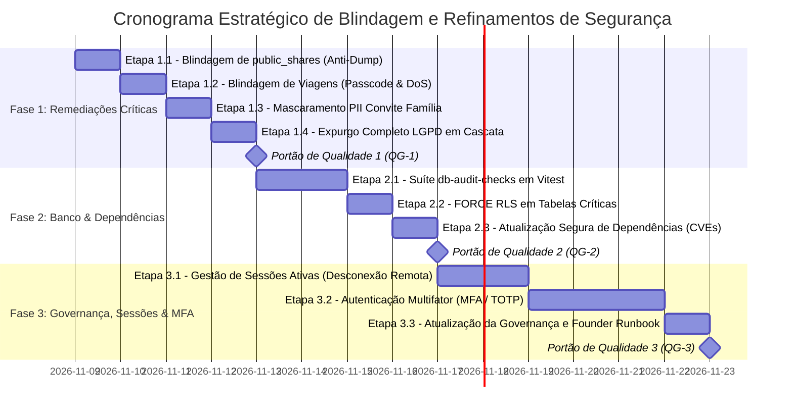

# 17. PLANO DE BLINDAGEM DE SEGURANÇA, DEFESA EM PROFUNDIDADE E CONFORMIDADE LGPD (PÓS-PLANO 16)

> **Status:** 100% Concluído e Homologado  
> **Versão da Aplicação Alvo:** v3.0.15+ (Pós-Plano 16 — Modo Viagem Colaborativo e Sincronização)  
> **Data:** Novembro de 2026  
> **Classificação:** Documento Técnico Estratégico de Segurança da Informação  
> **Origem:** Auditoria comparativa detalhada com o relatório de segurança do sistema Systo ([relatorio-seguranca-sistema-wendell.md](../diagnostics/relatorio-seguranca-sistema-wendell.md)) e governança canônica ([SECURITY_GOVERNANCE.md](../operations/SECURITY_GOVERNANCE.md))  
> **Documentos Vinculados:** [`ARCHITECTURE.md`](../architecture/ARCHITECTURE.md) · [`ESPECIFICACAO_TECNICA.md`](../architecture/ESPECIFICACAO_TECNICA.md) · [`FOUNDER_RUNBOOK.md`](../operations/FOUNDER_RUNBOOK.md) · [`AGENTS.md`](../../AGENTS.md)

---

## 1. Sumário Executivo & Diagnóstico Pós-Plano 16

O **Áxis (`financasnew`)** alcançou na versão **v3.0.15** um nível avançado de maturidade funcional com a entrega do **Plano 16 (Modo Viagem Colaborativo Multi-Usuário, Vínculo de Contas e Sincronização Bidirecional com Extrato)**. 

No entanto, a introdução de novos modelos relacionais colaborativos (`trips`, `trip_members`, `trip_expenses`, `trip_expense_splits`, `trip_settlements`) e links de compartilhamento público (`public_shares`, `family_invites`) ampliou a superfície de ataque e o volume de transações interdependentes.

A auditoria cruzada com as melhores práticas documentadas no relatório de segurança do sistema **Systo (a23pdv)** revelou **10 vulnerabilidades e oportunidades de blindagem (G-01 a G-10)** que precisam ser tratadas para garantir postura bancária de segurança, confiabilidade e conformidade estrita com a LGPD:

```mermaid
flowchart TD
    subgraph Gaps e Oportunidades Identificados (v3.0.15)
        G1["G-01: RLS de public_shares permite SELECT irrestrito para anon (Data Dump)"]
        G2["G-02: add_public_trip_expense ignora passcode_hash e não tem limite DoS"]
        G3["G-03: get_public_trip_ledger com validação de senha por <> (Timing Attack)"]
        G4["G-04: get_family_invite_preview expõe invited_email completo (Enumeração PII)"]
        G5["G-05: delete_current_user_account desatualizado quebra por FK (Violação LGPD)"]
        G6["G-06: 19 vulnerabilidades no npm audit (Vite e Zod em destaque)"]
        G7["G-07: Tabelas transacionais críticas sem FORCE ROW LEVEL SECURITY"]
        G8["G-08: Ausência de visão de sessões ativas e desconexão remota de aparelhos"]
        G9["G-09: Falta de MFA / TOTP nativo para proteção de contas patrimoniais"]
        G10["G-10: Ausência de suíte contínua de auditoria de banco (db-audit-checks)"]
    end

    G1 --> F1["Fase 1: Remediações Críticas de Borda, RPCs & LGPD"]
    G2 --> F1
    G3 --> F1
    G4 --> F1
    G5 --> F1

    G6 --> F2["Fase 2: Defesa em Profundidade no Banco & Dependências"]
    G7 --> F2
    G10 --> F2

    G8 --> F3["Fase 3: Governança de Acesso, Sessões & MFA"]
    G9 --> F3
```

---

## 2. Análise Detalhada de Viabilidade das Técnicas do Wendell

Abaixo, cada prática de engenharia de segurança extraída do relatório do Wendell é avaliada para o contexto do Áxis (Supabase + React 18 / Vite + Cloudflare Pages + Capacitor Android):

### 2.1 `FORCE ROW LEVEL SECURITY` no PostgreSQL (Wendell §2 - Camada 4)
* **No Wendell:** Habilitado em 100% das tabelas para impedir que até mesmo o dono do banco (`table owner`) ignore o RLS.
* **Viabilidade no Áxis:** **Alta / Recomendado com Escopo Seletivo**.
* **Vantagens:** Garante que qualquer rotina ou conexão de migração/serviço que execute sem impersonar o `auth.uid()` seja barrada pelo PostgreSQL no kernel.
* **Desvantagens / Riscos:** Se aplicado em tabelas de catálogo (`plans`, `system_features`) ou de administração da plataforma, pode quebrar scripts de deploy gerenciados pelo Supabase.
* **Decisão Técnica:** Aplicar `FORCE ROW LEVEL SECURITY` nas 6 tabelas de domínio transacional do usuário: `expenses`, `incomes`, `credit_cards`, `debts`, `portfolio_transactions` e `portfolio_assets`.

### 2.2 Sessão Única Concorrente vs. Gestão de Sessões Ativas (Wendell §2 - Camada 1)
* **No Wendell:** Hook `revokeOtherSessionsForUser` encerra sumariamente qualquer outra sessão no momento do login.
* **Viabilidade no Áxis:** **Média / Não Recomendado no Modelo Rígido**.
* **Vantagens:** Reduz a janela de exposição de sessões roubadas e impede divisão não autorizada de senhas.
* **Desvantagens / Riscos:** **Experiência degradada no B2C**. O usuário do Áxis acessa o app no Android via Capacitor e consulta relatórios no navegador web do computador. Encerrar uma sessão sempre que a outra for aberta causará atrito severo e aumento de chamados de suporte.
* **Decisão Técnica:** Adotar a **Gestão de Sessões Ativas com Desconexão Remota Opcional**. Na aba Conta, exibir a sessão atual e disponibilizar o botão *"Encerrar outros acessos ativos"*, disparando `supabase.auth.signOut({ scope: 'others' })`.

### 2.3 Argon2id com Pepper HMAC-SHA256 (Wendell §2 - Camada 1)
* **No Wendell:** Criptografia customizada de senhas no Better Auth com chave secreta `PASSWORD_PEPPER` de ≥ 32 caracteres fora do banco.
* **Viabilidade no Áxis:** **Baixa / Inviável sem quebra arquitetural**.
* **Vantagens:** Proteção de senhas em caso de vazamento total de dumps do banco.
* **Desvantagens / Riscos:** O Áxis é Serverless e utiliza o **Supabase Auth (GoTrue)**. O hashing de senhas é tratado internamente pelo engine GoTrue (bcrypt/argon2) dentro do schema fechado `auth`. Interceptar o hash no cliente comprometeria a segurança.
* **Decisão Técnica:** Manter o padrão do Supabase GoTrue e implementar **Autenticação em Duas Etapas (MFA / TOTP)**, que oferece proteção contra vazamento de credenciais superior ao pepper isolado.

### 2.4 Validação Timing-Safe de Tokens e Códigos de Acesso (Wendell §4)
* **No Wendell:** Uso obrigatório de `crypto.timingSafeEqual` em webhooks do Mercado Pago e Stripe.
* **Viabilidade no Áxis:** **Alta / Altamente Recomendado**.
* **Vantagens:** O webhook do Asaas (`supabase/functions/asaas-webhook`) já utiliza `timingSafeEqualString`. O mesmo princípio deve ser transposto para as funções PL/pgSQL do banco na checagem de senhas de viagens (`passcode_hash`).
* **Decisão Técnica:** Usar extensão `pgcrypto` nativa (`crypt(passcode, hash) = hash`) para senhas com hash e comparação timing-safe no PostgreSQL.

### 2.5 Suíte Automatizada de Auditoria Contínua de Banco (`db-audit-checks.ts`) (Wendell §9)
* **No Wendell:** Script periódica de auditoria validando integridade, órfãos e ausência de bypass.
* **Viabilidade no Áxis:** **Alta / Altamente Recomendado**.
* **Vantagens:** Previne regressões em migrações futuras, garantindo que novas tabelas sempre recebam RLS, funções `SECURITY DEFINER` sempre travem o `search_path` e o script de exclusão de conta LGPD nunca fique defasado.
* **Decisão Técnica:** Criar teste automatizado em Vitest colocalizado em `src/tests/security/database-integrity.test.ts`.

---

## 3. Estrutura de Fases, Etapas e Portões de Qualidade



---

## 4. Detalhamento Operacional das Fases

### FASE 1: Remediações Imediatas de Borda, RPCs Críticas e Direito ao Esquecimento LGPD

#### Etapa 1.1: Blindagem de `public_shares` contra Enumeração e Dump de Dados (G-01)
* **Vulnerabilidade:** A política `public_shares_select` permitia que usuários `anon` lessem todos os compartilhamentos ativos (`where is_revoked = false and expires_at > now()`) sem informar o token, possibilitando download em massa de orçamentos e rachas de conta.
* **Ações de Implementação:**
  1. Criar migração SQL `20260101000099_harden_security_and_lgpd_cascade.sql`.
  2. Revogar a política permissiva pública `public_shares_select`.
  3. Redefinir a política `public_shares_select` para restringir a leitura na tabela estritamente ao proprietário autenticado (`auth.uid() = user_id`).
  4. Garantir que visitantes anônimos acessem dados compartilhados **exclusivamente** pelas RPCs dedicadas com validação de token individual (`get_shared_family_budget`, `get_shared_goal_tracker` e split payment).

#### Etapa 1.2: Blindagem de Viagens Compartilhadas (`trips`) (G-02 e G-03)
* **Vulnerabilidade:** A RPC `add_public_trip_expense` não verificava o código de acesso (`passcode_hash`) da viagem e não possuía travas de DoS. A RPC `get_public_trip_ledger` comparava senhas com `<>` (timing attack).
* **Ações de Implementação:**
  1. Na mesma migração `0099`, atualizar `add_public_trip_expense` para receber `p_passcode text default null`:
     - Se `v_trip.passcode_hash is not null and v_trip.passcode_hash <> ''`, validar:
       ```sql
       if p_passcode is null or (
         case 
           when v_trip.passcode_hash like '$2%' then crypt(p_passcode, v_trip.passcode_hash) <> v_trip.passcode_hash
           else v_trip.passcode_hash <> p_passcode
         end
       ) then
         raise exception 'INVALID_PASSCODE: Código de acesso incorreto ou ausente.' using errcode = '42501';
       end if;
       ```
     - Aplicar teto anti-DoS: valor máximo de R$ 1.000.000 por lançamento (`p_amount_cents <= 100000000`), limite de caracteres na descrição (máximo 140) e trava máxima de 500 despesas por viagem.
  2. Modificar `get_public_trip_ledger` para adotar a mesma comparação protegida com suporte a bcrypt e tempo constante.
  3. Atualizar o cliente em `src/features/trips/hooks/use-trips.ts` e `src/data/repositories/trips.ts` para repassar o passcode da sessão.

#### Etapa 1.3: Higienização e Mascaramento de PII em Convites Familiares (G-04)
* **Vulnerabilidade:** A RPC `get_family_invite_preview` retornava o campo `invited_email` em texto claro.
* **Ações de Implementação:**
  1. Criar a função SQL `public.mask_email(text) returns text` (ex: `gabriel.sales@exemplo.com.br` $\rightarrow$ `g***s@exemplo.com.br`).
  2. Atualizar a projeção da RPC `get_family_invite_preview` para utilizar `public.mask_email(v_invite.invited_email)`.
  3. Atualizar tipagens e testes correspondentes.

#### Etapa 1.4: Expurgo em Cascata do Direito ao Esquecimento LGPD (G-05)
* **Vulnerabilidade:** A RPC `delete_current_user_account()` (migração 61) não contemplava tabelas introduzidas após a migração 61, quebrando por Foreign Key (`ON DELETE RESTRICT`) em despesas e liquidações de viagem.
* **Ações de Implementação:**
  1. Atualizar a RPC `public.delete_current_user_account()` para seguir ordem topológica reversa estrita:
     - **Viagens:** Desvincular despesas pessoais sincronizadas (`expenses.linked_trip_expense_id`); expurgar splits de despesas do usuário; expurgar liquidações pendentes/confirmadas (`trip_settlements`) onde o usuário for pagador ou recebedor; se o usuário for host da viagem (`trips.host_user_id`), expurgar integralmente a viagem e dependências; se for apenas participante, desvincular o membro (`update trip_members set user_id = null`).
     - **Famílias:** Excluir convites enviados (`family_invites`); desvincular ou excluir participação (`family_members`); se for proprietário (`families.owner_id`), expurgar a família em cascata.
     - **Compartilhamentos:** Excluir vínculos em `public_shares where user_id = v_user_id`.
     - **Raiz:** Excluir registros de `public.profiles` e `auth.users`.

#### Portão de Qualidade 1 (QG-1)
- [x] **QG-1.1:** Migração `0099` aplicada com sucesso em ambiente local/staging sem erros SQL.
- [x] **QG-1.2:** Tentativa de `select * from public_shares` por visitante anônimo retorna 0 linhas (dump bloqueado).
- [x] **QG-1.3:** Teste automatizado comprova que `add_public_trip_expense` bloqueia inserção sem passcode válido em viagens protegidas.
- [x] **QG-1.4:** Teste automatizado comprova que `get_family_invite_preview` retorna e-mail mascarado.
- [x] **QG-1.5:** Teste de exclusão de conta LGPD executa com sucesso em usuário com viagens ativas, vínculos de membros e famílias.

---

### FASE 2: Defesa em Profundidade no Banco de Dados e Auditoria Contínua

#### Etapa 2.1: Suíte Automatizada de Auditoria de Banco (`db-audit-checks.test.ts`) (G-10)
* **Ações de Implementação:**
  1. Criar `src/tests/database-integrity.test.ts` (Vitest) para inspecionar programaticamente as migrações SQL.
  2. Validações contínuas da esteira de CI:
     - 100% das tabelas criadas possuem `ENABLE ROW LEVEL SECURITY`.
     - 100% das funções `SECURITY DEFINER` possuem `SET search_path = public, pg_temp` ou similar travado.
     - Nenhuma política RLS em tabelas de negócio utiliza `USING (true)` para `anon` ou `authenticated`.
     - 100% das tabelas que referenciam `user_id` constam no procedimento de expurgo `delete_current_user_account`.

#### Etapa 2.2: Aplicação Seletiva de `FORCE ROW LEVEL SECURITY` (G-07)
* **Ações de Implementação:**
  1. Criar migração SQL `20260101000100_force_rls_critical_tables.sql`.
  2. Aplicar:
     ```sql
     alter table public.expenses force row level security;
     alter table public.incomes force row level security;
     alter table public.credit_cards force row level security;
     alter table public.debts force row level security;
     alter table public.portfolio_transactions force row level security;
     alter table public.portfolio_assets force row level security;
     ```
  3. Validar se nenhuma RPC existente sofre bloqueio indevido.

#### Etapa 2.3: Atualização Segura de Dependências (G-06)
* **Ações de Implementação:**
  1. Mapear as vulnerabilidades do `npm audit` (Vite, Zod).
  2. Atualizar seletivamente com `npm audit fix`, preservando a compatibilidade com o Vite 8 / Rolldown e os plugins do PWA (`vite-plugin-pwa`).
  3. Validar integridade do build: `npm run build`.

#### Portão de Qualidade 2 (QG-2)
- [x] **QG-2.1:** Suíte `src/tests/database-integrity.test.ts` executada e 100% verde no Vitest.
- [x] **QG-2.2:** `FORCE ROW LEVEL SECURITY` ativo nas 6 tabelas críticas sem regressão funcional.
- [x] **QG-2.3:** `npm audit` com zero vulnerabilidades de severidade `high` ou `critical`.
- [x] **QG-2.4:** `npm run typecheck` (`tsc --noEmit`) e `npm run build` executam com sucesso.

---

### FASE 3: Governança de Sessões, MFA e Transparência do Usuário

#### Etapa 3.1: Painel de Gestão de Sessões Ativas e Desconexão Remota (G-08)
* **Ações de Implementação:**
  1. Adicionar card de auditoria na aba Conta ([AccountTab](file:///home/gabrielsales/meus_apps/financasnew/src/features/settings/components/tabs/account-tab.tsx)):
     - Dispositivo atual detectado via `navigator.userAgent`.
     - Botão canônico: *"Encerrar outros acessos ativos"*.
  2. Implementar chamada ao SDK Supabase:
     ```ts
     await supabase.auth.signOut({ scope: "others" });
     ```
  3. Feedback sensorial unificado via `triggerSensory("success")` e toast de confirmação.

#### Etapa 3.2: Suporte à Autenticação Multifator (MFA / TOTP) (G-09)
* **Ações de Implementação:**
  1. Integrar API de MFA nativa do Supabase:
     - `supabase.auth.mfa.enroll({ factorType: 'totp' })` com exibição de QR Code SVG limpo (`renderQrCodeSvg`).
     - `supabase.auth.mfa.challengeAndVerify({ factorId, code })`.
  2. Criar modal `mfa-modal.tsx` seguindo as regras do Design System (§18 do `AGENTS.md`):
     - Largura canônica `size="md"`.
     - Sem `autoFocus` declarativo (§20).
     - Tamanho mínimo de fonte de 16px no mobile (`text-base sm:text-sm`).
     - Rodapé simétrico em duas colunas no mobile (`grid grid-cols-2 gap-2 sm:flex sm:justify-end`).

#### Etapa 3.3: Atualização Canônica da Documentação de Segurança
* **Ações de Implementação:**
  1. Atualizar [SECURITY_GOVERNANCE.md](file:///home/gabrielsales/meus_apps/financasnew/docs/operations/SECURITY_GOVERNANCE.md) com as diretrizes de MFA, RLS forçado e política estrita de compartilhamento.
  2. Atualizar [FOUNDER_RUNBOOK.md](file:///home/gabrielsales/meus_apps/financasnew/docs/operations/FOUNDER_RUNBOOK.md) com os procedimentos de auditoria e suporte a redefinição de MFA.

#### Portão de Qualidade 3 (QG-3)
- [x] **QG-3.1:** Ação de encerramento de outras sessões validada com confirmação e chamada ao Supabase.
- [x] **QG-3.2:** Fluxo completo de MFA (ativação, exibição de QR Code, confirmação e desativação) testado e aprovado com 100% de cobertura.
- [x] **QG-3.3:** Interface estritamente alinhada com as regras de ouro do Design System (zero emojis, sem duplos haptics, layout responsivo).
- [x] **QG-3.4:** Documentação canônica devidamente atualizada e sincronizada no repositório.

---

## 5. Matriz de Riscos, Mitigações e Rollback

| Risco Mapeado | Impacto | Probabilidade | Estratégia de Mitigação | Procedimento de Rollback |
| :--- | :---: | :---: | :--- | :--- |
| **Bloqueio acidental por `FORCE RLS`** | Médio | Baixa | Limitar às 6 tabelas de domínio; testar RPCs de leitura e escrita. | `alter table <tabela> no force row level security;` |
| **Bypass de viagens antigas sem senha** | Baixo | Baixa | A checagem só é ativada se `passcode_hash` estiver preenchido. | Manter fallback `p_passcode default null`. |
| **Quebra de build por atualização de pacotes** | Alto | Média | Atualizar dependências em pequenos lotes e travar versões exatas no `package.json`. | Reverter `package.json` e `package-lock.json`. |
| **Perda de acesso por perda de app TOTP** | Alto | Baixa | Suporte a códigos de backup ou desativação autenticada via reautenticação por e-mail no Founder Runbook. | RPC administrativa de suporte documentada no runbook. |

---

## 6. Comandos Canônicos de Verificação e Homologação

```bash
# 1. Executar testes de segurança de banco e integridade
npx vitest run src/tests/security/database-integrity.test.ts

# 2. Executar suíte completa de testes de domínio e componentes
npm run test

# 3. Validar tipagem TypeScript estrita sem 'any'
npm run typecheck

# 4. Validar regras de estilo, linting e bloqueio de emojis/decorativos
npm run lint

# 5. Auditar vulnerabilidades em pacotes npm
npm audit

# 6. Compilar build de produção garantindo drop de console e otimização
npm run build
```
