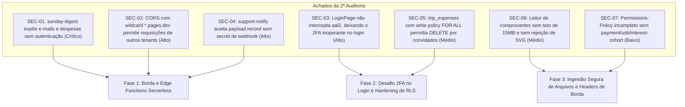
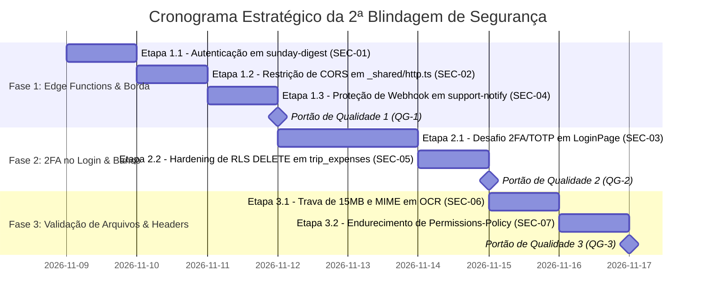

# 18. PLANO DE BLINDAGEM DE SEGURANÇA — 2ª RODADA DE DEFESA EM PROFUNDIDADE

> **Status:** 100% Concluído e Homologado  
> **Versão da Aplicação Alvo:** v3.0.15+ (Pós-Plano 17)  
> **Data:** Novembro de 2026  
> **Classificação:** Documento Técnico Estratégico de Segurança da Informação  
> **Origem:** Segunda Auditoria Detalhada de Borda, Edge Functions, Autenticação MFA e Políticas RLS  
> **Documentos Vinculados:** [`ARCHITECTURE.md`](../docs/architecture/ARCHITECTURE.md) · [`ESPECIFICACAO_TECNICA.md`](../docs/architecture/ESPECIFICACAO_TECNICA.md) · [`SECURITY_GOVERNANCE.md`](../docs/operations/SECURITY_GOVERNANCE.md) · [`AGENTS.md`](../AGENTS.md)

---

## 1. Sumário Executivo & Diagnóstico da 2ª Auditoria

A 2ª auditoria de segurança aprofundada no **Áxis Finance (`financasnew`)** cobriu a totalidade de Edge Functions Serverless, regras de CORS, desafio de segundo fator (MFA) na autenticação, políticas RLS residuais de exclusão e validações de arquivos de OCR.

Foram identificados **7 apontamentos de segurança (SEC-01 a SEC-07)** categorizados em 3 fases de intervenção:



---

## 2. Estrutura de Fases, Etapas e Portões de Qualidade



---

## 3. Detalhamento Operacional das Fases

### FASE 1: Borda e Edge Functions Serverless

#### Etapa 1.1: Autenticação Estrita em `sunday-digest` (SEC-01)
* **Vulnerabilidade:** A rota `/functions/v1/sunday-digest` aceitava requisições `POST` sem checar token de autenticação, chave de cron ou permissão de service_role, devolvendo e-mails e despesas semanais de clientes.
* **Ações de Implementação:**
  1. No arquivo [`supabase/functions/sunday-digest/index.ts`](../supabase/functions/sunday-digest/index.ts), extrair e validar o token do cabeçalho `Authorization`:
     ```ts
     const auth = req.headers.get("authorization") ?? "";
     const token = auth.replace(/^Bearer\s+/i, "").trim();
     const cronSecret = Deno.env.get("CRON_SECRET") ?? "";
     const serviceRoleKey = Deno.env.get("SUPABASE_SERVICE_ROLE_KEY") ?? "";

     const isAuthorized =
       (serviceRoleKey && token === serviceRoleKey) ||
       (cronSecret && token === cronSecret);

     if (!isAuthorized) {
       return jsonResponse(req, { error: "unauthorized" }, 401);
     }
     ```
  2. Testar que qualquer requisição sem token recebe `401 Unauthorized`.

#### Etapa 1.2: Restrição de CORS em `_shared/http.ts` (SEC-02)
* **Vulnerabilidade:** `url.hostname.endsWith(".pages.dev") || url.hostname.endsWith(".workers.dev")` considerava qualquer projeto Cloudflare Pages/Workers do mundo como autorizado pelo CORS.
* **Ações de Implementação:**
  1. No arquivo [`supabase/functions/_shared/http.ts`](../supabase/functions/_shared/http.ts), substituir a regra permissiva por verificação estrita do subdomínio oficial do projeto:
     ```ts
     // Permite apenas o domínio canônico do projeto e seus deploy previews legítimos
     if (
       url.hostname === "financasnew.pages.dev" ||
       url.hostname.endsWith(".financasnew.pages.dev")
     ) {
       return true;
     }
     ```
  2. Preservar `ALLOWED_ORIGINS` e origens locais/Capacitor.

#### Etapa 1.3: Segredo Compartilhado em `support-notify` (SEC-04)
* **Vulnerabilidade:** Chamadas enviando `payload.record` disparavam mensagens no Telegram sem autenticação prévia.
* **Ações de Implementação:**
  1. No arquivo [`supabase/functions/support-notify/index.ts`](../supabase/functions/support-notify/index.ts), validar `x-webhook-secret` contra `WEBHOOK_SECRET` ou autorização via `SUPABASE_SERVICE_ROLE_KEY` antes de despachar a notificação.
  2. Rejeitar chamadas não autenticadas com `401 Unauthorized`.

#### Portão de Qualidade 1 (QG-1)
- [x] **QG-1.1:** `sunday-digest` rejeita chamadas desautenticadas com `401 Unauthorized`.
- [x] **QG-1.2:** CORS em `_shared/http.ts` não autoriza domínios `.pages.dev` de terceiros.
- [x] **QG-1.3:** `support-notify` bloqueia injeções forjadas de `payload.record`.

---

### FASE 2: Desafio 2FA/TOTP no Login e Hardening de RLS

#### Etapa 2.1: Interceptação e Desafio de TOTP em `LoginPage` (SEC-03)
* **Vulnerabilidade:** Usuários com 2FA ativo logavam direto sem validação de segundo fator.
* **Ações de Implementação:**
  1. No formulário [`src/features/auth/pages/login-page.tsx`](../src/features/auth/pages/login-page.tsx):
     - Pós-`signInWithEmail()`, consultar `supabase.auth.mfa.getAuthenticatorAssuranceLevel()`.
     - Se `currentLevel === "aal1"` e `nextLevel === "aal2"`, pausar o redirecionamento e alternar a visualização para a tela de desafio 2FA:
       - Título: *"Verificação em Duas Etapas (2FA)"*;
       - Instrução amigável orientando a abrir o aplicativo autenticador;
       - Campo `Input` estilizado para código de 6 dígitos (`maxLength={6}`, `text-center tracking-widest font-mono text-lg`);
       - Botão *"Confirmar Código"* chamando `supabase.auth.mfa.challengeAndVerify({ factorId, code })`;
       - Botão secundário *"Cancelar e Voltar"*, efetuando `supabase.auth.signOut()` suavemente.
  2. Adicionar testes unitários em `src/features/auth/pages/login-page.test.tsx` cobrindo o fluxo de MFA.

#### Etapa 2.2: Hardening de RLS `DELETE` em `trip_expenses` (SEC-05)
* **Vulnerabilidade:** `trip_expenses_write_policy` permitia que qualquer membro da viagem fizesse `DELETE` em despesas de terceiros via REST direto.
* **Ações de Implementação:**
  1. Criar a migração `supabase/migrations/20260101000102_harden_trip_expenses_delete_policy.sql`.
  2. Dividir a política de escrita em:
     - `trip_expenses_insert_policy`: Qualquer membro da viagem (`is_trip_member` ou `is_trip_host`).
     - `trip_expenses_update_policy`: Anfitrião ou pagador/criador.
     - `trip_expenses_delete_policy`: Estritamente o anfitrião da viagem (`is_trip_host`) ou o usuário criador/pagador (`auth.uid() = tm.user_id`).
  3. Atualizar a suíte `src/tests/database-integrity.test.ts`.

#### Portão de Qualidade 2 (QG-2)
- [x] **QG-2.1:** Fluxo de login com MFA intercepta `aal2` e exige o código de 6 dígitos.
- [x] **QG-2.2:** Despesas de viagem não podem ser deletadas por convidados que não criaram/pagaram o registro.
- [x] **QG-2.3:** Suíte `src/tests/database-integrity.test.ts` 100% verde com as novas regras.

---

### FASE 3: Ingestão Segura de Arquivos e Cabeçalhos de Borda

#### Etapa 3.1: Validação Preventiva de Arquivos OCR (SEC-06)
* **Vulnerabilidade:** Arquivos gigantes (> 50MB) ou SVGs podiam causar travamento por Out-Of-Memory no browser.
* **Ações de Implementação:**
  1. Em [`src/components/modules/attach-receipt-dialog.tsx`](../src/components/modules/attach-receipt-dialog.tsx) e [`src/services/native/receipt-extractor.ts`](../src/services/native/receipt-extractor.ts):
     - Validar `file.size <= 15 * 1024 * 1024` (teto estrito de 15MB).
     - Rejeitar `file.type === "image/svg+xml"` ou extensões executáveis.
     - Exibir mensagem amigável no toast: *"O comprovante selecionado excede o limite de 15 MB. Envie um arquivo mais leve."*
  2. Atualizar testes unitários em `attach-receipt-dialog.test.tsx`.

#### Etapa 3.2: Endurecimento de `Permissions-Policy` (SEC-07)
* **Ações de Implementação:**
  1. No arquivo [`public/_headers`](../public/_headers), atualizar a linha de `Permissions-Policy`:
     ```
     Permissions-Policy: camera=(), microphone=(), geolocation=(), payment=(), usb=(), accelerometer=(), gyroscope=(), interest-cohort=()
     ```
  2. Atualizar o teste de segurança em [`src/tests/security-headers.test.ts`](../src/tests/security-headers.test.ts).

#### Portão de Qualidade 3 (QG-3)
- [x] **QG-3.1:** Upload de arquivos acima de 15MB rejeitado com feedback amigável.
- [x] **QG-3.2:** Headers de segurança em `public/_headers` aprovados em teste automatizado.
- [x] **QG-3.3:** `npm run typecheck`, `npm run lint`, `npm test` e `npm run build` executam com 100% de sucesso.
- [x] **QG-3.4:** Documentação em [`SECURITY_GOVERNANCE.md`](../docs/operations/SECURITY_GOVERNANCE.md) atualizada.

---

## 4. Matriz de Riscos e Mitigações

| Risco Mapeado | Impacto | Probabilidade | Estratégia de Mitigação |
|---|:---:|:---:|---|
| **Bloqueio acidental no login sem MFA** | Alto | Baixa | O desafio só é ativado se `nextLevel === 'aal2'` comprovado pelo Supabase Auth. |
| **Bloqueio de cron do Sunday Digest** | Médio | Baixa | Aceitar tanto `service_role` quanto `CRON_SECRET`. |
| **Rejeição de comprovantes válidos** | Baixo | Baixa | Teto de 15MB é mais que o triplo do tamanho médio de comprovantes bancários (geralmente < 2MB). |
