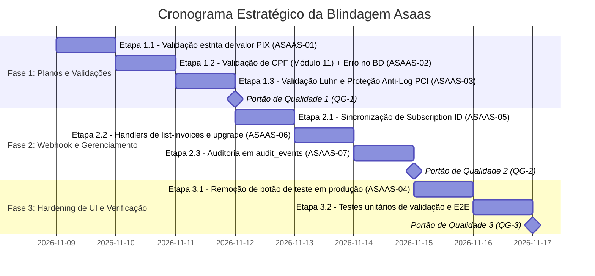

# 19. PLANO DE AUDITORIA E BLINDAGEM DO FLUXO DE PAGAMENTO (ASAAS)

> **Status:** 100% Concluído e Homologado  
> **Versão da Aplicação Alvo:** v3.0.15+ (Pós-Plano 18)  
> **Data:** Novembro de 2026  
> **Classificação:** Documento Técnico Estratégico de Segurança da Informação & Compliance Financeiro  
> **Origem:** Auditoria Completa do Subsistema de Assinaturas, Checkout, Webhooks e Governança Asaas  
> **Documentos Vinculados:** [`ARCHITECTURE.md`](../docs/architecture/ARCHITECTURE.md) · [`ESPECIFICACAO_TECNICA.md`](../docs/architecture/ESPECIFICACAO_TECNICA.md) · [`SECURITY_GOVERNANCE.md`](../docs/operations/SECURITY_GOVERNANCE.md) · [`AGENTS.md`](../AGENTS.md)

---

## 1. Sumário Executivo & Diagnóstico da Auditoria

O ecossistema de monetização e assinaturas do **Áxis Finance (`financasnew`)** opera com integração direta à API v3 do **Asaas** (gateway homologado para o mercado brasileiro, processando cobranças via PIX Dinâmico e Cartão de Crédito transparente).

Uma auditoria exaustiva cobrindo a arquitetura de borda, Edge Functions (`asaas-checkout`, `asaas-webhook`, `asaas-manage`), catálogo de planos (`asaas-plans.ts`), interface de checkout e repositórios identificou **7 apontamentos de segurança e integridade operacional**:

1. **ASAAS-01 (Crítico) — Bypass de valor em pagamentos PIX (`asaas-plans.ts`):**  
   A rotina de resolução de planos continha a expressão `if (!Number.isFinite(value) || approxEqual(value, ASAAS_PLAN_CATALOG.annual.value))`. Se um webhook recebesse `value: null`, `undefined` ou string não-numérica, a condição `!Number.isFinite(value)` retornava `true`, ativando indevidamente o plano Anual Pro sem validação do montante pago.

2. **ASAAS-02 (Alto) — Falha de validação estrita de CPF e silenciamento de erros no banco (`asaas-checkout`):**  
   O checkout verificava apenas se o CPF possuía 11 caracteres numéricos. Não executava a checagem dos dois dígitos verificadores (módulo 11) nem sequências homogêneas (`11111111111`). Adicionalmente, o comando `supabase.from("profiles").update({ cpf: cleanCpf })` não conferia a propriedade `error`, silenciando eventuais rejeições da trigger de banco `trg_sanitize_profile_cpf` e enviando CPFs corrompidos para a API externa.

3. **ASAAS-03 (Alto) — Ausência de validação de cartão de crédito (Luhn/Expiração) e proteção anti-log PCI-DSS:**  
   Dados de cartão recebidos na Edge Function não passavam pelo algoritmo de validação de checksum de Luhn, nem conferência de expiração antes do despacho à API. Faltava também uma camada formal de sanitização para garantir que número de cartão e CCV nunca sejam expostos em logs do Deno runtime sob falhas de rede ou exceções de requisição.

4. **ASAAS-04 (Médio) — Botão de simulação PIX exposto na interface de produção:**  
   A página `subscription-checkout-page.tsx` mantinha visível para clientes finais um botão destacado em verde intitulado *"Simular Confirmação PIX (Ambiente de Teste)"*, criando falsas expectativas e transmitindo sensação de ambiente de testes em produção.

5. **ASAAS-05 (Médio) — Dessincronização do `asaas_subscription_id` na ativação via webhook:**  
   Ao processar eventos `PAYMENT_RECEIVED` ou `PAYMENT_CONFIRMED`, o webhook atualizava o registro de `user_subscriptions` com `asaas_payment_id` e `asaas_customer_id`, mas não persistia o identificador `subscriptionId` da assinatura recorrente, gerando falhas quando o usuário tentava cancelar ou trocar o cartão na aba de configurações.

6. **ASAAS-06 (Médio) — Ações `list-invoices` e `upgrade-to-annual` não tratadas em `asaas-manage`:**  
   O repositório `billing.ts` possuía métodos chamando `action: "list-invoices"` e `action: "upgrade-to-annual"`, mas a Edge Function `asaas-manage` devolvia HTTP 400 "Ação não suportada", embora `_shared/asaas.ts` já tivesse as chamadas de API prontas.

7. **ASAAS-07 (Baixa) — Ausência de registro de auditoria em `audit_events` para transações de faturamento:**  
   Transições críticas (ativação Pro, cancelamento de renovação e estornos integrais) não deixavam registros na tabela imutável `public.audit_events`.

---

## 2. Estrutura de Fases e Portões de Qualidade



---

## 3. Detalhamento Operacional das Fases

### FASE 1: Planos, Catálogo e Validações de Borda

#### Etapa 1.1: Validação Estrita de Valor PIX (ASAAS-01)
- Em `supabase/functions/_shared/asaas-plans.ts`, substituir a condição permissiva por validação estrita:
  ```ts
  if (billingType === "PIX") {
    if (Number.isFinite(value) && approxEqual(value, ASAAS_PLAN_CATALOG.annual.value)) {
      return ASAAS_PLAN_CATALOG.annual.planId;
    }
    return null;
  }
  ```
- Atualizar testes em `src/tests/asaas-plans.test.ts` cobrindo casos com `value: undefined`, `value: null`, `value: NaN` e valores divergentes.

#### Etapa 1.2: Validação de CPF e Tratamento de Erros no Banco (ASAAS-02)
- Em `supabase/functions/_shared/asaas.ts`, exportar função pura `isValidCPF(cpf: string): boolean` (módulo 11 completo e rejeição de sequências homogêneas).
- Em `supabase/functions/asaas-checkout/index.ts`:
  - Validar com `isValidCPF(cleanCpf)`. Se inválido, devolver HTTP 400 com mensagem amigável.
  - Verificar `{ error: updateError }` na atualização de `profiles.cpf`. Se houver erro, devolver HTTP 400/500 impedindo avanço descontrolado.

#### Etapa 1.3: Validação de Luhn e Proteção Anti-Log PCI-DSS (ASAAS-03)
- Em `supabase/functions/_shared/asaas.ts`:
  - Exportar `isValidLuhn(cardNumber: string): boolean`.
  - Exportar `isValidCardExpiry(month: string, year: string): boolean`.
  - Exportar `sanitizePaymentLog(obj: unknown): unknown` que redige números de cartão (`card.number` para os 4 últimos dígitos) e mascara completamente `ccv`.
- Em `supabase/functions/asaas-checkout/index.ts` e `asaas-manage/index.ts`:
  - Validar checksum de Luhn e expiração antes de despachar para a API Asaas.
  - Assegurar que nenhum log imprima o objeto `card` em texto claro.

#### Portão de Qualidade 1 (QG-1)
- [x] **QG-1.1:** Webhook PIX com valor indefinido ou nulo retorna `null` e não promove a conta.
- [x] **QG-1.2:** CPF com dígitos verificadores incorretos é rejeitado no checkout com 400.
- [x] **QG-1.3:** Cartões com checksum de Luhn inválido ou vencidos são rejeitados antes da API externa.

---

### FASE 2: Webhook, Sincronização e Auditoria

#### Etapa 2.1: Sincronização de Subscription ID no Webhook (ASAAS-05)
- Em `supabase/functions/asaas-webhook/index.ts`:
  - No bloco `action === "activate"`, incluir `...(subscriptionId ? { asaas_subscription_id: subscriptionId } : {})` na atualização de `user_subscriptions`.

#### Etapa 2.2: Ações de Faturamento em `asaas-manage` (ASAAS-06)
- Em `supabase/functions/asaas-manage/index.ts`:
  - Implementar `action === "list-invoices"`, consultando `listAsaasCustomerPayments(userSub.asaas_customer_id)`.
  - Implementar `action === "upgrade-to-annual"`, validando que o usuário está no mensal e chamando `updateAsaasSubscriptionCycle`.

#### Etapa 2.3: Trilha de Auditoria em `audit_events` (ASAAS-07)
- Registrar eventos de auditoria imutáveis com `user_id`, tipo de evento (`billing.subscription_activated`, `billing.subscription_cancelled`, `billing.payment_refunded`) e metadados higienizados.

#### Portão de Qualidade 2 (QG-2)
- [x] **QG-2.1:** `asaas_subscription_id` persistido corretamente em ativações de cartão recorrente.
- [x] **QG-2.2:** `asaas-manage` atende `list-invoices` e `upgrade-to-annual` sem erro 400.
- [x] **QG-2.3:** Ações críticas de assinatura geram registros em `audit_events`.

---

### FASE 3: Hardening de UI e Verificação

#### Etapa 3.1: Ocultar Botão de Teste em Produção (ASAAS-04)
- Em `src/features/subscription/pages/subscription-checkout-page.tsx`:
  - Renderizar o botão `"Simular Confirmação PIX"` condicionado estritamente a `import.meta.env.DEV`.

#### Etapa 3.2: Suíte de Testes e Quality Gates
- Criar `src/tests/asaas-validation.test.ts`.
- Rodar `npx vitest run ...`.
- Rodar `npx tsc -b && npx tsc --noEmit`.
- Rodar `npx eslint ...`.
- Rodar `npm run build`.

#### Portão de Qualidade 3 (QG-3)
- [x] **QG-3.1:** Botão de simulação PIX ausente no bundle de produção.
- [x] **QG-3.2:** Suíte de testes do Asaas 100% verde.
- [x] **QG-3.3:** Typecheck, lint e build aprovados sem erros.
- [x] **QG-3.4:** Governança atualizada em `SECURITY_GOVERNANCE.md`.
