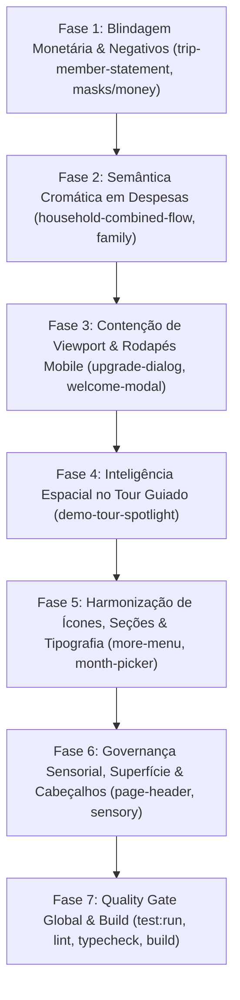

# 🎯 24_PLANO_EXECUCAO_AUDITORIA_VISUAL_E_CONGRUENCIA_GLOBAL.md

> **Status:** 100% Concluído e Homologado  
> **Classificação:** 🔵 Fluxo Completo (Correções de Auditoria Visual, Blindagem de UI Mobile, Integridade Financeira e Design System)  
> **Base de Regras:** `AGENTS.md` (Regras Canônicas §1–§27) · `DESIGN_SYSTEM.md` · `FINANCIAL_MATH_SPEC.md` · `ESPECIFICACAO_TECNICA.md`  
> **Origem:** Análise forense das capturas da pasta `auditoria_visual.zip` + Auditoria global expandida de congruência e governança em todo o repositório.  
> **Quality Gate:** `npm run test:run` + `npm run lint` + `npm run typecheck` + `npm run build` ao final de cada fase.

---

## 1. OBJETIVO E ESCOPO

Eliminar todas as 15 incongruências levantadas na auditoria completa do aplicativo, harmonizando a base de código com 100% das diretrizes do `AGENTS.md`, do `DESIGN_SYSTEM.md` e da precisão matemática de `FINANCIAL_MATH_SPEC.md`:

1. **Blindagem de Precisão Monetária & Sanitização de Negativos (Regras 3, 11 e FINANCIAL_MATH_SPEC):**
   - Corrigir `formatCentsAsCurrency` em `src/services/masks/money.ts`, que descarta valores negativos e retorna `"R$ 0,00"` para saldos devedores (ex: dívida de R$ 975,00 exibida como "R$ 0,00" amarelo).
   - Migrar os extratos de despesas compartilhadas (`trip-member-statement-dialog.tsx`, `public-trip-member-statement-dialog.tsx` e `trip-details-page.tsx`) para o primitivo canônico `<MoneyText cents={...} sign="auto" />`, com semântica de cores correta (`positive`/`negative`).
2. **Blindagem Semântica Cromática em Despesas e Metas (Regra 13):**
   - Corrigir anomalias em `household-combined-flow-card.tsx`, `household-balance-card.tsx` e `household-clustering-ranking.tsx` onde "Gastos Realizados" e despesas de familiares eram pintadas de verde vivo por causa do comportamento padrão de `<MoneyText cents={totalSpentCents} />`.
3. **Contenção Absoluta de Viewport & Eliminação de Overflows no Mobile (Regras 15, 18 e 22):**
   - Corrigir o estouro horizontal do botão primário de assinatura em `upgrade-dialog.tsx` (`"Continuar para Pagamento Se"` cortado na margem direita da tela).
   - Tornar o rodapé de checkout do Plano Pro sticky (`footer={<ModalFooter>...}`).
   - Reestruturar o rodapé de boas-vindas em `welcome-feature-modal.tsx`, eliminando o `flex-col-reverse` que espreme os dots contra a barra de gestos do sistema operacional.
   - Otimizar a trinca de saldos no extrato de gastos de viagem, substituindo o empilhamento vertical de 3 cards altos por grid compacto e ergonômico.
4. **Inteligência Espacial e Anti-Oclusão no Tour Guiado (Regras 18 e 22):**
   - Corrigir o posicionamento de `demo-tour-spotlight.tsx` para que o popover ancore-se no lado oposto ao elemento em foco, impedindo que o card do tour tampe o próprio elemento que está explicando.
   - Sanear a assimetria dos botões no mobile (`[<-]` quadrado vs `[Próximo ->]` retangular).
   - Bloquear e escurecer a BottomNav durante a execução do tour.
5. **Harmonização de Ícones, Seções de Navegação e Tipografia PT-BR (Regras 8, 13 e 21):**
   - Unificar os 4 estilos visuais colidindo em `more-menu-sheet.tsx` e organizar todas as seções com títulos padronizados, eliminando classes legadas (`bg-danger`, `text-[10px]`).
   - Remover ícones duplos redundantes (`CheckCircle2` adjacente ao ícone temático) nos benefícios do `upgrade-dialog.tsx`.
   - Corrigir a capitalização indevida da preposição "de" em `month-picker.tsx` e `proventos-tab.tsx` ("Novembro De 2026" → "Novembro de 2026").
   - Ajustar `PageHeader` para evitar botões de ícone único isolados em linhas órfãs no mobile.
   - Equilibrar a hierarquia visual dos 3 botões em `virgin-account-hero.tsx` e eliminar caixas decorativas soltas.
6. **Governança Sensorial e Zero Duplos Disparos (Regra 17):**
   - Eliminar chamadas manuais a `triggerSensory("action")` dentro de handlers `onClick` de `<Button />` em `virgin-account-hero.tsx` e `budgets-page.tsx`.
7. **Padrão Canônico de Superfície, Bordas e Cabeçalhos (Regras 16 e 21):**
   - Unificar ocorrências de `border-border/60` e `border-border/50` para `border-border/80`.
   - Migrar cabeçalhos ad-hoc de `family-budget-page.tsx` e `goal-tracker-public-page.tsx` para o primitivo unificado `<PageHeader />`.

---

## 2. CHECKLIST DE EXECUÇÃO EM FASES

- [x] **Fase 1:** Blindagem de Precisão Monetária & Sanitização de Valores Negativos (Regras 3, 11 e FINANCIAL_MATH_SPEC)
- [x] **Fase 2:** Blindagem Semântica Cromática em Despesas, Faturas e Metas Familiares (Regra 13)
- [x] **Fase 3:** Contenção de Viewport, Zero Overflow e Rodapés de Diálogos no Mobile (Regras 15, 18 e 22)
- [x] **Fase 4:** Inteligência Espacial e Anti-Oclusão no Tour Demonstrativo Guiado (Regras 18 e 22)
- [x] **Fase 5:** Harmonização de Ícones, Seções de Navegação e Tipografia PT-BR (Regras 8, 13, 14 e 21)
- [x] **Fase 6:** Governança Sensorial, Superfície Canônica e Cabeçalhos Unificados (Regras 16, 17 e 21)
- [x] **Fase 7:** Quality Gate Global, Testes de Regressão e Validação Completa de Build

---

## 3. DETALHAMENTO DAS FASES E ETAPAS

### FASE 1 — Blindagem de Precisão Monetária & Sanitização de Valores Negativos

#### 1.1 Refatoração de `src/services/masks/money.ts`
- **Problema:** A linha 48 possui: `const safe = Number.isFinite(cents) && cents >= 0 ? Math.round(cents) : 0;`. Se `cents < 0`, o valor é descartado e transformado em `0`, formatando como `"R$ 0,00"`.
- **Ação:**
  - Ajustar `formatCentsAsCurrency`:
    ```typescript
    export interface FormatCurrencyOptions {
      hideCents?: boolean;
      /** Se true, preserva o sinal negativo (ex: "-R$ 975,00" ou "−R$ 975,00"). */
      allowNegative?: boolean;
    }
    ```
    - Permitir que valores negativos finitos sejam formatados com sinal adequado quando solicitado ou de forma transparente para operações de balanço, sem perda de precisão.
  - Atualizar os testes em `src/services/masks/money.test.ts`.

#### 1.2 Migração para `<MoneyText />` nos Diálogos de Extrato de Gastos
- **Arquivos:**
  - `src/features/trips/components/trip-member-statement-dialog.tsx`
  - `src/features/public-share/components/public-trip-member-statement-dialog.tsx`
  - `src/features/trips/pages/trip-details-page.tsx`
- **Problema:** O saldo líquido do membro é renderizado via string manual com classes condicionais:
  ```tsx
  <span className={statement.netBalanceCents < 0 ? "text-warning" : ...}>
    {statement.netBalanceCents < 0 ? formatCentsAsBRL(statement.netBalanceCents) : "R$ 0,00"}
  </span>
  ```
  Isso resultou no bug da imagem 05 (saldo de -R$ 975,00 exibido como "R$ 0,00" em amarelo).
- **Ação:**
  - Substituir pelo primitivo canônico:
    ```tsx
    <MoneyText
      cents={statement.netBalanceCents}
      tone="auto"
      sign="explicit"
      className="text-sm font-bold tabular-nums"
    />
    ```
  - Eliminar a cor de alerta amarela (`text-warning`) para saldos devedores: saldo devedor deve ser vermelho (`text-negative-strong`) e saldo credor verde (`text-positive-strong`).
  - Em `trip-details-page.tsx` (linhas 697–702), substituir a concatenação manual pelo `<MoneyText />`.

#### 1.3 Quality Gate 1
- Executar: `npx vitest run src/services/masks/money.test.ts src/components/ui/money-text.test.tsx src/features/trips/ src/features/public-share/`
- Validar se nenhum saldo devedor é renderizado como zero.

---

### FASE 2 — Blindagem Semântica Cromática em Despesas e Metas

#### 2.1 Correção de Cor em Gastos Realizados do Lar
- **Arquivo:** `src/features/family/components/household-combined-flow-card.tsx`
- **Problema:** A linha 86 renderiza:
  ```tsx
  <MoneyText cents={totalSpentCents} />
  ```
  Como `totalSpentCents > 0`, o `MoneyText` com `tone="auto"` assume tom positivo, colorindo despesas de verde vivo!
- **Ação:**
  - Definir explicitamente:
    ```tsx
    <MoneyText cents={totalSpentCents} tone="default" />
    ```
  - Manter o tom neutro elegante do texto em conformidade com o ícone `ArrowDownRight text-negative-strong`.

#### 2.2 Saneamento em Cartões Familiares Correlatos
- **Arquivos:**
  - `src/features/family/components/household-balance-card.tsx` (linhas 88 e 129: `totalSpentCents` e `member.spent_cents`).
  - `src/features/family/components/household-clustering-ranking.tsx` (linha 118: `mc.spent_cents`).
  - `src/features/family/components/household-wealth-card.tsx` (linhas 111, 178 e 208: teto orçamentário e metas).
- **Ação:**
  - Adicionar `tone="default"` em todos os valores de despesas e limites estáticos, prevenindo coloração verde acidental.

#### 2.3 Quality Gate 2
- Executar: `npx vitest run src/features/family/`
- Validar conformidade cromática dos cartões do módulo Família.

---

### FASE 3 — Contenção de Viewport, Zero Overflow e Rodapés de Diálogos no Mobile

#### 3.1 Blindagem de Overflow no Modal de Upgrade Pro
- **Arquivo:** `src/components/modules/subscription/upgrade-dialog.tsx`
- **Problema:** Na imagem 08, o botão primário `"Continuar para Pagamento Seguro"` é cortado na margem direita (`"Continuar para Pagamento Se"`). O rodapé não é sticky e transborda a largura da coluna no mobile.
- **Ação:**
  - Mover o rodapé de dentro de `children` para a prop `footer={<ModalFooter>...}` do `<Modal />`, garantindo que o CTA permaneça visível na base da tela com backdrop blur e compensação de safe area.
  - No mobile, adotar rótulo objetivo e conciso para o CTA primário:
    - `<span className="sm:hidden">Continuar</span>`
    - `<span className="hidden sm:inline">Continuar para Pagamento Seguro</span>`
  - Reestruturar o layout do rodapé no mobile: o botão primário "Continuar" assume a largura total em destaque no topo, e o botão "Agora não" é posicionado abaixo como botão secundário discreto (`order-last sm:order-first`), prevenindo qualquer esmagamento em grid de 2 colunas estreitas.

#### 3.2 Harmonização do Rodapé de Boas-Vindas
- **Arquivo:** `src/components/modules/welcome-feature-modal.tsx`
- **Problema:** Na imagem 01, `flex-col-reverse` empurra os dots de paginação para baixo dos botões, prensando-os contra o fundo do modal.
- **Ação:**
  - Reestruturar o rodapé para linha única equilibrada:
    - Botão "Voltar" / "Pular" à esquerda;
    - Indicador de dots centralizado (`role="tablist"`);
    - Botão "Próximo" / "Começar a usar" à direita.
  - Eliminar o empilhamento vertical no mobile, mantendo o diálogo compacto e ergonômico.

#### 3.3 Otimização Ergonômica da Trinca de Saldos no Extrato de Gastos
- **Arquivos:**
  - `src/features/trips/components/trip-member-statement-dialog.tsx`
  - `src/features/public-share/components/public-trip-member-statement-dialog.tsx`
- **Problema:** Na imagem 04, as 3 métricas de saldo em `grid-cols-1` formam um túnel vertical de 3 caixas empilhadas que consomem mais de 220px de altura.
- **Ação:**
  - Migrar para grid compacto responsivo:
    - Mobile: `grid grid-cols-2 gap-2` com "Total Pago" e "Total Devido" lado a lado, e "Saldo Líquido" em destaque na linha inferior, ou `grid grid-cols-3 gap-2` com tipografia adaptativa `text-xs sm:text-sm`.
  - Simplificar o botão "Fechar Extrato", evitando barras de rodapé pesadas desnecessárias para diálogos de leitura pura.

#### 3.4 Quality Gate 3
- Executar: `npx vitest run src/components/modules/subscription/upgrade-dialog.test.tsx src/components/modules/welcome-feature-modal.test.tsx`
- Verificar visualmente a contenção e ausência de overflow horizontal em 360px de largura.

---

### FASE 4 — Inteligência Espacial e Anti-Oclusão no Tour Demonstrativo Guiado

#### 4.1 Anti-Oclusão do Elemento Alvo no Mobile
- **Arquivo:** `src/components/modules/demo-tour-spotlight.tsx`
- **Problema:** Na imagem 03, o popover ancorou-se no topo (`top-[max(env(safe-area-inset-top,0px),16px)]`) exatamente em cima do card de Configurações (`settings-notifications-card`), cobrindo o elemento que deveria apresentar.
- **Ação:**
  - Ajustar o cálculo de posicionamento mobile (`isAnchorTopMobile`):
    - Se o elemento alvo estiver na metade superior da viewport (`targetRect.top < viewportHeight * 0.5`), o popover DEVE ancorar obrigatoriamente na parte inferior (`bottom-[max(env(safe-area-inset-bottom,0px),16px)]`).
    - Se o elemento alvo estiver na metade inferior, o popover ancora no topo.
  - Garantir que o elemento em foco nunca seja coberto pelo popover explicativo.

#### 4.2 Simetria nos Botões de Navegação do Tour
- **Arquivo:** `src/components/modules/demo-tour-spotlight.tsx`
- **Problema:** O botão anterior usa `<span className="hidden sm:inline truncate">Anterior</span>`, virando um pequeno quadrado com a seta `[<-]`, enquanto o botão próximo exibe texto e ícone `[Próximo ->]`.
- **Ação:**
  - Unificar a apresentação: exibir o texto "Anterior" e "Próximo" de forma simétrica em ambos os botões, com larguras mínimas proporcionais.

#### 4.3 Isolamento da BottomNav Durante o Tour
- **Arquivo:** `src/components/modules/demo-tour-spotlight.tsx` e layout global
- **Problema:** Durante o tour guiado, a BottomNav permanece visível e interativa sem escurecimento.
- **Ação:**
  - Elevar o backdrop do tour (`z-floating-tools`) para cobrir adequadamente a BottomNav ou desativar interações na barra durante a execução da trilha.

#### 4.4 Quality Gate 4
- Executar: `npx vitest run src/components/modules/demo-tour-spotlight.test.tsx`

---

### FASE 5 — Harmonização de Ícones, Seções de Navegação e Tipografia PT-BR

#### 5.1 Unificação de Ícones e Seções no Menu "Mais Opções"
- **Arquivo:** `src/components/layout/more-menu-sheet.tsx`
- **Problema:** Na imagem 09, 4 tratamentos visuais colidem no mesmo menu: ícones crus sem fundo, ícone com caixinha verde claro, ícone com caixinha cinza e um botão gigante de instalar app com gradiente chamativo. As seções 1 e 3 não têm títulos. Usa `bg-danger text-white` e classes manuais de badge `text-[10px]`.
- **Ação:**
  - Padronizar todos os ícones da lista de navegação: padrão limpo e sóbrio (`size-4.5 text-muted-foreground`) em alinhamento consistente, sem caixas heterogêneas.
  - Nomear todas as seções: `"GESTÃO & ANÁLISE"`, `"SISTEMA"` e `"APLICATIVO & AJUDA"`.
  - Agrupar itens dentro de contêineres de lista contínuos com divisores internos discretos, eliminando o excesso de bordas soltas repetitivas.
  - Substituir o contador manual pelo primitivo `<Badge size="xs" variant={urgentCount > 0 ? "critical" : "default"}>`.

#### 5.2 Remoção de Ícones Duplos no Modal de Upgrade Pro
- **Arquivo:** `src/components/modules/subscription/upgrade-dialog.tsx`
- **Problema:** Na imagem 07, cada benefício renderiza `CheckCircle2` verde adjacente ao `Icon` temático na mesma linha.
- **Ação:**
  - Remover a duplicidade: exibir apenas o ícone temático de cada funcionalidade com cor sóbria ou apenas o `CheckCircle2`, mantendo a linha limpa e a hierarquia clara.

#### 5.3 Correção de Tipografia PT-BR (Preposição "de" Minúscula)
- **Arquivos:**
  - `src/components/modules/month-picker.tsx` (linha 54)
  - `src/features/investments/pages/proventos-tab.tsx` (linha 689)
- **Problema:** Na imagem 06, o seletor exibe "Novembro De 2026" porque a classe CSS `capitalize` torna a primeira letra de todas as palavras maiúscula.
- **Ação:**
  - Remover a classe CSS `capitalize`.
  - Implementar capitalização estrita apenas na primeira letra via string manipulation (`str.charAt(0).toUpperCase() + str.slice(1)`), garantindo `"Novembro de 2026"` e `"Agosto de 2026"` corretos conforme a norma culta pt-BR.

#### 5.4 Alinhamento de Cabeçalho em Telas Mobile
- **Arquivos:**
  - `src/components/layout/page-header.tsx`
  - `src/features/family/pages/family-page.tsx`
- **Problema:** Na imagem 06, o botão com o ícone de engrenagem quebra para uma linha nova inteira e fica flutuando órfão no canto esquerdo.
- **Ação:**
  - Em `PageHeader`, quando `actions` possuir apenas botões de ícone compacto no mobile, manter o alinhamento na mesma linha do título ou à direita do cabeçalho.

#### 5.5 Harmonização Visual no Primeiro Acesso
- **Arquivo:** `src/components/modules/virgin-account-hero.tsx`
- **Problema:** Na imagem 02, o card 1 tem botão verde e fundo verde, enquanto os cards 2 e 3 possuem botões outline brancos vazios e caixas decorativas de ícones.
- **Ação:**
  - Remover caixas decorativas nos ícones dos cards comuns em observância à Regra 13.
  - Equilibrar a hierarquia visual dos 3 botões para que os 3 transmitam affordance clara de clique.

#### 5.6 Quality Gate 5
- Executar: `npx vitest run src/components/layout/more-menu-sheet.test.tsx src/components/modules/month-picker.test.tsx src/components/modules/virgin-account-hero.test.tsx`

---

### FASE 6 — Governança Sensorial, Superfície Canônica e Cabeçalhos Unificados

#### 6.1 Eliminação de Duplo Disparo Sensorial
- **Arquivos:**
  - `src/components/modules/virgin-account-hero.tsx` (linhas 41, 103, 137, 166)
  - `src/features/budgets/pages/budgets-page.tsx` (linha 819)
- **Problema:** `triggerSensory("action")` é chamado explicitamente dentro de handlers `onClick` de elementos `<Button />`, que já disparam haptic sensorial internamente, violando a Regra 17.
- **Ação:**
  - Remover as chamadas manuais a `triggerSensory("action")` dentro de `onClick` nesses botões.

#### 6.2 Unificação de Bordas e Superfícies Canônicas
- **Arquivos:**
  - `src/features/family/components/household-combined-flow-card.tsx`
  - `src/features/trips/components/trip-member-statement-dialog.tsx`
  - `src/features/family/components/family-settings-dialog.tsx`
- **Problema:** Uso de classes heterogêneas `border-border/60` e `border-border/50` em sub-cards e divisores.
- **Ação:**
  - Substituir por `border-border/80` (trinca canônica do Design System).

#### 6.3 Migração de Cabeçalhos de Página Ad-Hoc para `<PageHeader />`
- **Arquivos:**
  - `src/features/public-share/pages/family-budget-page.tsx` (linha 85)
  - `src/features/public-share/pages/goal-tracker-public-page.tsx` (linha 159)
- **Problema:** Uso de marcação direta `<header className="...">` em vez do componente canônico unificado `<PageHeader />`.
- **Ação:**
  - Migrar para `<PageHeader />`.

#### 6.4 Quality Gate 6
- Executar: `npx vitest run src/features/budgets/ src/features/family/`

---

### FASE 7 — Quality Gate Global, Testes de Regressão e Validação Completa de Build

#### 7.1 Bateria Completa de Testes Unitários e de Integração
- Executar suíte completa de testes: `npm run test:run`
- Validar ausência de regressões em fluxos financeiros e componentes de UI.

#### 7.2 Análise Estática de Código (ESLint)
- Executar: `npm run lint`
- Garantir 0 erros e 0 warnings no projeto inteiro.

#### 7.3 Verificação de Tipos TypeScript Estrito
- Executar: `npm run typecheck`
- Garantir 0 erros de tipagem.

#### 7.4 Build de Produção
- Executar: `npm run build`
- Confirmar que o pacote de produção é gerado com sucesso sem avisos de bundle ou imports quebrados.

---

## 4. MATRIZ DE DEPENDÊNCIAS E ORDEM DE EXECUÇÃO



---

## 5. DEFINITION OF DONE (DOD)

O plano será considerado **100% concluído e homologado** quando:
1. Nenhuma tela do app exibir valores monetários negativos zerados como `"R$ 0,00"`;
2. Nenhum card de despesa financeira exibir valores em verde;
3. O botão de checkout do Plano Pro e demais rodapés de modais não sofrerem corte lateral em resoluções mobile de 360px a 390px;
4. O tour demonstrativo não sobrepor o elemento destacado em nenhum passo das trilhas;
5. O menu "Mais opções" apresentar ícones uniformes, títulos de seção claros e tokens canônicos (`critical`);
6. O seletor de mês exibir preposição em minúsculo ("de");
7. Nenhuma chamada dupla sensorial for disparada em botões;
8. Todas as bordas utilizarem o token canônico `border-border/80`;
9. Todos os Quality Gates automatizados passarem com 100% de sucesso (`npm run test:run`, `npm run lint`, `npm run typecheck`, `npm run build`).
