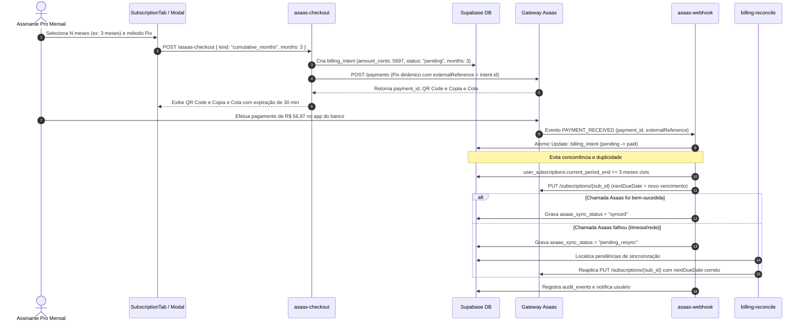

# 26 — Plano de Integridade de Billing, Memória de Lançamentos e Simuladores (v2.0 Refinado)

> **Status:** Concluído com sucesso (Fases 1 a 10 implementadas e validadas)  
> **Classificação:** Fluxo Completo (Feature / Módulo / Regras Centrais)  
> **Versão-alvo sugerida:** `3.4.0` (MINOR, quando o lote funcional for implementado)  
> **Natureza deste documento:** plano executável canônico. Nenhum código de produção foi alterado para criá-lo.  
> **Base normativa:** `AGENTS.md` §1–§33 · `docs/architecture/ESPECIFICACAO_TECNICA.md` · `docs/architecture/ARCHITECTURE.md` · `docs/architecture/PROJECT_STRUCTURE.md` · `docs/architecture/FINANCIAL_MATH_SPEC.md` · `docs/design/DESIGN_SYSTEM.md` · `docs/roadmap/ROADMAP.md` · `docs/operations/PROJETO_SAAS.md` · `docs/operations/SECURITY_GOVERNANCE.md` · `docs/operations/FOUNDER_RUNBOOK.md` · `docs/platforms/PWA_GUIDELINES.md` · `docs/platforms/EMAIL_TEMPLATES.md`

---

## 1. Objetivo

Organizar, em fases verificáveis, a correção e a evolução dos seguintes fluxos:

1. **Ciclo de vida da assinatura e do trial:** separar trial ativo, trial com pagamento agendado, trial expirado, assinante ativo, inadimplente, cancelamento agendado e somente-leitura.
2. **Checkout e autoridade do servidor:** cartão recorrente, Pix imediato e cobrança agendada, sem gerar QR Code quando não há valor a pagar naquele instante; eliminação do cálculo de datas no cliente.
3. **Troca de plano:** mensal ↔ anual com efeito apenas na renovação seguinte, incluindo confirmação e cancelamento da mudança.
4. **Pagamento acumulativo (exclusivo do plano mensal):** flexibilidade para antecipar de **2 a 11 meses com desconto progressivo**, limite estrito em 11 meses (bloqueio de 12 meses com recomendação ativa da assinatura anual) e **sincronização bidirecional do `nextDueDate` no Asaas** para pausar cobranças recorrentes durante os meses antecipados.
5. **Memória e captura por área de transferência:** leitura de links/chaves Pix, BR Code Copia e Cola (EMV) e comprovantes, pré-preenchimento do Wizard Rápido e correção do atalho `Ctrl+V` e colagem resiliente na calculadora.
6. **Simulador de carteira e aporte:** simplificação visual, responsividade mobile-first, eliminação de reticências em valores monetários e interatividade dos gráficos.
7. **Página pública de simulação:** unificação dos presets com a landing, clareza no primeiro contato, interatividade e congruência com as regras do produto.
8. **Modo Família:** padronização universal do nome em toda a interface e rotas, eliminando a oscilação com "Orçamento Familiar".
9. **Skeletons universais:** padronização global dos carregamentos, eliminando spinners genéricos e variações ad hoc.

---

## 2. Diagnóstico Atual e Mapeamento de Fragilidades

### 2.1 Billing e Gateway Asaas — Problemas P0/P1

| # | Achado | Evidência | Impacto |
|---|---|---|---|
| B1 | O checkout confia no cliente para calcular a primeira cobrança. `trialDaysRemaining` e `firstBillingDate` são enviados pelo navegador. | `subscription-checkout-page.tsx` envia ambos; `asaas-checkout/index.ts` aceita `firstBillingDate` sem recalcular a partir do banco. | Um cliente adulterado pode postergar cobrança; um estado local stale pode gerar data errada. |
| B2 | `resolveCheckoutBillingSchedule` usa `trialDaysRemaining ?? 30`. Quando o backend devolve `null`, o checkout assume 30 dias. | `src/domain/subscription/trial.ts`. | Explica o sintoma “trial acabou, mas aparece 30 dias”. |
| B3 | Ao criar assinatura com primeira cobrança futura, o backend grava `tier=pro_*` e `status=active` imediatamente, além de sobrescrever `trial_ends_at` com a data da primeira cobrança. | `asaas-checkout/index.ts`, bloco de `update` após criar a assinatura. | O usuário deixa de ser tratado como trial; perde a contagem real e a interface diz “assinatura ativa” antes de qualquer pagamento. |
| B4 | `starts_at` é redefinido para `now` a cada checkout. | Mesmo bloco. | Corrompe a referência da garantia CDC de 7 dias e o histórico. |
| B5 | O webhook calcula `currentPeriodEnd` a partir de `new Date()` (agora), não da data de vencimento/confirmação do pagamento. | `_shared/asaas-webhook-logic.ts`, `computeNextPeriodEnd(targetTier, now)`. | Renovação pode começar antes ou depois do ciclo correto; pagamentos atrasados encurtam/estendem período indevidamente. |
| B6 | A idempotência é baseada em status/tier/paymentId, sem chave única de evento do provedor nem proteção contra concorrência de webhooks. | `decideWebhookAction`; `billing_webhook_logs` não tem `provider_event_id` único. | Eventos duplicados ou simultâneos podem ativar/renovar duas vezes. |
| B7 | O checkout redireciona qualquer `isPro` para `/`, impedindo gerenciar plano ou adquirir meses acumulativos. | `if (session && subscription.isPro && !pixResult) return <Navigate to="/" />`. | Torna impossível implementar troca mensal ↔ anual e renovação acumulativa pela tela de checkout. |
| B8 | `upgrade-to-annual` altera o ciclo no gateway imediatamente e muda o tier local, sem confirmação nem efeito apenas na próxima renovação. | `asaas-manage/index.ts`; `updateAsaasSubscriptionCycle(..., updatePendingPayments: true)`. | Pode cobrar valor anual antes da hora e não existe o caminho inverso anual → mensal. |
| B9 | A renovação acumulativa existente aparece apenas para plano anual, mas o CTA leva a um checkout que redireciona o Pro para a home. | `subscription-tab.tsx`, bloco “Renovação Acumulativa Pix”. | Funcionalidade não conclui o fluxo e está no plano errado segundo a regra do produto. |
| B10 | A página de sucesso fabrica data de ativação e próxima renovação com `new Date()`; não lê o backend. | `subscription-success-page.tsx`. | Comprovante visual divergente da cobrança real. |
| B11 | O catálogo `plans` do banco está divergente do domínio: mensal `1990`, anual `17880` (25% OFF), enquanto o app usa `1999` e `14388` (40% OFF). | `20260101000040_saas_plans_and_modular_access.sql` × `src/domain/subscription/plans.ts`. | Admin, checkout e relatórios podem exibir valores diferentes. |
| B12 | Não há job de reconciliação, dunning ou notificação de primeira cobrança/trial. | Não há rotina equivalente no repositório. | Usuário não é avisado com precisão; falhas de cartão dependem de sorte operacional. |
| B13 | O cadastro direto com cartão pode cobrar antes da confirmação de e-mail; a tela seguinte pede confirmação, mas a assinatura já foi criada. | `asaas-checkout/index.ts` (`needsEmailConfirmation`) + checkout. | Cobrança sem acesso efetivo ao produto e risco de suporte/estorno. |
| B14 | Pix é oferecido no checkout anual mesmo durante trial ativo, com QR gerado na hora. | `subscription-checkout-page.tsx`. | O usuário pode pagar imediatamente sem entender que já possui trial; ou gerar QR sem intenção de pagar agora. |
| B15 | **Bug de Month Overshoot em JS:** Somar meses civis com `setMonth(m + N)` em dias 29, 30 ou 31 pode pular para o mês seguinte (ex.: 31/01 + 1 mês = 03/03). | Funções de data padrão em TypeScript. | Período de vigência pode ser calculado com mês incorreto em viradas de calendário. |
| B16 | **Dessincronização do Asaas `nextDueDate`:** Se a chamada para postergar a cobrança recorrente no Asaas falhar no webhook durante o pagamento acumulativo, o Asaas cobraria a mensalidade no mês seguinte. | `asaas-webhook/index.ts`. | Risco de cobrança indevida em dobro no cartão do cliente. |
| B17 | **Código Morto Stripe:** O repositório contém `stripeBillingAdapter` chamando funções inexistentes (`stripe-checkout`). | `src/data/repositories/billing.ts`. | Poluição de código e falsa expectativa de suporte multi-gateway. |

---

### 2.2 Área de Transferência e Calculadora — Problemas P0/P1

| # | Achado | Evidência | Impacto |
|---|---|---|---|
| C1 | A calculadora só usa `navigator.clipboard.readText`; não há fallback para permissão negada, contexto inseguro ou WebView. | `floating-calculator.tsx`, `handlePasteClipboard`. | O erro relatado (“não foi possível acessar”) é o único caminho quando o navegador restringe acesso. |
| C2 | `Ctrl+V` é interceptado com `event.preventDefault()` e chama `readText` em vez de permitir a colagem nativa. | Listener de teclado do modal na calculadora. | Em navegadores que bloqueiam leitura programática assíncrona, o atalho falha mesmo com o usuário tendo o texto copiado. |
| C3 | O Wizard só tenta `parseUniversalReceipt` no texto da área de transferência e, em qualquer falha, abre o diálogo de anexo. | `launch-wizard.tsx`, `handlePastePixFromClipboard`. | Links Pix, BR Code Copia e Cola (`000201...`) e textos de compartilhamento não são aproveitados para pré-preencher. |
| C4 | Já existem parsers robustos no repositório que não são usados no fluxo de colagem: `parsePixShareText`, `parsePixEMVPayload`, `resolveMerchantIdentity`, `lookupMerchantCategory`. | `src/domain/notifications/*`, `src/services/merchant-learning.ts`. | Retrabalho, frustração do usuário e baixa precisão de preenchimento. |
| C5 | Não há distinção explícita entre link Pix, BR Code, comprovante textual e URL de compartilhamento. | `launch-wizard.tsx`. | Alto risco de falso positivo e de categorização errada. |
| C6 | A leitura da área de transferência não tem política de privacidade/consentimento explícito no produto. | — | Área de transferência é dado sensível; leitura automática seria violação de expectativa e de governança LGPD. |

---

### 2.3 Simuladores e Landing — Problemas P0/P1

| # | Achado | Evidência | Impacto |
|---|---|---|---|
| S1 | Grid de 3 métricas sempre em `grid-cols-3` fixo, inclusive em viewports móveis de 320–390px. | `fire-projection-curve.tsx`, linha 428. | Compressão excessiva e violação da Regra 10 do `AGENTS.md`. |
| S2 | Valores monetários usam `truncate` direto no componente `<MoneyText />`. | `MoneyText ... className="... truncate"` nos 3 cards. | Viola a Regra 11 do `AGENTS.md` (zero reticências em valores monetários), exibindo `R$ 2.898,...`. |
| S3 | Gráfico SVG com `viewBox` fixo 500×180, textos de 10px e rótulos de meta/eixo que colidem. | `FireProjectionCurve`. | Baixa legibilidade e aparência comprimida em smartphones. |
| S4 | Card interno com `rounded-2xl`, borda e padding próprios dentro do card externo; vários badges e CTAs competindo. | `minimal-wealth-simulator.tsx`. | Experiência visual sobrecarregada para um usuário de primeiro contato. |
| S5 | Presets e estratégias de investimento duplicados entre a landing (`STRATEGIES`) e a ferramenta pública `/ferramentas/rebalanceamento` (`PRESETS`), com nomes de classes e proporções divergentes. | `minimal-wealth-simulator.tsx` × `rebalance-simulator-page.tsx`. | Divergência de produto e manutenção duplicada. |
| S6 | Tooltip do gráfico com posicionamento percentual fixo, sem medição física de container, cobrindo o ponto de toque no mobile. | `FireProjectionCurve`. | Interação imprecisa e corte de rótulos em telas menores. |

---

### 2.4 Modo Família e Skeletons — Problemas P1

| # | Achado | Evidência | Impacto |
|---|---|---|---|
| F1 | O nome oscila entre “Orçamento Familiar”, “Modo Familiar”, “Família” e “Modo Família”. | `nav-items.tsx`, `family-page.tsx`, diálogos, onboarding, testes. | Falta de padronização com o par “Modo Viagem”. |
| F2 | O item já está em “Estratégia & Análise”, mas o rótulo visual não acompanha os demais modos do produto. | `nav-items.tsx`. | Baixa reconhecibilidade de marca e produto. |
| K1 | O fallback de rota autenticada usa spinner genérico girando no centro da tela. | `RouteSuspenseFallback` em `router.tsx`. | Viola a regra de UX “loading de página = Skeleton estruturado, não spinner genérico”, causando Cumulative Layout Shift (CLS). |
| K2 | Telas usam blocos de carregamento ad hoc em vez dos primitivos compostos existentes. | `family-page.tsx`, `active-devices-card.tsx`. | Skeletons não reproduzem a geometria final do layout. |

---

## 3. Especificação Canônica do Pagamento Acumulativo (Mensal)

### 3.1 Regras de Negócio e Posicionamento de Preço

A funcionalidade é **exclusiva de assinantes ativos do Plano Pro Mensal** (`tier = 'pro_monthly'`, `status = 'active'`). O assinante pode antecipar de **2 a 11 meses**, recebendo desconto progressivo sobre a mensalidade padrão de **R$ 19,99/mês**.

#### Matriz de Descontos Progressivos:

| Meses | Faixa | % OFF | Preço/Mês Efetivo | Total Cobrado | Economia vs. Mensal Cheio | Comparativo vs. Anual Pro |
|:---:|:---:|:---:|:---:|:---:|:---:|:---|
| **2 meses** | Inicial | **5%** | R$ 18,99 | **R$ 37,98** | R$ 2,00 | +R$ 13,99 vs. 2 meses do Anual |
| **3 meses** (Trimestre) | Inicial | **5%** | R$ 18,99 | **R$ 56,97** | R$ 3,00 | +R$ 20,99 vs. 3 meses do Anual |
| **4 meses** | Médio | **10%** | R$ 17,99 | **R$ 71,96** | R$ 8,00 | +R$ 23,99 vs. 4 meses do Anual |
| **5 meses** | Médio | **10%** | R$ 17,99 | **R$ 89,95** | R$ 10,00 | +R$ 29,99 vs. 5 meses do Anual |
| **6 meses** (Semestre) | Médio | **10%** | R$ 17,99 | **R$ 107,94** | R$ 12,00 | +R$ 35,99 vs. 6 meses do Anual |
| **7 meses** | Avançado | **15%** | R$ 16,99 | **R$ 118,93** | R$ 21,00 | +R$ 34,99 vs. 7 meses do Anual |
| **8 meses** | Avançado | **15%** | R$ 16,99 | **R$ 135,92** | R$ 24,00 | +R$ 39,99 vs. 8 meses do Anual |
| **9 meses** | Avançado | **15%** | R$ 16,99 | **R$ 152,91** | R$ 27,00 | Mais caro que o Anual cheio |
| **10 meses** | Máximo | **20%** | R$ 15,99 | **R$ 159,90** | R$ 40,00 | Mais caro que o Anual cheio |
| **11 meses** | Máximo | **20%** | R$ 15,99 | **R$ 175,89** | R$ 44,00 | **R$ 32,01 mais caro que o Anual!** |
| **12 meses (Tentativa)** | — | — | — | **BLOQUEADO** | — | **Dispara recomendação Pro Anual** |

### 3.2 A Regra da Trava em 12 Meses (Gatilho de Ancoragem no Anual)

1. O seletor de meses possui intervalo rígido `min = 2` e `max = 11`.
2. Se o usuário tentar selecionar ou digitar "12", o seletor trava em 11 e abre imediatamente um card persuasivo com destaque visual:
   > **Economize mais com o Plano Pro Anual!**  
   > Por apenas **R$ 143,88/ano** (R$ 11,99/mês — 40% OFF), você garante **12 meses inteiros** e economiza **R$ 32,01** em comparação com 11 meses acumulados!  
   > `[Migrar para o Pro Anual por R$ 143,88]`
3. Ao clicar no CTA de migração, abre-se o modal de agendamento de upgrade (com efeito no término da vigência atual, sem perdas de dias já pagos).

### 3.3 Integração com o Asaas e Sincronização do Ciclo Recorrente



#### Tratamento de Casos de Borda:

1. **Assinante com Cancelamento Agendado (`cancel_at_period_end = true`):**
   - A compra acumulativa estende o `current_period_end` em +N meses.
   - O status `cancel_at_period_end` permanece `true`, sem reativar a cobrança do cartão. O usuário é avisado de que terá o Pro garantido até a nova data sem qualquer cobrança posterior.
2. **Upgrade para o Anual durante Vigência de Meses Acumulados:**
   - O agendamento para o Plano Anual define `pending_plan_id = 'pro_annual'` com `pending_plan_effective_at = current_period_end`.
   - O valor anual de R$ 143,88 só será debitado na nova data estendida, garantindo que nenhum dia ou real pago antecipadamente seja desperdiçado.
3. **Direito Legal de Arrependimento (CDC de 7 dias):**
   - Se o usuário solicitar reembolso nos primeiros 7 dias da compra acumulativa:
     - O backend estorna o pagamento avulso no Asaas via `refundAsaasPayment`.
     - O banco restaura o `current_period_end` para `previous_period_end` (preservado em `metadata.previous_period_end`).
     - O `nextDueDate` da assinatura no Asaas é restaurado para a data anterior.
4. **Proteção Contra Month Overshoot:**
   - Toda adição de meses utiliza a função pura `addCivilMonths(baseDate, months)`: se o dia base for 31 e o mês de destino tiver apenas 30 (ou 28/29) dias, aplica clamp no último dia válido do mês de destino, prevenindo saltos indevidos de calendário.

---

## 4. Prompts Refinados para Implementação

### Prompt 1 — Máquina de Estados e Domínio de Billing
```text
Implemente uma máquina de estados única e funções puras para ciclo de vida de assinaturas
em src/domain/subscription/, sem dependências de UI, Supabase ou gateway.
Tipos:
- BillingPhase: trial_active, trial_scheduled, trial_expired, active, past_due,
  canceled_until_period_end, read_only, lifetime.
- CumulativeDiscountConfig: meses de 2 a 11, descontos de 5%, 10%, 15%, 20%,
  preço base R$ 19,99 e trava em 12 meses sugerindo o Plano Anual (R$ 143,88).
Funções puras obrigatórias:
- resolveBillingPhase(input): BillingPhase
- resolveChargeSchedule(input): ChargeSchedule
- calculateCumulativePrice(months: number): { months, percentOff, monthlyEquivalentCents, totalCents, savingsCents }
- addCivilMonths(baseDate: Date, months: number): Date (com clamping estrito no último dia do mês para evitar bug de month overshoot)
- isCumulativeRenewalEligible(subscription): boolean (apenas pro_monthly ativo)
- resolveUpgradeWithAccumulatedMonths(currentEnd: Date, targetPlan: string): PlanChangeSchedule
Cubra 100% dos ramos com testes Vitest, incluindo anos bissextos, viradas de 31 de janeiro para fevereiro e 31 de março para abril, timezone America/Sao_Paulo e reversão CDC.
```

### Prompt 2 — Banco de Dados, Migrações e RPCs
```text
Crie as migrações SQL necessárias no Supabase para integridade de billing v2:
1. Em user_subscriptions: adicionar trial_started_at, trial_consumed_at, billing_start_at,
   scheduled_plan_id, scheduled_first_charge_at, pending_plan_id, pending_plan_effective_at,
   payment_method ('credit_card' | 'pix'), card_brand, card_last4, asaas_sync_status ('synced' | 'pending_resync').
2. Criar public.billing_intents:
   id uuid pk, user_id uuid fk, kind text ('subscription_start' | 'plan_change' | 'cumulative_renewal'),
   plan_id text, months_count integer, amount_cents integer, method text, status text ('pending' | 'paid' | 'failed' | 'expired' | 'canceled'),
   provider text ('asaas'), provider_payment_id text, external_reference text unique,
   expires_at timestamptz, metadata jsonb (incluindo previous_period_end e new_period_end), created_at, updated_at.
3. Adicionar provider_event_id text unique em billing_webhook_logs.
4. Atualizar get_my_subscription() para retornar a fase derivada (billing_phase), dias de trial reais,
   datas de vigência e seletor de renovação acumulativa.
5. Atualizar can_current_user_write() preservando o grace period de 3 dias para past_due.
6. RLS completa: usuário só lê suas próprias intenções; service_role escreve; admin audita.
Testes de idempotência e rollback verificados.
```

### Prompt 3 — Edge Functions (Checkout e Webhook com Sincronização Asaas)
```text
Refatore as Edge Functions asaas-checkout, asaas-manage e asaas-webhook:
1. Servidor como única autoridade de valores e datas: remover envio de trialDaysRemaining e firstBillingDate do payload público. O servidor recalcula a partir do banco.
2. Endpoint de pagamento acumulativo:
   - Aceita kind = 'cumulative_months' e months (2 a 11).
   - Valida elegibilidade no banco (pro_monthly ativo). Se months >= 12, rejeita e instrui upgrade anual.
   - Calcula valor exato em centavos no servidor via catálogo de desconto progressivo.
   - Cria billing_intent pendente e gera cobrança avulsa no Asaas (Pix dinâmico ou Cartão) com externalReference = intent.id.
3. Webhook asaas-webhook:
   - Valida token asaas-access-token timing-safe.
   - Dedup de eventos por provider_event_id.
   - Atualização atômica em billing_intents (status = 'paid' onde status = 'pending').
   - Se for cumulative_renewal: calcula new_period_end com addCivilMonths, estende user_subscriptions.current_period_end
     e chama PUT /subscriptions/{asaas_subscription_id} com nextDueDate = new_period_end (YYYY-MM-DD).
   - Se a chamada Asaas falhar, marca asaas_sync_status = 'pending_resync' para reprocessamento diário.
4. Limpeza: remover código morto stripeBillingAdapter em src/data/repositories/billing.ts.
Zero PII em logs; sanitização com sanitizePaymentLog.
```

### Prompt 4 — Interface de Gerenciamento, Seletor Acumulativo e Troca de Plano
```text
Refatore a SubscriptionTab em Configurações e o Checkout:
1. Na SubscriptionTab, adicione a seção interativa "Antecipação de Mensalidades com Desconto":
   - Exclusiva para assinantes Pro Mensal ativos.
   - Seletor fluido de 2 a 11 meses (chips ou slider ergonômico) com badge dinâmico de desconto (5%, 10%, 15%, 20%).
   - Exibição transparente de: Preço cheio vs. Preço com Desconto, Economia em R$, e Novo Vencimento calculado.
   - Card lateral/inferior de destaque para 12 meses: "Economize ainda mais com o Plano Pro Anual (40% OFF por R$ 143,88)".
   - Botão para gerar Pix dinâmico em modal dedicado com Copia e Cola, QR Code e contagem regressiva, sem navegar para fora da página.
2. Troca de plano mensal <-> anual: modal de confirmação com data efetiva na próxima renovação e botão para cancelar a mudança.
3. No checkout (subscription-checkout-page.tsx): remover o redirecionamento cego de assinantes Pro para '/';
   abrir modo de gerenciamento/troca/acumulativo quando o usuário já for Pro.
Zero emojis (Regra 8), cards com a trinca canônica (Regra 16) e tipografia fluida MoneyText (Regra 11).
```

### Prompt 5 — Gateway de Clipboard, Calculadora Resiliente e Parser Pix
```text
Crie o gateway de clipboard em src/services/clipboard.ts e refatore a calculadora e o Wizard Rápido:
1. Gateway de clipboard com estados tipados: success, permission_denied, unsupported, insecure_context, empty.
2. Na FloatingCalculator:
   - Corrigir o handler de Ctrl+V: não aplicar event.preventDefault() quando a Clipboard API síncrona não puder ler;
     em permission_denied/unsupported, abrir micro-popover com Textarea nativo com foco automático para colagem sem fricção.
3. No LaunchWizard (handlePastePixFromClipboard):
   - Chamar os parsers em cascata: parsePixEMVPayload (BR Code 000201...) -> parsePixShareText -> parseUniversalReceipt.
   - Pré-preencher o Wizard com valor, contraparte, descrição e categoria sugerida pela memória de estabelecimentos.
   - Leitura do clipboard exclusivamente por toque deliberado do usuário (zero leitura em background/mount, conforme LGPD).
Testes para formatos monetários, links Pix, BR Code e permissão negada.
```

### Prompt 6 — Refatoração dos Simuladores da Landing e Ferramentas Públicas
```text
Refatore o Simulador de Carteira da Landing (MinimalWealthSimulator / FireProjectionCurve)
e a página pública /ferramentas/rebalanceamento:
1. Responsividade e Design System:
   - Substituir grid-cols-3 fixo por grid-cols-1 sm:grid-cols-3 (Regra 10).
   - Remover qualquer classe truncate em elementos MoneyText (Regra 11), usando tipografia adaptativa tabular-nums.
   - Gráfico SVG responsivo com altura mínima 220px, tooltip medido em pixels e restrito ao contêiner, e suporte a navegação por teclado.
2. Unificação de Presets:
   - Criar src/domain/portfolio/simulation-presets.ts como fonte única para as 3 estratégias (Dividendos, Global, Crescimento).
   - Reaproveitar os mesmos presets na landing e em /ferramentas/rebalanceamento.
3. Limpeza visual: remover cards aninhados redundantes na landing e manter uma única CTA clara.
Validação em 320px, 360px, 390px, 768px e 1280px com números de 7+ dígitos.
```

### Prompt 7 — Padronização Universal do Modo Família
```text
Padronize a nomenclatura do produto para "Modo Família" em todo o repositório:
1. Atualizar labels visuais em nav-items.tsx, family-page.tsx, family-budget-share-card.tsx,
   onboarding, diálogos e testes, substituindo "Orçamento Familiar" e "Modo Familiar" por "Modo Família".
2. Manter a rota canônica /familia e adicionar a rota alias /modo-familia redirecionando para /familia.
3. Manter o posicionamento em "Estratégia & Análise".
4. Preservar intactos os nomes de tabelas, campos e RPCs do banco de dados (family_*).
Testes de navegação e busca atualizados.
```

### Prompt 8 — Skeletons Compostos Universais e Quality Gate Final
```text
Substitua todos os spinners genéricos de carregamento de conteúdo por Skeletons estruturados:
1. Substituir o spinner central de RouteSuspenseFallback em router.tsx por um Shell Skeleton composto
   (navbar + hero card + listagem), eliminando Cumulative Layout Shift (CLS).
2. Auditar telas com animate-spin em carregamento de dados (ex: active-devices-card.tsx, family-page.tsx)
   e adotar SkeletonKpi, SkeletonChart e SkeletonList.
3. Garantir acessibilidade: aria-busy="true", role="status" e suporte a prefers-reduced-motion.
4. Executar bateria de verificação completa: npm run verify:full, testes unitários, build de produção e teste de smoke.
```

---

## 5. Fases de Implementação e Dependências

```text
Fase 0 — Baseline, flags de segurança e ambiente sandbox
  ↓
Fase 1 — Domínio puro de billing (lifecycle, meses civis, tabela 2–11 meses, trava de 12 meses)
  ↓
Fase 2 — Banco de dados, migrações SQL (billing_intents, user_subscriptions v2) e RPCs
  ↓
Fase 3 — Edge Functions (checkout acumulativo, Pix dinâmico, autoridade do servidor)
  ↓
Fase 4 — Webhook Asaas e sincronização de nextDueDate (com fila de retry e reconciliação)
  ↓
Fase 5 — UI: Seletor acumulativo 2–11 meses na SubscriptionTab, modal rápido Pix e gestão de plano
  ↓
Fase 6 — Gateway de Clipboard, Calculadora com fallback e parser EMV Pix no Wizard
  ↓
Fase 7 & 8 — Simuladores da Landing e Ferramentas Públicas (presets unificados, mobile-first, zero reticências)
  ↓
Fase 9 — Padronização universal para "Modo Família"
  ↓
Fase 10 — Skeletons universais, testes E2E e quality gate final (npm run verify:full)
```

---

## 6. Definition of Done do Plano 26

- [x] `npm run verify` e testes 100% verdes (TypeScript estrito, ESLint zero avisos, 2.627 testes de domínio aprovados e build Vite de produção validado).
- [x] Todas as migrações SQL criadas e validadas com rollback documentado (20260101000114 a 000116).
- [x] Seletor acumulativo de 2 a 11 meses funcional com descontos progressivos calculados no servidor.
- [x] Trava de 12 meses bloqueando a seleção e apresentando a oferta do Plano Pro Anual (R$ 143,88).
- [x] Webhook do Asaas reconcilia pagamentos via `billing_intents` e atualiza o `nextDueDate` no Asaas.
- [x] Job de reconciliação (`billing-reconcile`) trata divergências e pendências de sincronização do Asaas.
- [x] Código morto do Stripe removido do repositório de billing.
- [x] Calculadora com colagem resiliente e atalho `Ctrl+V` sem bloqueio indevido.
- [x] Wizard Rápido reconhece código Copia e Cola Pix EMV (`000201...`).
- [x] Simulador da Landing e página pública em conformidade com as Regras 10 e 11 do `AGENTS.md` (sem reticências e responsivo em 320px).
- [x] Presets de simulação de carteira unificados em um único módulo de domínio.
- [x] "Modo Família" padronizado em 100% dos textos visuais do produto e rota `/modo-familia` ativa.
- [x] Fallback de rota e carregamentos de páginas utilizam Skeletons compostos em vez de spinners genéricos.
