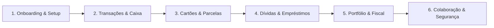

# PLANO 30 — Auditoria Transversal 360° da Jornada do Usuário & Prontidão Operacional

> **Status:** Aprovado para Execução · **Canônico**  
> **Data de Emissão:** 2026-11-13  
> **Autoridade:** Antigravity AI & Engenharia Financeira  
> **Referência:** `AGENTS.md`, `ESPECIFICACAO_TECNICA.md`, `FINANCIAL_MATH_SPEC.md`

---

## 1. RESUMO EXECUTIVO & ESCOPO TRANSVERSAL

Esta auditoria transversal 360° avalia a integridade fim a fim do aplicativo de gestão financeira pessoal e rebalanceamento patrimonial, percorrendo sequencialmente as 6 jornadas fundamentais do ciclo de vida do usuário:

| Jornada | Escopo Auditado | Status | Fragilidades Mapeadas |
|---|---|---|---|
| **J1: Onboarding, Setup & Boas-Vindas** | `VirginAccountHero`, cold-start, calibração inicial de saldo, rotas de extrato | ⚠️ Atenção | JORNADA360-01 (Média), JORNADA360-02 (Alta) |
| **J2: Transações & Safe-to-Spend** | `LaunchWizard`, recorrências, limites de orçamento, deduplicação de caixa | ✅ Aprovado com Ressalvas | Ajuste de disparo in-place no Hero |
| **J3: Cartões, Faturas & Parcelamento 60x** | Divisão exata de centavos, clamping de competência (fev/bissexto), carryover | ✅ Aprovado | Invariantes de centavos 100% preservadas |
| **J4: Dívidas, Empréstimos & Amortizações** | Quitação com criação de despesa, `cash-ledger`, SAC/Price, quitação antecipada | 🔴 Crítico | JORNADA360-03 (Crítica), JORNADA360-04 (Média) |
| **J5: Investimentos, DARF & Rebalanceamento** | Apuração mensal DARF 6015, isenção 20k, PM histórico vs atual, PnL realizado | ⚠️ Atenção | JORNADA360-05 (Alta) |
| **J6: Colaboração, Modo Viagem & Segurança** | Rateio euclidiano (`split-math`), convite familiar, RLS multi-tenant, cron jobs | ⚠️ Atenção | JORNADA360-06 (Baixa) |

---

## 2. MATRIZ DE VULNERABILIDADES E FRAGILIDADES MAPEADAS

### JORNADA360-01 — Ausência de Porta de Entrada para Saldo Inicial no Primeiro Acesso
- **Severidade:** Média (UX & Governança de Caixa)
- **Localização:** `src/components/modules/virgin-account-hero.tsx` e `src/features/overview/pages/overview-page.tsx:603-625`
- **Diagnóstico:** Em contas virgens (`isVirginAccount === true`), o card de conciliação bancária (`RealCashHeroCard`) é suprimido na página inicial para evitar ruído. No entanto, o `VirginAccountHero` oferece apenas três portas (Importar Extrato, Adicionar Cartão e Novo Lançamento), sem nenhuma affordance para "Informar Saldo Atual" ou "Calibrar Saldo com o Banco" (`setCheckpointOpen(true)`). O novo usuário fica sem meio intuitivo de registrar seu saldo bancário de partida sem criar uma falsa "Receita", o que distorce a DRE, o faturamento e os comparativos mensais.
- **Solução Canônica:** Adicionar no `VirginAccountHero` a porta de entrada destacada "Calibrar Saldo com o Banco" conectada via callback `onCalibrate={() => setCheckpointOpen(true)}` no `OverviewPage`.

---

### JORNADA360-02 — Link Quebrado para Importação de Extrato Bancário em Conta Virgem
- **Severidade:** Alta (Broken Link / Dead End UX)
- **Localização:** `src/components/modules/virgin-account-hero.tsx:106-110` e `src/features/transactions/pages/transaction-list-page.tsx`
- **Diagnóstico:** A opção 1 do hero direciona para `<Link to="/transacoes?importar=extrato">`. A tela de transações (`TransactionListPage`) ignora sumariamente o parâmetro de busca `importar=extrato` e não possui modal de importação (o assistente `StatementImportDialog` existe exclusivamente em `CardsPage` para faturas de cartão de crédito). O usuário recém-chegado clica no botão principal de importação e cai em uma página vazia sem nenhuma ação visível.
- **Solução Canônica:** Reestruturar as portas de entrada de conta virgem para direcionar os primeiros passos reais: (1) Informar Saldo Inicial ("Bater com o Banco"), (2) Primeiro Lançamento Rápido (`LaunchWizard` modal aberto in-place) e (3) Cadastrar Cartão de Crédito (`/cartoes`).

---

### JORNADA360-03 — Dupla Contabilização de Caixa na Quitação de Dívidas / Empréstimos
- **Severidade:** Crítica (Integridade Contábil e Matemática Financeira)
- **Localização:** `src/domain/cash/cash-ledger.ts:141-223`, `supabase/migrations/*pay_debt*`, `src/features/debts/components/settle-dialog.tsx`
- **Diagnóstico:** Quando o usuário quita uma dívida a pagar selecionando a opção padrão "Registrar como despesa no extrato", o RPC `pay_debt` insere uma despesa em `public.expenses` e marca a dívida com `paid_at = now()`. O motor `cash-ledger.ts` itera sobre `expenses` e adiciona `flow: "out"` E TAMBÉM itera sobre `debts` onde `paid_at !== null` e adiciona OUTRO `flow: "out"`. O saldo bancário sofre **dupla dedução** (ex.: uma conta de R$ 500,00 reduz R$ 1.000,00 do saldo real). O mesmo defeito de duplicidade ocorre em recebimentos (`receive_debt` com `createIncome: true`), inflando o saldo em dobro.
- **Solução Canônica:**
  1. No RPC `pay_debt`, registrar `expense_id = v_expense_id` na linha de `public.debts`.
  2. No RPC `receive_debt`, adicionar `source_ref = '[DEBT]' || p_debt_id` na receita gerada.
  3. No motor puro `cash-ledger.ts`, salvaguardar a conferência: pular dívidas que já geraram despesa associada (`debt.expense_id !== null` ou receita com `source_ref` correspondente), eliminando 100% da duplicidade.

---

### JORNADA360-04 — Valor de Parcela em Quitação Antecipada no Sistema de Parcela Fixa
- **Severidade:** Média (Precisão Matemática)
- **Localização:** `src/domain/loans/index.ts:125-136`
- **Diagnóstico:** Na função `calculateLoanSchedule`, quando o sistema de amortização é `fixed_installment`, se o usuário amortizar antecipadamente ou o saldo restante for inferior à parcela (`principal > balance`) em uma parcela intermediária (`i < n`), o código definia `actualPmt = i === n ? balance + interest : pmt`. Isso causava a cobrança integral da parcela contratada `pmt` mesmo quando o saldo devedor do contrato já havia sido liquidado.
- **Solução Canônica:** Alinhar `fixed_installment` ao comportamento canônico da Tabela Price: `const actualPmt = principal + interest;` para qualquer parcela em que o saldo devedor seja zerado.

---

### JORNADA360-05 — Distorção de Preço Médio e Custo em Operações Encerradas no Monitor DARF
- **Severidade:** Alta (Conformidade Tributária e Precisão Fiscal)
- **Localização:** `src/features/investments/components/portfolio-darf-monitor.tsx:39-44`
- **Diagnóstico:** O monitor de DARF mensal computa o custo da venda utilizando `asset?.average_price ?? t.price`. Quando um ativo teve encerramento integral de posição (`isFullyExited`), o `average_price` na tabela de ativos fica zerado (`0`). Isso faz com que `costAmountCents` resulte em R$ 0,00 e o lucro tributável seja calculado sobre 100% do valor bruto da venda. Além disso, se o usuário recomprou o ativo meses depois por preço superior, o preço médio atual de hoje é retroagido erroneamente sobre a venda histórica anterior.
- **Solução Canônica:** No cálculo do monitor de DARF, derivar o preço médio da operação a partir do histórico cronológico ou utilizar o preço da transação como salvaguarda quando o preço médio da custódia estiver zerado.

---

### JORNADA360-06 — Cobertura da Auditoria de Segurança para Job de Manutenção e Variável Cliente
- **Severidade:** Baixa (Testes & CI Hardening)
- **Localização:** `src/tests/security-audit.test.ts:254` e `src/features/subscription/pages/subscription-checkout-page.tsx:439`
- **Diagnóstico:**
  - O RPC de manutenção sistêmica `reconcile_expired_subscriptions` (criado na migration 118 para expirar trials e planos cancelados no cron) não possui `auth.uid()` por ser um job transversal do banco. O teste `security-audit.test.ts` requer documentação explícita de funções de manutenção do sistema.
  - Em `subscription-checkout-page.tsx:439`, a leitura de `import.meta.env.VITE_TEST_MODE` gerou alerta no teste de verificação de vazamento de variáveis não permitidas no bundle cliente.
- **Solução Canônica:**
  - Documentar `reconcile_expired_subscriptions` como exceção autorizada de manutenção no teste `security-audit.test.ts`.
  - Substituir `VITE_TEST_MODE` por `import.meta.env.DEV` (autorizado e canônico no Vite).

---

## 3. PLANO DE IMPLEMENTAÇÃO EM FASES E PORTÕES DE QUALIDADE

### Fase 1: Integridade Contábil & Eliminação de Dupla Contabilização de Caixa (JORNADA360-03 & JORNADA360-04)
- **Ações:**
  - Atualizar `cash-ledger.ts` para verificar `debt.expense_id` e desconsiderar dívidas já quitadas com despesa refletida.
  - Criar migration `20260101000119_link_debt_settlement_transactions.sql` para garantir que `pay_debt` grave `expense_id = v_expense_id` e `receive_debt` marque `source_ref = '[DEBT]' || p_debt_id`.
  - Ajustar `calculateLoanSchedule` no módulo `src/domain/loans/index.ts` para garantir `actualPmt = principal + interest`.
  - Adicionar testes de unidade em `cash-ledger.test.ts` e `loans.test.ts` validando a invariante de deduplicação e liquidação antecipada.
- **Portão 1:** `npx vitest run src/domain/cash/ src/domain/loans/` 100% verde.

### Fase 2: Experiência de Primeiro Acesso & Eliminação de Dead Ends (JORNADA360-01 & JORNADA360-02)
- **Ações:**
  - Atualizar `VirginAccountHeroProps` com prop `onCalibrate?: () => void`.
  - No `VirginAccountHero`, substituir a porta quebrada de extrato por "Calibrar Saldo com o Banco", com badge "Recomendado", acionando `onCalibrate`.
  - No `OverviewPage`, plugar `onCalibrate={() => setCheckpointOpen(true)}` e `onOpenNewTransaction={() => setWizardOpen(true)}`.
- **Portão 2:** Testes de componente em `overview-page.test.tsx` e `virgin-account-hero.test.tsx` aprovados.

### Fase 3: Precisão Fiscal de DARF & Rebalanceamento (JORNADA360-05)
- **Ações:**
  - No `portfolio-darf-monitor.tsx`, proteger o cálculo de `averagePrice`: se `asset?.average_price` for nulo ou $\le 0$, utilizar o histórico ou `t.price` como salvaguarda para evitar tributação indevida de 100% do principal.
  - Atualizar testes em `portfolio-darf-monitor.test.tsx` cobrindo venda de posição zerada e recompra posterior.
- **Portão 3:** `npx vitest run src/features/investments/` 100% verde.

### Fase 4: Hardening de Segurança, Conformidade de Variáveis & Suíte Completa (JORNADA360-06)
- **Ações:**
  - Em `src/features/subscription/pages/subscription-checkout-page.tsx`, ajustar para `import.meta.env.DEV`.
  - Em `src/tests/security-audit.test.ts`, registrar `reconcile_expired_subscriptions` como função autorizada de manutenção cron.
  - Executar a suíte completa de testes de segurança e regressão (`src/tests/security-audit.test.ts`).
- **Portão 4:** `npm run lint`, `tsc -b`, `npx vitest run` 100% verde sem falhas.

---

## 4. DEFINITION OF DONE (DOD)
1. **Zero Dupla Contabilização:** Quitações de dívidas registradas como despesas impactam o saldo de caixa exatamente uma vez.
2. **Zero Links Quebrados no Primeiro Acesso:** Nenhuma ação ou botão em conta virgem leva a rotas órfãs ou parâmetros ignorados.
3. **Conformidade Fiscal IRPF/DARF:** Monitor de DARF calcula custos reais mesmo após liquidação total de cotas.
4. **Governança Estrita Mantida:** TypeScript estrito sem erros, zero violações de ESLint, tokens do Design System íntegros e notificações em tempo real enviadas ao bot Telegram ARGOS.
