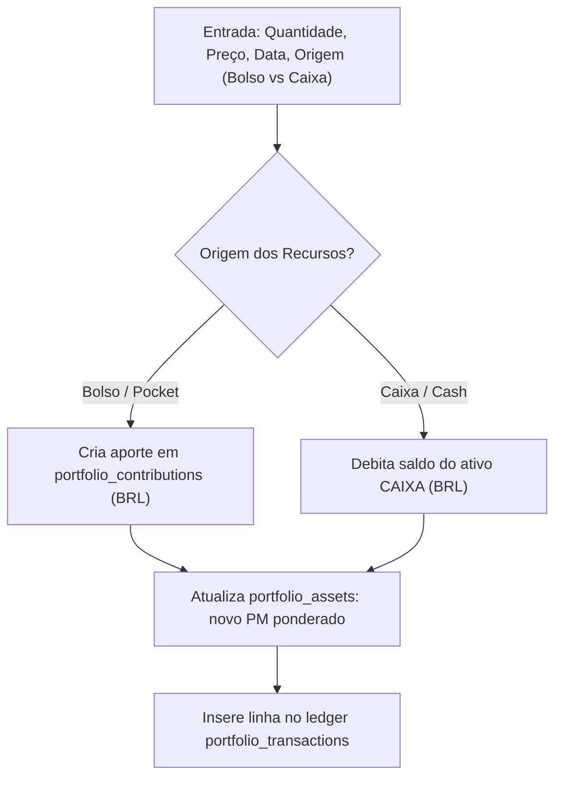
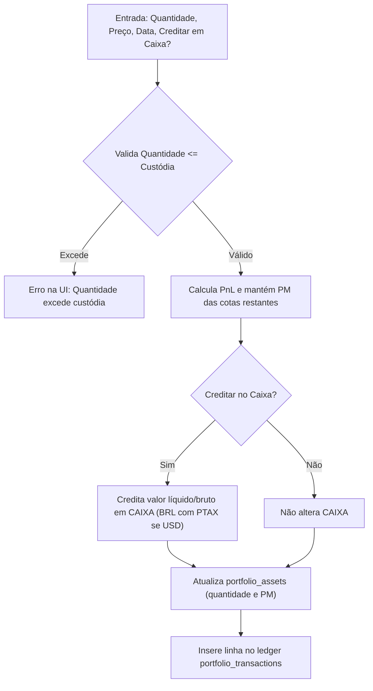

# Plano de Auditoria e Blindagem Integral do Fluxo de Compra e Venda de Ativos (§F36/§F40)

> **Documento Canônico de Execução — v3.6.6 (Build 65)**  
> **Status:** Concluído  
> **Escopo:** Fluxo completo de compra, venda, resgate, aporte, apuração e conciliação de caixa e custódia em investimentos.

---

## 1. Contexto e Motivação

Após as auditorias dos módulos de Proventos, DARF, Snapshots Patrimoniais e Fechamento Mensal Atômico (v3.6.5), esta auditoria cobre o núcleo transacional de investimentos: **todo o ciclo de vida de Compra e Venda de ativos**, garantindo consistência matemática rigorosa, reversibilidade de operações e sincronização atômica entre:
1. **Ledger de Transações (`portfolio_transactions`)**
2. **Posição de Custódia (`portfolio_assets`: quantidade, preço médio e metadados de Renda Fixa)**
3. **Ativo de Caixa (`CAIXA` 1:1 em BRL)**
4. **Aportes do Bolso (`portfolio_contributions`)**
5. **Apuração Fiscal e DARF Mensal (`tax.ts`)**

---

## 2. Diagnóstico & Fragilidades Mapeadas

| ID | Componente / Arquivo | Fragilidade Identificada | Gravidade | Solução |
|---|---|---|---|---|
| **F-01** | `portfolio-activity-panel.tsx:403-416` | **Inversão de sinal na exclusão de Venda no Caixa**: ao excluir uma venda que creditou o Caixa, o código executava `currentCashBalance + itemToDelete.total` (somando o valor da venda de novo em vez de subtrair o crédito). Além disso, somava valores em USD diretamente no Caixa BRL sem conversão cambial. | **CRÍTICA** | Segregar estritamente: compras devolvem recursos somando ao Caixa (`+ totalBRL`); vendas estornam subtraindo do Caixa (`- totalBRL`). Converter USD para BRL via PTAX (`usdRate`). |
| **F-02** | `transaction-form-dialog.tsx:209-228` | **Ausência de atualização de custódia na criação de transações**: ao registrar uma nova transação pelo diálogo avançado, apenas `createTx.mutateAsync` era chamado. O ativo em `portfolio_assets` permanecia com quantidade e PM desatualizados. Em vendas, nenhuma cota era deduzida e não havia opção de crédito no Caixa. | **CRÍTICA** | Atualizar atômica e integralmente o ativo em `portfolio_assets`: em compras, recalcular PM ponderado e debitar Caixa ou criar aporte; em vendas, validar quantidade disponível, abater cotas mantendo PM e creditar Caixa se selecionado. |
| **F-03** | `quick-transaction-sheet.tsx:290-399` | **Risco de duplo envio (concorrência/duplo clique)**: ausência de trava imediata com `ref` antes da execução assíncrona da ordem, permitindo disparos duplicados de ordens em conexões lentas. | **MÉDIA** | Adicionar `isSubmittingRef` e desabilitar botões durante a submissão, impedindo múltiplos envios paralelos. |
| **F-04** | `transaction-form-dialog.tsx` | **Falta de validação contra venda a descoberto**: usuário podia digitar quantidade de venda superior à custódia disponível sem bloqueio na UI. | **ALTA** | Adicionar validação `parsedQty <= asset.quantity` para operações de venda, exibindo mensagem de erro clara e bloqueando o envio. |
| **F-05** | `operations.ts:389-428` | **Reconciliação de Renda Fixa (`isTotalValue`) na exclusão**: salvaguarda contra saldos negativos ou distorção de custo histórico após exclusão de ordens no modo de valor total. | **MÉDIA** | Reforçar invariantes de não-negatividade e proporção em `calculateReconciledAssetPosition`. |

---

## 3. Matriz de Estados de Compra e Venda

### 3.1. Operações de Compra (`buy` / `subscription`)


### 3.2. Operações de Venda / Resgate (`sell`)


### 3.3. Exclusão e Estorno de Operações (`delete`)
```mermaid
flowchart TD
    P["Exclusão de Transação"] --> Q{"Tipo da Transação?"}
    Q -->|Compra (buy)| R["Estorna débito: SOMA totalBRL ao CAIXA (se pago com Caixa)"]
    Q -->|Venda (sell)| S["Estorna crédito: SUBTRAI totalBRL do CAIXA (se creditado em Caixa)"]
    R --> T["Restaura cotas e recalcula PM no portfolio_assets"]
    S --> T
```

---

## 4. Etapas de Implementação

- [x] **Fase 1: Correção do Bug de Estorno no Caixa em `PortfolioActivityPanel`**
  - Diferenciar `itemToDelete.type === "buy"` de `itemToDelete.type === "sell"`.
  - Para compras com rollback ativo: `newBal = currentCashBalance + totalBRL`.
  - Para vendas com rollback ativo: `newBal = Math.max(0, currentCashBalance - totalBRL)`.
  - Respeitar câmbio PTAX (`usdRate`) se o ativo for em USD.
- [x] **Fase 2: Blindagem do `TransactionFormDialog`**
  - Atualizar o ativo em `portfolio_assets` na criação de nova compra (PM ponderado e cotas).
  - Tratar venda em `TransactionFormDialog`: validar quantidade disponível, reduzir cotas mantendo PM e permitir crédito em Caixa.
  - Adicionar proteção contra duplo clique (`isSubmittingRef`).
- [x] **Fase 3: Proteção contra Duplo Clique no `QuickTransactionSheet`**
  - Implementar `isSubmittingRef` e trava de concorrência.
- [x] **Fase 4: Testes Unitários e de Integração**
  - Adicionar testes de exclusão de venda com estorno de Caixa no `portfolio-activity-panel.test.tsx`.
  - Adicionar testes de criação de compra e venda com atualização de ativo no `transaction-form-dialog.test.tsx`.
  - Testar proteção de concorrência e validações.
- [x] **Fase 5: Quality Gates e Documentação**
  - Executar suíte completa de investimentos (69 arquivos, 745 testes aprovados).
  - Executar `tsc -b` (100% aprovado, zero erros de tipo).
  - Executar `npm run lint` (100% aprovado, zero warnings).
  - Executar `npm run build` (Build de produção e PWA concluídos com sucesso).
  - Atualizar `ROADMAP.md` e `ESPECIFICACAO_TECNICA.md` para v3.6.6 (Build 65).
