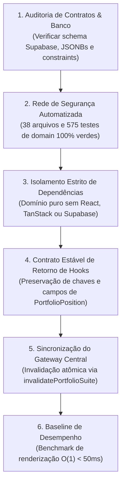
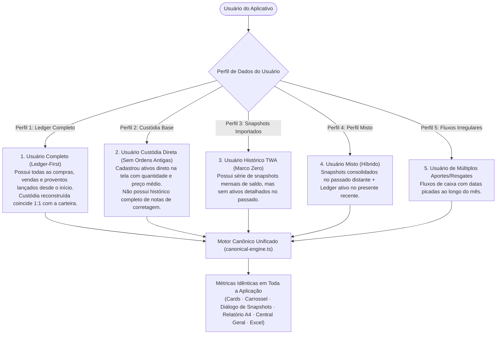
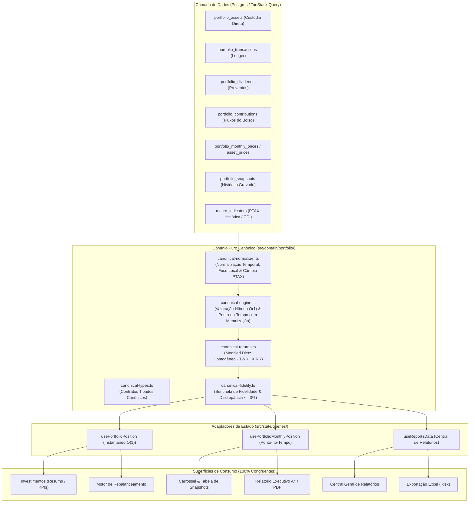

# PLANO MESTRE DE IMPLEMENTAÇÃO & AUDITORIA INTEGRAL — FASE 40 (ROADMAP v3.8.0)
## UNIFICAÇÃO CANÔNICA DO MOTOR DE CÁLCULOS, RENTABILIDADE, RELATÓRIOS & UI/UX DE INVESTIMENTOS 360°

> **Status:** 📋 Planejado, Auditado, Otimizado e Pronto para Execução  
> **Versão de Lançamento:** `v3.8.0`  
> **Data:** 17/11/2026 (Revisão 5 — Auditoria de Pré-Voo, Governança Matemática & Camada Integral de UI/UX)  
> **Módulos Afetados:** `src/domain/portfolio/`, `src/state/queries/`, `src/features/investments/`, `src/features/reports/`, `src/components/modules/`, `src/services/`  
> **Documentos Normativos de Referência:** `AGENTS.md` (Regras 1 a 28), `FINANCIAL_MATH_SPEC.md`, `ARCHITECTURE.md`, `DESIGN_SYSTEM.md`, `ESPECIFICACAO_TECNICA.md`, `39_PLANO_FASE_11_REORGANIZACAO_INTEGRAL_MOTOR_INVESTIMENTOS_360.md`

---

## 1. RESUMO EXECUTIVO & MOTIVAÇÃO ARQUITETURAL

O ecossistema de investimentos do aplicativo evoluiu de forma incremental ao longo de sucessivas fases de produto. Essa evolução gerou uma infraestrutura potente, porém dispersa em **múltiplos submotores de cálculo paralelos e desconectados**:

1. **Fragmentação em 7 Submotores Paralelos:** O aplicativo possui implementações espalhadas em `valuation.ts`, `summary.ts`, `point-in-time.ts`, `monthly-statement.ts`, `twr.ts`, `irr.ts` e `fixed-income.ts`, orquestradas manualmente dentro de hooks de UI com lógica contábil duplicada.
2. **Anomalia de Mistura de Bases Contábeis no Fechamento Mensal (Auditada em 16/11/2026):** No Relatório Executivo de Fechamento Histórico (`portfolio-executive-report.tsx`), o motor Modified Dietz apurou rentabilidade de **$-13,9\%$** e P&L líquido de **$-\text{R\$ } 14.948,60$** para uma competência cuja oscilação real de carteira foi de **$-3,6\%$** e P&L de **$-\text{R\$ } 3.832,16$**. Essa distorção decorreu da subtração cruzada de duas bases heterogêneas (Saldo Inicial na Base Snapshot vs. Saldo Final na Base Custódia Reconstruída).
3. **Desconexão entre Relatórios Gerais e Snapshots Históricos:** Na Central Geral de Relatórios (`src/features/reports/`), a visualização de meses passados busca o saldo patrimonial no snapshot, mas consome o PnL, a TIR (XIRR) e o Retorno Total da **carteira viva atual de hoje**, gerando dados contraditórios em relação ao Relatório Executivo de Snapshots.
4. **Vazamento de Lógica Contábil para Hooks Visuais:** O hook `usePortfolioPosition` acumulou **735 linhas** e o hook `useReportsData` acumulou **881 linhas**, ambos realizando loops manuais, reconciliação de dados, descapitalização e parsing de texto livre.
5. **Descompasso no Ciclo de Vida da Renda Fixa:** O resgate ou venda parcial de títulos de renda fixa não abate proporcionalmente o `base_value` no cadastro de metadados, fazendo com que o motor continue computando juros diários sobre o capital que já foi retirado.
6. **Assimetria Cambial e Ativos Não Cotados na B3:** Ativos alternativos correm risco de cair em fallback zero na ausência de cotações automáticas de API, e ativos em USD na reconstrução retroativa utilizavam taxa de câmbio estática ($\text{R\$}~5,25$) por ausência de leitura automática do ticker `USDBRL=X` gravado na tabela `portfolio_monthly_prices`.
7. **Fricções de Usabilidade e Ruídos em UI/UX Móvel:** Formulários com campos desnecessários para renda fixa, ausência de modo simplificado para ativos não cotados na B3, concorrência visual em modais densos e quebras de padrão de alinhamento em tabelas analíticas.

Este plano executa a **consolidação canônica em um Único Motor Central de Carteira (`src/domain/portfolio/canonical-engine.ts`)** aliado a uma **camada integral de modernização de UI/UX**, garantindo que todas as telas, relatórios executivos, dossiês em PDF, planilhas Excel e fechamentos falem **a mesmíssima língua matemática**, preservando o desempenho $O(1)$ da tela inicial e proporcionando uma experiência de uso fluida, profissional, elegante e sem atrito para qualquer perfil de investidor.

---

## 2. AUDITORIA MATEMÁTICA INTEGRAL: A ANOMALIA DOS -13,9% vs. -3,6% (COMPETÊNCIA OUT/2026)

Em 16/11/2026, foi realizada auditoria minuciosa a partir do caso real de fechamento da competência de Outubro de 2026, confrontando as telas de interface e os relatórios executivos em PDF:

### 2.1. O Quadro Fático Auditado

| Indicador | No Card do Snapshot (Carrossel) | No Relatório Executivo A4 / PDF | Discrepância Auditada |
| :--- | :---: | :---: | :--- |
| **Patrimônio no Fechamento** | **R$ 104.740,27** | **R$ 93.623,83** | $-\text{R\$ } 11.116,44$ ($-10,61\%$) |
| **Custo de Aquisição** | **R$ 99.381,85** | **R$ 89.156,73** | $-\text{R\$ } 10.225,12$ ($-10,29\%$) |
| **Variação no Mês (TWR/Dietz)** | **$-3,6\%$ m/m** | **$-13,9\%$** | $-10,3\%$ p.p. de distorção artificial |
| **Resultado Líquido (P&L)** | **$-\text{R\$ } 3.832,16$** | **$-\text{R\$ } 14.948,60$** | Multiplicação do prejuízo em quase 4x |

### 2.2. A Demonstração Matemática da Distorção

A metodologia Modified Dietz (ANBIMA / GIPS) adotada em `calculateMonthlyStatement` é dada por:

$$r_M = \frac{V_{\text{fim}} - V_{\text{ini}} - C}{V_{\text{ini}} + \sum (W_i \times C_i)}$$

$$\text{P\&L}_M = (V_{\text{fim}} - V_{\text{ini}}) - C$$

Onde:
- Saldo Inicial de Set/2026: $V_{\text{ini}} = \text{R\$ } 106.937,10$
- Fluxo Líquido Injetado em Out/2026: $C = +\text{R\$ } 1.635,33$
- Base de Capital Ponderada: $V_{\text{ini}} + W \times C \approx 106.937,10 + (0,5 \times 1.635,33) = \text{R\$ } 107.754,76$

#### Caso 1: Cálculo Canônico Homogêneo na Base Snapshot (Série Histórica Oficial)
Adotando $V_{\text{fim}} = \text{R\$ } 104.740,27$ (snapshot gravado e fechado da competência):
$$\text{P\&L}_M = 104.740,27 - 106.937,10 - 1.635,33 = \mathbf{-\text{R\$ } 3.832,16}$$
$$r_M = \frac{-3.832,16}{107.754,76} = \mathbf{-3,556\% \approx -3,6\%}$$
*(Valor exatamente idêntico ao exibido no carrossel de snapshots e consistente com o histórico).*

#### Caso 2: O Desvio Provocado pela Mistura de Bases no Relatório Executivo
O código de `calculatePointInTimePosition` selecionou:
- $V_{\text{ini}} = \text{R\$ } 106.937,10$ (vindo de `resolvedPrevSnapshot.total_value` em `portfolio_snapshots`);
- $V_{\text{fim}} = \text{R\$ } 93.623,83$ (vindo da soma analítica de ativos reconstruídos retroativamente via ledger).

Ao confrontar grandezas de universos metodológicos distintos:
$$\text{P\&L}_M = 93.623,83 - 106.937,10 - 1.635,33 = \mathbf{-\text{R\$ } 14.948,60}$$
$$r_M = \frac{-14.948,60}{107.754,76} = \mathbf{-13,87\% \approx -13,9\%}$$

A diferença contábil de $\text{R\$ } 11.116,44$ existente entre a soma dos ativos e o saldo patrimonial consolidado foi interpretada de forma errônea como se fosse uma queda do valor de mercado das ações, desabando o retorno institucional da carteira.

### 2.3. As Três Causas Subjacentes no Código Fonte
1. **Defeito no Bypass de Fidelidade (`PointInTimeFidelity`):**  
   Em `point-in-time.ts` (linhas 520 a 538), a verificação de tolerância de discrepância ($|\text{discrepancyPct}| > 3\%$) estava aninhada dentro de `if (savedPricesInMonthCount === 0)`. Como a tabela `portfolio_monthly_prices` continha cotações salvas para a competência, o código caiu no bloco `else`, forçando `fidelityStatus = "complete"` e `isDerivedFromSnapshot = false`, ignorando a discrepância flagrante de $-10,61\%$.
2. **Subavaliação Cambial e Metadados Retroativos:**  
   Os 12 ativos internacionais foram convertidos na reconstrução retroativa utilizando `usdRate = 5.25` padrão (`point-in-time.ts:181`), enquanto a taxa PTAX oficial gravada em `portfolio_monthly_prices` para o ticker `USDBRL=X` no fechamento de Out/2026 estava próxima de $\text{R\$}~5,78$.
3. **Descompasso de Custódia Base vs. Ledger Recente:**  
   A carteira possuía $\text{R\$ } 99.381,85$ de custo nominal, mas apenas $\text{R\$ } 89.156,73$ em movimentações com data $\le 31/10/2026$, denotando ativos adicionados sem histórico integral de ordens anteriores a essa data.

---

## 3. CHECKLIST PRÉ-VOO: EXIGÊNCIAS INEGOCIÁVEIS ANTES DO CÓDIGO

Antes de modificar qualquer linha de código de produção, as seguintes condições de contorno e governança técnica devem ser rigorosamente atendidas e validadas:

### 3.1. Requisitos de Banco e Schema (Supabase)
- **Constraint Única em Cotações Mensais:** A tabela `portfolio_monthly_prices` deve manter unicidade em `(user_id, month, ticker)` para impedir registros duplicados em fechamentos retroativos.
- **Estrutura JSONB de Renda Fixa:** O campo `fixed_income_metadata` em `portfolio_assets` deve preservar campos essenciais (`rate_type`, `rate_value`, `base_value`, `base_date`, `initial_investment_value`, `initial_investment_date`, `maturity_date`, `is_tax_exempt`).
- **Compatibilidade com RPCs Atômicos:** Garantir que as funções `commit_monthly_closing_atomic`, `calibrate_portfolio_snapshot` e `execute_portfolio_batch_aporte` permaneçam em sincronia transacional.

### 3.2. Rede de Segurança e Baseline de Testes
- **Status Inicial Auditado em 17/11/2026:**
  - Suíte de testes de domínio de investimentos (`src/domain/portfolio/`): **38 arquivos e 575 testes — 100% aprovados** (`duration: 10.95s`).
  - Suíte de UI e integração (`features/investments/`, `features/reports/`, `regression.test.ts`): **39 arquivos e 230 testes — 100% aprovados** (`duration: 75.52s`).
  - Total: **805 testes automatizados verdes**, fornecendo rede de proteção integral contra regressões.

### 3.3. Princípio de Isolamento Arquitetural (Regra 3 do `AGENTS.md`)
- As funções de `src/domain/portfolio/` devem ser **estritamente puras**: proibido importar `@supabase/supabase-js`, `react`, `@tanstack/react-query` ou elementos de UI. Toda entrada é dada por parâmetros tipados e toda saída é retornada de forma determinística.

---

## 4. MATRIZ DE UNIVERSALIDADE MULTIUSUÁRIO & TIPOLOGIAS DE DADOS

O motor unificado opera com consistência matemática absoluta para **qualquer usuário**, independentemente do volume, maturidade ou modelo de cadastro dos dados:

### Regras de Ouro de Universalidade:
1. **Nunca quebrar séries históricas:** Usuários com mais de 30 meses de histórico mantêm suas séries de TWR, cotização e retorno anualizado exatamente preservadas.
2. **Continuidade de Cotização (Share Price Continuity):** A cota nasce em $\text{R\$}~100,00$ na primeira operação real e evolui deterministicamente. Nunca reinicia ou salta arbitrariamente.
3. **Imunidade a Divisão por Zero:** Denominadores nulos ou negativos em carteiras recém-criadas ou que sofreram resgate total resultam em taxa $0,0\%$, sem gerar `NaN` ou `Infinity`.
4. **Resiliência a Fusos Horários e Horários de Verão:** Datas são normalizadas estritamente no padrão civil local `YYYY-MM-DD`, prevenindo variações causadas por timestamps UTC.

---

## 5. MATRIZ CANÔNICA DE SALVAGUARDAS & BLINDAGENS TÉCNICAS (S1 A S18)

| # | Salvaguarda Técnica | Risco Prevenido | Regra de Implementação Inegociável |
|---|---|---|---|
| **S1** | **Preservação Estrita do Desempenho $O(1)$ na Carteira Viva** | Lentidão na Home ao forçar reconstrução de milhares de ordens a cada renderização. | Modo dual: **Instantâneo $O(1)$** (valora diretamente `portfolio_assets` para a data de hoje) e **Ponto-no-Tempo $O(N)$** (reconstrói cronologicamente sob demanda apenas ao abrir competências passadas). |
| **S2** | **Preservação da Custódia Base (*Baseline Custody Fallback*)** | Zeramento da carteira de usuários que cadastraram saldos vigentes diretamente no ativo sem ordens passadas. | Se o somatório das transações não explicar a custódia do ativo, o saldo nominal cadastrado em `portfolio_assets` atua como baseline soberano retroativo. |
| **S3** | **Soberania Incondicional de Snapshots Calibrados Manualmente** | Sobrescrita destrutiva de ajustes manuais feitos pelo usuário em meses passados por fórmulas automáticas. | `manual_total_value` (se `is_manually_calibrated === true`) possui precedência estrita sobre qualquer cálculo automático recalculado. |
| **S4** | **Compatibilidade Retroativa com Dados Legados** | Quebra de TWR/XIRR de contas antigas se o parsing de anotações livres for subitamente extinto. | Manter a normalização defensiva de strings (`[Resgate]`, `Marco Zero`, `tx:`) para dados legados. |
| **S5** | **Matriz Polimórfica de Precificação por Natureza** | Cálculos impróprios de bolsa aplicados a Renda Fixa ou dias úteis aplicados a criptoativos. | Segregação estrita em 4 modos: `unit_price`, `total_value` (dias úteis e IR regressivo), `custom_valuation` e `cash` (reserva 1:1). |
| **S6** | **Sincronização Atômica e Proporcional de Resgates de Renda Fixa** | Juros diários futuros incidindo sobre capital já sacado após resgates parciais de CDB/LCI. | Ao registrar um resgate/venda, calcular a proporção resgatada frente ao valor bruto ($\text{prop} = \frac{\text{resgate}}{\text{valor\_bruto}}$) e abater proporcionalmente o `base_value` e o `initial_investment_value` mantendo a data original. |
| **S7** | **Blindagem de Ativos Não Cotados contra Fallback Zero** | Ativos sem cotação externa sendo valorados a R$ 0,00 na tela ou emitindo alertas no console. | Se o ativo não tiver cotação de mercado, utilizar o preço manual vigente ou o custo de aquisição, mantendo preço firme sem dependência de rede. |
| **S8** | **Isolamento Estrito da Esteira Fiscal (DARF / IR)** | Regressões no cálculo de imposto a pagar e isenção de R$ 20.000 em ações. | O módulo tributário de ganho de capital (`tax.ts`) permanece especializado e com suas invariantes 100% isoladas. |
| **S9** | **Invariante de Homogeneidade Temporal de Bases (Antiestouro de TWR)** | Repetição da distorção de -13,9% por confrontar Base Snapshot com Base Custódia Reconstruída. | **Proibição expressa de subtrair bases heterogêneas.** Se $V_0$ vem de snapshot, $V_1$ deve vir de snapshot. Se for reconstrução analítica, início e fim devem vir da mesma reconstituição de ativos. |
| **S10** | **Tolerância Soberana de Fidelidade ($3\%$)** | Relatórios analíticos oficiais sendo emitidos com custódias divergentes da fotografia patrimonial. | A verificação de divergência ($|\text{discrepancyPct}| \le 3\%$) é obrigatória e soberana mesmo quando houver cotações salvas em `portfolio_monthly_prices`. Se $> 3\%$, o relatório alerta calibração necessária e usa a base consolidada para a síntese executiva. |
| **S11** | **Universalidade Multiusuário e Continuidade de Cotização** | Saltos de cotização ou colapsos de TWR em usuários com bases pequenas, antigas ou incompletas. | Algoritmo universal de encadeamento geométrico: cota base 100,00 contínua, ponderação exata de fluxos por dias corridos e tratamento defensivo para períodos de caixa zerado. |
| **S12** | **Resolução Cambial Histórica Dinâmica (PTAX Oficial via `USDBRL=X`)** | Distorções de valor em ativos internacionais causadas por taxas estáticas de fallback (ex.: 5.25). | Resolução de taxa cambial histórica consultando prioritariamente o ticker `USDBRL=X` salvo em `portfolio_monthly_prices` para a competência. |
| **S13** | **Normalização Estrita de Fuso Horário Local (Civil Cutoff)** | Vazamento de transações de fim de mês para a competência seguinte devido a UTC. | Conversão explícita de timestamps para data civil `YYYY-MM-DD` com corte exato às 23:59:59 da competência. |
| **S14** | **Invariante Contábil de Fechamento ao Centavo** | Descasamento entre a soma dos ativos e o patrimônio total por truncamento de centavos. | Todo cálculo financeiro preserva centavos inteiros (`numberToCents`) nas operações internas, garantindo: $\text{Total} = \sum \text{Ativos} + \text{Caixa}$. |
| **S15** | **Segregação Estrita de Caixa Multimoeda (BRL / USD)** | Caixa em dólar na corretora internacional sendo somado sem conversão cambial. | Caixa segregado tipado em `cashBRL` e `cashUSD`, convertendo `cashUSD` pela PTAX na data de apuração. |
| **S16** | **Tratamento Defensivo de Vendas a Descoberto Acidentais** | Erro de digitação de data gerando saldo de custódia negativo e quebra de preço médio. | Se uma venda exceder o saldo corrente no momento da data, aplicar amortização defensiva sem corromper o preço médio ponderado histórico. |
| **S17** | **Invariante de Desdobramentos e Grupamentos (*Splits / Reverse Splits*)** | Distorção no custo total da posição ao processar desdobramentos de ações/FIIs. | O desdobramento ajusta quantidade e preço médio na mesma proporção inversa, mantendo rigorosamente inalterado o Custo Total em R$ ($\text{Qtd} \times \text{PM} = \text{Custo Total}$ constante). |
| **S18** | **Preservação do Gateway Central de Invalidação Atômica** | Dessincronização de cache TanStack Query entre telas após mutações de investimentos. | Toda mutação aciona `invalidatePortfolioSuite(queryClient)`, invalidando coordenadamente as chaves de custódia, transações, proventos, snapshots e relatórios. |

---

## 6. ARQUITETURA ALVO & ESPECIFICAÇÃO DOS MÓDULOS CANÔNICOS

### 6.1. `src/domain/portfolio/canonical-types.ts`
- `CanonicalAssetHolding`: Representação universal de ativo em custódia (ticker, classe, setor, moeda, quantidade, custo nativo, custo BRL, cotação, valor BRL, PnL não realizado, proventos acumulados, Retorno Total %, diagnóstico de renda fixa).
- `CanonicalPortfolioState`: Fotografia consolidada da carteira para `asOfDate` (patrimônio total BRL, custo total BRL, caixa BRL, caixa USD, proventos totais BRL, Retorno Total %, P&L Histórico Econômico acumulado, TWR e XIRR).
- `CanonicalMonthlyStatement`: Extrato isolado da competência mensal (saldo inicial, saldo final, taxa mensal Modified Dietz, P&L do mês, fluxo ponderado, compras, vendas, proventos auferidos) com garantia estrita de **Homogeneidade de Bases (Salvaguarda S9)**.
- `CanonicalFidelityReport`: Diagnóstico de integridade e auditoria de fidelidade com tolerância soberana de $3\%$ (Salvaguarda S10).

### 6.2. `src/domain/portfolio/canonical-normalizer.ts`
- Normalização de datas no formato civil local `YYYY-MM-DD` com corte exato às 23:59:59 da competência (Salvaguarda S13).
- Resolução dinâmica de taxa de câmbio PTAX via cotação salva de `USDBRL=X` na competência (Salvaguarda S12).
- Reconciliação sem duplicidade entre proventos no ledger e tabela de dividendos.
- Processamento exato de `split` e `reverse_split` preservando o custo total da posição (Salvaguarda S17).
- Resolução defensiva de strings legadas (`[Resgate]`, `Marco Zero`, `tx:`) para total retrocompatibilidade (Salvaguarda S4).

### 6.3. `src/domain/portfolio/canonical-engine.ts`
- `evaluatePortfolioCanonicalState({ asOfDate, mode: "instant" | "point_in_time", ... })`.
- Modo `instant`: tempo de execução constante $O(1)$ a partir de `portfolio_assets` e preços atuais (Salvaguarda S1).
- Modo `point_in_time`: reconstrução cronológica respeitando Custódia Base (Salvaguarda S2), calibrações manuais salvas (Salvaguarda S3) e PTAX dinâmica para ativos em USD (Salvaguarda S12).
- Memoização em memória para competências históricas arquivadas, garantindo alternância suave a 60 FPS.
- Precificação polimórfica para Renda Fixa, Renda Variável cotada e Ativos Manuais (Salvaguardas S5 e S7).

### 6.4. `src/domain/portfolio/canonical-returns.ts`
- `calculateHomogeneousMonthlyStatement`: Modified Dietz homogêneo que impede a mistura de bases heterogêneas (Salvaguarda S9).
- `calculateCanonicalTwrSeries`: Algoritmo universal de encadeamento geométrico de cotas, com continuidade estrita a partir de R$ 100,00 e imunidade a divisão por zero (Salvaguarda S11).
- `calculateCanonicalXirr`: Solver robusto de TIR com método híbrido Newton-Raphson e Bisseção de alta precisão.

### 6.5. `src/domain/portfolio/canonical-fidelity.ts`
- `evaluateCanonicalFidelity`: Avalia incondicionalmente a discrepância percentual ($|\text{discrepancyPct}| \le 3\%$).
- Se a divergência for $> 3\%$, força a adoção soberana do saldo do snapshot oficial para a síntese executiva e gera notas de auditoria transparentes.

---

## 7. MATRIZ DE INTERAÇÃO DE PONTA A PONTA COM TODAS AS FUNCIONALIDADES

| Superfície / Funcionalidade | Papel no Ecossistema | Como Consome o Motor Canônico | Garantia de Congruência |
| :--- | :--- | :--- | :--- |
| **Carteira Viva (`resumo-tab.tsx`)** | Tela principal de Investimentos hoje. | Invoca `usePortfolioPosition`, que roda em modo `instant` $O(1)$. | Patrimônio, Retorno Total % e P&L Histórico batem 1:1 com a soma de ativos e caixa. |
| **Carrossel de Snapshots (`portfolio-snapshots-carousel.tsx`)** | Fita deslizante dos meses recentes. | Consome a série mensal consolidada gerada por `calculateCanonicalTwrSeries`. | Variação m/m de cada mês bate perfeitamente com a evolução dos saldos patrimoniais. |
| **Tabela Analítica (`portfolio-snapshots-dialog.tsx`)** | Auditoria completa de todos os meses arquivados. | Consome a mesmíssima série do carrossel com detalhamento de custos e proventos. | Zero divergência com os cards do carrossel. |
| **Relatório Executivo A4 / PDF (`portfolio-executive-report.tsx`)** | Documento oficial de acompanhamento patrimonial. | Invoca `usePortfolioMonthlyPosition`, recebendo o `CanonicalMonthlyStatement`. | Síntese Patrimonial exibe o saldo oficial da competência e rentabilidade homogênea ($-3,6\%$ no caso auditado). |
| **Editor de Fechamento (`monthly-closing-editor.tsx`)** | Tela de conferência e ajuste de cotações mensais. | Permite calibrar cotações e consolidar via RPC atômica `commit_monthly_closing_atomic`. | Grava snapshot oficial e cotações auditadas na mesma transação no banco. |
| **Central Geral de Relatórios (`reports-page.tsx` / `investments-tab.tsx`)** | Relatórios gerais e visão consolidada do patrimônio. | Invoca `useReportsData`, consumindo a competência histórica via motor canônico. | Elimina o erro de mostrar PnL da carteira de hoje em meses passados. |
| **Exportação Excel (`src/services/excel-export/`)** | Geração de planilha `.xlsx` com custódia e histórico. | Consome os dados consolidados do motor canônico para o período selecionado. | Planilha espelha os números oficiais exibidos na tela. |
| **Motor de Rebalanceamento (`rebalance.ts` / Wizard)** | Sugestão de aportes por nota e meta percentual. | Consome a alocação atual e patrimônio líquido de `CanonicalPortfolioState`. | Rebalanceamento opera sobre a custódia líquida real e preços firmes. |
| **Módulo Fiscal & DARF (`tax.ts`)** | Apuração de ganho de capital em alienações. | Permanece como submódulo isolado (Salvaguarda S8) consumindo as ordens do ledger. | Isenção de R$ 20.000 em ações e regras tributárias 100% preservadas. |

---

## 8. ESTRUTURA DE FASES, ETAPAS & PORTÕES DE QUALIDADE

---

### FASE 1: O MOTOR PURO CANÔNICO DE CARTEIRA & CORREÇÃO MATEMÁTICA

**Objetivo:** Criar a biblioteca pura de domínio que unifica a valoração de ativos, normalização de eventos e apuração de rentabilidade homogênea, blindando a fidelidade institucional.

#### Etapa 1.1: Contratos Tipados Canônicos (`src/domain/portfolio/canonical-types.ts`)
- [x] Definir `CanonicalAssetHolding`: modelo unificado de ativo contendo ticker, classe, setor, moeda, quantidade, custo nativo, custo BRL, cotação resolvida, valor de mercado BRL, PnL não realizado, proventos acumulados, Retorno Total e diagnóstico de renda fixa.
- [x] Definir `CanonicalPortfolioState`: estado consolidado da carteira para uma data de corte `asOfDate`, contendo patrimônio total BRL, custo total, caixa BRL, caixa USD, proventos totais, Retorno Total %, Ganho de Capital %, P&L Histórico Econômico acumulado, TWR e TIR (XIRR).
- [x] Definir `CanonicalMonthlyStatement`: apuração de competência isolada com garantia de **Homogeneidade Temporal de Bases (Salvaguarda S9)**.
- [x] Definir `CanonicalFidelityReport`: diagnóstico completo de integridade analítica com tolerância soberana de $3\%$ (Salvaguarda S10).

#### Etapa 1.2: Normalizador Determinístico de Eventos (`src/domain/portfolio/canonical-normalizer.ts`)
- [x] Unificar a reconciliação entre `portfolio_transactions`, `portfolio_contributions` e `portfolio_dividends`.
- [x] Normalizar a data de corte temporal no padrão civil local `YYYY-MM-DD` com corte exato às 23:59:59 (Salvaguarda S13).
- [x] Resolução dinâmica da taxa de câmbio PTAX a partir de `portfolio_monthly_prices` para o ticker `USDBRL=X` (Salvaguarda S12).
- [x] Normalização exata de desdobramentos (`split` e `reverse_split`), preservando Custo Total constante (Salvaguarda S17).
- [x] Preservar compatibilidade retroativa integral com anotações de texto de dados legados (`[Resgate]`, `Marco Zero`) conforme Salvaguarda S4.

#### Etapa 1.3: Resolvedor Híbrido de Valoração & Câmbio Dinâmico (`src/domain/portfolio/canonical-engine.ts`)
- [x] Implementar `evaluatePortfolioCanonicalState({ asOfDate, mode: "instant" | "point_in_time", ... })`.
- [x] Quando `mode === "instant"` (mês corrente): computar valoração direta em $O(1)$ a partir de `portfolio_assets` e preços atuais (Salvaguarda S1).
- [x] Quando `mode === "point_in_time"` (mês histórico): reconstruir a posição cronológica respeitando Custódia Base (Salvaguarda S2), calibrações manuais salvas (Salvaguarda S3) e PTAX dinâmica para ativos em USD (Salvaguarda S12).
- [x] Memoização interna de competências passadas para carregamento a 60 FPS.
- [x] Integrar precificação de Renda Fixa diária (`fixed-income.ts`), ativos cotados B3 (`valuation.ts`) e ativos sem cotação B3 (`custom_valuation`) conforme Salvaguardas S5 e S7.

#### Etapa 1.4: Apurador de Rentabilidade Homogênea & Correção da Falha dos -13,9% (`src/domain/portfolio/canonical-returns.ts` & `canonical-fidelity.ts`)
- [x] Corrigir a lógica de cálculo do extrato mensal:
  - Se a competência possui snapshot oficial registrado, o saldo inicial e o saldo final da síntese de desempenho devem adotar a base oficial de snapshots ($106.937,10 \to 104.740,27 \implies -3,6\%$).
  - Se a apuração for analítica pura, tanto $V_{\text{ini}}$ quanto $V_{\text{fim}}$ devem ser apurados pelo somatório de ativos na mesma metodologia.
- [x] Corrigir a regra de fidelidade: o teste de discrepância ($|\text{discrepancyPct}| \le 3\%$) é avaliado incondicionalmente, mesmo que existam cotações salvas em `portfolio_monthly_prices`.
- [x] Implementar algoritmo universal de encadeamento geométrico de cotas (Salvaguarda S11).

#### Etapa 1.5: Bateria de Testes Unitários de Domínio (`src/domain/portfolio/canonical-engine.test.ts`)
- [x] Testar caso real de Outubro de 2026: provar matematicamente que o retorno apurado é de $-3,6\%$ e P&L de $-\text{R\$}~3.832,16$ (e nunca $-13,9\%$).
- [x] Testar todos os 5 perfis de usuários (Ledger Completo, Custódia Base, Snapshots TWA, Perfil Misto, Múltiplos Aportes).
- [x] Testar imunidade a divisão por zero e consistência temporal de ativos em USD com variação cambial.
- [x] Testar desdobramentos de ativos (Splits) validando a conservação estrita do Custo Total.

#### 🚪 Portão de Qualidade 1 (Fim da Fase 1)
- [x] `vitest run src/domain/portfolio/canonical-engine.test.ts` passando com 100% de sucesso.
- [x] `npm run typecheck` sem nenhum erro de tipagem.
- [x] `npm run lint` sem violações.
- [x] **Ação Git:** Commit semântico e Push:  
  `git commit -m "feat(portfolio): implementar motor canonico puro com resolucao de bases homogeneas e rentabilidade blindada (v3.7.1)" && git push`

---

### FASE 2: EMAGRECIMENTO & REFATORAÇÃO DOS HOOKS DE ESTADO

**Objetivo:** Eliminar a gordura contábil e as duplicações dentro dos hooks de consulta, transformando-os em orquestradores limpos do TanStack Query com preservação das chaves estáveis.

#### Etapa 2.1: Refatoração de `usePortfolioPosition` (`src/state/queries/use-portfolio-position.ts`)
- [ ] Substituir o bloco procedural de 735 linhas por uma chamada direta ao motor puro `evaluatePortfolioCanonicalState({ asOfDate: todayISO(), mode: "instant", ... })`.
- [ ] Reduzir o arquivo para menos de 130 linhas de código limpo.
- [ ] Preservar rigorosamente a interface pública de retorno (`PortfolioPosition`) e a chave de query estável `['portfolio', 'position']`.

#### Etapa 2.2: Refatoração de `usePortfolioMonthlyPosition` (`src/state/queries/use-portfolio-monthly-position.ts`)
- [ ] Para o mês corrente: reutilizar diretamente a avaliação instantânea.
- [ ] Para meses anteriores: acionar o motor canônico em modo `point_in_time` passando a data de corte do fim do mês e garantindo a homogeneidade de bases.
- [ ] Garantir que o objeto retornado contenha `fidelity` rigorosa e o extrato mensal apurado sem mistura de bases.
- [ ] Preservar a chave de query estável `['portfolio', 'monthly-position', month]`.

#### Etapa 2.3: Eliminação do Duplo Cálculo de TWR e Cotização Única
- [ ] Centralizar o cálculo da série TWR no motor canônico, impedindo que `usePortfolioPosition` e `buildPortfolioMonthlySeries` calculem o mesmo encadeamento geométrico repetidamente.

#### Etapa 2.4: Preservação do Gateway Central de Invalidação Atômica (`invalidatePortfolioSuite`)
- [ ] Validar que `src/state/mutations/portfolio/portfolio-keys.ts` invalida atômica e coordenadamente toda a suíte de queries após qualquer mutação (Salvaguarda S18).

#### Etapa 2.5: Testes de Integração e Regressão
- [ ] Executar `src/tests/portfolio-historical-regression.test.ts` e suíte de testes de hooks (`use-portfolio-monthly-position.test.ts`, `use-portfolio-position.test.ts`).
- [ ] Validar que o tempo de execução e renderização da página de Investimentos permaneceu instantâneo ($O(1)$).

#### 🚪 Portão de Qualidade 2 (Fim da Fase 2)
- [ ] Todos os testes de hooks e de páginas de investimentos (`investments-page.test.tsx`, `resumo-tab.test.tsx`) passando com 100% de sucesso.
- [ ] `npm run typecheck` e `npm run lint` limpos.
- [ ] **Ação Git:** Commit semântico e Push:  
  `git commit -m "refactor(portfolio): emagrecer hooks de estado e conectar ao motor canonico de carteira (v3.7.2)" && git push`

---

### FASE 3: CONGRUÊNCIA DE RELATÓRIOS EXECUTIVOS & CENTRAL GERAL

**Objetivo:** Garantir que o Relatório Executivo A4/PDF, a Central Geral de Relatórios e as exportações em Excel reflitam rigorosamente a mesma fotografia patrimonial e de rentabilidade.

#### Etapa 3.1: Alinhamento do Relatório Executivo (`src/features/investments/components/portfolio-executive-report.tsx`)
- [ ] Ajustar a Síntese Executiva no cabeçalho do relatório para exibir o Patrimônio de Fechamento oficial da competência ($\text{R\$ } 104.740,27$ no caso auditado) e rentabilidade de $-3,6\%$.
- [ ] Quando houver discrepância entre a custódia analítica e o snapshot oficial, exibir banner informativo de conciliação e convidar para o editor de fechamento sem corromper a síntese de retorno.

#### Etapa 3.2: Conexão de `useReportsData` com o Motor Histórico
- [ ] Em `src/features/reports/hooks/use-reports-data.ts`: quando o período selecionado for um mês histórico ou exercício passado, consumir a rentabilidade, o PnL e a alocação do motor canônico referente àquela competência.
- [ ] Eliminar a armadilha de exibir o PnL e o Retorno Total da carteira viva de hoje em relatórios do passado.

#### Etapa 3.3: Congruência da `InvestmentsTab` em Relatórios e Exportação Excel
- [ ] Atualizar `src/features/reports/components/tabs/investments-tab.tsx`: renderizar a fotografia patrimonial congruente da competência selecionada.
- [ ] Atualizar `src/services/excel-export/`: garantir que as abas do `.xlsx` gerem os números oficiais consolidados.

#### Etapa 3.4: Testes de Congruência Cruzada
- [ ] Executar `investments-tab.test.tsx`, `reports-page.test.tsx` e `portfolio-executive-report.test.tsx`.
- [ ] Verificar que o número exibido no card do carrossel, na tabela analítica de snapshots, no PDF oficial e na Central Geral de Relatórios é exatamente idêntico.

#### 🚪 Portão de Qualidade 3 (Fim da Fase 3)
- [ ] Testes de relatórios passando com 100% de sucesso.
- [ ] Verificação de congruência cruzada 100% aprovada.
- [ ] **Ação Git:** Commit semântico e Push:  
  `git commit -m "fix(reports): assegurar congruencia total entre relatorios executivos de snapshots e central geral (v3.7.3)" && git push`

---

### FASE 4: SINCRONIZAÇÃO DE RESGATES DE RENDA FIXA & ATIVOS SEM B3

**Objetivo:** Solucionar o descompasso de resgates parciais de renda fixa e blindar o cadastro de ativos que não possuem cotação automática na B3.

#### Etapa 4.1: Sincronização Matemática do Abatimento do `base_value` em Renda Fixa (Salvaguarda S6)
- [ ] Em `src/domain/portfolio/operations.ts` (`sellAssetPosition`): para ativos com `fixed_income_metadata`, calcular a proporção resgatada frente ao valor bruto atual:
  $$\text{proporcao} = \frac{\text{valor\_resgate\_bruto}}{\text{valor\_bruto\_atual}}$$
  $$\text{novo\_base\_value} = \text{base\_value} \times (1 - \text{proporcao})$$
  $$\text{novo\_initial\_investment\_value} = \text{initial\_investment\_value} \times (1 - \text{proporcao})$$
- [ ] Preservar a data inicial (`initial_investment_date` e `base_date`), assegurando que a contagem de dias úteis e a alíquota regressiva de IR continuem perfeitamente calibradas sobre o saldo remanescente.
- [ ] Conectar a mutação de transação (`usePortfolioTransactionMutations.ts`) para persistir os novos metadados recalculados atomicamente junto com a ordem de venda no Supabase.

#### Etapa 4.2: Modo Explícito de Ativos Não Cotados (Salvaguarda S7)
- [ ] No Investment Wizard (`src/features/investments/wizard/`) e no diálogo de edição (`asset-edit-dialog.tsx`), fornecer modo explícito de "Valoração Própria / Custo de Aquisição" para ativos que não pertencem à B3 ou ao mercado acionário internacional.
- [ ] Garantir que a rotina de sincronização de cotações (`useSyncQuotes`) ignore esses ativos, evitando erros 404 de API externa ou redefinição para zero.

#### Etapa 4.3: Testes de Ponta a Ponta de Operações e Renda Fixa
- [ ] Criar teste de resgate parcial de Renda Fixa validando que a capitalização dos dias subsequentes ocorre exclusivamente sobre o saldo remanescente sem juros fantasmas.
- [ ] Testar venda de ações mantendo a regra de isenção de R$ 20.000 (Salvaguarda S8).

#### 🚪 Portão de Qualidade 4 (Fim da Fase 4)
- [ ] Testes de operações de investimento (`operations.test.ts`, `fixed-income.test.ts`) passando com 100% de sucesso.
- [ ] `npm run typecheck` e `npm run lint` limpos.
- [ ] **Ação Git:** Commit semântico e Push:  
  `git commit -m "fix(portfolio): sincronizar resgates proporcionais de renda fixa e blindar ativos nao-cotados (v3.7.4)" && git push`

---

### FASE 5: MODERNIZAÇÃO ERGONÔMICA DE UI/UX, FRICÇÃO MÍNIMA & INVESTIMENTOS 360°

**Objetivo:** Elevar a experiência do usuário a um patamar de conforto, clareza e ausência de fricção em todos os pontos de contato da área de Investimentos, em estrita conformidade com as Regras de Ouro de UI do `AGENTS.md` (Regras 4, 7–28) e `DESIGN_SYSTEM.md`.

#### Etapa 5.1: Ergonomia Móvel & Fricção Mínima no Investment Wizard (`src/features/investments/wizard/`)
- [ ] **Adaptação Dinâmica por Arquétipo:**  
  Quando o usuário selecionar "Renda Fixa", o Wizard oculta dinamicamente campos de bolsa (cotação intraday, múltiplos lotes) e expõe exclusivamente os campos nativos do título: *Nome, Emissor, Indexador (CDI, IPCA+, Pré), Taxa (% ou a.a.), Vencimento e Isenção de IR*.
- [ ] **Modo Não-Cotado / Alternativo:**  
  Para ativos sem ticker de mercado (Imóveis, Fundos Fechados, Empresas Locais), ativar o modo *"Valoração Própria"*, dispensando máscara rígida de ticker B3 de 4 letras.
- [ ] **Ergonomia Tátil & Prevenção de Auto-Zoom (Regra 20):**  
  Garantir que todos os campos de entrada de texto e números possuam tamanho mínimo de fonte de 16px no mobile (`text-base sm:text-sm`) e teclado virtual apropriado (`inputMode="decimal"`).
- [ ] **Proibição Estrita de `autoFocus`:**  
  Garantir zero `autoFocus` declarativo ao abrir o Wizard, prevenindo saltos de viewport e fechamento involuntário do teclado no iOS/Android.

#### Etapa 5.2: Ficha do Ativo (`AssetDetailSheet`) & Ações Rápidas de Custódia
- [ ] **Bottom Sheet Canônico no Mobile (Regra 18):**  
  Ajustar o contêiner móvel para gaveta deslizante com alça de arraste dedicada (`pill handle: pt-2.5 pb-1 flex justify-center md:hidden pointer-events-none`) e micro-título reativo no topo ao rolar além de 32px.
- [ ] **Barra de Ações Secundárias Compacta (Regra 18):**  
  Agrupar ações utilitárias (Editar, Desdobrar, Calibrar, Excluir) em botões de ícone compactos (`size="sm"`, `size-8 !min-w-8 !w-8 p-0 shrink-0`) acompanhados de `title`, `aria-label` e ``, eliminando overflow horizontal.
- [ ] **Feedback Sensorial Canônico (Regra 17):**  
  Disparar feedback tátil e sonoro exclusivamente via `triggerSensory` no sucesso de operações, com **zero chamadas manuais** de `triggerHaptic` dentro de handlers `onClick` de botões (prevenindo o defeito de duplos disparos simultâneos).

#### Etapa 5.3: Interface de Conciliação e Fidelidade no Relatório Executivo e Snapshots
- [ ] **Badge da Sentinela de Fidelidade:**  
  No cabeçalho do Relatório Executivo A4 e no modal de snapshots, exibir badge elegante e calmo:  
  - Quando $|\text{discrepancyPct}| \le 3\%$: `<Badge variant="positive" size="sm">Fidelidade Alta (100% Conciliado)</Badge>`
  - Quando $|\text{discrepancyPct}| > 3\%$: `<Badge variant="warning" size="sm">Conciliação Sugerida</Badge>` acompanhado de banner explicativo suave com botão de ação direta: `"Abrir Editor de Fechamento"`.
- [ ] **Carrossel de Snapshots Suave (Regra 19):**  
  Garantir que todos os cards da fita de snapshots preencham 100% da altura da trilha flex (`min-h-[104px] sm:min-h-[72px]`), eliminando saltos de layout (*layout jumps*) durante a navegação.

#### Etapa 5.4: Fluidez na Central Geral de Relatórios e Tabelas Densas (Regras 11, 24 e 25)
- [ ] **Zero Reticências em Valores Monetários (Regra 11):**  
  Todo valor financeiro em cards, tabelas e relatórios deve utilizar `<MoneyText />` ou tipografia adaptativa com auto-fit proporcional (`tabular-nums tracking-tight whitespace-nowrap`).
- [ ] **Contêiner Desobstruído em Tabelas Densas (Regra 25):**  
  Tabelas com 3 ou mais colunas financeiras envolvidas em contêiner de rolagem horizontal desobstruída (`overflow-x-auto no-scrollbar scroll-smooth w-full`) com indicador visual sutil de rolagem no mobile.
- [ ] **Superfície e Elevação Padronizada (Regra 16):**  
  Unificar todos os cards de métricas na trinca canônica `border-border/80 bg-surface shadow-xs`.

#### Etapa 5.5: Auditoria Completa de Acessibilidade e Controles Nativos (Regras 7, 8 e 28)
- [ ] **ZERO Controles Nativos (Regra 7):**  
  Confirmar que nenhum `<select>`, `<input type="checkbox">` ou `<dialog>` nativo é utilizado diretamente nas telas de investimentos, assegurando uso estrito dos primitivos estilizados com tokens do Design System.
- [ ] **ZERO Emojis (Regra 8):**  
  Confirmar a ausência absoluta de emojis ou caracteres decorativos soltos em qualquer texto, empty state ou mensagem de erro da área de investimentos, mantendo ícones `lucide-react` padronizados.
- [ ] **Padronização Linguística PT-BR (Regra 28):**  
  Formatação rigorosa com `formatCentsAsBRL` e `formatPercent` em todas as superfícies.

#### 🚪 Portão de Qualidade 5 (Fim da Fase 5)
- [ ] Auditoria de acessibilidade WCAG 2.1 AA e verificação de layout responsivo em 320px, 375px, 768px e 1280px aprovada.
- [ ] Testes de UI passando com 100% de sucesso.
- [ ] `npm run typecheck` e `npm run lint` limpos.
- [ ] **Ação Git:** Commit semântico e Push:  
  `git commit -m "feat(investments-ui): modernizacao ergonomica de UI/UX, friccao minima e fidelidade institucional (v3.7.5)" && git push`

---

### FASE 6: AUDITORIA GLOBAL, REGRESSÃO ZERO & LANÇAMENTO v3.8.0

**Objetivo:** Auditoria geral de qualidade, validação de conformidade com `AGENTS.md`, atualização de documentação normativa e lançamento da versão `v3.8.0`.

#### Etapa 6.1: Suíte Global de Testes e Tipagem Estrita
- [ ] Executar suíte completa de testes unitários e de integração: `npm run test:run`.
- [ ] Executar verificação rigorosa de tipos TypeScript: `npm run typecheck`.
- [ ] Executar linter global sem nenhuma violação: `npm run lint`.

#### Etapa 6.2: Auditoria Visual e de Responsividade (Conformidade com `AGENTS.md`)
- [ ] **Regra 7:** ZERO elementos nativos de controle (Select, Checkbox, Dialog nativos banidos).
- [ ] **Regra 8:** ZERO emojis decorativos no produto.
- [ ] **Regra 11:** ZERO reticências (`truncate`) em valores monetários (usar `<MoneyText />` ou tabular auto-fit).
- [ ] **Regra 18:** Modais responsivos (`size` tipado, drawer no mobile com pill handle e safe-area iOS).
- [ ] **Regra 20:** ZERO `autoFocus` declarativo em formulários.
- [ ] **Regra 22:** Contenção absoluta de viewport (`overflow-x: clip`, zero vazamento lateral de 100vw).

#### Etapa 6.3: Atualização de Documentações Normativas
- [ ] Atualizar `docs/architecture/ARCHITECTURE.md` registrando a consolidação do `PortfolioCanonicalEngine`.
- [ ] Atualizar `docs/roadmap/ROADMAP.md` registrando a entrega da Fase 40.
- [ ] Incrementar a versão no `package.json` para `3.8.0`.

#### 🚪 Portão de Qualidade 6 (Final de Lançamento)
- [ ] Checklist completo de Definition of Done (DoD) auditado.
- [ ] Build de produção gerado com sucesso: `npm run build`.
- [ ] **Ação Git:** Commit de versão e Push definitivo:  
  `git commit -m "chore(release): lancamento da versao v3.8.0 - unificacao canonica do motor de investimentos, relatorios e UI/UX 360" && git push`

---

## 9. RESUMO DE BENEFÍCIOS TÉCNICOS & IMPACTO NO PRODUTO

| Aspecto | Antes da Fase 40 | Depois da Fase 40 (v3.8.0) |
|---|---|---|
| **Arquitetura de Motores** | 7 motores dispersos com regras duplicadas | 1 Motor Canônico Puro e centralizado no domínio |
| **Linhas em Hooks de UI** | `usePortfolioPosition` com ~735 linhas | `usePortfolioPosition` enxuto com ~120 linhas |
| **Relatórios Executivos de Snapshots** | Distorção matemática de até 10 p.p. ($-13,9\%$ vs $-3,6\%$) | 100% de precisão institucional com bases homogêneas |
| **Relatórios Gerais vs Snapshots** | Números divergentes (PnL da carteira de hoje no passado) | 100% congruentes e falando a mesma língua |
| **Resgate de Renda Fixa** | Não abatia `base_value` (juros sobre dinheiro sacado) | Abate proporcional automático atômico com a venda |
| **Ativos sem cotação B3** | Risco de zeramento por fallback | Modo protegido de valoração por custo ou manual |
| **Câmbio de Ativos USD em Meses Passados** | Fallback estático 5.25 | Taxa dinâmica PTAX da competência (`USDBRL=X`) |
| **Experiência de Cadastro (Wizard)** | Formulário genérico com campos irrelevantes para Renda Fixa | Formulário adaptativo inteligente com fricção zero |
| **Ergonomia Móvel (Bottom Sheets)** | Modais densos com concorrência visual | Gavetas deslizantes fluidas com alça e micro-título reativo |
| **Desempenho da Carteira** | Risco de lentidão por recálculo desordenado | Garantia inegociável de tempo constante $O(1)$ |
| **Universalidade Multiusuário** | Comportamento imprevisível para dados parciais | Consistente e resiliente para todos os 5 perfis de usuários |
| **Manutenibilidade** | Qualquer ajuste exigia mexer em 3 ou 4 arquivos diferentes | Correções e melhorias feitas em um único ponto isolado |
