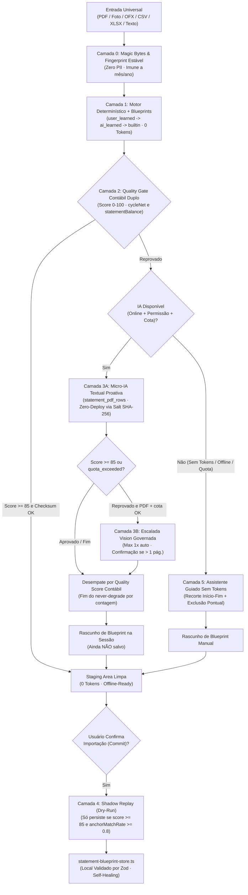
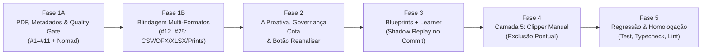

# PLANO ARQUITETURAL — MOTOR RESILIENTE E AUTO-EVOLUTIVO DE IMPORTAÇÃO DE FATURAS (v2.3)

> **Documento Canônico de Arquitetura — Self-Learning Statement Import Engine**  
> **Versão:** 2.3 (Consolidada pós-Revisão Arquitetural — 6 Formatos, 25 Blindagens, Zero-Deploy Edge Function) · **Status:** Concluído e Homologado (Fases 1A–5 · v3.24.0)  
> **Objetivo Central:** Garantir resiliência universal para **todos os tipos de arquivo** (PDF digital, PDF híbrido/escaneado, imagens/prints, OFX/QFX, CSV/TSV, Excel `.xlsx`/`.xls` HTML e texto colado), tornar a **IA proativa com governança estrita de cota** e capacitar o aplicativo a **aprender o layout de qualquer banco** (via IA ou ajuste manual), passando a ler faturas futuras daquele emissor com **0 tokens de IA e 100% de precisão determinística**.  
> **Governança:** `AGENTS.md` (§3, §4, §8, §18, §20, §26) · Zero Emojis · Funções Puras em `src/domain/` · TypeScript Estrito

---

## 1. VISÃO GERAL DA ARQUITETURA EM 5 CAMADAS

O motor opera como um **Pipeline Unificado de 5 Camadas com Ciclo Fechado de Aprendizado (*Closed-Loop Self-Learning*)**:

---

## 2. DETALHAMENTO TÉCNICO DAS 5 CAMADAS

### 2.1 Camada 0 — Ingestão Universal por Magic Bytes e Fingerprint Estável (`src/domain/reconciliation/ingestion/`)
1. **Sniffer de Magic Bytes (Item #12):**
   Inspeciona os primeiros bytes/conteúdo antes de confiar na extensão ou MIME type (protegendo arquivos renomeados no Android/WhatsApp ou `.xls` que são HTML/CSV):
   - `%PDF-` (`0x25 0x50 0x44 0x46 0x2D`) → PDF (`pdf_text` ou `pdf_scanned` se `< 100 chars` ou sem valor monetário — Item #23).
   - `PK\x03\x04` (`0x50 0x4B 0x03 0x04`) → `.xlsx` (ZIP/XML nativo).
   - `0xD0 0xCF 0x11 0xE0` → `.xls` BIFF8 legado (mensagem orientativa clara).
   - `<OFX>` / `OFXHEADER:` → OFX/QFX (mesmo salvo como `.txt`).
   - `<table` / `<Workbook` → Planilha HTML/XML.
   - `\x89PNG` / `\xFF\xD8\xFF` / `RIFF....WEBP` → Imagem para Vision IA.
2. **Estabilidade do Fingerprint entre Meses (Ajuste v2.3):**
   - `headerTokensHash` é computado removendo **dígitos, meses (`janeiro..dezembro`), anos (`202\d`), moedas (`R$`, `USD`) e nomes próprios**, mantendo apenas tokens estruturais de cabeçalho.
   - **Busca com Fallback em 2 Níveis:** primeiro tenta `pdf:<issuerKey>:<headerTokensHash>`; se não encontrar, faz fallback para `pdf:<issuerKey>` (garantindo hit na fatura do mês seguinte mesmo que uma frase promocional do banco mude).
   - Zero PII no fingerprint e no Blueprint.

---

### 2.2 Camada 1 — Motor Determinístico Guiado por Blueprints (`src/domain/reconciliation/blueprints/`)

Um **`StatementLayoutBlueprint`** é uma receita puramente declarativa validada por Zod:
* **Precedência:** `user_learned` → `ai_learned` → `builtin` (Nomad, XP/Rico/Clear, Nubank, Itaú, Bradesco, Santander, Inter, C6, BTG, BB, Caixa) → motor espacial genérico aprimorado.
* **Estrutura:** `fingerprint`, `issuerName`, `fileKind`, `origin`, `pdfRules` (`startMarkers`, `pauseMarkers`, `boletoMarkers`, `totalLabels`, `ignoredTotalLabels`, `columnMode`, `relativeXRanges`, `requireExplicitDatePerLine`), `tabularRules` (`columnMapping`, `delimiter`), `polarity`, `dateFormatHint`, `currencyStrategy`, `stats` (`uses`, `exactChecksumHits`, `consecutiveFailures`, `updatedAt`).

#### Regras Críticas de Precisão Multi-Formatos (Consolidado v2.3)
* **PDF Espacial (`spatial-pdf-parser.ts`):** Saída automática de `pause_zone` na virada de página ou cabeçalhos universais (`Extrato Referente ao mês`, `Data Descrição Valor`, `Data Histórico Valor`); `paused_boleto` sem `break`; separação estrita de `rawFullText` vs `reconstructedText`; passagem obrigatória de `officialTotalCents` antes do Checksum Gate.
* **Texto Livre (`text-parser.ts`):** Separação entre modo `strict_statement` (para PDFs/extratos: data explícita obrigatória, proíbe `todayISO()`, bloqueia `%`, CEP, CPF/CNPJ, Nosso Número e parênteses explicativos em frases) e modo `quick_paste_nl` (exclusivo para colagens curtas $\le 15$ linhas).
* **CSV/TSV (`csv-parser.ts` + `type-sniffer.ts`):** Parser RFC-4180 com suporte a quebras de linha dentro de aspas e remoção de `sep=;`; `detectDelimiter` conta delimitadores **fora de aspas**, desconta vírgulas decimais (`\d,\d{2}`) e prioriza `;`/`\t`; em `sniffColumnMapping`, `bestDescCol` tem prioridade absoluta sobre `bestTypeCol` (que só é permitido se `maxCols >= 4`).
* **OFX/QFX (`ofx-parser.ts`):** Parsing monetário via `parseAmountToCents` (eliminando o bug 1000x em `-1.234,56`); inferência automática de polaridade quando `TRNTYPE` for `OTHER`/`PAYMENT`; descarte de `SALDO ANTERIOR` (`isStatementNoiseOrSummary`); extração informativa de `<LEDGERBAL><BALAMT>`, `<ORG>` e `<ACCTID>`.
* **Excel `.xlsx` (`spreadsheet-parser.ts` + `type-sniffer.ts` — Ajuste de Precisão #21):**
  - Inspecionar todas as abas (`xl/worksheets/sheet*.xml`) e escolher automaticamente a aba com maior densidade de linhas válidas de Data + Valor.
  - **Precisão Numérica Cirúrgica:** **NÃO** aplicar `.toFixed(2)` em inteiros na leitura do XML (preservando datas seriais não detectadas e números de cartão). Corrigir ruído de ponto flutuante IEEE-754 (`140.49999999999997` → `140.50`) **somente** em floats não-inteiros cujo desvio para 2 casas decimais seja `< 1e-6`, além de normalizar notação científica (`2.5E+3`).
  - Em `parseAmountToCents`, só interpretar `(\.\d{3})+` sem vírgula como separador de milhar quando o contexto do arquivo **não** usar ponto `.` como separador decimal (protegendo exportações em padrão americano/internacional).
  - Suporte a células `cellType === "d"` (ISO-8601 nativo) e formatos de data customizados com hora (`dd/mm/yyyy hh:mm:00`).

---

### 2.3 Camada 2 — Quality Gate Contábil com Equação Dupla (`src/domain/reconciliation/quality-gate.ts`)

Função pura (`evaluateStatementExtractionQuality`) retornando score `0–100` e motivos explícitos:

#### Equação Contábil Dupla (Ajuste v2.3)
1. **`cycleNetCents` (Meta Prioritária — Compras do Ciclo):**
   $$\text{cycleNetCents} = \sum \text{compras} + \sum \text{encargos} - \sum \text{estornos}$$
   Confrontado prioritariamente contra **`Despesas e créditos do mês`** (ou `Total de compras do período`), quando presente no resumo (ex.: Nomad página 1).
2. **`statementBalanceCents` (Meta de Fechamento da Fatura):**
   $$\text{statementBalanceCents} = \max(0,\ \text{saldoAnterior} - \text{pagamentosFatura}) + \text{cycleNetCents}$$
   Confrontado contra **`Valor da fatura`** / **`Total da fatura`** (com tolerância de $\pm \text{R\$ } 0,05$).
   * **Regra para OFX (`<LEDGERBAL>`):** O `<LEDGERBAL>` do OFX é exibido apenas como **referência informativa** no resumo da fatura — **nunca** atua como gatilho rígido para reprovar um OFX estruturado válido e acionar IA ou Clipper.

#### Critérios Adicionais do Gate
* **Bidirecionalidade:** Reprova tanto falta (`< 95%`) quanto **excesso** (`> 105%`, ex.: R$ 47M vs R$ 1.528,54).
* **Sanidade de Descrições:** Reprova se $\ge 15\%$ forem `"Transação"`, datas, números puros ou termos contratuais (`CET`, `Taxa ao mês`, `Juros de atraso`).
* **Sanidade Temporal:** Reprova se $> 40\%$ tiverem data sintética `todayISO()`.
* **Outlier / Colapso / Confiança Tabular:** Reprova se alguma linha superar `3x` o total oficial, se ocorrer colapso espacial (`allLines > 15` com $\le 2$ txs e $\ge 3$ linhas monetárias descartadas) ou se CSV/XLSX tiver `mappingConfidence < 75%` ou `descriptionColIndex === dateColIndex`.

---

### 2.4 Camada 3 — IA Proativa, Governança de Cota e Compatibilidade Zero-Deploy

#### Verificações Confirmadas no Codebase (Pré-v2.3)
1. **Compatibilidade Zero-Deploy com a Edge Function em Produção:**
   * `AiStatementPdfRowsRequestSchema` em [ai-schemas.ts](file:///home/gabrielsales/meus_apps/financasnew/supabase/functions/_shared/ai-schemas.ts#L433-L448) aceita `{ mode, sha256, text?, imageBase64?, imageMimeType?, referenceYear?, competenceMonth? }`.
   * **Sem necessidade de deploy remoto:** o botão **"Reanalisar com IA"** contorna cache remoto envenenado gerando um novo SHA-256 hex válido (64 chars) sobre `${baseSha}:reanalyze:${nonce}` via `computeTextSha256`, e o `BlueprintLearner` destila os marcadores 100% no cliente (sem precisar de `layoutHints` da Edge Function).
2. **Governança Estrita de Cota (`batch_calls`):**
   * Em [ai-schemas.ts](file:///home/gabrielsales/meus_apps/financasnew/supabase/functions/_shared/ai-schemas.ts#L58-L67), o balde `batch_calls` (compartilhado por `statement_pdf_rows`, `line_curator` e `categorize_batch`) tem limites estritos: **Trial = 2/dia (5/mês)** e **Pro = 5/dia (20/mês)**, validados no servidor em [index.ts](file:///home/gabrielsales/meus_apps/financasnew/supabase/functions/ai-financial-assistant/index.ts#L558-L704).
   * **Regras de Proteção na Escalada 3A → 3B:**
     - **Aborto imediato em `quota_exceeded`:** se o Estágio 3A (ou qualquer chunk) retornar `reason === "quota_exceeded"`, interrompe imediatamente qualquer escalada ou chunk restante e exibe aviso claro com `formatAiQuotaResetHint(quotaResetAt)`.
     - **Teto de Escalada Automática:** máximo **1 escalada automática** por arquivo. Se o PDF tiver **1 página** com linhas de extrato/data, a escalada 3B (Vision) roda automaticamente com feedback claro no loading (*"Refinando leitura visual com IA..."*). Se houver **2 ou 3 páginas** de extrato, exibe confirmação explícita ao usuário informando o consumo de créditos (*"Este PDF requer leitura visual de N páginas com IA — Prosseguir / Recortar manualmente"*), protegendo cotas diárias de Trial (2/dia) e Pro (5/dia).
     - **Deduplicação de Fronteira e Mesclagem em Prints (#24–#25):** deduplicar compras repetidas por sobreposição de scroll entre prints consecutivos `N` e `N+1`, mesclar metadados campo a campo e exibir aviso explícito caso o usuário envie mais imagens que o limite do lote.
3. **Desempate Contábil (Fim do `never-degrade` Cego):**
   * Substitui `built.transactions.length < meaningfulLocalCount` por `qualityScore(IA) > qualityScore(Determinístico)`.

---

### 2.5 Camada 4 — Auto-Aprendizado Blindado (`BlueprintLearner` — 0 Tokens Extras)

1. **Persistência Somente no Commit:** O blueprint destilado fica apenas como **rascunho em memória na sessão** (`draftBlueprintRef`). Ele só é gravado em `statement-blueprint-store.ts` quando o usuário **confirma a importação** (evitando aprender resultados rejeitados ou incorretos).
2. **Shadow Replay (Auto-Validação Obrigatória):**
   * Antes de salvar qualquer blueprint aprendido, o sistema executa um **dry-run determinístico** aplicando o blueprint rascunho sobre `rawLines` do próprio arquivo.
   * O blueprint **só é persistido** se o dry-run atingir **`score >= 85` e Checksum válido** no próprio documento.
   * **Bloqueio de Aprendizado Frágil em Vision Pura:** se a extração veio de Vision pura (sem camada de texto alinhada) e a taxa de ancoragem das transações nas linhas textuais for `anchorMatchRate < 0.8`, o sistema **não** destila `pdfRules` (aprende apenas `MerchantLearningMemory` de categorias).
3. **Parametrização Anti-PII e Self-Healing:**
   * Remove meses, anos, dígitos de cartão e nomes próprios dos marcadores (`2–6` tokens estruturais limpos).
   * Se um blueprint salvo falhar 2 vezes consecutivas (`consecutiveFailures >= 2`), é invalidado e reaprendido automaticamente.

---

### 2.6 Camada 5 — Assistente Guiado Sem Tokens (`StatementBlockClipperStep`)

Acionado quando um formato inédito reprova no Quality Gate e o usuário está **sem cota de IA ou offline**:
* Permite marcar em 2 cliques **Início das compras** e **Fim das compras** sobre as linhas do arquivo.
* **Exclusão Pontual (Ajuste v2.3):** dentro do intervalo Início–Fim, cada linha possui um checkbox compacto permitindo **desmarcar linhas intrusas individuais** (ex.: rodapé de página, resumo intermediário ou subtotal que apareceu no meio da tabela), com barra fixa mostrando o recálculo ao vivo: **`Selecionado: R$ X vs Fatura Oficial: R$ Y`**.
* **Conformidade `AGENTS.md`:** 100% inline no mesmo modal (zero modais aninhados), zero `autoFocus` no mobile, zero emojis, componentes DRY de `components/ui`.
* Ao confirmar a importação no final do fluxo, o ajuste manual passa pelo **Shadow Replay** e alimenta o `BlueprintLearner` para automatizar os meses seguintes sem tokens.

---

## 3. CRONOGRAMA CONSOLIDADO DE EXECUÇÃO (6 FASES: 1A, 1B, 2, 3, 4, 5)

### Fase 1A — Estabilização do Motor PDF, Metadados e Quality Gate Contábil Duplo (Itens #1–#11)
- [x] **#1:** Passar `officialTotalCents` real ao `parseSpatialPdfDocument` em `readStatementFileContent` (reativando Checksum Gate e `line_curator`).
- [x] **#2:** Separar `rawFullText` de `reconstructedText` em `statement-import-helpers.ts`, garantindo que `detectStatementMetadata` leia sempre o cabeçalho completo.
- [x] **#3:** Corrigir `handleSwitchCompetence` em `use-statement-import.ts` para preservar extração espacial/Vision sem rebaixar ao `text-parser.ts` nem cobrar cota dupla.
- [x] **#4:** Corrigir `sniffColumnMapping` em `type-sniffer.ts` (prioridade absoluta para `bestDescCol` sobre `bestTypeCol`; `bestTypeCol` só com `maxCols >= 4`).
- [x] **#5:** Corrigir `extractPrintedStatementTotalCents` em `statement-preprocessor.ts` (2 níveis: `Despesas e créditos do mês` / `Valor da fatura` > `Total a pagar` fora de parcelamentos).
- [x] **#6:** Separar `strict_statement` (data obrigatória, sem `todayISO()`, bloqueia `%`/CEP/CPF/Nosso Número e parênteses explicativos) de `quick_paste_nl` ($\le 15$ linhas) em `text-parser.ts`.
- [x] Corrigir `spatial-pdf-parser.ts` (saída de `pause_zone` na virada de página + `Extrato Referente ao mês` e `Data Descrição Valor` em `SECTION_START_REGEX`).
- [x] **#11:** Criar `src/domain/reconciliation/quality-gate.ts` com **Equação Contábil Dupla** (`cycleNetCents` + `statementBalanceCents`) e reprovação bidirecional (falta e excesso).
- [x] Teste de regressão real da fatura completa da **Nomad** (3 páginas → exatamente **11 compras = R$ 1.528,54**, cartões `2107`/`7756`).

### Fase 1B — Blindagem Abrangente Multi-Formatos (Itens #12–#25)
- [x] **#12:** Implementar **Sniffer de Magic Bytes** na Camada 0 (`%PDF-`, `PK` XLSX, `D0 CF 11 E0` BIFF8, `<OFX>`, `<table`/`<Workbook`, PNG/JPG/WEBP).
- [x] **#13–#14:** Aprimorar `csv-parser.ts` (delimitador fora de aspas descontando decimais `\d,\d{2}`, suporte RFC-4180 a `\n` em aspas, remoção de `sep=;`).
- [x] **#15–#16:** Corrigir assinatura do cache de colunas em `statement-import-helpers.ts` (usar linha real de cabeçalho `startRowIndex - 1`, não `rows[0]`) e `validateMappingAgainstSample` em `statement-mapping-cache.ts` (suportar colunas duplas `Débito`/`Crédito` e exigir `desc !== date`).
- [x] **#17–#19:** Blindar `ofx-parser.ts` (usar `parseAmountToCents` corrigindo erro 1000x em `-1.234,56`, inferência automática de polaridade para `TRNTYPE=OTHER`, descarte de `SALDO ANTERIOR`, extração **informativa** de `<LEDGERBAL>`, `<ORG>`, `<ACCTID>` sem reprovar OFX no Quality Gate).
- [x] **#20–#22:** Blindar `spreadsheet-parser.ts` e `type-sniffer.ts` (seleção automática da melhor aba `sheet*.xml`, limpeza cirúrgica de ruído IEEE-754 apenas em floats não-inteiros com desvio `< 1e-6` sem corromper inteiros, notação científica, proteção de padrão decimal americano vs milhar BRL, suporte a `t="d"` e formatos de data com hora).
- [x] **#23:** Classificar PDFs híbridos (`fullText.trim().length < 100` ou zero tokens monetários) como `pdf_scanned` para acionar Vision.
- [x] **#24–#25:** Em `parseStatementVisionBlobsWithAi`, deduplicar fronteira entre prints consecutivos, mesclar metadados campo a campo e retornar aviso de truncamento quando exceder o limite de imagens.
- [x] Testes unitários dedicados para cada formato (`csv-parser.test.ts`, `ofx-parser.test.ts`, `spreadsheet-parser.test.ts`, `type-sniffer.test.ts`, `statement-mapping-cache.test.ts`, vision dedup).

### Fase 2 — IA Proativa em Todos os Formatos, Governança de Cota e Transparência na UI (Itens #7, #8, #10)
- [x] **#7:** Substituir `never-degrade` por desempate de `qualityScore` contábil em `statement-import-helpers.ts`.
- [x] **#8:** Garantir SHA-256 hex válido (64 chars) em todas as chamadas e salt determinístico (`reanalyze:${nonce}`) para o botão **"Reanalisar com IA"** sem exigir deploy na Edge Function.
- [x] Ativar gatilhos proativos da IA (Camada 3A) para PDF digital, texto colado e planilhas/CSVs ambíguos com agregação de metadados multi-chunk.
- [x] **#10:** Implementar escalada Vision governada (Camada 3B): aborto imediato em `quota_exceeded`, seleção cirúrgica de páginas com extrato, máximo 1 escalada automática (1 pág.) e confirmação explícita do usuário se $> 1$ página.
- [x] Exibir na UI a origem da leitura (*Local Conferida*, *Layout Aprendido*, *Estruturado com IA*), botão **"Reanalisar com IA"** e avisos honestos de cota/offline.

### Fase 3 — Catálogo de Blueprints Nativos e `BlueprintLearner` com Shadow Replay (Item #9)
- [x] Criar `src/domain/reconciliation/blueprints/` (`types.ts`, `builtin-blueprints.ts`, `fingerprint.ts`, `matcher.ts`, `learner.ts`, testes).
- [x] Criar `src/services/statement-blueprint-store.ts` (validação Zod, LRU 50 entradas, self-healing `consecutiveFailures >= 2`).
- [x] Implementar **Persistência somente no Commit**, **Shadow Replay** (`score >= 85` obrigatório), bloqueio de destilação Vision com `anchorMatchRate < 0.8` e **Fingerprint estável entre meses** com fallback `pdf:<issuerKey>`.
- [x] Teste ponta a ponta: *1ª fatura de banco inédito usa IA → commit salva blueprint após Shadow Replay → 2ª fatura (outro mês!) com IA desligada lê 100% com 0 tokens*.

### Fase 4 — Camada 5: Assistente Guiado Sem Tokens (`StatementBlockClipperStep`)
- [x] Criar componente inline `StatementBlockClipperStep` (zero modais aninhados, zero `autoFocus`, zero emojis).
- [x] Suportar marcação Início–Fim + **exclusão pontual de linhas intrusas individuais** com conferência ao vivo do total contra `Valor da fatura`.
- [x] Integrar com rascunho do `BlueprintLearner` para salvar no commit após Shadow Replay.

### Fase 5 — Regressão Multibancos e Homologação Final
- [x] Fixtures de regressão: Nomad, Rico/XP, Nubank, Itaú, Bradesco, CSV `;` com aspas/decimais, OFX com `-1.234,56` e `SALDO ANTERIOR`, XLSX multi-aba com floats IEEE-754, PDF híbrido, prints sobrepostos e fatura com saldo anterior.
- [x] Executar `npm run test`, `npm run typecheck`, `npm run lint` e auditoria `AGENTS.md` (parando antes de qualquer commit ou build de APK).

---

## 4. TABELA MESTRA DAS 25 BLINDAGENS MAPEADAS (RASTREABILIDADE COMPLETA)

| # | Categoria | Fragilidade / Bug Real | Fase Alocada |
|---|---|---|---|
| 1 | PDF Espacial | `officialTotalCents = undefined` desligava Checksum Gate e `line_curator` | Fase 1A |
| 2 | PDF Metadados | `reconstructedText` apagava cabeçalho antes de `detectStatementMetadata` | Fase 1A |
| 3 | Competência | `handleSwitchCompetence` descartava extração espacial / duplicava Vision | Fase 1A |
| 4 | Type Sniffer | `bestTypeCol` causava `descriptionColIndex === dateColIndex` em 3 colunas | Fase 1A |
| 5 | Total Oficial | First-match pegava `Total a pagar` de parcelamento em vez de `Valor da fatura` | Fase 1A |
| 6 | Text Parser | `parseNaturalLanguageLine` inventava `todayISO()` e lia CEP/Nosso Número em PDFs | Fase 1A |
| 7 | IA Fallback | `never-degrade` por contagem descartava 11 compras da IA por 74 linhas de lixo | Fase 2 |
| 8 | Cache IA | Salt inválido em `sha256` e cache remoto envenenado na reanálise manual | Fase 2 |
| 9 | Aprendizado | Overfitting/PII em marcadores, falta de Shadow Replay e persistência precoce | Fase 3 |
| 10 | Vision Cota | Escalada irrestrita em PDFs longos estourando `batch_calls` (2/dia Trial, 5/dia Pro) | Fase 2 |
| 11 | Quality Gate | Faturas com `Saldo Anterior` / rotativo gerando falso conflito de soma | Fase 1A |
| 12 | Ingestão | Roteamento só por extensão/MIME falhava em arquivos sem extensão (Android/WhatsApp) | Fase 1B |
| 13 | CSV | `detectDelimiter` contava vírgulas em aspas e decimais (`120,50`) vencendo `;` | Fase 1B |
| 14 | CSV | `split(/\r?\n/)` quebrava campos com `\n` em aspas e mantinha `sep=;` | Fase 1B |
| 15 | Cache Colunas | Chave de cache baseada em `rows[0]` (com mês) nunca dava hit no mês seguinte | Fase 1B |
| 16 | Cache Colunas | `validateMappingAgainstSample` invalidava planilhas com `Débito`/`Crédito` separados | Fase 1B |
| 17 | OFX | `parseFloat(rawAmt.replace(",", "."))` causava erro 1000x em `-1.234,56` | Fase 1B |
| 18 | OFX | `TRNTYPE=OTHER` com compras positivas marcava 100% como estorno | Fase 1B |
| 19 | OFX | `SALDO ANTERIOR` entrava como compra; `<LEDGERBAL>`/`<ORG>`/`<ACCTID>` ignorados | Fase 1B |
| 20 | Excel `.xlsx` | Lia apenas `sheet1.xml`, ignorando abas reais de lançamentos (`sheet2.xml`) | Fase 1B |
| 21 | Excel / Sniffer | Floats IEEE-754, notação científica (`2.5E+3` → `2,53`) e `1.500` → `1,50` | Fase 1B |
| 22 | Excel `.xlsx` | Células `t="d"` (ISO nativo) e datas com hora (`hh:mm:00`) não reconhecidas | Fase 1B |
| 23 | PDF Híbrido | PDFs escaneados com marca d'água (`< 100 chars`) nunca acionavam Vision | Fase 1B |
| 24 | Prints Vision | Sobreposição de scroll duplicava compras e `if (!latestAiMeta)` perdia metadados | Fase 1B |
| 25 | Prints Vision | Corte silencioso acima de 3 imagens sem avisar o usuário | Fase 1B |

---

## 5. DEFINITION OF DONE (CRITÉRIOS DE ACEITE)

1. A fatura real da **Nomad** (3 páginas) é lida com **exatamente 11 compras somando R$ 1.528,54**, reconhecendo cartão titular `2107` e virtual `7756`, com **0 linhas de CET, parcelas simuladas, CEP ou Nosso Número**.
2. Todos os 6 formatos (PDF digital/híbrido, prints, OFX, CSV/TSV, `.xlsx`/`.xls` HTML e texto colado) passam em testes dedicados cobrindo as 25 blindagens.
3. A **Equação Contábil Dupla** do Quality Gate valida `cycleNetCents` e `statementBalanceCents`, tratando `<LEDGERBAL>` do OFX apenas de forma informativa.
4. A escalada IA 3A → 3B funciona **sem exigir deploy da Edge Function**, respeitando estritamente `batch_calls` (aborto imediato em `quota_exceeded`, máximo 1 escalada automática, confirmação para $> 1$ página).
5. Nenhum Blueprint é salvo antes do commit ou sem passar pelo **Shadow Replay (`score >= 85`)**; após aprender a 1ª fatura de um banco inédito, a 2ª fatura (de outro mês) é lida com **0 tokens de IA**.
6. Sem tokens e em banco inédito, o `StatementBlockClipperStep` permite recorte Início–Fim + **exclusão pontual** com recálculo ao vivo, gerando Blueprint válido no commit.
