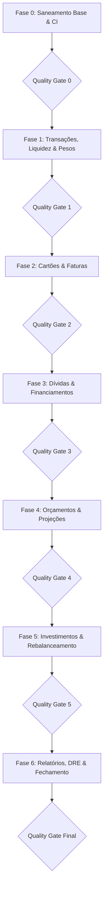

# 📊 PLANO_AUDITORIA_CONGRUENCIA.md — Plano Mestre de Auditoria & Congruência

> **Status:** Aprovado para execução — Auditoria profunda de regras de negócio, cálculos matemáticos, congruência contábil, diferenciação de pesos (rateio) e refinamento funcional.
>
> **Stack de Verificação:** Vitest · TypeScript estrito (`tsc --noEmit`) · ESLint estrito (`npm run lint`).
>
> **Diretriz de Execução:** Commit atômico por tarefa · Push remoto estritamente após a aprovação de cada Quality Gate de fase.

---

## 1. OBJETIVO E ESCOPO

Garantir que **100% dos cálculos matemáticos e regras de negócio** do aplicativo apresentem integridade contábil e fidelidade financeira absoluta, eliminando qualquer risco de exibir dados distorcidos ou imprecisos ao usuário.

A auditoria abrange ponta a ponta:
1. **Transações & Liquidez:** Despesas, rendas, conciliação bancária, pesos analíticos (0–1), arredondamento em centavos inteiros.
2. **Governança de Pesos e Rateio (Com Peso vs Sem Peso):** Transparência total entre Valor Bruto Nominal (100% bancário/fatura) e Valor Ponderado (participação pessoal efetiva).
3. **Cartões & Faturas:** Competência $YYYY-MM$ snapshot, fechamento vs vencimento, divisão exata de parcelas, pagamentos parciais, excedentes de fatura e estornos vinculados.
4. **Dívidas & Financiamentos:** Tabela SAC, Tabela Price, amortização extraordinária (desconto a valor presente CDC), juros de mora e multas.
5. **Orçamentos & Projeções:** Limites por categoria, regras de herança de limite, realocação automática, projeção de saldo futuro e gap de caixa.
6. **Investimentos & Rebalanceamento:** Preço médio em operações parciais, apuração de DARF mensal, isenção fiscal (ações vs ETFs vs B3), proventos BRL/USD, Yield on Cost (YoC) e algoritmo de aporte em 3 níveis (Classe $\to$ Setor $\to$ Ativo).
7. **Relatórios & DRE:** DRE Pessoal, Demonstração do Resultado, fluxo de caixa, balanço consolidado e eliminação de duplicações contábeis.

---

## 2. GOVERNANÇA DE QUALIDADE E PROTOCOLO GIT

### 2.1 Commit por Tarefa
Cada tarefa descrita neste plano possui escopo atômico e deve receber um commit semântico imediatamente após ser implementada e testada:
```bash
git add <arquivos-afetados>
git commit -m "tipo(escopo): descrição da tarefa em pt-BR ou en"
```

### 2.2 Quality Gates ao Fim de Cada Fase
Antes de efetuar qualquer `git push origin main`, os seguintes critérios devem estar **100% satisfeitos**:
1. **Vitest 100% Verde:** Todos os testes unitários e de integração sem falhas (`npx vitest run`).
2. **TypeScript Estrito:** Sem erros em `npx tsc --noEmit`.
3. **ESLint Estrito:** Sem violações em `npm run lint`.
4. **Documentação Atualizada:** Sincronização em `ESPECIFICACAO_TECNICA.md` e em `docs/`.

---

## 3. AUDITORIA ESPECIAL: LANÇAMENTOS COM PESO VS SEM PESO (RATEIO DE CONTAS)

### 3.1 O Problema da Confusão do Usuário
O sistema possui a funcionalidade de peso de relatório (`report_weight` de 0.0 a 1.0) para despesas e receitas. Ela serve tipicamente para:
- **Despesas Compartilhadas / Rateio (ex: 50%):** A conta do restaurante ou aluguel de R$ 1.000,00 foi paga pelo usuário, mas sua responsabilidade pessoal é apenas R$ 500,00.
- **Reembolso Corporativo / Trabalho (0%):** Uma viagem paga no cartão pessoal que será integralmente reembolsada pela empresa (não deve poluir seus gastos pessoais de vida).
- **Receitas de Rateio / Repasse (0%):** O dinheiro que o amigo transferiu para rachar a conta e que não constitui ganho patrimonial.

**Onde mora a confusão potencial:**
1. **Fatura do Cartão:** Se o usuário vê um valor ponderado na fatura, ele pode pagar o valor errado no boleto bancário (o banco exige os 100% brutos).
2. **Extrato Bancário / Conciliação:** O saldo da conta corrente física é debitado em 100%. Se a tela subtrair o valor ponderado, o saldo do app nunca bate com o saldo do banco.
3. **Orçamentos:** Um usuário com limite de R$ 1.000 em Alimentação pode se surpreender ao ver que gastou R$ 2.000 nominalmente, mas o app indica consumo de apenas 50% por causa do peso.

### 3.2 Princípios Canônicos de Resolução
Para eliminar qualquer ambiguidade ou informação falsa:
1. **Regra de Ouro Contábil:** O valor **BRUTO (100% Nominal)** é sempre a métrica financeira primária onde houver obrigação de caixa (Extrato, Saldo Real Bancário, Boleto de Fatura do Cartão e Quitação de Dívidas).
2. **Regra de Análise Pessoal:** O valor **PONDERADO (Efetivo)** é a métrica analítica de estilo de vida pessoal (DRE Pessoal, Poupança Pessoal, Gráficos de Gastos por Categoria e Metas de Orçamento).
3. **Transparência de Dupla Visualização:** Onde houver diferença entre bruto e ponderado, a interface **obrigatoriamente apresenta ambos os números de forma explícita** (Valor Bruto em destaque + Sub-linha/Badge com o valor ponderado ou vice-versa, com rotulagem clara: *"Total Pago"* vs *"Sua Parte"*).
4. **Badge de Identificação Visual no Extrato:** Lançamentos com rateio/peso $< 100\%$ devem carregar badge identificador discreto (ex: `50% rateio` ou `0% reembolso`), permitindo ao usuário entender instantaneamente por que o valor analítico difere.

---

## 4. MAPA DE DISCREPÂNCIAS IDENTIFICADAS

| ID | Área | Problema Identificado | Ação Corretiva |
|---|---|---|---|
| **E1** | Infra/Testes | `notifications-tab.test.tsx` com 11 testes falhando por falta do contexto do React Router (`useNavigate`). | Envolver o componente no helper de teste com `<MemoryRouter>`. |
| **E2** | Infra/Testes | `.env.example` falhava em `security-audit.test.ts` devido à chave `APK_DOWNLOAD_URL` com valor sem comentário. | Ajustar o placeholder oficial e garantir aderência no teste de segurança. |
| **E3** | Transações | `sumWeightedCents` (`src/domain/money/totals.ts`) multiplicava floats antes de converter em centavos. | Converter a base para centavos inteiros antes da multiplicação ponderada: `Math.round(numberToCents(item.value) * weight)`. |
| **E4** | Cartões | `resolveBillCompetence` exigia `Date` nativa; conversões a partir de strings sofriam drift de fuso em UTC. | Permitir passagem direta de string `YYYY-MM-DD` com extração local de ano, mês e dia. |
| **E5** | Cartões | `invoiceBalance` não acumulava excedentes de pagamento (`pago > previsto`) para crédito na fatura seguinte. | Registrar crédito transitório transferível para a competência posterior. |
| **E6** | Financiamentos | `calculateEarlyAmortization` concedia 1 mês cheio de desconto de juros para parcelas com vencimento no mês corrente (`monthsAhead = Math.max(1, ...)`). | Tratar `monthsAhead = 0` (ou pro-rata dia) para parcelas no mesmo mês da referência. |
| **E7** | Relatórios | `mergePaidDebts` somava dívidas pagas às despesas mesmo quando `pay_debt` já havia criado a respectiva despesa no banco. | Ignorar dívidas que já possuem vínculo direto de despesa (`expense_id`). |
| **E8** | Investimentos | `calculateMonthlyDarf` (`src/domain/portfolio/tax.ts`) atribuía isenção de R$ 20k para ETFs e ativos globais em USD. | Restringir a isenção de R$ 20.000,00 estritamente para ações comuns B3. |
| **E9** | Investimentos | `sellAssetPosition` (`src/domain/portfolio/operations.ts`) usava comparação estrita de strings (`rawClass === "ações"`), quebrando categorias como "Ações Nacionais". | Utilizar `normalizeClassName` e funções auxiliares canônicas. |
| **E10** | Orçamentos | Ausência de limite em categoria herdava o mês anterior sem distinguir de um limite 0,00 intencionalmente cadastrado. | Diferenciar valor nulo/inexistente (herda) de zero explícito (limite zero ativo). |
| **E11** | Governança de Pesos | Telas de Orçamentos e Extrato não explicavam claramente a diferença entre o valor total da compra e a "sua parte" ponderada. | Padronizar rótulos em diálogos, adicionar badges de rateio e permitir alternância de visualização em orçamentos. |

---

## 5. FASES DE EXECUÇÃO



---

### Fase 0: Saneamento da Suíte de Testes e CI
- [x] **Tarefa 0.1:** Corrigir `src/features/settings/components/tabs/notifications-tab.test.tsx` envolvendo a renderização em `<MemoryRouter>`.
  - *Commit:* `test(settings): wrap notifications tab in MemoryRouter for router context`
- [x] **Tarefa 0.2:** Corrigir `src/tests/security-audit.test.ts` e `.env.example` para suportar `APK_DOWNLOAD_URL` higienizado.
  - *Commit:* `fix(ci): sanitize APK_DOWNLOAD_URL placeholder in .env.example`
- 🏁 **Quality Gate 0:** Suíte de segurança e settings 100% verdes; `tsc --noEmit` ok. (Concluído)

---

### Fase 1: Transações, Liquidez e Auditoria de Pesos (Com Peso vs Sem Peso)
- [x] **Tarefa 1.1:** Refatorar `sumWeightedCents` em `src/domain/money/totals.ts` para preservação exata de centavos inteiros via `Math.round(numberToCents(item.value) * weight)`.
  - *Commit:* `fix(domain): compute weighted cents with integer base in sumWeightedCents`
- [x] **Tarefa 1.2:** Adaptar `resolveBillCompetence` em `src/domain/competence/index.ts` para receber string ISO `YYYY-MM-DD` com parsing imune a fusos horários.
  - *Commit:* `fix(competence): support ISO date strings directly in resolveBillCompetence`
- [x] **Tarefa 1.3:** Implementar badge visual claro de rateio no componente `TransactionRow` (`src/components/modules/transaction-row.tsx`) quando `reportWeight < 1` (ex: badge `50% rateio` ou `0% reembolso`), com helper explicativo do valor bruto vs ponderado.
  - *Commit:* `feat(ui): add visual split badge and explanatory labels in TransactionRow`
- [x] **Tarefa 1.4:** Atualizar os diálogos de detalhamento e lançamento (`ReportWeightField`) para substituir rótulos vagos por terminologia clara: *"Sua Participação / Rateio"* com aviso explícito de que o valor bancário cobrado permanece 100%.
  - *Commit:* `refactor(transactions): clarify split weight terminology in transaction dialogs`
- [ ] **Tarefa 1.5:** Atualizar `mergePaidDebts` para filtrar registros com `expense_id` e evitar duplicidades contábeis.
  - *Commit:* `fix(reports): prevent double counting of linked expenses in mergePaidDebts`
- 🏁 **Quality Gate 1:** Vitest em `domain/money`, `domain/competence`, `domain/expenses`, `components/modules`; `tsc --noEmit`; `npm run lint`; git push da Fase 1.

---

### Fase 2: Cartões de Crédito, Faturas e Parcelamentos
- [ ] **Tarefa 2.1:** Implementar mecanismo de crédito de fatura por excesso de pagamento (`pago > previsto`) em `src/domain/cards/index.ts`, permitindo que créditos transbordem para abater a competência posterior.
  - *Commit:* `feat(cards): handle overpayment credits in successive invoice competences`
- [ ] **Tarefa 2.2:** Validar a invariante da conservação estrita de centavos em parcelamentos de cartão (`divideIntoInstallments`), assegurando que a soma das parcelas seja idêntica ao valor da compra.
  - *Commit:* `test(cards): verify strict cents conservation across installment divisions`
- [ ] **Tarefa 2.3:** Auditar a apresentação da fatura de cartão para garantir que o **Valor do Boleto / Total a Pagar** exibido com destaque seja sempre o valor **Bruto Nominal (100%)**, com a métrica ponderada exibida como consulta analítica.
  - *Commit:* `fix(cards): guarantee gross nominal invoice total as primary payment metric`
- [ ] **Tarefa 2.4:** Validar congruência entre estornos de fatura e receitas criadas na categoria "Estorno".
  - *Commit:* `test(cards): assert refund balance congruence across invoice and income records`
- 🏁 **Quality Gate 2:** Vitest em `domain/cards` e componentes de cartões; `tsc --noEmit`; `npm run lint`; git push da Fase 2.

---

### Fase 3: Dívidas, Financiamentos e Amortizações
- [ ] **Tarefa 3.1:** Corrigir desconto em amortização extraordinária (`calculateEarlyAmortization`) em `src/domain/loans/index.ts`, para que parcelas vencendo no mesmo mês de referência não recebam desconto indevido de 1 mês cheio de juros.
  - *Commit:* `fix(loans): prevent unearned monthly interest discount on current month installments`
- [ ] **Tarefa 3.2:** Auditar amortizações Price e SAC para zeramento exato do saldo em centavos na parcela final $N$.
  - *Commit:* `test(loans): enforce exact zero remaining balance on final installment in SAC and Price`
- [ ] **Tarefa 3.3:** Auditar cálculo de encargos por atraso (multa e mora CDC) em `src/domain/debts/penalty.ts`, formalizando tolerância de atraso 0 no dia do vencimento.
  - *Commit:* `test(debts): confirm exact penalty and interest boundaries on due date`
- 🏁 **Quality Gate 3:** Vitest em `domain/loans`, `domain/debts`; `tsc --noEmit`; `npm run lint`; git push da Fase 3.

---

### Fase 4: Orçamentos, Metas e Projeções Financeiras
- [ ] **Tarefa 4.1:** Distinguir limite 0 explícito de ausência de limite no mês anterior em `src/domain/budgets/` (evitando herança indesejada quando o usuário intencionalmente zerou a categoria).
  - *Commit:* `fix(budgets): distinguish explicit zero limit from inherited budget limits`
- [ ] **Tarefa 4.2:** Disponibilizar alternância clara na tela de Orçamentos (`budgets-page.tsx`) entre visualização por **Gasto Pessoal (Ponderado)** e **Gasto Total da Família/Casa (Bruto)**, exibindo tooltips informativos.
  - *Commit:* `feat(budgets): support dual metric view for personal vs total household budget spend`
- [ ] **Tarefa 4.3:** Alinhar datas de desembolso futuro de faturas de cartão no motor de projeção de saldo (`domain/projection/`), usando a data de vencimento da fatura (`invoiceDueDate`) e não a data da compra.
  - *Commit:* `fix(projection): align credit card installment cash flows with invoice due dates`
- [ ] **Tarefa 4.4:** Validar regras de arredondamento em múltiplos de R$ 10 na realocação de orçamentos.
  - *Commit:* `test(budgets): validate budget reallocation constraints and multiple of 10 rounding`
- 🏁 **Quality Gate 4:** Vitest em `domain/budgets`, `domain/projection`; `tsc --noEmit`; `npm run lint`; git push da Fase 4.

---

### Fase 5: Investimentos, Custódia e Rebalanceamento
- [ ] **Tarefa 5.1:** Normalizar classes de ativos em `sellAssetPosition` (`src/domain/portfolio/operations.ts`) usando `normalizeClassName` e helpers canônicos (`isStockClass`, `isFiiClass`, `isFixedIncomeClass`).
  - *Commit:* `fix(portfolio): use normalized class helpers in sellAssetPosition`
- [ ] **Tarefa 5.2:** Corrigir apuração de DARF mensal (`calculateMonthlyDarf` em `src/domain/portfolio/tax.ts`), restringindo a isenção de R$ 20.000,00 estritamente para ações comuns B3 e segregando ativos internacionais (Lei 14.754/2023).
  - *Commit:* `fix(tax): restrict 20k exemption strictly to local common stocks and exclude ETFs`
- [ ] **Tarefa 5.3:** Auditar motor de aportes (`src/domain/portfolio/aporte.ts`) nos 3 modos e integridade das cotas B3 vs USD/Cripto.
  - *Commit:* `test(portfolio): stress-test aporte invariants with multi-level sector hierarchy`
- [ ] **Tarefa 5.4:** Auditar cálculo de Yield on Cost na moeda nativa USD antes da conversão cambial consolidada.
  - *Commit:* `test(portfolio): verify YoC calculation purity in native USD currency`
- 🏁 **Quality Gate 5:** Vitest em `domain/portfolio`; `tsc --noEmit`; `npm run lint`; git push da Fase 5.

---

### Fase 6: Relatórios Executivos, DRE e Fechamento Consolidado
- [ ] **Tarefa 6.1:** Substituir cálculos manuais flutuantes em `reports-page.tsx` (linhas 617-622) pela função canônica `weightedCents` de `src/domain/reports`.
  - *Commit:* `fix(reports): use weightedCents in reports-page to avoid floating-point drift`
- [ ] **Tarefa 6.2:** Auditar fórmulas patrimoniais de DRE e Balanço Consolidado em `domain/reports/`, garantindo congruência entre Ativo Total (Investimentos a Mercado + Caixa) e Passivo Total (Dívidas + Faturas).
  - *Commit:* `test(reports): verify balance sheet net worth formula across all liability classes`
- [ ] **Tarefa 6.3:** Sincronizar e atualizar a documentação oficial em `docs/` e `ESPECIFICACAO_TECNICA.md` com as regras e convenções auditadas.
  - *Commit:* `docs: update ESPECIFICACAO_TECNICA and audit documentation`
- 🏁 **Quality Gate 6 (Final):** Suíte completa do Vitest verde (364 arquivos), TypeScript sem erros (`tsc --noEmit`), ESLint limpo (`npm run lint`); git push final.
