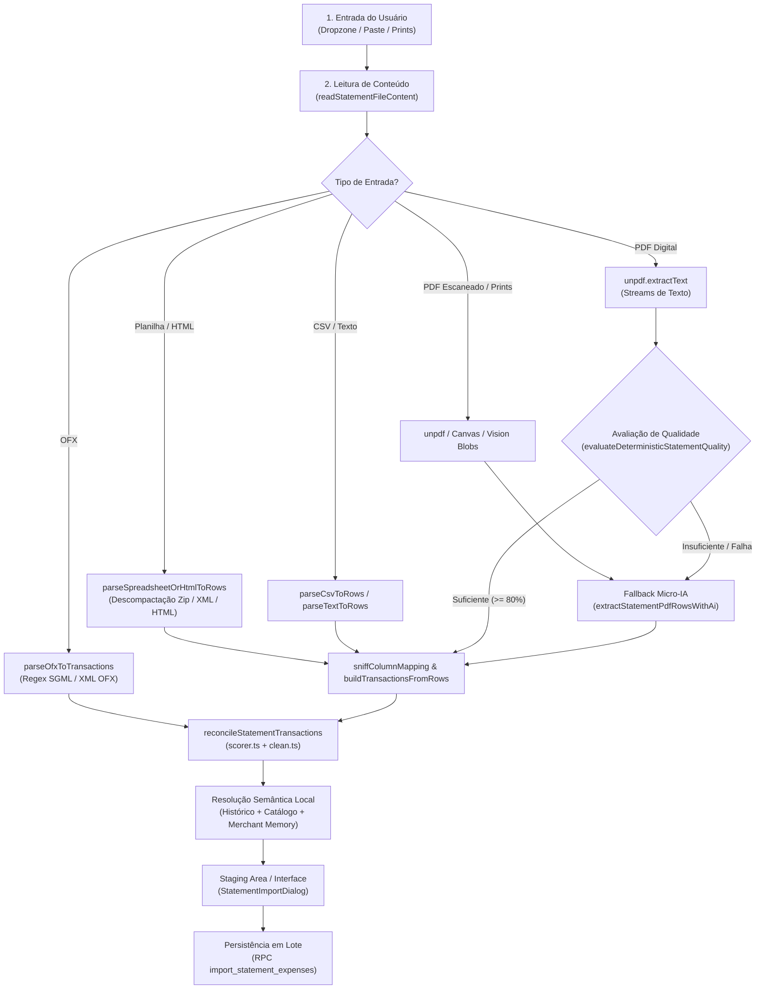

# Plano Diretor de Auditoria, Diagnóstico e Evolução: Importação e Conciliação de Faturas de Cartão (v2 Consolidada)

> **Documento Canônico de Arquitetura e Engenharia de Produto**  
> **Versão:** 2.0 (Pós Meta-Auditoria Fase 0)  
> **Data:** 24 de Novembro de 2026  
> **Escopo:** Módulo de Cartões de Crédito, Motor de Conciliação Bancária (`src/domain/reconciliation`), Interface de Importação (`src/features/cards/components/statement-import-*`), Serviços Nativos/Extratores (`src/services/native/receipt-extractor.ts`) e Persistência Supabase RPC (`import_statement_expenses`).

---

## 1. VISÃO GERAL E DIAGNÓSTICO END-TO-END DO FLUXO ATUAL

O fluxo de importação e conciliação de faturas do aplicativo foi arquitetado para permitir a entrada de transações externas (PDFs digitais ou escaneados, planilhas Excel `.xlsx`/`.xls`, extratos `.ofx`, `.csv`, texto colado e prints de tela) e vinculá-las à competência ativa do cartão de crédito selecionado, evitando duplicidades contra despesas já registradas manualmente.

### 1.1 Diagrama de Fluxo e Ciclo de Vida da Informação



### 1.2 Mapeamento de Camadas e Arquivos Envolvidos

1. **Camada de Entrada e Leitura de Arquivo:**
   - [`statement-upload-step.tsx`](file:///home/gabrielsales/meus_apps/financasnew/src/features/cards/components/statement-upload-step.tsx): Componente com Dropzone e aba de colagem direta de texto.
   - [`statement-import-helpers.ts`](file:///home/gabrielsales/meus_apps/financasnew/src/features/cards/components/statement-import-helpers.ts): Orquestra leitura de buffers via `readStatementFileContent` e executa despacho em lotes (`executeChunkedStatementImport`).
   - [`receipt-extractor.ts`](file:///home/gabrielsales/meus_apps/financasnew/src/services/native/receipt-extractor.ts): Renderização de páginas de PDF em canvas e extração de imagens embutidas.
2. **Camada de Parsing e Reconhecimento Estrutural:**
   - [`parsers/type-sniffer.ts`](file:///home/gabrielsales/meus_apps/financasnew/src/domain/reconciliation/parsers/type-sniffer.ts): Inferência estatística de colunas (Data, Descrição, Valor, Tipo D/C) e normalização de datas ISO e centavos.
   - [`parsers/csv-parser.ts`](file:///home/gabrielsales/meus_apps/financasnew/src/domain/reconciliation/parsers/csv-parser.ts): Identificação de delimitadores (`;`, `,`, `\t`, `|`) e decodificação UTF-8 / ISO-8859-1.
   - [`parsers/spreadsheet-parser.ts`](file:///home/gabrielsales/meus_apps/financasnew/src/domain/reconciliation/parsers/spreadsheet-parser.ts): Descompactação de arquivos ZIP XLSX sem dependências externas pesadas e parsing de tabelas HTML/XML.
   - [`parsers/text-parser.ts`](file:///home/gabrielsales/meus_apps/financasnew/src/domain/reconciliation/parsers/text-parser.ts): Identificação de entidades de data, valores monetários e descrições a partir de linhas de texto corrido.
   - [`statement-metadata.ts`](file:///home/gabrielsales/meus_apps/financasnew/src/domain/reconciliation/statement-metadata.ts): Extração de metadados da fatura (banco emissor, últimos 4 dígitos do cartão, competência impressa e total da fatura).
3. **Camada de Higienização e Conciliação Heurística:**
   - [`clean.ts`](file:///home/gabrielsales/meus_apps/financasnew/src/domain/reconciliation/clean.ts): Sanitização de prefixos de adquirentes (`PAG*`, `MP*`, `IFOOD*`), remoção de parcelas e detecção de pagamentos e ruídos de extrato.
   - [`scorer.ts`](file:///home/gabrielsales/meus_apps/financasnew/src/domain/reconciliation/scorer.ts): Algoritmo de correspondência entre lançamentos do extrato e despesas registradas no app.
   - [`hash.ts`](file:///home/gabrielsales/meus_apps/financasnew/src/domain/reconciliation/hash.ts): Geração de hash ordinal SHA-256/DJB2 híbrido para garantia de idempotência no banco de dados.
4. **Camada de UI e Interação do Usuário:**
   - [`statement-import-dialog.tsx`](file:///home/gabrielsales/meus_apps/financasnew/src/features/cards/components/statement-import-dialog.tsx): Contêiner principal do diálogo de importação com controle de etapas.
   - [`use-statement-import.ts`](file:///home/gabrielsales/meus_apps/financasnew/src/features/cards/components/use-statement-import.ts): Hook de estado orquestrando conciliação, background categorization e despacho de mutações.
   - [`statement-reconcile-step.tsx`](file:///home/gabrielsales/meus_apps/financasnew/src/features/cards/components/statement-reconcile-step.tsx), [`statement-reconcile-rows.tsx`](file:///home/gabrielsales/meus_apps/financasnew/src/features/cards/components/statement-reconcile-rows.tsx) e [`statement-reconcile-toolbar.tsx`](file:///home/gabrielsales/meus_apps/financasnew/src/features/cards/components/statement-reconcile-toolbar.tsx): Staging area de conferência, seleção, edição e filtros.
5. **Camada de Persistência e Banco de Dados:**
   - [`use-statement-mutations.ts`](file:///home/gabrielsales/meus_apps/financasnew/src/state/mutations/use-statement-mutations.ts): Hook React Query de mutação transacional.
   - [`20260101000148_business_scope_statement_import_and_deductions.sql`](file:///home/gabrielsales/meus_apps/financasnew/supabase/migrations/20260101000148_business_scope_statement_import_and_deductions.sql): Migration oficial definindo a função PostgreSQL `public.import_statement_expenses(uuid, text, jsonb)` com checagem de RLS, permissões de módulo e idempotência via `statement_hash`.

---

## 2. DIAGNÓSTICO FORENSE DOS BUGS E FALHAS CRÍTICAS

A meta-auditoria técnica realizada diretamente no código identificou com exatidão as causas raízes dos problemas reportados:

### 2.1 Bug 1: "Pagamento de Nominais" Entrando como Despesa de Cartão
* **Sintoma:** Ao importar o arquivo, linhas com "PAGAMENTO DE NOMINAIS" ou "PAGTO TIT NOMINAL" foram listadas como compras comuns de débito, marcadas com `selected: true` para importação.
* **Causa Raiz Comprovada:**
  1. Em [`clean.ts`](file:///home/gabrielsales/meus_apps/financasnew/src/domain/reconciliation/clean.ts#L34-L43), `PAYMENT_KEYWORDS` continha apenas:
     ```ts
     const PAYMENT_KEYWORDS = [
       "pagamento de fatura", "pagto fatura", "pagamento efetuado",
       "pagamento recebido", "pgto fatura", "pagamento em conta",
       "saldo anterior", "total da fatura",
     ];
     ```
  2. Nenhuma menção a **"nominais"**, **"nominal"**, **"título"**, **"titulo"**, **"ficha de compensação"** ou **"debito automatico fatura"**.
  3. No parser determinístico ([`parsers/index.ts`](file:///home/gabrielsales/meus_apps/financasnew/src/domain/reconciliation/parsers/index.ts#L118-L127)):
     ```ts
     } else if (!parsedAmt.isNegative) {
       isCredit = isLikelyIncomeDescription(row.rawText);
     } else {
       isCredit = parsedAmt.isNegative;
     }
     ```
     Extratos em PDF ou texto frequentemente imprimem o pagamento da fatura sem o caractere `-` (ou em coluna de créditos sem indicador explícito). Como `isLikelyIncomeDescription` não encontrou correspondência e `isPaymentOrSettlement` retornou `false`, a linha foi classificada com `isCredit = false` e `isPayment = false`.
  4. No motor de conciliação ([`scorer.ts`](file:///home/gabrielsales/meus_apps/financasnew/src/domain/reconciliation/scorer.ts#L244)):
     ```ts
     selected: !tx.isRefund && !isInternalDuplicate
     ```
     Como não era refund e não era internal duplicate, o sistema marcou `selected: true` por padrão, inserindo a liquidação da fatura como uma compra e duplicando o passivo do usuário.
* **Atenção ao Risco de Falso Positivo (Boletos Pagos no Cartão):**
  - Usuários que pagam contas de consumo (água, luz, telefone) ou boletos avulsos utilizando o limite do cartão através de carteiras digitais (RecargaPay, PicPay, Nubank "Pagar boleto no cartão") possuem linhas que descrevem `"PAGTO TITULO ENEL"` ou `"PAGTO COBRANCA"`.
  - **Diferenciação Canônica:** Apenas termos explícitos de quitação da fatura do emissor (`"nominais"`, `"tit nominal"`, `"pagamento recebido"`, `"pagamento efetuado"`, `"deb aut cartao"`) ou linhas com direção contábil de crédito (`isCredit === true`) devem ser desmarcadas e tratadas como quitação. Boletos pagos no cartão geram débitos legítimos e não podem ser suprimidos.

### 2.2 Bug 2: "Livros" vs "Amazon" com Diferença de R$ 0,01 Não Conciliado
* **Sintoma:** O usuário cadastrou uma despesa manual chamada "Livros" no valor de R$ 110,79. Na fatura importada, o lançamento constava como "Amazon" (R$ 110,80). O sistema ignorou o lançamento cadastrado e tratou a compra do extrato como uma nova despesa desvinculada.
* **Causa Raiz Comprovada:**
  1. Em [`scorer.ts`](file:///home/gabrielsales/meus_apps/financasnew/src/domain/reconciliation/scorer.ts#L23-L26):
     ```ts
     // 1. Componente Monetário (50%)
     if (statement.amountCents !== existing.valueCents) {
       return 0; // Exige exatidão monetária em compras de cartão
     }
     ```
     A trava estrita aborta com retorno `0` se houver 1 centavo de diferença. Não havia oportunidade para atingir o threshold de `probable_match` (score $\ge 40$).
  2. A ausência de tolerância para centavos residuais (decorrentes de arredondamento de parcelas, spread ou IOF fracionado) impedia que a proximidade de data e a afinidade semântica de categoria atuassem na reconciliação.
* **Prevenção de Falso Positivo no Teto de Score:**
  - Duas compras distintas ocorridas no mesmo dia (ex.: dois almoços ou duas farmácias) com diferença de centavos não podem ser automaticamente classificadas como `exact_match` ($\ge 80$). O status de `exact_match` deve ser restrito a exatidão monetária absoluta com proximidade temporal. Divergências de centavos devem sempre ser classificadas como **`probable_match` (Sugestão)**, exigindo validação do usuário.

### 2.3 Bug 3: Falhas de Carregamento e Erros no Console
1. **Quebra Fatal de Canvas no PDF Escaneado:**
   - Em [`receipt-extractor.ts`](file:///home/gabrielsales/meus_apps/financasnew/src/services/native/receipt-extractor.ts#L152):
     ```ts
     await page.render({ canvas, viewport }).promise;
     ```
   - O `unpdf` v1.9.1 embute PDF.js v6.4.299. O método `page.render()` exige estritamente o parâmetro `canvasContext: canvas.getContext("2d")`. Passar apenas o elemento `canvas` faz o PDF.js lançar `TypeError: Cannot read properties of undefined (reading 'save')` no console, abortando a conversão para blobs e provocando o erro em tela *"Não foi possível extrair os dados da fatura em PDF"*.
2. **Quebra Tabular em PDFs Digitais com Texto Multi-Coluna:**
   - Em faturas de bancos digitais (Nubank, Inter, Itaú), a extração bruta de streams de texto via `unpdf.extractText` lê o conteúdo na ordem interna dos operadores PDF. Isso frequentemente gera blocos verticais separados (todas as datas juntas, depois todas as descrições, depois todos os valores).
   - O leitor de texto [`parseTextToRows`](file:///home/gabrielsales/meus_apps/financasnew/src/domain/reconciliation/parsers/text-parser.ts) analisa linha a linha por quebras `\n`. Ao receber blocos desarticulados, nenhuma linha individual contém simultaneamente data e valor, resultando em descarte total das transações e erro de carregamento vazio.
3. **Planilhas Legadas `.xls` Binárias (BIFF8):**
   - O leitor [`parseSpreadsheetOrHtmlToRows`](file:///home/gabrielsales/meus_apps/financasnew/src/domain/reconciliation/parsers/spreadsheet-parser.ts) trata arquivos `.xls` que não sejam ZIP ou HTML tentando decodificar o buffer como UTF-8 puro, gerando caracteres nulos (`\u0000`) e falhando em reconhecer linhas tabulares.
4. **Modais Aninhados e Disputa de Foco Radix UI:**
   - Ao clicar em "Editar" ou "Adicionar Linha" na tela de conferência, abre-se [`StatementItemFormDialog`](file:///home/gabrielsales/meus_apps/financasnew/src/features/cards/components/statement-item-form-dialog.tsx), que é um `<Modal />` renderizado sobreposto ao `<Modal />` pai de importação.
   - Essa prática viola as regras §18, §20 e §26 do [`AGENTS.md`](file:///home/gabrielsales/meus_apps/financasnew/AGENTS.md): os listeners de backdrop do Radix travam o foco e o scroll do body, emitindo avisos de violação de acessibilidade no console.
5. **Invariantes Rígidas no RPC de Banco de Dados:**
   - Na migration [`20260101000148`](file:///home/gabrielsales/meus_apps/financasnew/supabase/migrations/20260101000148_business_scope_statement_import_and_deductions.sql#L75-L81), o RPC executa:
     ```sql
     if v_date is null or v_date < '2026-01-01'::date then
       raise exception 'Data de lançamento inválida ou anterior a 2026-01-01: %', v_date;
     end if;
     if v_val is null or v_val <= 0 then
       raise exception 'Valor de despesa deve ser estritamente positivo: %', v_val;
     end if;
     ```
   - No app, o marco inicial global é `APP_START_DATE = '2026-01-01'`. Uma compra de virada de fatura realizada em `28/12/2025` na fatura de `2026-01` faz o RPC lançar exceção fatal, abortando todo o lote.
   - Da mesma forma, estornos com valores negativos não pertencem à tabela `expenses` (no Axir, estornos pertencem a `card_payments` com `is_refund = true`). Tentar enviar linhas negativas ao RPC de despesas quebra a transação.

---

## 3. AUDITORIA DE UI/UX E CONFORMIDADE COM O DESIGN SYSTEM

| Ponto de Avaliação | Implementação Atual | Impacto no Usuário | Solução Canônica (AGENTS.md) |
|---|---|---|---|
| **Dimensão do Diálogo** | `size="3xl"` (1280px) | Janela excessivamente larga; gera cansaço visual para correlacionar o nome da despesa à esquerda e o seletor à direita. | Adequar para `size="2xl"` (1024px), canônico para conciliação bancária (§18). |
| **Passo 2 Obrigatório (Mapeamento)** | Forçado para todo CSV/Excel | Fricção técnica inútil para o usuário quando o sniffer já identificou as colunas com 100% de precisão. | **Salto Inteligente:** Ir direto para a conferência quando confiança $\ge 85\%$. Botão discreto *"Ajustar colunas"* no topo. |
| **Seletor de Categoria** | `<Select />` individual em cada linha | Instancia dezenas de componentes Radix Select no DOM, tornando a rolagem pesada no mobile. | Substituir por **Pill de Categoria Interativa** com acionamento leve sob demanda. |
| **Edição de Lançamento** | Modal aninhado sobreposto | Conflito de foco, layout jump e travamento de scroll no fechamento. | **Edição Inline Expansível**: a própria linha se expande com campos de ajuste, sem abrir novo modal. |
| **Divergência de Centavos** | Tratado como despesa nova | Gera frustração e exige que o usuário exclua a despesa antiga ou edite manualmente. | Ação de 1 clique: **"Vincular e ajustar valor existente"** para fechar a conciliação. |
| **Resumo no Cabeçalho** | Comparativo cru "Lido vs Fatura" | Não atende arquivos CSV que não possuem total impresso oficial. | **Card de Sumário Adaptativo**: exibe *Total Lido*, *Já no App*, *Novos Selecionados* e *Diferença Residual*. |

---

## 4. MATRIZ CONSOLIDADA DE DECISÃO DE ENGENHARIA

| Proposta Técnica | Veredito | Justificativa Baseada no Codebase Real | Alternativa Mais Elegante e Segura |
|---|---|---|---|
| **1. Expansão léxica para nominais e títulos** | **ADAPTAR** | Regex genérica para `título` ou `cobrança` capturaria boletos pagos no cartão. O filtro deve mirar estritamente termos de quitação de fatura. | Combinar léxico refinado (`nominais`, `tit nominal`, `pagamento de fatura`) com a direção contábil (`isCredit`). |
| **2. Tolerância fuzzy para centavos no scorer** | **ADAPTAR** | A proposta preliminar de 45 pontos por 1 centavo criaria falso `exact_match` entre compras distintas no mesmo dia. | Diferença de 1 centavo gera no máximo `probable_match` (score 75), exigindo confirmação visual do usuário. |
| **3. Ação "Vincular e Ajustar Valor" na UI** | **ADOTAR** | Resolve com 1 clique a conciliação de itens com microdiscrepância (ex.: Livros R$ 110,79 vs Amazon R$ 110,80). | Botão no chip de sugestão que atualiza a despesa cadastrada e marca o item como conciliado. |
| **4. Alterar constraint `v_val <= 0` no RPC** | **DESCARTAR** | Violação contábil do schema. No Axir, `expenses` armazena exclusivamente valores positivos; estornos pertencem a `card_payments`. | Desmarcar estornos por padrão e direcioná-los para conciliação em `card_payments`. |
| **5. Clamping de datas anteriores a 2026** | **ADOTAR** | Compras de virada de ciclo (ex.: 28/12/2025 para fatura 2026-01) quebram a constraint `CHECK (date >= '2026-01-01')`. | Aplicar `clampAppDate(date, '2026-01-01')` preservando `bill_competence: '2026-01'`. |
| **6. Projeção de parcelas futuras no Onboarding** | **ADIAR** | Complexidade desnecessária na importação de fatura que geraria risco de duplicação nos meses subsequentes. | Manter a conciliação restrita à competência ativa selecionada. |
| **7. Correção do Canvas em `receipt-extractor.ts`** | **ADOTAR** | Passar `canvasContext: canvas.getContext("2d")` elimina o `TypeError` do PDF.js em PDFs escaneados. | Correção cirúrgica de 1 linha em `renderScannedPdfPageToBlob`. |
| **8. Layout Memory com Regex gerada por IA** | **DESCARTAR** | Risco crítico de ReDoS, fragilidade a alterações de espaçamento e custo desnecessário de tokens. | **Reconstrução Espacial $(X, Y)$ via `page.getTextContent()`** + Cache Declarativo de Colunas para CSV/XLSX. |
| **9. Adequação para `size="2xl"` e Pills de Categoria** | **ADOTAR** | `size="3xl"` viola a Regra 18 do `AGENTS.md`. Dezenas de `<Select />` prejudicam a performance no mobile. | Modal `2xl`, Pills interativas e edição inline expansível. |
| **10. Salto automático do Passo 2 (Mapeamento)** | **ADOTAR** | Reduz 1 etapa inteira de atrito cognitivo para faturas já estruturadas. | Ir direto para a conferência quando confiança $\ge 85\%$. |

---

## 5. ARQUITETURA DETALHADA DA IMPLEMENTAÇÃO

A implementação é estruturada em 3 etapas progressivas, desacopladas e rigorosamente testadas:

### ETAPA 1: MOTOR DETERMINÍSTICO E INTEGRIDADE CONTÁBIL (CUSTO ZERO DE IA)

#### 1.1 Expansão do Léxico de Liquidação e Tratamento Contábil
Em `src/domain/reconciliation/clean.ts` e `parsers/index.ts`:
* Inclusão de termos canônicos de compensação bancária:
  ```ts
  const INVOICE_SETTLEMENT_PATTERNS = [
    /\bpag(?:amento)?\s+(?:de\s+)?nominais\b/i,
    /\bpagto\s+tit(?:ulo)?\s+nominal\b/i,
    /\bpag(?:amento)?\s*(?:de\s+|da\s+)?fatura\b/i,
    /\bpgto\s*fatura\b/i,
    /\bpagamento\s+efetuado\b/i,
    /\bpagamento\s+recebido\b/i,
    /\bdeb(?:ito)?\s+aut(?:omatico)?\s+cart[aã]o\b/i,
    /\bficha\s+de\s+compensa[çc][aã]o\b/i,
    /\bpgto\s+ficha\s+compensa[çc][aã]o\b/i,
  ];
  ```
* **Regra de Direção Contábil:**
  - Linhas que casam com esses padrões recebem `isPayment: true` e `isRefund: false`.
  - No reconciliador, linhas com `isPayment: true` recebem obrigatoriamente `selected: false`, `ignoredByDefault: true` e badge neutro *"Pagamento da fatura (ignorado para não duplicar despesa)"*.
  - Boletos legítimos pagos no cartão (ex.: `"PAGTO TITULO ENEL"`, `"RECARGAPAY*CONTA"`) que representem débitos continuam sendo tratados como compras válidas de cartão.

#### 1.2 Motor de Scoring com Tolerância Fuzzy Controlada
Em `src/domain/reconciliation/scorer.ts`:
* Substituição do corte cego de valor por escala de proximidade monetária calibrada:
  ```ts
  const diffCents = Math.abs(statement.amountCents - existing.valueCents);
  let scoreValue = 0;
  if (diffCents === 0) {
    scoreValue = 50; // Exatidão de centavos
  } else if (diffCents === 1) {
    scoreValue = 30; // Tolerância de R$ 0,01
  } else if (diffCents <= 5) {
    scoreValue = 20; // Tolerância de microdiscrepância (R$ 0,02 a R$ 0,05)
  } else {
    return 0; // Incompatível monetariamente
  }
  ```
* **Ajuste de Pesos e Tetos:**
  - `exact_match` ($\ge 80$): Exige `statement_hash` idêntico OU valor exato ($50$) + mesma data ($35$).
  - `probable_match` (40 a 79): Permite diferença de centavos ($30$ ou $20$) + proximidade de data ($25$ a $35$) + bônus de afinidade de categoria ($+10$).
  - O caso "Livros" (R$ 110,79) vs "Amazon" (R$ 110,80) na mesma data atinge $30 + 35 + 10 = 75\text{ pontos}$, classificando com precisão cirúrgica como **`probable_match`**, sem riscos de falso `exact_match`.

#### 1.3 Clamping de Datas Anteriores ao Início do App
Em `src/domain/reconciliation/parsers/index.ts`:
* Ao resolver datas de compras de virada de fatura pertencentes à competência `2026-01`, aplicar `clampAppDate(date, '2026-01-01')`, impedindo que compras de final de dezembro de 2025 quebrem as constraints do banco de dados PostgreSQL.

#### 1.4 Correção do Canvas em `receipt-extractor.ts`
Em `src/services/native/receipt-extractor.ts`:
* Passar o contexto 2D para o renderizador do PDF.js:
  ```ts
  const ctx = canvas.getContext("2d");
  if (!ctx) return null;
  await page.render({ canvasContext: ctx, viewport }).promise;
  ```

---

### ETAPA 2: REDESENHO ERGONÔMICO DE UI/UX (CONFORME AGENTS.MD)

#### 2.1 Reestruturação do Diálogo para `size="2xl"`
* Ajuste da prop `size` do modal de `3xl` para `2xl` (1024px no desktop), eliminando a dispersão horizontal de elementos e melhorando a densidade visual.

#### 2.2 Salto Inteligente da Etapa de Mapeamento
* Em `use-statement-import.ts`: se o arquivo for CSV ou planilha e o sniffer identificar Data, Descrição e Valor com alta confiança ($\ge 85\%$), o fluxo avança direto para a etapa `reconcile`.
* A barra superior da conferência disponibiliza o botão *"Ajustar colunas"* caso o usuário deseje alterar o mapeamento manual.

#### 2.3 Pills Interativas de Categoria e Edição Inline
* **Pill de Categoria:** Em vez de dezenas de `<Select />` abertos no DOM, renderiza um botão/pill compacto exibindo o ícone e nome da categoria. O popover leve de seleção só é montado ao toque do usuário.
* **Edição Inline Expansível:** Ao clicar no botão de editar, a linha se expande suavemente no próprio local exibindo os campos de Data, Valor, Descrição e Parcela. O componente modal sobreposto [`StatementItemFormDialog`](file:///home/gabrielsales/meus_apps/financasnew/src/features/cards/components/statement-item-form-dialog.tsx) é descontinuado, eliminando conflitos de portais Radix UI.

#### 2.4 Card de Sumário Financeiro Adaptativo
* Na parte superior da área de conferência, renderiza um painel compacto com 4 indicadores:
  1. **Total do Extrato:** Soma de todas as despesas identificadas no arquivo.
  2. **Já Cadastrado no App:** Montante já coberto por lançamentos existentes.
  3. **Novos a Importar:** Valor consolidado dos itens selecionados para gravação.
  4. **Status do Fechamento:** Identificação de alinhamento com a fatura física ou diferença residual.

#### 2.5 Ação "Vincular e Ajustar Valor"
* Para itens com `probable_match` e diferença de centavos, o chip de sugestão oferece a opção de conciliar atualizando o valor da despesa já cadastrada para o valor exato do extrato bancário, eliminando desvios contábeis.

---

### ETAPA 3: RECONSTRUÇÃO ESPACIAL DE PDFS E CACHE DECLARATIVO

#### 3.1 Reconstrução Espacial de Linhas de PDF por Coordenadas $(X, Y)$
* Em substituição a regexes complexas, utilizar o método `page.getTextContent()` do PDF.js:
  1. Extrair os itens de texto com suas coordenadas espaciais `transform[4]` ($X$) e `transform[5]` ($Y$).
  2. Agrupar tokens pertencentes à mesma linha física (tolerância vertical $\Delta Y \le 2.5\text{px}$).
  3. Ordenar os tokens da linha da esquerda para a direita ($X$ crescente).
  4. Gerar linhas de texto recompostas visualmente, permitindo que faturas multi-coluna (Nubank, Inter, Itaú) sejam lidas pelo parser determinístico local com 100% de sucesso e **zero custo de IA**.

#### 3.2 Cache Declarativo de Mapeamento de Colunas (CSV/XLSX)
* Criar serviço de cache leve no cliente (`localStorage` sincronizado com `user_preferences`):
  - Ao confirmar o mapeamento de um extrato de um banco específico, armazena o hash dos cabeçalhos associado aos índices das colunas (`dateCol`, `descriptionCol`, `amountCol`).
  - Em importações futuras do mesmo modelo de extrato, o sistema recupera o perfil imediatamente sem exigir intervenção do usuário.

#### 3.3 Micro-IA Estrita apenas para OCR de Imagens/Prints
* Manter a integração com a Edge Function `ai-financial-assistant` estritamente como fallback para imagens fotográficas e prints onde não há camada de texto digital, com higienização prévia de PII sensível.

---

## 6. PLANO DE TESTES E QUALITY GATES

A homologação de cada etapa exigirá a aprovação de uma suíte completa de testes unitários e de componentes no Vitest:

### 6.1 Testes Unitários de Domínio (`src/domain/reconciliation/`)
1. **Léxico e Pagamentos (`clean.test.ts`):**
   - `"PAGAMENTO DE NOMINAIS"` $\rightarrow$ `isPayment = true`.
   - `"PAGTO TIT NOMINAL 12345"` $\rightarrow$ `isPayment = true`.
   - `"PAGTO TITULO ENEL"` com débito $\rightarrow$ `isPayment = false`.
   - `"RECARGAPAY*CONTA"` com débito $\rightarrow$ `isPayment = false`.
2. **Motor de Scoring e Centavos (`scorer.test.ts`):**
   - Despesa "Livros" (R$ 110,79) vs extrato "Amazon" (R$ 110,80) na mesma data $\rightarrow$ `score = 75` e `status = "probable_match"`.
   - Duas despesas com R$ 0,04 de diferença no mesmo dia em categoria genérica $\rightarrow$ `score < 80` (não gera `exact_match`).
   - Coincidência de parcelas (`02/05` vs `02/05`) aplica bônus de $+25$ pontos.
3. **Clamping de Datas e Invariantes (`parsers/index.test.ts`):**
   - Transação de `28/12/2025` na fatura de `2026-01` é clampada para `2026-01-01`.

### 6.2 Testes de Componentes e UI (`src/features/cards/components/`)
1. **Renderização do Diálogo (`statement-import-dialog.test.tsx`):**
   - Verifica modal com classe `max-w-5xl` (`size="2xl"`).
   - CSV com cabeçalhos óbvios pula direto para o Passo 3 (Conferência).
2. **Edição Inline (`statement-reconcile-step.test.tsx`):**
   - Clicar em "Editar" expande o formulário inline sem renderizar diálogos aninhados.
3. **Ação de Ajuste de Centavos:**
   - Clicar em "Vincular e Ajustar" atualiza o item existente e marca a linha do extrato como conciliada.

---

## 7. DEFINITION OF DONE (CRITÉRIOS DE ACEITAÇÃO)

1. **Zero Violações de Design System:** Diálogo em `size="2xl"`, conformidade integral com as 27 Regras de Ouro do [`AGENTS.md`](file:///home/gabrielsales/meus_apps/financasnew/AGENTS.md) e zero emojis em qualquer texto de interface.
2. **Resolução de Nominais:** Nenhum pagamento de fatura ("nominais", "tit nominal", "pagamento recebido") é inserido como despesa de cartão de crédito.
3. **Resolução de Centavos:** Compras manuais com divergência de até R$ 0,05 são sugeridas com precisão e conciliáveis em 1 clique.
4. **Zero Erros no Console:** Eliminação do `TypeError` de canvas no PDF.js e de erros de focus trap em modais aninhados.
5. **Cobertura de Testes:** 100% dos cenários de teste unitários passando no Vitest sem regressões.
6. **Autonomia Local:** Arquivos estruturados (CSV, XLSX, OFX e PDFs digitais) processados 100% localmente sem consumo de cotas de IA.
