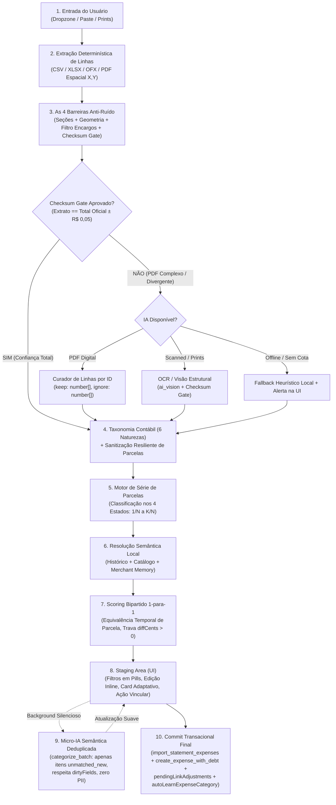

# Plano Diretor de Auditoria, Diagnóstico e Evolução: Importação e Conciliação de Faturas de Cartão (v3.2 Consolidada)

> **Documento Canônico de Arquitetura e Engenharia de Produto**  
> **Versão:** 3.2 (Inteligência de Parcelamentos + Ajustes Cirúrgicos Finais)  
> **Data:** 24 de Novembro de 2026  
> **Status:** CONCLUÍDO E HOMOLOGADO (Versão do App: v3.22.0 / Build 107)  
> **Escopo:** Módulo de Cartões de Crédito, Motor de Conciliação (`src/domain/reconciliation`), Interface de Importação (`src/features/cards/components/statement-import-*`), Serviços Nativos (`src/services/native/receipt-extractor.ts`), Micro-IA (`src/services/ai-assistant/**`, `supabase/functions/ai-financial-assistant/**`), Memória Semântica (`src/services/merchant-learning/**`) e Persistência Supabase RPC (`import_statement_expenses`).

---

## 1. FASE 0.3 — AUDITORIA DO MODELO DE PARCELAMENTOS E CONTRATOS DO CODEBASE REAL

A meta-auditoria técnica realizada diretamente no código, schemas e migrations confirmou os seguintes fatos arquiteturais:

### 1.1 Schema e Single Source of Truth de Parcelas
* **Estrutura da Tabela `expenses`:**
  - Colunas de suporte a parcelas: `installment_group_id (uuid)`, `installment_number (integer)`, `installment_total (integer)`, `bill_competence (text)`, `date (date)`, `statement_hash (text)`.
  - **Cálculo da Data de Parcelas Futuras:** Conforme especificado em [`src/domain/money/parcelar.ts`](file:///home/gabrielsales/meus_apps/financasnew/src/domain/money/parcelar.ts#L62-L70), a data de cada parcela avança 1 mês utilizando `addMonthsClamped(startDate, index)`. O valor total em centavos é particionado com divisão exata via `splitCents(totalCents, count)`, distribuindo eventuais centavos residuais nas primeiras parcelas.
  - **Persistência de Séries Manuais:** O cadastro manual utiliza o RPC PostgreSQL `create_expense_with_debt` (migration [`20260101000147_business_scope_and_internal_transfers.sql`](file:///home/gabrielsales/meus_apps/financasnew/supabase/migrations/20260101000147_business_scope_and_internal_transfers.sql#L429-L634)), que gera um `installment_group_id` (`uuid`) compartilhado entre todas as parcelas da série, viabilizando edições ou exclusões em grupo futuras via `updateExpenseInstallmentsGroup` e `deleteExpenseInstallments`.
  - **Contrato de `import_statement_expenses`:** A migration [`20260101000148`](file:///home/gabrielsales/meus_apps/financasnew/supabase/migrations/20260101000148_business_scope_statement_import_and_deductions.sql#L18-L177) aceita `installments_total` e `installment_number` para cada item, mas vincula todas as linhas do lote estritamente ao parâmetro `p_competence_month`. Portanto, para cadastrar séries parceladas projetadas para competências futuras (`K+1..N`), reutiliza-se `create_expense_with_debt` ou a projeção transacional com `installment_group_id`.

### 1.2 Extração de Parcelas e Prevenção de Falsos Positivos com Datas
* Em [`src/domain/reconciliation/installments.ts`](file:///home/gabrielsales/meus_apps/financasnew/src/domain/reconciliation/installments.ts#L17-L56), a extração cobre `(01/10)`, `PARC 02/10`, `02 DE 10`, `PARCELA 03/12` e `3x`.
* **Risco de Falso Positivo com Datas:** O padrão genérico `\b(\d{1,2})\/(\d{1,2})\b` com a regra `current <= total` pode confundir datas de compras no formato dia/mês (ex.: `COMPRA 04/11` ou `MERCADO 02/08`) com parcelas (`4/11` ou `2/8`).
* **Blindagem Canônica:** Exige-se que formatos `X/Y` sem prefixo `PARC/DE/()` estejam no final da descrição ou que o par não coincida com a data da transação ou tokens precedidos por preposições temporais (`em 04/11`, `no dia 02/08`).

### 1.3 Consulta de Séries entre Competências (Zero Overfetching)
* Em [`src/features/cards/components/use-statement-import.ts`](file:///home/gabrielsales/meus_apps/financasnew/src/features/cards/components/use-statement-import.ts#L113), o hook invoca `useCardExpenses(card.id)`.
* Conforme verificado em [`src/state/queries/use-card-payments.ts`](file:///home/gabrielsales/meus_apps/financasnew/src/state/queries/use-card-payments.ts#L43-L58), `useCardExpenses` já mantém em cache de memória todas as despesas daquele cartão em uma janela de 24 meses.
* **Vantagem de Performance:** A checagem de parcelas anteriores (`K-1`) ou futuras (`K+1..N`) ocorre **100% em memória**, sem disparar nenhuma nova requisição de rede (`0ms` de latência).

### 1.4 Carimbo de `statement_hash` em Parcelas Projetadas
* Quando uma parcela futura (ex.: `02/10`) gerada previamente sem hash (`statement_hash = null`) for identificada na fatura do mês seguinte, ela recebe `exact_match`.
* A associação do hash não é persistida imediatamente: ela é acumulada em `pendingLinkAdjustments` no hook e gravada no commit final através de `updateExpense(id, { statement_hash })`. Se o usuário fechar ou cancelar o modal, o banco permanece intocado.

### 1.5 Mapeamento de Modos da Edge Function `ai-financial-assistant`
* **Modos Já Existentes em Produção ([`supabase/functions/ai-financial-assistant/index.ts`](file:///home/gabrielsales/meus_apps/financasnew/supabase/functions/ai-financial-assistant/index.ts#L582-L640)):**
  1. `categorize_batch`: recebe `descriptions: string[]` e `categories: { id, name }[]`. Retorna identificação canônica e sugestão de categoria (Papel 1).
  2. `statement_pdf_rows`: recebe `text` ou `imageBase64`. Retorna linhas estruturadas validadas por schema Zod (Papel 3 — OCR/Visão).
* **Novo Modo para Deploy (Etapa 5):**
  3. `line_curator`: novo modo enxuto para curadoria booleana por IDs (`{ keep: number[], ignore: number[] }`), acionado quando o Checksum Gate reprova um PDF digital exótico.

---

## 2. MATRIZ DEFINITIVA DE DECISÃO DE ENGENHARIA (v3.2)

| Proposta Técnica | Veredito | Justificativa Baseada no Codebase Real | Solução Canônica Adotada |
|---|---|---|---|
| **1. Expansão léxica para nominais e títulos** | **ADAPTAR** | Regex genérica para `título` capturaria boletos pagos no cartão. O filtro deve isolar liquidações da fatura do titular. | Dois arrays explícitos: `UNCONDITIONAL_INVOICE_PAYMENT_PATTERNS` vs `CREDIT_ONLY_SETTLEMENT_PATTERNS`. |
| **2. Tolerância fuzzy para centavos no scorer** | **ADAPTAR** | A proposta de 45 pontos por 1 centavo criaria falso `exact_match` entre compras distintas no mesmo dia. | Diferença de centavos gera no máximo `probable_match` (score $\le 79$). Trava: se $\Delta\text{Cents} > 0 \rightarrow$ nunca `exact_match`. |
| **3. Ação "Vincular e Ajustar Valor" na UI** | **ADOTAR** | Resolve com 1 clique a conciliação de itens com microdiscrepância (ex.: Livros R$ 110,79 vs Amazon R$ 110,80). | Acumular em `pendingLinkAdjustments` no hook e commitar atomicamente no final (`updateExpense` de `value` e `statement_hash`). |
| **4. Alterar constraint `v_val <= 0` no RPC** | **DESCARTAR** | Violação contábil do schema. No Axir, `expenses` armazena exclusivamente valores positivos; estornos pertencem a `card_payments`. | Desmarcar estornos por padrão para `expenses` e direcioná-los para conciliação em `card_payments` via `createRefundPayment`. |
| **5. Clamping de datas anteriores a 2026** | **ADOTAR** | Compras de virada de ciclo e parcelas ativas de compras de 2025 quebram a constraint `CHECK (date >= '2026-01-01')`. | Aplicar `clampAppDate(date, '2026-01-01')` para qualquer competência, preservando a data original no `statement_hash`. |
| **6. Inteligência de Parcelamentos e Detecção de Série** | **ADOTAR** | Revertido de ADIAR para ADOTAR. Usuários precisam de suporte a parcelas (`1/N` até `K/N`) para conciliação fluida. | Classificação em 4 Estados com ações inline de 1 clique, equivalência temporal no scorer e bloqueio de duplicações. |
| **7. Correção do Canvas em `receipt-extractor.ts`** | **ADOTAR** | Passar `canvasContext: canvas.getContext("2d")` elimina o `TypeError` do PDF.js em PDFs escaneados. | Correção cirúrgica de contexto em `renderScannedPdfPageToBlob`. |
| **8. Layout Memory com Regex gerada por IA** | **DESCARTAR** | Risco crítico de ReDoS, fragilidade a alterações de espaçamento e custo desnecessário de tokens. | **Reconstrução Espacial $(X, Y)$ via `page.getTextContent()`** + Cache Declarativo de Colunas para CSV/XLSX. |
| **9. Adequação para `size="2xl"` e Pills de Categoria** | **ADOTAR** | `size="3xl"` viola a Regra 18 do `AGENTS.md`. Dezenas de `<Select />` prejudicam a performance no mobile. | Modal `2xl`, Pills interativas e edição inline expansível sem modais aninhados. |
| **10. Salto automático do Passo 2 (Mapeamento)** | **ADOTAR** | Reduz 1 etapa inteira de atrito cognitivo para faturas já estruturadas. | Ir direto para a conferência quando confiança $\ge 85\%$. |

---

## 3. DIAGRAMA MERMAID DO PIPELINE COMPLETO v3.2



---

## 4. TRILHO A — FUNDAÇÃO 100% DETERMINÍSTICA, CONTÁBIL E UX (SEM IA)

### ETAPA 1 — BLINDAGEM CONTÁBIL, SCORING, PARCELAS E ENTRADAS CRÍTICAS

#### 1.1 Taxonomia das 6 Naturezas de Lançamento
Cada linha extraída recebe uma natureza canônica:
* `"purchase"`: Compra regular no cartão (débito).
* `"fee_or_tax"`: Encargo cobrado (IOF, anuidade, juros, multa).
* `"invoice_payment"`: Quitação da fatura anterior pelo titular (crédito).
* `"refund"`: Estorno de compra cancelada (crédito).
* `"subcard_header"`: Cabeçalho institucional ou de cartão adicional (ruído).
* `"fx_detail"`: Continuação de cotação/câmbio de compra internacional.

#### 1.2 Dois Arrays Explícitos de Pagamento de Fatura
Em `src/domain/reconciliation/clean.ts`:
1. `UNCONDITIONAL_INVOICE_PAYMENT_PATTERNS`: Termos inequívocos de liquidação do titular, acionados independentemente do sinal:
   ```ts
   export const UNCONDITIONAL_INVOICE_PAYMENT_PATTERNS = [
     /\bpag(?:amento)?\s+(?:de\s+)?nominais\b/i,
     /\bpagto\s+tit(?:ulo)?\s+nominal\b/i,
     /\bpag(?:amento)?\s*(?:de\s+|da\s+)?fatura\b/i,
     /\bpgto\s*fatura\b/i,
     /\bpagamento\s+efetuado\b/i,
     /\bpagamento\s+recebido\b/i,
     /\bdeb(?:ito)?\s+aut(?:omatico)?\s+cart[aã]o\b/i,
   ];
   ```
2. `CREDIT_ONLY_SETTLEMENT_PATTERNS`: Termos ambíguos que só caracterizam quitação de fatura se acompanhados de crédito (`isCredit === true`):
   ```ts
   export const CREDIT_ONLY_SETTLEMENT_PATTERNS = [
     /\bficha\s+de\s+compensa[çc][aã]o\b/i,
     /\bpgto\s+ficha\s+compensa[çc][aã]o\b/i,
     /\bliquida[çc][aã]o\s+de\s+t[ií]tulo\b/i,
     /\bpagamento\s+de\s+t[ií]tulo\b/i,
     /\bpagto\s+t[ií]tulo\b/i,
     /\bpagamento\s+de\s+cobran[çc]a\b/i,
   ];
   ```
* **Preservação de Boletos Pagos no Cartão:** Se uma linha contiver `"PAGTO TITULO ENEL"` ou `"RECARGAPAY*CONTA"` com débito regular (`isCredit === false`), ela **não** casa com os padrões incondicionais e permanece como despesa de compra (`nature: "purchase"`, `selected: true`).

#### 1.3 Inteligência de Parcelamentos e Classificação nos 4 Estados
Em `src/domain/reconciliation/installments.ts`:
* **Extração Resiliente:** Extrai `{ current, total }` suportando edição manual inline de `total` (permitindo marcar manualmente um item como `1/N`). Protege datas (`DD/MM`) no meio do texto contra falsos positivos.
* **Classificação em 4 Estados da Série:**
  1. **Estado 1 — Parcela `1/N` Inédita:** Oferece ação inline de 1 clique: *"Cadastrar todas as N parcelas (1/N a N/N)"*, projetando os meses seguintes via `addMonthsClamped` e `splitCents`.
  2. **Estado 2 — Parcela `K/N` ($K \ge 2$) sem Série Cadastrada:** Detecta que parcelas passadas e futuras não existem. Oferece escolha clara entre:
     - *"Importar apenas esta parcela (K/N)"*;
     - *"Importar e projetar parcelas restantes (K/N até N/N)"*;
     - Busca automática no mês anterior por candidatas manuais de valor idêntico para sugerir vínculo retroativo. Nunca cria parcelas passadas (`1..K-1`) sem solicitação explícita.
  3. **Estado 3 — Parcela Anterior (`K-1`) Existe sem Projeção Futura:** Oferece vínculo à série existente e projeção opcional de `K+1..N`.
  4. **Estado 4 — Parcela Atual (`K`) ou Futuras (`K+1..N`) Já Cadastradas:** Concilia `K` normalmente (carimbando `statement_hash` se nulo) e bloqueia duplicações futuras.

#### 1.4 Equivalência Temporal e Tolerância a Centavos no `scorer.ts`
* **Resiliência a Convenções de Data (Original vs. Vigente):**
  - Bancos frequentemente repetem a data da compra original (ex.: `15/08/2026`) na fatura de novembro para a parcela `04/10`, enquanto o app registrou a parcela com a data vigente do mês (`15/11/2026`).
  - Quando a competência (`bill_competence`) e o parcelamento `(current, total)` coincidirem, concede-se **equivalência temporal plena (+35 pts)** para: mesma data, mesmo dia do mês ($\pm 2$ dias para drift de meses 28/30/31) OU deslocamento exato de $K - 1$ meses.
* **Tolerância a Centavos de Arredondamento:** Diferenças de R$ 0,01 decorrentes de `R$ 100 / 3` (33,34 vs 33,33) recebem $+30\text{ pts}$ de valor, classificando como `probable_match` com opção de 1 clique *"Vincular e ajustar valor"*.
* **Trava Estrutural e Escopo PJ:**
  - Se $\Delta\text{Cents} > 0 \rightarrow$ status **nunca** é `exact_match` (teto $79$).
  - O scorer isola despesas por escopo: despesas Pessoais não casam com PJ.
  - Normalização estrita: $\text{score} = \max(0, \min(100, \text{calculado}))$.

#### 1.5 Clamping de Datas `< 2026-01-01` Generalizado
* Qualquer compra com data anterior a `2026-01-01` ativa em qualquer competência de 2026 (ex.: compra parcelada iniciada em novembro/2025 com parcela `06/10` em abril/2026) tem sua data no banco clampada para `2026-01-01`.
* O `statement_hash` preserva a data original do extrato (`2025-11-10`) com `occurrenceIndex`, prevenindo colisões.

#### 1.6 Correção do Canvas e Senha de PDF sem Modais Aninhados
* **Canvas:** `receipt-extractor.ts` passa `canvasContext: canvas.getContext("2d")`.
* **Senha:** `PasswordException` ativa estado inline diretamente no componente `StatementUploadStep` (campo de senha no próprio cartão de dropzone), sem abrir diálogos aninhados.

---

### ETAPA 2 — MOTOR ESPACIAL DE PDFS $(X, Y)$ COM 4 BARREIRAS + CACHE DECLARATIVO

#### 2.1 Reconstrução Espacial de PDFs e Gutter de 2 Colunas
* Utiliza `page.getTextContent()` do `unpdf`:
  - **Gutter Relativo:** Analisa a faixa entre $0.42 \times \text{pageWidth}$ e $0.58 \times \text{pageWidth}$.
  - **Pré-Condição Bimodal:** Só ativa modo 2 colunas se a metade esquerda E a metade direita contiverem, independentemente, pares de Data + Valor. Caso contrário, processa como coluna única.
  - **Fusão Horizontal:** Tokens com $\Delta Y \le 2.5\text{px}$ são fundidos em linha única (esquerda para direita).

#### 2.2 As 4 Barreiras Anti-Ruído
1. **Máquina de Estados de Seção:** Start Zone (títulos de gastos) $\rightarrow$ Pause Zone (parcelamentos, canais) $\rightarrow$ Hard Stop (código de barras de 47–48 dígitos e canhoto de boleto).
2. **Geometria Dominante:** Alinhamento tabular com mediana de colunas da página e corte de letras miúdas ($< 7\text{pt}$).
3. **Filtro de Encargos:** Descarta simulações com `%`, `a.m.`, `CET`; mantém encargos reais com data (`IOF`, `ANUIDADE`, `MULTA`) como `fee_or_tax`.
4. **Checksum Gate:** Valida soma líquida contra o total oficial impresso ($\pm \text{R\$} 0,05$).

#### 2.3 Cache Declarativo de Mapeamento (CSV/XLSX)
* Grava mapeamento por hash de cabeçalhos em `localStorage` (`axir_statement_column_mapping_cache`).
* **Fallback Defensivo:** Se o extrato alterou colunas e os índices em cache excederem o número de colunas das linhas atuais, descarta o cache e executa o sniffer determinístico.

---

### ETAPA 3 — REDESENHO ERGONÔMICO DE UI/UX E ACELERAÇÃO DE ONBOARDING (`AGENTS.MD`)

#### 3.1 Modal `size="2xl"` e Salto Inteligente
* Modal fixo em `size="2xl"` (1024px), conforme Regra 18 do `AGENTS.md`.
* Salto automático do Passo 2 (Mapeamento) quando confiança determinística $\ge 85\%$. Botão *"Ajustar colunas"* no cabeçalho.

#### 3.2 Zero Modais Aninhados: Edição e Adição Inline
* **Descontinuação de `StatementItemFormDialog`:**
  - Tanto "Editar" quanto "Adicionar Linha" ocorrem de forma **expansível inline** na própria tabela.
  - Zero novos diálogos Radix, eliminando focus traps e travamento de scroll.
* **Pills Leves de Categoria:** Pill compacta com ícone e nome da categoria que abre popover leve apenas ao toque.
* **Zero Auto-Focus:** Inputs sem `autoFocus` declarativo no mobile, prevenindo auto-zoom do iOS Safari.

#### 3.3 Card de Sumário Financeiro Adaptativo e Filtros em Pills
* Indicadores: Total Lido, Já Cadastrado, Novos a Importar e Diferença Residual (compatível com faturas com e sem total oficial).
* Filtros em pills: `Todos`, `Novos`, `Sugestões`, `Conciliados`, `Ignorados / Estornos`.
* **Propagação em Lote:** Prompt de 1 clique para replicar categoria trocada para ocorrências idênticas do mesmo estabelecimento.

#### 3.4 Contrato de Commit Transacional
* Ajustes de divergência de centavos e novos lançamentos são acumulados no hook.
* O commit final executa `importMutation.mutateAsync` e `updateExpense` em sequência atômica via `Promise.allSettled`, com invalidação coordenada única do React Query. Clicar em "Cancelar" fecha a janela sem tocar no banco.

---

## 5. TRILHO B — CAMADA HÍBRIDA DE MICRO-IA (ORGANIZAÇÃO + CURADORIA + RESGATE)

### ETAPA 4 — MICRO-IA SEMÂNTICA DEDUPLICADA (PRÉ-CONCILIAÇÃO NÃO-BLOQUEANTE)

#### 4.1 Papel 1: Organizador Semântico Deduplicado
* Utiliza o modo existente `categorize_batch` da Edge Function `ai-financial-assistant`.
* Envia exclusivamente descrições únicas higienizadas com `maskSensitivePiiForAi` + lista de categorias. **Zero valores, zero datas, zero dados pessoais**.
* **Preservação de Edições (`dirtyFields`):** Hidratação assíncrona só toca itens `unmatched_new` não modificados pelo usuário.
* **Re-scoring Pós-IA:** Ao receber a categoria predita pela IA para itens que eram `unmatched_new`, reavalia se isso desbloqueia o bônus de categoria contra despesas cadastradas ainda não conciliadas.
* **Precedência Humana:** O aprendizado em `merchant-learning` só é persistido após o clique em "Importar Lançamentos".

---

### ETAPA 5 — MICRO-IA CURADORA DE LINHAS POR ID + RESGATE OCR COM CHECKSUM GATE

#### 5.1 Papel 2: Curador de Linhas por ID (Novo Modo `line_curator`)
* Acionado quando o motor espacial extrai linhas de PDF digital mas o Checksum Gate reprova a soma.
* Envia linhas numeradas higienizadas e recebe `{ keep: number[], ignore: number[] }`.
* **Zero Alucinação:** A IA não gera datas nem centavos. O cliente valida se os IDs retornados existem no conjunto original.

#### 5.2 Papel 3: OCR e Visão Estrutural
* Acionado exclusivamente para fotos, prints e PDFs escaneados via modo existente `statement_pdf_rows`.
* Validação rigorosa por schema Zod + Checksum Gate. Alerta na UI caso persista divergência.

---

## 6. PLANO DE TESTES (VITEST) E QUALITY GATES POR ETAPA

### Etapa 1 — Blindagem Contábil, Scoring e Parcelas
- [x] `clean.test.ts`:
  - `isPaymentOrSettlement`: `"PAGTO TIT NOMINAL"`, `"PAGAMENTO DE NOMINAIS"` $\rightarrow$ `isPayment = true`.
  - Preserva boletos no cartão: `"PAGTO TITULO ENEL"` com débito $\rightarrow$ `isPayment = false`.
- [x] `installments.test.ts`:
  - Extrai `01/10`, `PARC 02/12`, `02 DE 10`, `3x`.
  - Protege datas: `COMPRA 04/11` com transação em novembro não é confundido com parcela `4/11`.
  - Suporta edição manual do total `N` inline.
- [x] `scorer.test.ts`:
  - Caso Livros R$ 110,79 vs Amazon R$ 110,80 $\rightarrow$ `probable_match` (score 75).
  - Trava de centavos: $\Delta\text{Cents} > 0 \rightarrow$ nunca `exact_match`.
  - Equivalência temporal plena (+35 pts) entre fatura com data original (`15/08/2026`, `04/10`) e parcela cadastrada com data vigente (`15/11/2026`, `04/10`).
  - Arredondamento de parcela (`R$ 100 / 3`) conciliável via sugestão.
- [x] `parsers/index.test.ts`:
  - Parcela `06/10` em `2026-04` com data original `10/11/2025` clampada para `2026-01-01` sem colisão de hash.
- [x] `receipt-extractor.test.ts`:
  - `renderScannedPdfPageToBlob` passa `canvasContext` e renderiza com sucesso.

### Etapa 2 — Motor Espacial e Detecção de Série
- [x] `parsers/spatial-pdf-parser.test.ts`:
  - PDF 2 colunas com gutter entre $0.42$ e $0.58$ só particiona se ambas as metades tiverem Data + Valor.
  - Máquina de Estados: corta leitura no código de barras e descarta tabela de simulação.
  - Checksum Gate: validação de soma contra total impresso.
- [x] `parsers/spreadsheet-parser.test.ts`:
  - Guarda BIFF8 em arquivo `.xls` binário emite erro amigável.
- [x] `series-detector.test.ts`:
  - Estado 1: `1/10` inédita gera ação de projeção `1/10..10/10` com hash apenas na `1/10`.
  - Estado 2: `2/10` sem série sinaliza ausência da 1ª e projeta apenas para frente (`2/10..10/10`).
  - Estado 4: `2/10` quando `3/10..10/10` já existem $\rightarrow$ zero duplicação das futuras.

### Etapa 3 — UI/UX e Interações
- [x] `statement-import-dialog.test.tsx`:
  - Modal em `size="2xl"` (`max-w-5xl`).
  - CSV de alta confiança pula direto para conferência.
  - Cancelar modal não despacha nenhuma mutação parcial ao banco.
- [x] `statement-reconcile-rows.test.tsx`:
  - Edição inline e Adicionar Linha inline (sem `StatementItemFormDialog`, sem `autoFocus`).
  - Pill de categoria com popover sob demanda.
  - Ação "Vincular e Ajustar Valor" acumula em `pendingLinkAdjustments`.

### Etapa 4 — Micro-IA Semântica
- [x] `use-statement-import.test.ts`:
  - Background categoriza apenas `unmatched_new`.
  - Campos editados manualmente (`dirtyFields`) são preservados.
  - Re-scoring incremental atualiza itens pós-IA.
  - Memória semântica só grava após confirmação do usuário.

### Etapa 5 — Curador por ID e Resgate OCR
- [x] `line-curator.test.ts`:
  - Curadoria `{ keep, ignore }` aprovando Checksum Gate sem alucinação de dados.
- [x] `ai-assistant.test.ts`:
  - Modo `line_curator` devidamente integrado e fallback OCR validado por schema Zod.

---

## 7. DEFINITION OF DONE (CRITÉRIOS DE ACEITAÇÃO GLOBAIS)

1. [x] **Governança Estrita (`AGENTS.md`):** Modal `size="2xl"`, zero modais aninhados, zero emojis, haptics centralizados e sem auto-focus no mobile.
2. [x] **Inteligência de Parcelamentos Operacional:** Classificação nos 4 Estados, equivalência temporal no scorer, suporte a datas originais de 2025 clampadas e bloqueio absoluto de duplicações futuras.
3. [x] **Exatidão Contábil:** Nominais e quitações de fatura nunca viram despesa; boletos pagos no cartão são preservados.
4. [x] **Resolução de Microdiscrepâncias:** Tolerância de centavos tratada com precisão via `probable_match` e resolvida em 1 clique.
5. [x] **Custo Zero Predominante:** 90%+ das faturas processadas localmente pelo motor espacial determinístico.
6. [x] **Zero Erros no Console:** Eliminação definitiva do `TypeError` de canvas e de colisões de portais Radix UI.
