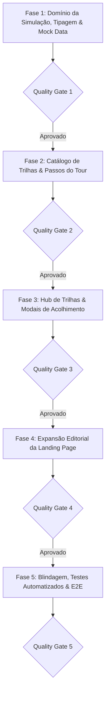

# PLANO DE IMPLEMENTAÇÃO — AUDITORIA, EXPANSÃO E MODERNIZAÇÃO DA APRESENTAÇÃO E DO TOUR GUIADO

> **Documento Canônico de Arquitetura de Produto, UX/UI e Governança de Software**  
> **Status:** Proposto / Consolidado em 5 Fases Sequenciais com Portões de Qualidade (QG1–QG5)  
> **Arquivo:** `planos/PLANO_AUDITORIA_E_EXPANSAO_APRESENTACAO_E_TOUR.md`  
> **Módulos Afetados:** `src/domain/demo-simulation/`, `src/components/modules/`, `src/features/landing/`, `src/features/transactions/`, `src/features/goals/`, `src/features/settings/`, `src/state/demo-mode/`  
> **Governança:** TypeScript Estrito (Zero `any`/`@ts-ignore`) · Funções Puras no Domínio · Moeda em Centavos (`<MoneyText />`) · Zero Controles Nativos · Zero Emojis (`local/no-decorative-unicode`) · Zero Duplo Haptic · Mobile-First · Portões de Qualidade por Fase  
> **Data:** Novembro de 2026 · **Ambientes:** Web Desktop, Web PWA (iOS/Android) & Android Nativo (Capacitor Pro)

---

## 1. VISÃO GERAL, CONTEXTO E OBJETIVO ESTRATÉGICO

O aplicativo recebeu recentemente adições estratégicas de alto valor percebido e tração colaborativa:
1. **Modo Família:** Segregação de despesas familiares vs. pessoais, teto compartilhado de gastos domésticos e geração de link seguro de acompanhamento em tempo real para o parceiro(a) (`/orcamento-familiar/:token`).
2. **Racha de Despesas Automático:** Divisão de contas em $N$ participantes com política configurável de absorção de centavos (*host* vs. *balanced*), gerador oficial de Pix Copia e Cola EMVCo e disparo de mensagem pronta para WhatsApp.
3. **Páginas Públicas Interativas com Onboarding:** Links de racha (`/racha/:token`) onde participantes copiam a chave Pix, conferem fatias individuais e podem salvar a despesa diretamente em suas próprias contas Áxis em 1 clique.
4. **Termômetro de Metas Coletivas & Arrecadações:** Campanhas de vaquinha (`CampaignCard` e `/meta/:token`) com barra de progresso visual em tempo real, cálculo de dias restantes, chave Pix do organizador integrada e gestão de apoiadores.

### O Problema Identificado na Auditoria
Embora a engenharia das funcionalidades esteja implementada e testada, **a camada de apresentação e a esteira de tour permaneceram estáticas no modelo legado (individual e puramente patrimonial)**:
* A **Landing Page (`/apresentacao`)** não cita nenhum dos recursos sociais/virais, perdendo o maior vetor de aquisição orgânica (*Product-Led Growth*).
* O **Tour Guiado (`DemoTourSpotlight`)** foca apenas no lançamento simples de despesas e ignora o botão de racha no Wizard, não apresenta o Modo Família e não demonstra os Termômetros de Arrecadação.
* Os **Dados Simulados (`mock-finances.ts`)** não trazem rachas com participantes ou campanhas ativas, fazendo com que o modo de simulação apresente telas vazias nos módulos colaborativos.

### O Objetivo do Plano
Reestruturar a narrativa da Landing Page e modernizar todo o ecossistema do Tour Guiado (dados mock, catálogo de passos, seletor de trilhas e modais de boas-vindas), permitindo que qualquer visitante ou novo usuário compreenda e experimente essas inovações em menos de 2 minutos, sem atrito.

```
┌────────────────────────────────────────────────────────────────────────────────────────────────────────┐
│                        ARQUITETURA UNIFICADA DE APRESENTAÇÃO E EXPERIÊNCIA DO TOUR                     │
└────────────────────────────────────────────────────────────────────────────────────────────────────────┘
                                                    │
                ┌───────────────────────────────────┴───────────────────────────────────┐
                ▼                                                                       ▼
   [VITRINE PÚBLICA: LANDING PAGE]                                         [EXPERIÊNCIA INTERNA: TOUR & HUB]
   (/apresentacao — Conversão & Valor)                                     (DemoTourSpotlight & TrackSelectModal)
   
   • Eixo 1: Caixa Real & Safe-to-Spend                                    • Trilha 1: Finanças Diárias & Cartões (8 passos)
   • Eixo 2: Cartões & Competências Futuras                                • Trilha 2: Finanças Compartilhadas (NOVA - 4 passos)
   • Eixo 3: Rebalanceamento & Carteira                                    • Trilha 3: Investimentos & Aportes (5 passos)
   • Eixo 4: Vida Compartilhada & Pix (NOVO)                               • Trilha 4: App Nativo Android Pro (4 passos)
     - Card Visual: Racha com Pix e WhatsApp                               • Micro-tours no Hub:
     - Card Visual: Termômetro de Vaquinha                                   - Racha Rápido & Pix (2 passos)
     - Card Visual: Orçamento Familiar Seguro                                - Termômetro de Metas (2 passos)
   • Pílulas no Hero & Prova Social de PWA                                   - Modo Família no Ajuste (2 passos)
```

---

## 2. ANÁLISE CRÍTICA DE FRAGILIDADES, RISCOS E MITIGAÇÕES TÉCNICAS

Antes do detalhamento das fases, a auditoria levantou 6 fragilidades potenciais que este plano mitiga:

| ID | Fragilidade / Risco Técnico | Causa Raiz | Solução / Mitigação Arquitetural |
|---|---|---|---|
| **F1** | **Telas Vazias no Modo Simulação** | Se o tour direcionar para `/orcamentos` ou `/transacoes` sem mocks de racha/meta, o usuário verá um `EmptyState`. | Enriquecer `mock-finances.ts` com 1 racha de despesa ativo com sinais de pagamento, 1 meta coletiva com termômetro em andamento e flag `familyModeEnabled: true` no mock de preferências. |
| **F2** | **Fadiga de Passos no Tour Principal** | Adicionar 4 novos passos à trilha `finances` faria ela subir de 8 para 12 passos, causando abandono do tour. | Manter `finances` ágil (apenas ajustar descrições do passo do Wizard e Tetos) e criar a **Trilha Dedicada `shared_finances` (4 passos)** + micro-tours no Hub. |
| **F3** | **Seletores Quebradiços em Diálogos Dinâmicos** | O `SplitExpenseDialog` é um modal que abre sob demanda. Se o seletor `data-tour` for procurado antes do modal montar, o spotlight falha. | O passo do tour deve focar no gatilho (`[data-tour="wizard-split-toggle"]`) e, caso demonstre o modal, sincronizar via `targetRoute` com parâmetro declarativo seguro (ex.: `?demo_modal=split`). |
| **F4** | **Conflito de Viewport & Altura no Mobile** | Cards de racha e termômetros possuem elementos verticais densos. No mobile (<768px), o popover do tour pode colidir com a barra inferior. | Utilizar a geometria inteligente de `calculateSpotlightGeometry` e garantir `spotlightPadding: 8` e `preferredPlacement: "top"` para controles próximos à bottom nav. |
| **F5** | **Regressão de Regras Estritas de UI (AGENTS.md §4)** | Risco de uso inadvertido de emojis (ex.: 🎉, 📱, 💰) ou formatação crua de moeda com `truncate`. | Bloqueio via linter `local/no-decorative-unicode`, uso exclusivo de ícones `lucide-react` padronizados e formatação monetária restrita ao componente `<MoneyText />`. |
| **F6** | **Inchaço do Bundle da Landing Page** | Componentes visuais ricos na Landing Page podem degradar o First Contentful Paint (FCP). | Construir os cards visuais do Eixo 4 com elementos leves de SVG/Tailwind nativos, sem bibliotecas pesadas de animação fora do `ScrollReveal` existente. |

---

## 3. ESTRUTURAÇÃO DO PLANO EM 5 FASES



---

### FASE 1: Domínio da Simulação, Tipagem & Mock Data
> **Objetivo:** Preparar a infraestrutura de dados em memória e tipagens para suportar a simulação realista do Modo Família, Racha de Despesas com Pix e Termômetro de Metas.

#### Etapa 1.1: Expansão dos Tipos de Trilha e Categorias (`types.ts`)
* **Arquivo:** `src/domain/demo-simulation/types.ts`
* Adicionar os novos identificadores à união de trilhas:
  ```typescript
  export type SharedTourTrackId =
    | "shared_finances"   // Trilha consolidada (4 passos)
    | "finances_split"     // Micro-tour: Racha de despesas e Pix (2 passos)
    | "finances_family"    // Micro-tour: Modo Família e link seguro (2 passos)
    | "finances_goals";    // Micro-tour: Termômetro de metas e vaquinhas (2 passos)

  export type TourTrackId =
    | LegacyTourTrackId
    | MicroTourTrackId
    | SharedTourTrackId;
  ```
* Adicionar a categoria `"shared"` em `TourTrackCategory` com rótulo "Compartilhadas".

#### Etapa 1.2: Enriquecimento do Dataset Mock (`mock-finances.ts`)
* **Arquivo:** `src/domain/demo-simulation/mock-finances.ts`
* **Inclusão de Despesa Familiar:** Adicionar despesa com flag `is_family: true` ("Supermercado Mensal Familiar" — R$ 850,00).
* **Inclusão de Racha Ativo:** Adicionar despesa vinculada a racha ("Churrasco com Amigos" — R$ 360,00, 4 participantes, R$ 90,00 cada, com 2 participantes com pagamento já sinalizado).
* **Inclusão de Meta com Campanha Pública:** Adicionar nos dados de `income-goals` uma campanha com `is_public: true`:
  - Título: *"Viagem de Fim de Ano"*
  - Alvo: R$ 6.000,00 (600.000 centavos)
  - Arrecadado: R$ 4.500,00 (450.000 centavos — 75% concluído)
  - Chave Pix configurada: `"financeiro@meuapp.com"`
  - 3 contribuições registradas no mock.
* **Inclusão de Preferência Familiar:** Habilitar `familyModeEnabled: true` nas preferências simuladas quando o tour navegar para o Modo Família.

#### Etapa 1.3: Atualização das Funções de Metadados (`metadata.ts`)
* **Arquivo:** `src/domain/demo-simulation/metadata.ts`
* Atualizar `TOUR_CATEGORY_LABELS` e `TOUR_TRACK_CONTEXTUAL_LABELS` para incluir as novas trilhas e micro-tours com descrições amigáveis e objetivas em pt-BR.

> **Quality Gate 1 (QG1):**
> 1. `npx vitest run src/domain/demo-simulation/mock-data.test.ts` passando com 100% de sucesso.
> 2. `npx vitest run src/domain/demo-simulation/metadata.test.ts` validando todas as novas chaves.
> 3. Zero erros de TypeScript (`npx tsc --noEmit`).

---

### FASE 2: Catálogo de Trilhas & Passos do Tour Guiado
> **Objetivo:** Definir os passos exatos de apresentação guiada das novas funcionalidades, respeitando as rotas, seletores DOM e placements adaptativos.

#### Etapa 2.1: Registro Canônico no Catálogo (`tour-catalog.ts`)
* **Arquivo:** `src/domain/demo-simulation/tour-catalog.ts`
* Registrar os metadados canônicos em `TOUR_TRACK_METAS`:
  - `shared_finances`: "Finanças Compartilhadas, Racha & Metas" (4 passos, ícone `users`, rota inicial `/transacoes?novo=despesa`).
  - `finances_split`: "Racha de Despesas & Cobrança Pix" (2 passos, ícone `share-2`, rota `/transacoes`).
  - `finances_family`: "Modo Família & Orçamento Conjunto" (2 passos, ícone `users`, rota `/configuracoes?tab=family`).
  - `finances_goals`: "Termômetro de Metas & Arrecadação" (2 passos, ícone `target`, rota `/orcamentos`).
* Adicionar o novo grupo em `TOUR_TRACK_GROUPS`:
  - Categoria `"shared"` com título *"Finanças Compartilhadas"*, badge *"3 micro-tours"*, contendo as trilhas correspondentes.

#### Etapa 2.2: Implementação dos Passos Detalhados (`tour-steps.ts`)
* **Arquivo:** `src/domain/demo-simulation/tour-steps.ts`
* **Definir a Trilha Consolidada `shared_finances` (4 passos):**
  1. *Passo 1 (Racha no Wizard):*
     - Rota: `/transacoes?novo=despesa`
     - Seletor: `[data-tour="wizard-split-toggle"]`
     - Título: *"Divisão Automática no Lançamento"*
     - Descrição: *"Ao lançar qualquer despesa, ative o switch de racha para calcular a divisão por pessoa imediatamente."*
     - Placement: `"top"` / Padding: 6.
  2. *Passo 2 (Configuração de Cobrança Pix & WhatsApp):*
     - Rota: `/transacoes`
     - Seletor: `[data-tour="split-pending-card"]`
     - Título: *"Cobrança Integrada por Pix e Link"*
     - Descrição: *"Gere QR Code Copia e Cola instantâneo, compartilhe fatias no WhatsApp e acompanhe quem já pagou em tempo real."*
     - Placement: `"bottom"` / Padding: 10.
  3. *Passo 3 (Termômetro de Metas Coletivas):*
     - Rota: `/orcamentos`
     - Seletor: `[data-tour="campaign-thermometer-card"]`
     - Título: *"Termômetro de Arrecadação em Tempo Real"*
     - Descrição: *"Transforme sonhos ou vaquinhas em campanhas públicas. Seus amigos acompanham o progresso e contribuem via Pix."*
     - Placement: `"top"` / Padding: 10.
  4. *Passo 4 (Modo Família com Proteção de Privacidade):*
     - Rota: `/configuracoes?tab=family`
     - Seletor: `[data-tour="family-budget-card"]`
     - Título: *"Orçamento Familiar Seguro a Dois"*
     - Descrição: *"Defina um teto mensal doméstico e compartilhe um link exclusivo de leitura para o parceiro(a), sem abrir senhas bancárias."*
     - Placement: `"top"` / Padding: 10.
* **Definir os Micro-Tours Correspondentes:** `finances_split` (passos 1 e 2), `finances_family` (passo 4), `finances_goals` (passo 3).
* **Refinar a Trilha Principal `finances`:**
  - Atualizar o texto do Passo 3 (`finances-wizard-dialog`) para mencionar explicitamente o switch de racha e o seletor familiar.
  - Atualizar o Passo 7 (`finances-budgets`) para destacar a coexistência de Tetos de Gastos e Termômetros de Metas.

#### Etapa 2.3: Atualização dos Testes de Catálogo e Steps
* **Arquivos:** `src/domain/demo-simulation/tour-catalog.test.ts` e `tour-steps.test.ts`
* Atualizar asserções de contagem exata de passos e existência de metadados para garantir que não haja divergência numérica.

> **Quality Gate 2 (QG2):**
> 1. `npx vitest run src/domain/demo-simulation/tour-catalog.test.ts` 100% verde.
> 2. `npx vitest run src/domain/demo-simulation/tour-steps.test.ts` 100% verde.
> 3. Todas as rotas alvo mapeadas são válidas e existem no roteador (`router.tsx`).

---

### FASE 3: Instrumentação de Seletores DOM & Modais de Acolhimento
> **Objetivo:** Adicionar os atributos `data-tour` necessários nas telas do app e atualizar o Diálogo de Boas-Vindas e o Seletor de Trilhas.

#### Etapa 3.1: Instrumentação de Atributos `data-tour` nas Telas
* **Wizard de Lançamento (`src/features/transactions/wizard/step-quick.tsx`):**
  - Adicionar `data-tour="wizard-split-toggle"` no contêiner do switch de rachar despesa.
* **Card de Rachas Ativos (`src/features/transactions/components/active-splits-card.tsx`):**
  - Adicionar `data-tour="split-pending-card"`.
* **Card de Campanha com Termômetro (`src/features/goals/components/campaign-card.tsx`):**
  - Adicionar `data-tour="campaign-thermometer-card"`.
* **Card de Orçamento Familiar (`src/features/settings/components/tabs/family-budget-share-card.tsx`):**
  - Adicionar `data-tour="family-budget-card"`.

#### Etapa 3.2: Modernização do Diálogo de Boas-Vindas (`welcome-modal.tsx`)
* **Arquivo:** `src/components/modules/welcome-modal.tsx`
* Adicionar um **4º Pilar Visual** na grade explicativa do diálogo:
  - Título: *"Finanças Compartilhadas & Pix"*
  - Descrição: *"Rache despesas com amigos via WhatsApp, acompanhe o orçamento familiar a dois e crie termômetros de vaquinha."*
  - Ícone: `Users` (`size-4 text-primary`)
* Atualizar o teste correspondente (`welcome-modal.test.tsx`).

#### Etapa 3.3: Inclusão da Aba "Compartilhadas" no Hub de Tours (`demo-track-select-modal.tsx`)
* **Arquivo:** `src/components/modules/demo-track-select-modal.tsx`
* Adicionar a aba `shared` ao componente de abas:
  - Ícone: `Users` (`size-4 text-primary`)
  - Label: `"Compartilhadas"`
  - Conteúdo: Card de destaque da trilha `shared_finances` (4 passos) + grade com os 3 micro-tours (`finances_split`, `finances_family`, `finances_goals`).
* Atualizar o teste correspondente (`demo-track-select-modal.test.tsx`).

#### Etapa 3.4: Atualização da Central de Ajuda (`help-modal.tsx`)
* **Arquivo:** `src/components/modules/help-modal.tsx`
* Adicionar um novo item de FAQ sanfona:
  - Pergunta: *"Como funciona a divisão de despesas e o Modo Família?"*
  - Resposta: *"O racha calcula o valor por pessoa, gera o Pix Copia e Cola e monta o link para WhatsApp. No Modo Família, você compartilha um link seguro de orçamento para o parceiro(a) acompanhar sem expor senhas."*

> **Quality Gate 3 (QG3):**
> 1. `npx vitest run src/components/modules/welcome-modal.test.tsx` verde.
> 2. `npx vitest run src/components/modules/demo-track-select-modal.test.tsx` verde.
> 3. `npx vitest run src/components/modules/demo-tour-spotlight.test.tsx` e `demo-tour-manual-verification.test.tsx` sem quebras de regressão.

---

### FASE 4: Expansão Editorial da Apresentação (Landing Page)
> **Objetivo:** Transformar a Landing Page em uma vitrine completa que destaca a facilidade do Racha com Pix, o Modo Família e os Termômetros de Arrecadação.

#### Etapa 4.1: Construção do "Eixo 4: Vida Compartilhada & Cobrança Ágil" (`product-narratives.tsx`)
* **Arquivo:** `src/features/landing/components/product-narratives.tsx`
* Inserir entre as narrativas existentes o **Eixo 4**, estruturado no padrão editorial do design system:
  1. **Cabeçalho da Seção:** Badge `Eixo 4 · Vida Compartilhada & Cobrança Ágil` + Título *"Sem discussões sobre dinheiro e sem planilhas de rateio"*.
  2. **Narrativa Editorial:** Explicação clara sobre a dor do descontrole em viagens, churrascos, barzinhos e na vida a dois, contrastando com a agilidade do sistema.
  3. **Três Destaques Práticos:**
     - *Racha Automático com Pix:* Divisão precisa de centavos e disparo formatado para WhatsApp com QR Code.
     - *Modo Família & Teto Conjunto:* Transparência entre o casal com respeito à privacidade de investimentos individuais.
     - *Termômetro de Metas Coletivas:* Acompanhamento visual de arrecadação em tempo real para projetos em grupo.
  4. **Card Demonstrativo Interativo (Mockup Visual Fiel):**
     - Card com estética idêntica à aplicação (`bg-surface/90 border-border/80 rounded-2xl shadow-xl`).
     - Demonstrando o cabeçalho *"Racha: Jantar Italiano (4 pessoas)"*.
     - Linhas de participantes com badges: *"Você (Pago)"*, *"Mariana (Pix Sinalizado)"*, *"Lucas (Pendente)"*.
     - Box de destaque com botão de simulação de WhatsApp e QR Code Pix Copia e Cola.
     - Barra de Termômetro de Meta: *"Meta: Viagem Réveillon (75% alcançado)"*.

#### Etapa 4.2: Atualização do Hero da Landing Page (`hero-editorial.tsx`)
* **Arquivo:** `src/features/landing/components/hero-editorial.tsx`
* Incluir pílula/badge no topo do Hero:
  - `<Badge variant="positive">Novo: Modo Família, Racha com Pix e Metas Coletivas</Badge>`
* Adicionar na fita de destaques rápidos (*value proposition bullet points*):
  - *"Racha automático de despesas e orçamento familiar conjunto."*

#### Etapa 4.3: Atualização do Showcase de Ferramentas (`tools-showcase.tsx`)
* **Arquivo:** `src/features/landing/components/tools-showcase.tsx`
* Adicionar na lista de ferramentas abertas ou chamadas contextuais:
  - Informação de que qualquer link de racha (`/racha/:token`) ou termômetro (`/meta/:token`) é aberto de forma 100% responsiva no navegador de amigos e familiares, com compatibilidade nativa PWA sem exigir instalação imediata.

#### Etapa 4.4: Atualização da Seção de Dúvidas Frequentes (`faq-section.tsx`)
* **Arquivo:** `src/features/landing/components/faq-section.tsx`
* Incluir duas novas perguntas de alta conversão:
  - *"Preciso que meus amigos tenham o aplicativo para cobrar um racha?"*
    - *Resposta:* Não. O link de cobrança abre diretamente no navegador do celular deles, exibindo o QR Code Pix Copia e Cola e o valor individual exato. Caso queiram, podem criar uma conta e salvar a despesa na hora.
  - *"Meu parceiro(a) terá acesso aos meus investimentos e contas pessoais no Modo Família?"*
    - *Resposta:* Não. O Modo Família foi desenhado com privacidade estrita: apenas o teto doméstico e as despesas explicitamente marcadas como familiares são compartilhadas. Seus cartões, investimentos e contas pessoais permanecem 100% privados.

> **Quality Gate 4 (QG4):**
> 1. `npx vitest run src/features/landing/` 100% verde.
> 2. Validação visual em telas mobile (360px), tablet (768px) e desktop (1280px).
> 3. Zero emojis inseridos (`npm run lint` sem erros da regra `local/no-decorative-unicode`).
> 4. Valores monetários renderizados exclusivamente com `<MoneyText />` ou classes tipográficas adaptativas tabulares (`tabular-nums tracking-tight whitespace-nowrap`).

---

### FASE 5: Blindagem, Testes Automatizados & Homologação Fim-a-Fim
> **Objetivo:** Validar a integridade de regressão de todo o repositório, garantindo conformidade rigorosa com AGENTS.md, performance e ausência de bugs visuais.

#### Etapa 5.1: Testes Unitários de Regressão
* Executar a suíte completa de testes do tour:
  - `src/components/modules/demo-tour-manual-verification.test.tsx`
  - `src/components/modules/demo-tour-spotlight.test.tsx`
  - `src/domain/demo-simulation/tour-catalog.test.ts`
  - `src/domain/demo-simulation/tour-steps.test.ts`
  - `src/state/demo-mode/demo-session-store.test.ts`
* Executar a suíte de testes da landing page:
  - `src/features/landing/pages/landing-page.test.tsx`
  - `src/features/landing/components/landing-footer.test.tsx`

#### Etapa 5.2: Verificação de Governança e Regras de Ouro (AGENTS.md)
* **Zero Emojis:** Rodar `npm run lint` para garantir que nenhuma string decorativa Unicode violou a governança.
* **Zero Controles Nativos:** Confirmar que nenhum `<select>` ou `<input type="checkbox">` cru foi utilizado.
* **Zero Duplos Disparos Sensoriais:** Verificar se todos os botões novos de interação utilizam o gateway central `triggerSensory("action")` sem duplicação no componente base.
* **Hierarquia de Ícones:** Respeitar o Nível 1 (*Icon-Only*, sem caixas decorativas em cabeçalhos comuns) e Nível 2 (*Prominent Badge Icons* em banners de alerta e heróis).

#### Etapa 5.3: Build de Produção
* Executar `npm run build` para certificar que os bundles do Vite compilam sem advertências de chunk, tipos ausentes ou imports cíclicos.

> **Quality Gate 5 (QG5):**
> 1. `npm run test` (todos os testes verdes).
> 2. `npm run lint` (zero erros e zero warnings de emojis).
> 3. `npm run build` gerando saída sem erros de compilação.

---

## 4. MATRIZ DE ARQUIVOS AFETADOS

| Ação | Arquivo | Finalidade |
|---|---|---|
| **MODIFY** | `src/domain/demo-simulation/types.ts` | Adicionar identificadores de trilha (`shared_finances`, etc.) e categoria `"shared"`. |
| **MODIFY** | `src/domain/demo-simulation/mock-finances.ts` | Enriquecer mock com despesas familiares, racha com pagamentos e campanha de vaquinha. |
| **MODIFY** | `src/domain/demo-simulation/metadata.ts` | Adicionar rótulos contextuais e nomes amigáveis em pt-BR para as novas trilhas. |
| **MODIFY** | `src/domain/demo-simulation/tour-catalog.ts` | Cadastrar as novas trilhas em `TOUR_TRACK_METAS` e criar o grupo `"shared"`. |
| **MODIFY** | `src/domain/demo-simulation/tour-steps.ts` | Mapear os 4 passos da trilha compartilhada e passos dos micro-tours dedicados. |
| **MODIFY** | `src/components/modules/welcome-modal.tsx` | Incluir o 4º pilar de Finanças Compartilhadas no modal de boas-vindas do app. |
| **MODIFY** | `src/components/modules/demo-track-select-modal.tsx` | Adicionar aba "Compartilhadas" no seletor de trilhas do tour. |
| **MODIFY** | `src/components/modules/help-modal.tsx` | Adicionar item de FAQ sobre divisão de despesas e Modo Família na Central de Ajuda. |
| **MODIFY** | `src/features/transactions/wizard/step-quick.tsx` | Adicionar atributo `data-tour="wizard-split-toggle"` no switch de rachar. |
| **MODIFY** | `src/features/goals/components/campaign-card.tsx` | Adicionar atributo `data-tour="campaign-thermometer-card"`. |
| **MODIFY** | `src/features/settings/components/tabs/family-budget-share-card.tsx` | Adicionar atributo `data-tour="family-budget-card"`. |
| **MODIFY** | `src/features/landing/components/product-narratives.tsx` | Implementar o **Eixo 4** com narrativa editorial e cards visuais de Racha Pix e Termômetro. |
| **MODIFY** | `src/features/landing/components/hero-editorial.tsx` | Incluir pílula de lançamento no cabeçalho e bullet points no hero. |
| **MODIFY** | `src/features/landing/components/tools-showcase.tsx` | Adicionar referência à experiência sem fricção dos links públicos PWA. |
| **MODIFY** | `src/features/landing/components/faq-section.tsx` | Incluir perguntas e respostas sobre privacidade familiar e cobrança de amigos sem app. |
| **MODIFY** | Testes associados (`*.test.ts`, `*.test.tsx`) | Atualizar testes de catálogo, passos, modais e páginas para cobrir 100% das adições. |

---

## 5. BENEFÍCIOS ESPERADOS APÓS A IMPLEMENTAÇÃO

1. **Aumento Significativo de Conversão na Landing Page:** O produto deixa de parecer apenas um gerenciador pessoal tradicional e passa a se posicionar como um ecossistema completo para a vida real (indivíduo, casal e amigos).
2. **Ativação Orgânica de Novos Usuários (Viralidade):** Usuários que entendem o poder do link do racha e do termômetro passam a usá-lo com amigos, atraindo novos usuários para a plataforma sem custo de aquisição.
3. **Descoberta Imediata sem Fricção:** Novos usuários que ativam o tour de 2 minutos aprendem instantaneamente a usar o Wizard com Racha, sem precisar adivinhar onde as opções estão escondidas.
4. **Isolamento e Segurança Reforçados:** A explicação clara da separação entre o financeiro pessoal e o familiar tranquiliza o usuário sobre a privacidade dos seus investimentos e contas.

---

> **Diretiva de Execução Futura:** Este documento está integralmente pronto e validado para execução conforme as diretrizes do `AGENTS.md`. Nenhuma linha de código foi modificada nesta etapa, preservando o repositório exatamente como solicitado.
