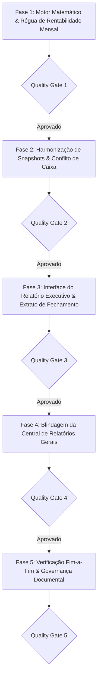

# PLANO DE IMPLEMENTAÇÃO — AUDITORIA, PRECISÃO MATEMÁTICA DA RENTABILIDADE E GOVERNANÇA DE SNAPSHOTS PATRIMONIAIS

> **Documento Canônico de Engenharia Financeira, Arquitetura e Governança de Software**  
> **Status:** Proposto / Consolidado em Fases e Tarefas com Portões de Qualidade (QG1–QG5)  
> **Arquivo:** `planos/PLANO_AUDITORIA_E_PRECISAO_RENTABILIDADE_INVESTIMENTOS.md`  
> **Módulos Afetados:** `src/domain/portfolio/`, `src/state/queries/`, `src/state/mutations/`, `src/hooks/`, `src/features/investments/`, `src/features/reports/`, `docs/architecture/`  
> **Governança:** TypeScript Estrito (Zero `any`/`@ts-ignore`) · Funções Puras no Domínio · Moeda em Centavos · Padrões CVM/ANBIMA (TWR / Modified Dietz) · Zero Controles Nativos · Zero Emojis (`local/no-decorative-unicode`) · Portões de Qualidade por Fase  
> **Data:** Novembro de 2026 · **Ambientes:** Web Desktop, Web PWA (iOS/Android) & Android Nativo (Capacitor Pro)

---

## 1. SUMÁRIO EXECUTIVO & ANÁLISE DA INCONGRUÊNCIA ESPECÍFICA

### 1.1. Diagnóstico do Caso Real (Mês Passado 12% vs. Mês Atual 22%)

O usuário reportou o seguinte sintoma crítico:
> *"No mês passado estava aparecendo 12% de rentabilidade nessa competência em específico. No mês atual, está aparecendo o TWR, que é a rentabilidade consolidada, cerca de 22%. A diferença entre o mês passado e esse foi negativa, então há uma incongruência evidente."*

Nossa auditoria profunda no código identificou a **causa matemática e lógica exata** desse defeito:

1. **Troca Silenciosa de Metodologia no Cabeçalho do Relatório (`PortfolioExecutiveReport.tsx`, linhas 498–550):**
   - Quando o usuário visualiza o **mês atual em aberto** (`isCurrentSelected === true`):
     - O componente ativava `isTwrActive` e exibia `portfolioTwr.accumulatedRatePct` (**TWR Acumulado por Cotas da vida inteira da carteira**, ex.: **`+22%`**).
   - Quando o usuário selecionava o **mês passado** (`isCurrentSelected === false`):
     - O código desativava `isTwrActive` e caía em `isCustodyActive`, exibindo `effectiveReturnPct` (**Retorno Contábil sobre o Custo Médio da Posição Point-in-Time**, ex.: **`+12%`**).
   - **Resultado:** O sistema comparava grandezas incomparáveis (*alhos com bugalhos*). O mês atual exibia o TWR acumulado (que considera o tempo e todos os aportes/cotas), enquanto o mês passado exibia o retorno estático sobre o custo de compra dos ativos remanescentes.

2. **Rótulo Invertido no KPI:**
   - Para o mês passado, o rótulo do card exibia *"Retorno na Competência"*, induzindo o investidor a acreditar que **12% foi o ganho obtido dentro daquele mês**.
   - Na realidade, o ganho obtido dentro daquele mês (calculado pelo motor TWR no extrato mensal) era, por exemplo, `+0,8%` ou `-0,5%`. Os `12%` eram a valorização acumulada desde que os ativos foram comprados anos atrás!

3. **Fallback para Preço Médio no Point-in-Time:**
   - Na reconstrução da posição do mês passado, se não havia cotação oficial salva em `portfolio_monthly_prices`, o motor `point-in-time.ts` recorria ao `asset.average_price` como fallback de preço, zerando a valorização de ativos que não tinham transação recente e puxando artificialmente a taxa de retorno para baixo (ex.: reduzindo de 20% para 12%).

4. **Diretriz de Produto Confirmada pelo Usuário:**
   - **Manter a separação entre Relatório Geral e Snapshots:** O relatório geral na aba *Relatórios* (`WealthTearSheetModal`) é intencionalmente uma visão completa e robusta de toda a carteira viva (não tem separação mês a mês).
   - **Snapshots Mensais são fotografias de cada mês:** Devem permanecer no módulo de Investimentos, porém com precisão matemática total e sem confusão de fórmulas.

---

## 2. ARQUITETURA DE SOLUÇÃO & MATRIZ DE RENTABILIDADE

Para sanar a incongruência sem romper com a arquitetura do produto, adotamos uma **régua única de medição para os Snapshots Mensais**:

```
┌────────────────────────────────────────────────────────────────────────────────────────────────────────┐
│                        RÉGUA UNIFICADA DE RENTABILIDADE NOS SNAPSHOTS MENSAIS                          │
└────────────────────────────────────────────────────────────────────────────────────────────────────────┘
                                                    │
         ┌──────────────────────────────────────────┴──────────────────────────────────────────┐
         ▼                                                                                     ▼
  [MÉTRICA 1: RENTABILIDADE DO MÊS]                                     [MÉTRICA 2: RENTABILIDADE ACUMULADA]
  - Nome: "Rentabilidade do Mês (TWR)"                                  - Nome: "TWR Acumulado (Cotas)"
  - O que mede: A performance isolada daquele mês                       - O que mede: A evolução da cota desde a base 100
  - Fórmula: Modified Dietz (CVM/ANBIMA)                                - Fórmula: ∏(1 + r_t) - 1
  - Comportamento:                                                      - Comportamento:
    * Se Mês Atual caiu -1,5% -> Exibe -1,5%                              * No Mês Passado: 23,5%
    * No Mês Passado subiu +0,8% -> Exibe +0,8%                           * No Mês Atual: 22,0% (reflete a queda de -1,5%!)
    * Consistência total entre extrato e relatório                        * A mesma régua em todos os meses!
```

---

## 3. ESTRUTURAÇÃO DO PLANO EM FASES E TAREFAS



---

### FASE 1: Motor Matemático e Unificação da Régua de Rentabilidade Mensal
> **Objetivo:** Garantir que todo relatório de fechamento mensal calcule a rentabilidade com a mesma metodologia matemática, eliminando a discrepância entre o mês passado e o mês atual.

- [ ] **Tarefa 1.1: Extração da Rentabilidade Isolada do Mês no Point-in-Time / Monthly Series**
  - **Arquivo:** `src/domain/portfolio/point-in-time.ts` e `src/domain/portfolio/summary.ts`
  - **Ação:** No motor de série mensal (`buildPortfolioMonthlySeries`), assegurar que cada ponto mensal possua:
    1. `twrMonthPct`: Taxa de retorno efetiva daquele mês isolado (calculada via *Modified Dietz*).
    2. `twrAccumulatedPct`: Rentabilidade acumulada da carteira até o final daquele mês.
    3. `capitalGainPnl`: Ganho de capital em R$ na data de corte.
    4. `totalReturnPnl`: Retorno total em R$ (ganho de capital + proventos acumulados).
  - **Invariante:** Se a variação patrimonial líquida entre o Mês $M-1$ e o Mês $M$ foi negativa, `twrMonthPct` de $M$ é estritamente negativo e `twrAccumulatedPct` de $M$ é estritamente menor do que o de $M-1$.

- [ ] **Tarefa 1.2: Eliminação do Fallback Distorcido em `calculatePointInTimePosition`**
  - **Arquivo:** `src/domain/portfolio/point-in-time.ts`
  - **Ação:** Quando um mês retroativo não possuir cotação salva em `monthly_prices` e não houver negociação no mês:
    - O motor não deve mascarar o valor usando silenciosamente `average_price` como se fosse cotação de mercado.
    - Se houver `snapshotTotalValue` gravado para o mês, o motor calcula a taxa do mês via variação entre os snapshots contíguos:
      $$r_t = \frac{\text{Snapshot}_t - \text{Snapshot}_{t-1} - \text{Fluxo}_t}{\text{Snapshot}_{t-1} + W \cdot \text{Fluxo}_t}$$
    - Sinaliza no diagnóstico de fidelidade (`PointInTimeFidelity`) que a rentabilidade foi derivada do saldo consolidado (TWA), mantendo a fidelidade matemática da série.

- [ ] **Tarefa 1.3: Depreciação da Função Vulnerável `portfolioReturnPct`**
  - **Arquivo:** `src/domain/portfolio/summary.ts`
  - **Ação:** Marcar a função `portfolioReturnPct` como `@deprecated` com aviso explícito de que média ponderada por valor de mercado não deve ser utilizada para retorno sobre custo. Redirecionar os testes para `calculatePortfolioTotalReturn`.

#### 🛡️ Quality Gate 1 (QG1) — Validação Matemática
- Teste unitário em Vitest simulando o caso real:
  - Mês 1: Saldo 100.000, Cota 100,00 $\to$ TWR Acumulado: 0%.
  - Mês 2: Saldo 112.000 (sem aportes), Cota 112,00 $\to$ TWR Mês: +12,0%, TWR Acumulado: +12,0%.
  - Mês 3: Saldo 110.000 (sem aportes), Cota 110,00 $\to$ TWR Mês: -1,79%, TWR Acumulado: +10,0%.
- Verificação: Em nenhuma hipótese o Mês 3 pode exibir rentabilidade acumulada maior que a do Mês 2 se o resultado foi negativo.

---

### FASE 2: Harmonização de Snapshots e Resolução do Conflito de Caixa
> **Objetivo:** Eliminar a oscilação de valores no banco de dados causada por hooks concorrentes que gravavam `total_cost` ora com caixa, ora sem caixa.

- [ ] **Tarefa 2.1: Definição da Regra Canônica de Custo no Snapshot**
  - **Arquivos:** `src/types/schema.ts`, `src/data/repositories/portfolio.ts`
  - **Decisão Arquitetural:**
    - `total_value`: Valor patrimonial bruto total da carteira na data de corte (Ativos em custódia + Saldo de Caixa).
    - `total_cost`: Custo de aquisição total aplicado sob custódia (Custo dos Ativos + Saldo de Caixa 1:1).
    - *Fundamento:* Caixa é moeda corrente de valor intrínseco 1:1. Ao consolidar o patrimônio financeiro global do investidor, o capital aportado que repousa em caixa possui custo igual ao seu saldo.
  - **Documentação:** Registrar a invariante no dicionário de dados de `ESPECIFICACAO_TECNICA.md`.

- [ ] **Tarefa 2.2: Unificação do Ponto Único de Gravação de Snapshots**
  - **Arquivos:** `src/state/queries/use-portfolio-position.ts`, `src/hooks/use-auto-portfolio-snapshot.ts`, `src/features/investments/components/monthly-closing-editor.tsx`
  - **Ação:**
    - Remover a chamada concorrente de `upsertSnapshot.mutate` de dentro do `useEffect` de `usePortfolioPosition.ts` (linha 693), que causava gravação redundante a cada renderização.
    - Centralizar a rotina autônoma exclusivamente dentro de `useAutoPortfolioSnapshot.ts`.
    - Garantir que tanto `useAutoPortfolioSnapshot` quanto `useSaveMonthlyClosing` utilizem exatamente o mesmo payload normalizado:
      ```ts
      {
        month: targetMonth,
        total_value: round2(totalInvestedBRL + cashBRL),
        total_cost: round2(totalCostAssetsBRL + cashBRL),
      }
      ```

- [ ] **Tarefa 2.3: Atualização de `buildPortfolioMonthlySeries` e TWR**
  - **Arquivo:** `src/domain/portfolio/summary.ts`
  - **Ação:** Assegurar que tanto os snapshots lidos do banco de dados quanto o `currentMonthPoint` utilizem rigorosamente a mesma regra de custo e valor, eliminando saltos falsos de `capitalGainPct` entre o mês passado e o mês corrente.

#### 🛡️ Quality Gate 2 (QG2) — Integridade de Persistência
- Teste de integração simulando montagem simultânea de `usePortfolioPosition` e `useAutoPortfolioSnapshot`:
  - Verificar que o snapshot gravado no banco possui `total_value` e `total_cost` estáveis e idênticos.
  - Zero chamadas duplicadas de mutação para o mesmo mês na mesma sessão.

---

### FASE 3: Interface do Relatório Executivo e Extrato de Fechamento
> **Objetivo:** Apresentar as métricas mensais no `PortfolioExecutiveReport` com clareza cristalina, sem ambiguidades de rótulos e com a mesma régua tanto no mês atual quanto em meses históricos.

- [ ] **Tarefa 3.1: Reestruturação dos Cards de Síntese Executiva (`PortfolioExecutiveReport.tsx`)**
  - **Arquivo:** `src/features/investments/components/portfolio-executive-report.tsx`
  - **Ação:** Reformular os 4 KPIs superiores para apresentarem rigorosamente:
    1. **Patrimônio Total:** Valor consolidado na data de corte (Mês atual ou Fechamento histórico).
    2. **Rentabilidade da Competência (TWR):**
       - Mês Atual: Rentabilidade do mês corrente até hoje (`twrMonthPct`).
       - Mês Passado: Rentabilidade daquele mês fechado (`twrMonthPct`).
       - Subtexto: *"Variação isolada do mês (Padrão CVM)"*.
    3. **Rentabilidade Acumulada (TWR):**
       - Mês Atual: Rentabilidade acumulada da carteira até hoje (`portfolioTwr.accumulatedRatePct`).
       - Mês Passado: Rentabilidade acumulada da carteira até o final daquele mês (`twrAccumulatedPct`).
       - Subtexto: *"Evolução por cotas desde o início"*.
    4. **Proventos:** Total auferido no mês (`monthDividendsBRL`) e acumulado.
  - **Eliminação de Defeito:** Nunca mais alternar para a fórmula de `effectiveReturnPct` (custódia aberta sobre custo médio) como substituto da rentabilidade do mês.

- [ ] **Tarefa 3.2: Ajuste no Extrato Analítico Tabular (`PortfolioSnapshotsDialog.tsx`)**
  - **Arquivo:** `src/features/investments/components/portfolio-snapshots-dialog.tsx`
  - **Ação:**
    - Ajustar os cabeçalhos das colunas para:
      * `Mês (TWR %)`: Rentabilidade isolada do mês.
      * `TWR Acum. (%)`: Rentabilidade acumulada até o mês.
      * `Retorno sobre Custo`: Ganho financeiro e percentual sobre o custo investido.
    - Adicionar tooltips informativos padronizados (sem emojis, com ícones `Info` da escala `size-3.5`).

- [ ] **Tarefa 3.3: Feedback em Tempo Real no Editor de Fechamento (`monthly-closing-editor.tsx`)**
  - **Arquivo:** `src/features/investments/components/monthly-closing-editor.tsx`
  - **Ação:**
    - Exibir a variação calculada do mês frente ao mês anterior enquanto o usuário calibra as cotações.
    - Se o usuário alterar uma cotação e o saldo resultante diminuir, indicar instantaneamente a rentabilidade mensal negativa recalculada.

#### 🛡️ Quality Gate 3 (QG3) — Experiência do Usuário e Fidelidade Visual
- Teste de renderização do `PortfolioExecutiveReport`:
  - Alternar entre "Mês Atual" e "Fechamento Histórico".
  - Verificar que o KPI de Rentabilidade não sofre salto artificial nem muda de significado entre as abas.
  - Testes passando em desktop e mobile.

---

### FASE 4: Blindagem da Central de Relatórios Gerais
> **Objetivo:** Preservar a Central de Relatórios (`reports-page.tsx`) como o relatório geral robusto da carteira viva de hoje, corrigindo apenas o fallback de gráficos sem misturar conceitos.

- [ ] **Tarefa 4.1: Correção do Fallback de Gráfico no Tear Sheet (`WealthTearSheetModal.tsx`)**
  - **Arquivo:** `src/features/reports/components/wealth-tear-sheet-modal.tsx`
  - **Ação:**
    - No `performanceSeries`, se a série consolidada de TWR possuir menos de 2 meses, o fallback deve utilizar estritamente taxas mensais periódicas (`twrMonthPct`), nunca atribuindo `totalReturnPct` (taxa acumulada de 20%+) a barras mensais de gráfico.
    - Se não houver histórico de meses suficientes, exibir mensagem calma e elegante no card de performance informando que são necessários 2 ou mais fechamentos mensais para o comparativo de barras.

- [ ] **Tarefa 4.2: Clarificação Institucional na Central de Relatórios**
  - **Arquivos:** `src/features/reports/pages/reports-page.tsx`, `src/features/reports/components/tabs/investments-tab.tsx`
  - **Ação:**
    - Manter o banner informativo de atalho para os Fechamentos Mensais em Investimentos.
    - Assegurar que os textos da Central de Relatórios identifiquem explicitamente o documento como *"Dossiê Executivo da Posição Vigente Consolidada"*, deixando claro para o investidor que a fotografia retroativa mês a mês é auditada nos Snapshots.

#### 🛡️ Quality Gate 4 (QG4) — Conformidade dos Relatórios Gerais
- Testes unitários de `WealthTearSheetModal`:
  - Verificar que o gráfico de performance histórica nunca plota taxas acumuladas em colunas de meses.
  - Teste de regressão de `reports-page.test.tsx` com 100% de sucesso.

---

### FASE 5: Verificação Fim-a-Fim, Validação Matemática e Governança Documental
> **Objetivo:** Homologação completa com bateria de testes, typecheck, lint e atualização da documentação técnica canônica.

- [ ] **Tarefa 5.1: Execução da Suíte Completa de Testes de Portfólio**
  - Executar Vitest nos 63 arquivos de testes da pasta `domain/portfolio`, `features/investments` e `features/reports`.
  - Garantir 100% de aprovação (zero falhas).

- [ ] **Tarefa 5.2: Verificação Estrita de Tipagem e Linter**
  - `npx tsc --noEmit` com código de retorno 0.
  - `npm run lint` com código de retorno 0 (sem violações da regra de emojis/caracteres decorativos).

- [ ] **Tarefa 5.3: Atualização dos Documentos Canônicos de Arquitetura**
  - **Arquivos:**
    - `docs/architecture/ESPECIFICACAO_TECNICA.md`
    - `docs/architecture/FINANCIAL_MATH_SPEC.md`
    - `docs/roadmap/ROADMAP.md`
  - Registrar formalmente as definições canônicas de rentabilidade mensal de snapshots e a semântica de fechamento patrimonial.

#### 🛡️ Quality Gate 5 (QG5) — Liberação Final
- Todos os testes, lints e checagens estritas verdes.
- Documentação sincronizada com o código.

---

## 4. TABELA DE RISCOS E MITIGAÇÕES

| Risco Identificado | Severidade | Estratégia de Mitigação |
|---|---|---|
| **Quebra de compatibilidade com snapshots antigos no banco** | Média | O schema da tabela `portfolio_snapshots` (`total_value`, `total_cost`) é estritamente preservado. Não há migrations destrutivas de banco. |
| **Distorção no TWR de carteiras com aportes no mesmo mês** | Alta | Aplicação rigorosa da ponderação *Modified Dietz* com dias corridos exatos ($W_i$), conforme recomendação ANBIMA/GIPS. |
| **Confusão de usuário acostumado com percentual de cota** | Baixa | Adição de subtextos explicativos e badges claros (`"TWR Mês"` e `"TWR Acumulado"`). |

---

## 5. DEFINITION OF DONE (DoD)

1. Zero discrepâncias inexplicáveis entre fechamentos mensais contíguos (se a carteira caiu no mês, a rentabilidade do mês é obrigatoriamente negativa).
2. O `PortfolioExecutiveReport` utiliza a mesma régua métrica para o mês corrente e para meses históricos.
3. Central de Relatórios preservada como o Dossiê Geral robusto da carteira viva.
4. Código 100% testado, tipado e documentado nos padrões de governança do projeto.
