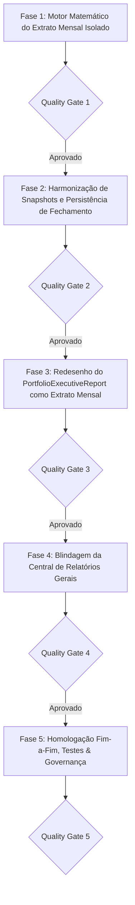

# PLANO DE IMPLEMENTAÇÃO — PRECISÃO MATEMÁTICA, EXTRATOS MENSAIS DE SNAPSHOTS E GOVERNANÇA DE RELATÓRIOS

> **Documento Canônico de Engenharia Financeira, Arquitetura e Governança de Software**  
> **Status:** Proposto / Consolidado em 5 Fases Sequenciais com Portões de Qualidade (QG1–QG5)  
> **Arquivo:** `planos/PLANO_AUDITORIA_E_PRECISAO_RENTABILIDADE_INVESTIMENTOS.md`  
> **Módulos Afetados:** `src/domain/portfolio/`, `src/state/queries/`, `src/state/mutations/`, `src/hooks/`, `src/features/investments/`, `src/features/reports/`, `docs/architecture/`  
> **Governança:** TypeScript Estrito (Zero `any`/`@ts-ignore`) · Funções Puras no Domínio · Moeda em Centavos · Padrões CVM/ANBIMA (TWR / Modified Dietz) · Zero Controles Nativos · Zero Emojis (`local/no-decorative-unicode`) · Portões de Qualidade por Fase  
> **Data:** Novembro de 2026 · **Ambientes:** Web Desktop, Web PWA (iOS/Android) & Android Nativo (Capacitor Pro)

---

## 1. DIRETRIZ FUNDAMENTAL DE PRODUTO: SEGREGAÇÃO ARQUITETURAL

O sistema estabelece uma distinção conceitual nítida entre os dois relatórios da plataforma:

```
┌──────────────────────────────────────────────────────────────────────────────────────────────────────────────────┐
│                                   ARQUITETURA DUAL DE RELATÓRIOS PATRIMONIAIS                                    │
└──────────────────────────────────────────────────────────────────────────────────────────────────────────────────┘
                                                          │
                  ┌───────────────────────────────────────┴───────────────────────────────────────┐
                  ▼                                                                               ▼
   [MÓDULO DE INVESTIMENTOS: SNAPSHOTS]                                            [CENTRAL DE RELATÓRIOS GERAIS]
   (PortfolioExecutiveReport / Fechamentos)                                       (WealthTearSheetModal / Dossiê A4)
   
   • Natureza: EXTRATO MENSAL DA COMPETÊNCIA                                       • Natureza: DOSSIÊ ESTRATÉGICO CONSOLIDADO
   • Escopo: ESTRITAMENTE AQUELE MÊS                                               • Escopo: HISTÓRICO GERAL & CUSTÓDIA VIVA
   • Objetivo: Fotografia fiel da competência                                      • Objetivo: Visão holística da riqueza
   • Métricas Contidas:                                                            • Métricas Contidas:
     - Saldo Patrimonial no último dia do mês                                        - Patrimônio Líquido Total Vigente
     - Rentabilidade isolada daquele mês (% TWR do Mês)                              - Rentabilidade Acumulada da Vida Inteira (TWR)
     - Resultado Financeiro do Mês (P&L gerado em R$)                                - Retorno Efetivo do Bolso (TIR / XIRR a.a.)
     - Proventos auferidos EXCLUSIVAMENTE naquele mês                                - Comparativo de Evolução Mês a Mês (Gráficos)
     - Movimentações ocorridas EXCLUSIVAMENTE naquele mês                            - Matrizes de Alocação (Target vs Actual)
     - Custódia congelada no fechamento daquele mês                                  - Raios-X de Subalocação & Termômetro de Risco
```

### 1.1. Diagnóstico da Causa Raiz do Defeito (12% vs. 22%)

O investidor observou que:
> *"No mês passado aparecia 12% de rentabilidade na competência e no mês atual aparecia 22% de TWR, mesmo com variação patrimonial negativa entre os dois meses."*

A auditoria matemática identificou que:
1. **Contaminação Temporal:** O relatório de snapshot do mês passado estava calculando métricas acumuladas de anos (Retorno Contábil sobre Custo de aquisição antigo) em vez de calcular a **Rentabilidade Isolada daquele mês**.
2. **Conflito de Fórmulas:** No mês atual, o KPI exibia o TWR acumulado da vida inteira (`22%`). No mês anterior, exibia o retorno estático sobre o custo médio (`12%`). Comparar duas metodologias opostas gerava a ilusão de um salto positivo quando a carteira havia caído.
3. **Falta de Dados Específicos do Mês:** Proventos e P&L exibidos eram acumulados históricos, violando o princípio do Snapshot como fotografia da competência.

---

## 2. ESPECIFICAÇÃO MATEMÁTICA DO EXTRATO MENSAL DE SNAPSHOT

Para qualquer competência $M$ (seja mês anterior ou mês corrente em formação), o relatório de snapshot obedece rigorosamente às equações contábeis do mês:

### 2.1. Rentabilidade Isolada do Mês ($r_M$ — Modified Dietz ANBIMA/GIPS)
$$r_M = \frac{\text{Saldo}_{\text{Fim}} - \text{Saldo}_{\text{Início}} - \text{FluxoLíquido}_M}{\text{Saldo}_{\text{Início}} + \sum_{i} (W_i \cdot \text{Fluxo}_i)}$$
Onde:
- $\text{Saldo}_{\text{Fim}}$ = Saldo de fechamento da carteira no último dia do mês $M$ (ativos valorados + caixa).
- $\text{Saldo}_{\text{Início}}$ = Saldo de fechamento do mês anterior $M-1$.
- $\text{FluxoLíquido}_M$ = $\text{Aportes Externos}_M - \text{Resgates Externos}_M$ ocorridos no mês $M$.
- $W_i = \frac{\text{DiasNoMês} - \text{DiaDoFluxo} + 1}{\text{DiasNoMês}}$ = Ponderação do fluxo por tempo de permanência.

**Invariante de Consistência:** Se $\text{Saldo}_{\text{Fim}} < \text{Saldo}_{\text{Início}}$ sem retiradas, $r_M$ é **estritamente negativo**.

### 2.2. Resultado Econômico Financeiro do Mês ($\text{P\&L}_M$ em R$)
$$\text{P\&L}_M = (\text{Saldo}_{\text{Fim}} - \text{Saldo}_{\text{Início}}) - \text{FluxoLíquido}_M$$
Representa o valor líquido em reais gerado pela carteira naquele mês (ganho/perda de capital + proventos recebidos), expurgando aportes e resgates.

### 2.3. Proventos do Mês ($\text{Div}_M$ em R$)
$$\text{Div}_M = \sum_{d \in \text{Mês } M} \text{Valor}(d)$$
Exclusivamente os proventos com data de corte/pagamento dentro daquele mês específico.

### 2.4. Movimentações do Mês
- $\text{Total Comprado}_M = \sum \text{Compras}(M)$
- $\text{Total Vendido/Resgatado}_M = \sum \text{Vendas}(M)$
- $\text{Aporte Líquido do Bolso}_M = \text{Aportes Externos}_M - \text{Resgates}_M$

---

## 3. ESTRUTURAÇÃO DO PLANO EM 5 FASES



---

### FASE 1: Motor Matemático do Extrato Mensal Isolado
> **Objetivo:** Implementar no domínio puro (`src/domain/portfolio/`) a apuração exata dos indicadores isolados da competência (variação do mês, P&L financeiro do mês, proventos do mês e movimentações do mês).

- [ ] **Tarefa 1.1: Função Pura de Apuração da Competência Mensal (`monthly-statement.ts`)**
  - **Novo Arquivo:** `src/domain/portfolio/monthly-statement.ts` + `monthly-statement.test.ts`
  - **Responsabilidades:**
    1. Receber o mês ($M$), saldo anterior ($M-1$), saldo final ($M$), fluxos externos com data, proventos do mês e transações do mês.
    2. Calcular:
       - `monthRatePct`: Taxa de retorno isolada do mês (% TWR via Modified Dietz).
       - `monthNetPnlBRL`: Resultado financeiro líquido gerado pela carteira no mês em R$.
       - `monthDividendsBRL`: Total de proventos auferidos no mês.
       - `monthBuysBRL`: Total de compras e subscrições do mês.
       - `monthSellsBRL`: Total de vendas e resgates do mês.
       - `monthNetContributionBRL`: Saldo líquido de aportes externos do mês.
    3. Garantir imunidade a contaminações de anos anteriores.

- [ ] **Tarefa 1.2: Integração com o Motor Point-in-Time (`point-in-time.ts`)**
  - **Arquivo:** `src/domain/portfolio/point-in-time.ts`
  - **Ação:**
    - Incorporar o resultado de `monthly-statement.ts` no `PointInTimeResult`.
    - Eliminar o fallback que substituía cotações ausentes por `average_price`, sinalizando claramente quando o mês for derivado de saldo consolidado de snapshot (TWA).

- [ ] **Tarefa 1.3: Depreciação Formal de `portfolioReturnPct` (`summary.ts`)**
  - **Arquivo:** `src/domain/portfolio/summary.ts`
  - **Ação:** Marcar `portfolioReturnPct` como `@deprecated`. Redirecionar usos para as funções canônicas baseadas em custo investido e Modified Dietz.

#### 🛡️ Quality Gate 1 (QG1) — Validação Matemática
- Teste unitário em Vitest com cenários exatos:
  - **Cenário A (Queda no mês):** Saldo $M-1 = 112.000$; Saldo $M = 110.000$ (sem aportes). Resultado: `monthRatePct = -1.79%`, `monthNetPnlBRL = -R$ 2.000,00`.
  - **Cenário B (Aporte no mês com ganho):** Saldo $M-1 = 100.000$; Aporte no dia 15 = R$ 10.000; Saldo $M = 115.000$. Resultado: Ganho real de R$ 5.000; `monthRatePct` positivo e calculado com ponderação do dia 15.
  - Zero contaminação com retornos de meses anteriores.

---

### FASE 2: Harmonização de Snapshots e Persistência de Fechamento
> **Objetivo:** Unificar a semântica da tabela `portfolio_snapshots` e eliminar concorrência entre hooks na gravação de dados.

- [ ] **Tarefa 2.1: Regra Canônica de Patrimônio e Custo no Snapshot**
  - **Arquivos:** `src/types/schema.ts`, `src/data/repositories/portfolio.ts`
  - **Definição Canônica:**
    - `total_value`: Saldo patrimonial total na data de corte (Ativos valorados + Saldo de Caixa).
    - `total_cost`: Custo de aquisição total aplicado sob custódia (Custo dos Ativos + Saldo de Caixa 1:1).
  - Registrar invariante em `ESPECIFICACAO_TECNICA.md`.

- [ ] **Tarefa 2.2: Desacoplamento da Gravação Automática de Snapshots**
  - **Arquivos:** `src/state/queries/use-portfolio-position.ts`, `src/hooks/use-auto-portfolio-snapshot.ts`, `src/features/investments/components/monthly-closing-editor.tsx`
  - **Ação:**
    - Remover a mutação concorrente de `usePortfolioPosition.ts` (linha 693).
    - Centralizar a materialização autônoma de snapshots em `useAutoPortfolioSnapshot.ts`.
    - Garantir que tanto o fechamento automático quanto o manual (`useSaveMonthlyClosing`) utilizem a mesma regra de custo e valor.

#### 🛡️ Quality Gate 2 (QG2) — Integridade de Persistência
- Teste de integração: simulação de montagem de telas e verificação de que o banco não recebe regravações conflitantes de snapshots.

---

### FASE 3: Redesenho do Relatório Executivo como Extrato Mensal da Competência
> **Objetivo:** Fazer com que o `PortfolioExecutiveReport` seja 100% focado na fotografia daquele mês específico, exibindo os dados daquele mês sem misturar com métricas globais.

- [ ] **Tarefa 3.1: Reestruturação dos 4 KPIs da Síntese Executiva (`PortfolioExecutiveReport.tsx`)**
  - **Arquivo:** `src/features/investments/components/portfolio-executive-report.tsx`
  - **Anatomia dos KPIs da Competência:**
    1. **Patrimônio no Fechamento:** Saldo consolidado no último dia daquele mês (ex.: R$ 110.000,00) com subtexto da quantidade de ativos em custódia na data de corte.
    2. **Rentabilidade da Competência (TWR):** A taxa de retorno isolada daquele mês (`monthRatePct`, ex.: `-1,79%` ou `+1,15%`), com subtexto *"Variação isolada do mês (Padrão CVM)"*.
    3. **Resultado Líquido do Mês (P&L):** Valor financeiro gerado pela carteira no mês em R$ (`monthNetPnlBRL`), com cor semântica (verde/vermelho) e subtexto *"Ganho de capital + proventos no mês"*.
    4. **Proventos da Competência:** Total recebido exclusivamente naquele mês (`monthDividendsBRL`), com subtexto indicando o total de proventos auferidos no período.
  - **Eliminação Definitiva:** Fim da alternância de fórmulas. Tanto para o mês atual quanto para meses anteriores, a métrica exibida é rigorosamente a do respectivo mês!

- [ ] **Tarefa 3.2: Inclusão do Painel de Movimentações da Competência**
  - **Arquivo:** `src/features/investments/components/portfolio-executive-report.tsx`
  - **Ação:**
    - Adicionar seção compacta e nobre no relatório detalhando o fluxo de caixa do mês:
      * Aportes Externos do Mês
      * Vendas / Resgates do Mês
      * Proventos Recebidos no Mês
      * Aporte Líquido Injetado no Mês
    - Exibir a lista de compras e vendas efetuadas estritamente na data de corte daquele mês.

- [ ] **Tarefa 3.3: Ajustes no Extrato Analítico Tabular (`PortfolioSnapshotsDialog.tsx`)**
  - **Arquivo:** `src/features/investments/components/portfolio-snapshots-dialog.tsx`
  - **Ação:**
    - Assegurar que a coluna `Mês (TWR %)` seja destacada como a performance do período.
    - Proventos exibidos na linha de cada mês devem ser os proventos auferidos naquele mês (`monthDividendsBRL`), mantendo o acumulado em coluna separada explícita.

#### 🛡️ Quality Gate 3 (QG3) — Experiência do Usuário e Fidelidade
- Testes de renderização:
  - Selecionar um mês anterior com desempenho negativo: comprovar que o KPI principal exibe a taxa negativa e o P&L negativo do mês.
  - Selecionar o mês atual: comprovar que exibe a fotografia do mês atual em formação.
  - Zero menção a taxas de 12% ou 22% em cards que deveriam indicar a taxa do mês.

---

### FASE 4: Blindagem da Central de Relatórios Gerais
> **Objetivo:** Manter a Central de Relatórios (`reports-page.tsx` / `WealthTearSheetModal`) como o Dossiê Geral robusto de toda a carteira viva, corrigindo apenas o fallback de gráficos históricos.

- [ ] **Tarefa 4.1: Correção do Fallback de Gráfico no Tear Sheet (`WealthTearSheetModal.tsx`)**
  - **Arquivo:** `src/features/reports/components/wealth-tear-sheet-modal.tsx`
  - **Ação:**
    - No gráfico comparativo mês a mês (`performanceSeries`), utilizar estritamente taxas mensais periódicas (`twrMonthPct`).
    - Nunca mais atribuir `totalReturnPct` (taxa acumulada de 20%+) como fallback em colunas mensais.
    - Caso haja menos de 2 fechamentos registrados, exibir empty state calmo informando a necessidade de histórico mensal para o gráfico de evolução.

- [ ] **Tarefa 4.2: Confirmação da Separação Estrutural na UI**
  - **Arquivos:** `src/features/reports/pages/reports-page.tsx`, `src/features/reports/components/tabs/investments-tab.tsx`
  - **Ação:**
    - Assegurar que os títulos da Central de Relatórios identifiquem formalmente o documento como *"Dossiê Executivo da Posição Vigente Consolidada"*.
    - Manter o banner informativo direcionando para Fechamentos & Snapshots para quem deseja auditar fotografias mensais isoladas.

#### 🛡️ Quality Gate 4 (QG4) — Conformidade dos Relatórios Gerais
- Testes unitários do modal Tear Sheet verificando renderização íntegra e sem distorções no gráfico histórico.

---

### FASE 5: Homologação Fim-a-Fim, Testes & Governança
> **Objetivo:** Garantia de 100% de sucesso nos testes, verificação estrita de lint/typecheck e sincronização documental.

- [ ] **Tarefa 5.1: Execução da Suíte Completa de Testes de Portfólio**
  - Rodar Vitest em todos os arquivos de `src/domain/portfolio/`, `src/features/investments/` e `src/features/reports/`.
  - Garantir 100% de aprovação em todos os testes novos e existentes.

- [ ] **Tarefa 5.2: Typecheck e Lint**
  - `npx tsc --noEmit` (0 erros).
  - `npm run lint` (0 erros e conformidade total com a regra de emojis/decorativos).

- [ ] **Tarefa 5.3: Atualização dos Documentos Canônicos de Arquitetura**
  - `docs/architecture/ESPECIFICACAO_TECNICA.md`: Adicionar a especificação do Extrato Mensal da Competência.
  - `docs/architecture/FINANCIAL_MATH_SPEC.md`: Registrar as fórmulas canônicas do Modified Dietz mensal e do P&L da competência.
  - `docs/architecture/PROJECT_STRUCTURE.md`: Registrar o novo módulo `monthly-statement.ts`.

#### 🛡️ Quality Gate 5 (QG5) — Liberação Final
- Todos os testes verdes, integridade matemática validada e documentação atualizada.

---

## 4. MATRIZ COMPARATIVA FINAL: O QUE O USUÁRIO VERÁ EM CADA TELA

| Elemento | Relatório de Snapshot do Mês (`PortfolioExecutiveReport`) | Central de Relatórios (`WealthTearSheetModal`) |
|---|---|---|
| **Propósito** | Extrato e Fotografia do Mês Selecionado | Dossiê Geral Estratégico da Carteira Viva |
| **Patrimônio Exibido** | Saldo no último dia daquele mês | Patrimônio Líquido Total Vigente |
| **Rentabilidade Principal** | **Rentabilidade daquele mês específico (% TWR do Mês)** | **Rentabilidade acumulada da carteira (TWR Acumulado)** |
| **Resultado Financeiro** | **P&L gerado no mês (R$)** | **Resultado Econômico Total Histórico (P&L Total R$)** |
| **Proventos** | **Recebidos exclusivamente naquele mês** | **Proventos acumulados de todos os tempos / ano** |
| **Movimentações** | **Compras, vendas e aportes daquele mês** | **Resumo do período filtrado / histórico geral** |
| **Ativos Listados** | Custódia no fechamento daquele mês | Custódia viva atual com alocação e setores |

---

## 5. DEFINITION OF DONE (DoD)

1. O relatório do snapshot do mês reflete 100% os dados daquele mês (rentabilidade do mês, P&L do mês, proventos do mês e movimentações do mês).
2. Se a carteira recuou no mês, a taxa exibida no snapshot do mês é obrigatoriamente negativa.
3. Central de Relatórios preservada como a visão geral robusta da carteira viva.
4. Conflito de gravação de caixa em snapshots eliminado.
5. Código 100% coberto por testes unitários e de integração, com tipagem estrita e documentação canônica.
