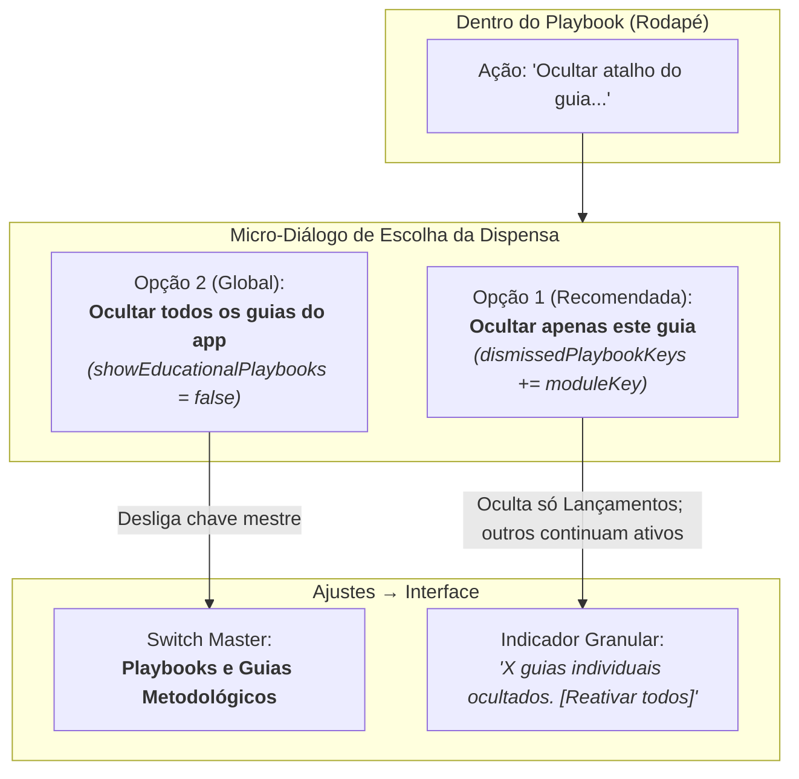
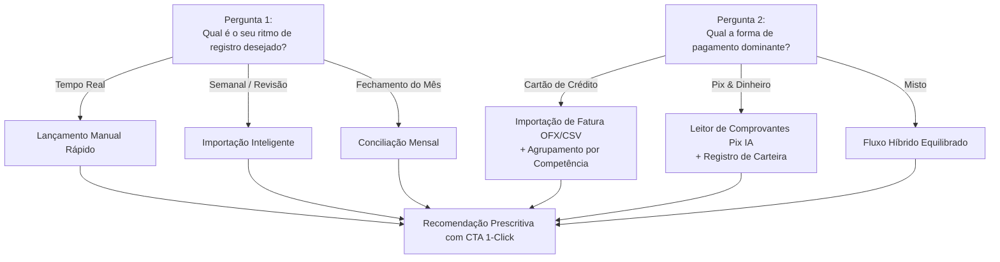
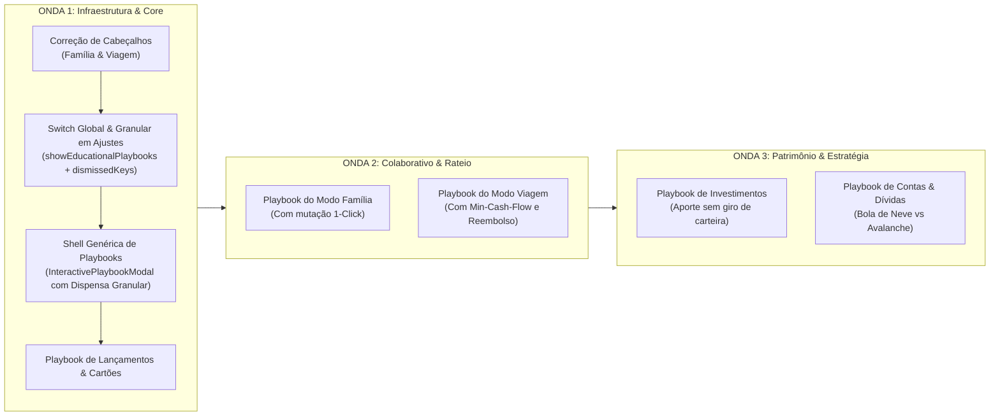

# Plano Canônico de Engenharia e Design: Padronização de Cabeçalhos e Sistema Universal de Playbooks Educativos

> **Status:** Aprovado para Planejamento / Versão 2.1 Consolidada (Com Governança Granular de Dispensa)  
> **Data:** 24 de Novembro de 2026  
> **Documentos de Referência:** `AGENTS.md` (Regras 4, 7, 8, 13, 15, 18, 20, 21), `docs/architecture/ESPECIFICACAO_TECNICA.md`, `docs/architecture/ARCHITECTURE.md`, `docs/design/DESIGN_SYSTEM.md`.  
> **Papel de Governança:** Arquiteto de Software Sênior & Product Designer Especialista em UX Mobile-First.  
> **Regra de Execução desta Etapa:** Modo estrito de auditoria, análise e refinamento documental (zero alterações em código de produção ou testes).  

---

## 1. Sumário Executivo & Visão do Produto

O Axir é um ecossistema financeiro pessoal e colaborativo avançado. Seu diferencial reside em motores de cálculo sofisticados (Reconciliação Familiar via *Hamilton-Hare*, Liquidação de Viagens por *Min-Cash-Flow*, Rebalanceamento de Carteira por Aportes e DRE com Segregação PF/PJ).

No entanto, a experiência do usuário enfrentava dois gargalos críticos identificados nesta auditoria:

1. **Hipertrofia e Deformação de Botões de Cabeçalho no Mobile:**  
   Em telas como o **Modo Família** e o **Modo Viagem**, classes pontuais injetadas no JSX (`max-sm:min-h-11` e `w-full min-h-11`) aliadas ao comportamento rígido do contêiner `PageHeader` criavam botões maciços de 44px de altura ocupando 100% da largura útil, com aspecto desproporcional e desconfortável quando comparados às páginas de Transações, Cartões, Investimentos e Dívidas.
2. **Insegurança Metodológica dos Usuários:**  
   Muitos usuários abandonam apps de finanças não por falta de recursos, mas por **dúvida metodológica** sobre o "jeito certo" de conduzir suas rotinas:
   - *Em Lançamentos:* Incerteza entre cadastrar despesa por despesa ou em lote; como nomear itens sem poluição; e o erro fatal de cadastrar a "fatura do cartão" como uma despesa única no fim do mês (quebrando DRE, orçamentos e relatórios).
   - *Em Investimentos:* O erro crônico de vender ativos para rebalancear gerando DARF e corretagem desnecessárias, ou misturar Reserva de Emergência com Renda Variável.
   - *No Modo Família e Viagem:* A incapacidade de lidar com a variabilidade de dinâmicas humanas (50/50 vs proporcional à renda vs caixa único; amigos dividindo no bar vs férias de casal).

A solução unificada proposta combina a **padronização geométrica e ergonômica dos cabeçalhos** com a introdução do **Sistema Universal de Playbooks Educativos do Axir**: módulos consultivos leves, interativos, orientados a diagnóstico rápido (quiz de 2 a 3 perguntas) com **configuração executável em 1 clique** e **governança anti-poluição em dois níveis (controle mestre global em Ajustes + dispensa granular por módulo)**.

---

## 2. Fase 0 — Meta-Análise Crítica e Auditoria da Codebase

### 2.1 Auto-Crítica do Escopo & Mitigação de Vieses

Uma auditoria técnica honesta exige avaliar os próprios pressupostos para evitar desperdício de engenharia e complexidade acidental:

| Pressuposto Inicial | Avaliação Crítica na Codebase Real | Diretriz Canônica Estabelecida |
|---|---|---|
| **"O problema dos botões gigantes é culpa exclusiva do componente `PageHeader`."** | **Falso.** A inspeção revelou que o `PageHeader` aplica `grid grid-cols-2 [&>*]:w-full` apenas para distribuir os botões simetricamente. A deformação grotesca em Família e Viagem foi provocada por **classes locais manuais** (`max-sm:min-h-11` e `w-full min-h-11`) introduzidas no JSX dessas páginas específicas. | A correção deve ser cirúrgica: limpar as classes locais infladas nas páginas e calibrar o `PageHeader` para manter botões em `size="sm"` (`h-9` mobile / `h-8` desktop) sem quebrar o layout das outras 25+ telas consumidoras. |
| **"Toda área complexa do app precisa de um Playbook completo de 4 abas."** | **Risco Crítico de Inchaço (*Scope Creep*).** Transformar o app em um manual escolar infantilizado afasta o usuário experiente e infla o bundle. | **Critério Estrito de Gating:** Apenas recebem Playbook Dedicado os módulos onde o erro metodológico do usuário **corrompe os dados financeiros ou causa prejuízo real** (duplicar despesa com fatura, gerar DARF indevida, misturar PJ/PF). Telas de consumo analítico (Relatórios, Metas, Lembretes) devem receber apenas micro-dicas ou permanecer puramente minimalistas. |
| **"A hit-area mínima da Apple/Google exige botões com altura visual de 44px no cabeçalho."** | **Conceito Errado de UX.** A diretriz WCAG 2.5.8 (Target Size Minimum) exige área de toque efetiva de 24×24px com espaçamento de 8px, ou 44×44px com alívio. Botões com altura visual de 36px (`h-9`) e padding horizontal com `gap-2` (8px) atendem plenamente à acessibilidade sem devorar o viewport vertical da tela. | Adotar altura canônica de `h-9` no mobile para botões de cabeçalho, preservando ergonomia ao toque sem criar blocos visuais maciços. |
| **"O botão de desativar dentro do modal deve desligar tudo de uma vez."** | **Falha de Julgamento de UX (Corrigida):** Se o usuário já sabe lançar despesas e clica para desativar o guia na tela de Transações, ele NÃO quer necessariamente perder os guias de Família, Viagens ou Investimentos (que ele sequer teve chance de conhecer). | Implementar **governança granular de dispensa**: o usuário pode escolher entre "Ocultar apenas este guia" (local) ou "Ocultar todos os guias do app" (global). |
| **"O switch nas Configurações pode ser apenas um estado remoto no banco."** | **Ponto Cego de Conectividade.** Se a flag `showEducationalPlaybooks` depender de requisição remota na inicialização, causará *layout shift* (FOUC) ou botões piscando na tela ao abrir o app offline. | Reutilizar a arquitetura síncrona do `useVisualCustomization` e `visual-storage.ts` (armazenamento local em `localStorage` com chave por usuário + sincronização assíncrona com `custom_settings` no Supabase). |

---

### 2.2 Mapeamento do Raio de Impacto do `PageHeader`

Foram auditadas todas as **26 telas e componentes** que consomem `<PageHeader />` no repositório:

1. `src/features/transactions/pages/transaction-list-page.tsx` (2 ações: Exportar CSV + Nova Transação)
2. `src/features/cards/pages/cards-page.tsx` (2 ações: Importar Fatura + Novo Cartão)
3. `src/features/debts/pages/debts-page.tsx` (2 ações: Contrato + Nova Conta)
4. `src/features/budgets/pages/budgets-page.tsx` (2 ações: Ajustar Orçamento + Nova Categoria)
5. `src/features/reports/pages/reports-page.tsx` (2 ações: Exportar Relatório + Compartilhar)
6. `src/features/investments/pages/investments-page.tsx` (2 ações com rótulos responsivos: Caixa + Nova Operação)
7. `src/features/family/pages/family-page.tsx` (**Alvo da Correção:** 2 ações com `max-sm:min-h-11`)
8. `src/features/trips/pages/trip-list-page.tsx` (**Alvo da Correção:** 1 ação com `w-full min-h-11`)
9. `src/features/trips/pages/trip-details-page.tsx` (Múltiplas ações agrupadas em `TripDetailsHeaderActions`)
10. `src/features/business/pages/business-page.tsx` (4 ações: Guia + Configurar + Transferir + Operação PJ $\rightarrow$ ativa `overflow-x-auto`)
11. `src/features/insights/pages/insights-page.tsx` (1 ação: Filtros)
12. `src/features/reminders/pages/reminders-page.tsx` (1 ação: Novo Lembrete)
13. `src/features/settings/pages/settings-page.tsx` (0 ações)
14. `src/features/family/components/family-onboarding-empty-view.tsx` (Empty states com PageHeader)
15. `src/features/trips/components/details/trip-details-empty-views.tsx` (Empty states com PageHeader)
16. *Telas Administrativas:* 9 páginas em `src/features/admin/pages/` e `admin-forensics-page.tsx`

**Conclusão de Segurança:** A estratégia mais segura consiste em eliminar as classes locais infladas em `family-page.tsx` e `trip-list-page.tsx`, sem alterar a casca estrutural global do `PageHeader`, permitindo que ao incluir o 3º botão (o Playbook correspondente), o cabeçalho ative automaticamente o layout fluido horizontal de chips com scroll suave, já aprovado em produção.

---

## 3. Fase 1 — Matriz Holística de Priorização de Playbooks

Mapeamento completo das áreas funcionais da codebase sob a ótica da fricção metodológica do usuário e do risco de corrupção contábil:

| Módulo / Funcionalidade | Fricção Metodológica Inicial | Risco de Erro Crítico nos Dados | Frequência de Uso | Classificação Final | Justificativa Arquitetural |
|---|---|---|---|---|---|
| **Lançamentos & Gestão de Cartões** (`transactions` / `cards`) | **Altíssima** (maior causa de abandono de iniciantes) | **Crítico** (duplicação de despesas com fatura, quebra de DRE e orçamentos) | Diária (Core Loop) | **Playbook Dedicado (Onda 1)** | O erro de lançar a fatura inteira como despesa única destrói a base de dados do usuário. |
| **Modo Família** (`family`) | **Altíssima** (atritos conjugais e modelos mentais divergentes) | **Alto** (acertos de contas distorcidos, sensação de injustiça) | Semanal / Mensal | **Playbook Dedicado (Onda 2)** | Usuários não sabem quando usar 50/50 vs proporcional ou o que pertence à casa. |
| **Modo Viagem** (`trips`) | **Alta** (vaquinha prévia vs acerto no fim, estresse com rateio) | **Médio/Alto** (inflar custo de vida se não isolar da cesta da casa) | Eventual / Férias | **Playbook Dedicado (Onda 2)** | Essencial para orientar o rateio justo e blindar o extrato pessoal de distorções. |
| **Modo Negócio / PJ** (`business`) | **Altíssima** (confusão patrimonial PF/PJ, risco fiscal) | **Crítico** (autuações fiscais, desenquadramento de MEI) | Semanal | **Playbook Dedicado Existente** | Já implementado com sucesso (`EducationalGuideModal`); serve de referência. |
| **Investimentos & Carteira** (`investments`) | **Altíssima** (insegurança em alocação, medo de errar no aporte) | **Crítico** (DARF indevida por giro de carteira, resgate de emergência no prejuízo) | Semanal / Mensal | **Playbook Dedicado (Onda 3)** | O motor de rebalanceamento por aportes do Axir exige alinhamento conceitual imediato. |
| **Contas & Dívidas** (`debts`) | **Alta** (estratégia de amortização: matemática vs psicológica) | **Alto** (rolagem de crédito rotativo e contração de juros abusivos) | Mensal | **Playbook Dedicado (Onda 3)** | Decisão crucial entre método Bola de Neve (psicológico) vs Avalanche (matemático). |
| **Orçamentos & Tetos** (`budgets`) | Média / Alta (50/30/20 vs Base Zero) | Médio (tetos irreais abandonados na 2ª semana) | Mensal | **Micro-guia / Kits Contextuais** | O módulo já possui o sistema de kits orçamentários (`kits.ts`); dialog explicativo resolve. |
| **Contas, Saldos & Checkpoints** (`accounts` / `reconciliation`) | Média (conciliação bancária vs ajuste de saldo) | Médio (criação de transações fantasmas de ajuste) | Semanal | **Micro-guia / Dica Contextual** | Tooltip e card explicativo dentro do diálogo de conciliação de saldo bastam. |
| **Metas Financeiras** (`goals`) | Baixa (sonhos, prazos e caixinhas) | Baixo (apenas poupança direcionada) | Eventual | **Não Precisa de Playbook** | A interface de metas e prazos já é 100% intuitiva; adicionar playbook geraria poluição. |
| **Relatórios Executivos & Projeções** (`reports` / `insights`) | Baixa / Média (interpretação de gráficos e DRE) | Zero (camada de leitura analítica) | Mensal | **Não Precisa de Playbook** | Já atendido com maestria pelo sistema de **Memória de Cálculo e Explicabilidade**. |
| **Lembretes & Recorrências** (`reminders`) | Baixa (contas com vencimento agendado) | Baixo | Pontual | **Não Precisa de Playbook** | Formulário direto e autoexplicativo. |

---

### 2.3 Especificação dos Playbooks Dedicados Novamente Priorizados

#### A. Playbook de Investimentos & Rebalanceamento Inteligente (`InvestmentsEducationalGuideModal`)

* **As 4 Dúvidas e Erros Fatais dos Usuários:**
  1. *O Erro do Giro de Carteira:* Achar que para rebalancear a carteira é necessário vender o ativo que subiu para comprar o que caiu. Isso gera DARF antecipada (15% em ações, 20% em FIIs), taxas de custódia/corretagem e interrompe o poder dos juros compostos.
  2. *A Ilusão da Reserva em Renda Variável:* Deixar o dinheiro de emergência em Fundos Imobiliários ou Ações atraído pelo dividendo mensal, sendo obrigado a vender cotas desvalorizadas no pior momento.
  3. *O Mito da Isenção Geral no IRPF:* Acreditar que a isenção de R\$ 20.000 de vendas mensais em ações se aplica a FIIs e ETFs (não se aplica: qualquer lucro de venda em FII paga 20% de DARF!).
  4. *O Abismo do "Preço Médio Cego":* Fazer preço médio para baixo em ativos que perderam completamente a governança ou que estão rumo à falência.
* **Os 4 Arquétipos e Pilares Mentais:**
  1. *Aporte Inteligente:* Você nunca vende ativos vencedores para equilibrar fatias; você usa o dinheiro novo do mês para comprar exclusivamente o ativo que está mais distante da sua meta percentual.
  2. *A Pirâmide Patrimonial:* Caixa Operacional $\rightarrow$ Reserva de Emergência (liquidez diária) $\rightarrow$ Renda Fixa de Médio Prazo $\rightarrow$ Renda Variável de Longo Prazo.
  3. *Score de Ativos & Governança:* O motor do Axir avalia a solidez antes de recomendar aportes; se a nota do ativo caiu, ele congela novas compras.
  4. *Fiscalidade Proativa:* Como o monitor de DARF e prejuízos a compensar protege o investidor de multas da Receita Federal.
* **CTAs Acionáveis Conectados ao App:**
  - `Ajustar Metas da Carteira` $\rightarrow$ Abre o diálogo `AllocationBreakdownDialog`.
  - `Calcular Aporte do Mês` $\rightarrow$ Abre o diálogo `ContributionFormDialog`.
  - `Auditar Reserva de Emergência` $\rightarrow$ Direciona para o card de Reserva da Home.

---

#### B. Playbook de Contas & Dívidas (`DebtsEducationalGuideModal`)

* **As 3 Dúvidas e Erros Fatais dos Usuários:**
  1. *A Armadilha do Empréstimo Substituto:* Pegar um empréstimo consignado ou pessoal para quitar o cartão e continuar utilizando o limite liberado do cartão (duplicando o endividamento).
  2. *Pagamento Mínimo vs Rotativo:* A ilusão de que pagar o mínimo da fatura resolve o mês, sem compreender o Custo Efetivo Total (CET) de mais de 400% ao ano.
  3. *Paralisia Decisória:* Não saber qual dívida priorizar quando há múltiplos credores.
* **Os 3 Pilares e Arquétipos:**
  1. *Método Bola de Neve (Snowball - Foco Psicológico):* Paga o valor mínimo em todas e quita primeiro a dívida de menor saldo. Elimina uma conta rapidamente, gerando vitória emocional e alívio mental.
  2. *Método Avalanche (Foco Matemático):* Quita primeiro a dívida com a maior taxa de juros (geralmente cartão ou cheque especial). Economiza o máximo de dinheiro em juros ao longo do tempo.
  3. *Estratégia de Amortização Extraordinária:* Abater parcelas do saldo devedor diretamente no final do contrato (reduz juros futuros drasticamente).
* **CTAs Acionáveis Conectados ao App:**
  - `Ordenar Esteira por Avalanche` $\rightarrow$ Aplica a ordenação automática na lista de dívidas.
  - `Ordenar Esteira por Bola de Neve` $\rightarrow$ Ajusta a prioridade na esteira.
  - `Registrar Renegociação` $\rightarrow$ Abre o modal de amortização de contrato com desconto.

---

## 4. Fase 2 — Refinamento Técnico e Governança Anti-Poluição

### 4.1 Solução Geométrica para Cabeçalhos e Botões (`PageHeader`)

#### O Diagnóstico Detalhado da Quebra Visual
1. **Em `src/features/family/pages/family-page.tsx`:**  
   Linhas 134 e 151:
   ```tsx
   // ANTES (Causa da deformação)
   className="gap-1.5 max-sm:min-h-11"
   ```
   A classe `max-sm:min-h-11` força uma altura de 44px no mobile. Como o `PageHeader` aplica `grid grid-cols-2 gap-2 [&>*]:w-full`, os botões tornam-se blocos retangulares pesados, gerando o "efeito tijolo".
2. **Em `src/features/trips/pages/trip-list-page.tsx`:**  
   Linha 173:
   ```tsx
   // ANTES (Causa da deformação)
   className="gap-1.5 w-full sm:w-auto min-h-11 sm:min-h-8 shadow-xs"
   ```
   O botão único recebe `w-full min-h-11`, esticando-se por 100% da largura útil da tela com 44px de altura.

#### A Solução Canônica de Engenharia
1. **Limpeza nas Telas:**
   - Em `family-page.tsx`: remover `max-sm:min-h-11`. Utilizar `size="sm"` canônico com `className="gap-1.5"`.
   - Em `trip-list-page.tsx`: remover `w-full min-h-11 sm:min-h-8`. Utilizar `size="sm" className="gap-1.5 shadow-xs"`.
2. **Harmonia de Altura e Área de Toque (WCAG 2.5.8):**
   - No mobile, botões `size="sm"` possuem altura canônica de `h-8` a `h-9` (32px a 36px) com padding vertical `py-2` e `gap-2` (8px).
   - O espaçamento de 8px e a ausência de elementos clicáveis colados acima/abaixo conferem área de toque segura e confortável sem necessidade de inflar artificialmente a caixa visual para 44px.
3. **Comportamento quando o Playbook for Adicionado:**
   - No Modo Família, ao adicionar o botão `Guia da Família` ao lado de `Convidar` e `Ajustes`, o número de ações passará de 2 para 3.
   - O `PageHeader` ativará automaticamente o layout `actionCount >= 3`:
     ```tsx
     "flex items-center justify-start sm:justify-end gap-2 overflow-x-auto no-scrollbar sm:flex-nowrap shrink-0 w-full sm:w-auto"
     ```
   - Os botões passarão a ser chips compactos com rolagem horizontal suave (`shrink-0 min-w-fit px-3 py-1.5`), eliminando instantaneamente o esticamento de 2 colunas e harmonizando a interface com o padrão já elogiado do Modo Negócio.

---

### 4.2 Governança Anti-Poluição: Seletor Global & Dispensa Granular

Para que o usuário tenha **controle absoluto** sobre a visibilidade dos guias sem ser punido por um modelo "tudo ou nada":



#### Modelo de Dados e Persistência
1. **Contrato de Tipos (`src/types/schema.ts`):**
   No tipo `UserSettings` / `custom_settings`:
   ```ts
   showEducationalPlaybooks?: boolean;          // Master global (default: true)
   dismissedPlaybookKeys?: string[];             // Lista de módulos dispensados localmente (ex: ["transactions"])
   ```
2. **Domínio de Preferências Visuais (`src/domain/preferences/visual-defaults.ts`):**
   - Campos em `VisualCustomizationSettings`:
     * `showEducationalPlaybooks: boolean;` (default: `true`)
     * `dismissedPlaybookKeys: string[];` (default: `[]`)
   - Chaves em `VISUAL_STORAGE_KEYS`:
     * `showEducationalPlaybooks: "show_educational_playbooks"`
     * `dismissedPlaybookKeys: "dismissed_playbook_keys"`
3. **Regra de Visibilidade do Botão em Cada Tela:**
   Um playbook de módulo `moduleKey` (ex: `"transactions"`, `"family"`, `"trips"`) só é renderizado se:
   ```ts
   const isPlaybookVisible = showEducationalPlaybooks && !dismissedPlaybookKeys.includes(moduleKey);
   ```
4. **UX do Micro-Diálogo de Dispensa dentro do Modal:**
   No rodapé de cada playbook, ao lado do botão "Fechar":
   - Botão discreto `variant="ghost" size="xs"` com ícone `EyeOff`: `"Ocultar atalho do guia..."`
   - Ao clicar, abre um popover ou diálogo compacto com as duas escolhas ilustradas no diagrama:
     * **"Ocultar apenas este guia" (Recomendado):** Adiciona o `moduleKey` ao array `dismissedPlaybookKeys`. Toast sensorial: *"Guia de Lançamentos ocultado. Você pode reativá-lo em Ajustes → Interface."*
     * **"Ocultar todos os guias do app":** Desliga `showEducationalPlaybooks = false`. Toast sensorial: *"Todos os guias educativos foram desativados no app. Você pode reativá-los em Ajustes → Interface."*
5. **Painel em Ajustes (`interface-shortcuts-card.tsx`):**
   - Switch Master: **Playbooks e Guias Metodológicos**.
   - Se o switch estiver ativo e `dismissedPlaybookKeys.length > 0`, renderiza abaixo um helper text com link de restauração:
     *"1 guia individual ocultado (Lançamentos). [Reativar todos os guias]"*.
     Ao clicar em "Reativar todos os guias", limpa o array `dismissedPlaybookKeys` com feedback tátil imediato.
6. **Regra Estrita de Empty States:**
   - Se `isPlaybookVisible === false`, o botão secundário "Ver Guia" no `EmptyState` não é renderizado, exibindo apenas o CTA operacional primário.
   - Zero `autoFocus` declarativo no mobile em formulários e modais (respeitando estritamente a Regra 20 do `AGENTS.md`).

---

### 4.3 Arquitetura de Software: Registro Declarativo de Playbooks (DRY)

Para não duplicar código e estruturas de modal (respeitando a Regra 4 do `AGENTS.md`):

1. **Componente Shell Genérico:**  
   `src/components/modules/playbooks/interactive-playbook-modal.tsx`  
   Estrutura padronizada:
   - Header com título, subtítulo e badge de método.
   - Tabs fluidas com scroll desobstruído (`variant="underline"`, `fullWidth={false}`).
   - Stepper de Quiz com feedback tátil (`triggerSensory("selection")`).
   - Card de recomendação com explicação fiscal/metodológica e botão de aplicação 1-Click.
   - Seções de boas práticas comparativas (verde vs vermelho).
   - Rodapé com botão de fechar e menu de dispensa granular integrada.
2. **Definições Puras de Conteúdo em Domínio:**  
   Colocalizadas em `src/domain/playbooks/`:
   - `transaction-playbook.ts`
   - `family-playbook.ts`
   - `trip-playbook.ts`
   - `investments-playbook.ts`
   - `debts-playbook.ts`
   Totalmente testadas com Vitest (`*.test.ts`), sem dependências de UI ou Supabase.

---

## 5. Especificação Técnica dos Playbooks Core

### 5.1 Playbook de Lançamentos & Gestão de Cartões (`TransactionEducationalGuideModal`)



#### As 4 Abas do Playbook de Lançamentos:
1. **Aba 1: Quiz de Ritmo & Diagnóstico:**  
   Microfluxo client-side de 2 perguntas objetivas. Sugere o melhor caminho e fornece CTAs imediatos:
   - Se Cartão: CTA `Importar Fatura` (`onOpenImport`).
   - Se Pix: CTA `Ler Comprovante Pix` (`onOpenPixScanner`).
   - Se Dinheiro/Manual: CTA `Novo Lançamento` (`onOpenNewTx`).
2. **Aba 2: A Anatomia do Lançamento Limpo (Categoria vs Descrição):**  
   - Ensinar que o campo **Categoria** é o motor estatístico do app (`Alimentação`, `Transporte`, `Lazer`).
   - O campo **Descrição** deve conter apenas o **Nome do Estabelecimento** (ex.: `Padaria Estrela`, `Uber Viagem`, `Supermercado Pão de Açúcar`).
   - Explicar que o importador de faturas do Axir já realiza a higienização automática (remove prefixos sujos como `PAG*`, `UBER*TRIP`, etc.), portanto o usuário deve adotar a mesma elegância nos lançamentos manuais.
3. **Aba 3: O Mito da "Fatura como Despesa":**  
   - Explicação visual didática: o cartão é apenas a forma de pagamento. O almoço no restaurante foi despesa de `Alimentação` no dia em que ocorreu.
   - O pagamento da fatura no fim do mês é registrado no Axir como **Transferência Interna** (Conta Bancária $\rightarrow$ Cartão) ou Pagamento de Fatura, **sem contar como nova despesa** e sem duplicar seu custo de vida.
4. **Aba 4: Compras Parceladas no Cartão:**  
   - Como o Axir distribui as parcelas (1 a 60) nas competências futuras automaticamente, mantendo a projeção de fluxo de caixa e o termômetro de faturas sempre precisos.

---

### 5.2 Playbook do Modo Família (`FamilyEducationalGuideModal`)

* **Aba 1: Quiz de Arquétipo Familiar (Diagnóstico):**
  - Mapeia a realidade do casal (diferença salarial, contas unificadas vs separadas, nível de privacidade desejado).
  - Prescrição 1-Click: dispara `updateFamilySettingsMutation.mutate({ split_rule: 'proportional' | 'equal' | 'combined' })`.
* **Aba 2: Os 3 Modelos de Divisão:**
  1. *Proporcional à Renda (Fair Share / Hamilton-Hare):* Quem ganha 70% da renda arca com 70% das contas compartilhadas.
  2. *Igualitário (50/50):* Contas divididas meio a meio.
  3. *Caixa Único (Fusão Patrimonial):* Foco no teto global da casa e no patrimônio unificado; sem cobranças entre o casal.
* **Aba 3: O que é da Casa vs O que é Individual:**
  - Tabela comparativa clara: moradia, feira, remédios dos filhos e contas de consumo pertencem à Casa; presentes, hobbies pessoais, roupas e saídas individuais saem do bolso individual.
* **Aba 4: O Fechamento Sem Constrangimento:**
  - Demonstra como o Axir calcula o saldo devedor/credor e gera o Pix de transferência direta com QR Code e chave copiada, encerrando o mês com transparência e harmonia.

---

### 5.3 Playbook do Modo Viagem (`TripEducationalGuideModal`)

* **Aba 1: Qual é o Perfil da sua Viagem? (Quiz):**
  - Avalia se é viagem em grupo grande, férias em casal, viagem solo ou deslocamento a trabalho.
* **Aba 2: Viagem em Grupo & Rateio Descomplicado:**
  - Ensina a regra "quem tiver na vez paga". O algoritmo *Min-Cash-Flow* calcula no final o menor número de transferências Pix para zerar o grupo.
* **Aba 3: Viagem a Trabalho & Despesas Reembolsáveis:**
  - Como utilizar o parâmetro `report_weight: 0%` para despesas corporativas pagas no cartão pessoal que serão reembolsadas pela empresa, impedindo que gastos corporativos inflem seu custo de vida doméstico.
* **Aba 4: Blindagem do Extrato Pessoal:**
  - Explica como o vínculo `trip_id` isola compras de férias para que a média histórica de gastos e projeções da Home não fiquem distorcidas.

---

## 6. Roadmap Reorganizado em Ondas de Entrega

O plano foi estruturado em **3 Ondas Incrementais** para garantir testes contínuos, ausência de regressões e validação funcional passo a passo:



### Onda 1 — Fundação, Correção Geométrica, Dispensa Granular & Playbook de Lançamentos
* **Objetivo:** Corrigir os botões defeituosos de cabeçalho, implantar o switch global com controle granular de dispensa e lançar o playbook mais crítico do aplicativo (Lançamentos e Cartões).
* **Tarefas de Engenharia:**
  1. Remover `max-sm:min-h-11` de `src/features/family/pages/family-page.tsx`.
  2. Remover `w-full min-h-11 sm:min-h-8` de `src/features/trips/pages/trip-list-page.tsx`.
  3. Revisar `PageHeader.tsx` para assegurar que pares de botões adotem altura canônica `h-9` no mobile.
  4. Adicionar `showEducationalPlaybooks` e `dismissedPlaybookKeys` no schema de `UserSettings`, no domínio `visual-defaults.ts`, no storage `visual-storage.ts` e no hook `useVisualCustomization`.
  5. Adicionar o card/switch em `src/features/settings/components/tabs/interface-shortcuts-card.tsx` colocalizado com a Memória de Cálculo, incluindo indicador de guias individuais ocultados e botão "Reativar todos os guias".
  6. Desenvolver a shell reutilizável `<InteractivePlaybookModal />` em `src/components/modules/playbooks/` com suporte ao micro-diálogo de dispensa deliberada ("Ocultar apenas este guia" vs "Ocultar todos").
  7. Criar o domínio `transaction-playbook.ts` e o modal `TransactionEducationalGuideModal.tsx`.
  8. Adicionar o gatilho discreto em `transaction-list-page.tsx` condicionado a `isPlaybookVisible`.
* **Quality Gate 1:**
  - Altura máxima de botões de cabeçalho no mobile $\le 36\text{px}$ (`h-9`).
  - Nenhum botão esticado em 100% da tela desnecessariamente.
  - Ao dispensar "apenas este guia", o guia de Lançamentos desaparece do extrato, mas o guia de Negócio continua acessível.
  - Ao desligar o switch master nas Configurações, todos os guias desaparecem de todo o app.
  - Testes unitários com 100% de aprovação para `transaction-playbook.test.ts`, `InteractivePlaybookModal.test.tsx` e `TransactionEducationalGuideModal.test.tsx`.

---

### Onda 2 — Playbooks Colaborativos (Família & Viagem)
* **Objetivo:** Solucionar a insegurança de rateio e convivência financeira nos módulos colaborativos.
* **Tarefas de Engenharia:**
  1. Criar o domínio puro `family-playbook.ts` e o modal `FamilyEducationalGuideModal.tsx`.
  2. Integrar o CTA 1-Click do quiz diretamente com a mutação de divisão da família (`split_rule`).
  3. Adicionar o gatilho `Guia da Família` no cabeçalho de `family-page.tsx` (respeitando `isPlaybookVisible`).
  4. Criar o domínio puro `trip-playbook.ts` e o modal `TripEducationalGuideModal.tsx`.
  5. Adicionar o gatilho `Guia de Viagem` no cabeçalho de `trip-list-page.tsx` e `trip-details-page.tsx`.
* **Quality Gate 2:**
  - O cabeçalho de Família (agora com 3 botões) ativa o layout fluido de chips horizontais com scroll suave no mobile, sem esmagamento.
  - A recomendação do quiz de família atualiza a regra de divisão com feedback tátil e persistência no Supabase.
  - Testes unitários cobrindo todos os fluxos de quiz, dispensa granular e renderização condicional.

---

### Onda 3 — Playbooks de Patrimônio & Gestão de Passivos (Investimentos & Dívidas)
* **Objetivo:** Proteger o usuário de prejuízos fiscais em investimentos e orientar a saída inteligente do endividamento.
* **Tarefas de Engenharia:**
  1. Criar o domínio puro `investments-playbook.ts` e o modal `InvestmentsEducationalGuideModal.tsx`.
  2. Adicionar atalho no cabeçalho de `investments-page.tsx` conectando CTAs aos diálogos de metas e aportes.
  3. Criar o domínio puro `debts-playbook.ts` e o modal `DebtsEducationalGuideModal.tsx`.
  4. Adicionar atalho em `debts-page.tsx` com CTAs de ordenação da esteira (Bola de Neve vs Avalanche).
* **Quality Gate 3:**
  - Zero duplicação de marcação JSX (reutilização estrita da shell `<InteractivePlaybookModal />`).
  - Conformidade estrita com as Regras de Ouro de UI (`AGENTS.md` Regras 4, 8, 13, 18, 20).
  - Cobertura completa de testes de regressão na suíte Vitest.

---

## 7. Decisões de Produto & Arquitetura Submetidas à Validação

1. **Governança Granular Aprovada:**  
   O usuário tem total autonomia para dispensar individualmente um guia pontual que já domina ("Ocultar apenas este guia") sem perder a descoberta dos demais módulos, ou desativar o ecossistema completo ("Ocultar todos").
2. **Localização do Seletor e Restauração em Ajustes:**  
   Na aba *Interface* das Configurações, imediatamente após a *Memória de Cálculo*, com botão explícito de "Reativar todos os guias" se houver módulos dispensados localmente.
3. **Escopo de Execução Imediata:**  
   Autorização para execução da **Onda 1** (Correção dos botões de Família/Viagem + Infraestrutura do Switch Global/Granular + Playbook de Lançamentos & Cartões).
