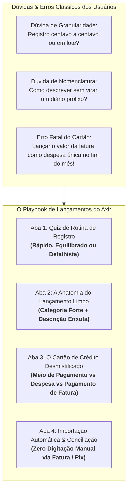

# Plano de Auditoria: Largura de Botões de Cabeçalho e Sistema Universal de Playbooks Educativos

> **Status:** Proposto / Em Planejamento  
> **Data:** 24 de Novembro de 2026  
> **Documentos de Referência:** `AGENTS.md` (Regras 4, 7, 8, 13, 18, 21), `docs/architecture/ESPECIFICACAO_TECNICA.md`, `docs/design/DESIGN_SYSTEM.md`.  
> **Autores:** Engenharia de Produto & Design System Axir  

---

## 1. Sumário Executivo & Diagnóstico da Auditoria

O presente plano endereça duas frentes de grande impacto para a experiência, estética e retenção do aplicativo:

1. **Correção e Padronização da Largura e Altura dos Botões de Cabeçalho (`PageHeader`):**
   - **Diagnóstico:** Na tela do **Modo Família** (evidenciada na captura enviada pelo usuário) e no **Modo Viagem**, os botões de ação do topo sofrem de hipertrofia visual: classes manuais como `max-sm:min-h-11` (44px de altura) e `w-full` forçam os botões a se expandirem como blocos maciços de ponta a ponta na tela do celular, quebrando a harmonia visual em relação às outras páginas do app (como Transações, Cartões, Dívidas e Orçamentos).
   - **Solução:** Eliminação de classes infladas de altura (`min-h-11`), padronização canônica do tamanho `size="sm"` (`h-8` / `h-9` no mobile) e alinhamento responsivo proporcional sem deformação de largura.

2. **Criação do Sistema de Playbooks Educativos & Metodológicos:**
   - **Diagnóstico:** O modelo mental dos usuários diante de conceitos financeiros fundamentais frequentemente gera insegurança e abandono:
     * *Em Lançamentos:* Dúvida entre lançar despesa por despesa ou em lote; como nomear itens sem poluição; e o erro crítico de cadastrar a "fatura do cartão" como uma despesa única no fim do mês, quebrando toda a inteligência orçamentária do app.
     * *No Modo Família:* Dúvida sobre como dividir contas a dois (50/50 vs proporcional à renda vs caixa único vs frentes separadas) e o que é gasto da casa vs individual.
     * *No Modo Viagem:* Dúvida sobre acerto no fim vs vaquinha prévia, viagens a trabalho reembolsáveis e isolamento do extrato doméstico.
   - **Solução com Governança Anti-Poluição:**
     * Criação de **Playbooks Interativos com Diagnóstico (Quiz) + Configuração com 1 Clique**.
     * **Seletor Global em Configurações:** Um switch dedicado em *Ajustes $\rightarrow$ Interface* (`showEducationalPlaybooks`), exatamente idêntico ao da *Memória de Cálculo*, permitindo que usuários avançados desliguem completamente todos os atalhos de playbooks de todo o app, preservando o minimalismo.

---

## 2. Auditoria dos Botões de Cabeçalho (Modo Família, Viagem e Demais Páginas)

### 2.1 Análise Comparativa do Código Atual

| Página / Módulo | Linha de Código | Comportamento no Mobile (< sm) | Diagnóstico Visual |
|---|---|---|---|
| **Modo Família** (`family-page.tsx`) | `className="gap-1.5 max-sm:min-h-11"` nos 2 botões (`+ Convidar` e `Ajustes`) | `PageHeader` aplica `grid grid-cols-2 [&>*]:w-full` somado a `min-h-11` (44px) | **Grave:** Dois botões enormes ocupando 100% da largura útil, com altura desproporcional a outros cabeçalhos, parecendo botões de checkout. |
| **Modo Viagem - Lista** (`trip-list-page.tsx`) | `className="gap-1.5 w-full sm:w-auto min-h-11 sm:min-h-8 shadow-xs"` no botão `+ Nova Viagem` | O botão único se estende por 100% da largura da tela (`w-full`) com 44px de altura (`min-h-11`) | **Grave:** Um único botão ocupando toda a horizontalidade como um bloco maciço. |
| **Modo Viagem - Detalhes** (`trip-details-page.tsx`) | `TripDetailsHeaderActions` usa `flex items-center gap-2 flex-wrap` com botões `size="sm"` | Mantém largura natural baseada no texto/ícone | **Harmônico:** Largura intrínseca correta, mas com excesso de botões quebrando linha sem scroll. |
| **Transações** (`transaction-list-page.tsx`) | Botões com `size="sm" className="gap-1.5"` | `grid grid-cols-2 gap-2` pelo `PageHeader` (2 ações) com altura padrão `h-8` | **Aceitável:** Distribuição simétrica, mas botões sofrem esticamento total da coluna. |
| **Negócio** (`business-page.tsx`) | 4 botões com `size="sm" className="gap-1.5"` | `actionCount >= 3` ativa `overflow-x-auto no-scrollbar flex-nowrap` | **Excelente:** Botões mantêm largura compacta confortável e deslizam suavemente sem esticar. |

### 2.2 Inconsistências Identificadas
1. **Injeção de `max-sm:min-h-11` / `min-h-11`:** Violação do padrão sóbrio de cabeçalhos (`AGENTS.md` Regra 21). Botões de cabeçalho devem ser compactos (`size="sm"` / `h-8` a `h-9`).
2. **Forçamento de `w-full` direto no botão:** Em `trip-list-page.tsx`, o botão `Nova Viagem` recebe `w-full` explícito, virando um banner horizontal isolado.
3. **Rigidez de 2 Colunas no `PageHeader`:** Quando há 2 botões, a regra `[&>*]:w-full` estica ambos até os limites da tela mesmo quando os rótulos são curtos (ex: "Convidar" e "Ajustes"), criando grandes vazios laterais dentro de cada botão.

### 2.3 Solução de Engenharia Proposta
- **Padronização Canônica em `PageHeader.tsx`:**
  * Remover classes de altura forçada dos botões filhos (`min-h-11`).
  * Em pares de 2 botões no mobile: manter `grid grid-cols-2 gap-2 w-full sm:w-auto` com botões em altura canônica `h-9` (`size="sm"` adaptado ao toque mobile sem virar tijolo de 44px), ou permitir alinhamento natural `flex items-center gap-2 overflow-x-auto no-scrollbar`.
  * No botão único de `trip-list-page.tsx`: remover `w-full min-h-11`, adotando `self-start sm:self-auto` ou largura intrínseca confortável.

---

## 3. Playbook de Lançamentos & Gestão de Cartões

A maior fonte de abandono de apps financeiros reside na dúvida operacional do usuário: *"Como eu lanço minhas despesas do dia a dia sem enlouquecer?"*.



### 3.1 Conteúdo Estruturado do Playbook de Lançamentos (`TransactionEducationalGuideModal`)

#### Aba 1: Descubra seu Ritmo de Registro (Quiz Interativo)
- **Passo 1:** *Com que frequência você quer interagir com o app?*
  - Opção A: "Todos os dias no momento da compra (tempo real)."
  - Opção B: "1 vez por semana ou no fim de semana (revisão de extrato)."
  - Opção C: "1 vez por mês ao fechar as contas."
- **Passo 2:** *Como você realiza a maioria dos seus pagamentos?*
  - Opção A: "Quase tudo no Cartão de Crédito."
  - Opção B: "Muito Pix e Débito no dia a dia."
  - Opção C: "Misto (Cartão, Pix, Boleto e Dinheiro vivo)."
- **Recomendação Acionável (com botão 1-Click):**
  - Para quem usa muito cartão: *"Recomendamos o fluxo de Importação de Fatura (OFX/CSV) + Notificações instantâneas. Você não precisa digitar compras manuais uma a uma."*
  - Para quem faz muito Pix: *"Recomendamos o Importador de Comprovantes Pix com leitura por IA."*

#### Aba 2: Categoria vs Descrição — A Regra da Clareza
Desmistifica a confusão entre o que escrever na descrição:
- **A Regra de Ouro:** A **Categoria** é o que alimenta seus gráficos, limites e inteligência orçamentária (`Alimentação`, `Transporte`, `Lazer`). A **Descrição** serve apenas para você lembrar o local ou o motivo em 2 a 3 palavras.
- **Tabela Comparativa "O que Fazer vs O que Evitar":**
  * ❌ *Evitar:* "Almoço de domingo que fui comer lasanha com meu primo em Campinas" $\rightarrow$ Quebra a tabela, corta na tela do celular e polui relatórios.
  * ✅ *Fazer:* Categoria: `Alimentação` | Descrição: `Restaurante Bella Pasta` | Nota opcional: `#almoço-família`.
  * ❌ *Evitar:* "Uber para ir até a casa da minha tia buscar a chave do portão".
  * ✅ *Fazer:* Categoria: `Transporte` | Descrição: `Uber Viagem`.

#### Aba 3: O Grande Mito do Cartão de Crédito
Explica de forma visual e amigável o erro de lançar a fatura como uma despesa:
1. **O Cartão é Meio de Pagamento, não Categoria:**
   - Se você gasta R\$ 2.000 no supermercado e R\$ 1.000 no posto de combustível no cartão de crédito, esses R\$ 3.000 pertencem a `Alimentação` e `Transporte`.
   - Se você lançar no final do mês "Fatura do Cartão R\$ 3.000", você destrói o histórico de quanto comeu e quanto rodou de carro!
2. **Como o Axir Resolve Isso Automaticamente:**
   - Você lança as compras vinculadas ao cartão durante o mês. O app agrupa tudo na fatura da competência certa.
   - Quando você paga o boleto do cartão da sua conta bancária, registra-se como **Transferência Interna** (Conta $\rightarrow$ Cartão) ou Pagamento de Fatura. O dinheiro sai do seu saldo bancário **sem contar como nova despesa** (prevenindo duplicar gastos)!

#### Aba 4: Compras Parceladas & Competência
- O que acontece quando você compra uma geladeira em 10x de R\$ 300?
- O Axir projeta os R\$ 300 nos próximos 10 meses nas faturas certas, sem você ter que lembrar de lançar todo mês.

---

## 4. Playbooks para Modo Família e Modo Viagem

### 4.1 Playbook do Modo Família (`FamilyEducationalGuideModal`)

Mapeia a variabilidade dos 4 modelos mentais familiares:

1. **Modelo Proporcional à Renda (Fair Share / Hamilton-Hare):**
   - Ideal quando há diferença relevante de salários (ex: 70% e 30%).
   - Cada um contribui na proporção exata da sua capacidade financeira.
   - *Ação 1-Click:* Configura a regra `proportional` e define as cotas com base na renda dos membros.
2. **Modelo Igualitário 50/50:**
   - Despesas compartilhadas da casa divididas estritamente ao meio.
   - Ideal para casais com rendas parecidas ou repúblicas de amigos.
   - *Ação 1-Click:* Configura a regra `equal`.
3. **Modelo de Caixa Único (Fusão Patrimonial Total):**
   - O dinheiro de ambos cai na mesma conta familiar imaginária.
   - Não há acerto de Pix entre o casal no final do mês; o foco é o teto total da casa e os investimentos conjuntos.
   - *Ação 1-Click:* Configura a regra `combined`.
4. **O que é da Casa vs O que é Pessoal:**
   - Tabela educativa de despesas comuns (aluguel, condomínio, luz, mercado, farmácia infantil) vs despesas individuais (hobbies, roupas pessoais, almoço individual no trabalho).

---

### 4.2 Playbook do Modo Viagem (`TripEducationalGuideModal`)

Mapeia os 4 arquétipos de viagem:

1. **Viagem em Galera / Amigos (Algoritmo Min-Cash-Flow):**
   - "Quem tiver na vez paga". Não precisa transferir Pix no meio do restaurante.
   - O Axir consolida o extrato da viagem e calcula no final o número mínimo de transferências Pix para zerar todos os saldos.
2. **Fundo Pré-Pago ("Caixinha da Viagem"):**
   - Cada membro antecipa um valor fixo (ex: R\$ 500) antes da viagem começar.
   - O app audita o consumo do fundo compartilhado.
3. **Viagem em Casal / Férias da Família:**
   - O foco não é cobrar o parceiro, mas controlar o **ritmo diário de gastos (Daily Burn-Rate)** para não estourar o limite das férias.
4. **Viagem a Trabalho / Reembolsável:**
   - Como usar o `report_weight: 0%` para despesas pagas do bolso próprio que serão reembolsadas pela empresa, sem distorcer o custo de vida pessoal.

---

## 5. Governança Anti-Poluição & Seletor Global em Configurações

Para garantir que os playbooks agreguem valor aos novos usuários sem irritar usuários veteranos, adota-se uma estratégia rigorosa de **Design Não-Intrusivo**:

### 5.1 O Seletor Global em Configurações
Analogamente ao switch já existente de **Memória de Cálculo e Explicabilidade**, adicionaremos a configuração no perfil do usuário (`custom_settings`):

```tsx
// src/features/settings/components/tabs/interface-shortcuts-card.tsx

<div
  className={cn(
    "flex items-center justify-between gap-3 p-3.5 rounded-xl border transition-colors duration-150",
    showEducationalPlaybooks ? "border-primary/40 bg-primary/5" : "border-border/80 bg-surface",
  )}
>
  <div className="flex items-center gap-3 min-w-0">
    <BookOpen className="size-4 text-muted-foreground shrink-0" aria-hidden="true" />
    <div className="min-w-0">
      <div className="font-semibold text-xs text-foreground">
        Playbooks e Guias Metodológicos
      </div>
      <div className="text-[11px] text-muted-foreground">
        {showEducationalPlaybooks
          ? "Ativo. Exibe atalhos para os guias práticos e playbooks metodológicos nas páginas (Família, Viagens, Lançamentos, Negócio e Dívidas)."
          : "Oculto. Mantém a interface 100% minimalista e focada em dados, ocultando os botões de guias educativos."}
      </div>
    </div>
  </div>
  <Switch
    checked={showEducationalPlaybooks}
    disabled={updateCustomSettingsMutation.isPending}
    onCheckedChange={(checked) => {
      triggerSensory("toggle");
      setShowEducationalPlaybooks(checked);
      updateCustomSettingsMutation.mutate({ showEducationalPlaybooks: checked });
    }}
    aria-label="Playbooks e Guias Metodológicos"
  />
</div>
```

### 5.2 Onde o Botão do Playbook Ficará Posicionado (quando habilitado)
1. **No cabeçalho das páginas (`PageHeader`):** Botão compacto `size="sm"` com ícone sóbrio `BookOpen` e texto conciso (ex.: "Guia de Lançamentos", "Guia da Família", "Guia de Viagem"), condicionado a `if (showEducationalPlaybooks)`.
2. **Dentro dos Diálogos de Formulário:** Um link textual discreto `text-[11px] text-muted-foreground hover:text-foreground` no rodapé do diálogo: *"Dúvida sobre qual método de divisão escolher? Consulte o guia"*.
3. **Nos Empty States:** Convite amigável antes do usuário criar o primeiro registro.

---

## 6. Plano de Execução Faseado

### Fase 1: Padronização Imediata da Largura e Altura dos Botões de Cabeçalho
- [ ] Remover `max-sm:min-h-11` de `src/features/family/pages/family-page.tsx`.
- [ ] Remover `w-full min-h-11 sm:min-h-8` de `src/features/trips/pages/trip-list-page.tsx`.
- [ ] Ajustar o contêiner de ações em `src/components/layout/page-header.tsx` para assegurar que botões em mobile não se estiquem de forma grotesca, mantendo altura padrão `h-8` / `h-9` (`size="sm"`).
- [ ] Validar responsividade em viewport estreito (< 380px) e viewport padrão (390px a 430px).

### Fase 2: Configuração Global em Ajustes (`showEducationalPlaybooks`)
- [ ] Adicionar o campo `showEducationalPlaybooks: boolean` em `UserSettings` / `custom_settings` (default: `true`).
- [ ] Adicionar o Card com Switch no painel de aparência/interface de `src/features/settings/components/tabs/interface-shortcuts-card.tsx`.
- [ ] Criar hook de conveniência `usePlaybooksPreference()` para consulta rápida em qualquer página.

### Fase 3: Playbook de Lançamentos & Gestão de Cartões
- [ ] Criar o modal `TransactionEducationalGuideModal` em `src/features/transactions/components/` com as 4 abas (Ritmo de Registro, Categoria vs Descrição, O Mito do Cartão, Parcelamentos).
- [ ] Adicionar gatilho sóbrio em `src/features/transactions/pages/transaction-list-page.tsx` respeitando `showEducationalPlaybooks`.
- [ ] Adicionar link sutil no diálogo de criação de despesas e importação de faturas.

### Fase 4: Playbook do Modo Família
- [ ] Criar o modal `FamilyEducationalGuideModal` em `src/features/family/components/` com as abas (Descobrir Regra de Divisão, 50/50 vs Proporcional vs Caixa Único, O que é da Casa vs Individual, Acerto sem Constrangimento).
- [ ] Integrar aplicação com 1-Click diretamente no estado da família (`consolidation.family.split_rule`).
- [ ] Adicionar gatilho no cabeçalho de `family-page.tsx` condicionado a `showEducationalPlaybooks`.

### Fase 5: Playbook do Modo Viagem
- [ ] Criar o modal `TripEducationalGuideModal` em `src/features/trips/components/` cobrindo os 4 perfis de viagem.
- [ ] Integrar no cabeçalho de `trip-list-page.tsx` e `trip-details-page.tsx`.
- [ ] Adicionar testes unitários completos de renderização e fluxos de quiz.

---

## 7. Critérios de Aceite e Definição de Pronto (DoD)

1. **Zero Botões Gigantes/Deformados:** Nenhum botão de cabeçalho em mobile ultrapassa a altura de 36px (`h-9`), e nenhum botão único se expande por 100% da tela sem necessidade funcional.
2. **Zero Poluição para Usuários Avançados:** Ao desmarcar o switch "Playbooks e Guias Metodológicos" nas configurações, **todos** os botões e links de playbooks desaparecem da interface do app instantaneamente.
3. **Prescritivo e Acionável:** Todo playbook inclui um quiz de no máximo 3 passos com recomendação clara e botão de aplicação com 1 clique.
4. **Governança do Design System:** Todos os modais de playbooks seguem estritamente `size="xl"`, abas com `Tabs variant="underline"`, ícones sóbrios de Nível 1 sem containers decorativos redundantes e feedback sensorial com `triggerSensory`.
5. **Zero Violações de Linter & TypeScript:** Cobertura de testes unitários com Vitest para todos os novos componentes de playbook.
