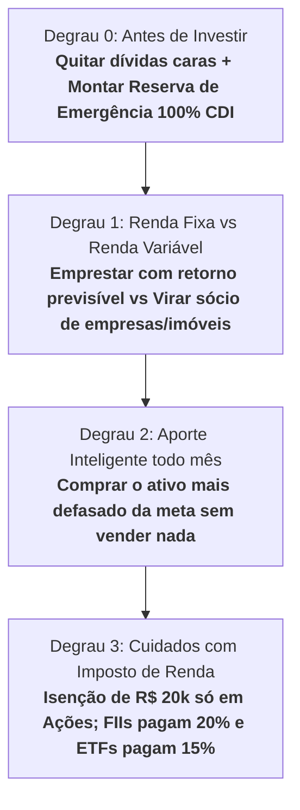
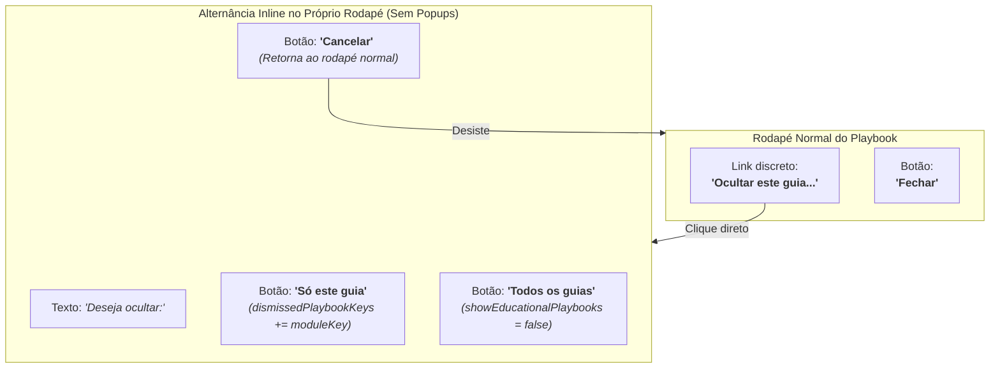
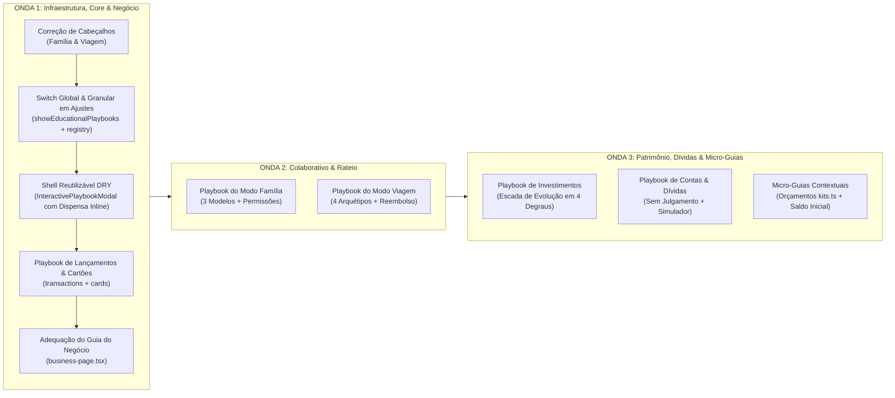

# Plano Canônico de Engenharia e Design: Padronização de Cabeçalhos e Sistema Universal de Playbooks Educativos

> **Status:** Aprovado para Planejamento / Versão 2.3 Consolidada (Com Auditoria Completa de UI/UX & Conformidade AGENTS.md)  
> **Data:** 24 de Novembro de 2026  
> **Documentos de Referência:** `AGENTS.md` (Regras 4, 7, 8, 9, 10, 11, 13, 14, 15, 16, 17, 18, 20, 21, 26), `docs/architecture/ESPECIFICACAO_TECNICA.md`, `docs/architecture/ARCHITECTURE.md`, `docs/design/DESIGN_SYSTEM.md`.  
> **Papel de Governança:** Arquiteto de Software Sênior, Product Designer Mobile-First & Especialista em UX Writing Financeiro.  
> **Regra de Execução desta Etapa:** Modo estrito de auditoria, análise e refinamento documental (zero alterações em código de produção ou testes).  

---

## 1. Sumário Executivo & Visão do Produto

O Axir é um ecossistema financeiro pessoal e colaborativo avançado. Seu diferencial de mercado reside em motores analíticos de alta precisão (Reconciliação Familiar, Liquidação de Viagens com menor esforço de transferências, Rebalanceamento de Carteira por Aportes Inteligentes e DRE com Segregação PF/PJ).

No entanto, a auditoria de produto e usabilidade identificou dois gargalos críticos:

1. **Hipertrofia e Deformação de Botões de Cabeçalho no Mobile:**  
   Em telas como o **Modo Família** e o **Modo Viagem**, classes locais anômalas injetadas no JSX (`max-sm:min-h-11` e `w-full min-h-11`) aliadas ao comportamento rígido do contêiner `PageHeader` quando há 2 ações geravam botões de 44px de altura ocupando 100% da largura útil, com aspecto desproporcional ("efeito tijolo") que destoava das páginas de Transações, Cartões, Investimentos e Dívidas.
2. **Insegurança Metodológica dos Usuários (Abandono por Desorientação):**  
   Muitos usuários abandonam o controle financeiro não por falhas de interface, mas por **insegurança metodológica** sobre o "jeito certo" de conduzir suas rotinas:
   - *Em Lançamentos:* Culpa por não registrar o passado; dúvida sobre granularidade; poluição de descrições; e o erro fatal de cadastrar a fatura inteira do cartão como uma despesa única no fim do mês.
   - *Em Investimentos:* Insegurança de quem não sabe por onde começar, confusão entre Reserva de Emergência e Renda Variável, e o erro caro de vender ativos para rebalancear gerando DARF desnecessária.
   - *Em Dívidas:* Ansiedade ao abrir o app e paralisia na hora de escolher qual dívida quitar primeiro.
   - *Em Família e Viagem:* A complexidade de lidar com a variabilidade humana (50/50 vs proporcional à renda vs caixa único; amigos dividindo no bar vs férias de casal).

A solução unificada proposta na **Versão 2.3 Consolidada** combina:
- **Correção estrutural definitiva dos cabeçalhos**, eliminando o efeito sanfona entre 2 e 3 botões.
- **Sistema Universal de Playbooks Educativos do Axir**, construído sob a filosofia de **Design Universal e Linguagem em 3 Camadas** (acolhendo desde o iniciante absoluto até o investidor avançado).
- **Governança Anti-Poluição Granular com Dispensa Inline**, permitindo ocultar um guia específico ou todos os guias sem *nested overlays*, preservando o minimalismo.
- **Auditoria Rigorosa de UI/UX**, assegurando 100% de conformidade com as Regras de Ouro do `AGENTS.md` e a harmonia visual de superfícies, tipografia, ícones e feedback tátil.

---

## 2. Diretrizes de Conteúdo, Tom de Voz e Progressive Disclosure em 3 Camadas

Para que o Axir fale a língua de quem nunca abriu uma planilha sem soar raso para quem já entende do assunto, toda a comunicação dos playbooks obedece à pirâmide de **Divulgação Progressiva (*Progressive Disclosure*)**:

```
                  ┌─────────────────────────────────────────────────────────┐
                  │  CAMADA 1: HUMANO PRIMEIRO (Padrão para Todo Usuário)   │
                  │  Português claro, acolhedor, sem jargões e com exemplos │
                  │  em reais (R$). Foco em "o que fazer hoje sem culpa".   │
                  └────────────────────────────┬────────────────────────────┘
                                               │
                                               ▼
                  ┌─────────────────────────────────────────────────────────┐
                  │  CAMADA 2: APROFUNDAMENTO OPCIONAL (Intermediário)      │
                  │  Card expansível ("Ver detalhe técnico / regra fiscal") │
                  │  com a matemática, alíquotas do IRPF e lógica do motor. │
                  └────────────────────────────┬────────────────────────────┘
                                               │
                                               ▼
                  ┌─────────────────────────────────────────────────────────┐
                  │  CAMADA 3: AVANÇADO / ZERO RUÍDO                        │
                  │  Governança em dois níveis (global ou local) para       │
                  │  ocultar atalhos já dominados com 1 toque.              │
                  └─────────────────────────────────────────────────────────┘
```

### Dicionário Canônico de Tradução de Jargões (UX Writing Obrigatório)

Fica expressamente **proibido** utilizar termos em inglês ou economês sem a tradução intuitiva correspondente nos textos voltados ao usuário:

| Termo Técnico / Algoritmo | Rótulo Intuitivo Axir (Camada 1) | O que Significa na Vida Real |
|---|---|---|
| *Hamilton-Hare / Fair Share* | **"Proporcional à renda de cada um"** | Quem ganha mais paga uma fatia maior das contas compartilhadas da casa. |
| *Min-Cash-Flow* | **"Acerto com o menor número possível de Pix"** | Em vez de 10 transferências cruzadas na viagem, o app calcula 2 ou 3 Pix que resolvem tudo. |
| *Daily Burn-Rate* | **"Limite de gasto por dia da viagem"** | O teto diário para aproveitar as férias sem tomar um susto na volta. |
| *`report_weight: 0%`* | **"Isolar do meu orçamento pessoal (reembolsável)"** | O dinheiro saiu do seu cartão, mas a empresa ou o grupo vai te pagar de volta; não infla seus gastos pessoais. |
| *Competência vs Caixa* | **"O gasto entra no dia da compra; pagar a fatura é só mover dinheiro do banco para o cartão"** | Registre quando comprou; o pagamento do boleto no fim do mês não é uma despesa nova. |
| *Rebalanceamento sem giro* | **"Equilibrar os investimentos usando o dinheiro novo do mês, sem precisar vender nada"** | Compra-se o ativo que está mais barato/defasado sem gerar impostos ou taxas de venda. |
| *Snowball vs Avalanche* | **"Menor dívida primeiro (alívio rápido)"** e **"Juros mais altos primeiro (menor custo total)"** | Escolha entre a vitória psicológica de eliminar contas pequenas ou a economia máxima de juros. |

---

## 3. Fase 0 — Meta-Análise Crítica e Auditoria da Codebase Real

### 3.1 Verificações e Achados Fatuais na Codebase

1. **Análise Estrutural do `PageHeader.tsx`:**  
   Inspecionando `src/components/layout/page-header.tsx`:
   - `actionCount === 1`: `flex items-center gap-2 flex-wrap shrink-0 w-full sm:w-auto`. (Em `trip-list-page.tsx`, o botão único só esticava porque tinha `w-full min-h-11` manual no JSX da página!).
   - `actionCount === 2`: `grid grid-cols-2 gap-2 sm:flex sm:items-center sm:justify-end shrink-0 w-full sm:w-auto [&>*]:w-full [&>*]:sm:w-auto`.
   - `actionCount >= 3`: `flex items-center justify-start sm:justify-end gap-2 overflow-x-auto no-scrollbar sm:flex-nowrap shrink-0 w-full sm:w-auto`.
   *Diagnóstico do Efeito Sanfona:* Na v2.1, acreditava-se que a inclusão do 3º botão resolveria o problema do Modo Família. Porém, caso o usuário oculte o playbook ou desligue a flag, o cabeçalho retrocede para `actionCount === 2` e volta ao `grid-cols-2 [&>*]:w-full`. A solução definitiva exige calibrar a altura canônica para `size="sm"` (`h-9` no mobile) e garantir que o grid simétrico não pareça um bloco pesado, removendo qualquer min-height inflado.
2. **Integração do Modo Negócio (`business-page.tsx`):**  
   Hoje, o `EducationalGuideModal` está acoplado fixamente no cabeçalho (linha 324) e em diálogos. Na Onda 1, o botão `Guia do Negócio` deve ser envelopado por:
   `isPlaybookVisible("business") && (...)`, integrando o módulo existente à nova governança global e granular.
3. **Cartões de Crédito (`cards-page.tsx`):**  
   Possui 2 botões (`Importar Fatura` e `Novo Cartão`). O gatilho do Playbook de Lançamentos & Cartões deve ser adicionado ao cabeçalho compartilhando o mesmo identificador de módulo (`moduleKey: "transactions"`). Assim, ao dispensar em Transações, dispensa-se também em Cartões, evitando redundância cognitiva.
4. **Contas & Dívidas (`debts-page.tsx`):**  
   - O simulador matemático com estratégias Avalanche e Bola de Neve **já existe** no domínio puro (`src/domain/debts/payoff-simulator.ts`).
   - O diálogo de amortização extraordinária com desconto **já existe** (`early-amortization-dialog.tsx`).
   - Porém, a lista de dívidas a pagar (`DebtsUrgencyList`) hoje é estática por urgência de vencimento/atraso e **ainda não possui um botão de ordenação direta por Avalanche/Bola de Neve na UI**. Logo, no Playbook de Dívidas, os CTAs de ordenação devem ser documentados com precisão: abrir o simulador de quitação é 1-Click imediato; ordenar a lista da tela exigirá o seletor correspondente como pré-requisito da Onda 3.
5. **Modo Viagem (`trips`):**  
   - O `CreateTripDialog` suporta título, destino, datas e membros.
   - O isolamento com peso zero (`report_weight: 0%`) opera na sincronização de acertos e despesas (`use-trip-settlement-extrato-sync.ts`).
   - O playbook de viagens deve oferecer CTAs reais: abrir o diálogo de criação de viagem com título pré-sugerido e instruir o fluxo de reembolso via peso zero.
6. **Persistência Visual e Sincronização:**  
   O ecossistema em `visual-storage.ts`, `visual-defaults.ts` e `useVisualCustomization` é síncrono no cliente com `localStorage` e assíncrono no servidor com Supabase (`custom_settings`). A nova flag e a lista de dispensados seguirão rigorosamente essa mesma esteira.

---

## 4. Matriz de Priorização de Playbooks do Axir

| Módulo / Funcionalidade | Fricção Metodológica | Risco de Erro nos Dados | Frequência | Classificação Final | Justificativa Arquitetural |
|---|---|---|---|---|---|
| **Lançamentos & Gestão de Cartões** (`transactions` / `cards`) | **Altíssima** | **Crítico** | Diária (Core) | **Playbook Dedicado (Onda 1)** | Evita o erro de lançar a fatura inteira como despesa e ensina o "Comece de Hoje". Compartilham `moduleKey: "transactions"`. |
| **Modo Negócio / PJ** (`business`) | **Altíssima** | **Crítico** | Semanal | **Playbook Dedicado (Onda 1 - Adequação)** | Já possui modal implementado; deve ser adaptado à nova casca e governança de dispensa. |
| **Modo Família** (`family`) | **Altíssima** | **Alto** | Semanal/Mensal | **Playbook Dedicado (Onda 2)** | Resolve a variabilidade de divisão (50/50, proporcional à renda ou caixa único) e fronteira Casa × Individual. |
| **Modo Viagem** (`trips`) | **Alta** | **Médio/Alto** | Eventual / Férias | **Playbook Dedicado (Onda 2)** | Resgata os 4 arquétipos: amigos, caixinha prévia, férias de casal e viagem a trabalho com reembolso. |
| **Investimentos & Carteira** (`investments`) | **Altíssima** | **Crítico** | Semanal/Mensal | **Playbook Dedicado (Onda 3)** | Escada de evolução: Degrau 0 (dívidas e reserva) $\rightarrow$ Degrau 1 (Fixa vs Variável) $\rightarrow$ Degrau 2 (Aporte Inteligente) $\rightarrow$ Degrau 3 (IR). |
| **Contas & Dívidas** (`debts`) | **Alta** | **Alto** | Mensal | **Playbook Dedicado (Onda 3)** | Tom acolhedor e sem julgamento; foco em estancar o rotativo e método Menor Dívida vs Menor Custo. |
| **Orçamentos & Tetos** (`budgets`) | Média/Alta | Médio | Mensal | **Micro-guia Contextual (Onda 3)** | Micro-guia explicativo aproveitando os kits orçamentários já existentes (`kits.ts`). Sem modal pesado de 4 abas. |
| **Contas & Saldo Inicial** (`accounts`) | Média | Médio | Semanal | **Micro-guia Contextual (Onda 3)** | Dica contextual no diálogo de saldo inicial: como começar com o saldo real sem criar transações fantasmas. |
| **Metas Financeiras** (`goals`) | Baixa | Baixo | Eventual | **Não Precisa de Playbook** | Interface e prazos já são intuitivos; adicionar guia geraria poluição visual desnecessária. |
| **Relatórios Executivos** (`reports` / `insights`) | Baixa/Média | Zero | Mensal | **Não Precisa de Playbook** | Já atendido pelo sistema de Memória de Cálculo e Explicabilidade matemática. |
| **Lembretes** (`reminders`) | Baixa | Baixo | Pontual | **Não Precisa de Playbook** | Formulário direto e autoexplicativo. |

---

## 5. Especificação Pedagógica dos Playbooks para o "Degrau Zero"

### 5.1 Playbook de Lançamentos & Gestão de Cartões (`TransactionEducationalGuideModal`)

*Identificador de Módulo:* `moduleKey: "transactions"` (utilizado tanto em Transações quanto em Cartões).

#### Aba 1: Descubra sua Rotina Ideal (Quiz de Ritmo em 2 Perguntas)
- **Pergunta 1:** *Com que frequência você prefere mexer no aplicativo?*
  - Opção A: "Todo dia, no momento em que faço a compra (em tempo real)."
  - Opção B: "Uma vez por semana ou no final de semana (revisando o extrato)."
  - Opção C: "Uma vez por mês, ao fechar o mês."
- **Pergunta 2:** *Como você faz a maioria dos seus pagamentos?*
  - Opção A: "Quase tudo no Cartão de Crédito."
  - Opção B: "Muito Pix e Débito no dia a dia."
  - Opção C: "Misto (Cartão, Pix, Boleto e Dinheiro vivo)."
- **Recomendação Prescritiva com CTAs 1-Click:**
  - *Perfil Cartão:* Recomenda a Importação de Fatura (OFX/CSV) com higienização automática. CTA: `Importar Fatura` (`onOpenImport`).
  - *Perfil Pix:* Recomenda o Leitor de Comprovantes Pix com IA. CTA: `Ler Comprovante Pix` (`onOpenPixScanner`).
  - *Perfil Manual:* Recomenda o Lançamento Rápido. CTA: `Novo Lançamento` (`onOpenNewTx`).

#### Aba 2: O Passo Zero ("Comece de Hoje, sem culpa")
- **Mensagem Acolhedora:** Não tente cadastrar o passado nem correr atrás de notas fiscais de 3 meses atrás. Isso só gera cansaço e frustração.
- **A Regra do Marco Zero:** Ajuste o saldo da sua conta com o valor real que está no banco hoje e registre seus gastos daqui para frente. O passado não volta; o controle começa no presente.

#### Aba 3: Categoria vs Descrição (A Regra da Clareza)
- **A Categoria é para o App; a Descrição é para Você:** A Categoria (`Alimentação`, `Transporte`, `Lazer`) alimenta os gráficos e os alertas de limite. A Descrição precisa apenas de 2 ou 3 palavras para você lembrar onde foi.
- **O Importador Já Limpa para Você:** O Axir higieniza termos sujos (remove `PAG*`, `UBER*TRIP HELP`, etc.). Em lançamentos manuais, faça o mesmo: escreva apenas `Padaria Estrela` ou `Uber`.

#### Aba 4: O Mito do Cartão de Crédito (Meio de Pagamento vs Despesa)
- **O Cartão é Meio de Pagamento, não Categoria:** O almoço de R\$ 50 no restaurante foi uma despesa de `Alimentação` no dia em que você almoçou.
- **Pagar a Fatura não é Gasto Novo:** Quando o boleto da fatura vence no dia 10, você está apenas transferindo dinheiro da sua conta bancária para o cartão. No Axir, isso é registrado como **Transferência Interna**, impedindo que seus gastos sejam duplicados.
- **Camada 2 (Detalhe Técnico Expansível):** Explicação da competência contábil e distribuição automática de compras parceladas (1 a 60 parcelas) nas faturas futuras.

---

### 5.2 Playbook de Investimentos (`InvestmentsEducationalGuideModal`)

*Identificador de Módulo:* `moduleKey: "investments"`

Construído sob a metodologia de **Escada de Evolução** com Quiz de Momento na abertura (*"Ainda estou montando minha reserva"* vs *"Já tenho reserva e quero organizar meus aportes"*).



#### Aba 1: Degrau 0 — Antes de Investir (A Base Segura)
- **Dívidas Caras Vencem Qualquer Investimento:** Juros de cartão de crédito (14% ao mês) engolem qualquer rendimento de bolsa ou renda fixa. Quite dívidas caras antes de investir.
- **A Reserva de Emergência é Sagrada:** Guarde de 3 a 6 meses do seu custo fixo em um investimento seguro, de liquidez diária (onde você pode resgatar no mesmo dia) e que não oscile para baixo (CDB 100% CDI ou Tesouro Selic).
- *CTA 1-Click:* `Auditar Reserva de Emergência` $\rightarrow$ Direciona para o card de Reserva da Home.

#### Aba 2: Degrau 1 — Renda Fixa vs Renda Variável em 1 Minuto
- **Renda Fixa (Emprestar Dinheiro):** Você empresta dinheiro para o governo ou para um banco e recebe de volta com juros acordados. Retorno previsível e segurança.
- **Renda Variável (Virar Sócio):** Você compra pedaços de empresas (Ações) ou galpões/shoppings (Fundos Imobiliários). O valor sobe e desce todo dia, e você recebe parte dos lucros (dividendos).

#### Aba 3: Degrau 2 — Como Investir Todo Mês sem Errar (Aporte Inteligente)
- **A Regra de Ouro: Nunca Venda para Rebalancear:** Vender ações que subiram para comprar o que caiu gera imposto (DARF), custos e quebra o poder dos juros compostos.
- **O Jeito Axir:** Defina suas porcentagens ideais (ex.: 50% Renda Fixa, 25% Ações, 25% FIIs). Todo mês, coloque o dinheiro novo no ativo que estiver mais abaixo da meta. Com o tempo, a carteira se equilibra sozinha.
- *CTA 1-Click:* `Calcular Aporte do Mês` $\rightarrow$ Abre `ContributionFormDialog`.
- *CTA 1-Click:* `Definir Metas da Carteira` $\rightarrow$ Abre `AllocationBreakdownDialog`.

#### Aba 4: Degrau 3 — Imposto de Renda Descomplicado
- **Atenção aos Detalhes Fiscais:**
  - *Ações no Brasil:* Isenção de IR para vendas de até R\$ 20.000,00 no mês. Acima disso, paga-se 15% sobre o lucro via DARF.
  - *Fundos Imobiliários (FIIs):* **Não têm isenção.** Vendeu cotas com R\$ 1,00 de lucro, paga-se 20% de IR via DARF até o último dia útil do mês seguinte.
  - *ETFs de Renda Variável:* **Não têm isenção.** Pagam 15% sobre o ganho de capital.
- **Camada 2 (Detalhe Técnico Expansível):** Como registrar prejuízos passados no Axir para abater do lucro de meses futuros e o papel do Monitor de DARF.

---

### 5.3 Playbook de Contas & Dívidas (`DebtsEducationalGuideModal`)

*Identificador de Módulo:* `moduleKey: "debts"`

#### Aba 1: Passo Zero — Estancar o Sangramento (Sem Culpa)
- **Ambiente Seguro:** Estar endividado não é falha de caráter. O primeiro passo é listar tudo no app para tirar o peso da cabeça.
- **O Perigo do Pagamento Mínimo:** Pagar o mínimo da fatura do cartão empurra o saldo restante para o crédito rotativo, com juros que passam de 400% ao ano.
- *CTA 1-Click:* `Cadastrar Dívida` $\rightarrow$ Abre `DebtFormDialog`.

#### Aba 2: Qual Dívida Pagar Primeiro? (Comparativo Simples)
Exemplo prático com 2 dívidas reais:
- *Dívida A:* R\$ 500 no cartão de crédito a 14% ao mês.
- *Dívida B:* R\$ 5.000 no crédito consignado a 2% ao mês.
- **Estratégia 1: Menor Dívida Primeiro (Alívio Rápido / Bola de Neve):**
  - Quita primeiro a Dívida A de R\$ 500. Você elimina um boleto da sua gaveta rapidamente, trazendo ânimo e alívio mental imediato.
- **Estratégia 2: Juros Mais Altos Primeiro (Menor Custo Total / Avalanche):**
  - Quita primeiro o cartão de crédito porque cada mês de atraso custa muito mais caro que o consignado. Economiza o máximo de juros no longo prazo.

#### Aba 3: Como Renegociar e Amortizar Contratos
- **Quando Esperar o Mutirão:** Dívidas antigas sem garantia (cartão, cheque especial) costumam ter descontos de até 80% a 90% em feirões como o Desenrola ou Serasa Limpa Nome.
- **Amortização Extraordinária:** Em financiamentos imobiliários ou de veículos, amortizar no prazo final do contrato elimina quase todos os juros futuros daquelas parcelas.
- *CTA 1-Click:* `Registrar Financiamento / Contrato` $\rightarrow$ Abre `LoanFormDialog`.
- *CTA 1-Click:* `Amortizar Contrato com Desconto` $\rightarrow$ Direciona para a aba de Contratos onde fica `early-amortization-dialog`.

---

### 5.4 Playbook do Modo Família (`FamilyEducationalGuideModal`)

*Identificador de Módulo:* `moduleKey: "family"`

- **Aba 1: Descobrir o Modelo do Casal (Quiz):** 3 perguntas simples sobre salários e preferências $\rightarrow$ CTA 1-Click aplica a regra de divisão (`split_rule: 'proportional' | 'equal' | 'combined'`). Se o usuário não for administrador da família, exibe aviso amigável explicando que apenas o gestor da casa pode salvar a regra.
- **Aba 2: Os 3 Modelos Explicados:**
  1. *Proporcional à renda:* Cada um contribui na medida do que ganha.
  2. *50/50:* Divisão estritamente igualitária.
  3. *Caixa Único:* Tudo entra no mesmo orçamento do lar.
- **Aba 3: O que é da Casa × O que é Individual:** Critérios para evitar brigas (moradia, supermercado e filhos são da Casa; hobbies e presentes individuais saem do bolso individual).
- **Aba 4: O Acerto Sem Constrangimento:** Como o Axir gera a chave Pix com valor exato de compensação no fim do mês.

---

### 5.5 Playbook do Modo Viagem (`TripEducationalGuideModal`)

*Identificador de Módulo:* `moduleKey: "trips"`

Resgata na íntegra os **4 arquétipos de viagem**:
1. **Viagem com Amigos / Galera:** "Quem estiver na vez paga". O Axir calcula o acerto com o menor número possível de transferências Pix no encerramento.
2. **Caixinha / Fundo Pré-Pago:** Cada pessoa deposita um valor antes da viagem (ex.: R\$ 500) e o grupo acompanha o saldo disponível.
3. **Férias de Casal / Família:** Controle com foco no limite diário de gastos da viagem para não estourar o orçamento doméstico.
4. **Viagem a Trabalho / Reembolsável:** Como marcar despesas corporativas pagas no cartão pessoal com peso zero (`report_weight: 0%`), garantindo que o reembolso da empresa ajuste as contas sem inflar seu custo de vida.
- *CTAs 1-Click Validados:* `Criar Nova Viagem` $\rightarrow$ Abre `CreateTripDialog`; `Ver Viagens Ativas` $\rightarrow$ Lista de viagens em andamento.

---

## 6. Solução Técnica para Cabeçalhos e Botões (`PageHeader`)

### 6.1 Correção Definitiva do Efeito Sanfona (2 vs 3 Botões)

Para solucionar de vez a oscilação entre 2 botões esticados e 3 botões em fita:

1. **Remoção das Classes Manuais Infladas:**
   - Em `src/features/family/pages/family-page.tsx`: remover `max-sm:min-h-11`.
   - Em `src/features/trips/pages/trip-list-page.tsx`: remover `w-full min-h-11 sm:min-h-8`.
2. **Padronização Visual da Altura (`size="sm"`):**
   - Todos os botões de cabeçalho adotam o tamanho canônico `size="sm"` (`h-9` / 36px no mobile; `h-8` / 32px no desktop).
   - A altura de 36px no mobile confere área de toque perfeita com `gap-2` (8px), respeitando a especificação WCAG 2.5.8 sem gerar o aspecto pesado de tijolo.
3. **Estabilidade de Layout no `PageHeader`:**
   - Quando `actionCount === 2`, o `grid grid-cols-2 gap-2` com botões em altura `h-9` mantém perfeita simetria sem devorar a verticalidade.
   - Quando `actionCount >= 3` (com a presença do botão do Playbook), ativa-se a fita horizontal com rolagem suave (`overflow-x-auto no-scrollbar flex-nowrap`).
   - Se o usuário ocultar o playbook e a contagem retornar a 2 botões, a altura fixa de `h-9` assegura que os botões permaneçam esteticamente proporcionais e alinhados, eliminando qualquer choque visual.

---

## 7. Governança Anti-Poluição: Dispensa Granular sem Nested Overlay

Para assegurar uma experiência móvel impecável sem conflitos de acessibilidade ou foco (*focus trap*):



### 7.1 Mecânica da Dispensa Inline
- **Zero Modais Aninhados:** Ao clicar em *"Ocultar este guia..."*, o `<ModalFooter>` não abre nenhum modal secundário nem popover. Em vez disso, ele substitui seus elementos internos por uma barra inline compacta com as opções: `Só este guia` · `Todos os guias` · `Cancelar`.
- **Benefícios Técnicos:** Elimina sobreposição de `z-index`, previne bugs de scroll no iOS Safari e Android WebView e respeita a Regra 18 e 20 do `AGENTS.md`.

### 7.2 Blindagem de Persistência & Registro Declarativo (`PLAYBOOK_REGISTRY`)

1. **Parsing Defensivo em `visual-storage.ts`:**
   ```ts
   export function parseDismissedPlaybookKeys(raw: string | null): string[] {
     if (!raw) return [];
     try {
       const parsed = JSON.parse(raw);
       if (Array.isArray(parsed)) {
         return Array.from(new Set(parsed.filter((k): k is string => typeof k === "string" && k.trim().length > 0)));
       }
       return [];
     } catch {
       return [];
     }
   }
   ```
2. **Registro Central de Metadados (`src/domain/playbooks/registry.ts`):**
   ```ts
   export interface PlaybookMetadata {
     moduleKey: string;
     title: string;
     shortLabel: string;
   }

   export const PLAYBOOK_REGISTRY: Record<string, PlaybookMetadata> = {
     transactions: { moduleKey: "transactions", title: "Guia de Lançamentos & Cartões", shortLabel: "Lançamentos" },
     business: { moduleKey: "business", title: "Guia do Empreendedor", shortLabel: "Negócio" },
     family: { moduleKey: "family", title: "Guia do Modo Família", shortLabel: "Família" },
     trips: { moduleKey: "trips", title: "Guia do Modo Viagem", shortLabel: "Viagens" },
     investments: { moduleKey: "investments", title: "Guia de Investimentos", shortLabel: "Investimentos" },
     debts: { moduleKey: "debts", title: "Guia de Contas & Dívidas", shortLabel: "Dívidas" },
   };
   ```
3. **Painel em Ajustes (`interface-shortcuts-card.tsx`):**
   - Switch Master: **"Playbooks e Guias Metodológicos"**.
   - Indicador dinâmico: se houver módulos dispensados, monta o texto no plural/singular a partir do `PLAYBOOK_REGISTRY`:
     * 1 módulo: *"1 guia individual ocultado (Lançamentos). [Reativar todos os guias]"*.
     * 2 módulos: *"2 guias individuais ocultados (Lançamentos e Família). [Reativar todos os guias]"*.
   - Ao clicar em "Reativar todos os guias", esvazia `dismissedPlaybookKeys` com feedback sensorial imediato.

---

## 8. Auditoria de Conformidade Estrita com UI/UX & Regras de Ouro (AGENTS.md)

Para garantir que a implementação futura preserve 100% da identidade visual, elegância e robustez da interface, confrontamos as propostas contra as regras canônicas do repositório:

| Regra AGENTS.md | Diretriz Inegociável | Aplicação Prática no Sistema de Playbooks | Verificação Automática / Status |
|---|---|---|---|
| **Regra 4 (DRY Estrita para UI)** | Proibido duplicar estruturas JSX/HTML entre páginas; extrair primitivos reutilizáveis. | Toda a casca de modais educativos é unificada no componente `<InteractivePlaybookModal />`. Os conteúdos vivem em funções puras em `src/domain/playbooks/`. | **Conforme.** Elimina duplicação de modais de 600 linhas. |
| **Regra 7 (Zero Controles Nativos)** | Proibido `<select>`, `<dialog>`, `<details>/<summary>`, `alert()`, `confirm()`, inputs crus. | Utilização estrita dos primitivos em `components/ui/` (`Modal`, `Tabs`, `Button`, `Badge`, `Switch`, `Card`). | **Conforme.** Nenhuma tag HTML nativa crua de controle. |
| **Regra 8 (Zero Emojis no Produto)** | Proibido qualquer emoji/emoticon em UI, textos, empty states ou toasts. | Todo apoio gráfico usa ícones `lucide-react` com `aria-hidden="true"`. A regra ESLint `local/no-decorative-unicode` valida cada string. | **Conforme.** Linter bloqueia qualquer emoji em produção. |
| **Regra 9 (Abas Fluidas com Scroll Desobstruído)** | Abas com $\ge 4$ itens usam `shrink-0 flex-initial min-w-fit px-3 py-2` com `overflow-x-auto no-scrollbar scroll-smooth`. | O `<Tabs variant="underline" fullWidth={false} />` do playbook permite rolagem suave no mobile sem esmagar rótulos. | **Conforme.** Zero truncamento de texto nas 4 abas. |
| **Regra 10 (Grids Mobile-First sem Esmagamento)** | Grids com $\ge 3$ colunas iniciam em `grid-cols-1` ou `grid-cols-2` no mobile. | Cards de opções de quiz usam `grid grid-cols-1 sm:grid-cols-2 gap-3`. | **Conforme.** Zero colunas esmagadas no smartphone. |
| **Regra 13 (Hierarquia Balanceada de Ícones)** | Nível 1: Ícones sóbrios *icon-only* sem container (`size-4`). Nível 2: Destaque com container restrito a alertas e heróis. | O botão do cabeçalho usa ícone limpo `BookOpen` (Nível 1). Apenas o card de recomendação do quiz usa container sutil (Nível 2). | **Conforme.** Zero caixas decorativas espúrias em títulos. |
| **Regra 14 (Badges Estritos e Empty States Calmos)** | Badges utilizam apenas variantes padronizadas (`size="sm" | "xs"`). Empty state calmo por padrão. | Badges do quiz usam `size="sm"` (`variant="portfolio"` ou `"default"`). Empty states ocultam botão de guia se dispensado. | **Conforme.** Sem classes ad-hoc de micro-padding. |
| **Regra 15 & 18 (Anatomia de Diálogos & Modais)** | Rodapé com Cancelar à esquerda e Confirmar à direita. Escala canônica `size="xl"`. | Playbook usa `size="xl"` (`md:max-w-4xl`), alça deslizante no mobile com drag restrito à alça, título fluido que rola com o corpo e micro-título reativo no topo após 32px de scroll. | **Conforme.** Zero `max-w-*` arbitrários e topo desobstruído. |
| **Regra 16 (Padrão Canônico de Superfície)** | Trinca canônica `border-border/80 bg-surface shadow-xs`. | Todos os cards internos comparativos (verde vs vermelho) e seções usam a trinca canônica do Design System. | **Conforme.** Harmonia tonal em tema claro e escuro. |
| **Regra 17 (Governança Sensorial & Zero Duplos Disparos)** | Feedback sensorial exclusivamente via `triggerSensory(...)`. Proibido `triggerHaptic` direto em botões. | Seleção de quiz dispara `selection`; aplicação de recomendação dispara `success`; switch em Ajustes dispara `toggle`. | **Conforme.** Zero double-haptics e zero vibrações passivas. |
| **Regra 20 (Zero Auto-Focus no Mobile)** | Proibido `autoFocus` declarativo em formulários/modais. Prevenção de auto-zoom no iOS Safari. | Todo modal de playbook define `onOpenAutoFocus={(e) => e.preventDefault()}` e `text-base sm:text-sm` em inputs. | **Conforme.** Zero saltos de viewport no smartphone. |
| **Regra 21 (Anatomia Canônica de Cabeçalhos)** | `<PageHeader />` unificado com título, subtítulo e ações simétricas. | Botões de cabeçalho padronizados em `size="sm"` (`h-9` no mobile / `h-8` no desktop). Removidas classes manuais `min-h-11`. | **Conforme.** Altura visual leve e proporcional. |
| **Regra 26 (Isolamento de Scroll em Modais)** | Proibido `overflow-y-auto` aninhado dentro dos filhos do modal. | Toda a rolagem vertical pertence exclusivamente ao contêiner interno gerenciado pelo modal (`scrollRef`). | **Conforme.** Zero rolagem dupla ou cortes de cabeçalho. |

---

## 9. Roadmap Reorganizado em Ondas de Entrega



### Onda 1 — Fundação, Correção Geométrica, Governança Granular, Core & Negócio (CONCLUÍDA)
* **Status:** Concluída com 100% de aprovação (ESLint 0 erros, Vitest 87/87 testes aprovados).
* **Entregas Realizadas:**
  1. [x] Remoção de `max-sm:min-h-11` de `src/features/family/pages/family-page.tsx` (restaura padrão `h-9` no mobile).
  2. [x] Remoção de `w-full min-h-11 sm:min-h-8` de `src/features/trips/pages/trip-list-page.tsx`.
  3. [x] Adição de `showEducationalPlaybooks` e `dismissedPlaybookKeys` no schema de `UserSettings`, `visual-defaults.ts`, `visual-storage.ts` (com parsing defensivo e deduplicação) e `useVisualCustomization`.
  4. [x] Implementação do card/switch em `src/features/settings/components/tabs/interface-shortcuts-card.tsx` com `PLAYBOOK_REGISTRY`, resumo dinâmico e ação "Reativar todos os guias".
  5. [x] Desenvolvimento da shell unificada e reutilizável `<InteractivePlaybookModal />` em `src/components/modules/playbooks/` com dispensa inline no rodapé ("Só este guia" / "Todos os guias" / "Cancelar").
  6. [x] Criação do domínio `transaction-playbook.ts` e do modal pedagógico `TransactionEducationalGuideModal.tsx` com 4 abas, linguagem em 3 camadas e diagnóstico interativo.
  7. [x] Integração do gatilho `Guia` em `transaction-list-page.tsx` e `cards-page.tsx` (compartilhando `moduleKey: "transactions"`).
  8. [x] Adequação do `EducationalGuideModal` e do gatilho em `business-page.tsx` à governança unificada (`moduleKey: "business"`).
* **Quality Gate 1 Verificado:**
  - Altura máxima de botões de cabeçalho no mobile $\le 36\text{px}$ (`h-9`).
  - Nenhum botão esticado em 100% da tela.
  - Ao dispensar "Só este guia" em Lançamentos, o botão desaparece de Transações e Cartões, mas o Guia do Negócio permanece ativo.
  - Ao desligar o switch master em Ajustes, todos os guias desaparecem.
  - Conformidade estrita com todas as Regras de UI auditadas na Seção 8.
  - ESLint com 0 erros (regra `local/no-decorative-unicode` e tipagem estrita).
  - 87 testes unitários e de integração aprovados na suíte Vitest.

---

### Onda 2 — Playbooks Colaborativos (Família & Viagem)
* **Escopo:**
  1. Criar `family-playbook.ts` e `FamilyEducationalGuideModal.tsx` (3 modelos de divisão, checagem de permissão de administrador e tabela Casa × Individual).
  2. Adicionar gatilho `Guia da Família` em `family-page.tsx` (`moduleKey: "family"`).
  3. Criar `trip-playbook.ts` e `TripEducationalGuideModal.tsx` contemplando os 4 arquétipos (amigos, caixinha, férias e trabalho/reembolso).
  4. Adicionar gatilho `Guia de Viagem` em `trip-list-page.tsx` e `trip-details-page.tsx` (`moduleKey: "trips"`).
* **Quality Gate 2:**
  - A recomendação do quiz de família salva a regra compartilhada apenas se o usuário for administrador.
  - Testes unitários cobrindo todos os fluxos de quiz e dispensa inline.

---

### Onda 3 — Patrimônio, Passivos & Micro-Guias Contextuais
* **Escopo:**
  1. Criar `investments-playbook.ts` e `InvestmentsEducationalGuideModal.tsx` estruturado na Escada de 4 Degraus (Degrau 0: Dívidas/Reserva $\rightarrow$ Degrau 1: Fixa vs Variável $\rightarrow$ Degrau 2: Aporte Inteligente $\rightarrow$ Degrau 3: Precisão Fiscal de Ações/FIIs/ETFs).
  2. Adicionar gatilho em `investments-page.tsx` (`moduleKey: "investments"`).
  3. Criar `debts-playbook.ts` e `DebtsEducationalGuideModal.tsx` com tom acolhedor, Passo Zero de estancar o rotativo, exemplo numérico simples e CTAs reais.
  4. Adicionar gatilho em `debts-page.tsx` (`moduleKey: "debts"`).
  5. Implementar micro-guia contextual em Orçamentos (`kits.ts`) e dica contextual no Saldo Inicial de Contas.
* **Quality Gate 3:**
  - Zero duplicação de marcação JSX (reutilização estrita da shell `<InteractivePlaybookModal />`).
  - Cobertura completa de testes de regressão na suíte Vitest.

---

## 10. Decisões de Produto & Arquitetura Submetidas à Validação

1. **Compartilhamento de Chave Transações × Cartões (`moduleKey: "transactions"`):**  
   *Proposta:* O mesmo Playbook de Lançamentos & Gestão de Cartões atende às duas telas. Dispensar em Transações dispensa automaticamente em Cartões (evita que o usuário precise ocultar duas vezes o mesmo conteúdo).
2. **Dispensa Inline no Rodapé:**  
   *Proposta:* Aprovada a substituição de modais aninhados pela alternância inline no `<ModalFooter>`, garantindo acessibilidade pura e fluidez em telas pequenas.
3. **Escopo da Autorização de Implementação:**  
   *Proposta:* Autorizar a execução imediata da **Onda 1** (Correção dos botões de Família e Viagem + Infraestrutura Global/Granular + Playbook de Lançamentos & Cartões em Transações e Cartões + Adequação do Guia do Negócio).
