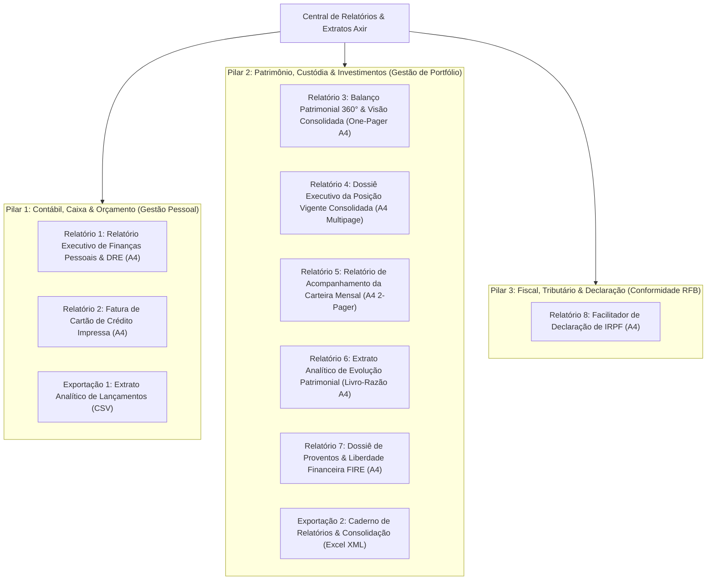

# Arquitetura e Plano Diretor Editorial de Relatórios — Axir

> **Status:** Concluído (Fase 0 — Validação Arquitetural, Metanálise e Árvore de Relatórios)  
> **Escopo:** Árvore Completa de Relatórios Gerados (PDF/A4, Excel XML, CSV) e Modais de Extrato/Conciliação  
> **Data:** 20 de Novembro de 2026  
> **Autor:** Arquiteto Frontend Sênior & Especialista em Design Editorial de Fintechs  

---

## 1. Parecer de Metanálise e Validação Arquitetural (Fase 0)

Em cumprimento ao protocolo de metanálise, confrontamos a auditoria visual externa com o código-fonte, a arquitetura de dados e o Design System real do Axir.

### 1.1 Diagnóstico do Motor de Geração e Tecnologias
- **Motor Atual de Impressão/PDF:** O aplicativo utiliza renderização nativa web A4 via navegador (`window.print()` e headless print do Chromium) combinada com o portal React `PrintSheet` ([print-sheet.tsx](file:///home/gabrielsales/meus_apps/financasnew/src/components/ui/print-sheet.tsx)) e regras de mídia `@media print` em [globals.css](file:///home/gabrielsales/meus_apps/financasnew/src/styles/globals.css#L711-L963). Não há dependência externa de `@react-pdf/renderer` ou `jsPDF`.
- **Causa Raiz da Quebra de Moeda (`R$` e `US$` separados da cifra):** Ocorre pela ausência de `white-space: nowrap` e falta de espaço não-quebrável (`\u00A0`) nos formatadores de moeda, permitindo que o motor de renderização do navegador quebre a linha entre o símbolo monetário e os dígitos.
- **Causa Raiz do Glitch de Centavos Soltos (`",66 ,42 ,24"` no DRE / PDF 5):** No componente [money-text.tsx](file:///home/gabrielsales/meus_apps/financasnew/src/components/ui/money-text.tsx#L69-L81), a função `formatMoneyNode` (ativada quando `variant="hero"` ou `deemphasizeCents=true`) divide o valor em dois nós React: o inteiro e `{match[2]}`. Por ser `inline-block`, em motores de PDF e sob restrição de altura, o span de centavos quebra de linha ou cai para fora do contêiner flex/grid, caindo no fundo da página como resíduo solto.
- **Causa Raiz dos Glifos Corrompidos (`لا`, `☐`, `A`, `%`, `$` soltos):** Decorrem de ícones inline que não tiveram fontes ou SVGs carregados a tempo do snapshot de impressão, bem como caracteres de escape ou ícones decorativos dentro de botões/headers. A solução é adotar SVG puro via `lucide-react` ou remover ícones decorativos nos documentos impressos.
- **Causa Raiz do Espaço após a Vírgula (`R$ 19.455, 28`):** É consequência direta da divisão do número em dois elementos DOM (`formatMoneyNode`), onde o parser do navegador e leitores de OCR interpretam o espaço entre nós HTML adjacentes como um caractere de espaço.

### 1.2 Auditoria de Congruência com o Design System Oficial
- **Paleta Oficial do App:** A identidade visual canônica do Axir (definida em [DESIGN_SYSTEM.md](file:///home/gabrielsales/meus_apps/financasnew/docs/design/DESIGN_SYSTEM.md) e [tokens.css](file:///home/gabrielsales/meus_apps/financasnew/src/styles/tokens.css)) baseia-se em:
  - *Petróleo Institucional (Primária):* `--primary-strong: #1B6B62` (Teal Petróleo).
  - *Marinho de Carteira (Portfolio):* `--portfolio: #1B3A4B` (Deep Navy).
  - *Ouro Âmbar (Acento):* `--accent: #DDA726`.
  - *Neutros de Alta Legibilidade:* Fundo branco puro `#FFFFFF`, texto quase preto `#0F172A`, texto secundário `#475569`, bordas sutis `#E2E8F0` (`border-border/80`).
  - *Semântica Contida (Regra 90/8/2):* Verde positivo `--positive-strong: #1B6B62` e Vermelho negativo `--negative-strong: #B23A2A`, usados estritamente em variações percentuais e desvios de orçamento.
- **Confronto com os Relatórios Atuais:** O gráfico de rosca do *Balanço Patrimonial 360°* utiliza com perfeição a paleta proprietária (petróleo, azul-aço e marinho). Em contrapartida, os *Raios-X do Dossiê da Posição Vigente* aplicam uma paleta externa saturada ("arco-íris" com roxo, magenta e verde-limão) que rompe a sobriedade. A paleta do Balanço 360° deve ser adotada como o **padrão cromático único para 100% dos relatórios**.

### 1.3 Resolução das Anomalias Conceituais e Semânticas
1. **Cronograma de Vencimento & Liquidez (*Dossiê da Posição*, p. 6):** O donut exibia R$ 3.181,78 (total de Renda Fixa), mas a tabela somava R$ 18.292,27 (25 ativos de toda a carteira, incluindo ações e FIIs classificados como "Liquidez"). **Correção arquitetural:** A seção de Vencimento pertence exclusivamente à Renda Fixa e deve analisar apenas os títulos de renda fixa e tesouro, totalizando rigorosamente os mesmos R$ 3.181,78 no gráfico e na tabela.
2. **Sinal dos Benchmarks 12M (*Dossiê da Posição*, p. 8):** O componente [performance-benchmarks-panel.tsx](file:///home/gabrielsales/meus_apps/financasnew/src/components/modules/reports/performance-benchmarks-panel.tsx) utilizava badges com o percentual de superação sem rótulo, causando confusão entre retorno e razão. A conversão para tabela comparativa de 5 colunas resolve em definitivo a ambiguidade de sinais.
3. **Arredondamento de FIIs (`20,0%` vs. `20,1%`):** Unificar a formatação em todo o sistema utilizando a biblioteca de máscaras canônica [formatPercent](file:///home/gabrielsales/meus_apps/financasnew/src/services/masks/percent.ts) com precisão padronizada de 1 casa decimal.
4. **Base da DRE no *Balanço 360°* vs. *Finanças Pessoais*:** O Balanço 360° passa a estampar explicitamente a etiqueta `(Base Ponderada)` ao lado do título da DRE resumida, garantindo congruência com o relatório de Finanças Pessoais que apresenta o valor nominal bruto com nota analítica.
5. **Padronização de IDs de Autenticação:** A chancela oficial passa a utilizar identificadores com prefixos mnemônicos funcionais: `IRPF-`, `FIRE-`, `BAL-`, `DOS-`, `DRE-`, `EXT-`, `CART-` e `FAT-`.

---

## 2. A Árvore de Relatórios do Axir

A árvore de relatórios foi estruturada em **3 Pilares Estratégicos**, abrangendo 8 Relatórios Executivos A4, 1 Pasta de Trabalho Excel XML viva e 1 Extrato Analítico CSV:

---

## 3. Matriz de Identidade Comum vs. Elemento Visual Exclusivo

Para que todos os relatórios façam parte da mesma família institucional, mas cada um possua uma ferramenta visual sob medida para seu objetivo:

| Relatório | Objetivo Funcional Primário | Elemento Visual Exclusivo (Diferenciador) | Elementos de Identidade Comum |
|---|---|---|---|
| **R1. Finanças & DRE** | Demonstração do resultado operacional, taxa de poupança e cumprimento orçamentário | **Cascata DRE em Barra Única Empilhada** (`Despesas 41% + Aportes 1% + Caixa 58% = 100%`) + Tabela com coluna dedicada `PONDERADO (R$)` | Cabeçalho Axir 70/30, KPI Strip, Rodapé com autenticação digital, QR Code 32px e paleta 90/8/2 |
| **R2. Fatura de Cartão** | Conferência de gastos do cartão bancário vs. valor ponderado considerado no orçamento | **Barra Linear de Rateio & Liquidação** (Fatura Bruta vs. Pago vs. Ponderado Pessoal) + Tabela com tag de parcelas | Cabeçalho Axir 70/30, tipografia tabular, rodapé institucional com ID `FAT-` |
| **R3. Balanço 360°** | Fotografia holística da saúde financeira, ativos, passivos e alavancagem (*One-Pager*) | **Rosca Patrimonial Tripartida em Grid 2 Colunas (55%/45%)** integrando Ativos, Passivos e DRE Pessoal em 1 única folha | Cabeçalho Axir 70/30, KPI Strip de 4 colunas, paleta verde-petróleo/marinho |
| **R4. Dossiê da Posição** | Dossiê estratégico completo de alocação, concentração, risco e métricas quantitativas | **Matriz de Barras Horizontais Proporcionais (Raios-X)** sem truncamentos + **Tabela de Benchmarks de 5 Colunas** | Cabeçalho de continuação nas páginas 2+, tabela de custódia com unidades no `thead` |
| **R5. Carteira Mensal** | Fechamento ágil da competência com movimentações do mês e índice PQS de qualidade | **Faixa Sintética Linear de Movimentações** (Compras, Vendas, Proventos, Aporte + Score PQS 8,2/10) | Tabela de custódia padronizada com R4, cabeçalho 70/30, rodapé oficial |
| **R6. Extrato Patrimonial** | Livro-razão cronológico auditável mês a mês de patrimônio, aportes e cota TWR | **Gráfico de Evolução Bicolor (Patrimônio vs. Custo)** + Tabela densa com zeros suprimidos (`—`) | KPI Strip de 4 colunas (sem grade 3+2), cabeçalho e rodapé oficial |
| **R7. Proventos & FIRE** | Monitoramento de renda passiva, autonomia financeira (runway) e reinvestimento | **Régua de Alta Precisão FIRE (0% a 100%)** com 5 marcos equilibrados + Gráfico de Barras Mensais sóbrio | Cabeçalho Axir 70/30, KPI Strip, rodapé com ID `FIRE-` |
| **R8. Facilitador IRPF** | Apoio operacional direto à transcrição de dados no programa da Receita Federal | **Árvore de Bens e Direitos Agrupada por Código da RFB** (sem truncamentos de tickers e com valores neutros) | Cabeçalho fiscal Axir, subtotais por grupo, rodapé oficial com ID `IRPF-` |
| **R9. Caderno Excel** | Consolidação analítica multi-abas viva para modelagem patrimonial | **Planilha Viva com Fórmulas Nativas (`=SUM`)** e linhas de empty state explicativas | Cores corporativas nos cabeçalhos, tipografia Calibri/Segoe UI, 6 abas |
| **R10. Extrato CSV** | Exportação de dados brutos para conciliação contábil e importadores externos | **CSV Formatado com Ponto e Vírgula e UTF-8 BOM**, sem descrições vazias | Sanitização de dados, compatibilidade total com Excel Windows/Mac |

---

## 4. Diretrizes Globais do Design Editorial Axir

### 4.1 Arquitetura de Folha A4 e Paginação
- **Margens:** `14mm 16mm 16mm 16mm` no `@page`.
- **Cabeçalho de Página 1 (Anatomia 70/30):**
  - *Esquerda (70%):* Monograma institucional Axir sóbrio em SVG vetorial (sem caixas decorativas com sombras ou bolinhas de app mobile) + Título do Documento H1 (`16pt font-bold`) + Subtítulo descritivo em tom neutro (`8.5pt text-muted-foreground`).
  - *Direita (30%):* Bloco de metadados alinhado à direita com Competência formatada por extenso (ex.: `Novembro de 2026`) e data de emissão.
  - *Fechamento:* Filete horizontal único contínuo de `1pt` em `border-border/80`.
- **Cabeçalho de Continuação (*Running Header*, páginas 2+):** Linha discreta de `7.5pt` no topo contendo `AXIR · [Título do Relatório]` à esquerda e `[Competência]` à direita, com filete inferior de `0.5pt`.
- **Rodapé e Paginação:** Em todas as páginas, linha inferior de `7pt` com chancela `axir.com.br`, identificador criptográfico com prefixo funcional e numeração formal `Página X de Y`.
- **Prevenção Estrita de Elementos Órfãos:**
  - `break-inside: avoid` em linhas de tabela, blocos de KPI, gráficos e rodapé contábil.
  - `break-after: avoid` em títulos H2/H3 e banners de grupo.
  - Subtotais de tabela estritamente vinculados às últimas linhas de dados.
  - Proibição absoluta de páginas finais contendo apenas o rodapé e o disclaimer.

### 4.2 Tipografia e Disciplina Numérica
- **Família Tipográfica:** Única família sans-serif de alta legibilidade (`Inter` / `system-ui`).
- **Algarismos Tabulares:** 100% dos valores numéricos com `font-variant-numeric: tabular-nums` e alinhamento à direita.
- **Proibição de Quebra de Moeda:** Símbolos monetários e sinais vinculados aos números via `white-space: nowrap` e `\u00A0`.
- **Unidade no Cabeçalho:** Em tabelas com 6 ou mais colunas, mover `(R$)` e `(US$)` para o cabeçalho (`thead`), exibindo apenas o valor numérico limpo nas células para eliminar repetições poluídas.
- **Higiene de Zeros:** Substituição de valores nulos e zeros repetitivos por travessão fino (`—`) em cinza médio.
- **Texto Alinhado à Esquerda:** Proibição de justificação de texto em parágrafos narrativos, prevenindo espaçamentos artificiais entre pontuações e números.

### 4.3 Primitivo Universal `KPI Strip`
- Faixa horizontal limpa e contínua de 3 ou 4 colunas simétricas (abolindo grades assimétricas como 3+2).
- Delimitação por linhas horizontais superior e inferior sutis (`0.75pt`), sem fundos escuros e sem bordas arredondadas externas.
- Três camadas verticais fixas garantindo alinhamento óptico rigoroso da linha de base:
  1. Rótulo `UPPERCASE` de 1 linha curta (`7–7.5pt`).
  2. Valor Principal em destaque (`15–18pt font-bold tabular-nums font-mono`).
  3. Metadado de apoio em 1 linha (`7.5–8pt text-muted-foreground`).

---

## 5. Plano de Refatoração Faseado (Uma Fase por Arquivo)

O plano de implementação é estruturado em **26 Fases Exclusivas**, respeitando estritamente a ordem de dependências da infraestrutura para os relatórios:

```mermaid
flowchart TD
    subgraph Bloco0["Bloco 0: Infraestrutura & Fundação Editorial"]
        F01["Fase 1: globals.css (Regras @media print e Resets de Página)"]
        F02["Fase 2: report-document-layout.tsx (Contêiner Mestre A4)"]
        F03["Fase 3: money-text.tsx (Fix Atômico de Centavos e Nowrap)"]
    end

    subgraph Bloco1["Bloco 1: Primitivos Editoriais Compartilhados"]
        F04["Fase 4: report-header.tsx (Cabeçalho Institucional 70/30)"]
        F05["Fase 5: report-footer.tsx (Rodapé Compacto Anti-Órfão e IDs)"]
        F06["Fase 6: report-executive-summary.tsx (Faixa Limpa de Síntese)"]
        F07["Fase 7: report-kpi-grid.tsx (KPI Strip Universal)"]
        F08["Fase 8: report-equity-class-table.tsx (Fix Colagem USD e Moeda no Thead)"]
        F09["Fase 9: report-class-tables.tsx (Banner Fora do Thead Anti-Órfão)"]
    end

    subgraph Bloco2["Bloco 2: Relatórios Executivos A4"]
        F10["Fase 10: financial-close-report-modal.tsx (DRE - PDF 5)"]
        F11["Fase 11: tax-facilitator-modal.tsx (IRPF - PDF 1)"]
        F12["Fase 12: consolidated-wealth-modal.tsx (Balanço 360° One-Pager - PDF 3)"]
        F13["Fase 13: dividend-freedom-modal.tsx (Proventos FIRE - PDF 2)"]
        F14["Fase 14: wealth-tear-sheet-modal.tsx (Dossiê da Posição - PDF 4)"]
        F15["Fase 15: portfolio-executive-report.tsx (Carteira Mensal)"]
        F16["Fase 16: portfolio-snapshots-dialog.tsx (Extrato Patrimonial - PDF 6)"]
        F17["Fase 17: card-invoice-print-view.tsx (Fatura de Cartão - PDF 7)"]
    end

    subgraph Bloco3["Bloco 3: Modais de Interface & Conciliação"]
        F18["Fase 18: statement-reconcile-rows.tsx (Layout Mobile Vertical Sem Estouro)"]
        F19["Fase 19: statement-reconcile-step.tsx (Toolbar de Filtros Fluidos)"]
        F20["Fase 20: statement-import-dialog.tsx (Modal 3xl no Desktop)"]
        F21["Fase 21: report-detail-dialog.tsx (Drilldown de Despesas e Rodapé Mobile)"]
        F22["Fase 22: trip-member-statement-modal.tsx (Extrato de Participante)"]
        F23["Fase 23: export-data-hub.tsx (Hub de Exportação de Dados)"]
    end

    subgraph Bloco4["Bloco 4: Motores de Exportação de Dados"]
        F24["Fase 24: excel-export.ts (Fórmulas Nativas =SUM e Empty States)"]
        F25["Fase 25: build-excel-workbook.ts (DRE Rica e Segregação de Passivos)"]
        F26["Fase 26: export-actions.ts (CSV Sanitizado com UTF-8 BOM)"]
    end

    Bloco0 --> Bloco1
    Bloco1 --> Bloco2
    Bloco2 --> Bloco3
    Bloco3 --> Bloco4
```

---

### Detalhamento das 26 Fases de Execução

#### Fase 1: Fundação do Mecanismo de Impressão e Resets de Viewport
- **Arquivo Alvo:** [src/styles/globals.css](file:///home/gabrielsales/meus_apps/financasnew/src/styles/globals.css)
- **Ações:**
  1. Configurar `@page { size: A4 portrait; margin: 14mm 16mm 16mm 16mm; }` com supressão de cabeçalhos nativos do navegador.
  2. Aplicar regras estritas para `.print-sheet table`: `table-layout: fixed; width: 100%; border-collapse: collapse;`.
  3. Configurar `.print-sheet footer, .print-sheet .report-footer` com `break-inside: avoid; margin-top: 10px;`, impedindo o empurrão do rodapé para uma página em branco isolada.
  4. Adicionar classes utilitárias para quebra programática: `.print-page-break-after`, `.print-avoid-break-inside` e `.print-table-condensed`.

#### Fase 2: Contêiner Mestre Editorial A4
- **Arquivo Alvo:** [src/components/modules/reports/report-document-layout.tsx](file:///home/gabrielsales/meus_apps/financasnew/src/components/modules/reports/report-document-layout.tsx)
- **Ações:**
  1. Atualizar o tamanho padrão do modal no desktop de `"2xl"` para `"3xl"` para relatórios densos, aproveitando viewports de até 1280px.
  2. No modo tela, aplicar prancheta editorial centrada com fundo suave e largura contida proporcionalmente.
  3. No modo impressão, garantir que `PrintSheet` limpe margens externas e entregue fluxo contínuo ao mecanismo de paginação.

#### Fase 3: Primitivo Monetário e Tratamento Atômico de Centavos
- **Arquivo Alvo:** [src/components/ui/money-text.tsx](file:///home/gabrielsales/meus_apps/financasnew/src/components/ui/money-text.tsx)
- **Ações:**
  1. No helper `formatMoneyNode`, substituir a divisão por `inline-block` por estrutura atômica estrita em linha: `{formatted}`. Eliminar quebras entre inteiro e centavos.
  2. Assegurar que o sinal e símbolo da moeda estejam vinculados por espaço não-quebrável (`\u00A0`).
  3. Desativar sumariamente animações (`NumberTicker`) em contexto de relatório impresso.

#### Fase 4: Cabeçalho Institucional dos Relatórios
- **Arquivo Alvo:** [src/components/modules/reports/report-header.tsx](file:///home/gabrielsales/meus_apps/financasnew/src/components/modules/reports/report-header.tsx)
- **Ações:**
  1. Redesenhar o monograma institucional Axir em SVG vetorial limpo, suprimindo bolinhas coloridas e fundos pesados de app mobile na impressão.
  2. Implementar layout 70/30: Marca + H1 + Subtítulo à esquerda; Competência por extenso + data de emissão à direita.
  3. Adicionar filete horizontal contínuo de `1pt` na base do cabeçalho.

#### Fase 5: Rodapé Contábil e Prevenção de Páginas Órfãs
- **Arquivo Alvo:** [src/components/modules/reports/report-footer.tsx](file:///home/gabrielsales/meus_apps/financasnew/src/components/modules/reports/report-footer.tsx)
- **Ações:**
  1. Reduzir a altura intrínseca do rodapé impresso (`print:pt-2 print:mt-3 print:gap-1.5`) e enxugar o texto do disclaimer para 2 linhas compactas.
  2. Implementar prefixos funcionais padronizados nos IDs de chancela (`IRPF-`, `FIRE-`, `BAL-`, `DOS-`, `DRE-`, `EXT-`, `FAT-`).
  3. Inserir numeração formal `Página X de Y` e otimizar o QR Code para dimensão de 32x32px.

#### Fase 6: Resumo Executivo e Faixa de Síntese
- **Arquivo Alvo:** [src/components/modules/reports/report-executive-summary.tsx](file:///home/gabrielsales/meus_apps/financasnew/src/components/modules/reports/report-executive-summary.tsx)
- **Ações:**
  1. Remover o fundo cinza denso (`bg-muted/30`) na impressão, adotando linha divisória superior sutil e respiro em branco.
  2. Padronizar o alinhamento óptico de linha de base para as 4 métricas principais.
  3. Eliminar parágrafos narrativos que apenas leiam os 4 números, mantendo apenas frases analíticas reais quando fornecidas.

#### Fase 7: Grade Universal de Indicadores (`KPI Strip`)
- **Arquivo Alvo:** [src/components/modules/reports/report-kpi-grid.tsx](file:///home/gabrielsales/meus_apps/financasnew/src/components/modules/reports/report-kpi-grid.tsx)
- **Ações:**
  1. Eliminar caixas com fundos coloridos ao redor de ícones nos documentos impressos, passando a exibir ícones sóbrios (`Icon-Only`, 16px).
  2. Substituir cartões com bordas grossas por grade editorial limpa com divisórias sutis.
  3. Assegurar auto-fit tipográfico impedindo truncamento em números com mais de 7 dígitos.

#### Fase 8: Tabela Densa de Ativos e Prevenção de Colagem em Moeda Estrangeira
- **Arquivo Alvo:** [src/components/modules/reports/report-equity-class-table.tsx](file:///home/gabrielsales/meus_apps/financasnew/src/components/modules/reports/report-equity-class-table.tsx)
- **Ações:**
  1. Expandir a largura das colunas de "Preço Médio" e "Cotação" em ativos internacionais no `<colgroup>` para 13% cada.
  2. Aumentar o padding horizontal mínimo das células monetárias de `px-1` para `px-2`.
  3. Mover `(R$)` e `(US$)` para os cabeçalhos das colunas, eliminando repetição excessiva de símbolos monetários nas linhas.
  4. Tratar nomes de ativos e tickers para quebra suave de linha sem reticências.

#### Fase 9: Orquestrador de Custódia e Banner Anti-Órfão
- **Arquivo Alvo:** [src/components/modules/reports/report-class-tables.tsx](file:///home/gabrielsales/meus_apps/financasnew/src/components/modules/reports/report-class-tables.tsx)
- **Ações:**
  1. Extrair o `ReportClassTableBanner` de dentro do `<thead>` da tabela, renderizando-o como cabeçalho de seção com `break-after: avoid;`.
  2. Assegurar que se uma tabela de classe não couber com pelo menos duas linhas de dados na página, o cabeçalho seja quebrado junto com a tabela para a página seguinte.
  3. Vincular a linha de subtotal da classe às linhas precedentes de ativos.

#### Fase 10: Relatório Executivo de Finanças Pessoais & DRE (PDF 5)
- **Arquivo Alvo:** [src/features/reports/components/financial-close-report-modal.tsx](file:///home/gabrielsales/meus_apps/financasnew/src/features/reports/components/financial-close-report-modal.tsx)
- **Ações:**
  1. Remover `animated` e `variant="hero"` do `MoneyText` em [FinancialCloseSummary.tsx](file:///home/gabrielsales/meus_apps/financasnew/src/features/reports/components/financial-close/FinancialCloseSummary.tsx), garantindo tipografia estável e eliminando centavos vazados.
  2. Substituir a cascata de 3 linhas por uma **barra horizontal única empilhada** de destinação da receita (`Despesas` + `Aportes` + `Poupança`).
  3. Criar coluna dedicada `PONDERADO (R$)` na DRE, Despesas por Categoria e Formas de Pagamento, eliminando empilhamento de números dentro de células.
  4. Ordenar categorias em ordem decrescente pelo valor realizado e adicionar linha de `TOTAL` em negrito.
  5. Unificar os 4 cards da Consolidação Residencial em grade compacta 2x2.

#### Fase 11: Facilitador de Declaração de IRPF (PDF 1)
- **Arquivo Alvo:** [src/features/reports/components/tax-facilitator-modal.tsx](file:///home/gabrielsales/meus_apps/financasnew/src/features/reports/components/tax-facilitator-modal.tsx)
- **Ações:**
  1. Reestruturar a tabela de Bens e Direitos em [TaxBensDireitosSection.tsx](file:///home/gabrielsales/meus_apps/financasnew/src/features/reports/components/tax-facilitator/TaxBensDireitosSection.tsx) agrupando os ativos por Grupo/Código da Receita Federal (`Grupo 03 · Código 01 — Ações`, `Grupo 04 · Código 02 — Renda Fixa`, etc.).
  2. Eliminar a coluna redundante "Código/Grupo", redistribuindo a largura para o Ticker (zero truncamentos como "CDB ORIGI...") e Discriminação.
  3. Alterar o tom da coluna "Situação em 31/12" para neutro contábil escuro (`tone="default"`), eliminando a cor verde indevida.
  4. Incluir linha de Subtotal por Grupo e Total Geral ao final da tabela na última página.
  5. Converter o card vazio de Rendimentos Isentos em uma linha descritiva serena.

#### Fase 12: Balanço Patrimonial 360° & Visão Consolidada (PDF 3)
- **Arquivo Alvo:** [src/features/reports/components/consolidated-wealth-modal.tsx](file:///home/gabrielsales/meus_apps/financasnew/src/features/reports/components/consolidated-wealth-modal.tsx)
- **Ações:**
  1. Consolidar todo o documento em **1 única página executiva (One-Pager)**, eliminando a Página 2 fantasma.
  2. Diagramar o miolo em grade de 2 colunas (55%/45%):
     - *Esquerda:* Rosca de Ativos (paleta proprietária petróleo/marinho) com tabela de 3 linhas de Ativos.
     - *Direita:* Tabela de Passivos e Alavancagem.
  3. Na seção inferior da DRE resumida, adicionar etiqueta `(Base Ponderada)` e formatar com linhas contábeis limpas.
  4. Ajustar margens e respiros verticais para acomodar o rodapé com chancela na folha 1.

#### Fase 13: Dossiê de Proventos & Liberdade Financeira FIRE (PDF 2)
- **Arquivo Alvo:** [src/features/reports/components/dividend-freedom-modal.tsx](file:///home/gabrielsales/meus_apps/financasnew/src/features/reports/components/dividend-freedom-modal.tsx)
- **Ações:**
  1. Redesenhar o Termômetro FIRE como régua de precisão minimalista com 5 marcos uniformes (`0%`, `25%`, `50%`, `75%`, `100%`) sem colisão de textos.
  2. Corrigir deslizes gramaticais na narrativa (`"o fluxo acumulado"`, `"autossustentáveis"`).
  3. Otimizar a altura do gráfico mensal de proventos e converter o estado vazio de Bola de Neve em uma faixa editorial de 1 linha.
  4. Preencher a página com harmonia e proporção visual nobre.

#### Fase 14: Dossiê Executivo da Posição Vigente Consolidada (PDF 4)
- **Arquivo Alvo:** [src/features/reports/components/wealth-tear-sheet-modal.tsx](file:///home/gabrielsales/meus_apps/financasnew/src/features/reports/components/wealth-tear-sheet-modal.tsx)
- **Ações:**
  1. Reorganizar a paginação do dossiê, reduzindo de 9 páginas fragmentadas para 6 páginas ricas e densas.
  2. **Substituir mini-donuts de Raios-X por barras horizontais proporcionais em 2 colunas**, eliminando 100% dos truncamentos (`Estados Unidos (US...`, `Liquidez / Sem...`).
  3. Suprimir o donut de 100% em veículo de custódia, convertendo em linha de destaque analítico.
  4. Corrigir o universo da tabela de Vencimento de Renda Fixa, restringindo aos títulos de renda fixa (R$ 3.181,78).
  5. **Converter os 4 cards de Benchmarks em tabela comparativa de 5 colunas** (`BENCHMARK | ACUMULADO | SPREAD | % DO ÍNDICE | 12M`).
  6. Reescalar o termômetro de concentração para `0%–40%` com marcadores limpos de 15% e 25%.
  7. Diagramar os conceitos metodológicos em grade editorial `2x2`.

#### Fase 15: Relatório Executivo de Acompanhamento da Carteira Mensal
- **Arquivo Alvo:** [src/features/investments/components/portfolio-executive-report.tsx](file:///home/gabrielsales/meus_apps/financasnew/src/features/investments/components/portfolio-executive-report.tsx)
- **Ações:**
  1. Remover artefato visual (`W`) do cabeçalho.
  2. Padronizar rótulos de 1 linha no KPI Strip, alinhando a linha de base.
  3. Condensar as Movimentações da Competência em uma faixa sintética horizontal de 1 linha com o score PQS (8,2/10).
  4. Compartilhar a mesma tabela de custódia padronizada com o Dossiê da Posição (ordenação canônica por peso, detalhamento de taxas de Renda Fixa e Caixa em linha resumo).
  5. Aplicar governança anti-órfão em subtotais, reduzindo o documento para 2 páginas perfeitas.

#### Fase 16: Extrato Analítico de Evolução Patrimonial (PDF 6)
- **Arquivo Alvo:** [src/features/investments/components/portfolio-snapshots-dialog.tsx](file:///home/gabrielsales/meus_apps/financasnew/src/features/investments/components/portfolio-snapshots-dialog.tsx)
- **Ações:**
  1. Padronizar o topo para `KPI Strip` simétrico de 4 colunas (`PATRIMÔNIO FINAL`, `CUSTO APLICADO`, `PROVENTOS NO PERÍODO`, `TWR ACUMULADO`).
  2. Corrigir ortografia no subtítulo (`mês a mês`).
  3. Otimizar a tabela de 9 colunas: mover `(R$)` e `(%)` para o `<thead>`, substituir `0,00` por travessão fino (`—`) e remover o selo repetitivo `fechado`.
  4. Reduzir a altura da tabela em ~35%, acomodando todo o extrato de até ~26 competências em 1 página única sem expulsar o rodapé.

#### Fase 17: Fatura de Cartão de Crédito Impressa (PDF 7)
- **Arquivo Alvo:** [src/components/modules/card-invoice-print-view.tsx](file:///home/gabrielsales/meus_apps/financasnew/src/components/modules/card-invoice-print-view.tsx)
- **Ações:**
  1. Alinhar ao cabeçalho padrão Axir: `Fatura de Cartão de Crédito — Rico` com metadados estruturados.
  2. Substituir a grade de 3 KPIs grandes por uma barra de síntese equilibrada.
  3. Renomear o cabeçalho da tabela de `Valor p/ Relatório` para `Ponderado (R$)`, eliminando quebra de linha feia.
  4. Preencher parcelas avulsas com `—` e pontuar corretamente o texto do rodapé.

#### Fase 18: Linhas de Conciliação de Extrato no Mobile & Desktop
- **Arquivo Alvo:** [src/features/cards/components/statement-reconcile-rows.tsx](file:///home/gabrielsales/meus_apps/financasnew/src/features/cards/components/statement-reconcile-rows.tsx)
- **Ações:**
  1. No mobile (`< sm`), reestruturar a linha de conciliação para layout vertical empilhado limpo: Checkbox + Título + Status na Linha 1; Data + Categoria em largura total na Linha 2; Ações compactas na Linha 3.
  2. Eliminar 100% do estouro horizontal em telas estreitas de 320px a 375px.
  3. No desktop (`sm:`), manter o alinhamento horizontal perfeitamente proporcional.

#### Fase 19: Toolbar e Filtros da Staging Area de Conciliação
- **Arquivo Alvo:** [src/features/cards/components/statement-reconcile-step.tsx](file:///home/gabrielsales/meus_apps/financasnew/src/features/cards/components/statement-reconcile-step.tsx)
- **Ações:**
  1. Padronizar as abas de filtro com rolagem horizontal suave no mobile (`Tabs fullWidth={false}`).
  2. Adicionar contadores em cada aba e botão adaptativo de seleção em lote.

#### Fase 20: Modal de Importação de Fatura e Extratos
- **Arquivo Alvo:** [src/features/cards/components/statement-import-dialog.tsx](file:///home/gabrielsales/meus_apps/financasnew/src/features/cards/components/statement-import-dialog.tsx)
- **Ações:**
  1. Expandir o tamanho do modal para `size="3xl"` no desktop, aproveitando a largura da viewport.
  2. No mobile, adotar gaveta de tela cheia com rodapé de confirmação seguro.

#### Fase 21: Modal de Detalhamento de Despesas (Drilldown Analítico)
- **Arquivo Alvo:** [src/features/reports/components/report-detail-dialog.tsx](file:///home/gabrielsales/meus_apps/financasnew/src/features/reports/components/report-detail-dialog.tsx)
- **Ações:**
  1. Inserir rodapé padronizado (`ModalFooter`) com botão "Concluir / Fechar" para ergonomia no mobile.
  2. Otimizar a renderização da lista de lançamentos para categorias com dezenas de itens.

#### Fase 22: Modal de Extrato de Participante em Viagens e Rachas
- **Arquivo Alvo:** [src/features/trips/components/trip-member-statement-modal.tsx](file:///home/gabrielsales/meus_apps/financasnew/src/features/trips/components/trip-member-statement-modal.tsx)
- **Ações:**
  1. Eliminar cards dentro de cards na síntese de acerto do participante.
  2. Alinhar o semáforo de saldo líquido com `MoneyText` e sinal explícito.
  3. No mobile, converter despesas em lista empilhada sem cortes.

#### Fase 23: Hub Central de Exportação de Dados e Lançamentos
- **Arquivo Alvo:** [src/components/modules/export-data-hub.tsx](file:///home/gabrielsales/meus_apps/financasnew/src/components/modules/export-data-hub.tsx)
- **Ações:**
  1. Padronizar os controles de seleção de período com a interface geral.
  2. Unificar mensagens de feedback sensorial (`triggerSensory`).

#### Fase 24: Caderno de Relatórios em Excel XML (Motor de Planilha)
- **Arquivo Alvo:** [src/services/excel-export.ts](file:///home/gabrielsales/meus_apps/financasnew/src/services/excel-export.ts)
- **Ações:**
  1. Substituir valores literais em linhas de totalização por fórmulas dinâmicas do Excel (`=SUM(G2:G20)`).
  2. Na aba de Proventos, quando vazia, inserir linha explicativa ("Nenhum provento registrado no período selecionado") em vez de tabela vazia.
  3. Configurar larguras auto-adaptativas de colunas para prevenir cortes ao abrir no Excel ou Numbers.

#### Fase 25: Consolidador de Dados do Caderno Excel
- **Arquivo Alvo:** [src/domain/reports/build-excel-workbook.ts](file:///home/gabrielsales/meus_apps/financasnew/src/domain/reports/build-excel-workbook.ts)
- **Ações:**
  1. Consumir YoC e rentabilidade diretamente dos contratos de domínio sem recálculo ad-hoc.
  2. Enriquecer a aba de DRE com histórico de competências e composição de categorias.
  3. Segregar passivos ativos de dívidas quitadas na aba de Passivos.

#### Fase 26: Serviço de Exportação de Extratos CSV
- **Arquivo Alvo:** [src/services/export-actions.ts](file:///home/gabrielsales/meus_apps/financasnew/src/services/export-actions.ts)
- **Ações:**
  1. Sanitizar lançamentos importados sem descrição, aplicando fallback explícito do nome da categoria.
  2. Adicionar coluna com o fator de ponderação de relatório (`report_weight`).
  3. Garantir encoding UTF-8 com BOM (`\uFEFF`) para abertura sem caracteres corrompidos no Excel em Windows.

---

## 6. Critérios de Aceite e Definition of Done (DoD)

Para cada fase concluída, a validação técnica exigirá:
1. **Zero Quebra de Moeda:** Símbolo `R$` ou `US$` jamais separado de sua respectiva cifra em qualquer relatório.
2. **Zero Centavos Soltos:** Centavos rigorosamente integrados ao corpo do número em todos os KPIs e tabelas.
3. **Zero Páginas Órfãs:** Balanço 360°, Extrato Patrimonial e Dossiê Fiscal contidos exatamente em suas respectivas páginas úteis, sem páginas em branco contendo apenas disclaimer.
4. **Zero Truncamentos de Ativos:** Tickers e nomes de classes legíveis sem reticências arbitrárias.
5. **Zero Recálculo (SSOT):** Congruência matemática absoluta entre o aplicativo, os modais de pré-visualização, os PDFs impressos e a planilha Excel.
6. **Bateria de Testes Automatizados:** Execução de `npm run test` com 100% de aprovação e sem regressões na suite de testes.
