# Arquitetura e Plano Diretor Editorial de Relatórios — Axir
## Tratado Unificado: Auditoria Visual, Engenharia de Design System e Governança Editorial

> **Status:** 100% Concluído e Homologado (Blocos 0 a 4 — Todas as Fases Implementadas e Validadas em Produção)  
> **Versão:** 9.0 (Convergência Canônica: Auditoria Visual Externa + Auditoria Técnica de Código + Plano Mestre de UX)  
> **Documentos de Referência Integrados:**  
> - `docs/plans/PLANO_MESTRE_AUDITORIA_VISUAL_UX_E_PADRONIZACAO.md` (Governança Global de UI e 20 Dimensões)  
> - `docs/design/DESIGN_SYSTEM.md` e `src/styles/tokens.css` (Design Tokens e Paleta Canônica)  
> - `docs/architecture/FINANCIAL_MATH_SPEC.md` e `docs/architecture/ESPECIFICACAO_TECNICA.md` (SSOT e Precisão Contábil)  
> - `AGENTS.md` (§4 Regras de Ouro 1 a 27)  
> **Escopo:** Árvore Completa de Relatórios Gerados (8 Relatórios A4 / 22 Páginas, Caderno Excel XML e Extrato CSV) + Modais de Extrato e Conciliação Bancária  

---

## 1. Metanálise Crítica: A Fratura entre Matemática e Entrega Visual

O **Axir** atingiu um patamar de maturidade contábil e quantitativa comparável ao de grandes consultorias globais e gestoras de patrimônio (*Family Offices* e *Private Banking*):
- O motor de investimentos apura rentabilidade real ponderada no tempo (**TWR**) no padrão CVM/ANBIMA, taxa interna de retorno pessoal (**TIR / XIRR**), resultado econômico acumulado (**P&L**), índice de equilíbrio de alocação e apuração fiscal de DARF de renda variável.
- O motor de finanças pessoais processa a Demonstração do Resultado do Exercício (**DRE**) com segregação de receitas brutas e ponderadas, apura o índice de poupança líquida, orçamentos por competência e fator de rateio de despesas familiares (**report_weight**).
- O motor fiscal compila a carteira em discriminações estruturadas para o Programa Gerador da Declaração da Receita Federal (Bens e Direitos e Rendimentos Isentos/Exclusivos).

Contudo, a inspeção visual aprofundada dos 8 relatórios reais exportados (22 páginas físicas A4) revelou uma **fratura crítica entre a sofisticação dos cálculos e a experiência visual entregue ao usuário**:
1. **O Ponto Cego da Auditoria Web Anterior:**  
   O plano anterior ([PLANO_MESTRE_AUDITORIA_VISUAL_UX_E_PADRONIZACAO.md](file:///home/gabrielsales/meus_apps/financasnew/docs/plans/PLANO_MESTRE_AUDITORIA_VISUAL_UX_E_PADRONIZACAO.md)), embora brilhante ao formular as **20 Dimensões Canônicas da Interface**, auditou a Central de Relatórios (`src/features/reports/*`) exclusivamente pela ótica dos componentes web e do React (`ReportDocumentLayout`, `Modal`, `Tabs`). Por não ter inspecionado o **resultado impresso dos PDFs na folha física A4**, deixou passar anomalias severas de paginação, quebras de linha e colapsos tipográficos.
2. **A Revelação da Auditoria Visual Externa (Caixa-Preta):**  
   Ao exportar os documentos reais gerados, o usuário enxerga: **moedas separadas do valor (`R$` solto na linha superior)**, **centavos vazados no rodapé da folha (`",66 ,42 ,24"`)**, **páginas fantasmas em branco contendo apenas 3 linhas de disclaimer**, **truncamentos perigosos de títulos públicos para a Receita Federal (`TESOURO-...`, `CDB ORIGI...`)**, **mini-donuts de Raios-X espremidos com paleta arco-íris saturada** e **ambiguidade em cartões de benchmarks**.
3. **O Diagnóstico Técnico de Código:**  
   Nossa investigação nos arquivos-fonte descobriu que essas falhas decorrem de mecanismos conhecidos do motor de renderização do navegador (`@media print` no Blink/Chromium): uso de `inline-block` em spans de centavos dentro do `formatMoneyNode`, ausência de `white-space: nowrap` e `\u00A0` em formatadores de moeda, banners de tabela inseridos indevidamente dentro do `<thead>` (gerando cabeçalhos órfãos na quebra de folha), ausência de suporte nativo a margin boxes em `@page` no Chromium e cálculo volumétrico excessivo que empurra o `<ReportFooter />` para páginas em branco adicionais.

---

## 2. A Anatomia Canônica dos Relatórios Executivos Axir (O Padrão Comum de 5 Níveis)

Para que toda a suíte de documentos impressos transmita a mesma autoridade institucional — no nível de publicações de *J.P. Morgan Private Bank*, *Goldman Sachs Wealth Management* ou *Big Four* —, **todos os relatórios adotam rigorosamente a mesma arquitetura física de 5 níveis**:

```
┌────────────────────────────────────────────────────────────────────────┐
│ NÍVEL 1: CABEÇALHO INSTITUCIONAL 70 / 30                               │
│ [Monograma SVG + Título H1 + Subtítulo]           [Competência Extensa]│
│                                                   [Data Emissão + User]│
├────────────────────────────────────────────────────────────────────────┤
│ NÍVEL 2: KPI STRIP UNIVERSAL (FAIXA HORIZONTAL DE 3 OU 4 COLUNAS)      │
│ [RÓTULO 1]            [RÓTULO 2]            [RÓTULO 3]           [RÓTULO 4]│
│ R$ 19.455,28          +2,4%                 R$ 182,78            R$ 4,60   │
│ Meta: 100%            vs CDI +1,2 p.p.      P&L Não Realizado    12 Meses  │
├────────────────────────────────────────────────────────────────────────┤
│ NÍVEL 3: ELEMENTO VISUAL EXCLUSIVO DO RELATÓRIO                        │
│ (Ex: Barra Empilhada DRE / Régua FIRE / Rosca 360° / Matriz Barras)   │
├────────────────────────────────────────────────────────────────────────┤
│ NÍVEL 4: CORPO ANALÍTICO TABULAR DE ALTA DENSIDADE                     │
│ ┌────────────────────────────────────────────────────────────────────┐ │
│ │ TABELA COM MOEDAS NO THEAD · ALINHAMENTO TABULAR · ZEROS EM TRAVESSÃO│ │
│ └────────────────────────────────────────────────────────────────────┘ │
├────────────────────────────────────────────────────────────────────────┤
│ NÍVEL 5: RODAPÉ ANTI-ÓRFÃO COM CHANCELA CRIPTOGRÁFICA                  │
│ Disclaimer Regulatório CVM/RFB    ID: PREFIX-DATA-HASH   Pág X de Y [QR]│
└────────────────────────────────────────────────────────────────────────┘
```

### 2.1 Detalhamento dos 5 Níveis Estruturais

#### Nível 1: Cabeçalho Institucional 70 / 30 (Página 1) e Running Header (Páginas 2+)
- **Lado Esquerdo (70%):**
  - **Monograma Institucional Axir:** Logo em vetor SVG limpo na cor Verde-Petróleo Institucional (`--primary-strong: #1B6B62`) com acento Âmbar (`--accent: #DDA726`). Proibido usar caixas com cantos arredondados que imitam botões de celular ou ícones soltos em caixas `size-10`.
  - **Título H1:** Tipografia sóbria `16–18pt font-bold tracking-tight text-foreground` em *Title Case*.
  - **Subtítulo:** `8–9pt text-muted-foreground` definindo a missão analítica do documento em exatamente uma linha.
- **Lado Direito (30%, Alinhado à Direita):**
  - **Competência de Referência:** Sempre por extenso em português natural (`Novembro de 2026`, `Dezembro de 2026`, `Exercício 2026 / Ano-Calendário 2025`). Proibido formato técnico cru (`2026-12`).
  - **Data de Emissão:** `Emitido em DD/MM/AAAA às HH:mm`.
  - **Identificação do Titular:** `Investidor: [Nome]` ou `Titular: [Nome]`.
- **Linha de Assinatura:** Filete horizontal único e contínuo de `1pt` (`border-border/80` ou `#CBD5E1`).
- **Running Header (Páginas 2+):** Linha minimalista de `7.5pt text-muted-foreground` no topo de cada página subsequente contendo `AXIR · [Nome do Relatório]` à esquerda e `[Competência] · Posição Consolidada` à direita, delimitada por hairline `0.5pt`.

#### Nível 2: O Primitivo Universal `KPI Strip`
- Faixa horizontal contínua e simétrica de 3 ou 4 colunas (eliminando grades assimétricas como 3+2 do Extrato).
- Delimitação por linhas horizontais superior e inferior sutis (`0.75pt`), sem fundos pesados e sem bordas arredondadas externas.
- **Três camadas verticais fixas garantindo alinhamento óptico absoluto:**
  1. **Rótulo `UPPERCASE` de 1 linha curta:** `7–7.5pt font-bold tracking-wider text-muted-foreground`.
  2. **Valor Principal em destaque:** `16–18pt font-bold tabular-nums font-mono text-foreground`.
  3. **Metadado de apoio em 1 linha:** `7.5–8pt text-muted-foreground` (ex.: variação, percentual da meta ou prazo).
- **Proibição expressa:** Proibido caixas decorativas (`bg-primary/10`, `size-8`) ao redor de ícones dentro dos KPIs em documentos impressos (cumprindo `AGENTS.md` Regra 13).

#### Nível 3: O Elemento Visual Exclusivo (Diferenciador do Relatório)
- Cada relatório possui um elemento visual proprietário que justifica sua existência e comunica seu propósito instantaneamente, erradicando a redundância narrativa (ver Seção 3).

#### Nível 4: Disciplina Tabular e Precisão Numérica
- **Algarismos Tabulares:** 100% dos números utilizam `font-variant-numeric: tabular-nums` e alinhamento estrito à direita.
- **Blindagem de Moeda (`nowrap` + `\u00A0`):** Símbolos monetários `R$` e `US$` rigorosamente atrelados à cifra via espaço não separável.
- **Unidade no Cabeçalho (`<thead>`):** Em tabelas com 6 ou mais colunas, mover `(R$)` e `(US$)` para o cabeçalho, mantendo as células limpas apenas com os números.
- **Higiene de Zeros:** Substituição de `R$ 0,00` repetitivo por travessão fino (`—`) em cinza médio.
- **Anti-Fragmentação:** Proibição de quebra no meio de linhas de tabela (`tr { break-inside: avoid }`) e cabeçalhos de tabela repetíveis no topo de cada página (`thead { display: table-header-group }`).

#### Nível 5: Rodapé Anti-Órfão com Chancela Criptográfica
- Faixa compacta (altura máxima de 45px) posicionada no pé do fluxo documental:
  - *Esquerda:* Disclaimer regulatório ou nota legal de confidencialidade (CVM / Receita Federal).
  - *Centro:* Identificador criptográfico oficial com **prefixo funcional padronizado** (`IRPF-`, `FIRE-`, `BAL-`, `DOS-`, `DRE-`, `EXT-`, `FAT-`).
  - *Direita:* Paginação formal `Página X de Y` + QR Code vetorial de 32x32px para autenticação digital.
- **Budget de Altura Útil (Orçamento de 1016px):** Em documentos One-Pager (Balanço 360°, Extrato de 26 meses, Fatura), o somatório de todos os blocos úteis é limitado a **960px**, garantindo que o rodapé permaneça na primeira página com 56px de margem de segurança.

---

## 3. A Matriz dos 10 Documentos: Objetivos, Diferenciadores Visuais e Orçamento de Viewport

A suíte documental do Axir é dividida em **3 Pilares Estratégicos**, onde cada relatório cumpre uma missão contábil indispensável:

| ID | Nome do Relatório / Documento | Pilar Estratégico | Propósito Analítico Único | Diferenciador Visual Exclusivo | Orçamento de Páginas |
|---|---|---|---|---|---|
| **R1** | **Relatório Executivo de Finanças Pessoais & DRE** (`financial-close-report-modal.tsx`) | Caixa & Orçamento | Apuração do resultado contábil, eficiência de poupança líquida e disciplina orçamentária (Orçado vs. Realizado). | **Barra DRE Empilhada Única** (Despesas 41,2% + Aportes 1,3% + Poupança 57,5% = 100%) + Tabela com coluna dedicada `PONDERADO (R$)`. | 2 Páginas (P1: DRE e Fluxos; P2: Categorias e Pagamentos) |
| **R2** | **Fatura de Cartão de Crédito Impressa** (`card-invoice-print-view.tsx`) | Caixa & Orçamento | Conferência dos lançamentos do cartão frente ao valor efetivamente ponderado/rateado no orçamento pessoal. | **Barra Linear de Rateio & Liquidação** (Bruto vs. Pago vs. Pessoal) + Tabela de gastos com badges de parcelas e competência. | 1 Página (< 50 lançamentos) |
| **R3** | **Balanço Patrimonial 360° & Visão Consolidada** (`consolidated-wealth-modal.tsx`) | Patrimônio & Custódia | Fotografia executiva holística da riqueza líquida, endividamento, liquidez e capacidade de poupança. | **Rosca Patrimonial Tripartida em Grade 2 Colunas (55%/45%)** integrando Ativos, Passivos e DRE Resumida em 1 folha exata. | **1 Página Exata (One-Pager)** |
| **R4** | **Dossiê Executivo da Posição Vigente Consolidada** (`wealth-tear-sheet-modal.tsx`) | Patrimônio & Custódia | Dossiê estratégico profundo de alocação, concentração, risco, diversificação geográfica e benchmarks no padrão Private Wealth. | **Matriz de Barras Horizontais Proporcionais (Raios-X)** sem truncamentos + **Tabela de Benchmarks de 5 Colunas**. | **6 Páginas** (reduzido de 9p após eliminação de chartjunk) |
| **R5** | **Relatório de Acompanhamento da Carteira Mensal** (`portfolio-executive-report.tsx`) | Patrimônio & Custódia | Fechamento mensal ágil da carteira, movimentações da competência e governança das posições ativas. | **Faixa Sintética Linear de Movimentações** (Compras, Vendas, Aporte + Score PQS 8,2/10) + Custódia com taxas e vencimentos. | **2 Páginas Exatas** |
| **R6** | **Extrato Analítico de Evolução Patrimonial** (`portfolio-snapshots-dialog.tsx`) | Patrimônio & Custódia | Livro-razão cronológico auditável mês a mês de patrimônio, custo aplicado, proventos e cota TWR. | **Gráfico Bicolor Patrimônio vs. Custo** + Tabela analítica de 9 colunas com zeros suprimidos por travessão fino (`—`). | **1 Página** (até 26 meses) |
| **R7** | **Dossiê de Proventos & Liberdade Financeira FIRE** (`dividend-freedom-modal.tsx`) | Patrimônio & Custódia | Monitoramento de renda passiva mensal, autonomia financeira (runway) e ativação do efeito bola de neve. | **Régua de Alta Precisão FIRE** (0–100% com 5 marcos uniformes) + Painel Projetivo de Aportes para a 1ª Cota Autossustentável. | 1 Página |
| **R8** | **Facilitador de Declaração de IRPF** (`tax-facilitator-modal.tsx`) | Fiscal & RFB | Transcrição operacional direta e segura para o Programa Gerador da Declaração (PGD) da Receita Federal. | **Árvore de Bens e Direitos agrupada por Código da Receita Federal** (Grupo 03, 04, 07) com subtotais por grupo e valores neutros. | 2 Páginas |
| **R9** | **Caderno de Relatórios & Consolidação** (`excel-export.ts` / `build-excel-workbook.ts`) | Modelagem & Auditoria | Pasta de trabalho multi-abas viva para simulações financeiras avançadas e auditoria contábil externa. | **Planilha Multi-Abas com Fórmulas Nativas do Excel (`=SUM`)** e cabeçalhos corporativos na cor petróleo. | Arquivo XML (.xls) 5 Abas |
| **R10** | **Extrato Analítico de Transações** (`export-actions.ts`) | Conciliação & Dados | Exportação bruta de movimentações para conciliação em softwares contábeis externos. | **CSV Sanitizado com UTF-8 BOM**, separador `;` e coluna explicativa de rateio/pesos. | Arquivo .csv |

---

## 4. Engenharia de Impressão e Resolução Técnica no Código-Fonte

### 4.1 O Desafio do Blink/Chromium e as Margin Boxes
No motor Chromium (`window.print()`), as regras CSS `@bottom-left` e `@bottom-right` dentro de `@page` **não são suportadas** (são ignoradas silenciosamente pelo navegador).  
**Solução Arquitetural:**  
O contêiner `.print-sheet` adota a técnica canônica de estruturação de página com `ReportDocumentLayout`, mantendo o `ReportFooter` posicionado no fim do fluxo útil com `break-inside: avoid; page-break-inside: avoid;` e orçamento volumétrico estrito (< 960px) para documentos One-Pager. Em documentos multi-página, os cabeçalhos de tabela utilizam `thead { display: table-header-group }` e os banners de agrupamento são extraídos de dentro do `thead` para classes com `break-after: avoid`, erradicando cabeçalhos órfãos.

### 4.2 Fix Atômico de Centavos e Blindagem de Moeda em `MoneyText`
**Causa Raiz:** Em `src/components/ui/money-text.tsx`, o helper `formatMoneyNode` divide o valor formatado quando `shouldDeemphasizeCents` é verdadeiro, gerando:
```tsx
<>
  {match[1]}
  <span className="inline-block text-[0.82em] font-semibold opacity-80 tracking-normal align-baseline tabular-nums">
    {match[2]}
  </span>
</>
```
Em tabelas impressas e no motor de quebra do Chromium, nós `inline-block` dentro de células sofrem quebra de linha ou ejeção de fluxo, fazendo com que os centavos caiam no rodapé da folha (`",66 ,42 ,24"`).  
**Correção Definitiva:**
1. Em modo relatório/impressão, renderizar o valor como uma string única e atômica: `<span className="inline tabular-nums whitespace-nowrap">`.
2. O formatador monetário vincula o símbolo à cifra através de `\u00A0` (*non-breaking space*), impossibilitando a quebra de `R$` para a linha de cima e do número para a linha de baixo.
3. Desativação mandatória de animações (`NumberTicker`) em contextos de relatório e impressão.

### 4.3 Supressão de Chartjunk nos Raios-X e Adoção da Paleta 90/8/2
**Causa Raiz:** `ReportExposureBreakdownCard.tsx` força a renderização de 7 mini-donuts de 112px com paleta saturada (`cat1` a `cat10`), gerando truncamentos generalizados nos rótulos e desperdício de 3 páginas inteiras no Dossiê da Posição.  
**Correção Definitiva:**
1. Substituir os mini-donuts por uma **Matriz de Barras Horizontais Proporcionais**:
   - Rótulo completo do segmento alinhado à esquerda (`text-xs font-medium text-foreground`).
   - Barra horizontal fina (`4px–6px`) preenchida na escala tonal institucional (Verde-Petróleo `#1B6B62` a Azul-Marinho `#1B3A4B`).
   - Saldo e Percentual alinhados à direita com `tabular-nums`.
2. O donut de `100%` (Veículo de Custódia) é convertido em uma linha executiva de síntese: `Veículo de Custódia: 100% Moeda Forte Direta (USD) · R$ 7.354,35`.
3. O Dossiê da Posição é condensado de 9 para **6 páginas executivas**.

---

## 5. Diretrizes Específicas de Refatoração por Relatório

### 5.1 R1: Relatório Executivo de Finanças Pessoais & DRE (`financial-close-report-modal.tsx`)
- **Página 1 (Resultado e Fechamento):**
  - Remover o parágrafo narrativo redundante abaixo dos 4 KPIs.
  - Substituir a "Cascata DRE" em 3 caixas verticais por uma **barra horizontal empilhada única**: `Despesas 41,2%` (Âmbar/Vinho) + `Aportes 1,3%` (Marinho) + `Poupança Líquida 57,5%` (Verde-Petróleo) = `100% da Receita`.
  - Na tabela `DRE PESSOAL`, criar coluna dedicada `PONDERADO (R$)`, eliminando a quebra de linha interna dentro da célula de valor bruto.
- **Página 2 (Composição e Meios de Pagamento):**
  - Ordenar a tabela `DESPESAS POR CATEGORIA` em **ordem decrescente pelo Realizado**.
  - Adicionar linha explícita de **TOTAL** em negrito (Orçado, Realizado, Ponderado e Desvio) em Categorias e em Formas de Pagamento.
  - Padronizar o bloco `CONSOLIDAÇÃO RESIDENCIAL (CASA)` com o primitivo `KPI Strip` e precisão decimal uniforme (`5,0%`).

### 5.2 R2: Fatura de Cartão de Crédito Impressa (`card-invoice-print-view.tsx`)
- Alinhar cabeçalho à anatomia canônica 70/30: H1 `Fatura de Cartão de Crédito — Rico`, subtítulo `Demonstrativo de Lançamentos e Rateio Orçamentário`, competência `Dezembro de 2026`.
- Renomear a coluna `VALOR P/ RELATÓRIO` para `PONDERADO (R$)` (unificando vocabulário SSOT com a DRE).
- Adicionar metadado de apoio ao KPI `PAGO` para nivelar a altura com os outros dois KPIs.
- Preencher parcelas avulsas ou recorrentes com `—` ou `À vista`.
- Corrigir pontuação do rodapé (`Documento gerado automaticamente. Valores expressos em reais (BRL).`).

### 5.3 R3: Balanço Patrimonial 360° & Visão Consolidada (`consolidated-wealth-modal.tsx`)
- **Consolidação em 1 Folha Exata (One-Pager):**
  - Eliminar o parágrafo narrativo que quadruplica os dados dos KPIs.
  - Reestruturar o miolo em **grade de 2 colunas (55% / 45%)**:
    - *Coluna Esquerda (55%):* `ATIVO PATRIMONIAL` — Rosca patrimonial sóbria integrada diretamente à tabela de classes (eliminando a tabela duplicada abaixo).
    - *Coluna Direita (45%):* `PASSIVOS EXIGÍVEIS & ALAVANCAGEM` — Tabela enxuta de dívidas e cartões, corrigindo títulos e parênteses.
  - Seção inferior (`DRE PESSOAL RESUMIDA`): Barra sintética com subtexto `(Base Ponderada)` alinhado à direita.
  - Orçamento vertical limitado a 740px, garantindo que o rodapé e a chancela permaneçam na folha 1.

### 5.4 R4: Dossiê Executivo da Posição Vigente Consolidada (`wealth-tear-sheet-modal.tsx`)
- **Página 1 (Alocação & Resumo):** Reduzir síntese para 3 bullets de diagnóstico executivo, incluir nota de rodapé para proventos, recalibrar o termômetro de concentração para escala `0%–40%` com marcas em `15%` e `25%`.
- **Páginas 2 e 3 (Custódia):** Adicionar acento em `CUSTÓDIA`, moedas no cabeçalho (`PM (R$)`, `PM (US$)`), suprimir colunas 100% vazias, exibir taxa e vencimento em Renda Fixa e transformar Reserva de Caixa em linha de síntese.
- **Páginas 4 e 5 (Raios-X Reestruturados):** Substituir mini-donuts por barras horizontais proporcionais em 2 colunas. Corrigir base de cálculo do *Cronograma de Vencimento* para contemplar estritamente ativos de Renda Fixa (`R$ 3.181,78`).
- **Página 6 (Performance, Benchmarks & Risco):**
  - Converter os 4 cards de Benchmarks em uma **Tabela Comparativa de 5 Colunas** (`BENCHMARK | ACUMULADO (26M) | SPREAD (P.P.) | % DO ÍNDICE | ÚLTIMOS 12M`).
  - Converter Métricas de Risco no componente universal `KPI Strip` de 4 colunas.
  - Diagramar as notas de Metodologia em grade `2x2` limpa acima do rodapé final.

### 5.5 R5: Relatório de Acompanhamento da Carteira Mensal (`portfolio-executive-report.tsx`)
- Remover resíduo textual `W` no topo do cabeçalho.
- Condensar o bloco de movimentações em **faixa sintética linear de 1 linha**: `Compras: R$ 45,88 · Vendas: R$ 0,00 · Proventos: R$ 0,00 · Aporte Líquido: +R$ 45,88 | Score PQS: 8,2/10`.
- Eliminar o parágrafo narrativo longo, liberando espaço para que Ações e FIIs caibam na página 1.
- Vincular a linha de Subtotal ao último ativo de cada classe, impedindo que subtotais fiquem órfãos na página seguinte.

### 5.6 R6: Extrato Analítico de Evolução Patrimonial (`portfolio-snapshots-dialog.tsx`)
- Converter a grade assimétrica 3+2 do topo no `KPI Strip` padrão de 4 colunas em `UPPERCASE` (`PATRIMÔNIO FINAL`, `CUSTO APLICADO`, `PROVENTOS NO PERÍODO`, `TWR ACUMULADO`).
- Mover unidades monetárias `(R$)` para o cabeçalho das 9 colunas.
- Substituir todos os `R$ 0,00` de proventos por travessão fino (`—`).
- Suprimir a tag repetitiva `fechado` de 24 linhas normais, marcando apenas exceções (`*` para mês corrente em aberto).
- Garantir contenção dos 26 meses em **1 única página física A4**.

### 5.7 R7: Dossiê de Proventos & Liberdade Financeira FIRE (`dividend-freedom-modal.tsx`)
- Redesenhar o Estágio FIRE como uma **régua horizontal minimalista de 5px** com 5 marcos uniformes (`0%`, `25%`, `50%`, `75%`, `100%`) e rótulos curtos abaixo.
- Corrigir ortografia e sintaxe (`o fluxo acumulado`, `autossustentáveis`).
- Compactar a visualização mensal de proventos quando o volume for inicial, e converter o empty state da Bola de Neve em nota de diagnóstico executivo de 2 linhas.

### 5.8 R8: Facilitador de Declaração de IRPF (`tax-facilitator-modal.tsx`)
- **Agrupamento por Código da Receita Federal:** Agrupar a tabela em seções (`Grupo 03 · Código 01 — Ações`, `Grupo 04 · Código 02 — Títulos Públicos`, `Grupo 07 · Código 03 — FIIs`, `Grupo 07 · Código 09 — ETFs`).
- **Eliminação da Coluna Código/Grupo:** Libera 22% de largura horizontal, transferindo espaço para a coluna Ticker (zero truncamento de títulos públicos) e Discriminação.
- Mover `Custo Total` para o topo da tabela e adicionar linha de `Total Geral` na última página.
- Renderizar valores na cor neutra contábil (`text-foreground`), abolindo verde para custos de aquisição.

### 5.9 R9 e R10: Motores de Exportação de Dados (`excel-export.ts`, `build-excel-workbook.ts`, `export-actions.ts`)
- **Excel (.xls):** Implementar fórmulas dinâmicas nativas (`=SUM(C2:C25)`) para linhas de totalizadores, suporte a empty states informativos e cabeçalhos em tom corporativo petróleo.
- **CSV (.csv):** Enriquecer arquivo com encoding UTF-8 BOM obrigatório, delimitador ponto e vírgula e coluna explícita de taxa de rateio familiar (`report_weight`).

---

## 6. Auditoria de UI/UX dos Modais de Conciliação e Extratos (Frente 1)

A auditoria dos modais interativos do aplicativo (`src/features/cards/*`, `src/features/reports/*`, `src/features/trips/*`) estabeleceu melhorias críticas de ergonomia e responsividade:

### 6.1 Erradicação de Rolagem Horizontal no Mobile (`statement-reconcile-rows.tsx`)
- **Diagnóstico:** Em telas móveis (< 390px), a linha de conciliação bancária forçava Checkbox + Título + Categoria Select (160px) + Valor (80px) + Botões de Ação na mesma linha horizontal, estourando a largura da tela e exigindo rolagem horizontal desconfortável.
- **Solução:** Reestruturar a linha em **layout empilhado nativo de 3 níveis**:
  - *Nível 1:* Checkbox + Descrição da Transação + Badge de Status + Valor Monetário alinhado à direita.
  - *Nível 2:* Data da Transação + Seletor de Categoria ocupando 100% da largura.
  - *Nível 3:* Botões de Ação tátil (Ignorar, Vincular) com alvos de toque $\ge 44\text{px}$.

### 6.2 Governança de Modais e Viewport no Desktop
- **Expansão de Viewport:** Modais ricos em dados tabulares (`statement-import-dialog.tsx`, `financial-close-report-modal.tsx`, `consolidated-wealth-modal.tsx`, `wealth-tear-sheet-modal.tsx`) passam a adotar formalmente `size="3xl"` (até 1280px no desktop), eliminando a compressão desnecessária de tabelas.
- **Isolamento de Scroll e Rodapé Mobile:** Garantir que o contêiner interno do modal gerencie a rolagem vertical exclusivamente via `scrollRef`, adicionando `ModalFooter` explícito com botão de fechar no mobile para modais de drilldown (`report-detail-dialog.tsx`).

---

## 7. Plano Diretor de Refatoração Faseado (26 Fases Exclusivas)

A execução prática será realizada em **26 fases atômicas (um arquivo por fase)**, agrupadas em 5 Blocos lógicos de dependência:

```mermaid
flowchart TD
    subgraph B0["Bloco 0: Infraestrutura Crítica de Impressão e Primitivos"]
        F01["Fase 1: globals.css (Regras @media print e Resets de Página)"]
        F02["Fase 2: report-document-layout.tsx (Contêiner Mestre A4 e Modal 3xl)"]
        F03["Fase 3: money-text.tsx (Fix Atômico de Centavos e Nowrap)"]
    end

    subgraph B1["Bloco 1: Componentes Editoriais Compartilhados"]
        F04["Fase 4: report-header.tsx (Cabeçalho Institucional 70/30)"]
        F05["Fase 5: report-footer.tsx (Rodapé Compacto Anti-Órfão e IDs)"]
        F06["Fase 6: report-executive-summary.tsx (Faixa Limpa de Síntese)"]
        F07["Fase 7: report-kpi-grid.tsx (KPI Strip Universal)"]
        F08["Fase 8: report-equity-class-table.tsx (Fix Colagem USD e Moeda no Thead)"]
        F09["Fase 9: report-class-tables.tsx (Banner Fora do Thead Anti-Órfão)"]
    end

    subgraph B2["Bloco 2: A Árvore de Relatórios Executivos A4"]
        F10["Fase 10: financial-close-report-modal.tsx (DRE - PDF 5)"]
        F11["Fase 11: tax-facilitator-modal.tsx (IRPF - PDF 1)"]
        F12["Fase 12: consolidated-wealth-modal.tsx (Balanço 360° One-Pager - PDF 3)"]
        F13["Fase 13: dividend-freedom-modal.tsx (Proventos FIRE - PDF 2)"]
        F14["Fase 14: wealth-tear-sheet-modal.tsx (Dossiê da Posição - PDF 4)"]
        F15["Fase 15: portfolio-executive-report.tsx (Carteira Mensal - PDF 7)"]
        F16["Fase 16: portfolio-snapshots-dialog.tsx (Extrato Patrimonial - PDF 6)"]
        F17["Fase 17: card-invoice-print-view.tsx (Fatura de Cartão - PDF 8)"]
    end

    subgraph B3["Bloco 3: Modais de Interface & Conciliação"]
        F18["Fase 18: statement-reconcile-rows.tsx (Layout Mobile Vertical Sem Estouro)"]
        F19["Fase 19: statement-reconcile-step.tsx (Toolbar de Filtros Fluidos)"]
        F20["Fase 20: statement-import-dialog.tsx (Modal 3xl no Desktop)"]
        F21["Fase 21: report-detail-dialog.tsx (Drilldown de Despesas e Rodapé Mobile)"]
        F22["Fase 22: trip-member-statement-modal.tsx (Extrato de Participante)"]
        F23["Fase 23: export-data-hub.tsx (Hub de Exportação de Dados)"]
    end

    subgraph B4["Bloco 4: Motores de Exportação de Dados"]
        F24["Fase 24: excel-export.ts (Fórmulas Nativas =SUM e Empty States)"]
        F25["Fase 25: build-excel-workbook.ts (DRE Rica e Segregação de Passivos)"]
        F26["Fase 26: export-actions.ts (CSV Sanitizado com UTF-8 BOM)"]
    end

    B0 --> B1
    B1 --> B2
    B2 --> B3
    B3 --> B4
```



### Detalhamento das 26 Fases

#### Bloco 0: Infraestrutura Crítica de Impressão e Primitivos
- **Fase 1:** `src/styles/globals.css` — Ajuste de margens `@page` para `14mm 16mm 16mm 16mm`, resets de tabela com `table-layout: fixed; width: 100%`, blindagem de footers com `break-inside: avoid; margin-top: 10px;` e classes utilitárias `.print-avoid-break-inside` e `.print-page-break-after`.
- **Fase 2:** `src/components/modules/reports/report-document-layout.tsx` — Suporte a `size="3xl"` no desktop (até 1280px) e portal de impressão limpo sem duplicações de nó ou margens espúrias.
- **Fase 3:** `src/components/ui/money-text.tsx` — Fix atômico no helper `formatMoneyNode` (eliminando centavos soltos no rodapé e quebras de moeda via `whitespace-nowrap` e `\u00A0`), e desativação estrita de animações (`NumberTicker`) em relatórios.

#### Bloco 1: Componentes Editoriais Compartilhados
- **Fase 4:** `src/components/modules/reports/report-header.tsx` — Cabeçalho institucional 70/30 com SVG vetorial, datas por extenso em português e filete contínuo de `1pt`.
- **Fase 5:** `src/components/modules/reports/report-footer.tsx` — Rodapé compacto anti-órfão, prefixos funcionais nos IDs (`IRPF-`, `FIRE-`, `BAL-`, `DOS-`, `DRE-`, `EXT-`, `FAT-`) e numeração formal `Página X de Y`.
- **Fase 6:** `src/components/modules/reports/report-executive-summary.tsx` — Faixa de resumo com alinhamento óptico de linha de base e remoção de fundos cinza pesados.
- **Fase 7:** `src/components/modules/reports/report-kpi-grid.tsx` — `KPI Strip` universal de 3 ou 4 colunas sem caixas decorativas em ícones.
- **Fase 8:** `src/components/modules/reports/report-equity-class-table.tsx` — Resolução da colagem de valores em dólar, expansão de padding para 12px e moedas no `<thead>`.
- **Fase 9:** `src/components/modules/reports/report-class-tables.tsx` — Extração do banner de classe de dentro do `thead`, erradicando cabeçalhos órfãos no fim da folha.

#### Bloco 2: A Árvore de Relatórios Executivos A4
- **Fase 10:** `src/features/reports/components/financial-close-report-modal.tsx` — Cascata DRE em barra única empilhada, coluna dedicada `PONDERADO (R$)` e linhas de totalizadores em negrito.
- **Fase 11:** `src/features/reports/components/tax-facilitator-modal.tsx` — Árvore de Bens e Direitos agrupada por Código da Receita Federal, sem truncamento de tickers e com valores em tom neutro contábil.
- **Fase 12:** `src/features/reports/components/consolidated-wealth-modal.tsx` — Compactação em grade 2 colunas para consolidar o Balanço 360° em **1 folha única perfeita (One-Pager)**.
- **Fase 13:** `src/features/reports/components/dividend-freedom-modal.tsx` — Régua FIRE minimalista de 5 marcos uniformes, correção gramatical e projeção para a primeira cota autossustentável.
- **Fase 14:** `src/features/reports/components/wealth-tear-sheet-modal.tsx` — Matriz de barras horizontais nos Raios-X, tabela comparativa de benchmarks de 5 colunas e condensação de 9 para 6 páginas.
- **Fase 15:** `src/features/investments/components/portfolio-executive-report.tsx` — Faixa linear de movimentações + PQS (8,2/10) e custódia em 2 páginas.
- **Fase 16:** `src/features/investments/components/portfolio-snapshots-dialog.tsx` — Extrato de 26 competências contido em 1 folha, travessões em zeros e supressão de tags redundantes.
- **Fase 17:** `src/components/modules/card-invoice-print-view.tsx` — Barra de síntese linear e tabela com coluna `Ponderado (R$)`.

#### Bloco 3: Modais de Interface e Conciliação
- **Fase 18:** `src/features/cards/components/statement-reconcile-rows.tsx` — Layout mobile vertical empilhado eliminando o estouro horizontal de tela em smartphones.
- **Fase 19:** `src/features/cards/components/statement-reconcile-step.tsx` — Toolbar de filtros fluidos com rolagem suave no mobile.
- **Fase 20:** `src/features/cards/components/statement-import-dialog.tsx` — Modal expandido para `size="3xl"` no desktop.
- **Fase 21:** `src/features/reports/components/report-detail-dialog.tsx` — Rodapé com botão de fechar no mobile e virtualização de listas longas.
- **Fase 22:** `src/features/trips/components/trip-member-statement-modal.tsx` — Padronização editorial do extrato de participante sem cards aninhados.
- **Fase 23:** `src/components/modules/export-data-hub.tsx` — Unificação do seletor de períodos e feedback sensorial.

#### Bloco 4: Motores de Exportação de Dados
- **Fase 24:** `src/services/excel-export.ts` — Introdução de fórmulas dinâmicas do Excel (`=SUM`) e linhas explicativas de empty state.
- **Fase 25:** `src/domain/reports/build-excel-workbook.ts` — Enriquecimento da DRE no Excel e segregação de dívidas ativas vs. quitadas.
- **Fase 26:** `src/services/export-actions.ts` — Sanitização de campos vazios e encoding UTF-8 com BOM.

---

## 8. Governança de Validação e Critérios de Aceite (DoD)

Para cada fase implementada, os seguintes critérios inegociáveis serão aferidos:
1. **Zero Quebra de Moeda:** Símbolos monetários `R$` e `US$` rigorosamente atrelados à cifra via `nowrap` e `\u00A0`.
2. **Zero Centavos Soltos:** Reais e centavos renderizados no mesmo nó visual atômico contínuo.
3. **Zero Páginas Órfãs:** Balanço 360°, Extrato Patrimonial e Fatura contidos exatamente em 1 página útil, sem folhas em branco com disclaimer isolado.
4. **Zero Truncamentos de Ativos:** Tickers da Receita Federal e nomes de setores 100% legíveis sem reticências.
5. **Fidelidade SSOT:** Zero recálculos na camada de relatório ou modal; consumo estrito dos dados normalizados de `domain/portfolio` e `domain/reports`.
6. **Suíte Automatizada 100% Verde:** `npm run test` executado e aprovado sem qualquer quebra de regressão.
