# Arquitetura e Plano Diretor Editorial de Relatórios — Axir
## Tratado Unificado: Auditoria Visual, Engenharia de Design System e Governança Editorial

> **Status:** Ativo / Fase 0 (Planejamento, Metanálise e Validação Arquitetural Concluídos)  
> **Versão:** 8.0 (Convergência Canônica: Auditoria Visual Externa + Auditoria Técnica de Código + Plano Mestre de UX)  
> **Documentos de Referência Integrados:**  
> - `docs/plans/PLANO_MESTRE_AUDITORIA_VISUAL_UX_E_PADRONIZACAO.md` (Governança Global de UI e 20 Dimensões)  
> - `docs/design/DESIGN_SYSTEM.md` e `src/styles/tokens.css` (Design Tokens e Paleta Canônica)  
> - `docs/architecture/FINANCIAL_MATH_SPEC.md` e `docs/architecture/ESPECIFICACAO_TECNICA.md` (SSOT e Precisão Contábil)  
> - `AGENTS.md` (§4 Regras de Ouro 1 a 27)  
> **Escopo:** Árvore Completa de Relatórios Gerados (8 Relatórios A4 / 22 Páginas, Caderno Excel XML e Extrato CSV) + Modais de Extrato e Conciliação Bancária  

---

## 1. Visão Geral do Cenário: O Abismo entre Matemática e Entrega Visual

O **Axir** atingiu um patamar de maturidade matemática e contábil comparável ao de grandes consultorias e gestoras de patrimônio (*Family Offices* e *Private Banking*):
- O motor de investimentos apura a rentabilidade real ponderada por cotas (**TWR**) no rigoroso padrão CVM/ANBIMA, o retorno do fluxo pessoal do investidor (**TIR / XIRR**), o resultado econômico fechado (**P&L**), a conformidade de diversificação por classes e a apuração de DARF de renda variável.
- O motor de finanças pessoais processa a Demonstração do Resultado do Exercício (**DRE**) com segregação de receitas brutas e ponderadas, apura o índice de poupança líquida, gerencia orçamentos por competência e aplica o fator de rateio de despesas familiares (**report_weight**).
- O motor fiscal compila a totalidade da carteira em discriminações pré-formatadas para as Fichas de Bens e Direitos e Rendimentos Isentos e Exclusivos da Receita Federal do Brasil.

Contudo, a inspeção aprofundada revelou uma **fratura crítica entre a sofisticação dos cálculos e a experiência visual entregue ao usuário**:
1. **O Ponto Cego da Auditoria Web Anterior:**  
   O plano pré-existente ([PLANO_MESTRE_AUDITORIA_VISUAL_UX_E_PADRONIZACAO.md](file:///home/gabrielsales/meus_apps/financasnew/docs/plans/PLANO_MESTRE_AUDITORIA_VISUAL_UX_E_PADRONIZACAO.md)), embora brilhante ao formular as **20 Dimensões Canônicas da Interface**, auditou a Central de Relatórios (`src/features/reports/*`) exclusivamente pela ótica dos componentes web e do React (`ReportDocumentLayout`, `Modal`, `Tabs`). Por não ter inspecionado o **resultado impresso dos PDFs na folha física A4**, deixou passar anomalias severas de paginação, quebras de linha e colapsos tipográficos.
2. **A Revelação da Auditoria Visual Externa (Caixa-Preta):**  
   Ao exportar e analisar os 8 documentos reais gerados (22 páginas), a auditoria visual externa capturou exatamente o que o usuário e o contador enxergam: **moedas separadas do valor (`R$` solto)**, **centavos vazados no rodapé da folha (`",66 ,42 ,24"`)**, **páginas fantasmas em branco contendo apenas 3 linhas de disclaimer**, **truncamentos perigosos de títulos públicos para a Receita Federal (`TESOURO-...`, `CDB ORIGI...`)**, **mini-donuts de Raios-X espremidos com paleta arco-íris saturada** e **ambiguidade em cartões de benchmarks**.
3. **O Diagnóstico Técnico de Código:**  
   Nossa investigação nos arquivos-fonte descobriu que essas falhas decorrem de mecanismos conhecidos do motor de renderização do navegador (`@media print` no Blink/Chromium): uso de `inline-block` em spans de centavos dentro do `formatMoneyNode`, ausência de `white-space: nowrap` e `\u00A0` em formatadores de moeda, banners de tabela inseridos indevidamente dentro do `<thead>` (gerando cabeçalhos órfãos na quebra de folha) e cálculo volumétrico excessivo que empurra o `<ReportFooter />` para páginas em branco adicionais.

A missão deste Tratado Unificado é **fundir essas três visões em uma única arquitetura de classe mundial**, integrando as 20 Dimensões de UI com um **Design Editorial Executivo Impecável**.

---

## 2. A Tríplice Convergência: Confronto Analítico Cruzado

A tabela abaixo cruza a percepção visual do usuário, as regras do Plano Mestre existente e a causa técnica no código-fonte:

| Item Auditado | Percepção da Auditoria Visual (Sua Análise) | Regra do Plano Mestre Existente (UX/DS) | Causa Raiz Técnica no Código-Fonte | Solução Arquitetural Definitiva |
|---|---|---|---|---|
| **Quebra de Moeda e Centavos Vazados** | `R$` e `US$` separados do número em quase todas as tabelas; centavos soltos caídos no rodapé da p. 1 da DRE (`",66 ,42 ,24"`). | **Dimensão 03 & Regra 11:** Zero reticências em valores monetários e blindagem com `.num` e `tabular-nums`. | Em [money-text.tsx](file:///home/gabrielsales/meus_apps/financasnew/src/components/ui/money-text.tsx#L69-L81), `formatMoneyNode` divide o valor em `<span className="inline-block text-[0.82em]">`. Na quebra de linha de PDF, o span dos centavos quebra ou é ejetado do fluxo. | **Fix Atômico no Primitivo:** Forçar `<span className="inline whitespace-nowrap tabular-nums">` sem separação de nó em relatórios; atrelar a moeda por `\u00A0`; desativar animações (`NumberTicker`) na impressão. |
| **Páginas Fantasmas com Disclaimer Órfão** | Balanço 360° e Extrato Patrimonial gerando página 2 vazia com apenas 3 linhas de disclaimer no topo. | **Dimensão 10 & Dimensão 08:** Viewport contido, hierarquia de superfícies e eliminação de ruído. | A altura somada de cabeçalho, donut, tabelas e DRE atinge ~820px. Somada às margens de 14mm, passa dos 1016px úteis do A4. O `ReportFooter` tem `break-inside: avoid !important` e é empurrado sozinho para a folha 2. | **Orçamento de Pixels (Budget de 1016px):** Compactar Balanço 360° para grid de 2 colunas (55%/45%), economizando 180px e consolidando em **1 folha One-Pager exata**; no Extrato, suprimir zeros e tags repetitivas. |
| **Truncamento de Tickers no IRPF** | Tickers cortados com reticências (`CDB ORIGI...`, `TESOURO-...`), impedindo identificação contábil dos bens. | **Dimensão 03 & Regra 23:** Prevenção de truncamento cego e quebra controlada em títulos. | Em [TaxBensDireitosSection.tsx](file:///home/gabrielsales/meus_apps/financasnew/src/features/reports/components/tax-facilitator/TaxBensDireitosSection.tsx#L106-L125), a coluna Ticker tem largura de apenas 12% com `truncate` estático, enquanto a coluna Código/Grupo gasta 16%. | **Agrupamento por Código da Receita:** Agrupar bens por seções (`Grupo 03 - Ações`, `Grupo 04 - Renda Fixa`). Isso **elimina a coluna Código/Grupo inteira**, liberando 22% de largura horizontal e zerando truncamentos. |
| **Mini-Donuts e Truncamentos nos Raios-X** | 7 mini-donuts espremidos com reticências (`Estados Unidos (US...`, `Liquidez / Sem...`), donut inútil de 100% e cores arco-íris. | **Dimensão 02:** Proibição de cores aleatórias em dados financeiros; adoção de paleta proprietária e regra 90/8/2. | [ReportExposureBreakdownCard.tsx](file:///home/gabrielsales/meus_apps/financasnew/src/components/modules/reports/report-exposure-breakdown-card.tsx) força donuts de 112px com tabelas de colunas estreitas. Na base de vencimento, computa os 25 ativos da carteira como liquidez. | **Matriz de Barras Horizontais Proporcionais:** Substituir mini-donuts por barras lineares proporcionais em 2 colunas. Rótulos 100% legíveis sem reticências, donut de 100% vira linha de destaque e redução de 9 para 6 páginas no dossiê. |
| **Ambiguidade em Cards de Benchmarks** | Badges com porcentagens (`28,3%`, `185,0%`) colados aos benchmarks sem rótulo, gerando confusão com o retorno do índice. | **Dimensão 06 & Dimensão 09:** Alinhamento tabular e calma cognitiva sem sobrecarga de badges. | Em [performance-benchmarks-panel.tsx](file:///home/gabrielsales/meus_apps/financasnew/src/components/modules/reports/performance-benchmarks-panel.tsx#L62-L68), `pctOfBenchmark` é estampado em badge sem rótulo textual e perde o sinal negativo. | **Tabela Comparativa de 5 Colunas:** `BENCHMARK | ACUMULADO | SPREAD (P.P.) | % DO ÍNDICE | ÚLTIMOS 12M`. Erradica qualquer hesitação do leitor. |
| **Estouro de Viewport no Mobile (Modais)** | Não aplicável (sua análise focou nos PDFs gerados). | **Dimensão 01 & Dimensão 10:** Governança de modais, abas fluidas e contenção estrita de 100vw. | Em [statement-reconcile-rows.tsx](file:///home/gabrielsales/meus_apps/financasnew/src/features/cards/components/statement-reconcile-rows.tsx#L148-L192), a linha força `pl-7` + Select (160px) + Valor (80px) + botões na mesma linha horizontal, ultrapassando 330px em telas de 320-375px. | **Layout Mobile Nativo Empilhado:** No mobile (< sm), reestruturar a linha em 3 níveis verticais (Linha 1: Check + Título + Valor; Linha 2: Data + Categoria full width; Linha 3: Ações). Zero rolagem horizontal. |
| **SSOT e Divergência de Nomenclatura** | `Valor p/ Relatório` na Fatura vs. `Ponderada` na DRE; Balanço 360° omite que a DRE é ponderada. | **Dimensão 03 & AGENTS.md §3:** Contratos de domínio unificados e vocabulário semântico padronizado. | Campos de ponderação (`report_weight`) operam matematicamente corretos no domínio, mas são renderizados com strings manuais diferentes em cada tela. | **Unificação Vocabular Canônica:** Padronizar `PONDERADO (R$)` em todos os documentos e explicitar a etiqueta `(Base Ponderada)` no Balanço 360°. |

---

## 3. A Árvore de Relatórios do Axir & Elementos Visuais Exclusivos

Para que cada relatório cumpra um objetivo analítico único sem duplicidades, organizamos a árvore de produtos em **3 Pilares Estratégicos**, definindo o **diferenciador visual exclusivo** de cada um:

```
Central de Relatórios & Extratos Axir
│
├── PILAR 1: GESTÃO PESSOAL, CAIXA & ORÇAMENTO
│   ├── R1: Relatório Executivo de Finanças Pessoais & DRE (A4)
│   │   ├── Objetivo: Apuração do resultado contábil, eficiência de poupança e cumprimento orçamentário.
│   │   └── Diferenciador Visual Exclusivo: Cascata DRE em Barra Única Empilhada (Despesas 41,2% + Aportes 1,3% + Poupança 57,5% = 100%) + Tabela com coluna dedicada PONDERADO (R$).
│   ├── R2: Fatura de Cartão de Crédito Impressa (A4)
│   │   ├── Objetivo: Conferência dos lançamentos bancários frente ao valor ponderado rateado no orçamento.
│   │   └── Diferenciador Visual Exclusivo: Barra Linear de Rateio & Liquidação (Bruto vs. Pago vs. Pessoal) + Tabela de gastos com badges de parcelas e competência.
│   └── R10: Extrato Analítico de Transações (CSV)
│       ├── Objetivo: Exportação bruta de movimentações para conciliação bancária externa e planilhas.
│       └── Diferenciador Visual Exclusivo: Arquivo sanitizado com UTF-8 BOM, separador ponto e vírgula e coluna explicativa de pesos.
│
├── PILAR 2: GESTÃO PATRIMONIAL, CUSTÓDIA & CARTEIRA
│   ├── R3: Balanço Patrimonial 360° & Visão Consolidada (One-Pager A4)
│   │   ├── Objetivo: Fotografia executiva holística da riqueza líquida, endividamento e liquidez.
│   │   └── Diferenciador Visual Exclusivo: Rosca Patrimonial Tripartida em Grid 2 Colunas (55%/45%) integrando Ativos, Passivos e DRE Resumida em 1 folha exata.
│   ├── R4: Dossiê Executivo da Posição Vigente Consolidada (A4 Multipage)
│   │   ├── Objetivo: Dossiê estratégico completo de alocação, concentração, risco e métricas quantitativas.
│   │   └── Diferenciador Visual Exclusivo: Matriz de Barras Horizontais Proporcionais (Raios-X) sem truncamentos + Tabela Comparativa de Benchmarks de 5 Colunas.
│   ├── R5: Relatório de Acompanhamento da Carteira Mensal (A4 2-Pager)
│   │   ├── Objetivo: Fechamento ágil da competência com movimentações do mês e governança da custódia.
│   │   └── Diferenciador Visual Exclusivo: Faixa Sintética Linear de Movimentações (Compras, Vendas, Aporte + Score PQS 8,2/10) + Tabela com taxas e vencimentos de Renda Fixa.
│   ├── R6: Extrato Analítico de Evolução Patrimonial (Livro-Razão A4)
│   │   ├── Objetivo: Livro-razão cronológico auditável mês a mês de patrimônio, aportes e cota TWR.
│   │   └── Diferenciador Visual Exclusivo: Gráfico Bicolor de Abertura Patrimônio vs. Custo + Tabela analítica com zeros suprimidos por travessão fino (—).
│   ├── R7: Dossiê de Proventos & Liberdade Financeira FIRE (A4)
│   │   ├── Objetivo: Monitoramento de renda passiva, autonomia financeira (runway) e efeito bola de neve.
│   │   └── Diferenciador Visual Exclusivo: Régua de Alta Precisão FIRE (0-100%) com 5 marcos uniformes + Painel Projetivo de Aportes para a 1ª Cota Autossustentável.
│   └── R9: Caderno de Relatórios & Consolidação (Excel XML)
│       ├── Objetivo: Modelagem patrimonial viva para simulações e auditoria avançada.
│       └── Diferenciador Visual Exclusivo: Pasta de trabalho multi-abas viva com fórmulas nativas do Excel (=SUM) e cabeçalhos corporativos na cor petróleo.
│
└── PILAR 3: FISCAL, TRIBUTÁRIO & REGULATÓRIO
    └── R8: Facilitador de Declaração de IRPF (A4)
        ├── Objetivo: Transcrição operacional direta e segura para o Programa Gerador da Declaração da Receita Federal.
        └── Diferenciador Visual Exclusivo: Árvore de Bens e Direitos agrupada por Código da Receita Federal (Grupo 03, 04, 07) com subtotais por grupo e valores neutros contábeis.
```

---

## 4. O Design Editorial Canônico Axir (Identidade Comum)

Todos os 8 documentos impressos operam sob uma **linguagem editorial única, elegante e sóbria**, inspirada no rigor visual dos bancos privados de investimentos internacionais (*J.P. Morgan Private Bank*, *Goldman Sachs Wealth Management* e *BTG Pactual*):

### 4.1 Anatomia da Página e Grid Físico
- **Margens:** `14mm 16mm 16mm 16mm` no `@page`.
- **Cabeçalho de Página 1 (Proporção 70/30):**
  - *Esquerda (70%):* Monograma institucional Axir sóbrio em SVG vetorial (sem caixas decorativas de celular) + Título H1 (`16pt font-bold text-foreground`) + Subtítulo descritivo (`8.5pt text-muted-foreground`).
  - *Direita (30%, alinhado à direita):* Competência formatada por extenso (`Novembro de 2026`) + Data de emissão (`Emitido em DD/MM/AAAA`) + Titular da conta.
  - *Fechamento:* Filete horizontal único contínuo de `1pt` em tom neutro suave (`border-border/80`).
- **Cabeçalho de Continuação (*Running Header*, Páginas 2+):**
  - Linha discreta de `7.5pt` no topo contendo `AXIR · [Título do Relatório]` à esquerda e `[Competência]` à direita, separada por hairline de `0.5pt`.
- **Rodapé Oficial em Todas as Páginas:**
  - Linha contínua com chancela `axir.com.br`, identificador criptográfico com prefixo funcional (`IRPF-`, `FIRE-`, `BAL-`, `DOS-`, `DRE-`, `EXT-`, `FAT-`), numeração formal `Página X de Y` e QR Code vetorial compacto (32x32px).
- **Orçamento de Altura Útil (Pixel Budget):**
  - Área útil de **269mm (~1016px a 96dpi)**. Toda página One-Pager (Balanço 360°, Extrato Patrimonial de até 26 meses, Fatura) deve somar no máximo 960px de conteúdo para garantir que o rodapé permaneça na folha 1 com margem de segurança.

### 4.2 Tipografia e Disciplina Numérica
- **Família Tipográfica Única:** `Inter` / `system-ui`.
- **Algarismos Tabulares:** 100% dos valores numéricos com `font-variant-numeric: tabular-nums` e alinhamento à direita.
- **Proibição de Quebra de Moeda:** Símbolos monetários e sinais vinculados aos números via `white-space: nowrap` e `\u00A0`.
- **Unidade no Cabeçalho:** Em tabelas com 6 ou mais colunas, mover `(R$)` e `(US$)` para os títulos das colunas (`thead`), exibindo apenas o valor numérico limpo nas células.
- **Higiene de Zeros:** Substituição de `0,00` por travessão fino (`—`) em cinza médio.
- **Texto Alinhado à Esquerda:** Proibição de justificação de texto em parágrafos narrativos, prevenindo espaçamentos artificiais entre pontuações e números.

### 4.3 Primitivo Universal `KPI Strip`
- Faixa horizontal limpa e contínua de 3 ou 4 colunas simétricas (eliminando grades assimétricas como 3+2).
- Delimitação por linhas horizontais superior e inferior sutis (`0.75pt`), sem fundos escuros e sem bordas arredondadas externas.
- Três camadas verticais fixas garantindo alinhamento óptico rigoroso da linha de base:
  1. Rótulo `UPPERCASE` de 1 linha curta (`7–7.5pt`).
  2. Valor Principal em destaque (`15–18pt font-bold tabular-nums font-mono`).
  3. Metadado de apoio em 1 linha (`7.5–8pt text-muted-foreground`).

### 4.4 A Paleta Executiva 90 / 8 / 2
- **90% Neutros Nobres:** Fundo branco puro `#FFFFFF`, grafite profundo `#0F172A` para dados e títulos, cinza médio `#475569` para rótulos/metadados e divisórias sutis `#E2E8F0`.
- **8% Identidade Axir:** Verde-Petróleo Institucional `--primary-strong: #1B6B62` e Azul-Marinho de Carteira `--portfolio: #1B3A4B` para destaques de seção, barras de alocação e roscas patrimoniais.
- **2% Semântica Funcional Estrita:** Verde positivo e vermelho negativo reservados exclusivamente para variações percentuais, retornos e desvios de orçamento. Custos de aquisição de bens, saldos patrimoniais e valores nominais utilizam **sempre tom neutro escuro**.

---

## 5. Plano Diretor de Refatoração Faseado (Uma Fase por Arquivo)

O plano de execução está estruturado em **26 Fases Exclusivas**, organizadas em 5 Blocos interdependentes:

```mermaid
flowchart TD
    subgraph B0["Bloco 0: Infraestrutura Crítica de Impressão e Primitivos"]
        F01["Fase 1: globals.css (Regras @media print e Resets de Página)"]
        F02["Fase 2: report-document-layout.tsx (Contêiner Mestre A4)"]
        F03["Fase 3: money-text.tsx (Fix Atômico de Centavos e Nowrap)"]
    end

    subgraph B1["Bloco 1: Componentes Editoriais Compartilhados"]
        F04["Fase 4: report-header.tsx (Cabeçalho Institucional 70/30)"]
        F05["Fase 5: report-footer.tsx (Rodapé Compacto Anti-Órfão e IDs)"]
        F06["Fase 6: report-executive-summary.tsx (Faixa Limpa de Síntese)"]
        F07["Fase 7: report-kpi-grid.tsx (KPI Strip Universal)"]
        F08["Fase 8: report-equity-class-table.tsx (Fix Colagem USD e Moeda no Thead)"]
        F09["Fase 9: report-class-tables.tsx (Banner Fora do Thead Anti-Órfão)"]
    end

    subgraph B2["Bloco 2: A Árvore de Relatórios Executivos A4"]
        F10["Fase 10: financial-close-report-modal.tsx (DRE - PDF 5)"]
        F11["Fase 11: tax-facilitator-modal.tsx (IRPF - PDF 1)"]
        F12["Fase 12: consolidated-wealth-modal.tsx (Balanço 360° One-Pager - PDF 3)"]
        F13["Fase 13: dividend-freedom-modal.tsx (Proventos FIRE - PDF 2)"]
        F14["Fase 14: wealth-tear-sheet-modal.tsx (Dossiê da Posição - PDF 4)"]
        F15["Fase 15: portfolio-executive-report.tsx (Carteira Mensal)"]
        F16["Fase 16: portfolio-snapshots-dialog.tsx (Extrato Patrimonial - PDF 6)"]
        F17["Fase 17: card-invoice-print-view.tsx (Fatura de Cartão - PDF 7)"]
    end

    subgraph B3["Bloco 3: Modais de Interface & Conciliação"]
        F18["Fase 18: statement-reconcile-rows.tsx (Layout Mobile Vertical Sem Estouro)"]
        F19["Fase 19: statement-reconcile-step.tsx (Toolbar de Filtros Fluidos)"]
        F20["Fase 20: statement-import-dialog.tsx (Modal 3xl no Desktop)"]
        F21["Fase 21: report-detail-dialog.tsx (Drilldown de Despesas e Rodapé Mobile)"]
        F22["Fase 22: trip-member-statement-modal.tsx (Extrato de Participante)"]
        F23["Fase 23: export-data-hub.tsx (Hub de Exportação de Dados)"]
    end

    subgraph B4["Bloco 4: Motores de Exportação de Dados"]
        F24["Fase 24: excel-export.ts (Fórmulas Nativas =SUM e Empty States)"]
        F25["Fase 25: build-excel-workbook.ts (DRE Rica e Segregação de Passivos)"]
        F26["Fase 26: export-actions.ts (CSV Sanitizado com UTF-8 BOM)"]
    end

    B0 --> B1
    B1 --> B2
    B2 --> B3
    B3 --> B4
```



---

### Detalhamento das 26 Fases de Execução

#### Bloco 0: Infraestrutura Crítica de Impressão e Primitivos
- **Fase 1:** [globals.css](file:///home/gabrielsales/meus_apps/financasnew/src/styles/globals.css) — Resets de `@media print`, margens de 14x16mm, tabelas com `table-layout: fixed; width: 100%`, contenção de footers e classes utilitárias anti-quebra.
- **Fase 2:** [report-document-layout.tsx](file:///home/gabrielsales/meus_apps/financasnew/src/components/modules/reports/report-document-layout.tsx) — Expansão para `size="3xl"` no desktop (aproveitando até 1280px) e portal de impressão limpo e sem margens duplicadas.
- **Fase 3:** [money-text.tsx](file:///home/gabrielsales/meus_apps/financasnew/src/components/ui/money-text.tsx) — Fix atômico no helper `formatMoneyNode` (eliminando centavos soltos no rodapé e quebras de moeda via `whitespace-nowrap` e `\u00A0`), e desativação de animações em relatórios.

#### Bloco 1: Componentes Editoriais Compartilhados
- **Fase 4:** [report-header.tsx](file:///home/gabrielsales/meus_apps/financasnew/src/components/modules/reports/report-header.tsx) — Cabeçalho institucional 70/30 com SVG vetorial, metadados por extenso e filete horizontal contínuo.
- **Fase 5:** [report-footer.tsx](file:///home/gabrielsales/meus_apps/financasnew/src/components/modules/reports/report-footer.tsx) — Rodapé compacto anti-órfão, prefixos funcionais nos IDs (`IRPF-`, `FIRE-`, etc.) e numeração `Página X de Y`.
- **Fase 6:** [report-executive-summary.tsx](file:///home/gabrielsales/meus_apps/financasnew/src/components/modules/reports/report-executive-summary.tsx) — Faixa de resumo com alinhamento óptico de linha de base e remoção de fundos pesados.
- **Fase 7:** [report-kpi-grid.tsx](file:///home/gabrielsales/meus_apps/financasnew/src/components/modules/reports/report-kpi-grid.tsx) — `KPI Strip` universal de 3 ou 4 colunas sem caixas decorativas em ícones.
- **Fase 8:** [report-equity-class-table.tsx](file:///home/gabrielsales/meus_apps/financasnew/src/components/modules/reports/report-equity-class-table.tsx) — Resolução da colagem de valores em dólar, expansão de padding para 12px e moedas no cabeçalho.
- **Fase 9:** [report-class-tables.tsx](file:///home/gabrielsales/meus_apps/financasnew/src/components/modules/reports/report-class-tables.tsx) — Extração do banner de classe de dentro do `thead`, erradicando cabeçalhos órfãos no fim da folha.

#### Bloco 2: A Árvore de Relatórios Executivos A4
- **Fase 10:** [financial-close-report-modal.tsx](file:///home/gabrielsales/meus_apps/financasnew/src/features/reports/components/financial-close-report-modal.tsx) — Cascata DRE em barra única empilhada, coluna dedicada `PONDERADO (R$)` e linhas de totalizadores.
- **Fase 11:** [tax-facilitator-modal.tsx](file:///home/gabrielsales/meus_apps/financasnew/src/features/reports/components/tax-facilitator-modal.tsx) — Árvore de Bens e Direitos agrupada por Código da Receita Federal, sem truncamento de tickers e com valores em tom neutro contábil.
- **Fase 12:** [consolidated-wealth-modal.tsx](file:///home/gabrielsales/meus_apps/financasnew/src/features/reports/components/consolidated-wealth-modal.tsx) — Compactação em grade 2 colunas para consolidar o Balanço 360° em **1 folha única perfeita (One-Pager)**.
- **Fase 13:** [dividend-freedom-modal.tsx](file:///home/gabrielsales/meus_apps/financasnew/src/features/reports/components/dividend-freedom-modal.tsx) — Régua FIRE minimalista de 5 marcos uniformes, correção gramatical e projeção para a primeira cota na Bola de Neve.
- **Fase 14:** [wealth-tear-sheet-modal.tsx](file:///home/gabrielsales/meus_apps/financasnew/src/features/reports/components/wealth-tear-sheet-modal.tsx) — Matriz de barras horizontais nos Raios-X, tabela comparativa de benchmarks de 5 colunas e condensação de 9 para 6 páginas.
- **Fase 15:** [portfolio-executive-report.tsx](file:///home/gabrielsales/meus_apps/financasnew/src/features/investments/components/portfolio-executive-report.tsx) — Faixa linear de movimentações + PQS (8,2/10) e custódia em 2 páginas.
- **Fase 16:** [portfolio-snapshots-dialog.tsx](file:///home/gabrielsales/meus_apps/financasnew/src/features/investments/components/portfolio-snapshots-dialog.tsx) — Extrato de 26 competências contido em 1 folha, travessões em zeros e supressão de tags redundantes.
- **Fase 17:** [card-invoice-print-view.tsx](file:///home/gabrielsales/meus_apps/financasnew/src/components/modules/card-invoice-print-view.tsx) — Barra de síntese linear e tabela com coluna `Ponderado (R$)`.

#### Bloco 3: Modais de Interface e Conciliação
- **Fase 18:** [statement-reconcile-rows.tsx](file:///home/gabrielsales/meus_apps/financasnew/src/features/cards/components/statement-reconcile-rows.tsx) — Layout mobile vertical empilhado eliminando o estouro horizontal de tela em smartphones.
- **Fase 19:** [statement-reconcile-step.tsx](file:///home/gabrielsales/meus_apps/financasnew/src/features/cards/components/statement-reconcile-step.tsx) — Toolbar de filtros fluidos com rolagem suave no mobile.
- **Fase 20:** [statement-import-dialog.tsx](file:///home/gabrielsales/meus_apps/financasnew/src/features/cards/components/statement-import-dialog.tsx) — Modal expandido para `size="3xl"` no desktop.
- **Fase 21:** [report-detail-dialog.tsx](file:///home/gabrielsales/meus_apps/financasnew/src/features/reports/components/report-detail-dialog.tsx) — Rodapé com botão de fechar no mobile e virtualização de listas longas.
- **Fase 22:** [trip-member-statement-modal.tsx](file:///home/gabrielsales/meus_apps/financasnew/src/features/trips/components/trip-member-statement-modal.tsx) — Padronização editorial do extrato de participante sem cards aninhados.
- **Fase 23:** [export-data-hub.tsx](file:///home/gabrielsales/meus_apps/financasnew/src/components/modules/export-data-hub.tsx) — Unificação do seletor de períodos e feedback sensorial.

#### Bloco 4: Motores de Exportação de Dados
- **Fase 24:** [excel-export.ts](file:///home/gabrielsales/meus_apps/financasnew/src/services/excel-export.ts) — Introdução de fórmulas dinâmicas do Excel (`=SUM`) e linhas explicativas de empty state.
- **Fase 25:** [build-excel-workbook.ts](file:///home/gabrielsales/meus_apps/financasnew/src/domain/reports/build-excel-workbook.ts) — Enriquecimento da DRE no Excel e segregação de dívidas ativas vs. quitadas.
- **Fase 26:** [export-actions.ts](file:///home/gabrielsales/meus_apps/financasnew/src/services/export-actions.ts) — Sanitização de campos vazios e encoding UTF-8 com BOM.

---

## 6. Governança de Validação e Critérios de Aceite (DoD)

Para cada fase concluída, os seguintes critérios inegociáveis serão aferidos:
1. **Zero Quebra de Moeda:** Símbolos monetários `R$` e `US$` rigorosamente atrelados à cifra.
2. **Zero Centavos Soltos:** Reais e centavos renderizados no mesmo nó visual contínuo.
3. **Zero Páginas Órfãs:** Balanço 360°, Extrato Patrimonial e Fatura contidos exatamente em 1 página útil, sem folhas em branco com disclaimer isolado.
4. **Zero Truncamentos de Ativos:** Tickers da Receita Federal e nomes de setores 100% legíveis sem reticências.
5. **Fidelidade SSOT:** Zero recálculos na camada de relatório ou modal; consumo estrito dos dados normalizados de `domain/portfolio` e `domain/reports`.
6. **Suíte Automatizada 100% Verde:** `npm run test` executado e aprovado sem qualquer quebra de regressão.
