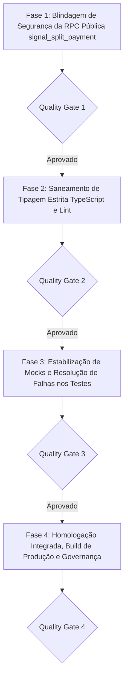

# PLANO DE IMPLEMENTAÇÃO — CORREÇÕES DA AUDITORIA, SEGURANÇA E ESTABILIZAÇÃO

> **Documento Canônico de Arquitetura, Segurança e Qualidade de Software**  
> **Status:** Proposto / Consolidado em 4 Fases Sequenciais com Portões de Qualidade (QG1–QG4)  
> **Arquivo:** `docs/plans/PLANO_CORRECOES_AUDITORIA_SEGURANCA_E_ESTABILIZACAO.md`  
> **Módulos Afetados:** `supabase/migrations/`, `src/tests/`, `src/components/modules/`, `src/features/transactions/`, `src/features/public-share/`, `src/features/cards/`, `src/features/settings/`, `src/features/budgets/`, `src/app/`  
> **Governança:** TypeScript Estrito (Zero `any`/`@ts-ignore`) · Segurança RLS & RPCs Transacionais (D1, D4) · Zero Emojis (`local/no-decorative-unicode`) · Zero Controles Nativos · Portões de Qualidade por Fase  
> **Data:** Novembro de 2026 · **Ambientes:** Web Desktop, Web PWA & Android Nativo (Capacitor Pro)  
> **Nota de Escopo:** O módulo de investimentos segue o plano específico em andamento (`PLANO_AUDITORIA_E_PRECISAO_RENTABILIDADE_INVESTIMENTOS.md`) e não é afetado por este documento.

---

## 1. VISÃO GERAL E DIAGNÓSTICO DA AUDITORIA

A auditoria completa identificou 4 áreas críticas que demandam intervenção imediata para garantir a segurança, integridade de tipos e estabilidade das suítes de teste após as recentes adições de funcionalidades (Racha Pix / Links Públicos, Metas Coletivas, Modo Orçamento Familiar e Renegociação de Dívidas):

```
┌────────────────────────────────────────────────────────────────────────────────────────┐
│              MATRIZ DE REMEDIAÇÃO — SEGURANÇA, COMPILAÇÃO E TESTES                     │
└────────────────────────────────────────────────────────────────────────────────────────┘
                                            │
        ┌───────────────────────────────────┼───────────────────────────────────┐
        ▼                                   ▼                                   ▼
 [SEGURANÇA & RPCs]                 [TIPAGEM E LINT]                   [TESTES & MOCKS]
 • RPC signal_split_payment         • 20 erros de tipo (tsc -b)        • 12 arquivos de teste
 • Proteção contra DoS em JSONB     • Contratos de Debt e Split        • Mocks de @/state sem novos
 • Validação e limites de strings   • MoneyInputProps alinhado           hooks (useFamilyMode, etc.)
 • Sanitização de valores           • Limpeza de import não usado      • Alinhamento com Regra 19
```

---

## 2. ESTRUTURA DO PLANO EM 4 FASES SEQUENCIAIS



---

### FASE 1: Blindagem de Segurança da RPC Pública `signal_split_payment`

> **Objetivo:** Mitigar o risco de negação de serviço (DoS), corrupção de payload e injeção de dados por chamadas anônimas abusivas na rota pública `/r/:token`, adequando a função aos padrões do `security-audit.test.ts`.

#### Tarefa 1.1: Nova Migração com Hardening e Sanitização Estrita
- **Arquivo de Destino:** `supabase/migrations/20260101000075_harden_signal_split_payment_rpc.sql` (ou atualização canônica de `20260101000071_create_signal_split_payment_rpc.sql`).
- **Ações de Blindagem:**
  1. **Validação de Entrada:**
     - `p_amount_cents`: deve ser estritamente maior que 0 (`p_amount_cents > 0`) e não exceder `(v_payload->>'total_cents')::bigint * 2` (prevenção contra estouro de inteiros ou valores absurdos).
     - `p_participant_name`: comprimento obrigatório entre 1 e 80 caracteres após `trim` (`length(trim(p_participant_name)) between 1 and 80`).
     - `p_token`: formato rígido alfanumérico com comprimento de token seguro (64 caracteres hexadecimais).
  2. **Trava Ativa contra Negação de Serviço (DoS):**
     - Estabelecer teto de **no máximo 50 sinais** registrados no array `payment_signals`. Caso exceda, rejeitar a requisição (`raise exception 'Limite de sinalizações atingido para este compartilhamento'`).
     - Deduplicação inteligente: se já houver um sinal pendente recente com o mesmo nome ou ID do participante nos últimos 10 minutos, reutilizar ou bloquear repetição imediata para evitar inchaço da coluna `payload`.
  3. **Manter Permissão Estrita de Execução:** `grant execute on function public.signal_split_payment to anon, authenticated, service_role;`.

#### Tarefa 1.2: Adequação do Guard Automatizado de Segurança
- **Arquivo:** `src/tests/security-audit.test.ts`
- **Ações:**
  - No teste `toda escrita composta ativa valida o dono (auth.uid()) no corpo — exceto triggers`, registrar a exceção fundamentada de acesso público intencional da RPC `signal_split_payment`, condicionada à presença das checagens defensivas (`is_revoked = false`, verificação de expiração e limites de tamanho/quantidade no payload).
  - Adicionar teste específico de penetração/segurança validando que a RPC rejeita nomes com mais de 80 caracteres, valores nulos ou negativos, e links expirados/revogados.

#### 🛡️ Quality Gate 1 (QG1) — Validação de Segurança
- `npx vitest run src/tests/security-audit.test.ts` executando com **100% de aprovação (53/53 testes verdes)**.
- Comprovação estática de que a RPC pública não permite injeção de dados sem limites nem escrita arbitrária fora do escopo do token.

---

### FASE 2: Saneamento de Tipagem Estrita TypeScript (`tsc -b`) e Lint

> **Objetivo:** Eliminar todos os 20 erros do compilador estrito `tsc -b` e o alerta de lint, garantindo fidelidade contratual entre schemas, componentes e chamadas de API.

#### Tarefa 2.1: Correção nos Componentes de Split / Racha Pix
- **Arquivos:**
  - `src/components/modules/manage-split-dialog.tsx`: substituir prop inexistente `onChangeCents` pela prop canônica aceita pelo primitivo `MoneyInput` (`onCentsChange` ou `value / onChange`).
  - `src/components/modules/pending-split-signals-card.tsx`:
    * Remover o acesso às propriedades inexistentes `linkedDebt.remaining_amount` e `linkedDebt.original_amount`.
    * Utilizar a propriedade canônica `linkedDebt.amount` conforme definido em `src/types/schema.ts`.
  - `src/features/transactions/components/active-splits-card.tsx`:
    * Substituir `variant="neutral"` no `Badge` por uma variante homologada do design system (`variant="muted"` ou `variant="default"`).
  - `src/features/public-share/components/select-participant-dialog.tsx`:
    * Tratar `participant.id` nulo/undefined garantindo fallback seguro (`setSelectedId(participant.id ?? "")`).

#### Tarefa 2.2: Correção nos Diálogos de Transações e Wizard
- **Arquivos:**
  - `src/features/transactions/components/expense-detail-dialog.tsx`:
    * Adicionar verificação de nulidade em `expense` antes de acessar `expense.category_id` (linhas 777 e 778).
    * Normalizar `categoryIcon` para `string | undefined` (`icon ?? undefined`) para evitar erro de tipo com `string | null`.
  - `src/features/transactions/wizard/launch-wizard.tsx`:
    * Normalizar `categoryIcon` para `string | undefined` no payload de despesa criada.
    * Remover o import não utilizado `CUSTOM_WEIGHT_VALUE` da linha 60, zerando os erros do ESLint.

#### Tarefa 2.3: Correção de Contratos nos Mocks dos Testes de Split
- **Arquivos:**
  - `src/components/modules/pending-split-signals-card.test.tsx`:
    * Adicionar propriedades obrigatórias no mock `SplitSharePayload` (`remainder_policy`, `host_name`, `host_city`, `pix_key`, etc.) e no mock `PublicShare` (`is_revoked`, `updated_at`).
  - `src/features/transactions/components/active-splits-card.test.tsx`:
    * Adicionar propriedades `expense_id` e `installment_group_id` nos objetos de teste do tipo `Debt`.

#### 🛡️ Quality Gate 2 (QG2) — Verificação de Tipos e Estilo
- Execução de `npm run typecheck` (`tsc -b`) retornando **0 erros**.
- Execução de `npm run lint` retornando **0 erros e 0 warnings**, com conformidade absoluta à regra `local/no-decorative-unicode`.

---

### FASE 3: Estabilização de Mocks e Resolução de Falhas nos Testes (Vitest)

> **Objetivo:** Atualizar os mocks de estado e asserções visuais para que todos os 12 arquivos de teste atualmente com falhas fiquem 100% verdes.

#### Tarefa 3.1: Atualização dos Mocks de `@/state` com Novos Hooks Globais
- **Causa Raiz:** Componentes como `ExpenseDetailDialog`, `FamilyBudgetShareCard` e `InterfaceShortcutsCard` passaram a consumir `useFamilyMode()` e `useMyPublicShares()`, que não foram declarados em mocks legados de `@/state`.
- **Arquivos a Atualizar:**
  - `src/features/cards/pages/cards-page.test.tsx`: incluir `useFamilyMode: vi.fn(() => ({ isFamilyModeEnabled: false, toggleFamilyMode: vi.fn(), isPending: false }))` no mock.
  - `src/features/settings/components/tabs/account-tab.test.tsx`: incluir `useFamilyMode` e `useMyPublicShares` no mock.
  - `src/features/settings/components/tabs/appearance-tab.test.tsx`: incluir `useFamilyMode` no mock.
  - `src/features/settings/components/tabs/appearance-subcomponents.test.tsx`: envolver com `QueryClientProvider` ou adicionar mock de `useFamilyMode`.
  - `src/tests/accessibility-audit.test.tsx`: incluir `useFamilyMode` e `useMyPublicShares` nos testes de página.
  - `src/tests/keyboard-navigation.test.tsx`: incluir `useFamilyMode` e `useMyPublicShares` no mock de `@/state`.
  - `src/app/router.test.tsx`: incluir `useSignalSplitPayment` no mock de `@/state`.

#### Tarefa 3.2: Correção do Fluxo de Exclusão no `manage-split-dialog.test.tsx`
- **Arquivo:** `src/components/modules/manage-split-dialog.test.tsx`
- **Ação:**
  - No teste `"permite exclusão total selecionando também a exclusão da despesa original"`, alinhar o trigger do checkbox de exclusão de despesa e o clique de confirmação com os estados assíncronos do diálogo, garantindo que `mockDeleteExpense("exp-1")` seja disparado e capturado pelo `waitFor`.

#### Tarefa 3.3: Alinhamento dos Testes de Banners do Carrossel com a Regra 19
- **Arquivos:**
  - `src/components/modules/android-pro-banner.test.tsx`
  - `src/components/modules/pace-alert-banner.test.tsx`
- **Ação:**
  - Adequar as asserções de texto para usar matchers flexíveis (ex.: regex ou função de matcher de texto do Testing Library) para textos com formatação inline (`Consumido 75% do orçamento...`), refletindo a nova anatomia compacta unificada de 2 linhas obrigatória pelo `AGENTS.md` (§4, Regra 19).

#### 🛡️ Quality Gate 3 (QG3) — Testes Unitários e de Integração
- Execução isolada dos 12 arquivos de teste afetados:
  ```bash
  npx vitest run \
    src/tests/security-audit.test.ts \
    src/app/router.test.tsx \
    src/features/cards/pages/cards-page.test.tsx \
    src/features/settings/components/tabs/account-tab.test.tsx \
    src/features/settings/components/tabs/appearance-tab.test.tsx \
    src/features/settings/components/tabs/appearance-subcomponents.test.tsx \
    src/tests/accessibility-audit.test.tsx \
    src/tests/keyboard-navigation.test.tsx \
    src/components/modules/manage-split-dialog.test.tsx \
    src/components/modules/android-pro-banner.test.tsx \
    src/components/modules/pace-alert-banner.test.tsx \
    src/features/insights/components/recurrence-audit-modal.test.tsx
  ```
- **Resultado Esperado:** 100% de aprovação em todos os arquivos acima.

---

### FASE 4: Homologação Integrada, Build de Produção e Governança

> **Objetivo:** Validação integral do repositório em nível de CI/CD para assegurar que não haja regressões, quebras de build ou violações de regras.

#### Tarefa 4.1: Execução Integral da Suíte Completa de Testes
- Executar `npm run test:run` em todo o repositório (513 arquivos, ~4.900 testes).
- Garantir 0 falhas e 0 erros não tratados.

#### Tarefa 4.2: Verificação do Build de Produção Web & Capacitor Sync
- Executar `npm run build` (`tsc -b && vite build`).
- Confirmar que o pacote `dist/` é gerado sem avisos críticos e respeita os limites de bundle.

#### Tarefa 4.3: Atualização de Documentação Canônica
- Atualizar `docs/architecture/ESPECIFICACAO_TECNICA.md` documentando a blindagem de DoS na RPC `signal_split_payment` e a padronização das chamadas de links públicos.
- Mover este plano para `docs/plans/completed/` após a homologação bem-sucedida de todas as fases.

#### 🛡️ Quality Gate 4 (QG4) — Prontidão para Produção
- `npm run typecheck` verde.
- `npm run lint` verde.
- `npm test:run` (100% dos testes passando).
- `npm run build` com saída limpa.

---

## 3. MATRIZ DE RASTREABILIDADE DAS TAREFAS

| Tarefa | Arquivo Principal | Categoria | Portão |
|---|---|---|:---:|
| 1.1 | `supabase/migrations/*signal_split_payment*.sql` | Segurança / RPC | QG1 |
| 1.2 | `src/tests/security-audit.test.ts` | Testes / Segurança | QG1 |
| 2.1 | `src/components/modules/manage-split-dialog.tsx` + `active-splits-card.tsx` | Tipagem / Contratos | QG2 |
| 2.2 | `src/features/transactions/components/expense-detail-dialog.tsx` + `launch-wizard.tsx` | Tipagem / Linter | QG2 |
| 2.3 | `src/components/modules/pending-split-signals-card.test.tsx` + `active-splits-card.test.tsx` | Tipagem / Mocks | QG2 |
| 3.1 | Mocks de `@/state` em `cards-page`, `account-tab`, `appearance-tab`, `axe`, `keyboard` | Testes / Mocks | QG3 |
| 3.2 | `src/components/modules/manage-split-dialog.test.tsx` | Testes / Split | QG3 |
| 3.3 | `src/components/modules/android-pro-banner.test.tsx` + `pace-alert-banner.test.tsx` | Testes / Banners | QG3 |
| 4.1 | Suíte completa `npm test:run` | Homologação Geral | QG4 |
| 4.2 | `npm run build` | Build de Produção | QG4 |
| 4.3 | Documentação em `docs/` | Governança | QG4 |
