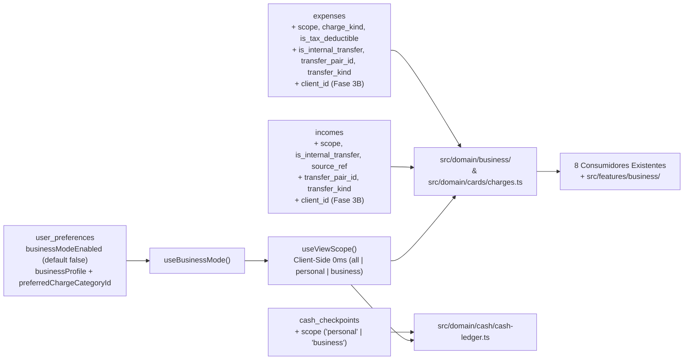

# Plano Mestre Arquitetural & Execução (v2.1 — Blueprint Definitivo) — Encargos de Cartão & Modo Negócio (MEI / Autônomo)

> **Status:** v2.1 — Blueprint Definitivo de Execução (Auditado ponta-a-ponta contra código, schema, UI/UX e regras de governança)  
> **Escopo:** (1) Gestão visual e matemática de encargos de cartão e custo do dinheiro (`charge_kind`); (2) Separação leve PF × PJ (**Modo Negócio / MEI / Profissional Liberal**) 100% opt-in; (3) Extensão do Dossiê Fiscal (`TaxFacilitatorModal`) e carteira leve de clientes com cobrança Pix blindada por LGPD.  
> **Premissas Inegociáveis:** **100% Online First** · **DRY estrito** · **SSOT em `src/domain/`** · **Centavos inteiros** · **Isolamento opt-in estrito (`businessModeEnabled ?? false`)** · **Zero complexidade de ERP**.

---

## 1. Visão Geral, Premissas Inegociáveis & Anti-Escopo Explícito

### 1.1 Problemáticas Resolvidas
1. **O "Custo Invisível" dos Juros e Atrasos no Cartão:** A coluna `charge_kind` (`'regular' | 'interest' | 'fine' | 'tax' | 'bank_fee'`) já existe em `expenses`, `recurrences` e `debts` (`20260101000014_charges_and_loans.sql`) e já é gravada automaticamente por `refinance_credit_card_bill` (`20260101000139_security_audit_remediation_and_rls_hardening.sql`), mas não está exposta na UI nem nos gráficos de composição.
2. **Mistura de Fluxo Pessoal (PF) e Profissional (PJ / Autônomo):** MEIs, psicólogos, dentistas, personal trainers, freelancers e pequenos lojistas misturam faturamento, custos operacionais, cartões e retiradas pessoais. ERPs tradicionais são burocráticos; apps PF comuns misturam tudo e escondem lucro real, provisão tributária e limite anual do MEI.

### 1.2 Premissas Inegociáveis
- **Isolamento Opt-in Estrito (`?? false`):** Diferente de `useFamilyMode` e `useTripMode` (hoje `?? true` em runtime), `useBusinessMode()` inicia **estritamente desligado (`?? false`)** e **jamais** é injetado em `src/data/repositories/profiles.ts`. Quando desligado: **zero** elementos extras de UI, **zero** queries adicionais e **zero** impacto no fluxo PF.
- **Acesso / Monetização (v1):** Disponível no **Trial + Plano Pro** reaproveitando o gate de assinatura existente (`useMutationGuard` / `useUserSubscription`). **Não** criar nova chave em `system_features` nem alterar políticas RLS de `can_current_user_write_module` na v1.
- **Blindagem de Desativação / Downgrade:** Se o usuário desativar o Modo Negócio depois (ou fizer downgrade de plano), nenhum dado é excluído, `/negocio` exibe estado informativo/somente-leitura, e a exclusão de `is_internal_transfer = true` nas visões consolidadas **permanece sempre ativa**.

### 1.3 Anti-Escopo Explícito (Proibido na v2.1)
- Assistente de Classificação Retroativa em Lote no onboarding;
- Pacotes / Sessões Pré-Pagas com máquina de estados de créditos;
- Emissão de NFS-e/NF-e, controle de estoque, folha de pagamento, múltiplos CNPJs/sócios ou contabilidade de partidas dobradas.

---

## 2. Contratos Arquiteturais & Regras Contábeis

### 2.1 Regime Contábil (DRE vs. Teto MEI vs. Escudo Tributário)
- **Teto MEI (Faturamento Anual):** Apurado por **Faturamento Bruto Recebido** no ano civil (`incomes` com `scope = 'business'` e `is_internal_transfer = false`, por `date`). Teto anual e valor do DAS são **100% parametrizáveis** em `UserPreferences.businessProfile` (nunca hardcoded sem override), com alertas em **70% (atenção)**, **85% (alerta)**, **100% (teto atingido)** e **120% (limite de tolerância com desenquadramento retroativo)**.
- **DRE Simplificado Mensal (Regime de Competência):**
  - `Receita Bruta` = soma de `incomes` (`scope = 'business'`, `!is_internal_transfer`).
  - `Custos Operacionais` = `sumWeightedCents` (`report_weight`) de `expenses` (`scope = 'business'`, `!is_internal_transfer`) excluindo impostos fiscais pagos (ver regra de desambiguação abaixo). O uso de `sumWeightedCents` garante que custos rachados (ex.: aluguel de consultório 50/50) contabilizem apenas a fração do titular.
  - `Lucro Operacional` = `Receita Bruta - Custos Operacionais`.
  - `Impostos Fiscais Pagos` = `sumWeightedCents` de despesas fiscais do negócio (regra abaixo).
  - `Retiradas (Pró-Labore)` = `expenses` com `scope = 'business'`, `is_internal_transfer = true`, `transfer_kind = 'pro_labore'`.
  - `Debts (receivable)` pendentes de negócio aparecem exclusivamente como indicador separado (**"A Receber / Inadimplência"**), nunca somados ao faturamento realizado.
- **Desambiguação Semântica de `charge_kind = 'tax'` (IOF de Cartão vs. Imposto Fiscal do Negócio):**
  - **Encargo financeiro de cartão (IOF):** `charge_kind = 'tax'` com `card_id IS NOT NULL` (ou `payment_method = 'credit_card'`). Entra no **Donut de Encargos do Cartão**, no **Radar Anti-Juros** e nos **Custos Operacionais** (quando `scope = 'business'`), mas **nunca** abate a provisão fiscal do Escudo Tributário.
  - **Imposto fiscal pago do negócio (DAS MEI, Carnê-Leão, ISS, Simples):** `scope = 'business'`, `charge_kind = 'tax'`, `is_internal_transfer = false`, **`card_id IS NULL` e `payment_method <> 'credit_card'`**.
  - **Escudo Tributário Líquido (`src/domain/business/tax-shield.ts`):** `provisaoLiquidaCents = Math.max(0, impostoEstimadoCents - impostosFiscaisPagosMesCents)`.
- **Perfis Adaptativos (`mei | liberal | micro_business`):**
  - Perfil `liberal` (ex.: psicólogo, dentista, advogado) **oculta** Termômetro MEI e seção DASN-SIMEI, priorizando **Livro-Caixa, Despesas Dedutíveis e Ponto de Equilíbrio**.
  - Perfil `mei` exibe Termômetro MEI e oferece no onboarding um **checkbox opcional** para criar recorrência mensal do DAS (`scope = 'business'`, `charge_kind = 'tax'`, `payment_method = 'pix' | 'transfer'`).

### 2.2 Transferências Internas Pareadas & Trigger Blindado
- **Modelo Único DRY:** Colunas simétricas adicionadas em `expenses` e `incomes`:
  - `is_internal_transfer boolean not null default false`
  - `transfer_pair_id uuid null`
  - `transfer_kind text null check (transfer_kind in ('pro_labore', 'capital_injection', 'card_reimbursement'))`
- **Semântica Matemática por Visão (`src/domain/business/scope-filter.ts`):**
  - **Visão Consolidada (`all`):** exclui **sempre** `is_internal_transfer = true` (zero dupla contagem em `Overview`, `CashLedger`, `Reports`, `Budgets` e `Insights`).
  - **Visão Pessoal (`personal`):** inclui `pro_labore` e `card_reimbursement` (entrada PF) e `capital_injection` (saída PF).
  - **Visão Negócio (`business`):** no **DRE**, exclui todo `is_internal_transfer = true` (impede que reembolso de cartão misto duplique o custo já lançado no cartão); no **Fluxo de Caixa PJ**, considera `pro_labore` e `card_reimbursement` como saída de caixa PJ e `capital_injection` como entrada de caixa PJ.
- **Imutabilidade na UI (Padrão `[REFUND]`):** Seguindo o padrão `isReadOnly` já adotado em `src/features/transactions/components/income-detail-dialog.tsx`, registros com `transfer_pair_id IS NOT NULL` são **imutáveis** em valor/data/escopo na UI, exibindo badge informativo + botão único **"Excluir transferência pareada"** (`delete_internal_transfer_pair`).
- **Trigger Postgres Blindado (Backup & LGPD Safe):**
  - Trigger `BEFORE UPDATE OR DELETE` em `expenses` e `incomes` bloqueia mutação isolada quando `OLD.transfer_pair_id IS NOT NULL`, exceto se `current_setting('app.allow_pair_mutation', true) = 'true'`.
  - Os **4 RPCs autorizados** executam `PERFORM set_config('app.allow_pair_mutation', 'true', true);` antes de operar:
    1. `delete_internal_transfer_pair(p_transfer_pair_id uuid)`
    2. `restore_backup(p_backup jsonb)` *(RPC vigente em `20260101000127_unify_scoring_governance_and_sector_scope.sql`)*
    3. `delete_current_user_account()` *(LGPD — `20260101000122_fix_rpc_syntax_errors_and_foreign_key_indexes.sql`)*
    4. `admin_delete_user(...)` *(expurgo administrativo — `20260101000122_fix_rpc_syntax_errors_and_foreign_key_indexes.sql`)*

### 2.3 Isolamento do Checkpoint PJ (`cash_checkpoints`)
- Adicionar `scope text not null default 'personal' check (scope in ('personal', 'business'))` em `cash_checkpoints`, com índice composto `(user_id, scope, date desc, created_at desc)`.
- Atualizar `getLatestCashCheckpoint(scope = 'personal')` em `src/data/repositories/cash-checkpoints.ts` para filtrar explicitamente `.eq("scope", scope)`.
- **Garantia anti-dupla contagem de saldo:** visões `all` e `personal` leem **exclusivamente** `scope = 'personal'` (nunca somam checkpoint PJ ao saldo consolidado); visão `business` lê **exclusivamente** `scope = 'business'` e, na ausência dele, exibe **"Fluxo Líquido do Período"** com CTA discreto para ancorar o saldo PJ.

### 2.4 Aritmética Exata de `pay_card_bill_with_charges` (Competência `M` vs. `M+1`)
Validada contra `invoiceBalance` / `buildCompetenceSummaries` (`src/domain/cards/index.ts`) e `resolveCashFlowEvents` (`src/domain/cash/cash-ledger.ts`):
- **Modo `M` ("Lançar nesta fatura — pago agora"):**
  - Insere 1..N linhas de encargo em `expenses` com `bill_competence = M`, `payment_method = 'credit_card'`, `charge_kind in ('interest', 'fine', 'tax', 'bank_fee')`.
  - Insere `card_payment` na competência `M` com `amount = nominal_pago + soma(encargos_M)`.
  - **Resultado exato:** `previsto_M` sobe pelos encargos e `pago_M` cobre `nominal + encargos` → `saldo_M = 0` (`status = "closed"`, zero saldo fantasma). Em `cash-ledger.ts`, como despesas de cartão são desacopladas do caixa diário, **somente** o `card_payment` (`nominal + encargos`) sai da conta corrente — batendo ao centavo com o débito bancário real.
- **Modo `M+1` ("Lançar na próxima fatura"):**
  - Insere 1..N linhas de encargo em `expenses` com `bill_competence = shiftMonth(M, +1)`.
  - Insere `card_payment` na competência `M` com `amount = nominal_pago`.
  - **Resultado exato:** fatura `M` fecha quitada pelo nominal, encargos entram na competência `M+1`, e o caixa diário deduz apenas o valor efetivamente pago hoje.
- **Conexão automática com refinanciamento e deduplicação:** `refinance_credit_card_bill` já grava `charge_kind = 'interest'`, entrando automaticamente no Donut e no Radar Anti-Juros. No importador (`src/domain/reconciliation/scorer.ts`), conceder bônus de match quando `inferredChargeKind !== 'regular'` coincide com `existing.chargeKind`.

### 2.5 Retrocompatibilidade Total de `restore_backup(p_backup jsonb)`
Como `restore_backup` (`20260101000127`) usa `jsonb_populate_recordset`, colunas ausentes em backups JSON legados chegam como `NULL`. Todos os `INSERT`s atualizados devem aplicar `coalesce` seguro:
- `expenses`: preservar `coalesce(nullif(e.charge_kind, ''), 'regular')` (corrige lacuna atual já na Fase 1/2A), `coalesce(nullif(e.scope, ''), 'personal')`, `coalesce(e.is_internal_transfer, false)`, `e.transfer_pair_id`, `e.transfer_kind`, `coalesce(e.is_tax_deductible, false)` e, na Fase 3B, `e.client_id` validado com `left join public.business_clients bc on bc.id = e.client_id and bc.user_id = v_uid`.
- `incomes`: `coalesce(nullif(i.scope, ''), 'personal')`, `coalesce(i.is_internal_transfer, false)`, `i.transfer_pair_id`, `i.transfer_kind` e `client_id` seguro na Fase 3B.
- `categories` / `credit_cards` / `debts` / `cash_checkpoints`: `coalesce(nullif(scope, ''), 'personal')` (e `charge_kind` em `debts`).

### 2.6 Blindagem LGPD (Fase 3B — Clientes & Cobrança Pix)
- Na UI de `business_clients`, o campo `notes` é rotulado **"Observações de faturamento"** com aviso discreto orientando a não registrar dados clínicos ou sensíveis.
- O payload retornado pelo RPC público em `public_shares` (`SECURITY DEFINER`) é estritamente sanitizado: expõe **apenas** apelido/primeiro nome público, valor, vencimento e chave/payload Pix — **jamais** `notes`, e-mail, telefone ou descrição privada.

---

## 3. Contratos de UX, Fricção Mínima & Integração Holística

### 3.1 Posicionamento Responsivo do `<ViewScopeSwitcher />` e Persistência de Sessão
Inspecionando `src/components/layout/mobile-topbar.tsx` (16 linhas: apenas logo + divisor) e `desktop-topbar.tsx` (slots de ícones à direita):
- **Desktop (`lg:`):** `<ViewScopeSwitcher />` compacto (`Tudo | Pessoal | Negócio`) posicionado na área de cabeçalho/toolbar das rotas com escopo.
- **Mobile (`< lg`):** **Nunca** espremer dentro da `MobileTopbar`. Renderizar como faixa contextual compacta full-width (`grid-cols-3`, zero overflow horizontal — Regra 22) **imediatamente abaixo do `<PageHeader />`**, visível **somente** quando `isBusinessModeEnabled && isScopedRoute`.
- **Rotas sem escopo (`/investimentos`, `/familia`, `/configuracoes`, `/metas`):** o switcher fica oculto, mas o valor em `useViewScope()` é preservado em memória/sessão ao retornar para rotas com escopo (`/visao-geral`, `/transacoes`, `/cartoes`, `/orcamentos`, `/dividas`, `/relatorios`, `/insights`).

### 3.2 Fricção Mínima no Wizard de Lançamento & Encargos
- **Pré-seleção inteligente de escopo:** Ao abrir `LaunchWizard`, `initialValues.scope` herda automaticamente `viewScope === 'business' ? 'business' : 'personal'` (zero toque extra para quem está operando no contexto Negócio).
- **`LaunchContextSelector` em 2 níveis (somente quando `businessModeEnabled = true`):**
  - Nível 1: segmento compacto `Pessoal | Negócio` (2 opções, cabe confortavelmente em 360px sem quebra feia).
  - Nível 2: chips compatíveis (`Pessoal` → `Individual | Família | Viagem | Racha`; `Negócio` → `Operacional | Viagem a trabalho | Racha de custo`, bloqueando `Família + Negócio`).
- **Categorias inteligentes:** Prioriza/filtra categorias compatíveis (`business` + `both` em Negócio; `personal` + `both` em Pessoal) com opção discreta *"Mostrar todas"* caso o usuário queira reutilizar uma categoria PF no negócio — nunca deixando o select vazio.
- **Categoria padrão de encargos:** Espelhando `preferredTripCategoryId` em `src/features/transactions/wizard/use-launch-wizard-state.ts`, adicionar `preferredChargeCategoryId` opcional em `UserPreferences` para pré-selecionar a categoria de juros/encargos no `CardChargeDialog` e `PaymentDialog` (com fallback seguro caso a categoria seja excluída).
- **Zero `autoFocus` declarativo:** Respeitar rigorosamente a Regra 20 do `AGENTS.md` em todos os novos modais (`CardChargeDialog`, `InternalTransferDialog`, `BusinessClientFormDialog`) e manter `text-base sm:text-sm` nos inputs para evitar auto-zoom no iOS.

### 3.3 Reembolso de Cartão Misto em 1 Clique & Proteção contra Duplicidade (Zero Tabela Extra)
- Em cartões `scope = 'mixed'`, `invoice-kpis-section.tsx` exibe barra de rateio *"R$ X Pessoal · R$ Y Negócio"* + botão **"Registrar Reembolso PJ → PF"**.
- O clique abre `InternalTransferDialog` **pré-preenchido** (`transferKind = 'card_reimbursement'`, valor exato `R$ Y`, data atual e descrição sugerida `"Reembolso fatura <Cartão> (<Mês>)"`).
- **Proteção determinística contra reembolso duplicado (DRY):** O RPC `create_internal_transfer_pair` grava a chave determinística `source_ref = '[REIMBURSEMENT]' || cardId || ':' || competenceMonth` na perna de `incomes` (coluna `source_ref` **já existe** em `incomes`!). `card-reimbursement.ts` soma os reembolsos já vinculados àquela chave e exibe:
  - Se `reembolsado >= totalNegocio`: `<Badge size="xs" variant="positive">Reembolsado</Badge>` (desabilita o CTA repetido);
  - Se `0 < reembolsado < totalNegocio`: pré-preenche apenas a diferença restante (`totalNegocio - reembolsado`).

### 3.4 Matriz de Invalidação de Cache (TanStack Query)

| Mutação / RPC Novo | Query Keys Invalidadas Atomicamente |
|---|---|
| `pay_card_bill_with_charges` | `["card-payments"]`, `["expenses"]`, `["invoices"]`, `["cash-checkpoints"]` / fluxo de caixa, `["overview"]`, `["budgets"]`, `["reports"]` |
| `create_internal_transfer_pair` / `delete_internal_transfer_pair` | `["expenses"]`, `["incomes"]`, `["overview"]`, `["budgets"]`, `["reports"]`, `["cash-checkpoints"]` (recalcula `useRealCashBalance`), `["invoices"]` (quando `card_reimbursement`) |
| `toggleBusinessMode` / atualizar `businessProfile` | `["user-preferences"]` |
| `createCashCheckpoint` (com `scope`) | `["cash-checkpoints"]` |
| `business_clients` CRUD (Fase 3B) | `["business-clients"]`, `["debts"]`, `["incomes"]` |

### 3.5 Estados Vazios, Divisão por Zero, Tema OLED & Sensorial
- **Zero `NaN%` / gráficos quebrados:** Todas as funções puras em `src/domain/cards/charges.ts` e `src/domain/business/` protegem denominadores (`total <= 0 ? 0 : ...`). Mês sem faturamento, sem custos ou sem checkpoint PJ usa `<EmptyState tone="default" />` calmo (Regra 14).
- **Tema Light / Dark / OLED & Governança Visual:** Superfícies sempre em `border-border/80 bg-surface shadow-xs` (Regra 16), ícones Nível 1 (`size-4 text-muted-foreground` ou semântico puro, sem caixas decorativas em cards comuns — Regra 13), badges estritamente `size="xs" | "sm" | "md"` (Regra 14), valores monetários sempre com `<MoneyText />` (Regra 11) e feedbacks táteis/sonoros exclusivamente via `src/services/sensory.ts` (Regra 17).

---

## 4. Arquitetura de Dados & Mapa Real de Impacto

### Os 8 Consumidores Reais de `expenses` / `incomes` (Raio de Explosão — Fase 2A)
1. **Caixa & Safe-to-Spend:** `src/state/queries/use-real-cash-balance.ts` + `src/domain/cash/cash-ledger.ts`
2. **Home (Overview):** `src/features/overview/hooks/use-overview-data.ts` + `src/features/overview/hooks/use-smart-advisor-queries.ts`
3. **Extrato & Detalhes:** `src/features/transactions/components/list/use-transaction-list.ts` + `src/features/transactions/components/use-expense-detail-actions.ts` + `src/features/transactions/components/use-income-detail-actions.ts`
4. **Orçamentos:** `src/features/budgets/components/use-budgets-page.ts` + `src/features/budgets/components/budgets-limits-derived.ts`
5. **Relatórios Financeiros:** `src/features/reports/hooks/use-finance-report-data.ts` + `src/features/reports/components/tabs/financial-expenses-breakdown-card.tsx`
6. **Insights:** `src/features/insights/hooks/use-insights-dashboard-data.ts` + `src/domain/insights/smart-advisor-rules.ts`
7. **Cartões & Reconciliação:** `src/state/queries/use-card-payments.ts` + `src/features/cards/components/statement-import-helpers.ts` + `src/domain/reconciliation/scorer.ts`
8. **Shell & Navegação:** `src/components/layout/sidebar.tsx`, `bottom-nav.tsx`, `more-menu-sheet.tsx`, `page-shell.tsx`

---

## 5. Plano de Execução Modularizado (5 Entregas Independentes)

### Fase 1 — Encargos de Cartão (`charge_kind`) & Donut de Custo do Dinheiro *(1 sprint)*
- **Criar:**
  - `supabase/migrations/2026..._pay_card_bill_with_charges.sql` (RPC `pay_card_bill_with_charges` com contrato exato `M` vs `M+1` + `audit_events` + preservação de `charge_kind` em `restore_backup`).
  - `src/domain/cards/charges.ts` + `charges.test.ts` (`summarizeInvoiceCharges`, `inferChargeKindFromDescription`).
  - `src/features/cards/components/card-charge-dialog.tsx` + `.test.tsx`.
  - `src/features/cards/components/invoice-composition-donut-card.tsx` + `.test.tsx` (reutilizando `<ReportDonutChart />`).
- **Modificar:**
  - `src/types/schema.ts` (`preferredChargeCategoryId` em `UserPreferences`), `src/data/rpc/cards.ts`, `src/state/mutations/use-card-mutations.ts`, `src/lib/labels.ts` (`CHARGE_KIND_LABELS`, alinhado a `src/features/debts/components/debt-penalties-fields.tsx`).
  - `src/features/cards/components/payment-dialog.tsx`, `invoice-competence-toolbar.tsx`, `cards-page-modals.tsx`, `statement-import-helpers.ts`.
  - `src/domain/reconciliation/scorer.ts` + `reconciliation.test.ts`.
  - `src/domain/calculation-memory/builders/invoice-breakdown.ts` + `.test.ts`.
  - `src/domain/reports/index.ts`, `src/features/reports/components/tabs/financial-expenses-breakdown-card.tsx` (4ª aba `"Encargos"`).
  - `src/components/modules/transaction-row.tsx`, `src/features/transactions/wizard/details-primary-fields.tsx`, `src/features/transactions/components/expense-edit-form.tsx`, `src/features/budgets/components/budget-category-row.tsx`.
  - `src/domain/insights/smart-advisor-rules.ts` + `.test.ts` (Radar Anti-Juros), `src/domain/demo-simulation/mock-finances.ts` (1 encargo de demonstração).
- **DoD:** `npm run lint`, `npm run typecheck`, `npm test` 100% verdes; `pay_card_bill_with_charges` fecha fatura `M` sem saldo fantasma e bate no `cash-ledger.ts`; `refinance_credit_card_bill` aparece automaticamente no Donut; deduplicação validada em teste unitário.

---

### Fase 2A — Fundação de Dados PF×PJ, Isolamento Opt-in & Integração nos 8 Consumidores *(1 sprint)*
- **Criar:**
  - `supabase/migrations/2026..._business_scope_and_internal_transfers.sql` (`scope` em `expenses`, `incomes`, `recurrences`, `debts`, `categories`, `credit_cards`, `cash_checkpoints`; colunas simétricas de transferência; índice `(user_id, scope, date desc, created_at desc)` em `cash_checkpoints`; trigger `BEFORE UPDATE/DELETE` blindado; RPCs `create_internal_transfer_pair` com `source_ref` opcional e `delete_internal_transfer_pair`; `set_config('app.allow_pair_mutation', 'true', true)` + `coalesce` legado em `restore_backup`, `delete_current_user_account` e `admin_delete_user`).
  - `src/domain/business/scope-filter.ts` + `.test.ts`.
  - `src/data/rpc/business.ts` + `.test.ts`.
  - `src/state/queries/use-business-mode.ts` + `.test.tsx` (`?? false` estrito, gate Trial/Pro).
  - `src/state/hooks/use-view-scope.ts` + `.test.tsx` (client-side 0 ms).
  - `src/components/layout/view-scope-switcher.tsx` + `.test.tsx`.
- **Modificar:**
  - `src/types/schema.ts`, `src/types/database.ts`.
  - Repositórios: `src/data/repositories/expenses.ts`, `incomes.ts`, `recurrences.ts`, `debts.ts`, `categories.ts`, `credit-cards.ts`, `cash-checkpoints.ts` (filtro explícito por `scope`).
  - `src/domain/export/backup.ts` + `.test.ts` (preservação de `transfer_pair_id` + retrocompatibilidade de backup legado).
  - `src/features/settings/components/tabs/interface-shortcuts-card.tsx` (toggle opt-in Modo Negócio).
  - Os 8 consumidores da Seção 4 + `expense-detail-dialog.tsx` e `income-detail-dialog.tsx` (imutabilidade + botão único `"Excluir transferência pareada"`).
  - `src/features/transactions/wizard/launch-context-selector.tsx`, `wizard-types.ts`, `use-launch-wizard-state.ts`, `use-launch-wizard-submit.ts` (2 níveis, pré-seleção por `viewScope`, filtro inteligente de categorias e flag `is_tax_deductible`).
  - `src/components/layout/page-shell.tsx`, `sidebar.tsx`, `bottom-nav.tsx`, `more-menu-sheet.tsx`.
- **DoD:** Suíte de regressão PF provando 0 elementos extras e 0 queries extras com `businessModeEnabled = false`; pgTAP validando bloqueio de mutação isolada de par + sucesso de `delete_internal_transfer_pair`, `restore_backup` (com JSON legado), `delete_current_user_account` e `admin_delete_user`; desativação posterior mantendo zero dupla contagem.

---

### Fase 2B — Feature `/negocio` (DRE, Escudo Tributário, Cartão Misto & Memória de Cálculo) *(1 sprint)*
- **Criar:**
  - `src/domain/business/dre-calculator.ts`, `tax-shield.ts` (com filtro `card_id === null`), `mei-limit.ts`, `break-even.ts`, `card-reimbursement.ts` (com detecção determinística via `source_ref`) + respectivos `*.test.ts`.
  - `src/domain/calculation-memory/builders/business-breakdown.ts` + `.test.ts`.
  - `src/features/business/pages/business-page.tsx` + `index.ts`.
  - `src/features/business/components/business-onboarding-empty-view.tsx` (perfis `mei | liberal | micro_business`, criação idempotente opcional de categorias iniciais de negócio e checkbox opcional de recorrência mensal do DAS para MEI).
  - `src/features/business/components/business-dre-card.tsx`, `mei-ceiling-card.tsx`, `tax-shield-card.tsx`, `break-even-card.tsx`, `internal-transfer-dialog.tsx`.
- **Modificar:**
  - `src/app/router.tsx` (rota `/negocio` com estado informativo se desativado).
  - `src/features/cards/components/invoice-kpis-section.tsx` (resumo de rateio PF/PJ em cartão `mixed` + botão 1 clique **"Registrar Reembolso PJ → PF"** + badge `"Reembolsado"` quando quitado).
  - `src/domain/reports/build-excel-workbook.ts` (aba `"Negócio (DRE)"` condicional).
- **DoD:** DRE bate ao centavo com despesas rachadas (`sumWeightedCents`); IOF de cartão não abate o Escudo Tributário; reembolso duplicado bloqueado via `source_ref`; perfil `liberal` 100% livre de jargão MEI; Memória de Cálculo (`?`) ativa em todos os KPIs.

---

### Fase 3A — Dossiê Fiscal Expandido (`TaxFacilitatorModal`: IRPF + DASN-SIMEI / Livro-Caixa) *(1 sprint)*
- **Criar:**
  - `src/domain/reports/tax-business-summary.ts` + `.test.ts`.
  - `src/features/reports/components/tax-facilitator/TaxDeductiblesSection.tsx` e `TaxBusinessSummarySection.tsx`.
- **Modificar:**
  - `src/features/reports/components/tax-facilitator-modal.tsx` + `.test.tsx` (seções condicionais preservando `OFFICIAL_TAX_FACILITATOR_DISCLAIMER`).
- **DoD:** PDF A4 imprimível sem quebra; perfil `liberal` exibe Livro-Caixa e oculta DASN-SIMEI; perfil `mei` exibe tabela mês a mês pronta para cópia.

---

### Fase 3B — Clientes Leves, Cobrança Pix Sanitizada (LGPD) & Inferência de Escopo *(1 sprint)*
- **Criar:**
  - `supabase/migrations/2026..._business_clients_and_sanitized_pix_share.sql` (`business_clients` com RLS `auth.uid()`; `client_id` opcional em `incomes`, `debts`, `recurrences`; RPC público sanitizado em `public_shares`; atualização de `restore_backup`, `delete_current_user_account` e `admin_delete_user`).
  - `src/data/repositories/business-clients.ts` + `.test.ts`.
  - `src/state/queries/use-business-clients.ts` (`enabled: isBusinessModeEnabled`) + `src/state/mutations/use-business-client-mutations.ts`.
  - `src/features/business/components/business-clients-tab.tsx` + `business-client-form-dialog.tsx` (`notes` rotulado *"Observações de faturamento"* com aviso LGPD).
- **Modificar:**
  - `src/domain/export/backup.ts` (`"business_clients"` em `BACKUP_TABLE_KEYS` **antes** de `incomes`/`expenses`/`debts`).
  - `src/features/business/pages/business-page.tsx` (aba `"Clientes & Recebimentos"`).
  - `src/features/transactions/wizard/use-receipt-autofill.ts` / `merchantLearning` (inferência automática de `scope = 'business'`).
- **DoD:** pgTAP provando que o RPC público de cobrança Pix **nunca** retorna `notes`, e-mail ou dados sensíveis; Backup/Restore restaura `business_clients` antes das tabelas filhas sem erro de FK; zero queries de `business_clients` com `businessModeEnabled = false`.

---

## 6. Checklist de Governança (`AGENTS.md`, DRY, Regra 33, Zero Regressão PF)

- [ ] **DRY de UI:** Reutilizar `<ReportDonutChart />`, `<ReportTable />`, `<ReportDocumentLayout />`, `<Modal />`, `<ModalFooter />`, `<PageHeader />`, `<Chip />`, `<Badge size="xs|sm|md" />`, `<MoneyText />`, `<EmptyState />`, `LaunchContextSelector` e `pix-key-input-fields.tsx`.
- [ ] **Domínio Puro:** Zero cálculo financeiro em componente/hook; tudo em `src/domain/` com centavos inteiros, proteção contra divisão por zero e testes Vitest colocalizados.
- [ ] **Atomicidade (D1):** `pay_card_bill_with_charges`, `create_internal_transfer_pair` e `delete_internal_transfer_pair` sempre via RPC Postgres transacional + `audit_events`.
- [ ] **Zero Elementos Nativos, Zero Emojis, Zero `autoFocus`:** Apenas primitivos de `src/components/ui/`, ícones `lucide-react` (Nível 1/Nível 2), inputs `text-base sm:text-sm`, feedbacks via `src/services/sensory.ts` e `npm run lint` verde.
- [ ] **Regra 33 (Memória de Cálculo):** Todos os novos KPIs de Encargos e Negócio plugados em `src/domain/calculation-memory/builders/`.
- [ ] **Zero Regressão PF:** Verificação automatizada garantindo que `businessModeEnabled = false` mantém UI, rede, saldos e backups 100% idênticos ao comportamento atual.
