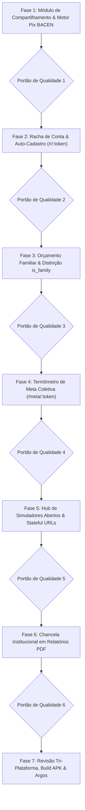

# Plano de Implementação — Ferramentas Utilitárias de Compartilhamento & Crescimento Orgânico

> **Data de Criação:** 04/11/2026  
> **Status:** Pronto para Execução (Night Shift / Argos Sandbox)  
> **Escopo:**  
> 1. Racha de Conta & Pix Copia e Cola BACEN (BR Code EMV QRCPS-MPM) com valor embutido e auto-cadastro.  
> 2. Painel de Orçamento Familiar Dinâmico (Distinção `is_family` no formulário e link somente leitura seguro).  
> 3. Termômetro de Meta Coletiva (Transparência de arrecadação em metas conjuntas com Pix).  
> 4. Hub de Simuladores Financeiros Abertos & Stateful URLs (Dívidas, Rebalanceamento e Juros Compostos).  
> 5. Chancela Institucional Sóbria em Relatórios e Extratos em PDF.  
> 6. Homologação Tri-Plataforma (Desktop, PWA e Android), Build Web, Build APK e Despacho Argos.  

---

## 1. Visão Geral & Filosofia de Crescimento do Produto

O **Áxis Finance** é uma plataforma focada em sobriedade, precisão matemática e design executivo. O crescimento orgânico do produto é estruturado sob o conceito de **Product-Led Growth (PLG) Utilitário**:
- **Zero Gamificação Infantil:** Sem joguinhos, moedas virtuais ou medalhas.
- **Viralidade Orgânica por Utilidade Real:** A divulgação acontece porque as ferramentas resolvem dores reais de divisão, planejamento familiar e conferência financeira entre duas ou mais pessoas.
- **Privacidade Bancária Intacta:** Links públicos expõem apenas a fração autorizada pelo usuário (ex.: o valor da fatia de uma pizza ou o saldo restante do mercado), mantendo contas bancárias, saldos reais e extrato pessoal 100% blindados.

---

## 2. Fragilidades Técnicas Antecipadas & Soluções de Engenharia

| Funcionalidade | Fragilidade Mapeada | Solução de Engenharia Integrada no Plano |
|---|---|---|
| **Racha de Conta & Pix** | Erro de centavos na divisão (ex.: R$ 100,00 ÷ 3 = R$ 33,33 x 3 = R$ 99,99; falta 1 centavo). | Algoritmo puro de rateio (`split-math.ts`) que distribui determinísticamente o resto de centavos ao anfitrião. |
| **Pix Copia e Cola** | Chave Pix cadastrada sem nome ou cidade gerando "QR Code Inválido" no banco do pagador. | Gerador EMV QRCPS-MPM com validação estrita dos campos obrigatórios do Banco Central e CRC16. |
| **Orçamento Familiar** | Vazamento acidental de detalhes bancários confidenciais do titular para o parceiro/família. | RPC seguro `SECURITY DEFINER` que projeta apenas teto, total gasto e saldo restante da categoria autorizada. |
| **Simuladores Públicos** | URLs de compartilhamento quebrando em aplicativos de mensagens por excesso de caracteres. | Codificação compacta URL-safe via Base64/LZ com fallback seguro para parâmetros padrão. |
| **Páginas Públicas** | Exigência de login/cadastro gerando abandono imediato pelo convidado (>90%). | Páginas ultraleves que abrem em <400ms sem login; cadastro é opcional e serve para inaugurar a conta. |

---

## 3. Estrutura do Plano de Implementação

O plano é dividido em **7 Fases**, com etapas em checklist Markdown (`- [ ]`) e **Portão de Qualidade** obrigatório ao final de cada fase.



---

## Fase 1: Módulo Central de Compartilhamento & Motor Pix BACEN (BR Code EMV)

Estruturar a camada pura de dados e o motor de geração de Pix Copia e Cola compatível com qualquer banco do Brasil.

- [ ] **Tarefa 1.1: Migração PostgreSQL para Tokens de Compartilhamento Público**
  - Criar migração `supabase/migrations/20260101000065_create_public_shares_table.sql`:
    - Tabela `public_shares` com colunas:
      - `id uuid primary key default gen_random_uuid()`
      - `user_id uuid references auth.users(id) on delete cascade not null`
      - `kind text not null` (`split`, `family_budget`, `goal_tracker`)
      - `token text unique not null` (nanoid / string curta)
      - `payload jsonb not null`
      - `created_at timestamptz default now()`
      - `expires_at timestamptz default (now() + interval '30 days')`
      - `is_revoked boolean default false`
    - RLS: inserção/atualização/exclusão exclusiva para o `user_id` autenticado; `select` público liberado para registros não expirados e não revogados via token.

- [ ] **Tarefa 1.2: Motor Puro de Geração de Pix Copia e Cola Padrão BACEN (`pix-br-code.ts`)**
  - Criar `src/domain/pix/pix-br-code.ts`:
    - Formatação do payload padrão EMV QRCPS-MPM (Payload Format Indicator, Merchant Account Info com Chave Pix, Merchant Category Code 0000, Transaction Currency 986 para BRL, Transaction Amount com 2 casas decimais, Country Code BR, Merchant Name, Merchant City, Additional Data Field com TXID).
    - Cálculo matemático estrito do polinômio CRC16-CCITT (0x1021) conforme especificação do Banco Central.
    - Testes unitários com casos de teste oficiais do BACEN em `src/domain/pix/pix-br-code.test.ts`.

- [ ] **Tarefa 1.3: Algoritmo Puro de Rateio de Centavos com Balanceamento de Sobra (`split-math.ts`)**
  - Criar `src/domain/finance/split-math.ts`:
    - Função `splitAmountEqually(totalCents: number, peopleCount: number): number[]` que calcula a fatia de cada participante e atribui eventuais restos de centavos de forma balanceada sem perder nenhum centavo da despesa original.
    - Testes colocalizados em `src/domain/finance/split-math.test.ts`.

- [ ] **Portão de Qualidade 1:**
  - [ ] Executar: `npm run typecheck`
  - [ ] Executar: `npm run lint`
  - [ ] Executar: `npx vitest run src/domain/pix/pix-br-code.test.ts src/domain/finance/split-math.test.ts`
  - [ ] **Commit & Push da Fase 1:** `git commit -m "feat(share): motor pix bacen br code e schema de compartilhamento publico"`

---

## Fase 2: Racha de Conta & Auto-Cadastro para Convidados (`/r/:token`)

Permitir que o usuário divida qualquer despesa rapidamente e gere uma página pública limpa onde o amigo copia o Pix com o valor preenchido e pode inaugurar sua conta.

- [ ] **Tarefa 2.1: Diálogo de Divisão de Despesa no Aplicativo (`SplitExpenseDialog.tsx`)**
  - Criar `src/components/modules/split-expense-dialog.tsx`:
    - Abre a partir do menu de opções de qualquer transação de despesa.
    - Permite definir número de participantes ou nomes customizados.
    - Seleciona a chave Pix do anfitrião (com preenchimento automático a partir do perfil).
    - Botão de ação: **[Gerar Racha & Copiar Link]**.

- [ ] **Tarefa 2.2: Rota Web Pública Ultraleve `/r/:token` (`SplitPublicPage.tsx`)**
  - Criar página pública em `src/features/public-share/pages/split-public-page.tsx`:
    - Design executivo limpo, adaptado para telas mobile:
      - Título da despesa, data e valor total.
      - Destaque claro: **Sua parte: R$ XX,XX**.
      - Botão de um toque com feedback tátil e cópia instantânea: **[Copiar Pix — R$ XX,XX]**.
      - QR Code Pix opcional gerado em canvas client-side.

- [ ] **Tarefa 2.3: Fluxo de Auto-Inauguração de Conta (Auto-Onboarding)**
  - Na página `/r/:token`:
    - Botão: **[Salvar esta despesa no meu controle financeiro]**.
    - Se o usuário já possuir o app instalado: abre via deep link e salva a transação.
    - Se for um novo visitante: modal simples com E-mail e Senha que cria a conta e já inaugura o dashboard com a despesa de R$ XX,XX cadastrada.

- [ ] **Portão de Qualidade 2:**
  - [ ] Executar: `npm run typecheck`
  - [ ] Executar: `npm run lint`
  - [ ] Executar: `npx vitest run src/features/public-share/`
  - [ ] **Commit & Push da Fase 2:** `git commit -m "feat(share): racha de contas com pix copia e cola e auto-onboarding"`

---

## Fase 3: Orçamento Familiar & Distinção de Despesas (`is_family`)

Possibilitar a separação elegante entre despesas individuais e familiares, oferecendo ao cônjuge/família uma visão segura de leitura do orçamento da casa.

- [ ] **Tarefa 3.1: Migração PostgreSQL para o Campo `is_family`**
  - Criar migração `supabase/migrations/20260101000066_add_is_family_to_transactions.sql`:
    - Adicionar coluna `is_family boolean default false not null` em `transactions`.
    - Criar índice parcial: `create index idx_transactions_user_family on transactions(user_id, date) where is_family = true`.

- [ ] **Tarefa 3.2: Integração do Switch no Formulário de Transações**
  - Atualizar os formulários de criação/edição de transações (`TransactionFormDialog` e `QuickExpenseModal`):
    - Switch discreto: `[ ] Despesa da Casa / Familiar` com helper text *"Visível no Painel Familiar compartilhado"*.
    - Configuração por categoria: permitir marcar nas categorias (ex.: "Supermercado", "Moradia") a opção *"Sugerir como familiar por padrão"*.

- [ ] **Tarefa 3.3: Filtro Rápido no Extrato do Titular**
  - No extrato do titular, adicionar filtro de visão: `[Todos | Pessoais | Familiar]`, permitindo ao usuário consultar isoladamente quanto o lar consumiu no mês.

- [ ] **Tarefa 3.4: Rota Web Pública de Leitura `/orcamento-familiar/:token`**
  - Criar `src/features/public-share/pages/family-budget-page.tsx`:
    - Consulta via RPC seguro `get_shared_family_budget`:
      - Exibe apenas: Teto do Mês, Total Gasto e **Saldo Restante Disponível** em barra de progresso.
      - Lista das despesas familiares do mês (apenas descrição, data e valor; sem dados de conta ou cartão).
    - O cônjuge pode fixar a página na tela inicial como atalho PWA.
    - Titular conta com botão em Configurações para revogar ou regenerar o link a qualquer momento.

- [ ] **Portão de Qualidade 3:**
  - [ ] Executar: `npm run typecheck`
  - [ ] Executar: `npm run lint`
  - [ ] Executar: `npx vitest run src/features/settings/ src/features/public-share/`
  - [ ] **Commit & Push da Fase 3:** `git commit -m "feat(family): distincao de despesas familiares e link de leitura para conjuge"`

---

## Fase 4: Termômetro de Meta Coletiva (`/meta/:token`)

Permitir o compartilhamento transparente do progresso de metas em grupo (viagens, presentes, festas, reformas) com botão de Pix para arrecadação.

- [ ] **Tarefa 4.1: Ativação de Termômetro Público no Módulo de Metas**
  - No card de Metas (`GoalCard`), adicionar opção: **"Compartilhar Progresso da Meta"**.
  - O usuário vincula sua chave Pix para arrecadação e gera o link público.

- [ ] **Tarefa 4.2: Rota Web Pública `/meta/:token` (`GoalTrackerPublicPage.tsx`)**
  - Criar `src/features/public-share/pages/goal-tracker-public-page.tsx`:
    - Título da Meta (ex.: *"Viagem de Fim de Ano"*), Alvo e Valor Arrecadado.
    - Termômetro visual de progresso dinâmico (ex.: R$ 4.200 / R$ 6.000 — 70%).
    - Contagem regressiva de dias até a data alvo.
    - Botão de um toque: **[Copiar Pix do Organizador]**.
    - Conforme o organizador cadastra os depósitos na meta pelo app, o termômetro atualiza sozinho na web para todos os participantes acompanharem.

- [ ] **Portão de Qualidade 4:**
  - [ ] Executar: `npm run typecheck`
  - [ ] Executar: `npm run lint`
  - [ ] Executar: `npx vitest run src/features/goals/ src/features/public-share/`
  - [ ] **Commit & Push da Fase 4:** `git commit -m "feat(goals): termometro de meta coletiva com pix para arrecadacao"`

---

## Fase 5: Hub de Simuladores Financeiros Abertos & Stateful URLs

Transformar os motores de amortização e alocação de carteira em ferramentas públicas abertas na web, operando como ímãs de atração orgânica sem custo de servidor.

- [ ] **Tarefa 5.1: Rotas Públicas dos Simuladores no Cliente**
  - Criar rotas públicas indexáveis:
    - `/ferramentas/simulador-dividas` (Método Avalanche vs Bola de Neve).
    - `/ferramentas/rebalanceamento` (Cálculo de Aportes para Carteira de Investimentos).
    - `/ferramentas/juros-compostos` (Projeção de Independência Financeira).
  - Execução 100% no cliente (client-side), importando as funções puras de `src/domain/debts/` e `src/domain/investments/`. Custo zero de banco de dados.

- [ ] **Tarefa 5.2: Motor de Serialização e Compartilhamento via Stateful URLs**
  - Criar utilitário `src/domain/share/stateful-url.ts`:
    - Serializa os parâmetros da simulação em query string comprimida (ex.: `?s=eyJw...`).
    - Botão **[Copiar Link da Simulação]**: qualquer amigo que abrir o link vê os gráficos e tabelas pré-carregados com os números exatos.

- [ ] **Tarefa 5.3: CTA Sóbrio de Conversão**
  - No rodapé dos simuladores públicos:
    - *"Deseja monitorar suas finanças e metas com automação diária? Criar conta no Áxis Finance"*.
    - Botão de início rápido que já transporta os dados da simulação para a conta criada.

- [ ] **Portão de Qualidade 5:**
  - [ ] Executar: `npm run typecheck`
  - [ ] Executar: `npm run lint`
  - [ ] Executar: `npx vitest run src/domain/share/stateful-url.test.ts`
  - [ ] **Commit & Push da Fase 5:** `git commit -m "feat(tools): hub de simuladores financeiros abertos com stateful urls"`

---

## Fase 6: Chancela Institucional em Relatórios e Extratos em PDF

Garantir que documentos contábeis e extratos exportados pelo usuário transmitam alto padrão executivo e apresentem o Áxis Finance discretamente para cônjuges, contadores e sócios.

- [ ] **Tarefa 6.1: Padronização do Rodapé Contábil nos Relatórios Exportados**
  - Atualizar os templates de exportação e impressão de PDF:
    - Inclusão de rodapé tipográfico minimalista:  
      `Relatório estruturado via Áxis Finance · Gestão Financeira Pessoal & Automação | axis.app`
    - Inclusão opcional de micro QR Code no canto com link de validação.

- [ ] **Portão de Qualidade 6:**
  - [ ] Executar: `npm run typecheck`
  - [ ] Executar: `npm run lint`
  - [ ] **Commit & Push da Fase 6:** `git commit -m "feat(export): chancela institucional sobria em relatorios pdf"`

---

## Fase 7: Revisão Tri-Plataforma, Build Web, Build APK & Despacho Argos

Fase final de consolidação, homologação visual nas 3 plataformas (Desktop Web, Mobile PWA e Android Nativo), build dos artefatos de produção e envio do relatório ao fundador.

- [ ] **Tarefa 7.1: Varredura de Qualidade, Bugs e Fricções de UI/UX**
  - Verificar ergonomia e tempo de carregamento de todas as páginas públicas (`/r/:token`, `/orcamento-familiar/:token`, `/meta/:token`, `/ferramentas/*`).
  - Garantir responsividade perfeita em smartphones (< 400px), tablets e desktops.
  - Assegurar conformidade com as regras DRY e zero controles HTML nativos crus (`AGENTS.md`).

- [ ] **Tarefa 7.2: Atualização Completa da Documentação de Arquitetura**
  - Atualizar `docs/architecture/ESPECIFICACAO_TECNICA.md` documentando o módulo de compartilhamento, a tabela `public_shares` e as regras de Racha e Orçamento Familiar.
  - Atualizar `docs/architecture/ARCHITECTURE.md` refletindo as novas rotas públicas e o gerador de Pix BACEN.

- [ ] **Tarefa 7.3: Compilação Web de Produção & Sincronização Capacitor**
  - Executar: `npm run build`.
  - Executar: `npx cap sync android`.

- [ ] **Tarefa 7.4: Compilação dos APKs Android de Produção (Debug & Release Assinado)**
  - Executar o script oficial de empacotamento:
    ```bash
    bash scripts/build-apk.sh
    ```
  - Validar a integridade dos artefatos em `android/app/build/outputs/apk/` e a geração de `version.json` com SHA-256 e tamanho.

- [ ] **Tarefa 7.5: Commit e Push Final da Homologação**
  - Sincronizar todos os arquivos na branch principal (`git push origin main`).

- [ ] **Tarefa 7.6: Despacho do Relatório Executivo ao Fundador via Bot ARGOS (Telegram)**
  - Disparar o script de notificação no Telegram com o relatório completo de tudo o que foi implementado:
    ```bash
    npx tsx scripts/notify-telegram.ts --summary "Módulo de Compartilhamento, Racha Pix, Orçamento Familiar e Simuladores Abertos homologado com sucesso."
    ```

- [ ] **Portão de Qualidade Final:**
  - [ ] 100% dos testes da suíte aprovados sem erros.
  - [ ] Build Web e APK Android Release gerados e validados.
  - [ ] Páginas públicas operando perfeitamente sem autenticação prévia.
  - [ ] Documentação técnica sincronizada.
  - [ ] Notificação Telegram entregue pelo bot ARGOS com o relatório executivo.
  - [ ] Repositório sincronizado no GitHub (`git push origin main`).
