# PLANO DE EXECUÇÃO: FINALIZAÇÃO PARA PRODUÇÃO E PRIMEIROS CLIENTES

> **Documento:** Plano Canônico de Go-Live, Atendimento Direto, Blindagem Runtime e Homologação Operacional SaaS  
> **Aplicação:** Áxis Finance (Web, PWA e Android Pro)  
> **Ordem de Execução:** Este plano deve ser executado **por último**, após a conclusão dos planos paralelos em andamento (`PLANO_GESTAO_CONTA_AUTH_E_EXPERIENCIA_SAAS.md`, `PLANO_ADEQUACAO_LEGAL_E_REGULATORIA.md` e melhorias de onboarding).  
> **Governança:** Fases sequenciais, tarefas com checklist, portões de qualidade (*quality gates*), testes automatizados, conformidade estrita com o Design System, zero emojis no produto, zero controles HTML nativos crus e alinhamento total com `AGENTS.md`.

---

## 1. DIAGNÓSTICO DO ESTADO ATUAL & FRAGILIDADES AUDITADAS DE PRODUÇÃO

Uma análise aprofundada da plataforma revelou que o motor de cálculo financeiro, a segurança multi-tenant (RLS) e as suítes de testes automatizados estão em nível excepcional de maturidade. No entanto, para receber com sucesso os **primeiros clientes pagantes reais**, foram identificadas **9 fragilidades operacionais e de runtime críticas** que precisam de solução definitiva:

```
┌────────────────────────────────────────────────────────────────────────────────────────────────────────┐
│                        MAPA DE FRAGILIDADES AUDITADAS ANTES DO PRIMEIRO CLIENTE                        │
└────────────────────────────────────────────────────────────────────────────────────────────────────────┘
                                                    │
     ┌──────────────────┬───────────────────┬───────┴───────────┬───────────────────┬──────────────────┐
     ▼                  ▼                   ▼                   ▼                   ▼                  ▼
[FRAGILIDADE 1]    [FRAGILIDADE 2]     [FRAGILIDADE 3]     [FRAGILIDADE 4]     [FRAGILIDADE 5]    [FRAGILIDADE 6]
Canal de Suporte   Homologação Real    Risco de Tela       Quebra de Chunks    Marca Legada nas   Pix Duplicado
Inexistente        do Asaas em Prod    Branca no React     em Novos Deploys    Cobranças Asaas    no Checkout
Sem canal direto   Chaves e webhooks   Sem ErrorBoundary   ChunkLoadError em   "Guia Financeiro"  Gera múltiplas
no app; risco de   sem homologação     global; exceções    lazy routes após    no comprovante     cobranças se o
churn silencioso.  de ponta a ponta.   desmontam o DOM.    deploy Cloudflare.  do cliente.        usuário reabrir.
```

### Fragilidade 1: Ausência de Canal de Contato Direto e Suporte no App (Risco de Churn Silencioso)
* **Problema:** Quando os primeiros clientes encontrarem qualquer dúvida de usabilidade, comportamento inesperado ou desejarem sugerir melhorias, não há hoje um canal nativo embutido na aplicação para falarem diretamente com o fundador.
* **Impacto:** O usuário desiste sem avisar (churn silencioso) ou fica frustrado sem saber para onde enviar feedbacks.
* **Solução:** Implementar um **Chat/Widget Nativo de Suporte** perfeitamente integrado ao Design System (com abas para *Dúvidas*, *Reportar Bug* e *Sugestões*), armazenado no banco Supabase (`support_tickets`/`support_messages`) e disparando **notificação instantânea no Telegram pessoal do fundador**, permitindo atendimento imediato e coleta de metadados técnicos do cliente (dispositivo, versão, tela atual).

### Fragilidade 2: Homologação Ponta a Ponta do Gateway Asaas em Ambiente de Produção
* **Problema:** Os adaptadores de faturamento e as Edge Functions do Asaas (`asaas-checkout`, `asaas-manage`, `asaas-webhook`) já estão desenvolvidos, mas operam apenas teoricamente sem homologação ativa com as chaves reais de produção do Asaas.
* **Impacto:** Risco de falha no momento em que o cliente tenta pagar o Pix (QR code não abrir, webhook de confirmação não ser autenticado, ou assinatura não migrar automaticamente para `active`).
* **Solução:** Roteiro formal de ativação de credenciais de produção no Supabase Secrets, cadastro do webhook com token de autenticação e teste transacional com valor real de R$ 1,00 para homologar o ciclo completo (geração do Pix, pagamento pelo app do banco, webhook recebido e assinatura ativada).

### Fragilidade 3: Ausência de `ErrorBoundary` Global no React (Risco de "Tela Branca Total")
* **Problema:** Se qualquer componente React em runtime lançar uma exceção de renderização não capturada (ex.: um dado com data inesperada, falha de cálculo ou biblioteca de visualização), o React 18 desmonta **toda a árvore de componentes** (`#root` fica completamente em branco).
* **Impacto:** O cliente se depara com uma tela em branco inerte, sem saber o que ocorreu e sem botão para recuperar a sessão.
* **Solução:** Implementar o componente `AppErrorBoundary` envolvendo a aplicação em `src/app/providers.tsx` com tela no Design System (*"Algo inesperado aconteceu"*), botões *"Recarregar Aplicativo"*, *"Tentar Novamente"* e atalho rápido *"Reportar ao Suporte"*, além de envio automático ao Sentry.

### Fragilidade 4: Falha de Carregamento de Chunks em Novos Deploys (`ChunkLoadError`)
* **Problema:** A Cloudflare Pages gera hashes criptográficos únicos para cada tela (`assets/investments-[hash].js`). Quando um deploy for publicado enquanto um cliente estiver com a aba aberta, se ele navegar para uma rota lazy-loaded, o navegador tentará buscar o chunk com o hash antigo que foi excluído da CDN, disparando `Failed to fetch dynamically imported module`.
* **Impacto:** O cliente clica no menu e a navegação congela com erro no console.
* **Solução:** Injetar o listener canônico `vite:preloadError` no bootstrap (`main.tsx`) executando um `window.location.reload()` controlado para sincronizar os assets novos sem travar a navegação.

### Fragilidade 5: Vestígios de Marca Legada nas Cobranças do Asaas ("Guia Financeiro")
* **Problema:** Nas Edge Functions do Asaas (`_shared/asaas.ts` e `asaas-checkout/index.ts`), o descritivo de fatura enviado ao gateway ainda contém `"Plano Pro Anual (1 Ano) - Guia Financeiro"`, além de menções isoladas em diálogos de boas-vindas.
* **Impacto:** No comprovante Pix do banco ou na fatura do cartão, o cliente verá o nome antigo, gerando suspeita de golpe ou dúvida sobre a legitimidade da cobrança.
* **Solução:** Padronizar 100% das strings para a marca oficial **Áxis Finance** (`"Áxis Finance — Plano Pro Anual"` e `"Áxis Finance — Plano Pro Mensal"`).

### Fragilidade 6: Geração de Cobranças Pix Duplicadas Órfãs no Asaas
* **Problema:** Se o usuário clicar em "Gerar Pix", sair da tela e voltar instantes depois gerando outro Pix, a Edge Function cria uma nova cobrança avulsa no Asaas sem necessidade.
* **Solução:** No `asaas-checkout`, antes de criar nova cobrança Pix, verificar se já existe um `asaas_payment_id` com status `PENDING` gerado há menos de 1 hora para aquele usuário, reutilizando o QR Code ativo.

### Fragilidade 7: Inexistência de Script Automatizado de Verificação Pré-Voo (`preflight`)
* **Problema:** Não há um comando único para auditar variáveis de ambiente, conexão com banco, existência de tabelas/RPCs críticas e status do cron de cotações antes de liberar o link para clientes.
* **Solução:** Criar `npm run preflight` (`scripts/preflight-check.ts`) com validação completa e relatório visual no terminal.

### Fragilidade 8: Falta de Checklist Passo a Passo para Serviços Externos Críticos
* **Problema:** O deploy depende de múltiplos painéis (Cloudflare Pages, Resend SMTP, Supabase Auth). Esquecer de configurar SPF/DKIM do Resend faz o e-mail de ativação cair no spam.
* **Solução:** Checklist consolidado de Go-Live Externo cobrindo DNS, SSL Full Strict, Headers de Borda, SMTP Resend e Rate Limits.

### Fragilidade 9: Falta do Guia Operacional do Fundador (Runbook de Atendimento)
* **Problema:** Falta de um documento operacional para o fundador saber exatamente como liberar planos Pro/VIP manualmente no `/admin`, resolver pendências de pagamento e prestar suporte.
* **Solução:** Criação do documento `docs/FOUNDER_RUNBOOK.md`.

---

## 2. ARQUITETURA DE RESILIÊNCIA, CHAT NATIVO & NOTIFICAÇÕES TELEGRAM

```
┌────────────────────────────────────────────────────────────────────────────────────────────────────────┐
│                        ARQUITETURA DE RESILIÊNCIA RUNTIME & ATENDIMENTO SAAS                           │
└────────────────────────────────────────────────────────────────────────────────────────────────────────┘

    [Cliente no App]  ──► [Botão de Ajuda / Suporte]
                                  │
                                  ▼
                     [Diálogo Nativo de Suporte]
                     ├─ Tipo: Dúvida / Bug / Sugestão
                     ├─ Mensagem do Cliente
                     └─ Metadados automáticos (versão, SO, rota)
                                  │
                                  ▼
                   [PostgreSQL: public.support_tickets]
                   [RLS: Usuário insere / Superadmin lê]
                                  │
                                  ▼
                     [Trigger Database / Edge Function]
                                  │
                                  ▼
                   [Bot Telegram: Notificação Instantânea]
                   ┌────────────────────────────────────────┐
                   │ 💬 Novo Chamado: Áxis Finance           │
                   │ Cliente: João Silva (joao@email.com)   │
                   │ Tipo: 🐛 Reporte de Bug                │
                   │ Rota: /investments                     │
                   │ Versão: v2.73 (Android PWA)            │
                   │ Mensagem: "Não consegui salvar o ativo"│
                   └────────────────────────────────────────┘

    [Falhas Runtime Protegidas]
    ├─ Exceção de Render React   ──► [AppErrorBoundary] ──► Tela Calma + "Recarregar" + "Reportar Suporte"
    └─ ChunkLoadError (Novo Deploy) ──► [vite:preloadError] ──► Auto-Reload Silencioso dos novos assets
```

---

## 3. ROTEIRO DE EXECUÇÃO DETALHADO EM 5 FASES

```mermaid
flowchart TD
    subgraph FASE_1["Fase 1: Resiliência Runtime & Chat Nativo com Telegram"]
        T1_1["Migração SQL: public.support_tickets & RLS"] --> T1_2["Edge Function: support-notify (Telegram)"]
        T1_2 --> T1_3["Componente UI: SupportChatDialog no PageShell"]
        T1_3 --> T1_4["Gestão de Chamados no Painel /admin"]
        T1_4 --> T1_5["AppErrorBoundary Global & Listener vite:preloadError"]
        T1_5 --> QG1{"Portão 1: Telegram testado & ErrorBoundary blindado"}
    end

    subgraph FASE_2["Fase 2: Homologação Asaas & Blindagem de Cobrança"]
        QG1 --> T2_1["Configurar Secrets no Supabase (ASAAS_API_KEY)"]
        T2_1 --> T2_2["Deploy e Validação de asaas-checkout & webhook"]
        T2_2 --> T2_3["Higienização da Marca 'Áxis Finance' & Reúso de Pix"]
        T2_3 --> T2_4["Teste de Cobrança Real (R$ 1,00) Pix e Assinatura"]
        T2_4 --> QG2{"Portão 2: Webhook processado e plano Pro ativado"}
    end

    subgraph FASE_3["Fase 3: Script Automatizado de Pré-Voo"]
        QG2 --> T3_1["Criar scripts/preflight-check.ts"]
        T3_1 --> T3_2["Registrar npm run preflight no package.json"]
        T3_2 --> QG3{"Portão 3: Todos os checks 100% verdes no terminal"}
    end

    subgraph FASE_4["Fase 4: Checklist Operacional de Go-Live"]
        QG3 --> T4_1["Configuração SMTP Resend (SPF, DKIM, DMARC)"]
        T4_1 --> T4_2["Configuração Domínio Próprio & Cloudflare Pages"]
        T4_2 --> T4_3["Verificação de Rate Limits e pg_cron no Supabase"]
        T4_3 --> QG4{"Portão 4: E-mails transacionais e SSL auditados"}
    end

    subgraph FASE_5["Fase 5: Runbook do Fundador & Documentação"]
        QG4 --> T5_1["Criar docs/FOUNDER_RUNBOOK.md"]
        T5_1 --> T5_2["Atualizar docs/ROADMAP.md e docs/PROJECT_STRUCTURE.md"]
        T5_2 --> QG5{"Portão 5: Homologação Final Concluída com Sucesso"}
    end
```



---

## 4. DETALHAMENTO DAS TAREFAS POR FASE

---

### FASE 1: Resiliência Runtime, Blindagem de Deploys & Chat Nativo de Atendimento
**Objetivo:** Eliminar riscos de tela branca no React, imunizar a navegação contra novos deploys e permitir que qualquer cliente envie mensagens e reporte bugs diretamente pelo aplicativo, notificando o fundador em tempo real no Telegram.

- [ ] **Tarefa 1.1 — Migração SQL `public.support_tickets` (`supabase/migrations/20260101000060_support_tickets.sql`):**
  - Criar tabela `public.support_tickets`:
    ```sql
    create type public.support_ticket_type as enum ('doubt', 'bug', 'suggestion', 'other');
    create type public.support_ticket_status as enum ('open', 'in_progress', 'resolved', 'closed');

    create table public.support_tickets (
      id uuid primary key default gen_random_uuid(),
      user_id uuid not null references auth.users(id) on delete cascade,
      type public.support_ticket_type not null default 'doubt',
      status public.support_ticket_status not null default 'open',
      subject text,
      message text not null,
      user_email text,
      user_name text,
      app_version text,
      current_route text,
      device_info jsonb default '{}'::jsonb,
      admin_notes text,
      created_at timestamptz not null default now(),
      updated_at timestamptz not null default now()
    );

    alter table public.support_tickets enable row level security;

    create policy "Users can insert own support tickets"
      on public.support_tickets
      for insert
      to authenticated
      with check ((select auth.uid()) = user_id);

    create policy "Users can view own support tickets"
      on public.support_tickets
      for select
      to authenticated
      using ((select auth.uid()) = user_id);

    create policy "Admins can view and manage all support tickets"
      on public.support_tickets
      for all
      to authenticated
      using (
        exists (
          select 1 from public.profiles
          where id = (select auth.uid()) and role in ('admin', 'superadmin')
        )
      );
    ```

- [ ] **Tarefa 1.2 — Edge Function para Notificação no Telegram (`supabase/functions/support-notify/index.ts`):**
  - Implementar função serverless acionada na criação de chamados.
  - Formatar mensagem rica no Telegram com:
    - Nome e E-mail do cliente (com links diretos);
    - Tipo do chamado (*Dúvida*, *Bug* ou *Sugestão*);
    - Rota do app onde o usuário estava;
    - Descrição detalhada da mensagem;
    - Informações do dispositivo (plataforma Web/PWA/Android).
  - Usar variáveis secretas: `TELEGRAM_BOT_TOKEN` e `TELEGRAM_CHAT_ID`.

- [ ] **Tarefa 1.3 — Componente de UI `SupportChatDialog` (`src/components/modules/support/support-chat-dialog.tsx`):**
  - Diálogo acessível no padrão do Design System (`components/ui/modal.tsx`).
  - Seletor de tipo com abas estilizadas: *Dúvida*, *Reportar Problema (Bug)*, *Sugestão*.
  - Campo de texto (`Textarea` encapsulado) com contador de caracteres.
  - Captura transparente de metadados em segundo plano (`app_version`, `window.location.pathname`, plataforma de acesso).
  - Feedback visual de envio com `triggerSensory("success")` e toast explicativo: *"Mensagem enviada! Retornaremos o contato em breve"*.
  - Ponto de acesso contextual: Botão de ajuda discreto no cabeçalho global (`GlobalHeader`) e item *"Ajuda & Suporte"* no menu móvel (`MoreMenuSheet`).

- [ ] **Tarefa 1.4 — Aba de Gestão de Chamados no Painel Administrativo (`/admin`):**
  - Visualização de chamados abertos na área administrativa (`src/features/admin/`).
  - Filtro por status (*Abertos*, *Em Andamento*, *Resolvidos*).
  - Ação rápida para alterar status e registrar notas internas.

- [ ] **Tarefa 1.5 — `AppErrorBoundary` Global & Listener de `vite:preloadError`:**
  - Criar `src/components/layout/app-error-boundary.tsx` com tratamento gracioso de falhas de renderização React:
    - Tela polida no Design System com ícone `AlertTriangle`, título *"Algo inesperado aconteceu"*, descrição amigável e sem vazamento de detalhes técnicos;
    - Botão *"Tentar novamente"* (reseta o estado do boundary) e botão *"Recarregar Aplicativo"* (`window.location.reload()`);
    - Atalho *"Falar com o Suporte"* acionando o `SupportChatDialog` pré-preenchido com categoria *Bug*;
    - Envio automático do erro com stacktrace higienizado para o Sentry (`reportError`).
  - Embalar a aplicação em `src/app/providers.tsx` com o `AppErrorBoundary`.
  - No `src/main.tsx`, registrar o listener de recuperação automática de chunks do Vite:
    ```ts
    window.addEventListener("vite:preloadError", () => {
      window.location.reload();
    });
    ```

> **PORTÃO DE QUALIDADE 1:**  
> Simulação de erro em componente capturada pelo `AppErrorBoundary` sem tela branca; mensagem teste de suporte entregue no Telegram em < 2 segundos.

---

### FASE 2: Homologação Asaas em Produção, Higienização de Marca & Reúso de Pix
**Objetivo:** Validar o ciclo completo de cobrança do plano Pro (R$ 19,90/mês e R$ 178,80/ano) via Asaas, assegurando marca oficial nos comprovantes bancários, reaproveitamento de Pix pendente e ativação atômica de assinaturas.

- [ ] **Tarefa 2.1 — Configuração das Credenciais do Asaas no Supabase Secrets:**
  - Configurar as variáveis secretas de produção via Supabase CLI:
    ```bash
    supabase secrets set ASAAS_API_KEY="sua_chave_producao_asaas"
    supabase secrets set ASAAS_API_URL="https://api.asaas.com/v3"
    supabase secrets set ASAAS_WEBHOOK_TOKEN="seu_token_secreto_webhook"
    ```
- [ ] **Tarefa 2.2 — Deploy e Blindagem das Edge Functions do Asaas:**
  - Fazer o deploy das funções `asaas-checkout`, `asaas-manage` e `asaas-webhook`:
    ```bash
    supabase functions deploy asaas-checkout --no-verify-jwt
    supabase functions deploy asaas-manage
    supabase functions deploy asaas-webhook --no-verify-jwt
    ```
  - Verificar a validação do header de autenticação `asaas-access-token` no webhook, descartando requisições não autorizadas.
  - Garantir idempotência: eventos repetidos de `PAYMENT_RECEIVED` ou `PAYMENT_CONFIRMED` não devem duplicar registros em `user_subscriptions`.

- [ ] **Tarefa 2.3 — Higienização de Marca Oficial ("Áxis Finance") & Reúso de Pix Ativo:**
  - Atualizar `supabase/functions/_shared/asaas.ts`:
    - Trocar `"Plano Pro Anual - Guia Financeiro"` por `"Áxis Finance — Plano Pro Anual"`.
    - Trocar `"Plano Pro Mensal - Guia Financeiro"` por `"Áxis Finance — Plano Pro Mensal"`.
  - Atualizar `supabase/functions/asaas-checkout/index.ts`:
    - Trocar `"Plano Pro Anual (1 Ano) - Guia Financeiro"` por `"Áxis Finance — Plano Pro Anual"`.
  - Limpar menções legadas residuais em `onboarding-banner.tsx`, `onboarding-card.tsx` e `welcome-feature-modal.tsx`.
  - No `asaas-checkout/index.ts`, antes de criar nova cobrança Pix:
    - Consultar se existe `asaas_payment_id` recente com status `PENDING` para o usuário gerado há menos de 1 hora.
    - Se existir, buscar o QR Code correspondente e devolvê-lo, prevenindo geração de múltiplas cobranças órfãs no Asaas.

- [ ] **Tarefa 2.4 — Teste Real de Ponta a Ponta de R$ 1,00 (Go-Live Transacional):**
  - No painel Asaas, cadastrar a URL do webhook: `https://<PROJETO>.supabase.co/functions/v1/asaas-webhook`.
  - Habilitar eventos: `PAYMENT_RECEIVED`, `PAYMENT_CONFIRMED`, `PAYMENT_OVERDUE`, `PAYMENT_DELETED`.
  - Criar uma conta de teste no app e simular contratação do plano com Pix de teste ou valor mínimo.
  - Efetuar o pagamento e auditar a transição atômica em `user_subscriptions`:
    - `status` passa de `trialing` para `active`.
    - `tier` passa para `pro_annual` ou `pro_monthly`.
    - `canWrite` permanece `true`.
  - Validar estorno/reembolso no painel do Asaas para homologar a política de devolução em até 7 dias (CDC Art. 49).

> **PORTÃO DE QUALIDADE 2:**  
> Pagamento real homologado; webhook processado em tempo real com nome "Áxis Finance" no extrato/Pix e ativação do plano Pro sem intervenção manual.

---

### FASE 3: Script Automatizado de Pré-Voo & Health Check (`npm run preflight`)
**Objetivo:** Fornecer um comando único e infalível para validar se a aplicação, o banco e os serviços externos estão 100% saudáveis antes de passar o app para qualquer cliente.

- [ ] **Tarefa 3.1 — Desenvolver o Script `scripts/preflight-check.ts`:**
  - O script deve executar as seguintes checagens automáticas:
    1. **Ambiente Local e Node.js:** Versão do Node em conformidade com `.nvmrc` (≥ 22.23.4).
    2. **Variáveis de Ambiente:** Presença de `VITE_SUPABASE_URL`, `VITE_SUPABASE_ANON_KEY`, `VITE_DEFAULT_BILLING_PROVIDER`.
    3. **Conexão com o Supabase:** Requisição `ping` de autenticação e consulta de leitura rápida no endpoint REST.
    4. **Integridade de Esquema:** Verificar se as tabelas críticas (`profiles`, `categories`, `expenses`, `user_subscriptions`, `support_tickets`) respondem com sucesso.
    5. **Integridade de RPCs:** Invocar RPC de consulta `public.get_my_subscription()` e atestar retorno estruturado.
    6. **Status do Cache de Cotações:** Verificar se existem cotações ativas em `public.asset_prices` com `user_id is null`.
    7. **Integridade do Build:** Testar compilação limpa do TypeScript (`tsc -b`) e linting (`eslint .`).
  - Formatar a saída no terminal com indicadores claros de aprovação (*SUCESSO*, *ALERTA*, *FALHA*).

- [ ] **Tarefa 3.2 — Registrar Script no `package.json`:**
  - Adicionar script: `"preflight": "tsx scripts/preflight-check.ts"`.

> **PORTÃO DE QUALIDADE 3:**  
> Execução de `npm run preflight` retornando 100% dos testes operacionais com status verde.

---

### FASE 4: Checklist Operacional de Go-Live Externo (Domínio, DNS, Resend e Supabase)
**Objetivo:** Garantir a prontidão de infraestrutura, eliminando qualquer risco de e-mails caindo em spam ou bloqueios de tráfego.

- [ ] **Tarefa 4.1 — Configuração de SMTP Dedicado no Resend (Alta Entregabilidade):**
  - Criar conta no [Resend](https://resend.com) e cadastrar o domínio institucional.
  - Inserir as entradas DNS exigidas no registrador/Cloudflare:
    - Registro TXT para validação de domínio.
    - Registro TXT para SPF (`v=spf1 include:amazonses.com ~all`).
    - Registros CNAME para assinatura criptográfica DKIM.
    - Registro TXT para DMARC (`v=DMARC1; p=none; rua=mailto:...`).
  - Aguardar validação com status *Verified* no painel do Resend.
  - Copiar as credenciais SMTP geradas e inserir no Supabase em *Authentication → SMTP Settings*:
    - **Host:** `smtp.resend.com`
    - **Port:** `465` (ou `587`)
    - **User:** `resend`
    - **Password:** `<API_KEY_DO_RESEND>`
    - **Sender Email:** `nao-responda@seudominio.com.br` (ou `contato@...`)
    - **Sender Name:** `Áxis Finance`

- [ ] **Tarefa 4.2 — Configuração do Domínio Oficial na Cloudflare:**
  - No painel da Cloudflare Pages, vincular o domínio oficial (ex.: `app.seudominio.com.br`).
  - Configurar SSL/TLS em modo **Full (Strict)**.
  - Validar se os cabeçalhos de borda (`public/_headers`) estão sendo servidos corretamente (HSTS, CSP estrita e cache imutável de assets).
  - Em *Supabase Dashboard → Authentication → URL Configuration*:
    - Atualizar `Site URL` para a URL oficial de produção.
    - Atualizar `Redirect URLs` para incluir `https://app.seudominio.com.br/**`.

- [ ] **Tarefa 4.3 — Blindagem de Rate Limits e Agendamento de Cotações:**
  - Em *Supabase Dashboard → Authentication → Rate Limits*:
    - Ativar proteção contra força bruta (lockout temporário após erros repetidos).
    - Ajustar limites de envio de e-mails para garantir que novos usuários não sejam bloqueados.
  - Em *Supabase Dashboard → Database → SQL Editor*:
    - Rodar o script `supabase/quotes-cron.sql` com as credenciais reais de produção para agendar as cotações nos horários de pregão da B3.

> **PORTÃO DE QUALIDADE 4:**  
> Envio de e-mail de cadastro para conta externa (Gmail/Outlook) chegando diretamente na Caixa de Entrada com SPF/DKIM válidos (sem alerta de spam).

---

### FASE 5: Guia Operacional do Fundador (`FOUNDER_RUNBOOK.md`) & Documentação
**Objetivo:** Criar o manual de bordo do fundador para a operação cotidiana com os primeiros clientes.

- [ ] **Tarefa 5.1 — Criar `docs/FOUNDER_RUNBOOK.md`:**
  - O manual deve conter procedimentos operacionais padronizados para:
    1. **Primeiro Atendimento a Clientes:** Como receber chamados via Telegram e responder pelo e-mail ou WhatsApp do cliente.
    2. **Concessão Manual de Planos e Ajustes de Acesso:**
       - Como transformar um usuário em Beta VIP / Lifetime ou estender trial pelo painel `/admin` ou SQL.
    3. **Resolução de Problemas de Faturamento:**
       - O que fazer se o cliente pagar o Pix e o banco dele demorar a notificar.
       - Como efetuar cancelamento e reembolso com 1 clique no Asaas sem atrito.
    4. **Exclusão Manual de Dados ou Backup do Cliente:**
       - Como orientar o usuário a utilizar a "Zona de Perigo" ou a exportar seus dados em JSON/CSV.
    5. **Monitoramento e Alertas:**
       - Onde acompanhar métricas de saúde, erros no Sentry e concorrência no Supabase.

- [ ] **Tarefa 5.2 — Atualização da Documentação Viva:**
  - Atualizar `docs/PROJECT_STRUCTURE.md` incluindo `support_tickets`, `SupportChatDialog`, `AppErrorBoundary`, `scripts/preflight-check.ts` e `FOUNDER_RUNBOOK.md`.
  - Atualizar `docs/ROADMAP.md` registrando a consolidação deste plano mestre de go-live.

> **PORTÃO DE QUALIDADE 5:**  
> Documento consolidado, navegável e validado para uso diário.

---

## 5. MATRIZ DE RISCOS & CONTINGÊNCIAS OPERACIONAIS

| Risco Identificado | Probabilidade | Impacto | Ação de Mitigação Planejada |
|---|---|---|---|
| **Cliente não recebe e-mail de confirmação** | Baixa | Alto | SMTP Resend configurado com DKIM/SPF próprio + botão de reenvio com cooldown de 60s no login. |
| **Cliente com dúvida crítica travado em uma tela** | Média | Alto | Chat nativo de suporte com disparo imediato no Telegram do fundador para resposta em tempo real. |
| **Erro inesperado em componente React** | Baixa | Alto | `AppErrorBoundary` intercepta o erro, exibe tela amigável e oferece botão de recarregar e reportar bug. |
| **Novo deploy invalida chunks antigos do navegador** | Média | Médio | Listener `vite:preloadError` recarrega silenciosamente a página sem deixar o usuário em tela quebrada. |
| **Instabilidade pontual no gateway Asaas** | Baixa | Médio | Usuário recebe período de carência (30 dias de trial) e pode continuar usando o app sem corte imediato; fundador pode liberar acesso manualmente pelo `/admin`. |
| **Falha na cotação de ativos de investimento** | Baixa | Baixo | Cache consolidado em `asset_prices` com tolerância offline e possibilidade de override manual de preço pelo usuário. |
| **Dispositivo Android antigo não suporta notificações** | Baixa | Baixo | Degradação graciosa: usuário usa o aplicativo normalmente via lançamento manual ágil (< 3 segundos) ou importação de extratos. |

---

## 6. DEFINITION OF DONE (DOD) PARA PASSAR AO PRIMEIRO CLIENTE

A aplicação estará considerada **oficialmente pronta para o primeiro cliente** quando:
1. `npm run preflight` rodar no terminal com 100% de sucesso.
2. `npm run typecheck`, `npm run lint` e `npm test` estiverem 100% verdes.
3. `AppErrorBoundary` e o listener `vite:preloadError` estiverem ativos e cobrindo a aplicação.
4. Cadastro de um usuário real enviar e-mail de confirmação em português via Resend sem cair na caixa de spam.
5. O usuário conseguir navegar, criar lançamentos e visualizar seus gráficos sem qualquer tela de erro.
6. O botão de suporte no app enviar uma mensagem teste que apite no Telegram do fundador em tempo real.
7. A página de termos e privacidade estiver acessível publicamente no rodapé.
8. O checkout de R$ 1,00 via Pix no Asaas processar com sucesso exibindo a marca "Áxis Finance" e liberando o selo Pro na conta.
