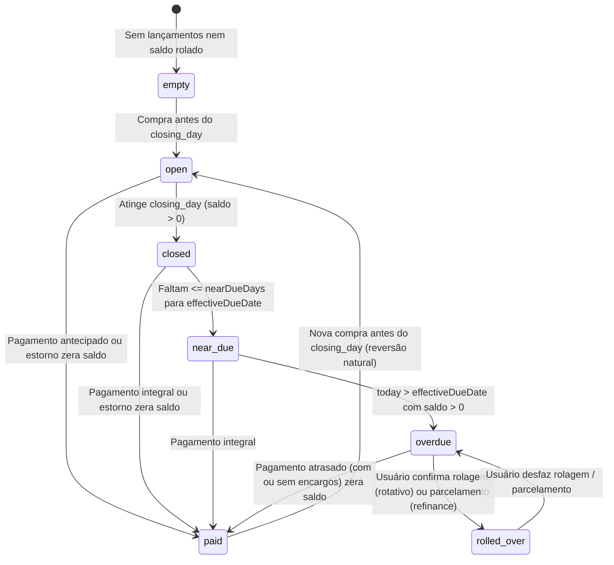

# Plano Arquitetural v2 — Fluxo Integrado de Cartões, Faturas, Rotativo e Insights

> **Status:** Versão v2 definitiva (auditada contra o código-fonte real, blindada contra regressões e pronta para execução sequencial).
> **Documentos base:** [auditoria_cartoes_fluxo_insights.md](file:///home/gabrielsales/.gemini/antigravity/brain/0d32e185-9c54-4a39-b05d-3af9ad9f344e/auditoria_cartoes_fluxo_insights.md) · `docs/architecture/ESPECIFICACAO_TECNICA.md` · `docs/architecture/FINANCIAL_MATH_SPEC.md`.

---

## 1. Resumo da Fase 0 e Divergências Encontradas no Código Real

### 1.1 Meta-Análise do Prompt e Ajustes Arquiteturais
- **Contradição real na Blindagem #4 (`create_refund`):** O prompt sugeriu baixar o piso de data de `create_refund` para `2000-01-01`. Porém, no schema real ([20260101000001_schema.sql](file:///home/gabrielsales/meus_apps/financasnew/supabase/migrations/20260101000001_schema.sql#L120-L122)) e em [src/types/schema.ts](file:///home/gabrielsales/meus_apps/financasnew/src/types/schema.ts#L155-L156), `APP_START_DATE = '2026-01-01'` é uma **CHECK constraint rígida** nas tabelas `card_payments`, `incomes` e `expenses` (`check (date >= date '2026-01-01')`). **Decisão:** manter a validação explícita de `APP_START_DATE` (`2026-01-01`) em `create_refund` para retornar mensagem semântica idêntica a `create_card_payment` em vez de erro cru de constraint Postgres.
- **Risco de Over-Engineering na Blindagem #8 (Feriados vs. Fim de Semana):** A prorrogação bancária de sábado/domingo para segunda-feira (`adjustDueDateForWeekend`) é pura, barata e determinística (zero dependências externas). **Não** adicionaremos tabela de feriados nacionais/municipais nesta v2 para evitar manutenção frágil.
- **Refinamento da Blindagem #11 (Cartão Misto `scope: "mixed"`):** O grounding revelou um bug adicional não mapeado na v1 em [use-real-cash-balance.ts](file:///home/gabrielsales/meus_apps/financasnew/src/state/queries/use-real-cash-balance.ts#L116-L128): ele filtra `cardExpenses` por `effectiveViewScope`, mas mantém `cardPayments` integrais do cartão. Em cartões `scope: "mixed"` (visíveis em PF e PJ via [scope-filter.ts](file:///home/gabrielsales/meus_apps/financasnew/src/domain/business/scope-filter.ts#L92-L104)), isso fatiava as despesas enquanto comparava com o pagamento do boleto integral. **Decisão:** o cálculo do saldo da fatura (`buildCompetenceSummaries`) **sempre** usa 100% das despesas, pagamentos e rollovers do `card_id`; o escopo PF/PJ filtra apenas **quais cartões** aparecem (com o rateio PF/PJ do cartão misto mantido em `calculateMixedCardSplit`).

### 1.2 Pontos Cegos Descobertos no Grounding (Incorporados nesta v2)
1. **Backup & Restore (`export.ts` / `restore_backup`):** A nova tabela `card_bill_rollovers` deve integrar exportação e restauração de backup para evitar perda de rolagens e reabertura de faturas históricas.
2. **Exclusão de Cartão (`delete_credit_card`):** `card_bill_rollovers.card_id` deve usar `REFERENCES public.credit_cards(id)` **sem** `ON DELETE CASCADE` (espelhando `card_payments`), impedindo exclusão definitiva de cartão com histórico.
3. **Modo Demo (`use-simulated-queries.ts`):** Novos hooks de leitura de rollovers devem respeitar `useDemoSession()`.
4. **Incompatibilidade de `card_payments.competence_month` (`char(7)` vs `text`):** No schema base, `card_payments.competence_month` é `char(7)` com check `^\d{4}-\d{2}$`. Em `card_bill_rollovers`, usaremos `text` com `check (... ~ '^\d{4}-\d{2}$')` para evitar padding implícito e manter ergonomia nas comparações.
5. **Reconciliação de `InvoiceStatusBadge` e `buildInvoiceBreakdown`:** [invoice-status-badge.tsx](file:///home/gabrielsales/meus_apps/financasnew/src/components/modules/invoice-status-badge.tsx#L10-L15) mapeia apenas 4 estados (`closed` em verde `"positive"`, `open`, `near_due`, `overdue`), e [invoice-breakdown.ts](file:///home/gabrielsales/meus_apps/financasnew/src/domain/calculation-memory/builders/invoice-breakdown.ts#L20-L50) não possui campos para `principalRoladoRecebidoCents` nem `principalRoladoEnviadoCents`. Ambos estão cobertos no roadmap.

---

## 2. Máquina de Estados Canônica v2

### 2.1 Diagrama de Estados (Incluindo Transições Reversas)



### 2.2 Tabela de Precedência Estrita (Ordem de Avaliação em `invoiceStatus`)

A função pura `invoiceStatus` avalia **estritamente nesta ordem** (Blindagens #6 e #7):

| Prioridade | Estado (`InvoiceStatus`) | Rótulo UI | Variante `Badge` | Condição Exata | Entra em Obrigações (Cash-Gap / Safe-to-Spend / Lembretes)? |
|---|---|---|---|---|---|
| 1 | `rolled_over` | **Rolada** | `muted` / `secondary` | `saldoBrutoCents === 0 && principalRoladoEnviadoCents > 0` *(prevalece sobre `paid` mesmo se houve pagamento parcial + rolagem!)* | **Não** (obrigação transferida para `M+1` ou `M+1..M+N`) |
| 2 | `empty` | **Sem lançamentos** | `muted` | `totalFaturaBrutoCents === 0 && saldoBrutoCents === 0` | **Não** |
| 3 | `paid` | **Paga** | `positive` | `totalFaturaBrutoCents > 0 && saldoBrutoCents === 0` | **Não** |
| 4 | `overdue` | **Vencida** | `critical` | `saldoBrutoCents > 0 && today > effectiveDueDate` | **Sim** (dívida exigível hoje; mostra data real vencida) |
| 5 | `near_due` | **Vence em breve** | `warning` | `saldoBrutoCents > 0 && today <= effectiveDueDate && effectiveDueDate <= addDaysISO(today, nearDueDays)` | **Sim** |
| 6 | `closed` | **Fechada** | `default` | `saldoBrutoCents > 0 && today >= closingDate && effectiveDueDate > addDaysISO(today, nearDueDays)` | **Sim** (no `effectiveDueDate`) |
| 7 | `open` | **Aberta** | `default` | `saldoBrutoCents > 0 && today < closingDate` | **Sim** (no `effectiveDueDate`, se dentro do horizonte) |

### 2.3 Regras de Calendário, Timezone e Transições Reversas (Blindagens #6 e #8)
- **Data Civil Local (`YYYY-MM-DD`):** Todas as comparações usam `todayISO()` ([src/domain/debts/index.ts](file:///home/gabrielsales/meus_apps/financasnew/src/domain/debts/index.ts#L16-L22)), que lê ano/mês/dia no fuso local do dispositivo (nunca `new Date().toISOString().slice(0, 10)` em UTC).
- **Clamp Determinístico de Meses Curtos:** `clampDay(day, year, month)` no TS espelha exatamente `public.resolve_competence_boundary(p_date, p_closing_day)` no Postgres (`least(greatest(day, 1), último dia do mês)`).
- **Prorrogação Bancária de Fim de Semana (`effectiveInvoiceDueDate`):**
  - `nominalDueDate = invoiceDueDate(competenceMonth, dueDay)` (usado para exibição da data nominal);
  - Se `nominalDueDate` cair no **sábado** (`dayOfWeek === 6`), `effectiveDueDate = addDaysISO(nominalDueDate, 2)` (segunda-feira);
  - Se cair no **domingo** (`dayOfWeek === 0`), `effectiveDueDate = addDaysISO(nominalDueDate, 1)` (segunda-feira);
  - A transição `near_due -> overdue` e o dia de débito no Cash-Gap usam `effectiveDueDate`.
- **Política para Lançamento Retroativo ou Estorno Tardio em Competência `rolled_over`:**
  - Se uma nova compra retroativa for inserida em `M` já `rolled_over`, `saldoBrutoCents` volta a ser `> 0`, trazendo `M` de volta para `overdue` (sinalizando claramente o saldo residual descoberto).
  - Se um estorno tardio chegar em `M` já `rolled_over`, o excesso de créditos (`pago + estorno + creditoAnterior > totalFaturaBruto - principalRoladoEnviado`) gera `creditoRestanteCents > 0`, que transborda automaticamente como `creditoAnteriorCents` para `M+1`, abatendo o principal rolado na fatura seguinte!

---

## 3. Equação Contábil Única e Matriz de Impacto nos 3 Regimes

Para cada cartão e cada competência $M$ em ordem cronológica crescente (centavos inteiros):

$$\text{TotalFaturaBruto}_M = \text{PrevistoBruto}_M + \text{PrincipalRoladoRecebido}_M$$

$$\text{Abatimentos}_M = \text{Pago}_M + \text{Estornos}_M + \text{CréditoAnterior}_M + \text{PrincipalRoladoEnviado}_M$$

$$\text{SaldoAbertoBruto}_M = \max\Big(0,\; \text{TotalFaturaBruto}_M - \text{Abatimentos}_M\Big)$$

$$\text{CréditoRestante}_{M \to M+1} = \max\Big(0,\; (\text{Pago}_M + \text{Estornos}_M + \text{CréditoAnterior}_M) - \max(0,\; \text{TotalFaturaBruto}_M - \text{PrincipalRoladoEnviado}_M)\Big)$$

> **Regra de Detecção de Estorno Unificada:** Em todos os módulos, estorno é estritamente `p.is_refund === true || p.amount < 0`.

### Matriz de Impacto nos 3 Regimes

| Evento Financeiro | DRE / Orçamento (Competência) | Caixa Bancário (`cash-ledger.ts`) | Obrigação da Fatura & Limite |
|---|---|---|---|
| Compra no crédito (`expense`) | **Entra em $M$** (pelo valor ponderado) | **Neutro** | Aumenta `PrevistoBruto_M` e Limite Usado |
| Pagamento de fatura (`card_payment`) | **Neutro** (anti-duplicidade) | **Saída (`flow: "out"`)** na data | Reduz `SaldoAberto_M` e libera Limite |
| Estorno na fatura (`create_refund`) | Neutraliza consumo via renda `[REFUND]` | **Neutro** *(correção BUG-02!)* | Reduz `SaldoAberto_M` (excesso vira `creditoRestante`) e libera Limite |
| Pagamento com encargos (`mode='current'`) | Encargos entram como `expenses` em $M$ | **Saída (`nominal + encargos`)** | Zera `SaldoAberto_M` (`card_payment = nominal + encargos`) |
| Pagamento com encargos (`mode='next'`) | Encargos entram como `expenses` em $M+1$ | **Saída (`nominal`)** | Zera `SaldoAberto_M`; encargos entram em `PrevistoBruto_{M+1}` |
| Rolagem / Rotativo (`rollover_card_bill`) | **Principal: Neutro** · **Juros/Multa/IOF: `expenses` em $M+1$** | **Neutro** (só debita ao pagar $M+1$) | Zera $M$ (`rolled_over`); soma principal + juros em $M+1$; Limite total mantido + juros |
| Parcelamento (`refinance_credit_card_bill`) | **Principal: Neutro** · **Juros: `expenses` em $M+1..M+N$** | **Saída apenas da entrada** (se `> 0`) | Zera $M$ (`rolled_over`); distribui principal (resto na 1ª parcela) + juros em $M+1..M+N$ |

---

## 4. Especificação Técnica de Banco de Dados e RPCs

### 4.1 Nova Tabela `public.card_bill_rollovers` + FK em `public.expenses` (Blindagem #1)

```sql
create table public.card_bill_rollovers (
  id uuid primary key default gen_random_uuid(),
  user_id uuid not null references public.profiles(id) on delete cascade,
  card_id uuid not null references public.credit_cards(id), -- sem CASCADE: protege exclusão de cartão com histórico
  from_competence_month text not null check (from_competence_month ~ '^\d{4}-\d{2}$'),
  to_competence_month text not null check (to_competence_month ~ '^\d{4}-\d{2}$'),
  principal_amount numeric(12, 2) not null check (principal_amount > 0),
  kind text not null check (kind in ('rollover', 'refinance')),
  group_id uuid not null default gen_random_uuid(),
  note text,
  created_at timestamptz not null default now(),
  constraint card_bill_rollovers_month_order check (to_competence_month > from_competence_month)
);

-- Índice de unicidade parcial: impede duas rolagens simples duplicadas do mesmo mês para o mesmo mês (Blindagem #2)
create unique index uq_card_bill_rollovers_single_rollover
  on public.card_bill_rollovers (card_id, from_competence_month, to_competence_month)
  where kind = 'rollover';

create index idx_card_bill_rollovers_user_card
  on public.card_bill_rollovers (user_id, card_id, from_competence_month, to_competence_month);

-- Integridade referencial de encargos sem uuid[] órfão (Blindagem #1):
alter table public.expenses
  add column if not exists rollover_id uuid references public.card_bill_rollovers(id) on delete cascade;

create index if not exists idx_expenses_rollover_id
  on public.expenses (rollover_id) where rollover_id is not null;
```

- **RLS:** `user_id = auth.uid()` para `SELECT`; escritas exclusivamente via RPCs `SECURITY DEFINER` com `is_current_user_active()` + `can_current_user_write_module('cards')`.
- **Por que `expenses.rollover_id ON DELETE CASCADE` resolve a Blindagem #1:** Se o usuário excluir manualmente uma despesa de juros antes de desfazer a rolagem, nada fica órfão; e quando `delete_card_bill_rollover` remove a linha em `card_bill_rollovers`, o Postgres exclui atomicamente todos os encargos vinculados em cascata.

### 4.2 Contratos das RPCs (Migration Única e Coesa)

1. **`public.rollover_card_bill(p_card_id uuid, p_from_competence_month text, p_to_competence_month text, p_principal_amount numeric, p_charges jsonb default '[]', p_note text default null) RETURNS jsonb`**
   - **Lock de concorrência (Blindagem #2):** `perform pg_advisory_xact_lock(hashtext('card_bill:' || p_card_id::text || ':' || p_from_competence_month));`
   - **Validação server-side de teto (Blindagem #2):** Recalcula o `saldo_aberto_bruto` de `p_from_competence_month` no servidor (incluindo carryover acumulado até `p_from_competence_month`) e rejeita se `p_principal_amount > saldo_aberto_bruto` (tolerância de `0.00`).
   - Insere `card_bill_rollovers (kind = 'rollover')`, insere encargos em `expenses` com `rollover_id = v_rollover_id`, `bill_competence = p_to_competence_month`, categoria reservada `"Tarifas e Encargos"` e `charge_kind`.
   - **Retorno:** `{ rollover_id, group_id, from_competence_month, to_competence_month, principal_amount, charges_amount, created_expense_ids }`.

2. **`public.delete_card_bill_rollover(p_rollover_id uuid) RETURNS jsonb`**
   - Localiza `v_rollover` e trava com `pg_advisory_xact_lock` no cartão.
   - **Proteção contra cascata (Blindagem #3):** Para todo `to_competence_month` afetado (1 mês se `rollover`, N meses se `refinance` pelo `group_id`), verifica se já existe `card_payments` ou `card_bill_rollovers` subsequente (`from_competence_month = to_competence_month`). Se existir, **bloqueia** com erro semântico: `"Não é possível desfazer esta rolagem porque a fatura de destino (MM/AAAA) já possui pagamento ou nova rolagem registrada. Estorne a operação da fatura posterior primeiro."`
   - Exclui pelo `group_id` (cascade remove automaticamente os encargos via `expenses.rollover_id`).

3. **`public.pay_card_bill_with_charges(...)` (Correção BUG-03)**
   - Executa `DROP FUNCTION IF EXISTS` nas **duas assinaturas conflitantes** (`0146` e `0150`).
   - Recria assinatura única compatível com [src/data/rpc/cards.ts](file:///home/gabrielsales/meus_apps/financasnew/src/data/rpc/cards.ts#L43-L51): `(p_card_id uuid, p_competence_month text, p_nominal_amount numeric, p_charges jsonb default '[]', p_charge_competence_mode text default 'current', p_payment_date date default current_date, p_note text default null)`.
   - Usa categoria reservada `"Tarifas e Encargos"` (fallback automático), soma `v_charges_total` ao `card_payments.amount` quando `mode = 'current'` e retorna `{ payment_id, total_paid, nominal_amount, charges_amount, charges_competence, created_expense_ids }`.

4. **`public.refinance_credit_card_bill(...)` (Correção BUG-04 + Blindagem #10)**
   - Aceita `p_principal_installments jsonb` (ou `principal_amount` + `interest_amount` por parcela em `p_installments`), valida no servidor que `sum(principal) <= saldo_aberto_bruto - p_initial_payment_amount` e que `p_initial_payment_amount >= 0`.
   - Com `pg_advisory_xact_lock`: registra entrada em `card_payments` (se `> 0`), grava N linhas em `card_bill_rollovers` (`kind = 'refinance'`, mesmo `group_id`) com o principal de cada parcela (resto dos centavos na 1ª parcela via `splitCents`) e grava os juros em `expenses` vinculados via `rollover_id`!

5. **`public.recalculate_bill_competences(p_card_id uuid)` (Correção BUG-05 + Blindagem #5)**
   - **Blindagem Bidirecional:** Calcula `v_new_competence` (usando `date_trunc('month', e.date) + interval '1 month'` quando `e.date >= resolve_competence_boundary(...)`) e aplica o `UPDATE` **somente** quando:
     1. A despesa **não** tem `statement_hash IS NOT NULL` nem `rollover_id IS NOT NULL`;
     2. A competência **de origem** (`e.bill_competence`) **não** possui `card_payments` nem `card_bill_rollovers` (origem ou destino);
     3. A competência **de destino** (`v_new_competence`) **não** possui `card_payments` nem `card_bill_rollovers` (origem ou destino).

6. **`public.create_refund(...)` (Correção BUG-08 + Blindagem #4 ajustada)**
   - Adiciona validação explícita `p_competence_month ~ '^\d{4}-\d{2}$'` e `p_date >= date '2026-01-01'` (alinhada à constraint da tabela e a `APP_START_DATE`).

7. **`public.delete_expense_installments` e `public.update_expense_installments_group` (Blindagem #12)**
   - Em exclusão/edição de grupo (`mode IN ('all', 'subsequent')`), protege parcelas de cartão cuja `bill_competence` já esteja liquidada ou rolada (`exists card_payments` ou `exists card_bill_rollovers` naquela competência), pulando parcelas encerradas (ou bloqueando em `single` com mensagem clara orientando a usar estorno na fatura atual).

8. **`public.restore_backup`**
   - Passa a incluir `card_bill_rollovers` na restauração (e `src/data/repositories/export.ts` na exportação).

---

## 5. Roadmap de Execução em Fases Sequenciais

### Fase 1 — Banco de Dados e Contratos de Dados
1. Nova migration `supabase/migrations/20260101000154_card_bill_lifecycle_and_rollovers.sql` (tabela `card_bill_rollovers`, coluna `expenses.rollover_id`, todas as 8 RPCs acima).
2. Atualizar tipos em [src/types/database.ts](file:///home/gabrielsales/meus_apps/financasnew/src/types/database.ts) e [src/types/schema.ts](file:///home/gabrielsales/meus_apps/financasnew/src/types/schema.ts) (`CardBillRollover`, `rollover_id` em `Expense`).
3. Criar repositório [src/data/repositories/card-bill-rollovers.ts](file:///home/gabrielsales/meus_apps/financasnew/src/data/repositories/card-bill-rollovers.ts) + wrappers RPC em [src/data/rpc/cards.ts](file:///home/gabrielsales/meus_apps/financasnew/src/data/rpc/cards.ts).
4. Atualizar exportação em [src/data/repositories/export.ts](file:///home/gabrielsales/meus_apps/financasnew/src/data/repositories/export.ts) e janela simétrica de 24 meses em [src/data/repositories/expenses.ts](file:///home/gabrielsales/meus_apps/financasnew/src/data/repositories/expenses.ts) e [src/data/repositories/card-payments.ts](file:///home/gabrielsales/meus_apps/financasnew/src/data/repositories/card-payments.ts).

### Fase 2 — Domínio Puro e Fonte Única de Verdade (SSOT)
1. [src/domain/cards/index.ts](file:///home/gabrielsales/meus_apps/financasnew/src/domain/cards/index.ts):
   - Adicionar `effectiveInvoiceDueDate(competenceMonth, dueDay)` (prorrogação sábado/domingo → segunda-feira — Blindagem #8);
   - Evoluir `InvoiceStatus` para os 7 estados canônicos + `INVOICE_STATUS_LABELS` + tabela de precedência estrita (Blindagens #6 e #7);
   - Evoluir `buildCompetenceSummaries` para receber `rollovers?: readonly CardBillRolloverLike[]`, unificar detecção de estorno (`is_refund === true || amount < 0`) e expor `principalRoladoRecebidoCents`, `principalRoladoEnviadoCents`, `totalFaturaBrutoCents`;
   - Criar **`resolveOpenCardInvoices(...)`** (SSOT):
     - Recebe `cards`, `expenses`, `payments`, `rollovers`, `today`;
     - **Blindagem #9:** nunca omite cartão `is_active === false` se tiver `saldoBrutoCents > 0`;
     - **Blindagem #11:** calcula faturas com 100% das despesas/pagamentos/rollovers do `card_id` (escopo PF/PJ filtra apenas a lista de `cards` passada ao motor);
     - Retorna obrigações normalizadas com `nominalDueDate`, `effectiveDueDate`, `saldoBrutoCents`, `status` e `isOverdue`.
2. [src/domain/cards/refinancing.ts](file:///home/gabrielsales/meus_apps/financasnew/src/domain/cards/refinancing.ts):
   - Garantir conservação exata de centavos no principal via `splitCents` (resto na 1ª parcela — Blindagem #10).
3. [src/domain/cash/cash-ledger.ts](file:///home/gabrielsales/meus_apps/financasnew/src/domain/cash/cash-ledger.ts):
   - Remover `flow: "in"` de `card_refund` (estorno de cartão é neutro no caixa bancário — BUG-02).

### Fase 3 — Unificação de Todos os Consumidores (Home, Cash-Gap, Safe-to-Spend, Lembretes, Radar, Limite)
1. [src/domain/projection/cash-gap.ts](file:///home/gabrielsales/meus_apps/financasnew/src/domain/projection/cash-gap.ts):
   - Refatorar `projectCardInvoiceObligations` para delegar integralmente a `resolveOpenCardInvoices` (eliminando o loop duplicado, o fallback divergente de `bill_competence: null` e carregando `nominalDueDate` + `isOverdue`).
2. [src/domain/cash/cycle-obligations.ts](file:///home/gabrielsales/meus_apps/financasnew/src/domain/cash/cycle-obligations.ts):
   - Substituir `autoSelectBillMonth` (que pegava só 1 fatura por cartão) por `resolveOpenCardInvoices`, somando todas as faturas com `saldoBrutoCents > 0` vencidas ou com vencimento até o fim do ciclo atual.
3. [src/domain/calculation-memory/builders/cash-breakdown.ts](file:///home/gabrielsales/meus_apps/financasnew/src/domain/calculation-memory/builders/cash-breakdown.ts) & [invoice-breakdown.ts](file:///home/gabrielsales/meus_apps/financasnew/src/domain/calculation-memory/builders/invoice-breakdown.ts):
   - Em `buildCashGapBreakdown`: exibir *"Vencida em DD/MM/AAAA — exigível hoje"* para faturas atrasadas e listar apenas `inflows` com `expectedDate <= gapDate` (ou separar claramente entradas pós-gap).
   - Em `buildInvoiceBreakdown`: incluir linhas de *"Saldo anterior (rotativo/parcelamento)"* (`+ principalRoladoRecebidoCents`) e *"Saldo rolado para próxima fatura"* (`- principalRoladoEnviadoCents`).
4. [src/features/overview/hooks/use-overview-data.ts](file:///home/gabrielsales/meus_apps/financasnew/src/features/overview/hooks/use-overview-data.ts), [use-overview-obligations.ts](file:///home/gabrielsales/meus_apps/financasnew/src/features/overview/hooks/use-overview-obligations.ts), [use-real-cash-balance.ts](file:///home/gabrielsales/meus_apps/financasnew/src/state/queries/use-real-cash-balance.ts), [use-reminders.ts](file:///home/gabrielsales/meus_apps/financasnew/src/state/queries/use-reminders.ts), [build-overview-metrics.ts](file:///home/gabrielsales/meus_apps/financasnew/src/domain/overview/build-overview-metrics.ts):
   - Passar `cardRollovers` e **guarda de loading** obrigatória no `buildOverviewCashGapResult`;
   - Parar de fatiar `cardExpenses` por escopo dentro do cálculo de saldo de fatura em `useRealCashBalance` (Blindagem #11);
   - Unificar `useReminders` e `buildOverviewWeeklyRadarSummary` sobre `resolveOpenCardInvoices`.
5. [src/features/cards/hooks/cards-page-selectors.ts](file:///home/gabrielsales/meus_apps/financasnew/src/features/cards/hooks/cards-page-selectors.ts):
   - Corrigir `buildUsedLimitMap` para somar `saldoBrutoCents` de **todas** as competências não pagas (incluindo parcelas futuras e juros de refinanciamento — Blindagem #10).

### Fase 4 — Integração com o Importador de Faturas (Blindagem #13)
1. [src/domain/reconciliation/clean.ts](file:///home/gabrielsales/meus_apps/financasnew/src/domain/reconciliation/clean.ts):
   - Expandir `STATEMENT_SUMMARY_OR_NOISE_KEYWORDS` com padrões explícitos de saldo rolado/rotativo (`"saldo financiado"`, `"saldo rotativo"`, `"saldo em rotativo"`, `"rotativo fatura anterior"`, `"transferencia saldo anterior"`, `"principal parcelamento fatura"`).
2. [src/domain/reconciliation/reconcile.ts](file:///home/gabrielsales/meus_apps/financasnew/src/domain/reconciliation/reconcile.ts) & [use-statement-import.ts](file:///home/gabrielsales/meus_apps/financasnew/src/features/cards/components/use-statement-import.ts):
   - Reforçar o match de encargos (`charge_kind !== 'regular'`) já criados via `BillRolloverDialog` / `pay_card_bill_with_charges` na mesma competência, marcando-os automaticamente como `exact_match` / `probable_match` para evitar duplicação de juros na importação.

### Fase 5 — Estado (React Query), Invalidação e UI de Cartões
1. Queries & Mutations:
   - Criar `useCardBillRollovers(cardId)` e `useAllCardBillRollovers()` (com suporte a `useDemoSession()` em `use-simulated-queries.ts`);
   - Criar `useRolloverCardBill()` e `useDeleteCardBillRollover()` em [src/state/mutations/use-card-mutations.ts](file:///home/gabrielsales/meus_apps/financasnew/src/state/mutations/use-card-mutations.ts);
   - Corrigir `useCreateCardPayment` para invalidar também `["overview"]`, `["reminders"]`, `["insights"]`, `["reports"]` (BUG-10).
2. UI ([src/components/modules/invoice-status-badge.tsx](file:///home/gabrielsales/meus_apps/financasnew/src/components/modules/invoice-status-badge.tsx) e `src/features/cards/components/`):
   - Atualizar `InvoiceStatusBadge` para os 7 estados;
   - Criar `BillRolloverDialog` (Modal `size="md"`, zero `autoFocus`, categoria `"Tarifas e Encargos"` automática, confirmação explícita de juros/multa/IOF — acionável apenas quando `invStatus === "overdue"`);
   - Atualizar `BillRefinanceDialog` para enviar principal + juros ao RPC corrigido;
   - Atualizar `InvoiceCompetenceToolbar`, `InvoiceKpisSection` e `CardInvoicePaymentsFeed` para exibir saldo rolado recebido/enviado e botão de desfazer rolagem;
   - Garantir que seletores de *novas compras* ocultem cartões `is_active === false`, enquanto faturas pendentes de cartões inativos continuam acessíveis para quitação (Blindagem #9).

---

## 6. Matriz de Verificação e Testes Obrigatórios

| Blindagem / Bug | Camada | Cenário de Teste Obrigatório (Vitest / SQL) |
|---|---|---|
| **#1** FK `expenses.rollover_id` | SQL / RPC | Criar rolagem com juros → excluir rolagem remove encargos em cascata; excluir despesa manualmente não deixa órfão nem quebra `delete_card_bill_rollover` |
| **#2** Lock & Teto de principal | SQL / RPC | Tentar rolar valor `> saldoAbertoBruto` falha; duas rolagens simultâneas para o mesmo `(card_id, from_month, to_month)` rejeitam a segunda |
| **#3** Proteção contra cascata | SQL / RPC | Rolar `M -> M+1`, registrar pagamento (ou nova rolagem) em `M+1`, tentar desfazer `M -> M+1` → bloqueia com erro semântico claro |
| **#4** Piso `APP_START_DATE` em `create_refund` | SQL / RPC | `create_refund` com data `< 2026-01-01` ou `competence_month` inválido retorna mensagem amigável |
| **#5** `recalculate_bill_competences` bidirecional | SQL / RPC | Alterar `closing_day` não move compra saindo de mês pago/rolado/reconciliado nem entrando em mês destino pago/rolado/reconciliado |
| **#6** Transições reversas FSM | Domain (`cards.test.ts`) | Pagamento antecipado (`paid`) + nova compra antes do fechamento volta para `open`; estorno tardio em `rolled_over` gera `creditoRestante` para `M+1` |
| **#7** Precedência `rolled_over` vs `paid` | Domain (`cards.test.ts`) | Pagamento parcial (R\$ 400) + rolagem do resto (R\$ 600) → `saldo === 0` e status estritamente `rolled_over` (nunca `paid`) |
| **#8** Timezone, clamp e fim de semana | Domain (`cards.test.ts`) | `due_day = 31` em Fev/Abr clampa corretamente; vencimento no sábado/domingo prorroga `effectiveDueDate` para segunda; não vira `overdue` no domingo |
| **#9** Cartão inativo com dívida | Domain + UI | Cartão `is_active: false` com fatura aberta continua em `resolveOpenCardInvoices`, Cash-Gap, Safe-to-Spend e Lembretes, mas some do seletor de nova compra |
| **#10** Limite real + resto na 1ª parcela | Domain (`cards.test.ts`, `refinancing.test.ts`) | `buildUsedLimitMap` soma todas as competências abertas + juros futuros; `splitCents` em R\$ 100,00 / 3x gera `3334 + 3333 + 3333 = 10000` |
| **#11** Escopo PF/PJ em cartão misto | Domain + Hooks | Cartão `mixed` com compras PF + PJ e pagamento integral tem `saldo === 0` tanto na visão PF quanto PJ (sem fatiar despesas contra pagamento inteiro) |
| **#12** Proteção de parcelas quitadas | SQL / RPC | Editar/excluir grupo de parcelas (`all`/`subsequent`) preserva parcelas em competências `paid`/`rolled_over` |
| **#13** Importador anti-duplicação | Domain (`reconciliation`) | Linhas de *"Saldo anterior / Rotativo"* são ignoradas como ruído; encargos já criados via rolagem dão match com a despesa existente |
| **BUG-02** Estorno neutro no caixa | Domain (`cash-ledger.test.ts`) | `card_refund` não altera `currentBalanceCents` no regime de caixa |
| **BUG-03 / BUG-04** Encargos & Parcelamento | SQL / RPC + Domain | `pay_card_bill_with_charges(mode='current')` zera a fatura; `refinance_credit_card_bill` zera `M` como `rolled_over` e cobra principal + juros em `M+1..M+N` |
| **Congruência SSOT** | Integração | Mesmo dataset produz soma idêntica de obrigações abertas entre `CardsPage`, `Safe-to-Spend`, `Cash-Gap Alert`, `WeeklyRadar` e `useReminders` |
