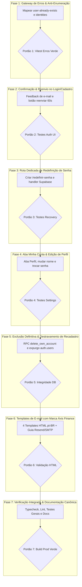

# PLANO DE EXECUÇÃO: GESTÃO DE CONTAS, AUTENTICAÇÃO RESILIENTE E EXPERIÊNCIA SAAS DE ALTO NÍVEL

> **Documento:** Plano Canônico de Gestão de Contas, Recuperação, Confirmação e Branding SaaS  
> **Aplicação:** Áxis Finance (Web, PWA e Android Nativo)  
> **Status:** Pronto para Execução por Fases (Diagnóstico e Planejamento Concluídos)  
> **Governança:** Fases sequenciais, tarefas com checklist, portões de qualidade (*quality gates*), testes automatizados, padronização visual estrita (DESIGN_SYSTEM), sem emojis, sem elementos nativos e conformidade com AGENTS.md.

---

## 1. DIAGNÓSTICO DO ESTADO ATUAL & ANÁLISE DE CAUSA-RAIZ

Após auditoria detalhada no código-fonte, rotas, banco de dados e fluxos de autenticação do Áxis Finance, foram identificadas as causas raízes exatas para cada uma das deficiências apontadas:

### 1.1 Conflito no Cadastro de E-mail Existente & Falso Positivo Anti-Enumeração
* **Causa Raiz 1 (Tradução/Gateway de Erros):** Em `src/services/errors/index.ts`, a função `classifyError` captura códigos de erro Postgres (`23505`), mas o Supabase Auth no endpoint `/auth/v1/signup` retorna HTTP 422 com payload `{"code": "user_already_exists", "msg": "User already registered"}`. Essa mensagem não cai em nenhuma categoria pré-formatada e atinge o fallback em inglês `User already registered`.
* **Causa Raiz 2 (Condicional Frágil na UI):** Em `src/features/auth/pages/register-page.tsx` (linhas 134–136), o código busca especificamente por:
  ```ts
  const isAccountExistsError =
    error?.toLowerCase().includes("já existe uma conta") ||
    error?.toLowerCase().includes("já possui uma conta");
  ```
  Como o erro chega em inglês (`User already registered`), a variável avalia para `false`. Por isso, os links *"Fazer login"* e *"Recuperar senha"* **nunca aparecem** para o usuário.
* **Causa Raiz 3 (Proteção Anti-Enumeração do Supabase):** Quando o Supabase está com a flag *"Prevent user enumeration"* ligada nas configurações de Auth, requisições de cadastro para e-mails já existentes **não retornam erro**. Em vez disso, retornam HTTP 200 com um objeto `User` contendo array vazio de identidades (`identities: []`). Em `src/data/auth.ts`, a função `signUpWithEmail` avalia apenas `needsEmailConfirmation: data.session === null`, considerando a operação um sucesso. O frontend então exibe a mensagem de confirmação de e-mail enviada, enganando o usuário que acredita que a conta foi criada.

### 1.2 Feedback Incompleto de E-mail Não Confirmado & Ausência de Reenvio no Login
* **Causa Raiz 1 (Mensagem Genérica):** Em `src/features/auth/pages/login-page.tsx`, quando o login falha com erro `email_not_confirmed`, o gateway produz a mensagem estática: `"E-mail ainda não confirmado. Verifique sua caixa de entrada."`. Não há menção ao endereço específico digitado no formulário.
* **Causa Raiz 2 (Ausência de CTA de Reenvio):** Não existe integração com o método `supabase.auth.resend({ type: 'signup', email })`. Se o link original expirou ou caiu na caixa de spam do usuário, o usuário fica bloqueado sem ter como disparar novo e-mail a partir da tela de login.
* **Causa Raiz 3 (Onboarding Pós-Cadastro Frágil):** Na tela de cadastro (`/cadastro`), ao concluir um registro com confirmação pendente, o formulário permanece na tela apenas com um alerta no topo, sem um estado de sucesso imersivo de boas-vindas que destaque o e-mail cadastrado e os próximos passos.

### 1.3 Quebra do Fluxo de Recuperação e Redefinição de Senha
* **Causa Raiz 1 (Redirecionamento Incorreto):** Em `src/data/auth.ts`, o método `resetPasswordForEmail` define:
  ```ts
  emailRedirectTo: `${window.location.origin}/entrar`
  ```
  Ao clicar no link recebido por e-mail, o usuário é jogado na tela de login comum (`/entrar`), com os parâmetros de token na URL (`#access_token=...&type=recovery`), mas a tela de login **não possui formulário de nova senha**.
* **Causa Raiz 2 (Ausência da Rota `/redefinir-senha`):** O sistema não possui uma página dedicada que capture o evento `PASSWORD_RECOVERY` do Supabase Auth e ofereça os campos de *"Nova Senha"* e *"Confirmar Nova Senha"* com validação dos requisitos de segurança (`checkPasswordRequirements`).

### 1.4 Ausência de Gestão de Conta e Perfil do Usuário Autenticado
* **Causa Raiz 1 (Sem Aba de Perfil/Conta):** No hub de `/configuracoes`, existem abas para *Aparência*, *Notificações*, *Segurança*, *Assinatura* e *Dispositivos*. No card de *Segurança*, há apenas a exibição estática do nome e e-mail e um botão de *"Sair da Conta"*.
* **Causa Raiz 2 (Sem Edição de Nome):** Não existe interface nem mutação de dados para atualizar o campo `name` na tabela `public.profiles` e nos metadados do `auth.users`.
* **Causa Raiz 3 (Sem Alteração de Senha Autenticada):** O usuário logado não tem como alterar sua senha atual por uma nova de forma preventiva dentro do painel.

### 1.5 Travamento no Recadastro de Contas Apagadas (Supabase Auth vs. Profiles)
* **Causa Raiz 1 (Exclusão Incompleta / Órfã):** A chave estrangeira no banco de dados é definida como:
  ```sql
  create table public.profiles (
    id uuid primary key references auth.users (id) on delete cascade
  );
  ```
  Isso significa que deletar de `auth.users` apaga o perfil, mas deletar de `public.profiles` **NÃO apaga** o usuário da tabela `auth.users`. Quando um administrador ou rotina manual deleta o usuário na tabela `profiles`, o registro permanece intacto no schema interno do Supabase (`auth.users`). Ao tentar recadastrar com o mesmo e-mail, o Supabase bloqueia o cadastro por duplicidade em `auth.users`.
* **Causa Raiz 2 (Ausência de RPC de Autoexclusão Definitiva):** O aplicativo não possui uma RPC `SECURITY DEFINER` que permita ao próprio usuário (ou superadmin) expurgar integralmente sua identidade de `auth.users`, liberando o e-mail no ato para novos cadastros.

### 1.6 E-mails Transacionais sem Branding Áxis Finance
* **Causa Raiz:** O projeto está utilizando o remetente e o modelo de e-mail padrão do Supabase Auth (texto simples em inglês). Falta fornecer os modelos HTML responsivos completos e diagramados no Design System do Áxis Finance (Dark/Light harmônico, tipografia tabular, logo vetorial, CTAs estilizados e orientações de segurança em pt-BR), bem como orientações para configuração de SMTP profissional (ex.: Resend).

---

## 2. MAPA GERAL DE FASES E PORTÕES DE QUALIDADE (QUALITY GATES)

A execução seguirá **7 Fases Sequenciais**, com verificação rígida a cada entrega:



---

## 3. DETALHAMENTO DAS FASES E TAREFAS (CHECKLIST DE EXECUÇÃO)

### FASE 1: Gateway de Erros, Detecção de Duplicidade e Anti-Enumeração
**Objetivo:** Eliminar mensagens técnicas em inglês no cadastro e tratar transparentemente tanto o erro 422 quanto retornos com identidades vazias.

- [ ] **Tarefa 1.1 — Ampliar o Gateway de Erros (`src/services/errors/index.ts`):**
  - Adicionar o kind canônico `"user-already-exists"` ao tipo `ErrorKind`.
  - Definir a mensagem amigável padrão em `MESSAGES`:
    `"user-already-exists": "Este e-mail já está cadastrado no Áxis Finance. Faça login ou recupere sua senha se tiver esquecido."`
  - Na função `classifyError()`, capturar detecções de `user_already_exists`, `user already registered` e status 422 de autenticação antes de qualquer fallback de sanitização.
- [ ] **Tarefa 1.2 — Tratar Anti-Enumeração em `src/data/auth.ts`:**
  - Na função `signUpWithEmail()`, verificar se `data.user` existe mas possui `identities` vazio (`data.user.identities && data.user.identities.length === 0`).
  - Lançar `AppError("user-already-exists", MESSAGES["user-already-exists"])` quando essa condição for detectada, impedindo a exibição de falso sucesso de cadastro.
- [ ] **Tarefa 1.3 — Aprimorar feedback na Tela de Cadastro (`src/features/auth/pages/register-page.tsx`):**
  - Atualizar o detector de conta existente para verificar `err.kind === "user-already-exists"` ou textos sanitizados do gateway.
  - Exibir card de alerta com bordas em tom de aviso/destaque contendo os botões CTA rápidos:
    - Botão 1: *"Fazer Login Agora"* (redireciona para `/entrar?email=...`).
    - Botão 2: *"Recuperar Minha Senha"* (redireciona para `/recuperar-senha?email=...`).
- [ ] **Tarefa 1.4 — Testes Unitários de Regressão:**
  - Atualizar `src/services/errors/index.test.ts` validando a classificação de `user_already_exists`.
  - Atualizar `src/features/auth/pages/register-page.test.tsx` garantindo que os links de ação apareçam corretamente.

> **PORTÃO DE QUALIDADE 1 (Quality Gate 1):**  
> `npx vitest run src/services/errors/index.test.ts src/features/auth/pages/register-page.test.tsx` aprovado com 100% de sucesso.

---

### FASE 2: Confirmação de E-mail, Onboarding e Reenvio Seguro no Login
**Objetivo:** Informar ao usuário o e-mail exato pendente de ativação, oferecer reenvio imediato com proteção anti-flood (cooldown) e proporcionar experiência de cadastro premium.

- [ ] **Tarefa 2.1 — Implementar Função de Reenvio em `src/data/auth.ts`:**
  - Criar `resendConfirmationEmail(email: string): Promise<void>` utilizando `getSupabase().auth.resend({ type: 'signup', email, options: { emailRedirectTo: `${window.location.origin}/entrar` } })`.
  - Normalizar erros através do gateway `classifyError`.
  - Expor a função através do hook `useAuth()` em `src/hooks/use-auth.ts`.
- [ ] **Tarefa 2.2 — Enriquecer Feedback na Tela de Login (`src/features/auth/pages/login-page.tsx`):**
  - Ao capturar o erro `email-not-confirmed`:
    - Exibir banner informativo contextual: *"O e-mail **{email}** ainda não foi confirmado. Verifique sua caixa de entrada e a pasta de spam."*
    - Renderizar botão de ação direta: `<Button variant="outline" size="sm">Reenviar link de confirmação</Button>`.
    - Implementar timer regressivo de cooldown (60 segundos) após o clique para impedir abusos e rate limits da API.
    - Disparar feedback sensorial com `triggerSensory("success")` e toast de confirmação.
- [ ] **Tarefa 2.3 — Tela de Sucesso de Onboarding no Cadastro (`src/features/auth/pages/register-page.tsx`):**
  - Quando o cadastro for bem-sucedido e exigir confirmação (`needsEmailConfirmation === true`), ocultar o formulário e exibir o componente de confirmação imersivo:
    - Ícone semântico `MailCheck` no padrão canônico.
    - Título: *"Confirme seu endereço de e-mail"*.
    - Destaque legível do e-mail digitado com badge neutro/positivo.
    - Dicas úteis: checar spam, adicionar à lista de remetentes confiáveis.
    - Botão de retorno seguro para `/entrar`.
- [ ] **Tarefa 2.4 — Testes Automatizados de Fluxo:**
  - Criar testes em `src/features/auth/pages/login-page.test.tsx` validando a exibição do botão de reenvio e acionamento do cooldown.

> **PORTÃO DE QUALIDADE 2 (Quality Gate 2):**  
> Testes de tela de login e cadastro executados com sucesso; zero warnings de acessibilidade ou lints.

---

### FASE 3: Rota Dedicada de Redefinição de Senha (`/redefinir-senha`)
**Objetivo:** Fechar a lacuna crítica de recuperação de conta criando uma página moderna e segura para digitação da nova senha.

- [ ] **Tarefa 3.1 — Atualizar Redirecionamento de Recuperação em `src/data/auth.ts`:**
  - Alterar o `emailRedirectTo` de `resetPasswordForEmail()` para apontar especificamente para `${window.location.origin}/redefinir-senha`.
- [ ] **Tarefa 3.2 — Criar Método de Atualização de Senha em `src/data/auth.ts`:**
  - Criar função `updateUserPassword(newPassword: string): Promise<void>` chamando `getSupabase().auth.updateUser({ password: newPassword })`.
- [ ] **Tarefa 3.3 — Desenvolver Página `ResetPasswordPage` (`src/features/auth/pages/reset-password-page.tsx`):**
  - Construir layout sob o `AuthShell` padronizado.
  - Escutar o evento `PASSWORD_RECOVERY` do Supabase via `supabase.auth.onAuthStateChange` e verificar sessão ativa com flag de recuperação.
  - Validar requisitos de senha em tempo real usando `checkPasswordRequirements(newPassword)`.
  - Campo duplo: *"Nova senha"* e *"Confirmar nova senha"*, com `PasswordInput` padronizado.
  - Tratamento de sessão expirada/link inválido com redirecionamento amigável para solicitar novo link.
  - Ao concluir com sucesso: emitir `triggerSensory("success")`, exibir toast e conduzir para a área autenticada (`/`).
- [ ] **Tarefa 3.4 — Registrar Rota no Router (`src/app/router.tsx` e `src/app/routes.tsx`):**
  - Adicionar rota pública lazy `/redefinir-senha` e `/atualizar-senha`.
- [ ] **Tarefa 3.5 — Testes Unitários e de Componente:**
  - Criar `src/features/auth/pages/reset-password-page.test.tsx` cobrindo sucesso, divergência de senhas e links expirados.

> **PORTÃO DE QUALIDADE 3 (Quality Gate 3):**  
> `npx vitest run src/features/auth/pages/reset-password-page.test.tsx` aprovado; rotas testadas contra deep-links.

---

### FASE 4: Aba "Minha Conta" & Gestão de Perfil no Painel (`/configuracoes`)
**Objetivo:** Permitir ao usuário autenticado total controle sobre sua conta: alteração de nome, troca preventiva de senha e dados cadastrais.

- [ ] **Tarefa 4.1 — Criar Repositório e Mutations de Perfil:**
  - Em `src/data/repositories/profiles.ts`, implementar `updateOwnProfile(userId: string, data: { name: string }): Promise<void>`.
  - Atualizar simultaneamente os metadados em Supabase Auth via `supabase.auth.updateUser({ data: { name } })`.
  - Criar hook React Query `useUpdateProfile()` em `src/state/` com invalidação otimista de caches.
- [ ] **Tarefa 4.2 — Criar Aba "Minha Conta" (`src/features/settings/components/tabs/account-tab.tsx`):**
  - Card 1 — **Dados Pessoais:** Exibição do e-mail (com badge "Verificado"), campo de edição de Nome com validação Zod e botão *"Salvar Alterações"*.
  - Card 2 — **Segurança & Senha:** Formulário para alteração de senha (Nova Senha + Confirmação), medidor de força de senha e botão *"Atualizar Senha"*.
  - Card 3 — **Informações da Conta:** Identificador da conta (UUID truncado com botão de cópia rápida), data de criação da conta e plano atual ativo.
- [ ] **Tarefa 4.3 — Integrar Aba no `SettingsPage` (`src/features/settings/pages/settings-page.tsx`):**
  - Adicionar a aba *"Minha Conta"* (`account`) como primeira aba de configurações com ícone `User` do Lucide.
  - Atualizar o helper `resolveSettingsTab()` para mapear aliases: `conta`, `perfil`, `usuario`, `account`, `profile`.
  - Reorganizar a aba `SecurityTab`, mantendo nela exclusivamente biometria, escudo de privacidade, backups/restauração e sessões.
- [ ] **Tarefa 4.4 — Testes de Integração de Perfil:**
  - Criar `src/features/settings/components/tabs/account-tab.test.tsx`.

> **PORTÃO DE QUALIDADE 4 (Quality Gate 4):**  
> Testes de configurações aprovados; navegação fluida em desktop e mobile sem quebra de abas.

---

### FASE 5: Exclusão Definitiva de Conta e Destravamento de Recadastro no Supabase
**Objetivo:** Sanar em definitivo a impossibilidade de recadastro de e-mails de contas apagadas, implementando exclusão segura e atômica diretamente em `auth.users`.

- [ ] **Tarefa 5.1 — Criar Migration SQL de Exclusão Definitiva (`supabase/migrations/`):**
  - Criar a função RPC `public.delete_own_account()` com privilégios `SECURITY DEFINER` e `set search_path = public, auth, pg_temp`:
    ```sql
    create or replace function public.delete_own_account()
    returns void
    language plpgsql
    security definer
    set search_path = public, auth, pg_temp
    as $$
    declare
      v_user_id uuid := auth.uid();
    begin
      if v_user_id is null then
        raise exception 'Acesso não autenticado.';
      end if;

      -- 1. Exclui o usuário da tabela raiz de autenticação do Supabase
      -- O ON DELETE CASCADE configurado no schema eliminará profiles,
      -- despesas, receitas, cartões, dívidas, orçamentos e preferências.
      delete from auth.users where id = v_user_id;
    end;
    $$;
    ```
  - Conceder permissão de execução: `grant execute on function public.delete_own_account() to authenticated;`.
  - Criar RPC complementar para Superadmin: `public.admin_delete_user(target_user_id uuid)` permitindo aos administradores removerem contas de teste do sistema de forma limpa sem deixar resíduos em `auth.users`.
- [ ] **Tarefa 5.2 — Implementar Função na Camada Data (`src/data/rpc.ts` e repositórios):**
  - Criar wrapper tipado `deleteOwnAccount(): Promise<void>`.
  - Criar wrapper para admin `adminDeleteUser(userId: string): Promise<void>`.
- [ ] **Tarefa 5.3 — Interface de Zona de Perigo em `account-tab.tsx`:**
  - Card estilizado *"Zona de Perigo"* com borda destrutiva suave.
  - Botão *"Excluir Minha Conta"*.
  - Modal de confirmação rigoroso (`ConfirmDialog` / `Modal`):
    - Explicação clara sobre a perda irrecuperável dos dados financeiros.
    - Exigência de digitação manual da frase de confirmação: `"EXCLUIR MINHA CONTA"`.
  - Ao confirmar:
    - Execução do RPC `delete_own_account()`.
    - Execução da rotina centralizada `resetAppState(queryClient)`.
    - Chamada `supabase.auth.signOut()`.
    - Redirecionamento imediato para a página inicial com toast informativo.
- [ ] **Tarefa 5.4 — Integrar Exclusão Limpa no Painel Administrativo (`src/features/admin/`):**
  - No `UserEditDialog`, adicionar botão *"Excluir Usuário do Sistema"* para Superadmins, garantindo que o comando expurgue o usuário de `auth.users` e libere o e-mail para novo teste/recadastro.
- [ ] **Tarefa 5.5 — Testes de Autonomia e Desconexão:**
  - Criar teste automatizado garantindo que a rotina limpa integralmente o storage local e caches ao excluir a conta.

> **PORTÃO DE QUALIDADE 5 (Quality Gate 5):**  
> RPC testada; recadastro de e-mail previamente excluído executado com sucesso imediato.

---

### FASE 6: Templates de E-mail Transacional com a Marca Áxis Finance & Guia SMTP
**Objetivo:** Entregar comunicação por e-mail de padrão internacional, personalizada com o logotipo, cores e tipografia do aplicativo, com instruções claras para o provedor de envio.

- [ ] **Tarefa 6.1 — Criar Arquivo de Templates Canônicos (`docs/EMAIL_TEMPLATES.md`):**
  - Desenvolver 4 templates HTML/CSS inline responsivos compatíveis com os principais clientes (Gmail, Outlook, Apple Mail):
    1. **Template 1: Confirmação de Cadastro (`Confirm signup`)** — Mensagem de boas-vindas, botão de confirmação, link alternativo e aviso de validade do token (`{{ .ConfirmationURL }}`).
    2. **Template 2: Recuperação de Senha (`Reset Password`)** — Aviso de solicitação de redefinição, botão com CTA claro apontando para `/redefinir-senha` (`{{ .ConfirmationURL }}`), aviso de segurança caso o usuário não tenha solicitado.
    3. **Template 3: Convite de Acesso (`Invite User`)** — Apresentação da plataforma e código de convite.
    4. **Template 4: Confirmação de Troca de E-mail (`Change Email Address`)** — Validação do novo endereço.
  - Paleta alinhada ao design tokens: fundo `#0F172A` / `#F8FAFC`, texto de alto contraste, botão primário com raio de borda suave e rodapé com identificação da marca e canais de suporte.
- [ ] **Tarefa 6.2 — Guia Operacional de Configuração SMTP:**
  - Documentar passo a passo como configurar o provedor de e-mail profissional (Resend, Brevo ou SendGrid) no painel do Supabase (`Project Settings > Authentication > SMTP Settings`).
  - Documentar onde colar os códigos HTML no menu `Authentication > Email Templates`.

> **PORTÃO DE QUALIDADE 6 (Quality Gate 6):**  
> Templates HTML validados; renderização impecável sem distorção em dispositivos móveis.

---

### FASE 7: Auditoria de Ponta a Ponta, Testes de Regressão e Documentação Canônica
**Objetivo:** Consolidar todas as entregas, garantir que nenhum teste legado quebrou e atualizar a documentação de arquitetura do repositório.

- [ ] **Tarefa 7.1 — Bateria Completa de Testes Automatizados:**
  - Execução de checagem de tipos estrita: `npm run typecheck` (`tsc --noEmit`).
  - Execução do linter com a regra anti-emojis ativa: `npm run lint`.
  - Execução da suíte completa de testes: `npm run test:run`.
- [ ] **Tarefa 7.2 — Verificação Visual Cruzada (Desktop & Mobile):**
  - Validar responsividade em 320px, 375px, 768px e 1440px.
  - Testar temas: Claro, Escuro e Preto OLED.
  - Verificar estados de carregamento (Skeleton), erro e vazios.
- [ ] **Tarefa 7.3 — Atualização da Documentação do Projeto:**
  - Atualizar `docs/PROJECT_STRUCTURE.md` incluindo novos arquivos (`account-tab.tsx`, `reset-password-page.tsx`).
  - Atualizar `docs/ARCHITECTURE.md` detalhando o fluxo aprimorado de autenticação e recuperação.
  - Atualizar `docs/ROADMAP.md` e `docs/DEPLOYMENT.md`.

> **PORTÃO DE QUALIDADE 7 (Quality Gate 7):**  
> `npm run build` gerando bundle limpo e sem warnings. 100% dos testes verdes.

---

## 4. MATRIZ DE RASTREABILIDADE: REQUISITOS DO USUÁRIO VS. SOLUÇÃO TÉCNICA

| Requisito do Usuário | Problema Detectado no Código | Solução na Especificação Técnica | Fase de Execução |
|---|---|---|---|
| **Recuperação de Senha Completa** | `resetPasswordForEmail` manda para `/entrar`; não há tela de nova senha. | Criação da rota `/redefinir-senha` com captura de sessão de recuperação e validador de força. | **Fase 3** |
| **Alteração de Senha & Nome** | Sem tela e sem endpoints para o usuário autenticado editar seus dados cadastrais. | Nova aba *"Minha Conta"* em `/configuracoes` com mutações para nome e senha. | **Fase 4** |
| **E-mails Personalizados com a Marca** | E-mails padrão do Supabase em inglês e layout básico. | Acervo de 4 templates HTML/CSS responsivos em pt-BR com design system e guia Resend. | **Fase 6** |
| **Feedback de E-mail Não Confirmado no Login** | Alerta genérico sem informar o e-mail e sem opção de reenvio. | Alerta contextual destacando o e-mail digitado e botão de reenvio com cooldown de 60s. | **Fase 2** |
| **Conflito no Cadastro de E-mail Existente** | Erro 422 em inglês e bypass por `identities: []` anti-enumeração. | Classificação de `user-already-exists` no gateway e exibição de CTAs para Login e Recuperação. | **Fase 1** |
| **Travamento no Recadastro de Contas Apagadas** | Exclusão feita em `profiles` não deletava de `auth.users`, travando o e-mail. | RPC `delete_own_account()` com `SECURITY DEFINER` e exclusão limpa em `auth.users`. | **Fase 5** |
| **Controle e Organização do Usuário** | Falta de autonomia de gerenciamento e conformidade LGPD. | Autoexclusão com confirmação manual, exportação de dados e gestão centralizada. | **Fase 4 e 5** |

---

## 5. REGRAS INVIOLÁVEIS DE DESENVOLVIMENTO (AGENTS.md & DESIGN_SYSTEM)

Durante a futura implementação deste plano, as seguintes regras devem ser rigorosamente observadas:
1. **Zero Emojis:** É terminantemente proibido utilizar emojis em qualquer texto, toast ou empty state. Toda representação visual utiliza ícones do `lucide-react`.
2. **Zero Controles Nativos:** Proibido usar inputs crus ou selects HTML nativos. Utilizar exclusivamente os primitivos `Input`, `PasswordInput`, `Button`, `Modal` e `Alert`.
3. **Moeda e Valores:** Sempre utilizar formatação segura via `<MoneyText />` sem reticências arbitrárias.
4. **Isolamento de Camadas:** Funções de cálculo de regras de validação permanecem puras em `src/domain/`; chamadas de API apenas em `src/data/`; orquestração de estado em `src/state/`.
5. **Governança Sensorial:** Usar exclusivamente `triggerSensory()` para disparos táteis/sonoros sem duplicidade em cliques de botões.

---

## 6. PRÓXIMOS PASSOS IMEDIATOS

1. Revisão e homologação deste plano detalhado pelo usuário.
2. Início da execução gradual a partir da **Fase 1** mediante autorização explícita.
