# PLANO CANÔNICO REFINADO: GESTÃO DE CONTAS, AUTENTICAÇÃO RESILIENTE E EXPERIÊNCIA SAAS

> **Documento:** Plano de Execução Refinado & Reorganizado de Gestão de Contas, Recuperação, Confirmação e Branding SaaS  
> **Aplicação:** Áxis Finance (Web, PWA e Android Nativo)  
> **Status:** Refinado e Pronto para Execução (Diagnóstico Atualizado, Obras Concluídas Consolidadas e Fragilidades Mitigadas)  
> **Governança:** Fases sequenciais, tarefas com checklist, portões de qualidade (*quality gates*), testes automatizados, padronização visual estrita (`DESIGN_SYSTEM.md`), sem emojis, sem elementos nativos e conformidade integral com `AGENTS.md`.

---

## 1. AUDITORIA REAL DO ESTADO ATUAL (O QUE JÁ FOI FEITO VS. PENDÊNCIAS)

Após rigorosa auditoria em código, rotas, tipos, componentes e suíte de testes unitários com Vitest, este é o estado real e comprovado de cada componente do sistema:

### 1.1 Itens Concluídos e Validados com Sucesso (100% Verdes)
* [x] **Rota Dedicada de Redefinição de Senha (`/redefinir-senha` e `/atualizar-senha`):**
  - Implementada em `src/features/auth/pages/reset-password-page.tsx`.
  - Integrada com lazy loading no router público (`src/app/router.tsx`).
  - Escuta os eventos `PASSWORD_RECOVERY` e `SIGNED_IN` via `supabase.auth.onAuthStateChange`.
  - Formulário com campos duplos de senha, validação de critérios em tempo real com `checkPasswordRequirements` e feedback sensorial.
  - Testes automatizados aprovados em `src/features/auth/pages/reset-password-page.test.tsx` (4 testes passando).
* [x] **Função de Atualização de Senha (`updateUserPassword`):**
  - Implementada na camada de dados em `src/data/auth.ts`.
  - Aponta redirecionamento de `resetPasswordForEmail` corretamente para `/redefinir-senha`.
* [x] **Feedback e Reenvio de Confirmação de E-mail no Login:**
  - Função `resendConfirmationEmail` implementada em `src/data/auth.ts` e exportada via `useAuth()`.
  - Em `src/features/auth/pages/login-page.tsx`, o erro `email-not-confirmed` renderiza card de alerta contextual com o e-mail preenchido, botão de reenvio, cooldown decrescente de 60 segundos e proteção anti-flood.
  - Testes automatizados aprovados em `src/features/auth/pages/login-page.test.tsx` (7 testes passando).
* [x] **Card Imersivo de Sucesso Pós-Cadastro:**
  - Em `src/features/auth/pages/register-page.tsx`, quando `needsEmailConfirmation === true`, o formulário é ocultado e um card amigável com `MailCheck`, orientações sobre spam e validade de 24 horas é apresentado.
* [x] **CTAs de Conta Existente no Cadastro:**
  - Em `src/features/auth/pages/register-page.tsx`, links diretos *"Fazer login agora"* (`/entrar?email=...`) e *"Recuperar minha senha"* (`/recuperar-senha?email=...`) já são exibidos quando `isAccountExistsError` é verdadeiro.
  - Testes automatizados aprovados em `src/features/auth/pages/register-page.test.tsx` (8 testes passando).
* [x] **Mutação de Atualização de Nome no Perfil:**
  - Função `updateOwnProfile(userId, { name })` já implementada em `src/data/repositories/profiles.ts` (atualizando `auth.users` e `public.profiles`).
  - Hook React Query `useUpdateProfile()` já implementado em `src/state/mutations/use-profile-mutations.ts`.

---

## 2. ANÁLISE DE FRAGILIDADES IDENTIFICADAS & SOLUÇÕES DE ENGENHARIA

Durante a revisão profunda do repositório, foram detectadas **4 fragilidades técnicas críticas** que precisam de solução arquitetural explícita antes e durante a continuidade da execução:

### Fragilidade 1: Quebra de Typecheck por Inconsistência no Gateway de Erros (`src/services/errors/index.ts`)
* **Problema:** A execução de `npm run typecheck` (`tsc -b`) falha atualmente com o erro:
  ```
  src/services/errors/index.ts:47:7 - error TS2741: Property '"user-already-exists"' is missing in type ... but required in type 'Record<ErrorKind, string>'.
  ```
* **Causa Raiz:** O tipo union `ErrorKind` possui tanto `"user_already_exists"` quanto `"user-already-exists"`, mas o objeto `MESSAGES` só mapeia a chave com sublinhado (`user_already_exists`).
* **Solução Canônica:** Unificar o dicionário mapeando ambas as chaves para a mesma mensagem amigável em pt-BR no objeto `MESSAGES`, e garantir que a classificação emita a chave canônica `"user-already-exists"`, mantendo retrocompatibilidade total.

### Fragilidade 2: Falso Positivo Anti-Enumeração no Cadastro (`src/data/auth.ts`)
* **Problema:** Quando a proteção *"Prevent user enumeration"* está ativa no Supabase Auth (padrão de segurança em produção), requisições de cadastro para e-mails já registrados retornam HTTP 200 com `user.identities: []` e `session: null`.
* **Causa Raiz:** Em `src/data/auth.ts`, a função `signUpWithEmail` avalia apenas `return { needsEmailConfirmation: data.session === null }`. Ela não checa a lista de identidades. Logo, o frontend assume que a conta foi criada e orienta o usuário a checar um e-mail que jamais chegará.
* **Solução Canônica:** Em `signUpWithEmail`, checar explicitamente:
  ```ts
  if (data.user && Array.isArray(data.user.identities) && data.user.identities.length === 0) {
    throw new AppError("user-already-exists", MESSAGES["user-already-exists"]);
  }
  ```

### Fragilidade 3: Risco de Violação de Chave Estrangeira na Exclusão em Cascata (`delete from auth.users`)
* **Problema:** O plano original previa apenas `delete from auth.users where id = v_user_id;` na RPC de autoexclusão.
* **Causa Raiz:** No schema Postgres (`supabase/migrations/20260101000001_schema.sql` e subsequentes):
  - `expenses`, `incomes`, `recurrences` e `budget_limits` possuem FK para `categories(id)` **sem cascade**.
  - `card_payments` e `card_competence_overrides` possuem FK para `credit_cards(id)`.
  - `portfolio_transactions` e `allocation_targets` dependem de `portfolio_assets(id)`.
  No PostgreSQL, quando um registro raiz de usuário é excluído, se o cascade tentar remover a tabela pai (`categories` ou `credit_cards`) antes das tabelas filhas (`expenses` ou `card_payments`), o banco lança erro `23503 foreign_key violation`.
* **Solução Canônica:** A nova migração SQL de exclusão (`delete_own_account` e `admin_delete_user`) deve efetuar um expurgo atômico explícito em **ordem topológica reversa** (filhos antes dos pais, replicando o padrão seguro da migração `0010_backup_restore.sql`) antes de remover o registro em `profiles` e `auth.users`. Adicionalmente, `admin_delete_user` deve bloquear terminantemente a autoexclusão acidental do superadmin executor.

### Fragilidade 4: Estado da Sessão e Limpeza de Cache no Frontend Pós-Exclusão
* **Problema:** Ao excluir a conta no Supabase Auth, se o cliente chamar `supabase.auth.signOut()` logo em seguida, o SDK do Supabase pode receber 401/404 ao tentar revogar um token de um usuário que acabou de ser deletado.
* **Solução Canônica:** A rotina do frontend deve:
  1. Envolver o `signOut()` em bloco `try/catch` tolerante a falhas.
  2. Limpar o estado do TanStack Query (`queryClient.clear()`).
  3. Desvincular o storage de observabilidade e usuário (`setActiveUserId(null)`).
  4. Redirecionar com `replace: true` para `/entrar` com toast explicativo.

---

## 3. ARQUITETURA DE ABAS EM CONFIGURAÇÕES (`/configuracoes`)

Para garantir harmonia com o Design System, sem sobrecarregar a interface, as abas de configurações passam a ter a seguinte separação clara de responsabilidades:

| Aba | Identificador | Ícone Lucide | Responsabilidades |
|---|---|---|---|
| **Minha Conta** *(Nova - 1ª aba)* | `account` | `User` | **Dados Pessoais:** Edição de Nome, E-mail com badge "Verificado", Papel no sistema.<br>**Segurança da Conta:** Alteração de senha autenticada (Nova + Confirmação com medidor).<br>**Identificação SaaS:** ID da conta (UUID truncado com cópia), data de ingresso, plano atual com badge.<br>**Zona de Perigo:** Exclusão definitiva de conta com modal rigoroso de confirmação digitada. |
| **Aparência** | `appearance` | `Palette` | Temas (Claro, Escuro, OLED, Sistema), feedback sensorial e widgets visuais. |
| **Notificações** | `notifications` | `Bell` | Lembretes de contas a pagar/receber, dias de antecedência, canais e assistente. |
| **Segurança & Dados** | `security` | `ShieldCheck` | **Proteção de Acesso:** Bloqueio biométrico (Face/Fingerprint) e tempo de tolerância.<br>**Privacidade:** Escudo de Privacidade (Privacy Shield).<br>**Dados:** Exportação/Importação JSON/CSV e Wizard de Restauração.<br>**Demonstração:** Carga e limpeza de dados de teste. |
| **Assinatura** | `subscription` | `Zap` | Gestão de planos Pro, status de cobrança e ciclo SaaS. |
| **Dispositivos & App** | `devices` | `Smartphone` | Status de instalação PWA/Nativo, cache e atualização de versão. |

---

## 4. ROTEIRO DE EXECUÇÃO REORGANIZADO POR FASES

```mermaid
flowchart TD
    subgraph FASE_A["Fase 1: Correção de Compilação & Anti-Enumeração"]
        T1_1["Corrigir MESSAGES['user-already-exists'] em src/services/errors/index.ts"] --> T1_2["Checar identities: [] em signUpWithEmail (src/data/auth.ts)"]
        T1_2 --> QG1{"Portão 1: typecheck & vitest auth verdes"}
    end

    subgraph FASE_B["Fase 2: Nova Aba Minha Conta (UI & Mutações)"]
        QG1 --> T2_1["Criar src/features/settings/components/tabs/account-tab.tsx"]
        T2_1 --> T2_2["Integrar AccountTab em settings-page.tsx & router"]
        T2_2 --> T2_3["Remover bloco de perfil duplicado de SecurityTab"]
        T2_3 --> QG2{"Portão 2: vitest settings & navegação fluida"}
    end

    subgraph FASE_C["Fase 3: Migração SQL & RPCs de Exclusão Definitiva"]
        QG2 --> T3_1["Criar migração supabase/migrations/20260101000059_delete_account_rpcs.sql"]
        T3_1 --> T3_2["Wrappers em src/data/rpc.ts (deleteOwnAccount / adminDeleteUser)"]
        T3_2 --> T3_3["Modal 'Zona de Perigo' na AccountTab & Exclusão no Admin"]
        T3_3 --> QG3{"Portão 3: Teste de Integridade & Expurgo DB"}
    end

    subgraph FASE_D["Fase 4: Templates de E-mail & Guia SMTP Profissional"]
        QG3 --> T4_1["Criar docs/EMAIL_TEMPLATES.md (4 modelos HTML com marca Áxis Finance)"]
        T4_1 --> T4_2["Documentar configuração SMTP (Resend / Brevo) no Supabase"]
        T4_2 --> QG4{"Portão 4: Validação de Layout Responsivo"}
    end

    subgraph FASE_E["Fase 5: Portão Geral de Qualidade & Documentação"]
        QG4 --> T5_1["Atualizar docs/PROJECT_STRUCTURE.md e docs/ARCHITECTURE.md"]
        T5_1 --> T5_2["Auditoria Final: typecheck, lint, vitest e build de produção"]
        T5_2 --> QG5{"Portão 5: Homologação Concluída"}
    end
```



---

## 5. DETALHAMENTO DAS TAREFAS RESIDUAIS (CHECKLIST CIRÚRGICO)

### FASE 1: Correção de Tipos e Detecção de Anti-Enumeração
**Objetivo:** Restaurar integridade estrita do TypeScript (`npm run typecheck`) e sanar falso positivo no cadastro quando o e-mail já existe com anti-enumeração ativa no Supabase.

- [x] **Tarefa 1.1 — Normalizar `ErrorKind` e `MESSAGES` em `src/services/errors/index.ts`:**
  - Garantir que `MESSAGES` possua a entrada padronizada para `"user-already-exists"`:
    ```ts
    "user-already-exists": "Este e-mail já está cadastrado no Áxis Finance. Faça login ou recupere sua senha se tiver esquecido.",
    user_already_exists: "Este e-mail já está cadastrado no Áxis Finance. Faça login ou recupere sua senha se tiver esquecido.",
    ```
  - Em `classifyError()`, retornar `kind: "user-already-exists"`.
  - Executar `npm run typecheck` e validar eliminação do erro TS2741.
- [x] **Tarefa 1.2 — Blindar Anti-Enumeração em `src/data/auth.ts`:**
  - Na função `signUpWithEmail()`, verificar se `data.user` existe e `Array.isArray(data.user.identities) && data.user.identities.length === 0`.
  - Nessa condição, disparar `AppError("user-already-exists", MESSAGES["user-already-exists"])`.
- [x] **Tarefa 1.3 — Validar Suíte de Testes Existentes:**
  - Executar: `npx vitest run src/services/errors/index.test.ts src/features/auth/pages/register-page.test.tsx`.

> **PORTÃO DE QUALIDADE 1 (Quality Gate 1):**  
> `npm run typecheck` sem qualquer erro de compilação; testes de cadastro e erros aprovados com 100% de sucesso.

---

### FASE 2: Implementação da Aba "Minha Conta" (`AccountTab`) em `/configuracoes`
**Objetivo:** Entregar ao usuário autenticado total soberania sobre seus dados cadastrais (nome, e-mail, senha e metadados) com layout aderente ao Design System Áxis Finance.

- [x] **Tarefa 2.1 — Criar Componente `AccountTab` (`src/features/settings/components/tabs/account-tab.tsx`):**
  - **Card 1: Dados Pessoais:**
    - Input de Nome vinculado a `useUpdateProfile()`.
    - Exibição do E-mail acompanhado de badge neutro/positivo `"Verificado"`.
    - Badge do perfil de acesso (`userAccess.role` traduzido).
    - Botão *"Salvar Alterações"* com feedback sensorial.
  - **Card 2: Segurança & Senha:**
    - Campos *"Nova Senha"* e *"Confirmar Nova Senha"* usando o primitivo `PasswordInput`.
    - Validador de requisitos de segurança com `checkPasswordRequirements(newPassword)`.
    - Botão *"Atualizar Senha"* chamando `updateUserPassword(newPassword)`.
    - Limpeza de inputs e feedback sensorial pós-sucesso.
  - **Card 3: Detalhes da Conta & SaaS:**
    - Identificador único da conta (`UUID` com máscara e botão para copiar com feedback de cópia).
    - Data de criação da conta formatada em pt-BR.
    - Status do Plano Pro ativo com link de atalho para a aba de Assinatura.
- [x] **Tarefa 2.2 — Integrar no `SettingsPage` e `resolveSettingsTab` (`src/features/settings/pages/settings-page.tsx`):**
  - Adicionar `"account"` como a primeira aba de configurações com ícone `User`.
  - Atualizar a função `resolveSettingsTab()` para mapear os aliases: `"account"`, `"conta"`, `"perfil"`, `"usuario"`, `"usuário"`, `"profile"` para `"account"`.
  - Exportar `AccountTab` em `src/features/settings/components/tabs/index.ts`.
- [x] **Tarefa 2.3 — Desacoplar `SecurityTab` (`src/features/settings/components/tabs/security-tab.tsx`):**
  - Remover de `SecurityTab` o bloco redundante de cabeçalho de usuário que agora reside em `AccountTab`.
  - Manter em `SecurityTab` exclusivamente: Biometria, Escudo de Privacidade, Hub de Exportação/Restauração de Dados e Ambiente de Demonstração.
- [ ] **Tarefa 2.4 — Criar Testes Unitários:**
  - Criar `src/features/settings/components/tabs/account-tab.test.tsx` cobrindo alteração de nome, validação de divergência de senhas e submissão bem-sucedida.

> **PORTÃO DE QUALIDADE 2 (Quality Gate 2):**  
> `npx vitest run src/features/settings/` executado com 100% de aprovação. Navegação entre abas sem saltos ou layouts quebrados.

---

### FASE 3: Migração SQL de Exclusão Definitiva, RPCs Atômicas e Zona de Perigo
**Objetivo:** Permitir ao próprio usuário (e ao superadmin para contas de teste) excluir a conta de forma definitiva, eliminando todos os dados em ordem reversa segura e liberando o e-mail no ato em `auth.users`.

- [ ] **Tarefa 3.1 — Criar Migração SQL (`supabase/migrations/20260101000059_delete_account_rpcs.sql`):**
  - Implementar `public.delete_own_account()` com privilégios `SECURITY DEFINER` e `set search_path = public, auth, pg_temp`:
    ```sql
    create or replace function public.delete_own_account()
    returns void
    language plpgsql
    security definer
    set search_path = public, auth, pg_temp
    as $$
    declare
      v_user_id uuid := auth.uid();
    begin
      if v_user_id is null then
        raise exception 'Acesso não autenticado.';
      end if;

      -- 1. Investimentos (filhos antes dos pais)
      delete from public.portfolio_transactions where user_id = v_user_id;
      delete from public.allocation_targets where user_id = v_user_id;
      delete from public.asset_prices where user_id = v_user_id;
      delete from public.cash_checkpoints where user_id = v_user_id;
      delete from public.portfolio_assets where user_id = v_user_id;

      -- 2. Cartões, Lançamentos e Recorrências (filhos antes dos cartões/categorias)
      delete from public.card_competence_overrides where card_id in (select id from public.credit_cards where user_id = v_user_id);
      delete from public.card_payments where card_id in (select id from public.credit_cards where user_id = v_user_id);
      delete from public.expenses where user_id = v_user_id;
      delete from public.incomes where user_id = v_user_id;
      delete from public.recurrences where user_id = v_user_id;
      delete from public.debts where user_id = v_user_id;
      delete from public.loans where user_id = v_user_id;
      delete from public.budgets where user_id = v_user_id;
      delete from public.income_goals where user_id = v_user_id;
      delete from public.credit_cards where user_id = v_user_id;
      delete from public.categories where user_id = v_user_id;

      -- 3. Extratos e Lembretes
      delete from public.bank_statement_import_items where batch_id in (select id from public.bank_statement_import_batches where user_id = v_user_id);
      delete from public.bank_statement_import_batches where user_id = v_user_id;
      delete from public.reminder_states where user_id = v_user_id;
      delete from public.insight_feedback where user_id = v_user_id;

      -- 4. Preferências, Permissões e Assinatura
      delete from public.user_preferences where user_id = v_user_id;
      delete from public.user_module_permissions where user_id = v_user_id;
      delete from public.user_subscriptions where user_id = v_user_id;
      delete from public.audit_events where user_id = v_user_id;

      -- 5. Perfil e Conta em auth.users
      delete from public.profiles where id = v_user_id;
      delete from auth.users where id = v_user_id;
    end;
    $$;

    grant execute on function public.delete_own_account() to authenticated;
    ```
  - Implementar RPC complementar para Superadmin: `public.admin_delete_user(target_user_id uuid)`:
    - Validação estrita: apenas executores com `role = 'superadmin'` têm permissão.
    - Bloqueio de autoexclusão acidental (`if target_user_id = auth.uid() then raise exception ...`).
    - Expurgo na mesma ordem topológica reversa.
- [ ] **Tarefa 3.2 — Criar Wrappers Tipados em `src/data/rpc.ts`:**
  - Implementar `deleteOwnAccount(): Promise<void>`.
  - Implementar `adminDeleteUser(params: { targetUserId: string }): Promise<void>`.
- [ ] **Tarefa 3.3 — Implementar Card "Zona de Perigo" em `account-tab.tsx`:**
  - Card com bordas sutis em tom destrutivo (`border-critical/30 bg-surface`).
  - Botão *"Excluir Minha Conta"* abrindo `Modal` de confirmação rigorosa.
  - Exigência de digitação manual da frase de confirmação: `"EXCLUIR MINHA CONTA"`.
  - Ao confirmar: chamada da RPC `deleteOwnAccount()`, tratamento com `try/catch` para `supabase.auth.signOut()`, limpeza local com `queryClient.clear()` e redirecionamento seguro para `/entrar`.
- [ ] **Tarefa 3.4 — Integrar Exclusão no Painel Administrativo (`user-edit-dialog.tsx`):**
  - Para superadmins, exibir botão *"Excluir Usuário do Sistema"* com diálogo de confirmação.
  - Atualização automática da listagem de usuários e invalidação do cache React Query.

> **PORTÃO DE QUALIDADE 3 (Quality Gate 3):**  
> RPC testada; recadastro de e-mail previamente excluído executado com sucesso imediato sem violação de FK.

---

### FASE 4: Templates de E-mail Transacionais com Design System Áxis Finance & Guia SMTP
**Objetivo:** Substituir as mensagens genéricas em inglês do Supabase por templates HTML responsivos no Design System oficial, com guia de parametrização para provedores SMTP de alta entregabilidade (Resend / Brevo).

- [ ] **Tarefa 4.1 — Criar Arquivo Canônico de Templates (`docs/EMAIL_TEMPLATES.md`):**
  - Desenvolver 4 templates em HTML com CSS inline compatíveis com clientes web e mobile:
    1. **Confirmação de Cadastro (`Confirm signup`):** Logo do Áxis Finance, mensagem de boas-vindas, botão de confirmação (`{{ .ConfirmationURL }}`), aviso de validade de 24h e dicas de segurança.
    2. **Recuperação de Senha (`Reset password`):** Botão direcionando para `/redefinir-senha` (`{{ .ConfirmationURL }}`), aviso de expiração e instrução caso o usuário não tenha solicitado.
    3. **Convite de Acesso (`Invite user`):** Mensagem de convite VIP, instruções de primeiro acesso e link seguro.
    4. **Confirmação de Alteração de E-mail (`Change email address`):** Verificação de segurança para transição de endereço.
  - Cores e tokens: Fundo escuro premium (`#0B0F19`), contêiner do card (`#111827`), borda sutil (`#1F2937`), tipografia Sans-Serif moderna e botão com cor primária de destaque.
- [ ] **Tarefa 4.2 — Guia Operacional de Configuração de Provedor SMTP:**
  - Passo a passo para obter API Key / credenciais SMTP no Resend (ou Brevo).
  - Configuração no painel Supabase em `Project Settings > Authentication > SMTP Settings`.
  - Mapeamento de cada template no menu `Authentication > Email Templates`.

> **PORTÃO DE QUALIDADE 4 (Quality Gate 4):**  
> Templates validados em clientes móveis e desktop; renderização sem distorção em modo claro e escuro.

---

### FASE 5: Auditoria Geral de Ponta a Ponta e Atualização da Documentação
**Objetivo:** Consolidar todas as entregas, garantir que nenhum teste legado quebrou e sincronizar a documentação viva do projeto.

- [ ] **Tarefa 5.1 — Bateria Completa de Testes Automatizados:**
  - Checagem estrita de tipos: `npm run typecheck` (`tsc -b`).
  - Checagem do linter (incluindo regra anti-emojis): `npm run lint`.
  - Suíte completa de testes unitários: `npm run test:run`.
- [ ] **Tarefa 5.2 — Atualização da Documentação Viva:**
  - Atualizar `docs/PROJECT_STRUCTURE.md` incluindo o novo arquivo `account-tab.tsx` e a nova migração.
  - Atualizar `docs/ARCHITECTURE.md` descrevendo o fluxo completo de gestão de conta e recuperação.
  - Atualizar `docs/ROADMAP.md` marcando a entrega canônica.

> **PORTÃO DE QUALIDADE 5 (Quality Gate 5):**  
> `npm run build` gerando bundle limpo e sem warnings. 100% dos testes verdes.

---

## 6. MATRIZ DE RASTREABILIDADE: REQUISITOS VS. SOLUÇÃO TÉCNICA

| Requisito do Usuário | Situação Encontrada | Solução no Plano Refinado | Status |
|---|---|---|---|
| **Recuperação de Senha** | Redirecionamento quebrado para `/entrar`. | Rota dedicada `/redefinir-senha` com validador de requisitos. | **CONCLUÍDO** |
| **Reenvio de Confirmação** | Alerta estático e sem botão de ação no login. | Banner com e-mail destacado, botão de reenvio e cooldown de 60s. | **CONCLUÍDO** |
| **Onboarding Pós-Cadastro** | Formulário continuava na tela apenas com texto. | Card imersivo com `MailCheck`, dicas de spam e botão seguro. | **CONCLUÍDO** |
| **CTAs de Conta Existente** | Mensagens técnicas em inglês e links ausentes. | Classificação de `user-already-exists` com links rápidos. | **CONCLUÍDO** |
| **Falso Positivo Anti-Enumeração** | Retorno 200 com `identities: []` exibia falso sucesso. | Detecção explícita de `identities.length === 0` em `signUpWithEmail`. | **FASE 1** |
| **Gestão de Perfil (Nome & Senha)** | Usuário logado não podia alterar nome nem senha. | Nova aba `AccountTab` com mutações para nome e senha em sessão. | **FASE 2** |
| **Exclusão Definitiva de Conta** | E-mail ficava travado em `auth.users` após exclusão. | RPC `delete_own_account` com expurgo topológico reverso de FKs. | **FASE 3** |
| **Exclusão de Usuários no Admin** | Admin não conseguia expurgar contas de teste. | RPC `admin_delete_user` com proteção contra autoexclusão. | **FASE 3** |
| **E-mails com a Marca Áxis Finance** | E-mails padrão do Supabase em inglês. | 4 templates HTML responsivos com design system e guia SMTP. | **FASE 4** |

---

## 7. DIRETRIZES DE IMPLEMENTAÇÃO FUTURA (AGENTS.md)

1. **Zero Emojis:** É terminantemente proibido o uso de emojis em qualquer texto, toast ou empty state. Toda representação visual utiliza ícones do `lucide-react`.
2. **Zero Controles Nativos:** Proibido usar inputs, checkboxes ou selects HTML nativos. Utilizar exclusivamente os primitivos encapsulados (`Input`, `PasswordInput`, `Button`, `Modal`, `Alert`, `Checkbox`).
3. **Moeda e Valores:** Sempre utilizar `<MoneyText />` ou tipografia tabular adaptativa sem `truncate` direto em valores.
4. **Isolamento de Camadas:** Funções puras em `src/domain/`; chamadas de rede apenas em `src/data/`; estado em `src/state/`; componentes de UI em `src/components/` ou `src/features/`.
5. **Governança Sensorial:** Usar exclusivamente `triggerSensory()` para disparos táteis/sonoros sem chamadas manuais redundantes em cliques de botões.
