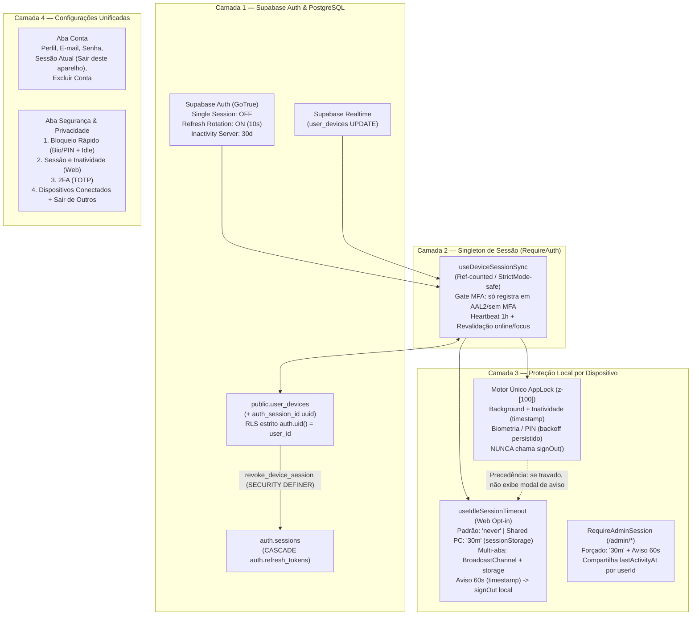

# Plano Mestre v2.0 — Arquitetura de Autenticação Multidispositivo, Inatividade e Bloqueio do Aplicativo (Axir)

> **Versão:** 2.0 (Pós Meta-Auditoria Arquitetural — Fase 0)  
> **Data:** 2026-11-24  
> **Status:** Concluído e Implantado (Fases 0–6 · Migration `0152` aplicada em produção · v3.24.0)  
> **Escopo:** Frontend Web/PWA, App Android Nativo (Capacitor), Supabase Auth (Cloud & `config.toml`), PostgreSQL (`public.user_devices` + `auth.sessions`), Realtime, Web Push / FCM, Console Admin (`/admin/*`) e Configurações (Conta & Segurança).  
> **Governança:** Estritamente aderente às regras de `AGENTS.md` (TS estrito, funções puras, DRY de UI, Regras 7–24 de UI/Modais/Ícones/Zero `autoFocus`/Zero emojis).

---

## Changelog v1 → v2

### O que entrou na v2 (validado na Meta-Auditoria)
1. **Revogação real no servidor via `auth.sessions` (sem Edge Function extra):** `register_device_session` passa a capturar `auth_session_id` diretamente de `auth.jwt() ->> 'session_id'` no servidor, e `revoke_device_session` exclui a sessão real em `auth.sessions` (cascateando `auth.refresh_tokens`) via RPC `SECURITY DEFINER`, mantendo o Realtime para desconexão instantânea da UI.
2. **Gate estrito de MFA (AAL1 vs. AAL2):** bloqueio explícito para que `registerDevice()` nunca execute nem reative um dispositivo revogado enquanto o usuário ainda estiver em AAL1 aguardando desafio TOTP.
3. **Eliminação de sessões órfãs em `verifyCurrentPassword()`:** encerramento obrigatório em `finally` (`isolatedClient.auth.signOut({ scope: "local" })`) para não acumular sessões fantasmas em `auth.sessions` após desativar *single session*.
4. **Sincronização multi-aba de atividade e aviso prévio:** `BroadcastChannel` com fallback em `localStorage` (`storage` event) para sincronizar `lastActivityAt` e `stay_connected` entre abas (incluindo convivência entre Console Admin e App de Finanças abertos em paralelo).
5. **Timers 100% baseados em timestamps (`Date.now()`):** tanto `lockOnIdle` quanto a contagem regressiva de 60s do `<IdleSessionWarningModal />` calculados por `deadlineAt - Date.now()`, recalculados em `visibilitychange`, `focus` e Capacitor `appStateChange`.
6. **Precedência explícita entre `AppLockOverlay` (`z-[100]`, `inert`) e `IdleSessionWarningModal` (`z-modal = 50`):** se a tela já estiver bloqueada quando o idle logout vencer, desloga silenciosamente sem abrir modal atrás/por cima do overlay; se o modal de aviso estiver visível nos 60s finais, adia o disparo de `lockOnIdle`.
7. **Persistência do backoff de PIN (5 tentativas → 30s; 10 tentativas → CTA de saída) via `user-storage.ts`:** sobrevive a F5 e reinícios do WebView Android sem adicionar dependências nativas.
8. **Ciclo de vida isolado do modo *"Computador compartilhado"* via `sessionStorage`:** capturado no `/entrar` antes do `userId` existir, aplicado apenas naquela sessão e limpo automaticamente em `resetAppState()`.
9. **Resiliência de reconexão e higiene de `public.user_devices`:** revalidação de `checkDeviceRevoked` em `online`, foco e reconexão Realtime; proteção `StrictMode` (ref-count/mutex); limpeza oportunista de registros revogados > 90 dias no próprio RPC; filtro de exibição limpa no `ActiveDevicesCard`.
10. **Fluxo de `ResetPasswordPage` e `ChangePasswordModal`:** registro imediato do dispositivo após redefinição de senha (evitando falso logout ao navegar para `/`) e checkbox opcional *"Encerrar sessão em outros dispositivos"* na troca de senha.

### O que foi ajustado ou descartado (anti-overengineering)
- **Descartada criação de nova Edge Function para revogação individual:** o projeto já utiliza RPCs `SECURITY DEFINER` owned by `postgres` operando em `auth.*` (`delete from auth.users`, `delete from auth.mfa_factors`). Fazer a revogação de `auth.sessions` dentro de `revoke_device_session` (com fallback defensivo) elimina latência extra, cold start e superfície de deploy.
- **Descartada introdução de `@capacitor/preferences` para backoff de PIN:** o plugin não está instalado em `package.json`; todo o app usa `localStorage` isolado por `userId` (`src/services/user-storage.ts`), que persiste no WebView Android e mantém getters síncronos compatíveis com `useSyncExternalStore`.
- **Descartado cron job dedicado para limpeza de `user_devices`:** limpeza oportunista por usuário (`is_revoked = true AND last_seen_at < now() - interval '90 days'`) dentro de `register_device_session` resolve o crescimento de tabela com custo zero de infraestrutura.

---

## Fase 0 — Meta-Auditoria do Código Real e do Plano v1

A tabela abaixo classifica cada item da v1, cada ponto do roteiro de auditoria e novas descobertas encontradas diretamente no repositório.

| ID | Item / Hipótese Auditada | Classificação | Evidência no Código Atual | Decisão para a v2 |
|---|---|---|---|---|
| **M01** | Logout forçado de 20 min na Web/PWA sem configuração | `[CONFIRMADO]` | `src/app/require-auth.tsx#L157`, `src/hooks/use-idle-session-timeout.ts#L11,L70-L98` | Padrão passa a `"never"`; timeout vira opt-in por dispositivo com aviso prévio de 60s. |
| **M02** | Logout cruzado entre dispositivos via Supabase Dashboard + `verifyCurrentPassword` | `[CONFIRMADO]` | `src/data/auth.ts#L128-L144`, `src/hooks/use-sign-out.ts#L33`, `supabase/config.toml#L279-L283` | Fase 0 no Supabase Dashboard (`Single session = OFF`) + correção em `verifyCurrentPassword`. |
| **M03** | Loop de re-login em dispositivo revogado + chamadas paralelas em `useAuth()` | `[CONFIRMADO]` | `src/hooks/use-auth.ts#L340-L376`, `src/services/native/device-info.ts#L12-L35` | Extrair para singleton `useDeviceSessionSync`; registrar antes de checar em login explícito; rotacionar `device_id` ao ser revogado. |
| **M04** | Revogação individual efetiva em `auth.sessions` (Edge Function vs. RPC) | `[PREMISSA AJUSTADA]` | `supabase/migrations/20260101000112_user_devices_and_session_management.sql#L148-L175`; precedentes em `20260101000111` e `20260101000147` (`delete from auth.*`) | Usar coluna `auth_session_id` preenchida via `auth.jwt() ->> 'session_id'` e `delete from auth.sessions` dentro da RPC `SECURITY DEFINER` + Realtime na UI. **Sem Edge Function nova.** |
| **M05** | Gate de MFA (AAL1 vs. AAL2) ausente no registro de dispositivo | `[CONFIRMADO]` | `src/hooks/use-auth.ts#L341-L345` checa apenas `!user \|\| snapshot.loading`, ignorando `mfaRequired && !mfaVerified` | Bloquear `registerDevice()` até `!(mfaRequired && !mfaVerified)`. |
| **M06** | Sessões órfãs criadas por `verifyCurrentPassword()` | `[CONFIRMADO]` | `src/data/auth.ts#L138-L143` chama `isolatedClient.auth.signInWithPassword` sem `signOut` | Adicionar `finally { await isolatedClient.auth.signOut({ scope: "local" }).catch(() => {}); }`. |
| **M07** | Multi-aba no `useIdleSessionTimeout`: aba inativa derruba aba ativa | `[CONFIRMADO]` | `src/hooks/use-idle-session-timeout.ts#L79-L151` usa apenas `useRef` local por aba | Sincronizar `lastActivityAt` e `stay_connected` via `BroadcastChannel` + fallback `localStorage` (`storage` event). |
| **M08** | Corridas entre `registerDevice`, `checkDeviceRevoked` e `rotateDeviceId()` multi-aba | `[CONFIRMADO]` | `src/hooks/use-auth.ts#L347-L375`, `src/services/native/device-info.ts#L4-L35` | Flag explícita pós-login (`pendingExplicitDeviceRegistration`), mutex in-flight e rotação de `device_id` apenas ao confirmar revogação antes do `signOut({ scope: "local" })`. |
| **M09** | Timers vulneráveis a throttling/hibernação em contagem regressiva e `lockOnIdle` | `[CONFIRMADO]` | `src/hooks/use-idle-session-timeout.ts#L108-L151`; `src/services/native/app-lock.ts` sem idle timer | Todos os timers baseados em `deadlineAt - Date.now()`, recalculados em `visibilitychange`, `focus` e `appStateChange`. |
| **M10** | Colisão entre `AppLockOverlay` (`z-[100]`, `inert`) e `IdleSessionWarningModal` (`z-50`) | `[CONFIRMADO]` | `src/app/app-lock-overlay.tsx#L114-L128,L199` torna `[data-radix-portal]` `inert`; `src/components/ui/modal.tsx#L172` usa `z-modal` (`50`) | Regra de precedência estrita: se `isAppLocked() === true`, não abre modal de aviso e encerra silenciosamente no deadline; se modal de aviso aberto, pausa `lockOnIdle`. |
| **M11** | Persistência de backoff de PIN em Android/Web (`@capacitor/preferences` vs `localStorage`) | `[PREMISSA AJUSTADA]` | `package.json#L47-L58` não possui `@capacitor/preferences`; `src/services/native/pin-lock.ts` não tem backoff; `src/services/user-storage.ts` isola `localStorage` por `userId` | Persistir `{ failedAttempts, lockedUntilMs }` via `user-storage.ts` (`localStorage`), sem instalar novo plugin nativo. |
| **M12** | Ciclo de vida do modo *"Computador compartilhado"* na tela `/entrar` | `[CONFIRMADO]` | `src/features/auth/pages/login-page.tsx`, `src/services/auth-cleanup.ts#L53-L59` (`sessionStorage.clear()` no logout) | Gravar flag efêmera em `sessionStorage` no submit; aplicar `IdleLogoutPolicy = "30m"` efêmero na sessão; limpo automaticamente no logout. |
| **M13** | Resiliência Realtime, higiene de `user_devices` e drift `config.toml` vs Dashboard | `[CONFIRMADO]` | `src/state/queries/use-user-access.ts#L76-L120`, `src/features/settings/components/tabs/active-devices-card.tsx`, `supabase/config.toml#L279-L283` | Revalidar em `online`/foco/reconexão; limpeza oportunista > 90 dias na RPC; filtro na UI; documentação alinhada. |
| **M14** | Bug ao remover PIN religa `biometric_lock_enabled` | `[CONFIRMADO]` | `src/features/settings/components/pin-setup-dialog.tsx#L87-L96`, `src/features/settings/components/tabs/security-tab.tsx#L166-L176` | Separar callbacks `onPinSaved` e `onPinRemoved`. |
| **M15** | Botão *"Usar Biometria"* fantasma na Web sem suporte biométrico | `[CONFIRMADO]` | `src/app/app-lock-overlay.tsx#L259-L274` renderiza botão sem verificar disponibilidade biométrica | Checar `isNativePlatform() \|\| biometricsAvailable` antes de renderizar troca para biometria. |
| **M16** | Desconexão entre `signOut({ scope: "others" })` e `public.user_devices` | `[CONFIRMADO]` | `src/hooks/use-sign-out.ts#L36-L39`, `src/features/settings/components/tabs/account-tab.tsx#L129-L150` | Nova RPC `revoke_other_device_sessions` invocada dentro de `useSignOut({ scope: "others" })` + invalidação de `["user-devices"]`. |
| **M17** | Console Admin (`/admin/*`) sem proteção de inatividade | `[CONFIRMADO]` | `src/components/routing/require-admin-session.tsx#L10-L30` | Montar `useIdleSessionTimeout({ forcedPolicy: "30m", warningSeconds: 60 })` em `RequireAdminSession`. |
| **M18** | Edge Function dedicada para revogar `auth.sessions` ou cron dedicado para limpar `user_devices` | `[DESCARTADO]` | Precedentes de `SECURITY DEFINER` em `auth.*` já em produção; volume atual de 15 linhas em `user_devices` | Overengineering para o estágio atual; RPC `SECURITY DEFINER` + limpeza oportunista resolvem com menor latência e zero infra extra. |
| **M19** | **React `StrictMode` ativo** exige proteção contra double-mount em Realtime e timers | `[NOVA DESCOBERTA]` | `src/main.tsx#L34` (`<StrictMode>`) + padrão ref-counted em `src/state/queries/use-user-access.ts#L50-L73` | `useDeviceSessionSync` e canal Realtime devem usar ref-count/cleanup idempotente e mutex in-flight. |
| **M20** | **`ResetPasswordPage`** navega para `/` sem registrar o dispositivo atual após `signOut({ scope: "others" })` | `[NOVA DESCOBERTA]` | `src/features/auth/pages/reset-password-page.tsx#L107-L113,L152` | Chamar `markPendingExplicitDeviceRegistration()` / `registerDevice()` após redefinir a senha para evitar falso logout se o aparelho já foi revogado antes. |
| **M21** | **`ChangePasswordModal`** não oferece opção de encerrar outros dispositivos | `[NOVA DESCOBERTA]` | `src/features/settings/components/tabs/change-password-modal.tsx#L78` | Adicionar checkbox opcional *"Encerrar sessão em outros dispositivos"* (desmarcado por padrão para conforto). |
| **M22** | **Offline fail-open em `checkDeviceRevoked`** precisa ser invariante testada | `[NOVA DESCOBERTA]` | `src/data/repositories/devices.ts#L73-L87` retorna `false` em erro de rede | Formalizar e testar que erros de rede/offline **nunca** deslogam o usuário. |
| **M23** | **AdminShell abre App de Finanças em nova aba (`target="_blank"`)** | `[NOVA DESCOBERTA]` | `src/features/admin/layouts/admin-shell.tsx#L80-L91` | Compartilhar `lastActivityAt` por `userId` entre abas (Admin e App) para não deslogar o admin enquanto ele atua no App, mantendo o deadline de 30m ativo para `/admin/*`. |
| **M24** | **Conformidade estrita com `AGENTS.md`** em novos modais/cards | `[NOVA DESCOBERTA]` | `AGENTS.md` Regras 7, 8, 13, 15, 18, 20 (`<Modal size="sm">`, `<ModalFooter borderless>`, zero `autoFocus`, ícones Nível 1 icon-only `size-4`, zero emojis) | Incluir checklist de conformidade `AGENTS.md` como Quality Gate obrigatório nas Fases 4 e 5. |

---

## 1. Arquitetura Consolidada v2.0



### 1.1 Contratos Canônicos de Dados e Armazenamento

#### A) Banco de Dados (`public.user_devices`)
- **Nova coluna:** `auth_session_id uuid` (nullable, preenchida automaticamente no servidor via `nullif(auth.jwt() ->> 'session_id', '')::uuid` dentro de `register_device_session`).
- **Índice adicional:** `idx_user_devices_auth_session on public.user_devices(user_id, auth_session_id) where auth_session_id is not null`.
- **RPCs (todas `SECURITY DEFINER`, `set search_path = public, pg_temp`, `revoke all from public, anon`, `grant execute to authenticated`):**
  1. `register_device_session(p_device_id, p_device_name, p_browser, p_os, p_ip_address)`:
     - Captura `v_session_id := nullif(auth.jwt() ->> 'session_id', '')::uuid`.
     - Faz `upsert` em `(user_id, device_id)` com `auth_session_id = coalesce(v_session_id, user_devices.auth_session_id)`, `is_revoked = false`, `last_seen_at = now()`.
     - Limpeza oportunista: `delete from public.user_devices where user_id = v_user_id and is_revoked = true and last_seen_at < now() - interval '90 days'`.
  2. `revoke_device_session(p_device_record_id uuid)`:
     - Atualiza `is_revoked = true, last_seen_at = now()` filtrando `id = p_device_record_id and user_id = v_user_id`, capturando `v_auth_session_id`.
     - Se `v_auth_session_id is not null`, executa bloco protegido:
       ```sql
       begin
         delete from auth.sessions where id = v_auth_session_id and user_id = v_user_id;
       exception when insufficient_privilege then
         -- Fallback seguro: is_revoked = true + Realtime já garantem desconexão
         null;
       end;
       ```
  3. `revoke_other_device_sessions(p_current_device_id text)`:
     - Marca `is_revoked = true, last_seen_at = now()` onde `user_id = v_user_id and device_id <> trim(p_current_device_id) and is_revoked = false`.
     - Retorna a contagem de dispositivos atualizados.
  4. `check_device_session_revoked(p_device_id text)`: mantida sem quebra de contrato.

#### B) Preferências Locais de Bloqueio (`src/services/native/app-lock.ts`)
Migradas transparentemente a partir da chave legada `biometric_lock_enabled` via `src/services/user-storage.ts`:

```ts
export type AppLockMethod = "biometrics" | "pin" | "biometrics_or_pin";

export interface AppLockConfig {
  enabled: boolean;
  method: AppLockMethod;
  graceMinutes: number; // 0 | 1 | 5 | 15 | 30
  lockOnIdle: boolean;  // true por padrão quando bloqueio está ativo e graceMinutes > 0
}
```

#### C) Backoff Persistido de PIN (`src/services/native/pin-lock.ts`)
Armazenado em `user-storage.ts` sob a chave `app_pin_lockout`:

```ts
export interface PinLockoutState {
  failedAttempts: number;
  lockedUntilMs: number | null;
}
```
- **Regra pura (em `src/domain/` ou helper puro testável):**
  - 1–4 erros: sem espera.
  - 5–9 erros: bloqueio de 30s (`Date.now() + 30_000`) a cada erro a partir do 5º (ou 30s no 5º, 60s no 7º, 120s no 9º).
  - ≥ 10 erros: bloqueio de 5 min + destaque visual no botão *"Sair da conta e entrar com senha"*.
  - Sucesso no PIN ou Biometria: limpa `app_pin_lockout`.

#### D) Política de Inatividade Web (`src/services/session-policy.ts`)
```ts
export type IdleLogoutPolicy = "never" | "15m" | "30m" | "60m" | "240m";
```
- **Persistência normal (por dispositivo + usuário):** `user-storage.ts` chave `idle_logout_policy`, padrão `"never"`.
- **Modo *"Computador compartilhado"*:** gravado em `window.sessionStorage` sob `axir_shared_device_session = "1"` no submit do `/entrar`; sobrepõe a política efetiva para `"30m"` apenas enquanto aquela sessão existir; removido automaticamente por `resetAppState()` (`sessionStorage.clear()`).

### 1.2 Regras de Precedência e Concorrência

1. **Gate de MFA no registro de dispositivo:**
   - `useDeviceSessionSync` só executa `registerDevice()` ou `checkDeviceRevoked()` quando `!authLoading && Boolean(user) && !(mfaRequired && !mfaVerified)`.
   - No login sem MFA (`useLoginForm`) e após verificação TOTP (`handleVerifyMfa`) e após `ResetPasswordPage`, marca `markPendingExplicitDeviceRegistration()` (em memória/`sessionStorage`) para garantir que `registerDevice()` execute **antes** de qualquer `checkDeviceRevoked()`.
2. **Ordem de revogação remota (Realtime / `online` / `visibilitychange`):**
   - Mutex em módulo (`isHandlingRemoteRevocation`) evita disparos duplicados entre Realtime + foco + StrictMode.
   - Sequência atômica: (a) confirma `device_id === currentDeviceId`; (b) rotaciona `device_id` (`rotateDeviceId()`); (c) limpa sync timestamp; (d) exibe toast informativo (*"Esta sessão foi encerrada remotamente por outro dispositivo."* — 1 único toast); (e) executa `signOut({ scope: "local" })` (que derruba todas as outras abas do mesmo navegador via `SIGNED_OUT` nativo do SDK Supabase).
3. **Precedência `AppLockOverlay` vs `IdleSessionWarningModal`:**
   - `AppLockOverlay` (`z-[100]`) tem precedência absoluta de privacidade.
   - Se o `deadlineAt` do idle logout se aproximar (janela de 60s) enquanto `isAppLocked() === true`: **não** abre `<IdleSessionWarningModal />`; quando `Date.now() >= deadlineAt` e o usuário continuar bloqueado sem interagir, executa `signOut({ scope: "local" })` silenciosamente (que desativa o overlay e leva para `/entrar` com toast).
   - Se `isAppLocked() === false` e `<IdleSessionWarningModal />` abrir na janela de 60s: `AppLock` adia o disparo de `lockOnIdle` enquanto o modal de aviso estiver aberto, evitando conflito de focus trap.
4. **Sincronização Multi-aba (`BroadcastChannel` + `localStorage` fallback):**
   - Canal `axir_idle_sync_${userId}` (compartilhado entre abas do App e do Console Admin do mesmo `userId`).
   - Mensagens: `{ type: "activity", at: number }` (throttled a cada 5s) e `{ type: "stay_connected", at: number }`.
   - Fallback automático via `localStorage` key `axir_idle_last_activity_${userId}` + listener `window.addEventListener("storage", ...)` para navegadores sem `BroadcastChannel`.
   - A contagem regressiva de 60s e o timer principal calculam sempre `remainingMs = deadlineAt - Date.now()`, recalculados em `visibilitychange`, `focus` e `appStateChange`.

---

## 2. Plano de Execução Faseado com Quality Gates

### Fase 0 — Infraestrutura & Governança Supabase Cloud (Passo Manual + Docs)
- **Ações:**
  1. No **Supabase Dashboard → Authentication → Sessions** (produção):
     - `Enforce single session per user` = **OFF**
     - `Time-box user sessions` = **OFF** (ou `90d`)
     - `Inactivity timeout` = **`30d`** (ou **OFF**)
     - `Refresh token rotation` = **ON**, `Reuse interval` = **`10s`**
     - `JWT expiry` = **`3600s`**
  2. Documentar os valores oficiais e a nota sobre não-propagação automática de `[auth]` via `supabase db push` em `supabase/config.toml` (comentário explicativo) e `docs/operations/SECURITY_GOVERNANCE.md`.
- **Quality Gate 0:** Login simultâneo no mesmo usuário em 2 navegadores distintos mantém ambas as sessões válidas por > 5 minutos sem erro 401.

---

### Fase 1 — Backend, Migration SQL e Correção de Sessões Órfãs
- **Arquivos a criar/modificar:**
  - `[NOVO]` `supabase/migrations/20260101000152_session_devices_lifecycle_hardening.sql`
    - `alter table public.user_devices add column if not exists auth_session_id uuid;`
    - Índice `idx_user_devices_auth_session`
    - Atualização de `register_device_session` (captura `auth.jwt() ->> 'session_id'` + limpeza oportunista > 90d)
    - Atualização de `revoke_device_session` (deleta `auth.sessions` com fallback defensivo)
    - Nova RPC `revoke_other_device_sessions(p_current_device_id text)`
    - Inclusão idempotente de `public.user_devices` na publicação `supabase_realtime`
  - `[MOD]` `src/data/auth.ts`: encerrar sessão efêmera em `finally` dentro de `verifyCurrentPassword()`.
  - `[MOD]` `src/data/rpc/auth-sessions.ts`: adicionar `revokeOtherDeviceSessionsRpc(currentDeviceId)`.
  - `[MOD]` `src/data/repositories/devices.ts`: adicionar `revokeOtherDevices(currentDeviceId)` + garantir fail-open documentado em `checkDeviceRevoked` para erros de rede.
  - `[MOD]` `src/hooks/use-sign-out.ts`: em `scope === "others"`, chamar `revokeOtherDevices(getOrCreateDeviceId())` e invalidar `userDevicesKey`.
  - `[MOD]` `src/services/native/device-info.ts`: adicionar `rotateDeviceId()`, reduzir `SYNC_THROTTLE_MS` para `60 * 60 * 1000` (1h), adicionar flag `markPendingExplicitDeviceRegistration()` / `consumePendingExplicitDeviceRegistration()`.
  - `[MOD]` `src/types/database.ts` / `src/types/schema.ts`: refletir `auth_session_id?: string | null` em `UserDevice`.
- **Cenários de borda cobertos:**
  - `verifyCurrentPassword()` falha ou acerta → cliente isolado sempre faz `signOut({ scope: "local" })`.
  - `checkDeviceRevoked()` offline / timeout de rede → retorna `false` (nunca desloga usuário sem internet).
  - `revoke_device_session` quando `auth_session_id` é `null` (registros legados) → marca `is_revoked = true` sem erro.
- **Testes exigidos:**
  - Atualizar `src/data/auth.test.ts` (assert `isolatedClient.auth.signOut({ scope: "local" })` chamado em sucesso e erro de `verifyCurrentPassword`).
  - Atualizar `src/data/repositories/devices.test.ts` (`revokeOtherDevices` + fail-open offline em `checkDeviceRevoked`).
  - Atualizar `src/services/native/device-info.test.ts` (`rotateDeviceId`, throttle 1h, flag de registro explícito).
- **Quality Gate 1:** `npm run typecheck && npm run lint && npx vitest run src/data/auth.test.ts src/data/repositories/devices.test.ts src/services/native/device-info.test.ts`.

---

### Fase 2 — Orquestrador Global de Sessão e Dispositivos (`useDeviceSessionSync`)
- **Arquivos a criar/modificar:**
  - `[NOVO]` `src/hooks/use-device-session-sync.ts`:
    - Singleton ref-counted (100% seguro sob `<StrictMode>`).
    - Gate estrito de MFA: não roda enquanto `mfaRequired && !mfaVerified`.
    - Se `consumePendingExplicitDeviceRegistration()` for `true`: chama `registerDevice()` primeiro.
    - Caso contrário (boot/reload): chama `checkDeviceRevoked()` primeiro; se revogado, executa rotina atômica com mutex (`rotateDeviceId()` → toast único → `signOut({ scope: "local" })`).
    - Canal Realtime em `public.user_devices` (`filter: user_id=eq.${user.id}`, evento `UPDATE`): desconexão instantânea quando `device_id === currentDeviceId && is_revoked === true`.
    - Revalidação automática (throttled) em `window` `online`, `visibilitychange` (retorno ao foco) e callback `SUBSCRIBED` de reconexão Realtime.
    - Heartbeat de `last_seen_at` a cada 1h (`shouldSyncDeviceSession`).
  - `[MOD]` `src/hooks/use-auth.ts`: remover o `useEffect` de dispositivos (linhas 337–376), deixando `useAuth()` puramente reativo.
  - `[MOD]` `src/app/require-auth.tsx`: montar `useDeviceSessionSync()` uma única vez.
  - `[MOD]` `src/features/auth/hooks/use-login-form.ts`: chamar `markPendingExplicitDeviceRegistration()` após login sem MFA e após `handleVerifyMfa` (AAL2).
  - `[MOD]` `src/features/auth/pages/reset-password-page.tsx`: chamar `markPendingExplicitDeviceRegistration()` antes de navegar para `/` após redefinir senha.
  - `[MOD]` `src/features/settings/components/tabs/change-password-modal.tsx`: adicionar checkbox opcional *"Encerrar sessão em outros dispositivos"* (desmarcado por padrão; quando marcado, chama `signOut({ scope: "others" })`).
- **Cenários de borda cobertos:**
  - Login com 2FA ativo: em AAL1 nenhuma chamada de `registerDevice` é feita; após TOTP (AAL2) registra imediatamente.
  - Re-login em dispositivo anteriormente revogado: não entra em loop de logout.
  - StrictMode double-mount: apenas 1 canal Realtime ativo e 1 chamada de sincronização.
- **Testes exigidos:**
  - `[NOVO]` `src/hooks/use-device-session-sync.test.ts` (MFA gate, ordem login vs reload, Realtime revocation + mutex, reconexão/online, StrictMode).
  - Atualizar `src/hooks/use-auth.test.ts` e `src/features/auth/pages/reset-password-page.test.tsx`.
- **Quality Gate 2:** `npm run typecheck && npm run lint && npx vitest run src/hooks/use-auth.test.ts src/hooks/use-device-session-sync.test.ts src/features/auth/`.

---

### Fase 3 — Motor Unificado `AppLock`, Backoff de PIN e Correções do Overlay
- **Arquivos a criar/modificar:**
  - `[MOD]` `src/services/native/app-lock.ts`:
    - Migrar para contrato `AppLockConfig` (`enabled`, `method`, `graceMinutes`, `lockOnIdle`) mantendo leitura retrocompatível da chave legada `biometric_lock_enabled`.
    - Integrar monitoramento de inatividade em tela aberta baseado em `Date.now()` (`lastInteractionAt`, recalculado em `visibilitychange`/`focus`/`appStateChange`), pausável quando `IdleSessionWarningModal` estiver ativo (`setAppLockIdlePaused(boolean)`).
    - Blindar `shouldLockOnColdStart()` para nunca travar sem sessão ativa ou sem método configurado.
  - `[MOD]` `src/services/native/pin-lock.ts`:
    - Implementar estado persistido `PinLockoutState` em `user-storage.ts` (`getPinLockoutState`, `recordPinFailure`, `clearPinLockout`).
    - Integrar verificação de lockout dentro de `unlockAppWithPin()`.
  - `[MOD]` `src/features/settings/components/pin-setup-dialog.tsx`:
    - Separar `onPinSaved` e `onPinRemoved` (corrigindo o bug B4).
  - `[MOD]` `src/app/app-lock-overlay.tsx`:
    - Consultar disponibilidade biométrica (`checkBiometricsAvailability`) e só exibir botão *"Usar Biometria"* quando `isNativePlatform() || biometricsAvailable`.
    - Exibir feedback claro de lockout do PIN com contagem regressiva por timestamp e destaque do botão *"Sair da conta e entrar com senha"* após 10 falhas.
    - Garantir zero `autoFocus` (Regra 20 `AGENTS.md`).
- **Cenários de borda cobertos:**
  - Remover PIN sem biometria ativa → `app_lock_enabled` vira `false` e overlay não dispara.
  - 5 erros de PIN + F5 / reinício do app → lockout continua vigente até `lockedUntilMs`.
  - Consumidores existentes (`back-button.ts`, `global-search.tsx`, `privacy-toggle.tsx`, `use-shell-onboarding-orchestrator.ts`, `use-pending-split-expense.ts`, `require-auth.tsx`) mantêm 100% de compatibilidade com `isAppLocked` / `subscribeAppLock`.
- **Testes exigidos:**
  - Atualizar `src/services/native/app-lock.test.ts` (migração legada, `lockOnIdle` por timestamp, pausa durante aviso de idle, cold start).
  - Atualizar `src/services/native/pin-lock.test.ts` (backoff progressivo persistido e reset no sucesso).
  - Atualizar `src/app/app-lock-overlay.test.tsx` (ocultação do botão Biometria na Web sem sensor, exibição de lockout).
  - Atualizar `src/features/settings/components/pin-setup-dialog.test.tsx` (`onPinRemoved` separado de `onPinSaved`).
- **Quality Gate 3:** `npm run typecheck && npm run lint && npx vitest run src/services/native/app-lock.test.ts src/services/native/pin-lock.test.ts src/app/app-lock-overlay.test.tsx src/features/settings/components/pin-setup-dialog.test.tsx`.

---

### Fase 4 — Política de Inatividade Opt-in, Sync Multi-aba, Modal de Aviso 60s e Guard Admin
- **Arquivos a criar/modificar:**
  - `[NOVO]` `src/services/session-policy.ts`:
    - `IdleLogoutPolicy` (`"never" | "15m" | "30m" | "60m" | "240m"`), padrão `"never"`.
    - `getIdleLogoutPolicy(userId)`, `setIdleLogoutPolicy(policy, userId)`, `getEffectiveIdleLogoutPolicy(userId)` (respeita flag `axir_shared_device_session` em `sessionStorage`).
    - `setSharedDeviceSession(enabled)` / `isSharedDeviceSession()`.
  - `[MOD]` `src/hooks/use-idle-session-timeout.ts`:
    - Ler `getEffectiveIdleLogoutPolicy(user.id)` (ou `options.forcedPolicy` para Admin).
    - Desabilitar completamente se política efetiva for `"never"` ou `isDemoActive` ou `!hasUser`.
    - Sincronizar `lastActivityAt` e `stay_connected` entre abas via `BroadcastChannel` (`axir_idle_sync_${userId}`) + fallback `localStorage` (`storage` event).
    - Calcular janela de aviso de 60s e expiração exclusivamente via `deadlineAt - Date.now()`, recalculados em `visibilitychange`, `focus` e `appStateChange`.
    - Implementar regra de precedência com `AppLock`: se `isAppLocked() === true`, não exibe modal de aviso e encerra silenciosamente no deadline; enquanto modal aberto, chama `setAppLockIdlePaused(true)`.
  - `[NOVO]` `src/components/modules/idle-session-warning-modal.tsx`:
    - Usa `<Modal size="sm">` + `<ModalFooter borderless>` (Regras 15, 18, 20 `AGENTS.md`: zero `autoFocus`, sem emojis, Cancelar/Sair à esquerda e *"Continuar conectado"* à direita).
    - Exibe contagem regressiva limpa em segundos (`tabular-nums`).
  - `[MOD]` `src/app/require-auth.tsx`: conectar `useIdleSessionTimeout()` ao `<IdleSessionWarningModal />`.
  - `[MOD]` `src/components/routing/require-admin-session.tsx`: montar `useIdleSessionTimeout({ forcedPolicy: "30m", warningSeconds: 60 })` + `<IdleSessionWarningModal />`.
  - `[MOD]` `src/features/auth/pages/login-page.tsx` e `src/features/auth/hooks/use-login-form.ts`: adicionar `<Checkbox />` discreto *"Computador compartilhado (sair após 30 min sem uso)"* (desmarcado por padrão; grava `setSharedDeviceSession(true)` no submit).
- **Cenários de borda cobertos:**
  - Usuário padrão (política `"never"`) deixa aba parada por 2 horas → continua logado.
  - Duas abas abertas (ou Admin + App) com política `"30m"`: atividade na Aba A atualiza `lastActivityAt` da Aba B → nenhuma aba desloga.
  - Aba hibernada por 45 min com política `"30m"` → ao voltar (`visibilitychange`), detecta `Date.now() >= deadlineAt` e faz `signOut({ scope: "local" })` imediatamente.
  - Modo *"Computador compartilhado"* → após logout, `sessionStorage.clear()` limpa a flag e o próximo login volta ao padrão normal.
- **Testes exigidos:**
  - Atualizar `src/hooks/use-idle-session-timeout.test.ts` (padrão `"never"`, aviso 60s por timestamp, sync multi-aba, precedência com `AppLock`, modo compartilhado, modo forçado Admin).
  - Atualizar `src/components/routing/require-admin-session.test.tsx` e `src/features/auth/pages/login-page.test.tsx`.
- **Quality Gate 4:** `npm run typecheck && npm run lint && npx vitest run src/hooks/use-idle-session-timeout.test.ts src/components/routing/require-admin-session.test.tsx src/features/auth/pages/login-page.test.tsx`.

---

### Fase 5 — Consolidação da UI de Configurações (Conta & Segurança)
- **Arquivos a criar/modificar:**
  - `[NOVO]` `src/features/settings/components/tabs/security/session-inactivity-card.tsx`:
    - Visível na Web/PWA; card canônico (`border-border/80 bg-surface shadow-xs`, ícone Nível 1 `size-4 text-muted-foreground` sem caixa decorativa — Regra 13/16 `AGENTS.md`).
    - Seletor (`<Select />`) com opções claras: *Manter conectado (Recomendado)*, *15 minutos*, *30 minutos*, *1 hora*, *4 horas*.
    - Indicação clara quando o modo *"Computador compartilhado"* estiver ativo nesta sessão.
  - `[NOVO]` `src/features/settings/components/tabs/security/two-factor-card.tsx`:
    - Card dedicado de 2FA (TOTP) na aba Segurança com badge de status (`Ativo` / `Desativado`) e botão *"Gerenciar 2FA"* abrindo `<MfaModal />`.
  - `[MOD]` `src/features/settings/components/tabs/security/app-lock-card.tsx`:
    - Adicionar toggle *"Bloquear também quando a tela ficar parada"* (`lockOnIdle`, visível quando `graceMinutes > 0`).
  - `[MOD]` `src/features/settings/components/tabs/active-devices-card.tsx`:
    - Integrar botão *"Desconectar outros aparelhos"* (com confirmação e sync `useSignOut({ scope: "others" })`).
    - Filtrar registros revogados com > 30 dias (ou agrupar histórico revogado de forma limpa abaixo dos ativos, exibindo no máximo 5 recentes + ação de remover).
  - `[MOD]` `src/features/settings/components/tabs/security-tab.tsx`:
    - Orquestrar os 4 cards na ordem lógica: (1) `AppLockCard`, (2) `SessionInactivityCard` (Web/PWA), (3) `TwoFactorCard`, (4) `ActiveDevicesCard`, seguidos de `PlatformsTriptychCard`, `AppAboutCard` e `DeleteAccountCard`.
    - Usar `onPinSaved` e `onPinRemoved` no `PinSetupDialog`.
  - `[MOD]` `src/features/settings/components/tabs/account/account-sessions-card.tsx` e `account-tab.tsx`:
    - Enxugar `AccountSessionsCard` para focar apenas em **"Sessão neste Dispositivo"** (*Sair deste aparelho*) + link discreto *"Configurar bloqueio, 2FA e outros aparelhos"* (`?tab=security`), removendo duplicidade.
  - `[MOD]` `src/features/settings/pages/settings-page.tsx`:
    - Ajustar rótulo da aba `security` para `"Segurança & Privacidade"` (`shortLabel: "Segurança"`), preservando rotas `?tab=security` / `?tab=seguranca`.
- **Quality Gate 5:** `npm run typecheck && npm run lint && npx vitest run src/features/settings/` + checagem visual responsiva (mobile < 400px e desktop) conforme Regras 9–24 de `AGENTS.md`.

---

### Fase 6 — Validação Ponta a Ponta, Regressão Completa e Documentação
- **Ações:**
  1. Executar suíte completa: `npm run typecheck && npm run lint && npm test`.
  2. Executar checklist manual E2E nos 7 cenários críticos:
     - Multidispositivo simultâneo (Desktop + Mobile/APK).
     - Permanência conectado > 20 min na Web/PWA no modo padrão (`never`).
     - Bloqueio rápido por PIN/Biometria (background + idle) sem deslogar nem perder Push.
     - Opt-in de inatividade / Computador compartilhado com contagem regressiva de 60s + sync multi-aba.
     - Revogação individual remota em tempo real + re-login sem loop.
     - *"Desconectar outros aparelhos"* sincronizando `auth.sessions` e `user_devices`.
     - Remoção de PIN e backoff persistido após F5.
  3. Atualizar `docs/operations/SECURITY_GOVERNANCE.md` com a nova matriz de sessão, multidispositivo, inatividade e bloqueio.
- **Quality Gate Final:** Zero erros de TypeScript, zero warnings/erros de ESLint (incluindo `local/no-decorative-unicode`), 100% dos testes Vitest passando.

---

## 3. Mapa de Riscos Residuais (Trade-offs Assumidos Conscientemente)

| Risco Residual | Causa / Limitação de Plataforma | Mitigação Aplicada |
|---|---|---|
| **Drift de configuração no Supabase Dashboard** | `supabase/config.toml` não sincroniza automaticamente a seção `[auth.sessions]` com o projeto Cloud via `db push`. | Checklist explícito na Fase 0 + documentação em `SECURITY_GOVERNANCE.md` e comentário no `config.toml`. |
| **Bypass local de PIN / backoff na Web via DevTools** | O PIN local é uma camada de **privacidade de tela** no cliente (`localStorage`), não substitui autenticação de servidor. | A segurança real dos dados continua garantida por Supabase Auth + RLS + 2FA; no Android Pro o armazenamento fica isolado no sandbox do app. |
| **Fallback caso `delete from auth.sessions` sofra restrição de permissão em upgrade futuro do Supabase** | Alterações de privilégio do schema `auth` gerenciado pelo Supabase podem restringir DML direto na tabela interna. | Bloco `exception when insufficient_privilege` na RPC preserva `is_revoked = true` + desconexão imediata via Realtime + checagem em `checkDeviceRevoked`. |
| **Abas totalmente suspensas (Page Lifecycle API / congelamento de OS) durante revogação remota** | O WebSocket Realtime pode desconectar enquanto o SO hiberna a aba/app. | Revalidação automática de `checkDeviceRevoked()` em `visibilitychange`, `online` e reconexão Realtime garante desconexão assim que o usuário volta à aba/app. |
| **Sessões legadas em `user_devices` anteriores à migration** | Registros antigos têm `auth_session_id = NULL` até o próximo heartbeat (1h) ou login. | `revoke_device_session` trata `auth_session_id IS NULL` graciosamente via `is_revoked = true` + Realtime; novos registros/heartbeats preenchem `auth_session_id` automaticamente. |
