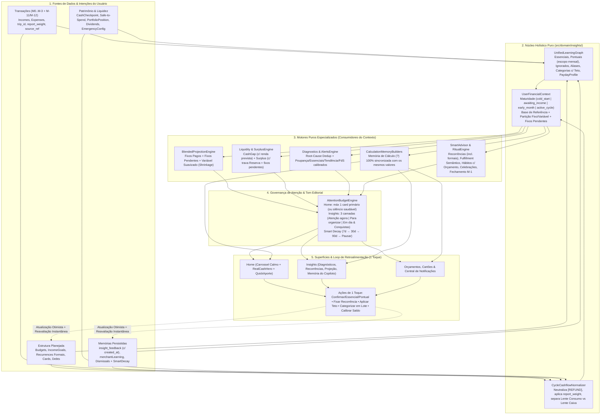

# PLANO MESTRE — Motor de Insights Holístico, Adaptativo e Profissional (Copiloto Financeiro)

> **Status:** Arquitetura & Plano Mestre (Pronto para Execução Faseada)  
> **Escopo:** `overview`, `projection`, `cash`, `insights`, `savings`, `cards`, `budgets`, `recurrences`, `investments` (carteira, proventos, reserva de emergência), `calculation-memory`, `notifications` e camada de estado/persistência.  
> **Premissa de Governança:** 100% alinhado ao `AGENTS.md` (TypeScript estrito sem `any`, funções puras em `src/domain/` com moeda em centavos inteiros, testes Vitest colocalizados, DRY estrito em UI, zero emojis, zero `autoFocus`, Memória de Cálculo congruente ao centavo).

---

# PARTE 1 — META-ANÁLISE DO CODEBASE REAL

## 1. Inventário & Mapa de Dependências Atual

A auditoria direta linha por linha do repositório mapeou **6 camadas desconectadas** que hoje computam visões parciais — e frequentemente contraditórias — da mesma realidade financeira do usuário.

### 1.1. Mapa de Motores, Hooks e Persistência Existentes

| Camada | Arquivos Reais no Codebase | O que Calcula / Persiste | Divergência / Fragilidade Confirmada |
|---|---|---|---|
| **Projeção & Ritmo** | `src/domain/projection/index.ts`<br>`src/domain/projection/cash-gap.ts`<br>`src/domain/projection/emergency-fund.ts`<br>`src/domain/projection/weekly-radar.ts` | `dailyBudget`, `spendingPace`, `endOfMonthProjection`, `analyzeCashGap`, `calculateEmergencyFund`, `resolveEmergencyFundComposition`, `computeWeeklyDueRadar` | 1. `spendingPace` permite `monthlyBudgetCents = 1` vindo de `Math.max(1, 0)`.<br>2. `endOfMonthProjection` extrapola linearmente tudo (`expenses / dayOfMonth * daysInMonth`), sem separar fixos/pontuais/viagens.<br>3. `analyzeCashGap` dispara sem verificar se há checkpoint ou entradas recorrentes.<br>4. `calculateEmergencyFund` classifica `0 meses` como `"critico"` mesmo em *cold start*. |
| **Visão Geral (Home)** | `src/domain/overview/build-overview-metrics.ts`<br>`src/domain/overview/surplus.ts`<br>`src/domain/overview/alert-dismissals.ts`<br>`src/features/overview/hooks/use-overview-data.ts`<br>`src/features/overview/hooks/use-overview-cashflow.ts`<br>`src/features/overview/hooks/use-overview-obligations.ts`<br>`src/features/overview/components/build-overview-alerts.tsx` | KPIs, `computeCurrentMonthProjectionMetrics`, `calculateSurplusCapacity`, `buildOverviewCashGapResult`, carrossel unificado (`maxItems=5`) | 1. **Bug dos 500.000%:** linha 138 de `build-overview-metrics.ts` faz `monthlyBudgetCents: Math.max(1, grossIncomeCents)`.<br>2. **Falso otimismo:** `calculateSurplusCapacity` deduz faturas/dívidas, mas **não deduz** recorrências fixas pendentes nem verifica se a **Reserva de Emergência** está completa.<br>3. **Lente mista:** `computeMonthlyCashflowMetrics` usa `grossExpenseCents` em `totals` e `projectionMetrics`, mas `spentWeightedCents` em `budgetRows`.<br>4. **Poluição do carrossel:** até 5 cards simultâneos + `AutoRegisteredBanner` + `PendingSuggestionsCard` + `PendingSplitSignalsCard` + `DashboardPixClipboardCard` empilhados fora do carrossel. |
| **SmartAdvisor** | `src/domain/insights/advisor.ts`<br>`src/domain/insights/smart-advisor-rules.ts`<br>`src/domain/insights/habits.ts`<br>`src/domain/insights/intent-semantics.ts`<br>`src/domain/insights/extended-periodicity.ts`<br>`src/domain/insights/aporte-learning.ts`<br>`src/features/overview/hooks/use-smart-advisor-queries.ts`<br>`src/features/overview/hooks/use-smart-advisor-dismissals.ts` | Candidatos priorizados (1–4), hábitos/microvazamentos, compromissos anuais/semanais, padrão de corretora, cooldown 7d/30d | 1. `useSmartAdvisorQueries` **não recebe** `trip_id`, `source_ref` nem `recurrences` formais.<br>2. `detectSpendingHabits` olha apenas para o mês atual, ignora `categoryBudgetsMap` (pede "Definir teto" mesmo com orçamento ativo e folgado) e projeta `totalMonthCents * 12`.<br>3. `generateSmartAdvisorInsights` não gera nenhum insight de reforço positivo/economia real.<br>4. Dupla instanciação: `useNotificationCenter` (linha 286) chama `useSmartAdvisorInsights()` **em paralelo** com `OverviewPage` (linha 86), duplicando toda a árvore de queries e processamento a cada render de layout! |
| **Insights (Página)** | `src/domain/insights/alerts.ts`<br>`src/domain/insights/diagnostics.ts`<br>`src/domain/insights/build-insights-dashboard.ts`<br>`src/domain/insights/build-insights-analytics.ts`<br>`src/domain/insights/build-insights-warnings.ts`<br>`src/domain/insights/recurrences.ts`<br>`src/domain/insights/card-radar.ts`<br>`src/features/insights/hooks/use-insights-dashboard-data.ts` | Alertas críticos (1–6), Saúde da poupança, Concentração, Fim de semana, Tendência pro-rata, Gastos essenciais, Recorrências, Desafios de economia | 1. `build-insights-dashboard.ts` (linha 93) repete o bug `Math.max(1, averagePastExpensesCents)` quando `incomeCents === 0 && averagePastExpensesCents === 0`.<br>2. `criticalAlerts` dispara 4 alertas simultâneos quando `income = 0`.<br>3. `diagnostics.ts` (linha 167) retorna `percentChange: +100%` e `isSignificant: true` quando o mês anterior é zero!<br>4. `build-insights-analytics.ts` (linha 161) soma `essentialExpensesCents` sem `report_weight` e ignora `feedbackMap[key] === "essential"`.<br>5. `recurrences.ts` (linha 698) exclui `recurrenceId != null`, fazendo contas fixas convertidas sumirem dos Custos Fixos Mensais e do Radar de Cartão!<br>6. `use-insights-dashboard-data.ts` chama `useEmergencyFundComposition()` **sem passar `monthlyExpensesCents`** (linha 24), fazendo `composition.targetMonthsProgressPercent` ficar `0%`! |
| **Economia & Orçamentos** | `src/domain/savings/index.ts`<br>`src/domain/budgets/index.ts`<br>`src/features/budgets/components/use-budgets-page.ts` | `buildChallengeOptions`, `discretionaryChallenge`, `buildLimitSuggestions`, `suggestIncrease`, `suggestReduction`, `reallocationSuggestion` | 1. **`buildLimitSuggestions` é código morto em produção** (usado apenas em testes!).<br>2. `suggestReduction` não pondera `elapsedPercent` (sugeriria reduzir orçamento no dia 5).<br>3. `buildChallengeOptions` não consulta `feedbackMap` (sugere cortar categorias cujos gastos foram marcados como `"essential"`). |
| **Carteira, Proventos & Caixa** | `src/domain/cash/cash-ledger.ts`<br>`src/domain/cash/cycle-obligations.ts`<br>`src/domain/portfolio/dividends-analytics.ts`<br>`src/state/queries/use-corporate-dividends.ts`<br>`src/state/queries/use-portfolio-position.ts`<br>`src/state/queries/use-real-cash-balance.ts` | Saldo real em conta, Safe-to-Spend, proventos liquidados/provisionados, aportes em carteira | 1. **Estornos (`[REFUND]`)**: `cash-ledger.ts` (linha 133) neutraliza `source_ref.startsWith("[REFUND]")` corretamente no caixa, mas `computeMonthlyCashflowMetrics`, `buildInsightsDashboard`, `detectIncomeRecurrences` e `realizedByCategoryMap` **NÃO filtram `[REFUND]`**! Um estorno de R\$ 1.000 no cartão infla artificialmente a Renda do mês, a Taxa de Poupança e o ritmo de gastos!<br>2. **Proventos lançados manualmente como renda** podem disparar falso `missingThisMonth` em `detectIncomeRecurrences` por terem periodicidade irregular (trimestral/semestral).<br>3. `portfolio_contributions` sai do caixa (`cash-ledger.ts` linha 240) e é separado de `expense` no `computeOverview`, mas `calculateSurplusCapacity` não distingue "aporte já feito para a meta" de "dinheiro parado antes da reserva". |
| **Memória de Cálculo (`?`)** | `src/domain/calculation-memory/builders/insights-breakdown.ts`<br>`src/domain/calculation-memory/builders/budgets-breakdown.ts`<br>`src/domain/calculation-memory/builders/overview-breakdown.ts`<br>`src/domain/calculation-memory/builders/cash-breakdown.ts` | Modais de transparência matemática | 1. `insights-breakdown.ts` (linha 29) usa `dayOfMonth = 15` hardcoded (o `SmartAdvisorCard` não passa o dia real).<br>2. `budgets-breakdown.ts` (linha 203) tem o mesmo bug `safeMonthlyExpenses = Math.max(1, monthlyExpensesCents)` em `buildEmergencyFundBreakdown`! Se `monthlyExpensesCents === 0` e há R\$ 500 em caixa, a memória de cálculo exibe **`50.000 meses (~1.500.000 dias)`** de autonomia!<br>3. `budgets-breakdown.ts` (linha 308) também tem `currentDay = 15` hardcoded.<br>4. Não existe builder de Memória de Cálculo para `PaceAlertBanner`, `ProjectionLine`, `CashGapAlert` e `SurplusAporteBanner`. |
| **Persistência & Memórias** | Tabela `public.insight_feedback` (`occurrence_key`, `decision`, `created_at`)<br>`user_preferences.custom_settings` (JSONB):<br>• `merchantLearning`<br>• `cardDigitsMapping` / `bankCardMapping`<br>• `advisorDismissals` / `advisorLastDismissedDay`<br>• `dashboardAlertDismissals`<br>• `emergencyFundConfig`<br>LocalStorage (`financas_receipt_learning_v1`) | 4 repositórios isolados de aprendizado | 1. `insight_feedback` tem `created_at`, mas `listFeedback()` (`src/data/repositories/insight-feedback.ts` linha 18) **nem sequer seleciona `created_at`**! Sem `created_at`, `one_off` ("silencia apenas no ciclo atual") vira silenciamento perpétuo!<br>2. **Duas memórias de estabelecimentos duplicadas e desconectadas:** `merchantLearning` (em `src/services/merchant-learning.ts` + nuvem Supabase) vs. `receipt-learning.ts` (`financas_receipt_learning_v1` só em `localStorage`, sem escopo de usuário `userId`!).<br>3. `advisorDismissals` e `dashboardAlertDismissals` usam formatos e chaves separadas sem contador de dispensas consecutivas (impossibilitando *Smart Decay*). |

---

## 2. Validação dos 8 Gargalos + Novos Achados Críticos no Código Real

### Validação dos 8 Gargalos
1. **Gargalo 1 — Isolamento de Aprendizado ("Amnésia entre Módulos"):** **CONFIRMADO 100% + AGRAVADO.** Além dos 4 silos anteriores, descobrimos um **5º silo** (`receipt-learning.ts` isolado em `localStorage` global sem escopo por usuário) e a ausência do `created_at` na query de `insight_feedback`.
2. **Gargalo 2 — Cegueira ao Ritmo de Caixa (Payday & Cash-Flow Timing):** **CONFIRMADO 100%.** `spendingPace`, `endOfMonthProjection` e `analyzeCashGap` assumem renda no dia 1 e ignoram `latestCheckpoint === null` e rendas recorrentes previstas.
3. **Gargalo 3 — Estornos (`[REFUND]`), Reembolsos, Viagens (`trip_id`) e Pesos (`report_weight`):** **CONFIRMADO + NOVO ACHADO GRAVE.** O app já possui infraestrutura formal para estornos (`income.source_ref.startsWith("[REFUND]")`, validada por `assertRefundCongruence` em `src/domain/cards/index.ts`), mas **nenhum motor de Overview ou Insights neutraliza `[REFUND]`**. Uma compra de R\$ 1.000 estornada no cartão aparece hoje como `+R$ 1.000` de receita E `+R$ 1.000` de despesa — distorcendo base de renda, burn rate, taxa de poupança e tendência mensal!
4. **Gargalo 4 — Efeito Metralhadora & Falso Otimismo:** **CONFIRMADO 100%.** Sem renda, 1 gasto dispara até 8 avisos/badges vermelhos entre Home e Insights. Com renda no dia 5 antes das contas fixas, `SurplusAporteBanner` sugere investir o dinheiro do aluguel.
5. **Gargalo 5 — `buildLimitSuggestions` desconectado e sem consciência temporal:** **CONFIRMADO 100%.** Validado via `grep`: zero chamadas em `src/features/`.
6. **Gargalo 6 — SmartAdvisor sem reforço positivo nem governança de fadiga:** **CONFIRMADO 100%.** Todos os 12 geradores em `advisor.ts` são corretivos/operacionais; nenhum celebra evolução real.
7. **Gargalo 7 — Memória de Cálculo com hardcodes e divisão por 1 centavo:** **CONFIRMADO + NOVO ACHADO GRAVE.** Além do `dayOfMonth = 15` em `insights-breakdown.ts`, `buildEmergencyFundBreakdown` (`budgets-breakdown.ts:203`) faz `Math.max(1, monthlyExpensesCents)`, gerando autonomias absurdas (`50.000 meses`) quando não há despesa base!
8. **Gargalo 8 — Desconexão com Investimentos, Reserva de Emergência e Proventos:** **CONFIRMADO 100%.** `SurplusAporteBanner` e `advisor.ts` (`aporte:rebalance`) nunca consultam `resolveEmergencyFundComposition` / `calculateEmergencyFund`. Além disso, `use-insights-dashboard-data.ts` não passa `monthlyExpensesCents` ao `useEmergencyFundComposition()`, quebrando o progresso da meta configurada na reserva.

### Novos Achados Descobertos na Inspeção Direta (Achados 9 a 12)
- **Achado 9 — Duplicação de Queries/Computação no Shell (`useNotificationCenter` vs. `OverviewPage`):** `useNotificationCenter` (montado no cabeçalho/shell de **todas as páginas**) executa `useSmartAdvisorInsights()` completo — disparando 10 queries de despesas/receitas de até 12 meses atrás + `detectRecurrences` + `detectSpendingHabits` + `detectAnnualCommitments` mesmo quando o usuário está na Home (que roda `useSmartAdvisorInsights` pela segunda vez com parâmetros diferentes!) ou em Configurações!
- **Achado 10 — `detectIncomeRecurrences` confunde proventos ou entradas esporádicas com salário mensal:** Como `detectIncomeRecurrences` só exige `months.length >= 2` dentro de 6 meses (sem checar continuidade mensal!), receber um dividendo ou reembolso em Janeiro e Abril faz o motor enquadrar como `frequent_client` mensal e acusar `missingThisMonth` em Maio!
- **Achado 11 — Lente Competência vs. Lente Caixa misturada em `computeMonthlyCashflowMetrics`:** A Home calcula `totals = computeOverview(grossIncomeCents, grossExpenseCents, investmentCents)` ignorando `report_weight`, enquanto `useOverviewData` passa `incomeCents`/`expenseCents` ponderados em alguns subcomponentes e `gross` em outros. Pior: `expenses` de cartão são filtradas por `date` na query `useExpenses(month)` (data da compra), não por `bill_competence` (fatura do mês), enquanto `safeToSpend` olha `bill_competence` (vencimento da fatura). Sem explicitar claramente **Lente Consumo do Mês** vs. **Lente Liquidez de Caixa**, o usuário vê números divergentes entre o Hero de Caixa e o Card de Resultado.
- **Achado 12 — `insight_feedback` não distingue o escopo temporal do `one_off` sem migration, mas PODE resolver 100% sem migration!** A tabela `public.insight_feedback` **já possui a coluna `created_at timestamptz not null default now()`** no schema original (`20260101000001_schema.sql:173`)! Basta passar a selecionar `created_at` em `listFeedback()` para que `one_off` expire automaticamente na virada do ciclo (mês) sem alterar uma única tabela no banco!

---

## 3. Crítica Construtiva: Simplificações & Soluções Mais Elegantes

### 3.1. O que Simplificar ou Eliminar (SSOT & DRY)
1. **Unificar `receipt-learning.ts` dentro de `merchant-learning.ts`:** Eliminar o dicionário duplicado `financas_receipt_learning_v1` (ou migrá-lo automaticamente na leitura) para que exista **uma única memória de estabelecimentos** escopada por `userId` e sincronizada na nuvem.
2. **Eliminar a dupla computação do SmartAdvisor:** Criar um único hook/seletor memoizado de contexto financeiro (`useFinancialContext`) compartilhado entre Home, Insights e Notification Center (via cache do TanStack Query + selectors puros), e só ativar a avaliação do `advisor` em `useNotificationCenter` quando `categoryPreferences.advisorInsights === true` (respeitando o próprio opt-in já existente no código!).
3. **Fundir a lógica de "Base de Referência Mensal" em uma única função pura:** Hoje `build-overview-metrics.ts`, `build-insights-dashboard.ts` e `budgets/index.ts` inventam cada um sua própria fórmula de denominador (`Math.max(1, grossIncomeCents)` vs `Math.max(1, averagePastExpensesCents)` vs `totalLimitsCents || incomesCents`). Tudo passará a usar `resolveMonthlyReferenceBudget()` em `src/domain/insights/financial-context.ts`.
4. **Consolidar Banners Soltos na Home dentro da Governança de Atenção:** Evitar que `PaceAlertBanner`, `CashGapAlert`, `SurplusAporteBanner`, `GoalProgressAlertBanner` e `SmartAdvisorCard` briguem por atenção simultaneamente sem prioridade contextual.

### 3.2. Tabela Comparativa: Proposta Inicial vs. Solução Mais Elegante

| Dimensão | Proposta Anterior / Inicial | Solução Mais Elegante (Adotada neste Plano) | Justificativa Técnica e de UX |
|---|---|---|---|
| **Projeção nos Dias 1–10 (Blended Projection)** | Apenas separar fixos e projetar linearmente `variable / day * daysInMonth` a partir do dia 3. | **Estimador de Shrinkage Quadrático no Total (Blended Variable Projection):**<br>Para custos variáveis, usa peso quadrático progressivo $w(d) = \min\left(1,\; \left(\frac{d}{14}\right)^2\right)$ mesclando a extrapolação observada no total com a **mediana histórica dos últimos 3 meses** ($\hat{V}_{\text{hist}}$):<br>$\hat{V}_{\text{mês}} = \max\!\left(V_{\text{atual}},\; \operatorname{round}\!\left(w(d) \cdot \frac{V_{\text{atual}} \cdot D}{d} + (1 - w(d)) \cdot \hat{V}_{\text{hist}}\right)\right)$<br>Quando não há histórico ($\hat{V}_{\text{hist}} = 0$), exige $d \ge 8$ **e** pelo menos $3$ lançamentos variáveis em $\ge 2$ dias distintos antes de extrapolar. | A fórmula anterior cancelava $1/d$ no termo $(D-d)\cdot w(d)\cdot V/d$, gerando ~R\$ 3.540 no Cenário #5. Com shrinkage quadrático no total, no dia 2 ($w = (2/14)^2 \approx 2{,}04\%$) uma compra de R\$ 700 frente à mediana histórica de R\$ 1.800 produz **~R\$ 1.978** (estável e realista), convergindo 100% para o ritmo real a partir do dia 14. |
| **Base de Referência em Recebimento Quinzenal / Fracionado** | Usar apenas `operatingIncomeCents` assim que $> 0$, ignorando a 2ª parcela esperada do mês. | **Soma Dinâmica de Entradas Previstas do Ciclo:**<br>Se `operatingIncomeCents > 0` **mas** o `PaydayProfile` (confiança $\ge 0{,}6$) ainda indicar `expectedUpcomingInflowsCents > 0` pendentes no mês atual, a base de referência é `operatingIncomeCents + expectedUpcomingInflowsCents` (com `isProvisionalReference = true`). | Evita queda brusca da referência entre o 1º recebimento (ex.: adiantamento dia 15) e o 2º recebimento (dia 30), mantendo o ritmo coerente durante todo o mês. |
| **Projeção Total com Fixos Pendentes** | Somar apenas fixos já pagos (`fixedPaid`) + projeção variável. | **Projeção de Fechamento Completa (3 parcelas):**<br>$\hat{E}_{\text{total}} = E_{\text{estrutural pago}} + E_{\text{fixo previsto pendente}} + \hat{V}_{\text{mês}}$<br>Onde $E_{\text{fixo previsto pendente}}$ soma recorrências formais e recorrentes confirmadas/detectadas do ciclo que ainda não foram lançadas no mês. | Elimina o "degrau artificial" no meio do mês: no dia 4 o usuário já vê que o Aluguel de R\$ 2.000 do dia 10 faz parte do fechamento projetado do mês, evitando a ilusão de que "sobrou tudo" antes do dia 10 e o susto súbito no dia 11. |
| **Expiração e Escopo Preciso de `one_off` (Zero Migration)** | Criar nova tabela/coluna ou depender apenas de `created_at` para todo tipo de `one_off`. | **Chave Escopada + Fallback Legado (Zero Migration):**<br>1. Para outliers de transação única (Fase 5): chave `tx_one_off:<expenseId>` (vinculada diretamente à data da despesa).<br>2. Para `one_off` de hábito/recorrência: suporta mês explícito na chave `one_off:YYYY-MM:<slug>`, mantendo `created_at.slice(0, 7)` (coluna já existente em `public.insight_feedback`) como fallback para registros legados. | 100% retrocompatível, zero risco de schema drift, elimina falsos bloqueios em lançamentos retroativos e evita `one_off` perpétuo. |
| **Trava de Reserva de Emergência no Aporte + Override Limpo** | Simplesmente esconder o `SurplusAporteBanner` ou bloquear indefinidamente quem guarda a reserva em outra instituição. | **Direcionamento Inteligente de Excedente (`SurplusAllocationIntent`) com Override:**<br>• Se Reserva < Meta configurada (`targetMonths`, padrão 6m), há custo de vida confiável e `emergencyFundConfig.hasExternalEmergencyFund !== true`: banner orienta **"Reforçar Reserva de Emergência"**.<br>• Se Reserva $\ge$ Meta **ou** o usuário marcou `hasExternalEmergencyFund: true` (reversível em 1 clique na Memória do Copiloto): mantém **"Capacidade de Aporte"** para rebalanceamento da carteira. | Protege o patrimônio orientando primeiro a liquidez sem aprisionar usuários que mantêm a reserva de emergência fora do app. |
| **Neutralização de Estornos `[REFUND]` (No Mês e Cross-Month)** | Apenas subtrair `[REFUND]` do total de despesas sem distinguir se a compra original foi neste mês ou em ciclo anterior. | **Normalização por Bucket + Isolamento Cross-Month (`normalizeCycleCashflows`):**<br>1. Exclui sempre `[REFUND]` da Renda Operacional (`operatingIncomeCents`).<br>2. Se houver despesa compatível no mês atual, abate do bucket correspondente (`fixed` / `one_off` / `variable`).<br>3. Se for estorno de ciclo anterior (sem despesa correspondente no mês), isola em **`priorCycleRefundCreditCents`** — abatendo o consumo líquido global (`netExpenseCents`) **sem** distorcer `variableExpenseCents` nem gerar falsa celebração de economia. | Preserva a invariante matemática de partição ao centavo e evita que um estorno de compra do mês passado crie a ilusão de economia no ritmo variável deste mês. |
| **Coordenação de Banners Operacionais na Home** | Controlar apenas os slides internos do carrossel (`DashboardAlertsCarousel`). | **Política Global de Dobra na Home (`AttentionBudget`):**<br>Coordena também a fila de banners operacionais fora do carrossel (`AutoRegisteredBanner`, `PendingSuggestionsCard`, `PendingSplitSignalsCard`, `DashboardPixClipboardCard`) com teto estrito de visibilidade simultânea acima da dobra (máx. 1 banner operacional prioritário expandido; demais colapsados/agrupados). | Garante uma Home limpa e respirável no mobile e desktop, impedindo empilhamento de 3–4 banners acima do `RealCashHeroCard`. |
| **Camada Compartilhada do Hook + Lentes no `?`** | Colocar `useUserFinancialContext` dentro de `src/features/overview/hooks/`. | **Hook Compartilhado em `src/state/selectors/use-user-financial-context.ts` + Transparência de Lentes no `?`:**<br>Posiciona o hook em camada neutra de estado (`src/state/selectors/`), eliminando acoplamento lateral `insights -> overview`; e inclui nota concisa na Memória de Cálculo (`?`) distinguindo **Lente Consumo (competência)** de **Lente Caixa (vencimentos)** quando aplicável. | Respeita estritamente a arquitetura de camadas (`AGENTS.md` §3) e dá total clareza ao usuário quando saldo em conta e resultado do mês divergem por compras no cartão. |
| **Fadiga e Cooldown Adaptativo (*Smart Decay*)** | Manter apenas `Record<string, number>` (timestamp de expiração 7d/30d). | **Estender o JSONB `custom_settings.advisorDismissalMeta` (Zero Migration):**<br>Armazenar `{ count: number; lastDismissedAt: string; muted?: boolean }` por `themeFamily` (ex.: `habit`, `savings`, `calibration`, `pace`).<br>• 1ª dispensa: **7 dias**;<br>• 2ª dispensa consecutiva: **30 dias**;<br>• 3ª dispensa consecutiva: **90 dias** + oferta discreta *"Pausar sugestões deste tipo"* (`muted: true`), reversível a qualquer momento na **Memória do Copiloto**. | Mantém compatibilidade total com `advisorDismissals: Record<string, number>`, não requer migration SQL e respeita o ritmo cognitivo de cada usuário sem ser insistente. |
| **Ritual de Fechamento Mensal** | Criar uma nova página ou modal obrigatório na virada do mês. | **Card Editorial Contextual (Dias 1 a 5 do Mês Novo) no Topo da Aba Insights (e 1 slide opcional na Home se não houver urgência):**<br>Exibe em 3 linhas limpas o fechamento do mês anterior (`M-1`): Resultado real + 1 conquista positiva + 1 sugestão estrutural de 1 toque (ex.: ajuste de limite via `buildLimitSuggestions` sobre o mês fechado `M-1`!), dispensável com 1 clique. | Aproveita `buildLimitSuggestions` no **único momento estatisticamente correto** (sobre o mês encerrado `M-1`, nunca no dia 5 do mês aberto!), sem criar peso de navegação nem pop-ups invasivos. |

### 3.3. Performance e Reatividade
- **Custo computacional:** `buildUserFinancialContext` é uma função pura $O(N)$ sobre as transações dos últimos 4 meses (tipicamente $100$ a $1.500$ registros $\rightarrow < 1.5\text{ ms}$ em JS).
- **Zero re-renders redundantes:**
  1. Instanciar a derivação dentro de um hook fino `useUserFinancialContext(month)` com `useMemo` baseado em referências estáveis do TanStack Query (aproveitando `staleTime` e deduplicação de cache entre `OverviewPage`, `InsightsPage` e `useNotificationCenter`).
  2. Em `useNotificationCenter`, só executar o hook de `SmartAdvisor` quando `categoryPreferences.advisorInsights === true` (padrão já é `false` em `DEFAULT_NOTIFICATION_CATEGORY_PREFERENCES`!). Só essa trava elimina ~50% das execuções redundantes em navegação!
  3. Estruturar `FinancialContext` com sub-objetos estáveis (evitando recriar objetos de projeção quando muda apenas UI local).

### 3.4. Riscos Ocultos & Edge Cases Blindados
1. **Fuso horário e virada de mês (`YYYY-MM-DD`):** Sempre usar `todayLocalIso()` / `todaySaoPauloISO()` com parsing manual de `YYYY-MM-DD` (nunca `new Date("YYYY-MM-DD")` sem hora, evitando deslocamento UTC-3 no dia 1º às 21h).
2. **Usuários sem módulo de Investimentos (`!hasFeature("investments")`):** A trava de reserva e o direcionamento de sobra nunca devem sugerir rotas `/investments` nem travar se `portfolioRows = []`; para usuários do plano essencial, a sobra orienta **Reserva em Conta** ou **Metas Financeiras**.
3. **Usuários sem Cartão de Crédito ou sem Checkpoint de Caixa:** `hasLiquidityContext` checa explicitamente `latestCheckpoint !== null || totalInflowsSinceStart > 0`. Sem isso, `CashGapAlert` fica inativo.
4. **Rendas em moeda estrangeira ou proventos em USD:** Proventos da carteira entram sempre convertidos via `resolveDividendAmountBRL` / `fxRate` e **somente quando `status === "SETTLED"`** (nunca provisionados).
5. **Divisão por zero e aritmética de centavos:** Invariante global absoluta: **proibido `Math.max(1, divisor)`** para disfarçar base nula! Toda razão financeira exige guarda explícita `if (baseCents <= 0) return null / inactive`.

---

# PARTE 2 — ARQUITETURA ALVO HOLÍSTICA (PONTA A PONTA)

## 1. Diagrama de Arquitetura Holística



---

## 2. Contratos de Domínio (TypeScript Estrito — Zero `any`)

Os contratos abaixo serão implementados em `src/domain/insights/financial-context.ts`, `src/domain/insights/learning-graph.ts` e `src/domain/insights/attention-budget.ts`.

```ts
// ============================================================================
// 1. GRAFO UNIFICADO DE APRENDIZADO (src/domain/insights/learning-graph.ts)
// ============================================================================

export type FeedbackDecision =
  | "ignore"
  | "confirm"
  | "essential"
  | "already_cancelled"
  | "one_off"
  | "not_subscription";

export interface FeedbackEntry {
  occurrenceKey: string;
  decision: FeedbackDecision;
  /** ISO timestamp da tabela insight_feedback.created_at (para escopo mensal de one_off). */
  createdAt?: string | null;
}

export type PaydayPattern =
  | "unknown"
  | "start_of_month"   // 1..10 (típico CLT 5º dia útil)
  | "biweekly"         // 2 entradas principais (ex.: dia 15 + dia 30)
  | "late_month"       // 20..31 (comissionado / recebimento fim de mês)
  | "variable_flow";   // autônomo / múltiplas datas sem padrão fixo

export interface PaydayProfile {
  pattern: PaydayPattern;
  typicalIncomeDays: readonly number[];
  expectedMonthlyIncomeCents: number;
  confidence: number; // 0..1
  monthsAnalyzed: number;
}

export type InsightThemeFamily =
  | "pace"
  | "cash_gap"
  | "surplus"
  | "habit"
  | "savings_cut"
  | "price_adjustment"
  | "calibration"
  | "income_confirm"
  | "missing_expense"
  | "annual_commitment"
  | "celebration"
  | "monthly_closing";

export interface SmartDecayRecord {
  dismissCount: number;
  lastDismissedAt: string;
  dismissedUntil: number;
  muted?: boolean;
}

export interface UnifiedLearningGraph {
  /** Mapa legado compatível (apenas decisões ativas para o mês de referência). */
  activeFeedbackMap: Readonly<Record<string, FeedbackDecision>>;
  /** Chaves marcadas como essenciais pelo usuário (ex.: "sub:academia", "recurring:terapia"). */
  essentialKeys: ReadonlySet<string>;
  /** Chaves de hábito/recorrência marcadas como pontuais (one_off) no mês de referência. */
  currentMonthOneOffKeys: ReadonlySet<string>;
  /** IDs exatos de despesas marcadas como pontuais (`tx_one_off:<expenseId>`). */
  oneOffExpenseIds: ReadonlySet<string>;
  /** Chaves ignoradas/canceladas/rebaixadas. */
  ignoredKeys: ReadonlySet<string>;
  /** Categorias com orçamento explícito/herdado ativo no mês (categoryId -> limitCents). */
  budgetedCategoryLimits: ReadonlyMap<string, number>;
  /** Aliases normalizados aprendidos via merchantLearning (rawAliasNorm -> friendlyNameNorm). */
  merchantAliasMap: ReadonlyMap<string, string>;
  /** Perfil de entrada de renda inferido automaticamente do histórico. */
  paydayProfile: PaydayProfile;
  /** Estado de fadiga/decaimento por família de tema. */
  decayByFamily: Readonly<Partial<Record<InsightThemeFamily, SmartDecayRecord>>>;
}

// ============================================================================
// 2. LENTES CONTÁBEIS & CONTEXTO HOLÍSTICO (src/domain/insights/financial-context.ts)
// ============================================================================

export type AccountMaturityStage =
  | "cold_start"       // Sem renda no mês, sem histórico útil e sem orçamentos definidos
  | "awaiting_income"  // Possui histórico de renda/metas/orçamentos, mas renda do mês = 0
  | "early_month"      // Possui base de referência, mas dia < 8 ou amostragem variável insuficiente
  | "active_cycle";    // Ciclo maduro com base válida e massa crítica de transações

export type ReferenceBudgetSource =
  | "current_income"              // Renda operacional efetiva do mês atual
  | "current_plus_expected_income"// Renda parcial já recebida + parcelas esperadas (PaydayProfile conf >= 0.6)
  | "expected_income"             // Renda habitual aprendida (PaydayProfile / metas de receita / M-1)
  | "category_budgets"            // Soma dos limites de orçamento definidos nas categorias
  | "none";                       // Nenhuma referência cadastrada

export interface NormalizedCycleLens {
  /** Lente Consumo / Competência (ponderada por report_weight, com [REFUND] neutralizado). */
  consumption: {
    operatingIncomeCents: number;        // Exclui [REFUND]
    refundsNeutralizedCents: number;     // Estornos abatidos contra despesas do mês atual
    priorCycleRefundCreditCents: number; // Estornos de ciclos anteriores (não distorcem variableExpenseCents)
    grossWeightedExpenseCents: number;   // Soma ponderada bruta antes de abatimentos
    netExpenseCents: number;             // max(0, grossWeightedExpenseCents - refundsNeutralizedCents - priorCycleRefundCreditCents)
    fixedPaidCents: number;              // Recorrências (formais + detectadas) + estruturais + essenciais pagas (pós-estorno no bucket)
    oneOffAndTripCents: number;          // Compras pontuais (one_off / tx_one_off) + despesas com trip_id (pós-estorno no bucket)
    variableExpenseCents: number;        // Gasto cotidiano variável (pós-estorno no bucket; base para burn rate)
    variableDaysCount: number;           // Dias distintos com gasto variável
    variableTxCount: number;             // Quantidade de transações variáveis
    historicalVariableMedianCents: number; // Mediana de gastos variáveis de M-1..M-3
  };
  /** Lente Liquidez / Caixa (estritamente regime de caixa bancário). */
  liquidity: {
    hasLiquidityContext: boolean;        // true se há CashCheckpoint ou histórico real de caixa
    realCashBalanceCents: number;
    committedObligationsCents: number;   // Faturas abertas + dívidas pagáveis do ciclo
    safeToSpendCents: number;
    pendingRecurringExpensesCents: number; // Custos fixos previstos ainda não lançados no mês
    expectedUpcomingInflowsCents: number;  // Rendas habituais previstas ainda não recebidas no mês
  };
  /** Lente Patrimônio & Investimentos (integração holística). */
  wealth: {
    hasInvestmentsAccess: boolean;
    monthlyContributionsCents: number;
    monthlySettledDividendsCents: number;
    emergencyReserveCents: number;
    emergencyTargetCents: number;
    emergencyMonthsCovered: number | null; // null quando não há custo de vida base
    emergencyTargetMonths: 3 | 6 | 12;
    hasExternalEmergencyFund: boolean;     // Override limpo em emergencyFundConfig
    isEmergencyFundComplete: boolean;
    emergencyGapCents: number;
  };
}

export interface UserFinancialContext {
  month: string;
  todayISO: string;
  dayOfMonth: number;
  daysInMonth: number;
  elapsedPercent: number;
  isCurrentMonth: boolean;
  maturity: AccountMaturityStage;
  referenceBudgetCents: number;
  referenceBudgetSource: ReferenceBudgetSource;
  /** Flag informando se a base está usando estimativa provisória (expected_income ou category_budgets). */
  isProvisionalReference: boolean;
  learning: UnifiedLearningGraph;
  lens: NormalizedCycleLens;
  /** Obrigações recorrentes (formais + detectadas) unificadas para todos os módulos. */
  fixedCommitmentsSummary: {
    totalMonthlyFixedCents: number;
    pendingThisMonthCents: number;
    formalCount: number;
    detectedCount: number;
    fixedCommitmentRatePercent: number | null;
  };
}

// ============================================================================
// 3. GOVERNANÇA DE ATENÇÃO (src/domain/insights/attention-budget.ts)
// ============================================================================

export type InsightSurfaceLayer = "attention_now" | "to_organize" | "on_track_celebration";

export type InsightTone = "critical" | "warning" | "consultative" | "positive" | "neutral";

export interface GovernedInsightItem {
  id: string;
  themeKey: string;
  family: InsightThemeFamily;
  layer: InsightSurfaceLayer;
  tone: InsightTone;
  priorityScore: number; // 0..100 (determinístico)
  title: string;
  description: string;
  /** Rótulo transparente de base de cálculo (ex.: "Base: renda habitual prevista"). */
  contextTag?: string;
  /** Payload para Memória de Cálculo (?) sempre sincronizado. */
  calculationBasis?: Record<string, number | string | boolean | null>;
}

export interface AttentionBudgetPolicy {
  /** Máximo de itens no carrossel da Home (padrão: 2; 1 se houver alerta crítico P0). */
  homeMaxCards: number;
  /** Máximo de banners operacionais fora do carrossel expandidos acima da dobra na Home (padrão: 1). */
  homeMaxOperationalBanners: number;
  /** Máximo de itens abertos inicialmente na camada "Atenção agora" em Insights. */
  insightsAttentionMaxVisible: number;
  /** Máximo de perguntas de micro-calibração simultâneas. */
  maxCalibrationsVisible: number;
  /** Permite silêncio intencional na Home quando tudo está saudável e sem ações urgentes. */
  allowIntentionalSilence: boolean;
}
```

---

## 3. Estratégia de Persistência e Retrocompatibilidade

> **Princípio de Engenharia:** **Zero migrations obrigatórias para entregar 95% do valor holístico**, evitando riscos de deploy/RLS/backup-restore e mantendo retrocompatibilidade imediata com usuários existentes.

| Dado / Aprendizado | Onde Vive Hoje | Ajuste Necessário | Migration SQL? |
|---|---|---|---|
| **Feedback qualificado (`essential`, `one_off`, `confirm`, `not_subscription`, `already_cancelled`, `ignore`)** | Tabela `public.insight_feedback` (`occurrence_key`, `decision`, `created_at`) | Atualizar `listFeedback()` em `src/data/repositories/insight-feedback.ts` para selecionar `occurrence_key, decision, created_at` e expor `useFeedbackEntries()` mantendo `useFeedback()` 100% compatível. | **Não.** A coluna `created_at` já existe desde a migration `000001`. |
| **Smart Decay & Pausa por Família de Insight** | `user_preferences.custom_settings` (JSONB) | Adicionar campo opcional tipado `advisorDecayMeta?: Record<string, SmartDecayRecord>` e `monthlyClosingDismissedMonth?: string` em `UserCustomSettings` (`src/types/schema.ts`), sincronizado via `updateCustomSettings`. | **Não.** `custom_settings` é JSONB já validado e salvo na nuvem + backup/restore. |
| **Memória de Estabelecimentos Unificada** | `custom_settings.merchantLearning` + legado `localStorage["financas_receipt_learning_v1"]` | Unificar leitura/escrita em `src/services/merchant-learning.ts`, com migração transparente de 1 via do legado localStorage para `merchantLearning` escopado por `userId`. | **Não.** |
| **Preferências de Recorrências Formais, Orçamentos, Metas de Renda e Checkpoints** | Tabelas `recurrences`, `budgets`, `income_goals`, `cash_checkpoints`, `user_dividend_events` | Apenas leitura unificada pelo `useUserFinancialContext` (sem alteração de schema). | **Não.** |
| **Opcional (Decisão em Aberto — Fase 6):** Reclassificação em lote retroativa de despesas por estabelecimento | Tabela `expenses` | Pode ser executada via `update` em lote (IDs pertencentes ao `user_id` via RLS) ou RPC dedicada opcional se o volume passar de 100 lançamentos. | **Opcional** (só se desejarmos atomicidade transacional server-side na Fase 6). |

---

## 4. Matriz Expandida de Cenários de Usuário (16 Cenários Cobertos)

| # | Cenário Real | Home (Carrossel & Hero) | Insights > Diagnósticos | Insights > Projeção & Reserva | SmartAdvisor & Memória de Cálculo (`?`) |
|---|---|---|---|---|---|
| **1** | **Cold Start (Caso da Imagem):** Dia 23, 1 despesa R\$ 50, renda = 0, sem orçamento, sem histórico. | **Zero alertas vermelhos.** `PaceAlertBanner` e `CashGapAlert` suprimidos. Mostra apenas progresso de onboarding (se ativo). | 1 único aviso neutro/consultivo: *"Complete o contexto do mês adicionando sua renda ou orçamentos"*. Poupança: `—` (*Aguardando renda*). Tendência: `—` (*Sem base anterior*). Essenciais: `—` (*Em formação*). | `ProjectionLine` em estado neutro de calibração (*"Defina sua renda ou orçamento para projetar o fechamento"*). Reserva: badge neutro *"Aguardando base"* (não *"Crítico"*). | Sem cobranças. Memória de Cálculo nunca divide por 1 centavo. |
| **2** | **Novo com Orçamento, Sem Renda:** Definiu R\$ 2.000 de tetos em categorias, gastou R\$ 400. | Usa `referenceBudgetCents = R$ 2.000` (`category_budgets`). `20%` consumido $\rightarrow$ saudável, sem alerta de ritmo. | Mostra ritmo sobre orçamentos definidos + 1 dica discreta para registrar renda e ativar taxa de poupança. | Projeção usa tetos definidos com selo transparente *"Base: orçamentos definidos"*. | `?` explicita: `Base de Referência = Soma dos Orçamentos (R$ 2.000,00)`. |
| **3** | **Antigo em Virada de Mês (Sem Salário Lançado):** Histórico de R\$ 6.000/mês dia 5; hoje é dia 4 e gastou R\$ 300. | `maturity = "awaiting_income"`. Usa `expectedMonthlyIncomeCents = R$ 6.000` (`isProvisionalReference = true`). Zero susto de `500000%`. | Sem cascata de alertas. Indica *"Baseado na sua renda habitual prevista"*. | Projeção calcula normalmente sobre R\$ 6.000 previstos. | SmartAdvisor prioriza 1 toque: *"Confirmar recebimento habitual (R\$ 6.000)"* na janela do dia 5 ($\pm 3$ dias). |
| **4** | **Contas Fixas no Início do Mês:** Ganha R\$ 6.000, pagou Aluguel (R\$ 2.200) + Escola (R\$ 800) no dia 4. | Aluguel e Escola classificados em `fixedPaidCents` ($1\times$ no mês). Sem falso alerta de déficit. | Ritmo reflete apenas a trajetória real (fixos $1\times$ + variáveis suavizados). | Projeção de fechamento: `R$ 3.000 (fixos) + fixos pendentes + projeção variável suavizada`. | `?` discrimina as 3 parcelas: *Fixos pagos + Fixos previstos pendentes + Variáveis projetados*. |
| **5** | **Pico Variável no Dia 2 (Supermercado Mensal):** Histórico variável médio R\$ 1.800/mês; fez compra de R\$ 700 de mercado no dia 2. | **Blended Projection (Shrinkage Quadrático):** peso $w = (2/14)^2 \approx 2{,}04\%$ na extrapolação total, mesclado com $97{,}96\%$ da mediana histórica! Não dispara alarme falso de déficit. | Ritmo equilibrado (suavizado até dia 14). | Projeção estável (~R\$ 1.978 em vez de R\$ 10.500!). | `?` explica: *"Projeção suavizada com seu histórico recente para evitar distorções nos primeiros dias"*. |
| **6** | **Compra Outlier (`one_off`) ou Viagem Ativa (`trip_id`):** Comprou notebook R\$ 3.500 (`one_off`) ou lançou gastos com `trip_id`. | Entra no saldo real do mês, mas **isolado em `oneOffAndTripCents`** (não multiplica pelos dias restantes!). | Sem inflar burn rate nem gerar falso hábito anual. | Reserva e projeção de meses futuros não ficam contaminadas pelo outlier. | `one_off` expira automaticamente na virada do mês (via `created_at`). |
| **7** | **Falso Otimismo no Dia 5 (Salário Caiu, Aluguel Não):** Recebeu R\$ 5.000 dia 5; Aluguel R\$ 2.000 e Internet R\$ 150 previstos pro dia 10. | `pendingRecurringExpensesCents = R$ 2.150` deduzidos da sobra livre. Sugere aporte apenas sobre o excedente seguro real. | Poupança efetiva do ciclo já contabiliza obrigações pendentes. | Projeção já inclui os R\$ 2.150 pendentes desde o dia 1. | `?` exibe linha explícita: `(-) Contas fixas previstas pendentes no mês: R$ 2.150,00`. |
| **8** | **Estorno / Reembolso no Cartão (`[REFUND]` — No Mês e Cross-Month):** Compra de R\$ 800 estornada (`source_ref: "[REFUND]..."`). | Renda operacional exclui `[REFUND]`. Se houver gasto compatível no mês, abate do bucket correspondente; se for de ciclo anterior, isola em `priorCycleRefundCreditCents` sem distorcer `variableExpenseCents`. | Burn rate, poupança e tendência refletem o consumo líquido real sem falsa celebração de economia. | Projeção usa buckets reais sem subestimar gasto variável por crédito de ciclo anterior. | `?` lista explicitamente em *Ajustes*: *"Estornos neutralizados"* (distinguindo mês atual vs. ciclo anterior). |
| **9** | **Investidor com Reserva Incompleta vs. Completa vs. Externa:** Sobra segura de R\$ 1.200; Reserva cobre 2,1 meses (meta: 6 meses). | Banner muda para **"Reforçar Reserva de Emergência"** (`2,1m / 6m`). Quando Reserva $\ge 6$m **ou** `hasExternalEmergencyFund: true`, ativa **"Capacidade de Aporte"** para rebalanceamento da carteira. | Diagnóstico consistente com a meta de autonomia. | `EmergencyThermometer` recebe `baselineMonthlyExpensesCents` real (nunca `0`) e exibe progresso correto. | `?` da Reserva nunca divide por `1` centavo; mostra *"Aguardando base"* se sem custo de vida. Override reversível na Memória do Copiloto. |
| **10** | **Proventos / Dividendos na Carteira:** Recebeu R\$ 350 de FIIs/ações este mês (`SETTLED`); custos fixos de assinaturas somam R\$ 180. | Não gera falso alerta de "renda atrasada" em `detectIncomeRecurrences`. | Proventos reais contam como reforço patrimonial positivo. | — | SmartAdvisor pode celebrar marco raro de alto valor: *"Seus proventos do mês (R\$ 350) já cobrem suas assinaturas fixas (R\$ 180)!"* |
| **11** | **Usuário que Já Criou Orçamento na Categoria:** Teto de R\$ 600 para Delivery; 4 pedidos somando R\$ 240 (40%). | Sem alerta de hábito pedindo para definir teto. | Categoria "Em dia". | Sem conflito entre orçamento e hábito. | SmartAdvisor silencia `"Definir teto para delivery"`. Só aciona se projeção da categoria exceder 85% do teto. |
| **12** | **Recorrência Formal + Marcação `"essential"`:** Fixou Aluguel como Recorrência Formal e marcou Academia como `"essential"`. | Aluguel continua contabilizado nos Custos Fixos e no `pendingRecurringExpensesCents`. | Academia entra em **Gastos Essenciais** (corrigido com `report_weight`). | Academia **nunca** aparece nos Desafios de Corte (10/20/30%). | Recorrência formal aparece em *Custos Fixos* e no *Radar de Cartão*, mas **não** gera pergunta de calibração. |
| **13** | **Variação de Descrição (Fulfillment Semântico):** Mês passado `"Salário ACME"` R\$ 5.000; este mês `"Pagamento Nov"` R\$ 5.000 na mesma categoria. | Sem alerta de renda atrasada nem risco de duplicar receita em 1 toque. | Consistente. | Consistente. | Fulfillment verifica categoria + faixa de valor ($\pm 20\%$) + `merchantAliasMap` antes de marcar `missingThisMonth`. |
| **14** | **Fadiga de Dispensa (*Smart Decay*):** Usuário dispensou sugestões de "Hábito frequente" 3 vezes seguidas. | Cooldown evolui automaticamente: 7d $\rightarrow$ 30d $\rightarrow$ 90d, oferecendo botão discreto *"Pausar sugestões de hábitos"*. | Limpo e respeitoso. | — | Tudo visível e reversível em 1 clique na **Memória do Copiloto**. |
| **15** | **Reforço Positivo / Economia Real:** Dia 22, renda ativa, gastos variáveis 20% abaixo da própria média histórica ($\ge$ R\$ 100 economizados). | Se não houver alerta urgente, exibe 1 card elegante de reconhecimento (tom positivo suave). | Destaca saúde financeira sem exagero. | Mostra ganho real no superávit projetado. | `?` compara média histórica variável vs. mês atual pro-rata. |
| **16** | **Ritual de Fechamento Mensal (Dias 1 a 5):** Virada de mês com histórico em `M-1`. | Se não houver urgência crítica, oferece atalho calmo para o resumo de `M-1`. | Bloco editorial colapsável no topo de Insights: *Resultado real de M-1 + 1 conquista + 1 ajuste estrutural sugerido (via `buildLimitSuggestions`)*. | — | Clique de 1 toque aplica o novo limite realista para o mês novo e marca o ritual como concluído (`monthlyClosingDismissedMonth`). |

---

## 5. Diretrizes de UI/UX Confortável & Governança Editorial

1. **Orçamento de Atenção (*Attention Budget*):**
   - **Home (Carrossel):** Máximo de **2 slides** por padrão (caindo para **1 slide focado** quando existir alerta crítico P0 como assinatura vencida ou descasamento de caixa iminente). Quando tudo está em dia e sem ação pendente: **silêncio intencional** (nenhum banner artificial para preencher espaço).
   - **Página Insights (Aba Diagnósticos):** Substituir a lista plana de alertas por **3 camadas semânticas claras**:
     1. *Atenção agora* (máx. 2 visíveis, expansível — apenas risco real com base validada);
     2. *Para organizar* (micro-calibrações de 1 toque, fechamento mensal e ajustes estruturais de orçamento);
     3. *Em dia & Conquistas* (tom positivo calmo, celebrações de economia e cobertura por proventos).
2. **Hierarquia Visual & Tokens (`AGENTS.md` §4 Regras 8–20):**
   - **Zero emojis** em textos, badges ou empty states — apenas ícones `lucide-react` (`size-4` Nível 1 / `size-4.5` em casca `size-9 rounded-xl border` Nível 2 no carrossel).
   - **Estados sem base são sempre Neutros (`tone="neutral"`, `Badge variant="muted"`):** Nunca usar vermelho (`critical`) ou amarelo (`warning`) para "falta de dados".
   - **Zero truncamento em valores monetários:** sempre `<MoneyText />` com `tabular-nums whitespace-nowrap`.
   - **Botão de Memória de Cálculo (`?`):** Todo card/banner que apresenta percentual projetado, limite diário, sobra sugerida ou cobertura de reserva carrega o `?` alinhado à mesma fonte de cálculo.
3. **Tabela de Copywriting Consultivo (Tom de Copiloto Financeiro):**

| Situação | Copy Antiga (Alarmista / Robótica) | Copy Nova (Consultiva & Confortável) |
|---|---|---|
| Sem renda no mês (usuário novo) | *"Projeção de déficit no mês — FORA DO TRILHO — Consumido 500000% do orçamento. Limite: R\$ 0,00/dia."* | *(Suprimido da Home).* Em Insights: *"Complete o contexto do mês: registre sua renda ou defina orçamentos para acompanhar seu ritmo diário e a projeção de fechamento."* |
| Ritmo acelerado (com base válida) | *"FORA DO TRILHO — Consumido 92% do orçamento (70% do mês decorrido)."* | *"Ritmo acima do planejado — Você utilizou 92% da referência mensal com 70% do mês decorrido. Para fechar no azul, mire em até R\$ 48,00/dia."* |
| Sobra de caixa com reserva incompleta | *"Capacidade de Aporte Estimada — Sobra de R\$ 800 disponível para aporte na carteira."* | *"Reforçar Reserva de Emergência — Você tem R\$ 800 livres no ciclo. Sua reserva cobre 2,4 de 6 meses — priorizar liquidez fortalece sua segurança."* |
| Saúde da poupança sem renda | *"0% — Crítico"* | *"— · Aguardando renda"* |
| Tendência sem mês anterior | *"+100% (vermelho)"* | *"— · Sem base anterior"* |
| Economia real no mês | *(Inexistente)* | *"Ritmo sob controle — Seus gastos variáveis estão 18% abaixo da sua média recente, gerando R\$ 320 de economia até aqui."* |

---

# PARTE 3 — PLANO DE IMPLEMENTAÇÃO EM FASES COM PORTÕES DE QUALIDADE

A execução está estruturada em **6 fases atômicas e sequenciais**, indo do núcleo matemático puro até a experiência completa de aprendizado, ações de 1 toque e ritual cíclico. Nenhuma fase avança sem 100% de aprovação no seu Portão de Qualidade.

---

## FASE 1 — Fundação Pura: Grafo de Aprendizado, Normalizador Contábil & `UserFinancialContext`

### Objetivo e Fronteira de Escopo
Construir o **núcleo puro SSOT** em `src/domain/insights/` e blindar as funções matemáticas de `src/domain/projection/` contra divisões por `1` centavo, estornos `[REFUND]` e distorções de início de mês.  
**Fora de escopo nesta fase:** mudanças de UI/JSX, SmartAdvisor cards novos e ações de 1 toque.

### Arquivos Cirúrgicos
- **Criar:**
  - `src/domain/insights/learning-graph.ts` + `learning-graph.test.ts` (construção de `UnifiedLearningGraph`, escopo mensal de `one_off` via `createdAt`, inferência de `PaydayProfile`, normalização de aliases de `merchantLearning`, `SmartDecayRecord`).
  - `src/domain/insights/financial-context.ts` + `financial-context.test.ts` (normalização de `[REFUND]` + `report_weight`, `resolveMonthlyReferenceBudget`, `partitionFixedAndVariableExpenses`, cálculo de `AccountMaturityStage`, `NormalizedCycleLens`, `buildUserFinancialContext`).
- **Refatorar:**
  - `src/domain/projection/index.ts` + `index.test.ts` (eliminar `spentPercent` com base $\le 0$; adicionar **Blended Variable Projection** com shrinkage quadrático $w(d)=\min(1,(d/14)^2)$ no total + `fixedPaidCents` + `pendingFixedCents` + `oneOffAndTripCents`; retornar `null` em `dailyBudget` e `endOfMonthProjection` quando sem base).
  - `src/domain/overview/surplus.ts` + `surplus.test.ts` (adicionar `pendingRecurringObligationsCents`, `emergencyGapCents` e `hasExternalEmergencyFund` $\rightarrow$ `allocationIntent: "emergency_fund" | "portfolio_aporte" | "none"`).
  - `src/types/schema.ts` (adicionar `hasExternalEmergencyFund?: boolean` opcional em `EmergencyFundConfig`).
  - `src/domain/insights/index.ts` (exportar barrel).
  - `src/data/repositories/insight-feedback.ts` + `insight-feedback.test.ts` (incluir `created_at` em `listFeedback()`).
  - `src/state/queries/use-insight-feedback.ts` + `use-insight-feedback.test.tsx` (adicionar `useFeedbackEntries()` mantendo `useFeedback()` retrocompatível).

### Regras de DRY, Modularização e SSOT
- Proibido usar `Math.max(1, divisor)` em qualquer função de projeção/razão.
- Toda conversão monetária em centavos inteiros (`numberToCents`, `sumWeightedCents`).
- Zero dependência de React/UI/Supabase dentro de `src/domain/`.

### Portão de Qualidade (Quality Gate — Fase 1)
- **Checks Automatizados:** `npm run typecheck`, `npm run lint`, `npm test` passando 100% sem warnings novos.
- **Suíte de Testes de Cenário (Vitest) Obrigatória:**
  1. Cold start dia 23 com R\$ 50 e renda 0 $\rightarrow$ `maturity = "cold_start"`, `pace.active = false`, `spentPercent = 0`, `projection.onTrack = null`, `dailyCents = null`.
  2. Novo com orçamentos (R\$ 2.000) e renda 0 $\rightarrow$ `referenceBudgetSource = "category_budgets"`.
  3. Antigo em virada de mês (histórico R\$ 6.000, mês atual renda 0) $\rightarrow$ `maturity = "awaiting_income"`, `referenceBudgetSource = "expected_income"`.
  4. Recebimento quinzenal / fracionado (recebeu R\$ 2.400 dia 15, falta R\$ 3.600 dia 30 com confiança $\ge 0{,}6$) $\rightarrow$ `referenceBudgetCents = R$ 6.000`, `referenceBudgetSource = "current_plus_expected_income"`, `isProvisionalReference = true`.
  5. Pico variável no dia 2 (R\$ 700 mercado) com mediana histórica R\$ 1.800 $\rightarrow$ projeção blended quadrática **~R\$ 1.978** (não R\$ 10.500 nem R\$ 3.540).
  6. Pagamento pesado fixo no dia 4 (Aluguel R\$ 2.200) $\rightarrow$ contabilizado $1\times$ sem extrapolar por 30 dias.
  7. Compra com `trip_id` ou marcada como `tx_one_off:<id>` / `one_off:YYYY-MM:<slug>` / legado `one_off` no mês atual $\rightarrow$ entra no saldo real, não infla burn rate; `one_off` de mês passado não bloqueia mês atual.
  8. Receita `[REFUND]` de R\$ 800 no mês (com gasto compatível) vs. estorno cross-month (sem gasto compatível) $\rightarrow$ ambos excluídos da renda operacional; o no mês abate o bucket correspondente e o cross-month isola em `priorCycleRefundCreditCents` preservando `variableExpenseCents`.
  9. Salário caiu dia 5 com Aluguel pendente dia 10 $\rightarrow$ `calculateSurplusCapacity` deduz `pendingRecurringObligationsCents`.
  10. Sobra positiva com reserva incompleta (2m/6m), completa (6m/6m) e override `hasExternalEmergencyFund = true` $\rightarrow$ `allocationIntent` alterna corretamente entre `"emergency_fund"` e `"portfolio_aporte"`.
- **Auditoria Matemática:** Verificar invariante `netExpenseCents === Math.max(0, fixedPaidCents + oneOffAndTripCents + variableExpenseCents - priorCycleRefundCreditCents)` ao centavo.
- **Critério Go/No-Go:** Todos os testes acima verdes + zero regressão nos testes existentes de `projection`, `overview` e `insights`.

---

## FASE 2 — Recorrências Formais, Fulfillment Semântico & Unificação de Memórias

### Objetivo e Fronteira de Escopo
Resolver o **Paradoxo da Recorrência Formal**, evitar falsas omissões (`missingThisMonth`) por variação de descrição, blindar proventos em `detectIncomeRecurrences` e unificar a memória de estabelecimentos (`receipt-learning` $\rightarrow$ `merchant-learning`).  
**Fora de escopo:** mudanças visuais na Home/Insights (apenas camada de domínio e serviços).

### Arquivos Cirúrgicos
- **Refatorar:**
  - `src/domain/insights/recurrences.ts` + `recurrences.test.ts`:
    - Suportar opção `includeFormalRecurrences?: boolean` marcando `isFormalRecurrence: true` (mantém recorrências formais em Custos Fixos Mensais, Taxa de Comprometimento e Radar de Cartão, filtrando-as apenas da calibração).
    - Implementar **Fulfillment Semântico** antes de `missingThisMonth = true` (checa mesma categoria + valor $\pm 20\%$ + `merchantAliasMap` no mês atual).
    - Em `detectIncomeRecurrences`: exigir continuidade/regularidade (não classificar 2 eventos espaçados em 5 meses como renda mensal) e filtrar `source_ref` `[REFUND]` e proventos esporádicos.
  - `src/domain/insights/habits.ts` + `habits.test.ts`:
    - Filtrar `tripId != null` e chaves `one_off` do mês atual.
    - Aceitar `historicalExpenses` (M-1..M-3) para suavizar `annualProjectedCents` quando o hábito aparece apenas no mês corrente (evitando multiplicar semana atípica por 12).
    - Expor metadado `isRecurringAcrossMonths: boolean` e `categoryBudgetCents?: number`.
  - `src/domain/notifications/receipt-learning.ts` + `src/services/merchant-learning.ts` (+ testes):
    - Unificar consulta/gravação de aprendizado de comprovantes dentro de `merchantLearning` (com migração silenciosa de leitura do legado `financas_receipt_learning_v1`).
  - `src/features/cards/hooks/use-card-subscription-radar.ts` (+ testes):
    - Passar `includeFormalRecurrences: true` para que assinaturas formalizadas continuem protegidas no Radar de Fatura.

### Portão de Qualidade (Quality Gate — Fase 2)
- **Checks Automatizados:** `npm run typecheck`, `npm run lint`, `npm test`.
- **Suíte de Testes de Cenário (Vitest):**
  1. Converter assinatura em recorrência formal (`recurrenceId != null`) $\rightarrow$ permanece em `calculateRecurringTotals` e `calculateCardSubscriptionImpact`, mas **não** gera insight `calib:*`.
  2. Mês passado `"Salário ACME"` R\$ 5.000; mês atual `"Salário Nov"` R\$ 5.000 na mesma categoria $\rightarrow$ `missingThisMonth = false`.
  3. Despesa de viagem (`tripId`) com 4 restaurantes na semana $\rightarrow$ **não** gera hábito anual recorrente.
  4. Aprendizado salvo via comprovante/OCR passa a ser reconhecido imediatamente em `merchantLearning` e no `UnifiedLearningGraph`.
- **Teste Cross-Module:** Confirmar que alias salvo em `merchantLearning` agrupa corretamente lançamentos em `detectRecurrences`.
- **Critério Go/No-Go:** Zero falso positivo de duplicação de renda e 100% de preservação das recorrências formais nos totais.

---

## FASE 3 — Integração Holística na Visão Geral (Home), CashGap & Governança de Atenção

### Objetivo e Fronteira de Escopo
Conectar o `UserFinancialContext` à Home, eliminar definitivamente o banner `500000%`, introduzir o **Attention Budget** + **Smart Decay** e blindar `CashGapAlert`, `PaceAlertBanner`, `SurplusAporteBanner` e `QuickAporteCard`.

### Arquivos Cirúrgicos
- **Criar:**
  - `src/domain/insights/attention-budget.ts` + `attention-budget.test.ts` (regras de limite de slides no carrossel + política de teto/prioridade para banners operacionais fora do carrossel `AutoRegisteredBanner` / `PendingSuggestionsCard` / `PendingSplitSignalsCard` / `DashboardPixClipboardCard` + silêncio intencional + *Smart Decay* 7d $\rightarrow$ 30d $\rightarrow$ 90d $\rightarrow$ pausa).
  - `src/state/selectors/use-user-financial-context.ts` (hook compartilhado em camada neutra `src/state/selectors/`, evitando acoplamento lateral `insights -> overview`).
- **Refatorar:**
  - `src/types/schema.ts` (adicionar `advisorDecayMeta` e `monthlyClosingDismissedMonth` opcionais em `UserCustomSettings`).
  - `src/domain/overview/build-overview-metrics.ts` + `build-overview-metrics.test.ts` (consumir `UserFinancialContext`, remover `Math.max(1, grossIncomeCents)`, injetar `predictedInflows` e `hasLiquidityContext` no `buildOverviewCashGapResult`).
  - `src/features/overview/hooks/use-overview-data.ts`, `use-overview-cashflow.ts`, `use-overview-obligations.ts`, `use-overview-modals.ts`.
  - `src/features/overview/components/build-overview-alerts.tsx` + `overview-page.tsx` (aplicar `AttentionBudget` com teto de 2 slides / 1 se crítico P0).
  - `src/components/modules/pace-alert-banner.tsx` + `pace-alert-banner.test.tsx` (tom consultivo, selo transparente de base provisória, suporte ao `?` Memória de Cálculo, nunca exibir `R$ 0,00/dia` sem base).
  - `src/components/modules/surplus-aporte-banner.tsx` (+ teste) (suportar modo `"emergency_fund"` vs `"portfolio_aporte"` com base na trava inteligente de reserva).
  - `src/components/modules/cash-gap-alert.tsx` + `cash-gap-alert.test.tsx` (exibir contexto claro e `?` Memória de Cálculo).
  - `src/hooks/use-notification-center.ts` (evitar rodar `useSmartAdvisorInsights()` quando `categoryPreferences.advisorInsights === false`).

### Portão de Qualidade (Quality Gate — Fase 3)
- **Checks Automatizados:** `npm run typecheck`, `npm run lint`, `npm test`.
- **Suíte de Testes de Cenário:**
  1. Home no caso exato da imagem (dia 23, 1 despesa R\$ 50, sem renda) $\rightarrow$ `PaceAlertBanner` **não renderiza**; `CashGapAlert` **não renderiza** sem checkpoint.
  2. Home com salário recorrente previsto dia 5 e fatura vencendo dia 10 $\rightarrow$ `CashGapAlert` inclui a entrada prevista do dia 5 e **não** dispara falso déficit.
  3. Home com sobra R\$ 1.000 e reserva em 2m/6m $\rightarrow$ banner orienta *"Reforçar Reserva de Emergência"*; com reserva 6m/6m $\rightarrow$ *"Capacidade de Aporte"*.
  4. Home sem urgências e saudável $\rightarrow$ silêncio intencional respeitado; com 5 alertas elegíveis $\rightarrow$ respeita `homeMaxCards`.
  5. Navegação entre telas com `advisorInsights: false` $\rightarrow$ `useNotificationCenter` não dispara queries duplicadas do SmartAdvisor.
- **Auditoria UI/UX (`AGENTS.md` §4):** Validar uniformidade de altura no carrossel (Regra 19), hierarquia Nível 2 de ícones (Regra 13), zero emojis (Regra 8), zero truncamento em `<MoneyText />` (Regra 11).
- **Critério Go/No-Go:** Zero falsos alertas na Home em todos os cenários de cold start e início de mês.

---

## FASE 4 — Diagnósticos Calibrados, Reserva de Emergência, Desafios & Memória de Cálculo (`?`)

### Objetivo e Fronteira de Escopo
Alinhar 100% da página `/insights` (abas Diagnósticos e Projeção) e todos os builders de **Memória de Cálculo** ao `UserFinancialContext`, eliminando alertas duplicados, falsos `+100%`, `Crítico` sem dados e divisões por `1` centavo.

### Arquivos Cirúrgicos
- **Refatorar:**
  - `src/domain/insights/alerts.ts` (+ testes): **Root-Cause Deduplication** quando `incomeCents === 0 && expenseCents > 0`; texto consultivo; suporte a `isProvisionalReference`.
  - `src/domain/insights/diagnostics.ts` (+ testes):
    - `SavingsHealth`: adicionar estado `"indefinido"` (`"Aguardando renda"`).
    - `calculateProRataTrend`: retornar `{ hasPreviousBase: false, isSignificant: false, percentChange: 0 }` quando `previousExpensesToSameDateCents <= 0`.
    - `weekendComparable`: exigir massa crítica mínima ($\ge 4$ despesas em $\ge 2$ dias úteis e $\ge 1$ dia de fim de semana decorrido).
    - `essentialSpendingRatio`: exigir massa crítica mínima ($\ge 3$ lançamentos) e usar `Math.max(referenceIncomeCents, totalExpensesCents)` quando há renda.
  - `src/domain/insights/build-insights-dashboard.ts` + `build-insights-analytics.ts` (+ testes):
    - Consumir `buildUserFinancialContext`.
    - Corrigir `essentialExpensesCents` para multiplicar por `report_weight` e incluir despesas cujo item/fornecedor esteja em `learning.essentialKeys`.
    - Passar `essentialKeys` para filtrar `buildChallengeOptions` e `discretionaryChallenge` (`src/domain/savings/index.ts`).
  - `src/domain/projection/emergency-fund.ts` (+ testes): retornar `health: "indefinido"` (`"Aguardando base"`) quando `monthlyExpensesCents <= 0`.
  - `src/domain/calculation-memory/builders/budgets-breakdown.ts` + `insights-breakdown.ts` (+ testes):
    - Eliminar `Math.max(1, monthlyExpensesCents)` em `buildEmergencyFundBreakdown`.
    - Adicionar builders `buildPaceProjectionBreakdown` e atualizar `buildSmartAdvisorBreakdown` para receber `dayOfMonth` e `daysInMonth` reais + detalhamento da projeção híbrida (Fixos Pagos + Fixos Pendentes + Variável Suavizado) + nota concisa distinguindo **Lente Consumo (competência)** de **Lente Caixa (vencimentos)** quando aplicável.
  - `src/features/insights/hooks/use-insights-dashboard-data.ts` (passar `monthlyExpensesCents` ao `useEmergencyFundComposition`, carregar `recurrences` formais e `useFeedbackEntries`).
  - `src/features/insights/components/diagnostics-tab.tsx`, `DiagnosticsWarningsSection.tsx`, `projection-tab.tsx`, `src/components/modules/projection-line.tsx`, `src/components/modules/emergency-thermometer.tsx` (organização das 3 camadas semânticas em Diagnósticos + estados neutros calmos em todos os cards).

### Portão de Qualidade (Quality Gate — Fase 4)
- **Checks Automatizados:** `npm run typecheck`, `npm run lint`, `npm test`.
- **Suíte de Testes de Cenário:**
  1. Aba Diagnósticos com 1 despesa R\$ 50 sem renda $\rightarrow$ exatamente 1 aviso informativo, Poupança `"Aguardando renda"` (neutro), Tendência `"Sem base anterior"` (neutro), Essenciais `"Em formação"` (neutro), Fim de Semana `"—"` (neutro).
  2. Despesa de aluguel compartilhada (`report_weight = 0.5`) $\rightarrow$ Gastos Essenciais usa exatamente 50% do valor.
  3. Despesa marcada como `"essential"` no feedback $\rightarrow$ entra em Gastos Essenciais e sai dos Desafios de Corte.
  4. `buildEmergencyFundBreakdown` com `monthlyExpensesCents = 0` $\rightarrow$ exibe estado de calibração sem `50.000 meses`.
- **Auditoria de Congruência Matemática (`?`):** Todo número exibido em `ProjectionLine`, `EmergencyThermometer`, `PaceAlertBanner` e `SmartAdvisorCard` bate ao centavo com seu respectivo modal `?`, usando o `dayOfMonth` real (nunca `15` hardcoded).
- **Critério Go/No-Go:** Zero badges `critical` por falta de dados; 100% de congruência entre números na tela e `?`.

---

## FASE 5 — SmartAdvisor Proativo: Consciência de Orçamento, Micro-Calibrações, Celebrações & Proventos

### Objetivo e Fronteira de Escopo
Evoluir o `SmartAdvisor` de um gerador de alertas corretivos para um **Copiloto Financeiro Educado**: consciente de orçamentos já criados, capaz de fazer micro-calibrações de 1 toque para entradas/saídas atípicas, celebrar vitórias reais (economia e proventos cobrindo contas fixas) e aplicar *Smart Decay* nas dispensas.

### Arquivos Cirúrgicos
- **Refatorar:**
  - `src/domain/insights/advisor.ts` + `advisor.test.ts` + `smart-advisor-rules.ts` + `smart-advisor-rules.test.ts`:
    - **Consciência de Orçamento em Hábitos:** silenciar `"Definir teto"` quando a categoria já possui orçamento em `learning.budgetedCategoryLimits` e consumo $< 85\%$ do teto; se $\ge 85\%$, mudar o insight para revisão do limite existente.
    - **Trava de Reserva no `aporte:rebalance`:** alinhar com `SurplusAllocationIntent`.
    - **Micro-Calibração de 1 Toque:** detectar despesa avulsa outlier ($\ge 25\%$ da renda ou $\ge 3\times$ mediana da categoria) ainda não classificada e oferecer confirmação leve: *"Este gasto foi pontual?"* (`one_off`) para limpar a projeção do mês instantaneamente; detectar entrada atípica de alto valor para classificar como *Renda extra* vs *Reembolso*.
    - **Insights Positivos & Celebratórios (Prioridade 3.5, máximo 1 ativo):**
      1. *Economia Real no Mês:* a partir do dia 15, se gasto variável pro-rata estiver $\ge 15\%$ abaixo da mediana histórica (economia $\ge$ R\$ 100).
      2. *Proventos Cobrindo Custos Fixos:* quando proventos liquidados no mês (`monthlySettledDividendsCents`) cobrem $\ge 100\%$ de uma assinatura/conta fixa relevante ou $\ge 20\%$ dos custos fixos totais.
    - Integrar `SmartDecayRecord` no `filterAndRankAllAdvisorInsights`.
  - `src/features/overview/hooks/use-smart-advisor-dismissals.ts` + `use-smart-advisor-queries.ts` (persistir `advisorDecayMeta` em `custom_settings`, repassar `dayOfMonth`/`daysInMonth` reais ao `SmartAdvisorCard`).
  - `src/features/overview/components/smart-advisor/smart-advisor-card.tsx` + `smart-advisor-routing.ts` (suporte visual ao badge/ícone positivo de celebração e opção discreta de pausar família após 3 dispensas).

### Portão de Qualidade (Quality Gate — Fase 5)
- **Checks Automatizados:** `npm run typecheck`, `npm run lint`, `npm test`.
- **Suíte de Testes de Cenário:**
  1. Hábito frequente em categoria com orçamento de R\$ 600 e gasto de R\$ 240 $\rightarrow$ suprimido.
  2. Compra atípica de R\$ 3.000 marcada como `"Pontual"` em 1 toque $\rightarrow$ atualiza `insight_feedback`, remove da extrapolação variável e melhora instantaneamente a projeção do mês!
  3. 3 dispensas consecutivas da família `habit` $\rightarrow$ cooldown 7d $\rightarrow$ 30d $\rightarrow$ 90d + oferta de pausa.
  4. Usuário economizando 20% na reta final do mês $\rightarrow$ recebe celebração discreta; proventos liquidados cobrindo assinaturas $\rightarrow$ celebração patrimonial.
- **Teste Cross-Module:** Confirmar que marcar um gasto como `"Pontual"` no `SmartAdvisorCard` altera imediatamente o valor de fechamento projetado em `ProjectionLine` (na aba Projeção) e no `PaceAlertBanner` (na Home).
- **Critério Go/No-Go:** Propagação instantânea em tempo real (otimista) entre SmartAdvisor, Home e Insights validada por teste.

---

## FASE 6 — Ações Estruturais de 1 Toque, Ritual de Fechamento Mensal & Memória Transparente do Copiloto

### Objetivo e Fronteira de Escopo
Fechar o ciclo holístico com: (1) **Ritual de Fechamento Mensal** discreto (dias 1 a 5) conectando o motor `buildLimitSuggestions` ao mês encerrado `M-1` com aplicação em 1 toque; (2) **Memória do Copiloto** unificada e auditável (mostrando decisões, `PaydayProfile` aprendido, aliases de estabelecimentos e famílias pausadas com reversão em 1 clique); (3) validação end-to-end completa.

### Arquivos Cirúrgicos
- **Criar:**
  - `src/domain/insights/monthly-closing.ts` + `monthly-closing.test.ts` (gera resumo do mês encerrado `M-1`: resultado real, 1 conquista destacada e até 1–2 ajustes estruturais de orçamento via `buildLimitSuggestions` sobre o mês fechado `M-1`).
  - `src/features/insights/components/monthly-closing-card.tsx` + `monthly-closing-card.test.tsx` (card editorial discreto no topo de Insights nos dias 1–5, dispensável em 1 clique com persistência em `monthlyClosingDismissedMonth` e CTA de 1 toque para aplicar ajuste de teto via `useSetBudgetLimit`).
- **Refatorar:**
  - `src/domain/savings/index.ts` + `index.test.ts` (adicionar guarda de contexto `isMonthClosedOrLate` em `suggestReduction` para impedir redução prematura no início de meses abertos).
  - `src/features/insights/components/assistant-memory-section.tsx` + `assistant-memory-section.test.tsx` + `src/domain/insights/assistant-memory.ts`:
    - Evoluir para **"Memória do Copiloto"**, exibindo em seções colapsáveis limpas:
      1. *Perfil de Renda Aprendido* (`PaydayProfile` com explicação transparente);
      2. *Decisões de Aprendizado* (`Essenciais`, `Pontuais do mês`, `Canceladas`, `Reclassificadas`);
      3. *Temas em Cooldown / Famílias Pausadas* (reversão em 1 clique com `SmartDecayRecord`);
      4. *Estabelecimentos Aprendidos* (resumo + link/reversão de `merchantLearning`).
  - `src/features/insights/pages/insights-page.tsx` + `insights-page.test.tsx` (integrar `MonthlyClosingCard` nos dias 1–5 quando houver dados em `M-1`).

### Portão de Qualidade Final (Quality Gate — Fase 6 & Release)
- **Checks Automatizados:** `npm run typecheck`, `npm run lint`, `npm test`, `npm run build` — **100% verdes, zero erros/warnings**.
- **Suíte de Testes End-to-End de Domínio:** Cobrir explicitamente todos os **16 cenários da Matriz (Parte 2 §4)**.
- **Auditoria Final de Propagação Holística:**
  - Aplicar sugestão de limite no Ritual de Fechamento $\rightarrow$ atualiza `budgets` $\rightarrow$ atualiza `UnifiedLearningGraph.budgetedCategoryLimits` $\rightarrow$ silencia alertas redundantes no SmartAdvisor.
  - Revogar decisão ou família pausada na Memória do Copiloto $\rightarrow$ reativa imediatamente nos motores sem recarregar a página.
- **Checklist Final de UI/UX (`AGENTS.md`):** Mobile (< 390px) e Desktop sem overflow horizontal, zero emojis, zero `autoFocus`, todos os valores em `<MoneyText />`, zero alertas vermelhos em estado sem dados, `CalculationMemoryModal` sincronizado em todos os cards.
- **Critério Go/No-Go:** Build de produção limpo + 100% da matriz de 16 cenários comprovadamente verde.
