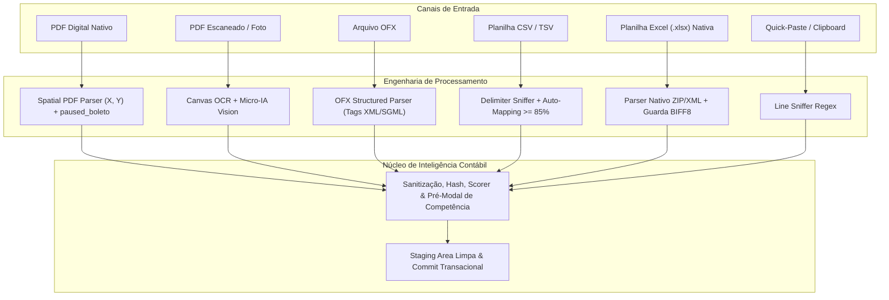
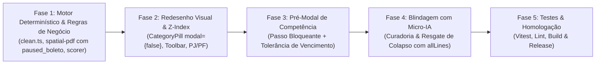

# PLANO MESTRE DE OTIMIZAÇÃO, BLINDAGEM E REFINAMENTO DA IMPORTAÇÃO DE FATURAS

> **Documento Canônico de Arquitetura, UX e Engenharia Financeira**  
> **Versão:** 1.1 (Definitiva e Refinada pós-Fase 0) · **Status:** Pronto para Execução (Aguardando Sinal Verde)  
> **Escopo:** Blindagem Determinística, Resolução das 5 Fragilidades Reais, Matriz Multibancos, Governança Temporal de Ciclos e Experiência de Usuário de Mínima Fricção  
> **Governança:** `AGENTS.md` (§3, §4, §8, §10, §13, §18, §20, §25, §26) · Zero Emojis · TypeScript Estrito · Vitest

---

## 1. SUMÁRIO EXECUTIVO E OBJETIVOS DA ENTREGA

O módulo de importação e conciliação de faturas de cartão de crédito é o componente de maior densidade informacional e sensibilidade operacional do aplicativo. Ele consolida arquivos digitais heterogêneos (PDFs com geometria complexa, planilhas CSV/Excel nativas, extratos OFX, capturas visuais e texto colado) contra o livro razão (*ledger*) local do usuário.

A partir de testes empíricos com faturas reais de mercado e das evidências visuais fornecidas pelo usuário, foram constatadas **cinco fragilidades arquiteturais e ergonômicas críticas**, aprofundadas na auditoria preliminar (Fase 0):
1. **Poluição Visual e Sobrecarga de Controles:** Exibição indevida de filtros e badges PJ/PF em cartões de uso exclusivamente pessoal e containers retangulares vazios na interface.
2. **Bloqueio de Interação no Seletor de Categorias (`CategoryPill`):** O menu suspenso de categorias abria atrás do modal principal em virtude de colisão na escala de `z-index` (`z-dropdown` vs `z-modal`) e risco de captura de foco pelo Radix Dialog.
3. **Divergência Prematura de Competência:** Exibição da tela de conferência com dados confrontados contra o mês errado antes de qualquer confirmação deliberada do usuário, com risco de falsos positivos em cartões com vencimento no mês subsequente (`due_day < closing_day`).
4. **Vazamento Contábil de Quitações de Fatura:** Lançamentos nominais de quitação do mês anterior (ex.: *"Pagamentos Validos Normais"*) sendo importados como compras de cartão de crédito, e termos de saldo/resumo sendo enviados para a aba de ignorados como se fossem amortizações.
5. **Colapso Espacial em PDFs com Boletos na Capa:** O encontro de códigos de barras ou linhas digitáveis na primeira página abortava globalmente a extração via `break`, capturando unicamente o cabeçalho de resumo do cartão como uma compra falsa.

### Princípios Invioláveis desta Otimização
* **Regras de Negócio e Motores Determinísticos em Primeiro Lugar:** Todo comportamento deve ser resolvido prioritariamente por algoritmos determinísticos puros, parsers espaciais e validações matemáticas. A Inteligência Artificial atua como camada secundária não-bloqueante para resgate de anomalias e enriquecimento semântico.
* **Zero Emojis e Design Sóbrio:** Conforme `AGENTS.md` §8, zero caracteres Unicode decorativos ou emoticons. Toda sinalização utiliza ícones `lucide-react` padronizados e tipografia adaptativa tabular.
* **Ergonomia e Mínima Fricção:** Pulo automático de etapas redundantes, zero digitação repetitiva de categorias e contenção estrita de rolagem e viewport.

---

## 2. AUDITORIA FACTUAL DAS 5 FRAGILIDADES CRÍTICAS

### 2.1 Fragilidade 1: Poluição Visual e Excesso de Ruído (Seletores e Badges PJ/PF)
* **Localização no Código:**
  - `src/features/cards/components/statement-reconcile-toolbar.tsx` (linhas 192–218).
  - `src/features/cards/components/statement-reconcile-rows.tsx` (linhas 685–706).
  - `src/features/cards/components/statement-reconcile-step.tsx` (linhas 260–284).
* **Diagnóstico Técnico:**
  O sistema vinculava a exibição dos seletores `Tudo PJ` / `Tudo PF` e dos badges de cada linha exclusivamente à flag global `isBusinessModeEnabled` (se o usuário tem o Modo Negócio ativo na conta). Com isso, ao importar a fatura de um cartão de crédito puramente pessoal (`card.scope === "personal"`), a interface era inundada com botões irrelevantes de escopo e um badge cinza `PF` repetido em dezenas de linhas.
  Além disso, a barra de metadados renderizava um card com borda contendo apenas o botão *"Ajustar colunas"* solitário à direita quando não havia `detectedCardLast4`, gerando uma caixa cinza/branca vazia visualmente desconfortável.

### 2.2 Fragilidade 2: Z-Index Trap e Focus Trap no `CategoryPill`
* **Localização no Código:**
  - `src/features/cards/components/statement-reconcile-rows.tsx` (linhas 80–84).
  - `src/styles/tokens.css` (linhas 22–24: `--z-dropdown: 20; --z-modal: 50;`).
  - `src/components/ui/modal.tsx` (linhas 131–139 e 248–265).
* **Diagnóstico Técnico:**
  O `CategoryPill` utiliza o primitivo `<Popover>` do Radix. O `<PopoverContent>` é montado em um portal acoplado diretamente a `document.body` com a classe `z-dropdown` (`z-index: 20`). O diálogo principal `<Modal size="2xl">` opera em `z-modal` (`z-index: 50`).
  Como consequência, ao clicar no pill de categoria para alterar a classificação de uma compra, o menu suspenso abria fisicamente **atrás do modal**. O usuário não via nada abrir e acreditava que a alteração estava bloqueada, conseguindo editá-la somente ao entrar no formulário inline de edição completa.
  Adicionalmente, se o Popover operasse com `modal={true}`, o `FocusScope` e o lock de rolagem do Radix Dialog pai entrariam em concorrência, prejudicando a digitação no campo de busca e a rolagem da lista de categorias.

### 2.3 Fragilidade 3: Divergência Prematura de Competência e Falsos Conflitos
* **Localização no Código:**
  - `src/features/cards/components/statement-import-dialog.tsx` (linhas 128–169).
  - `src/features/cards/components/use-statement-import.ts` (linhas 430–460).
  - `src/domain/reconciliation/statement-metadata.ts` (linhas 277–298).
* **Diagnóstico Técnico:**
  Quando o arquivo importado pertencia a um mês diferente do modal (ex.: arquivo de Dezembro/2026 aberto na competência Novembro/2026), o hook avançava o fluxo diretamente para `step = "reconcile"`.
  Isso provocava o confronto indevido dos lançamentos da fatura contra as compras já cadastradas em Novembro, gerando alertas falsos de despesas ausentes no app e exibindo um banner amarelo no topo enquanto toda a lista já estava carregada.
  Além disso, em cartões onde o vencimento ocorre no mês subsequente ao fechamento (`due_day < closing_day`, ex.: fecha dia 25/11 e vence dia 05/12), faturas que imprimem *"Fatura de Dezembro — Vencimento 05/12"* disparavam falso conflito contra a competência de consumo (Novembro), mesmo quando 100% das compras pertenciam a Novembro.

### 2.4 Fragilidade 4: Evasão de Quitações e Ruídos de Resumo Contábil
* **Localização no Código:**
  - `src/domain/reconciliation/clean.ts` (linhas 39–53: `UNCONDITIONAL_INVOICE_PAYMENT_PATTERNS`).
  - `src/domain/reconciliation/scorer.ts` (linhas 269–284).
* **Diagnóstico Técnico:**
  Em `clean.ts`, o padrão incondicional de quitação procurava `/\bpag(?:amento)?\s+(?:de\s+)?nominais\b/i`. Em extratos bancários de cartões (especialmente Itaú, Bradesco e Santander), o lançamento de quitação da fatura anterior frequentemente é descrito como `"Pagamentos Validos Normais"` ou `"Pagamento Valido Normal"`.
  Como a linha veio com valor sem sinal negativo explícito no extrato e a descrição continha *"Normais"* em vez de *"Nominais"*, o motor classificou a linha como compra regular (`purchase`). No `scorer.ts`, a linha foi marcada como `status = "unmatched_new"`, com checkbox marcado (`selected: true`), somando R$ 1.431,27 no total a importar.
  Em paralelo, termos como `saldo anterior` e `total da fatura` estavam incluídos em `UNCONDITIONAL_INVOICE_PAYMENT_PATTERNS`, fazendo com que resumos da fatura fossem incorretamente direcionados para a aba de ignorados como se fossem amortizações financeiras.

### 2.5 Fragilidade 5: Colapso Espacial em PDFs com Boletos na Capa
* **Localização no Código:**
  - `src/domain/reconciliation/parsers/spatial-pdf-parser.ts` (linhas 61–63 e 304–310).
  - `src/domain/reconciliation/clean.ts` (linhas 317–323: `SUBCARD_HEADER_REGEX`).
* **Diagnóstico Técnico:**
  Nas faturas brasileiras de cartão de crédito (Rico, XP, Nubank, Itaú, Santander, Inter), o boleto bancário de pagamento com código de barras ou linha digitável fica situado quase sempre na **primeira página**.
  No laço principal de [spatial-pdf-parser.ts](file:///home/gabrielsales/meus_apps/financasnew/src/domain/reconciliation/parsers/spatial-pdf-parser.ts#L305-L307), a linha de código de barras disparava `state = "hard_stop"`, executando um `break` global que abortava a leitura de todas as páginas seguintes e de todas as compras detalhadas abaixo do boleto.
  A única linha capturada antes do boleto foi o cabeçalho de resumo da fatura: `"Cartão: **** **** **** 2107 VISA 15/11/2026 R$ 1.528,54"`. Como tinha data e valor e o regex `isSubcardHeader` não cobria o formato com dois pontos e máscara de asteriscos, essa linha de resumo virou uma compra regular. Como o valor coincidia exatamente com o total oficial impresso da fatura, o Checksum Gate validou com falso positivo (`passed: true`), gerando a tela com 1 único lançamento consolidado espúrio.
  Além disso, a simples remoção do `break` com `shouldDrop: true` na linha do código de barras faria com que as linhas vizinhas do boleto (*"Vencimento"*, *"Data do Documento"*, *"Valor do Documento"*) vazassem como compras falsas caso não fossem suprimidas como um bloco contínuo.

---

## 3. ENGENHARIA DAS SOLUÇÕES PROPOSTAS

### 3.1 Solução para Fragilidade 1: Escopo Misto Estrito, Toolbar Limpa e Chip de Cabeçalho
1. **Regra de Visibilidade de Escopo:**
   - Criar predicado de domínio puro:
     ```ts
     export function shouldDisplayScopeControls(
       cardScope?: "personal" | "business" | "mixed",
       isBusinessModeEnabled?: boolean,
     ): boolean {
       return isBusinessModeEnabled === true && cardScope === "mixed";
     }
     ```
   - Em cartões pessoais (`card.scope === "personal"`) ou exclusivos de empresa (`card.scope === "business"`), os seletores `Tudo PJ` / `Tudo PF` na toolbar e os botões `PF` em cada linha da tabela são **completamente suprimidos**.
2. **Identificação Limpa de Cartão `business` Puro:**
   - Quando `card.scope === "business"`, todas as linhas importadas herdam incondicionalmente `scope: "business"` em [statement-import-helpers.ts](file:///home/gabrielsales/meus_apps/financasnew/src/features/cards/components/statement-import-helpers.ts#L344).
   - Para sinalizar o escopo sem poluição visual, o cabeçalho/subtítulo do modal exibe um chip compacto:
     ```tsx
     <Badge size="xs" variant="portfolio" className="ml-2 font-medium">
       Cartão PJ / Negócio
     </Badge>
     ```
3. **Remoção de Caixa Vazia:**
   - Eliminar o container solto em [statement-reconcile-step.tsx](file:///home/gabrielsales/meus_apps/financasnew/src/features/cards/components/statement-reconcile-step.tsx).
   - O botão *"Ajustar colunas"* passa a ser renderizado de forma contextual na barra superior ao lado do resumo financeiro ou dentro da toolbar de ações. Se `detectedCardLast4` existir, ele é exibido como um chip sutil e informativo.

### 3.2 Solução para Fragilidade 2: Elevação Z-Index e Blindagem contra Focus/Scroll Trap
1. **Correção de Elevação e Coexistência com Radix Dialog:**
   - No `CategoryPill` em [statement-reconcile-rows.tsx](file:///home/gabrielsales/meus_apps/financasnew/src/features/cards/components/statement-reconcile-rows.tsx):
     * Configurar `<Popover open={open} onOpenChange={setOpen} modal={false}>`, impedindo que o popover ative uma camada concorrente de bloqueio de rolagem ou aprisionamento de foco contra o `<Modal>`.
     * No `<PopoverContent>`, aplicar `elevated={true}`, classe `z-floating-tools` (`z-index: 60`), `onOpenAutoFocus={(e) => e.preventDefault()}` e `onCloseAutoFocus={(e) => e.preventDefault()}`.
     * Nos itens de seleção da lista, adicionar `onPointerDown={(e) => e.stopPropagation()}` e `onClick={(e) => e.stopPropagation()}`.
   - Com isso, o menu suspenso flutua perfeitamente acima da janela do modal (`z-modal` = 50), o campo de busca permite digitação fluida e a lista de categorias rola sem travamentos.
2. **Propagação Imediata:**
   - Ao clicar em uma categoria da lista com busca, o callback `onChange(opt.value)` é disparado instantaneamente, fechando o popover e atualizando a linha sem exigir clique no botão de edição.

### 3.3 Solução para Fragilidade 3: Pré-Modal Bloqueante com Tolerância de Fechamento vs Vencimento
1. **Máquina de Estados de Importação:**
   - Adicionar o estado explícito `competence_conflict` no hook [use-statement-import.ts](file:///home/gabrielsales/meus_apps/financasnew/src/features/cards/components/use-statement-import.ts).
   - Após a extração do arquivo (Passo 1), o sistema avalia a discrepância de competência.
2. **Tolerância Inteligente de Vencimento (`due_day < closing_day`):**
   - Se a distribuição de transações indicar com confiança alta (`confidence === "high"`) que as compras pertencem à competência ativa `activeCompetenceMonth` pelo `closing_day` cadastrado, e a discrepância detectada for estritamente de $+1$ mês com `detectedDueDate` nos primeiros dias do mês subsequente ($\le 10$), o sistema entende que se trata da convenção de vencimento do emissor e **não ativa o conflito**, preservando a competência de consumo do usuário.
3. **Interface do Pré-Diálogo de Competência (Conflito Real):**
   - Quando houver divergência real de ciclo, o fluxo pausa antes de montar a Staging Area:
     * **Título:** Divergência de Mês da Fatura
     * **Mensagem:** *"O arquivo anexado refere-se à fatura de **[Mês Detectado, ex.: Dezembro de 2026]**, mas a importação foi iniciada na competência de **[Mês Ativo, ex.: Novembro de 2026]**."*
     * **Botão Primário:** *"Ajustar para [Mês Detectado] e prosseguir"* — atualiza a competência ativa no app e reexecuta `applyReconciliation({ competenceForReconciliation: newMonth })`, recalculando `existingExpenses`, `scorer.ts` e `series-detector.ts` contra o mês correto.
     * **Botão Secundário:** *"Conferir e anexar outro arquivo"* — reseta o arquivo em memória e retorna à tela inicial de upload.
     * **Ação Discreta (Link/Ghost):** *"Manter [Mês Ativo] mesmo assim"* — prossegue na competência atual caso o usuário queira forçar a importação.

### 3.4 Solução para Fragilidade 4: Blindagem Incondicional de Quitações e Isolamento de Resumo
1. **Expansão de Padrões em `clean.ts`:**
   - Atualizar `UNCONDITIONAL_INVOICE_PAYMENT_PATTERNS` para cobrir de forma exaustiva quitações bancárias nominais:
     ```ts
     export const UNCONDITIONAL_INVOICE_PAYMENT_PATTERNS: RegExp[] = [
       /\bpag(?:amentos?|to)?\s+(?:v[aá]lidos?\s+)?(?:normais|nominais)\b/i,
       /\bpag(?:amentos?|to)?\s+(?:efetuados?|recebidos?|parciais?|antecipados?)\b/i,
       /\bpag(?:amentos?|to)?\s*(?:de\s+|da\s+)?fatura\b/i,
       /\bpgto\s*fatura\b/i,
       /\bcr[eé]dito\s+(?:de\s+)?pag(?:amento|to)?\b/i,
       /\bdeb(?:ito)?\s+aut(?:omatico)?\s+cart[aã]o\b/i,
       /\bdebito\s+automatico\s+fatura\b/i,
       /\bpagamento\s+(?:da\s+)?fatura\s+por\s+pix\b/i,
       /\bautopagto\b/i,
     ];
     ```
   - **Pix no Crédito:** Linhas contendo apenas `"pagamento por pix"` permanecem em `CREDIT_ONLY_SETTLEMENT_PATTERNS` (ou exigem `isCredit === true`), preservando compras e transferências realizadas pelo titular via Pix no crédito.
   - **Saldo Anterior e Total da Fatura:** Removidos de `UNCONDITIONAL_INVOICE_PAYMENT_PATTERNS`. São interceptados como **ruído de resumo/cabeçalho** (`isSummaryOrNoiseLine`), sendo sumariamente descartados no parser/pré-processador para **nunca entrarem** na Staging Area nem na aba de ignorados.
2. **Classificação Contábil no Scorer:**
   - Toda linha com `isPayment === true` recebe: `nature = "invoice_payment"`, `selected = false`, `ignoredByDefault = true`, alocada exclusivamente na aba *"Ignorados / Estornos"*.

### 3.5 Solução para Fragilidade 5: Estado `paused_boleto`, Máscaras Flexíveis e Detecção de Colapso
1. **Pausa de Bloco de Boleto (`paused_boleto`) com Suporte a Páginas:**
   - Adicionar a propriedade `pageNumber: number` no tipo `SpatialPdfLine`.
   - Ao encontrar a linha digitável ou código de barras (`HARD_STOP_BARCODE_REGEX`), a máquina de estados não executa `break`. Em vez disso, transiciona para `state = "paused_boleto"` e grava a página corrente (`boletoPage = line.pageNumber`).
   - O estado `paused_boleto` descarta o bloco do boleto (`shouldDrop: true`) e é desativado quando:
     * A página virar (`line.pageNumber > boletoPage`); OU
     * Encontrar uma seção válida de compras (`SECTION_START_REGEX`: *Lançamentos, Compras, Detalhamento, Transações*).
   - Adicionar predicado `isBoletoFieldNoise` (*vencimento, data do documento, valor do documento, sacado, cedente, nosso número, ficha de compensação, autenticação mecânica*) para impedir vazamento de linhas residuais do boleto como compras.
2. **Flexibilização de Máscaras em `SUBCARD_HEADER_REGEX`:**
   - Atualizar a expressão regular em `clean.ts`:
     ```ts
     const SUBCARD_HEADER_REGEX =
       /^(?:(?:cart[aã]o(?:\s*:)?|final|titular|adicional)\s*(?:[•*xX.-]{3,16}[\s*]*\d{4}|\b\d{4}\b)|(?:visa|mastercard|elo|amex)\s+.*final\s+\d{4}|lan[çc]amentos\s+do\s+cart[aã]o)\b/i;
     ```
   - Em `extractTransactionsFromSpatialLines`, se uma linha for classificada como `subcard_header`, ela alimenta os metadados do cartão (`detectedCardLast4`), mas **nunca é adicionada ao array `transactions`**.
3. **Detector Determinístico de Anomalia de Colapso com Input Integral:**
   - Condição de Colapso Real: $\le 2$ transações extraídas, documento com densidade textual alta (`allLines.length > 15`) e a linha resultante apresenta descrição característica de cartão ou fatura (`isSubcardHeader`).
   - Diferenciação de Compra Única Legítima: Se o documento tem poucas linhas úteis e a descrição é de estabelecimento comum (`"UBER"`, `"POSTO IPIRANGA"`), o fluxo transcorre normalmente sem falso alarme.
   - Fallback de Resgate por Micro-IA: No colapso real, o input enviado ao orquestrador inteligente (`line_curator`) consiste no **conjunto integral de linhas espaciais pré-filtro (`allLines`)** ou no texto completo reconstruído das páginas, permitindo isolar as compras detalhadas que haviam sido suprimidas.

---

## 4. GOVERNANÇA TEMPORAL DE FATURAS: CICLOS, DATAS E PARCELAMENTOS

```
Mês M (Outubro)                   Mês M+1 (Novembro)                 Mês M+2 (Dezembro)
--------------------------------------------------------------------------------------
[... Compra 15/10 ...] | Fechamento 25/10 | [... Compra 28/10 ...] | Vencimento 05/11
       |                       |                      |                     |
  Fatura Out/2026         Corte do Ciclo        Fatura Nov/2026       Pagamento Real
```

### 4.1 A Trinca Temporal Canônica
Para cada despesa no cartão de crédito, o sistema opera sob três referências temporais estritas:
1. **Data da Despesa ($D$ — `date`):** O dia calendário exato em que a transação física ou digital ocorreu (ex.: `2026-10-28`). Essencial para auditoria, relatórios diários de consumo e conciliação contra comprovantes bancários.
2. **Data de Fechamento / Corte ($C$ — `closing_day`):** O dia do mês em que o banco emissor encerra o ciclo de faturamento e emite o boleto.
3. **Data de Vencimento ($V$ — `due_day`):** O dia limite para quitação da fatura sem incidência de juros do rotativo.
4. **Competência da Fatura ($M$ — `bill_competence`):** O mês contábil de competência ao qual a fatura pertence no aplicativo (formato `YYYY-MM`).

### 4.2 Regra de Atribuição de Competência para Compras Pós-Fechamento
A função de domínio canônica `resolveBillCompetence(transactionDate, closingDay)` em `src/domain/competence/` rege a atribuição estrita de competência:
$$\text{competência} = \begin{cases} \text{Mês}(D), & \text{se } \text{Dia}(D) < C \\ \text{Mês}(D) + 1, & \text{se } \text{Dia}(D) \ge C \end{cases}$$

* **Exemplo Prático:** Cartão com fechamento no dia 20.
  - Compra em `2026-10-18` $\rightarrow$ Fatura de Outubro de 2026 (`2026-10`).
  - Compra em `2026-10-22` $\rightarrow$ Fatura de Novembro de 2026 (`2026-11`).
* **Consequência na Importação:** Quando o usuário importa a fatura de Novembro, o extrato trará compras datadas entre `22/10` e `19/11`. O motor de inferência de competência (`statement-metadata.ts`) considera o `closing_day` cadastrado no cartão para não confundir a fatura de Novembro com a de Outubro.

### 4.3 Faturas com Vencimento no Mês Subsequente
Bancos como Nubank e Itaú frequentemente fecham a fatura no final do mês e colocam o vencimento nos primeiros dias do mês seguinte (ex.: fecha dia 28/10 e vence dia 05/11).
* **Diretriz de Produto:** No produto, a competência é identificada pelo **mês de referência do consumo e fechamento da fatura**, e não pelo dia de pagamento. O detector de metadados pondera o dia de vencimento em relação ao fechamento para suprimir falsos conflitos.

### 4.4 Compras Parceladas: Parcela Ativa vs Projeção Futura
Ao importar uma compra parcelada presente no extrato (ex.: `"PARC 02/06 MAGAZINE LUIZA R$ 150,00"`):
1. **Parcela Ativa ($K = 2$):** A data gravada é a data da transação indicada no extrato, atribuída à `bill_competence` ativa da fatura.
2. **Projeções Futuras ($K+1 \dots N$):** O motor de projeção de parcelamentos gera as parcelas $3, 4, 5, 6$ ancoradas nas competências subsequentes (`M+1`, `M+2`, `M+3`, `M+4`), preservando o valor exato da parcela (em centavos inteiros, sem inflação por arredondamento) e sem aplicar `statement_hash` nas parcelas futuras (o hash pertence unicamente à parcela real do extrato).

### 4.5 Transações Internacionais e Fuso Horário
* Faturas com transações internacionais trazem data de processamento com fuso horário e linhas de detalhamento cambial (`fx_detail`, ex.: cotação PTAX, IOF de 4,38%, valor original em USD).
* O motor espacial funde a linha de cotação à compra principal e isola o IOF como encargo tributário (`fee_or_tax`), mantendo a integridade da data brasileira.

---

## 5. MATRIZ DE SUPORTE MULTIBANCOS BRASILEIROS

| Instituição | Padrão Visual do PDF | Formato de Parcelas | Particularidades de Quitação e Ruído | Heurística Recomendada |
|---|---|---|---|---|
| **Nubank** | Coluna única, limpo, alta conformidade geométrica | `01/05` ou `(1/5)` ao fim da descrição | Quitação vem como *"Pagamento recebido"* com crédito | Extrator padrão de 1 coluna; Checksum Gate imediato |
| **Itaú / Personnalité / Latam Pass** | Cabeçalho denso, boleto na capa, multi-cartões (Titular + Adicionais) | `PARC 03/10` ou `03/10` | Quitação expressa como *"Pagamentos Validos Normais"* ou *"Pagto Tit Nominal"* | Supressão de boleto na capa com `paused_boleto`; agregação por cartão |
| **Bradesco / Bradescard** | Duas colunas densas, seções de encargos e limites antes das compras | `PARC 02/06` ou `PC 02/06` | Datas em `DD/MM` sem ano explícito; tabela de simulação na base | Gutter bimodal relativo; inferência de ano pela competência ativa |
| **Santander** | Tabela estruturada com linhas cinzas, boletos no rodapé ou capa | `PARC. 04/12` | Seção de *"Total a Pagar"* com opções de rotativo e parcelamento | Barreira 3 anti-simulação; descarte de linhas com `% a.m.` |
| **XP / Rico / Clear** | Resumo consolidado do cartão no topo (`**** 2107`), boleto na página 1 | `PARC=01/10` ou `PARC 01/10` | Cabeçalho do cartão com valor total consolidado | Descarte de `subcard_header`; leitura contínua com `paused_boleto` |
| **Banco Inter** | Tabela limpa, sem grades pesadas, resumo de cashback e IOF | `Parcela 02 de 10` ou `02/10` | Estornos e cashback lançados com sinal de crédito | Separação entre reembolso e compra; suporte nativo a OFX |
| **C6 Bank** | Divisão por titular e cartão adicional, pontos Átomos no topo | `(03/06)` no meio da descrição | Lançamentos de C6 Tag e pedágio agrupados | Normalização de adquirente; descarte de resumo de pontos |
| **BTG Pactual** | Relatório executivo, moeda estrangeira detalhada inline | `PARC 01/03` | Cotação de dólar e spread em linha imediatamente inferior | Anexação automática de `fx_detail` na compra correspondente |
| **Banco do Brasil (Ourocard)** | Formato tabular tradicional com colunas fixas: Data, Histórico, Valor | `PARC 02/05` | Lançamentos de juros de mora e anuidade destacados | Mapeamento direto de colunas; classificação de encargos (`fee_or_tax`) |
| **Caixa Econômica** | Formato clássico de extrato bancário | `01/10` | Linhas de saldo anterior e encargos contratuais | Barreira 1 de seções com descarte de saldos anteriores |

---

## 6. MATRIZ DE TIPOS DE ARQUIVO E CANAIS DE INGESTÃO



### 6.1 PDF Digital Nativo
* **Motor:** `spatial-pdf-parser.ts` via `unpdf`.
* **Heurística:** Extração cartesiana $(X, Y)$, agrupamento com $\Delta Y \le 2.5\text{px}$, Gutter Bimodal relativo, estado `paused_boleto` associado ao número da página e 4 Barreiras Anti-Ruído.
* **Garantia:** Zero perda de compras em PDFs de duas colunas e zero travamento por boletos.

### 6.2 Arquivos OFX (Open Financial Exchange)
* **Motor:** `ofx-parser.ts`.
* **Vantagem:** Formato estruturado puro com tags canônicas (`<STMTTRN>`, `<TRNTYPE>`, `<TRNAMT>`, `<FITID>`).
* **Experiência:** Salto imediato de mapeamento; 100% de confiança determinística sem ambiguidade.

### 6.3 Planilhas CSV / TSV
* **Motor:** `csv-parser.ts`.
* **Heurística:** Detecção automática do delimitador (vírgula, ponto-e-vírgula ou tabulação) e pontuação de cabeçalhos. Se a confiança determinística for $\ge 85\%$, salta o Passo 2 de mapeamento e abre direto a conferência.

### 6.4 Planilhas Excel (.xlsx) via Parser Nativo ZIP/XML
* **Motor:** `spreadsheet-parser.ts` próprio (zero-dependency).
* **Engenharia:** Descompactação e parsing streaming de `xl/worksheets/sheet1.xml` e `xl/sharedStrings.xml` diretamente em TypeScript.
* **Segurança:** Sanitização estrita contra injeção de fórmulas (`=`, `@`, `+`, `-`) e detecção imediata de arquivos binários legados pré-2003 via magic bytes `isBiff8Excel` (`0xD0, 0xCF, 0x11, 0xE0`), instruindo o usuário a salvar como `.xlsx`.

### 6.5 Texto Colado / Clipboard (Quick-Paste)
* **Motor:** `text-parser.ts`.
* **Uso:** O usuário copia o extrato diretamente do internet banking ou app do banco e cola na área de transferência. O motor isola blocos contendo datas e valores em centavos.

---

## 7. CATÁLOGO DE SUGESTÕES DE UX E OTIMIZAÇÕES DE ERGONOMIA

### 7.1 Pulo Automático Inteligente (Zero Cliques Redundantes)
Quando o arquivo é um OFX, PDF com mapeamento determinístico ou CSV com colunas padronizadas (`Data`, `Estabelecimento`, `Valor`), o modal deve pular diretamente do upload para a Staging Area. O botão discreto *"Ajustar colunas"* permanece acessível para correções pontuais, eliminando uma tela intermediária inteira em mais de 90% dos casos.

### 7.2 Propagação Rápida de Categorias com Aprendizado
Ao trocar a categoria de uma compra recorrente (ex.: mudar *"Uber"* de *"Outros"* para *"Transporte"*), o sistema deve identificar se existem outras compras do mesmo estabelecimento na fatura e oferecer um banner suave de confirmação: *"Aplicar Transporte às outras 3 compras de Uber?"*. Com um único clique, todas são atualizadas e a regra é salva no catálogo local para as próximas faturas.

### 7.3 Modo Comparativo Limpo (Diferencial Visual Claro)
A separação por abas na Staging Area deve manter a hierarquia cognitiva estrita:
* **Novos:** Lançamentos do extrato que não constavam no aplicativo (selecionados por padrão).
* **Sugestões:** Compras cujo valor ou data são muito semelhantes a lançamentos manuais já existentes (com botão direto de *"Vincular e ajustar"*).
* **Conciliados:** Compras com equivalência exata (já desmarcadas por padrão para não duplicar).
* **No App apenas:** Despesas que foram registradas manualmente no app mas não vieram na fatura (alertando sobre possíveis compras canceladas ou lançadas no cartão errado).

### 7.4 Auto-Vínculo de Estornos e Reembolsos
Reembolsos ou créditos na fatura (ex.: estorno do iFood de R$ 45,00) devem ser destacados visualmente em tom positivo suave (`text-positive-strong`), com a opção direta de abater uma despesa específica ou gerar um crédito de compensação na fatura.

### 7.5 Ergonomia Mobile-First e Acessibilidade
* Proibição estrita de `autoFocus` para prevenir saltos de tela no teclado virtual (`AGENTS.md` §20).
* Fonte mínima de 16px nos inputs no mobile para impedir o zoom automático do iOS Safari.
* Toque de gaveta inferior (*Bottom Sheet*) com alça deslizante contínua no smartphone e modal centralizado `size="2xl"` no desktop (`AGENTS.md` §18).

---

## 8. PLANO DE IMPLEMENTAÇÃO FASEADO E DEFINITION OF DONE



### Fase 1: Motor Determinístico & Regras de Negócio
- [ ] Atualizar `UNCONDITIONAL_INVOICE_PAYMENT_PATTERNS` em `clean.ts` com suporte a *"Pagamentos Validos Normais"*, variações de quitação e pagamentos de fatura.
- [ ] Manter `pagamento por pix` restrito a créditos ou exigindo a palavra *"fatura"*, prevenindo bloqueio de Pix no Crédito.
- [ ] Descartar termos de `saldo anterior` e `total da fatura` como ruído de resumo antes da Staging Area, sem enviá-los para a aba de ignorados.
- [ ] Atualizar `SUBCARD_HEADER_REGEX` em `clean.ts` para cobrir máscaras com `•`, `*`, `x`, `X`, `.`, `-` e formatos sem prefixo estrito `"Cartão"`.
- [ ] Adicionar `pageNumber: number` em `SpatialPdfLine` e implementar o estado `paused_boleto` em `spatial-pdf-parser.ts`, com reativação na virada de página ou seção válida.
- [ ] Implementar filtro anti-ruído `isBoletoFieldNoise` em `spatial-pdf-parser.ts`.
- [ ] Descartar linhas de cabeçalho de cartão da lista de compras em `spatial-pdf-parser.ts`, aproveitando-as unicamente para preencher `detectedCardLast4`.
- [ ] Adicionar testes de unidade em `clean.test.ts` e `spatial-pdf-parser.test.ts` cobrindo faturas reais da Rico e quitações do Itaú.

### Fase 2: Redesenho Visual, Eliminação de Ruído e Z-Index
- [ ] Configurar `<Popover modal={false}>` no `CategoryPill` em `statement-reconcile-rows.tsx` com `elevated={true}` e classe `z-floating-tools`.
- [ ] Adicionar `onOpenAutoFocus={(e) => e.preventDefault()}` e `stopPropagation` nos itens da lista para blindagem contra foco/scroll trap do diálogo pai.
- [ ] Ocultar seletores `Tudo PJ` / `Tudo PF` e badges `PF` das linhas quando `card.scope !== "mixed"` em `statement-reconcile-toolbar.tsx` e `statement-reconcile-rows.tsx`.
- [ ] Exibir chip compacto `<Badge size="xs" variant="portfolio">Cartão PJ / Negócio</Badge>` no cabeçalho quando `card.scope === "business"`.
- [ ] Eliminar o container vazio de metadados em `statement-reconcile-step.tsx`, integrando *"Ajustar colunas"* de forma limpa.

### Fase 3: Pré-Modal Bloqueante de Divergência de Competência
- [ ] Criar o estado `step = "competence_conflict"` em `use-statement-import.ts`.
- [ ] Implementar regra de tolerância de vencimento no mês subsequente (`due_day < closing_day`) para suprimir falsos conflitos.
- [ ] Interromper o avanço automático para `reconcile` quando houver discrepância real de mês detectada.
- [ ] Renderizar o componente de confirmação de competência em `statement-import-dialog.tsx` com as opções de ajuste imediato (reexecutando o scorer na nova competência) ou troca de arquivo.

### Fase 4: Blindagem com Micro-IA (Curadoria e Resgate)
- [ ] Implementar detector de anomalia de colapso de resumo ($\le 2$ linhas iguais ao total da fatura, alta densidade textual `allLines.length > 15`, descrição de cabeçalho de cartão).
- [ ] Acionar o fallback inteligente via `line_curator` enviando as **linhas pré-filtro integrais (`allLines`)** para resgate das compras suprimidas.
- [ ] Expandir o categorizador semântico para reforçar a marcação de pagamentos atípicos.

### Fase 5: Validação, Testes Automatizados e Homologação
- [ ] Executar suíte completa de testes (`npm run test`).
- [ ] Executar checagem de tipos estrita (`npm run typecheck`).
- [ ] Executar validação de padrões e lint (`npm run lint`).
- [ ] Validar a ausência de emojis e conformidade com `AGENTS.md`.

---

### Definition of Done (DoD)
1. Fatura da Rico em PDF extrai 100% das compras individuais, sem colapsar no total consolidado do cartão.
2. Lançamentos de quitação como *"Pagamentos Validos Normais"* são identificados como pagamentos, desmarcados por padrão e alocados na aba de ignorados.
3. Cartões pessoais não exibem botões nem badges PJ/PF em nenhum local do modal.
4. O seletor de categorias abre perfeitamente acima do modal e atualiza a categoria em 1 clique sem travamento de foco ou scroll.
5. Faturas com divergência real de mês exibem o diálogo prévio bloqueante antes de carregar a lista de conferência, sem falsos alarmes em faturas que vencem no início do mês seguinte.
6. A documentação técnica reflete com 100% de exatidão o parser nativo ZIP/XML próprio para planilhas `.xlsx`.
7. Todos os testes unitários e de integração passam com 100% de sucesso.
